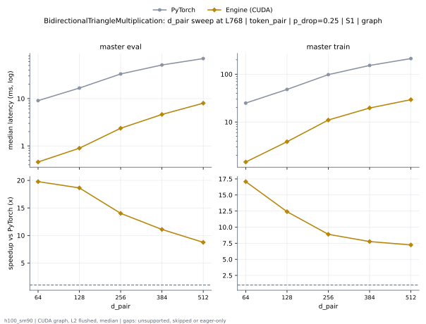

# BidirectionalTriangleMultiplication on h100_sm90

Generated by `python -m foldjet_engine.measure.plot` from speed tokens `judge/tokens/h100_sm90/`; do not edit.

### L sweep: token_pair | d_pair=128;p_drop=0.25 | S1 | graph

**master eval** (median ms; x = speedup vs PyTorch)

| L | PyTorch | Engine (Triton) | Engine (CUDA) |
|---|---|---|---|
| 128 | 0.3124 | 0.09602 (3.25x) | 0.04226 (7.39x) |
| 256 | 1.159 | 0.2353 (4.92x) | 0.119 (9.74x) |
| 384 | 2.567 | 0.471 (5.45x) | 0.2331 (11.01x) |
| 512 | 4.908 | 0.7758 (6.33x) | 0.4033 (12.17x) |
| 640 | 10.04 | 1.218 (8.24x) | 0.6145 (16.34x) |
| 768 | 16.67 | 1.712 (9.74x) | 0.8948 (18.63x) |

**master train** (median ms; x = speedup vs PyTorch)

| L | PyTorch | Engine (Triton) | Engine (CUDA) |
|---|---|---|---|
| 128 | 1.009 | 0.3175 (3.18x) | 0.2082 (4.84x) |
| 256 | 3.704 | 0.8736 (4.24x) | 0.496 (7.47x) |
| 384 | 7.292 | 1.736 (4.20x) | 0.9515 (7.66x) |
| 512 | 13.94 | 2.949 (4.73x) | 1.66 (8.40x) |
| 640 | 28.81 | 4.721 (6.10x) | 2.75 (10.48x) |
| 768 | 47.98 | 6.766 (7.09x) | 3.868 (12.41x) |

### L sweep: token_pair | d_pair=256;p_drop=0.25 | S1 | graph

**master eval** (median ms; x = speedup vs PyTorch)

| L | PyTorch | Engine (Triton) | Engine (CUDA) |
|---|---|---|---|
| 128 | 0.5459 | 0.1815 (3.01x) | 0.0764 (7.14x) |
| 256 | 2.108 | 0.5403 (3.90x) | 0.2622 (8.04x) |
| 384 | 4.72 | 1.156 (4.08x) | 0.548 (8.61x) |
| 512 | 9.256 | 1.976 (4.69x) | 0.9693 (9.55x) |
| 640 | 19.6 | 3.077 (6.37x) | 1.543 (12.70x) |
| 768 | 33.08 | 4.431 (7.47x) | 2.36 (14.02x) |

**master train** (median ms; x = speedup vs PyTorch)

| L | PyTorch | Engine (Triton) | Engine (CUDA) |
|---|---|---|---|
| 128 | 1.724 | 0.5623 (3.07x) | 0.4526 (3.81x) |
| 256 | 6.592 | 1.796 (3.67x) | 1.386 (4.76x) |
| 384 | 13.91 | 3.74 (3.72x) | 2.668 (5.22x) |
| 512 | 27.33 | 6.509 (4.20x) | 4.884 (5.60x) |
| 640 | 58.22 | 11.14 (5.23x) | 7.643 (7.62x) |
| 768 | 97.79 | 16.1 (6.07x) | 11.01 (8.89x) |

### L sweep: token_pair | d_pair=384;p_drop=0.25 | S1 | graph

**master eval** (median ms; x = speedup vs PyTorch)

| L | PyTorch | Engine (Triton) | Engine (CUDA) |
|---|---|---|---|
| 128 | 0.8358 | 0.3147 (2.66x) | 0.1459 (5.73x) |
| 256 | 3.156 | 0.9447 (3.34x) | 0.5046 (6.25x) |
| 384 | 7.111 | 2.112 (3.37x) | 1.088 (6.54x) |
| 512 | 13.93 | 3.611 (3.86x) | 2.012 (6.92x) |
| 640 | 30.52 | 5.764 (5.30x) | 3.253 (9.38x) |
| 768 | 51.25 | 8.2 (6.25x) | 4.62 (11.09x) |

**master train** (median ms; x = speedup vs PyTorch)

| L | PyTorch | Engine (Triton) | Engine (CUDA) |
|---|---|---|---|
| 128 | 2.558 | 0.9449 (2.71x) | 0.7159 (3.57x) |
| 256 | 9.633 | 3.059 (3.15x) | 2.313 (4.17x) |
| 384 | 21.03 | 6.627 (3.17x) | 4.65 (4.52x) |
| 512 | 41.61 | 11.69 (3.56x) | 8.749 (4.76x) |
| 640 | 90.71 | 19.6 (4.63x) | 13.91 (6.52x) |
| 768 | 152.3 | 28.43 (5.36x) | 19.63 (7.76x) |

### L sweep: token_pair | d_pair=512;p_drop=0.25 | S1 | graph

**master eval** (median ms; x = speedup vs PyTorch)

| L | PyTorch | Engine (Triton) | Engine (CUDA) |
|---|---|---|---|
| 128 | 1.135 | 0.4938 (2.30x) | 0.2921 (3.89x) |
| 256 | 4.308 | 1.639 (2.63x) | 0.8968 (4.80x) |
| 384 | 9.853 | 3.718 (2.65x) | 1.872 (5.26x) |
| 512 | 19.24 | 6.519 (2.95x) | 3.53 (5.45x) |
| 640 | 41.85 | 10.51 (3.98x) | 5.652 (7.40x) |
| 768 | 69.94 | 15.17 (4.61x) | 7.99 (8.75x) |

**master train** (median ms; x = speedup vs PyTorch)

| L | PyTorch | Engine (Triton) | Engine (CUDA) |
|---|---|---|---|
| 128 | 3.348 | 1.355 (2.47x) | 1.117 (3.00x) |
| 256 | 12.82 | 4.561 (2.81x) | 3.684 (3.48x) |
| 384 | 28.72 | 9.984 (2.88x) | 7.038 (4.08x) |
| 512 | 57.09 | 17.77 (3.21x) | 14.11 (4.05x) |
| 640 | 125.2 | 32.5 (3.85x) | 22.43 (5.58x) |
| 768 | 212 | 58.63 (3.62x) | 29.31 (7.23x) |

### L sweep: token_pair | d_pair=64;p_drop=0.25 | S1 | graph

**master eval** (median ms; x = speedup vs PyTorch)

| L | PyTorch | Engine (Triton) | Engine (CUDA) |
|---|---|---|---|
| 128 | 0.2117 | 0.06842 (3.09x) | 0.02698 (7.85x) |
| 256 | 0.6586 | 0.1155 (5.70x) | 0.06026 (10.93x) |
| 384 | 1.518 | 0.2112 (7.19x) | 0.1208 (12.56x) |
| 512 | 2.836 | 0.3329 (8.52x) | 0.2047 (13.85x) |
| 640 | 5.484 | 0.4868 (11.27x) | 0.3124 (17.56x) |
| 768 | 9.046 | 0.6735 (13.43x) | 0.4575 (19.77x) |

**master train** (median ms; x = speedup vs PyTorch)

| L | PyTorch | Engine (Triton) | Engine (CUDA) |
|---|---|---|---|
| 128 | 0.6684 | 0.221 (3.02x) | 0.107 (6.24x) |
| 256 | 2.252 | 0.4678 (4.81x) | 0.2087 (10.79x) |
| 384 | 4.039 | 0.9093 (4.44x) | 0.397 (10.17x) |
| 512 | 7.553 | 1.484 (5.09x) | 0.646 (11.69x) |
| 640 | 14.97 | 2.277 (6.57x) | 0.9908 (15.10x) |
| 768 | 24.88 | 3.207 (7.76x) | 1.457 (17.07x) |

### d_pair sweep at L768: token_pair | p_drop=0.25 | S1 | graph

**master eval** (median ms; x = speedup vs PyTorch)

| d_pair | PyTorch | Engine (Triton) | Engine (CUDA) |
|---|---|---|---|
| 64 | 9.046 | 0.6735 (13.43x) | 0.4575 (19.77x) |
| 128 | 16.67 | 1.712 (9.74x) | 0.8948 (18.63x) |
| 256 | 33.08 | 4.431 (7.47x) | 2.36 (14.02x) |
| 384 | 51.25 | 8.2 (6.25x) | 4.62 (11.09x) |
| 512 | 69.94 | 15.17 (4.61x) | 7.99 (8.75x) |

**master train** (median ms; x = speedup vs PyTorch)

| d_pair | PyTorch | Engine (Triton) | Engine (CUDA) |
|---|---|---|---|
| 64 | 24.88 | 3.207 (7.76x) | 1.457 (17.07x) |
| 128 | 47.98 | 6.766 (7.09x) | 3.868 (12.41x) |
| 256 | 97.79 | 16.1 (6.07x) | 11.01 (8.89x) |
| 384 | 152.3 | 28.43 (5.36x) | 19.63 (7.76x) |
| 512 | 212 | 58.63 (3.62x) | 29.31 (7.23x) |

