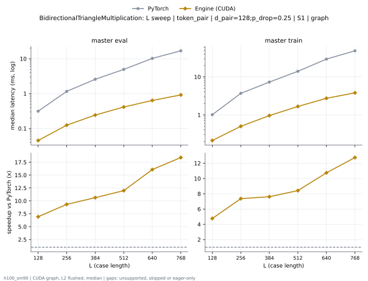
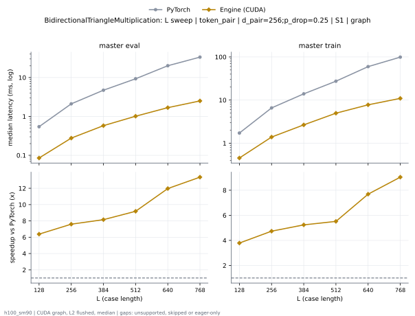
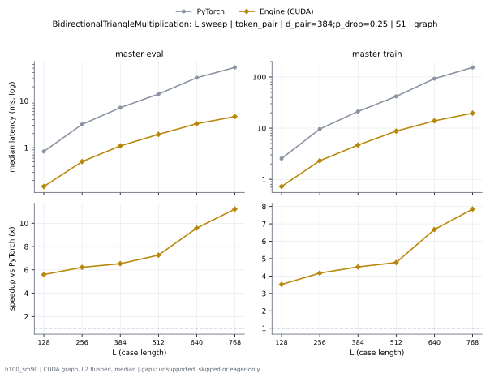
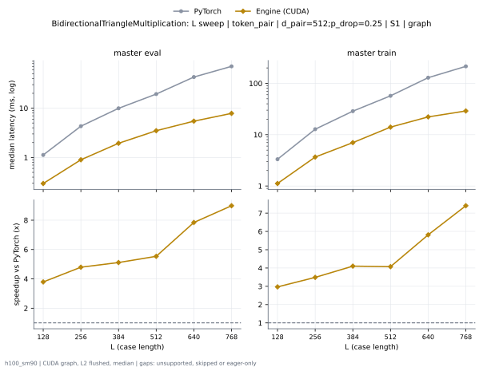
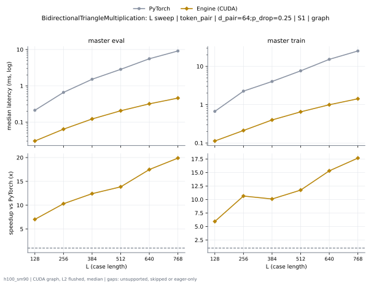
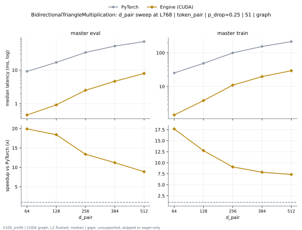

# BidirectionalTriangleMultiplication on h100_sm90

Generated by `python -m miniworld_engine.measure.plot` from speed tokens `judge/tokens/h100_sm90/`; do not edit.

### L sweep: token_pair | d_pair=128;p_drop=0.25 | S1 | graph

**master eval** (median ms; x = speedup vs PyTorch)

| L | PyTorch | Engine (Triton) | Engine (CUDA) |
|---|---|---|---|
| 128 | 0.313 | 0.09654 (3.24x) | 0.04538 (6.90x) |
| 256 | 1.158 | 0.2365 (4.90x) | 0.1238 (9.35x) |
| 384 | 2.59 | 0.4712 (5.50x) | 0.2415 (10.73x) |
| 512 | 4.943 | 0.7717 (6.41x) | 0.4133 (11.96x) |
| 640 | 10.23 | 1.195 (8.56x) | 0.6412 (15.95x) |
| 768 | 16.85 | 1.694 (9.95x) | 0.914 (18.43x) |

**master train** (median ms; x = speedup vs PyTorch)

| L | PyTorch | Engine (Triton) | Engine (CUDA) |
|---|---|---|---|
| 128 | 1.013 | 0.3175 (3.19x) | 0.2119 (4.78x) |
| 256 | 3.695 | 0.8726 (4.23x) | 0.502 (7.36x) |
| 384 | 7.302 | 1.731 (4.22x) | 0.96 (7.61x) |
| 512 | 14.03 | 2.951 (4.75x) | 1.651 (8.49x) |
| 640 | 29.37 | 4.721 (6.22x) | 2.752 (10.67x) |
| 768 | 48.51 | 6.746 (7.19x) | 3.888 (12.48x) |

### L sweep: token_pair | d_pair=256;p_drop=0.25 | S1 | graph

**master eval** (median ms; x = speedup vs PyTorch)

| L | PyTorch | Engine (Triton) | Engine (CUDA) |
|---|---|---|---|
| 128 | 0.5426 | 0.1819 (2.98x) | 0.08485 (6.40x) |
| 256 | 2.097 | 0.5366 (3.91x) | 0.2762 (7.59x) |
| 384 | 4.722 | 1.151 (4.10x) | 0.58 (8.14x) |
| 512 | 9.295 | 1.977 (4.70x) | 1.031 (9.02x) |
| 640 | 20.11 | 3.095 (6.50x) | 1.672 (12.03x) |
| 768 | 33.48 | 4.418 (7.58x) | 2.415 (13.86x) |

**master train** (median ms; x = speedup vs PyTorch)

| L | PyTorch | Engine (Triton) | Engine (CUDA) |
|---|---|---|---|
| 128 | 1.717 | 0.563 (3.05x) | 0.4529 (3.79x) |
| 256 | 6.57 | 1.788 (3.67x) | 1.388 (4.73x) |
| 384 | 13.95 | 3.749 (3.72x) | 2.677 (5.21x) |
| 512 | 27.4 | 6.516 (4.21x) | 4.951 (5.53x) |
| 640 | 59.7 | 11.12 (5.37x) | 7.744 (7.71x) |
| 768 | 98.96 | 16.16 (6.12x) | 10.88 (9.10x) |

### L sweep: token_pair | d_pair=384;p_drop=0.25 | S1 | graph

**master eval** (median ms; x = speedup vs PyTorch)

| L | PyTorch | Engine (Triton) | Engine (CUDA) |
|---|---|---|---|
| 128 | 0.8348 | 0.3163 (2.64x) | 0.1491 (5.60x) |
| 256 | 3.153 | 0.9484 (3.32x) | 0.5067 (6.22x) |
| 384 | 7.152 | 2.116 (3.38x) | 1.092 (6.55x) |
| 512 | 14.02 | 3.619 (3.87x) | 1.956 (7.17x) |
| 640 | 31.17 | 5.763 (5.41x) | 3.263 (9.55x) |
| 768 | 51.79 | 8.246 (6.28x) | 4.647 (11.14x) |

**master train** (median ms; x = speedup vs PyTorch)

| L | PyTorch | Engine (Triton) | Engine (CUDA) |
|---|---|---|---|
| 128 | 2.55 | 0.9453 (2.70x) | 0.7236 (3.52x) |
| 256 | 9.618 | 3.075 (3.13x) | 2.313 (4.16x) |
| 384 | 21.15 | 6.648 (3.18x) | 4.665 (4.53x) |
| 512 | 41.82 | 11.79 (3.55x) | 8.784 (4.76x) |
| 640 | 92.75 | 19.64 (4.72x) | 13.79 (6.73x) |
| 768 | 154.2 | 28.55 (5.40x) | 19.45 (7.93x) |

### L sweep: token_pair | d_pair=512;p_drop=0.25 | S1 | graph

**master eval** (median ms; x = speedup vs PyTorch)

| L | PyTorch | Engine (Triton) | Engine (CUDA) |
|---|---|---|---|
| 128 | 1.126 | 0.4943 (2.28x) | 0.297 (3.79x) |
| 256 | 4.312 | 1.593 (2.71x) | 0.899 (4.80x) |
| 384 | 9.937 | 3.712 (2.68x) | 1.943 (5.11x) |
| 512 | 19.33 | 6.548 (2.95x) | 3.491 (5.54x) |
| 640 | 42.8 | 10.79 (3.97x) | 5.457 (7.84x) |
| 768 | 70.52 | 15.25 (4.62x) | 7.849 (8.98x) |

**master train** (median ms; x = speedup vs PyTorch)

| L | PyTorch | Engine (Triton) | Engine (CUDA) |
|---|---|---|---|
| 128 | 3.322 | 1.357 (2.45x) | 1.119 (2.97x) |
| 256 | 12.79 | 4.565 (2.80x) | 3.666 (3.49x) |
| 384 | 28.73 | 9.976 (2.88x) | 7.004 (4.10x) |
| 512 | 57.19 | 17.78 (3.22x) | 14.04 (4.07x) |
| 640 | 129.1 | 32.62 (3.96x) | 22.21 (5.81x) |
| 768 | 214.7 | 58.85 (3.65x) | 29.01 (7.40x) |

### L sweep: token_pair | d_pair=64;p_drop=0.25 | S1 | graph

**master eval** (median ms; x = speedup vs PyTorch)

| L | PyTorch | Engine (Triton) | Engine (CUDA) |
|---|---|---|---|
| 128 | 0.2124 | 0.06901 (3.08x) | 0.03027 (7.01x) |
| 256 | 0.6593 | 0.1158 (5.69x) | 0.06395 (10.31x) |
| 384 | 1.518 | 0.2115 (7.18x) | 0.1224 (12.40x) |
| 512 | 2.858 | 0.3329 (8.59x) | 0.206 (13.87x) |
| 640 | 5.575 | 0.4864 (11.46x) | 0.3186 (17.50x) |
| 768 | 9.15 | 0.673 (13.60x) | 0.4595 (19.91x) |

**master train** (median ms; x = speedup vs PyTorch)

| L | PyTorch | Engine (Triton) | Engine (CUDA) |
|---|---|---|---|
| 128 | 0.6686 | 0.2223 (3.01x) | 0.1125 (5.95x) |
| 256 | 2.253 | 0.4671 (4.82x) | 0.2115 (10.65x) |
| 384 | 4.035 | 0.906 (4.45x) | 0.3991 (10.11x) |
| 512 | 7.625 | 1.481 (5.15x) | 0.6487 (11.75x) |
| 640 | 15.19 | 2.268 (6.70x) | 0.992 (15.32x) |
| 768 | 25.14 | 3.198 (7.86x) | 1.427 (17.61x) |

### d_pair sweep at L768: token_pair | p_drop=0.25 | S1 | graph

**master eval** (median ms; x = speedup vs PyTorch)

| d_pair | PyTorch | Engine (Triton) | Engine (CUDA) |
|---|---|---|---|
| 64 | 9.15 | 0.673 (13.60x) | 0.4595 (19.91x) |
| 128 | 16.85 | 1.694 (9.95x) | 0.914 (18.43x) |
| 256 | 33.48 | 4.418 (7.58x) | 2.415 (13.86x) |
| 384 | 51.79 | 8.246 (6.28x) | 4.647 (11.14x) |
| 512 | 70.52 | 15.25 (4.62x) | 7.849 (8.98x) |

**master train** (median ms; x = speedup vs PyTorch)

| d_pair | PyTorch | Engine (Triton) | Engine (CUDA) |
|---|---|---|---|
| 64 | 25.14 | 3.198 (7.86x) | 1.427 (17.61x) |
| 128 | 48.51 | 6.746 (7.19x) | 3.888 (12.48x) |
| 256 | 98.96 | 16.16 (6.12x) | 10.88 (9.10x) |
| 384 | 154.2 | 28.55 (5.40x) | 19.45 (7.93x) |
| 512 | 214.7 | 58.85 (3.65x) | 29.01 (7.40x) |

