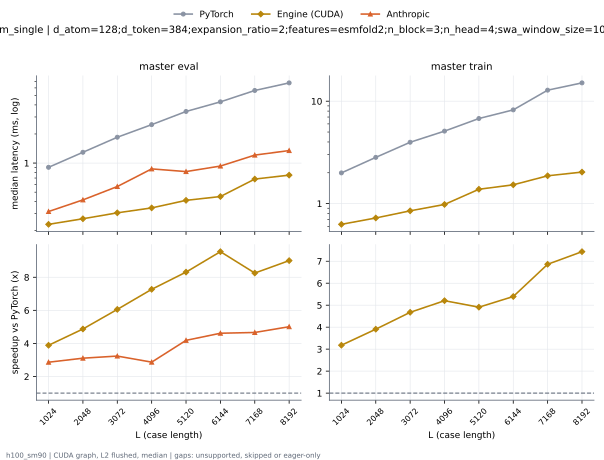
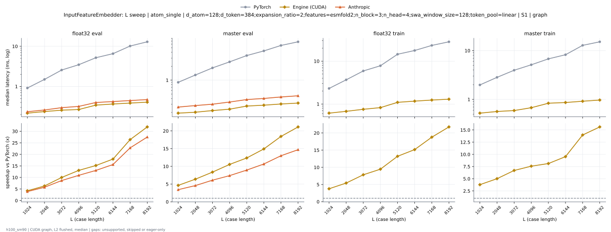

# InputFeatureEmbedder on h100_sm90

Generated by `python -m foldjet_engine.measure.plot` from speed tokens `judge/tokens/h100_sm90/`; do not edit.

### L sweep: atom_single | d_atom=128;d_token=384;expansion_ratio=2;features=esmfold2;n_block=3;n_head=4;swa_window_size=1000000;token_pool=linear | S1 | graph

**master eval** (median ms; x = speedup vs PyTorch)

| L | PyTorch | Engine (Triton) | Engine (CUDA) | Anthropic |
|---|---|---|---|---|
| 1024 | 0.9029 | 0.3256 (2.77x) | 0.2323 (3.89x) | 0.3154 (2.86x) |
| 2048 | 1.302 | 0.4074 (3.20x) | 0.266 (4.89x) | 0.416 (3.13x) |
| 3072 | 1.857 | 0.5107 (3.64x) | 0.3103 (5.99x) | 0.5719 (3.25x) |
| 4096 | 2.512 | 0.5886 (4.27x) | 0.3444 (7.29x) | 0.8708 (2.89x) |
| 5120 | 3.451 | 0.8019 (4.30x) | 0.4137 (8.34x) | 0.8166 (4.23x) |
| 6144 | 4.316 | 0.9153 (4.72x) | 0.4528 (9.53x) | 0.9317 (4.63x) |
| 7168 | 5.662 | 1.195 (4.74x) | 0.6855 (8.26x) | 1.209 (4.68x) |
| 8192 | 6.685 | 1.328 (5.04x) | 0.7536 (8.87x) | 1.348 (4.96x) |

**master train** (median ms; x = speedup vs PyTorch)

| L | PyTorch | Engine (Triton) | Engine (CUDA) | Anthropic |
|---|---|---|---|---|
| 1024 | 1.99 | 0.7982 (2.49x) | 0.5872 (3.39x) | 7.758 (eager) |
| 2048 | 2.837 | 1.086 (2.61x) | 0.6816 (4.16x) | 7.729 (eager) |
| 3072 | 3.97 | 1.462 (2.71x) | 0.7986 (4.97x) | 9.173 (eager) |
| 4096 | 5.127 | 1.763 (2.91x) | 0.9017 (5.69x) | 9.052 (eager) |
| 5120 | 6.795 | 2.481 (2.74x) | 1.341 (5.07x) | 10.58 (eager) |
| 6144 | 8.27 | 2.852 (2.90x) | 1.446 (5.72x) | 10.67 (eager) |
| 7168 | 12.9 | 3.93 (3.28x) | 1.804 (7.15x) | 12.22 (eager) |
| 8192 | 15.05 | 4.378 (3.44x) | 1.976 (7.62x) | 12.89 (eager) |

### L sweep: atom_single | d_atom=128;d_token=384;expansion_ratio=2;features=esmfold2;n_block=3;n_head=4;swa_window_size=1000000;token_pool=relu | S1 | graph

**master eval** (median ms; x = speedup vs PyTorch)

| L | PyTorch | Engine (Triton) | Engine (CUDA) | Anthropic |
|---|---|---|---|---|
| 1024 | 0.9024 | 0.3219 (2.80x) | 0.2319 (3.89x) | 0.3098 (2.91x) |
| 2048 | 1.284 | 0.4061 (3.16x) | 0.2657 (4.83x) | 0.4069 (3.16x) |
| 3072 | 1.846 | 0.5133 (3.60x) | 0.3067 (6.02x) | 0.5633 (3.28x) |
| 4096 | 2.494 | 0.5888 (4.24x) | 0.3439 (7.25x) | 0.8623 (2.89x) |
| 5120 | 3.407 | 0.801 (4.25x) | 0.4125 (8.26x) | 0.7978 (4.27x) |
| 6144 | 4.304 | 0.9169 (4.69x) | 0.4541 (9.48x) | 0.9108 (4.73x) |
| 7168 | 5.649 | 1.19 (4.75x) | 0.6865 (8.23x) | 1.194 (4.73x) |
| 8192 | 6.764 | 1.329 (5.09x) | 0.755 (8.96x) | 1.328 (5.09x) |

**master train** (median ms; x = speedup vs PyTorch)

| L | PyTorch | Engine (Triton) | Engine (CUDA) | Anthropic |
|---|---|---|---|---|
| 1024 | 1.977 | 0.7953 (2.49x) | 0.5761 (3.43x) | 7.672 (eager) |
| 2048 | 2.81 | 1.081 (2.60x) | 0.678 (4.15x) | 7.688 (eager) |
| 3072 | 3.93 | 1.459 (2.69x) | 0.7972 (4.93x) | 9.223 (eager) |
| 4096 | 5.081 | 1.756 (2.89x) | 0.901 (5.64x) | 9.269 (eager) |
| 5120 | 6.767 | 2.447 (2.77x) | 1.311 (5.16x) | 10.5 (eager) |
| 6144 | 8.228 | 2.852 (2.88x) | 1.443 (5.70x) | 10.46 (eager) |
| 7168 | 12.83 | 3.947 (3.25x) | 1.774 (7.23x) | 11.98 (eager) |
| 8192 | 15 | 4.381 (3.42x) | 1.941 (7.73x) | 12.82 (eager) |

### L sweep: atom_single | d_atom=128;d_token=384;expansion_ratio=2;features=esmfold2;n_block=3;n_head=4;swa_window_size=128;token_pool=linear | S1 | graph

**float32 eval** (median ms; x = speedup vs PyTorch)

| L | PyTorch | Engine (Triton) | Engine (CUDA) | Anthropic |
|---|---|---|---|---|
| 1024 | 0.9149 | 0.2874 (3.18x) | 0.2171 (4.21x) | 0.2349 (3.90x) |
| 2048 | 1.495 | 0.307 (4.87x) | 0.2374 (6.30x) | 0.2595 (5.76x) |
| 3072 | 2.555 | 0.3266 (7.82x) | 0.2564 (9.97x) | 0.296 (8.63x) |
| 4096 | 3.475 | 0.337 (10.31x) | 0.2687 (12.93x) | 0.3187 (10.90x) |
| 5120 | 5.215 | 0.4621 (11.29x) | 0.3455 (15.09x) | 0.3984 (13.09x) |
| 6144 | 6.58 | 0.5097 (12.91x) | 0.3655 (18.00x) | 0.4204 (15.65x) |
| 7168 | 10.22 | 0.5503 (18.57x) | 0.3863 (26.46x) | 0.4457 (22.93x) |
| 8192 | 13.03 | 0.5663 (23.01x) | 0.4073 (31.99x) | 0.4711 (27.65x) |

**master eval** (median ms; x = speedup vs PyTorch)

| L | PyTorch | Engine (Triton) | Engine (CUDA) | Anthropic |
|---|---|---|---|---|
| 1024 | 0.9028 | 0.2688 (3.36x) | 0.1939 (4.66x) | 0.2615 (3.45x) |
| 2048 | 1.283 | 0.2822 (4.55x) | 0.2025 (6.34x) | 0.282 (4.55x) |
| 3072 | 1.839 | 0.2995 (6.14x) | 0.2201 (8.36x) | 0.3016 (6.10x) |
| 4096 | 2.488 | 0.3031 (8.21x) | 0.2367 (10.51x) | 0.3362 (7.40x) |
| 5120 | 3.403 | 0.3425 (9.94x) | 0.2764 (12.31x) | 0.38 (8.95x) |
| 6144 | 4.289 | 0.3615 (11.86x) | 0.2889 (14.85x) | 0.4018 (10.68x) |
| 7168 | 5.628 | 0.3819 (14.74x) | 0.3057 (18.41x) | 0.4327 (13.01x) |
| 8192 | 6.758 | 0.3966 (17.04x) | 0.3202 (21.11x) | 0.4586 (14.73x) |

**float32 train** (median ms; x = speedup vs PyTorch)

| L | PyTorch | Engine (Triton) | Engine (CUDA) | Anthropic |
|---|---|---|---|---|
| 1024 | 2.301 | 0.7828 (2.94x) | 0.6099 (3.77x) | 6.566 (eager) |
| 2048 | 3.67 | 0.8743 (4.20x) | 0.6786 (5.41x) | 6.565 (eager) |
| 3072 | 5.933 | 0.9756 (6.08x) | 0.7546 (7.86x) | 7.696 (eager) |
| 4096 | 7.844 | 1.054 (7.44x) | 0.7842 (10.00x) | 8.86 (eager) |
| 5120 | 14.55 | 1.498 (9.71x) | 1.099 (13.24x) | 11.15 (eager) |
| 6144 | 17.77 | 1.614 (11.01x) | 1.17 (15.19x) | 12.77 (eager) |
| 7168 | 23.33 | 1.705 (13.68x) | 1.24 (18.82x) | 14.79 (eager) |
| 8192 | 28.27 | 1.779 (15.90x) | 1.259 (22.46x) | 16.49 (eager) |

**master train** (median ms; x = speedup vs PyTorch)

| L | PyTorch | Engine (Triton) | Engine (CUDA) | Anthropic |
|---|---|---|---|---|
| 1024 | 1.981 | 0.6249 (3.17x) | 0.482 (4.11x) | 8.013 (eager) |
| 2048 | 2.828 | 0.6995 (4.04x) | 0.5236 (5.40x) | 7.85 (eager) |
| 3072 | 3.94 | 0.7971 (4.94x) | 0.5777 (6.82x) | 9.668 (eager) |
| 4096 | 5.099 | 0.8384 (6.08x) | 0.6181 (8.25x) | 9.659 (eager) |
| 5120 | 6.79 | 1.058 (6.42x) | 0.7496 (9.06x) | 10.83 (eager) |
| 6144 | 8.253 | 1.117 (7.39x) | 0.7895 (10.45x) | 10.82 (eager) |
| 7168 | 12.85 | 1.187 (10.83x) | 0.8267 (15.55x) | 11.85 (eager) |
| 8192 | 15.06 | 1.254 (12.01x) | 0.8619 (17.48x) | 11.8 (eager) |

### L sweep: atom_single | d_atom=128;d_token=384;expansion_ratio=2;features=esmfold2;n_block=3;n_head=4;swa_window_size=128;token_pool=relu | S1 | graph

**master eval** (median ms; x = speedup vs PyTorch)

| L | PyTorch | Engine (Triton) | Engine (CUDA) | Anthropic |
|---|---|---|---|---|
| 1024 | 0.8988 | 0.2675 (3.36x) | 0.1943 (4.63x) | 0.2569 (3.50x) |
| 2048 | 1.284 | 0.2823 (4.55x) | 0.2029 (6.33x) | 0.2754 (4.66x) |
| 3072 | 1.836 | 0.3001 (6.12x) | 0.22 (8.34x) | 0.2951 (6.22x) |
| 4096 | 2.479 | 0.3045 (8.14x) | 0.2371 (10.46x) | 0.3257 (7.61x) |
| 5120 | 3.394 | 0.3439 (9.87x) | 0.278 (12.21x) | 0.3657 (9.28x) |
| 6144 | 4.275 | 0.3627 (11.79x) | 0.2892 (14.78x) | 0.3876 (11.03x) |
| 7168 | 5.618 | 0.3826 (14.68x) | 0.3067 (18.32x) | 0.4175 (13.46x) |
| 8192 | 6.747 | 0.3996 (16.89x) | 0.3211 (21.01x) | 0.4431 (15.23x) |

**master train** (median ms; x = speedup vs PyTorch)

| L | PyTorch | Engine (Triton) | Engine (CUDA) | Anthropic |
|---|---|---|---|---|
| 1024 | 1.97 | 0.6225 (3.16x) | 0.4805 (4.10x) | 7.641 (eager) |
| 2048 | 2.809 | 0.6942 (4.05x) | 0.5193 (5.41x) | 7.705 (eager) |
| 3072 | 3.935 | 0.792 (4.97x) | 0.5704 (6.90x) | 9.206 (eager) |
| 4096 | 5.073 | 0.8352 (6.07x) | 0.6123 (8.29x) | 9.119 (eager) |
| 5120 | 6.781 | 1.049 (6.46x) | 0.747 (9.08x) | 10.51 (eager) |
| 6144 | 8.211 | 1.113 (7.38x) | 0.7829 (10.49x) | 10.59 (eager) |
| 7168 | 12.82 | 1.184 (10.84x) | 0.8323 (15.41x) | 11.22 (eager) |
| 8192 | 15.1 | 1.239 (12.18x) | 0.8616 (17.52x) | 11.38 (eager) |

### L sweep: atom_single | d_atom=128;d_token=384;expansion_ratio=2;features=legacy;n_block=3;n_head=4;swa_window_size=1000000;token_pool=relu | S1 | graph

**float32 eval** (median ms; x = speedup vs PyTorch)

| L | PyTorch | Engine (Triton) | Engine (CUDA) | Anthropic |
|---|---|---|---|---|
| 1024 | 0.92 | 0.3372 (2.73x) | 0.2477 (3.71x) | 0.2778 (3.31x) |
| 2048 | 1.496 | 0.4232 (3.54x) | 0.2916 (5.13x) | 0.3807 (3.93x) |
| 3072 | 2.561 | 0.5435 (4.71x) | 0.3365 (7.61x) | 0.5548 (4.62x) |
| 4096 | 3.479 | 0.6117 (5.69x) | 0.37 (9.40x) | 0.8312 (4.19x) |
| 5120 | 5.222 | 0.9124 (5.72x) | 0.4768 (10.95x) | 0.8167 (6.39x) |
| 6144 | 6.607 | 1.054 (6.27x) | 0.5133 (12.87x) | 0.9132 (7.23x) |
| 7168 | 10.24 | 1.377 (7.43x) | 0.7624 (13.43x) | 1.18 (8.68x) |
| 8192 | 13.05 | 1.514 (8.62x) | 0.837 (15.59x) | 1.314 (9.93x) |

**master eval** (median ms; x = speedup vs PyTorch)

| L | PyTorch | Engine (Triton) | Engine (CUDA) | Anthropic |
|---|---|---|---|---|
| 1024 | 0.884 | 0.3169 (2.79x) | 0.2227 (3.97x) | 0.296 (2.99x) |
| 2048 | 1.274 | 0.3974 (3.21x) | 0.2582 (4.94x) | 0.3929 (3.24x) |
| 3072 | 1.832 | 0.5048 (3.63x) | 0.2989 (6.13x) | 0.5504 (3.33x) |
| 4096 | 2.497 | 0.5888 (4.24x) | 0.3405 (7.33x) | 0.8599 (2.90x) |
| 5120 | 3.408 | 0.7944 (4.29x) | 0.4028 (8.46x) | 0.7868 (4.33x) |
| 6144 | 4.296 | 0.9054 (4.74x) | 0.4431 (9.69x) | 0.8998 (4.77x) |
| 7168 | 5.629 | 1.182 (4.76x) | 0.6737 (8.35x) | 1.169 (4.81x) |
| 8192 | 6.745 | 1.314 (5.13x) | 0.7391 (9.12x) | 1.302 (5.18x) |

**float32 train** (median ms; x = speedup vs PyTorch)

| L | PyTorch | Engine (Triton) | Engine (CUDA) | Anthropic |
|---|---|---|---|---|
| 1024 | 2.292 | 0.944 (2.43x) | 0.8179 (2.80x) | 6.196 (eager) |
| 2048 | 3.667 | 1.256 (2.92x) | 0.9883 (3.71x) | 6.234 (eager) |
| 3072 | 5.907 | 1.637 (3.61x) | 1.147 (5.15x) | 7.89 (eager) |
| 4096 | 7.811 | 1.976 (3.95x) | 1.393 (5.61x) | 9.988 (eager) |
| 5120 | 14.5 | 2.934 (4.94x) | 1.805 (8.04x) | 18.69 (eager) |
| 6144 | 17.71 | 3.364 (5.26x) | 1.995 (8.87x) | 22.55 (eager) |
| 7168 | 23.29 | 4.464 (5.22x) | 2.381 (9.78x) | 31.33 (eager) |
| 8192 | 28.33 | 4.927 (5.75x) | 2.678 (10.58x) | 35.98 (eager) |

**master train** (median ms; x = speedup vs PyTorch)

| L | PyTorch | Engine (Triton) | Engine (CUDA) | Anthropic |
|---|---|---|---|---|
| 1024 | 1.955 | 0.7845 (2.49x) | 0.5598 (3.49x) | 7.541 (eager) |
| 2048 | 2.79 | 1.07 (2.61x) | 0.6615 (4.22x) | 7.628 (eager) |
| 3072 | 3.913 | 1.444 (2.71x) | 0.7722 (5.07x) | 8.978 (eager) |
| 4096 | 5.063 | 1.722 (2.94x) | 0.894 (5.66x) | 8.933 (eager) |
| 5120 | 6.725 | 2.451 (2.74x) | 1.287 (5.23x) | 10.38 (eager) |
| 6144 | 8.187 | 2.824 (2.90x) | 1.413 (5.80x) | 10.44 (eager) |
| 7168 | 12.81 | 3.905 (3.28x) | 1.743 (7.35x) | 12.02 (eager) |
| 8192 | 15.08 | 4.362 (3.46x) | 1.935 (7.79x) | 12.83 (eager) |

### L sweep: atom_single | d_atom=128;d_token=384;expansion_ratio=2;features=legacy;n_block=3;n_head=4;swa_window_size=128;token_pool=relu | S1 | graph

**float32 eval** (median ms; x = speedup vs PyTorch)

| L | PyTorch | Engine (Triton) | Engine (CUDA) | Anthropic |
|---|---|---|---|---|
| 1024 | 0.92 | 0.2783 (3.31x) | 0.216 (4.26x) | 0.2265 (4.06x) |
| 2048 | 1.487 | 0.3009 (4.94x) | 0.2312 (6.43x) | 0.2491 (5.97x) |
| 3072 | 2.548 | 0.3288 (7.75x) | 0.2568 (9.92x) | 0.291 (8.75x) |
| 4096 | 3.46 | 0.3294 (10.50x) | 0.2661 (13.00x) | 0.3034 (11.40x) |
| 5120 | 5.201 | 0.4581 (11.35x) | 0.3402 (15.29x) | 0.3861 (13.47x) |
| 6144 | 6.56 | 0.5082 (12.91x) | 0.3589 (18.28x) | 0.3945 (16.63x) |
| 7168 | 10.19 | 0.5382 (18.94x) | 0.3745 (27.21x) | 0.4175 (24.41x) |
| 8192 | 13 | 0.5649 (23.01x) | 0.3964 (32.79x) | 0.4391 (29.61x) |

**master eval** (median ms; x = speedup vs PyTorch)

| L | PyTorch | Engine (Triton) | Engine (CUDA) | Anthropic |
|---|---|---|---|---|
| 1024 | 0.8747 | 0.2622 (3.34x) | 0.1855 (4.72x) | 0.2433 (3.60x) |
| 2048 | 1.266 | 0.2749 (4.60x) | 0.194 (6.52x) | 0.2618 (4.83x) |
| 3072 | 1.825 | 0.2938 (6.21x) | 0.2131 (8.56x) | 0.2828 (6.45x) |
| 4096 | 2.463 | 0.3004 (8.20x) | 0.2309 (10.67x) | 0.3172 (7.77x) |
| 5120 | 3.377 | 0.3337 (10.12x) | 0.265 (12.74x) | 0.35 (9.65x) |
| 6144 | 4.256 | 0.3496 (12.17x) | 0.2772 (15.35x) | 0.3702 (11.50x) |
| 7168 | 5.601 | 0.3693 (15.17x) | 0.2926 (19.14x) | 0.3968 (14.12x) |
| 8192 | 6.718 | 0.3825 (17.56x) | 0.3059 (21.96x) | 0.4216 (15.93x) |

**float32 train** (median ms; x = speedup vs PyTorch)

| L | PyTorch | Engine (Triton) | Engine (CUDA) | Anthropic |
|---|---|---|---|---|
| 1024 | 2.296 | 0.7761 (2.96x) | 0.5975 (3.84x) | 6.319 (eager) |
| 2048 | 3.642 | 0.8621 (4.22x) | 0.67 (5.44x) | 6.29 (eager) |
| 3072 | 5.897 | 0.9668 (6.10x) | 0.7457 (7.91x) | 7.651 (eager) |
| 4096 | 7.796 | 1.041 (7.49x) | 0.8094 (9.63x) | 8.779 (eager) |
| 5120 | 14.5 | 1.503 (9.65x) | 1.082 (13.40x) | 10.8 (eager) |
| 6144 | 17.71 | 1.577 (11.23x) | 1.145 (15.46x) | 12.48 (eager) |
| 7168 | 23.28 | 1.692 (13.76x) | 1.214 (19.18x) | 14.63 (eager) |
| 8192 | 28.15 | 1.757 (16.02x) | 1.271 (22.15x) | 16.44 (eager) |

**master train** (median ms; x = speedup vs PyTorch)

| L | PyTorch | Engine (Triton) | Engine (CUDA) | Anthropic |
|---|---|---|---|---|
| 1024 | 1.949 | 0.6081 (3.20x) | 0.464 (4.20x) | 7.692 (eager) |
| 2048 | 2.781 | 0.681 (4.08x) | 0.5019 (5.54x) | 7.736 (eager) |
| 3072 | 3.899 | 0.7709 (5.06x) | 0.551 (7.08x) | 9.557 (eager) |
| 4096 | 5.044 | 0.8174 (6.17x) | 0.5947 (8.48x) | 9.332 (eager) |
| 5120 | 6.718 | 1.027 (6.54x) | 0.7211 (9.32x) | 10.03 (eager) |
| 6144 | 8.156 | 1.085 (7.52x) | 0.7523 (10.84x) | 10.06 (eager) |
| 7168 | 12.78 | 1.152 (11.10x) | 0.7939 (16.10x) | 11.13 (eager) |
| 8192 | 15.03 | 1.206 (12.47x) | 0.8254 (18.21x) | 11.06 (eager) |

