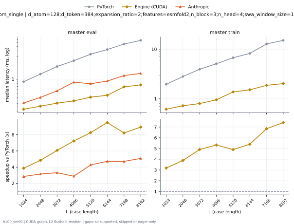
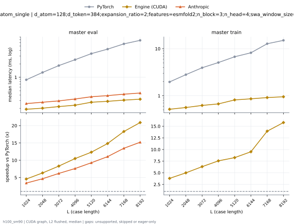
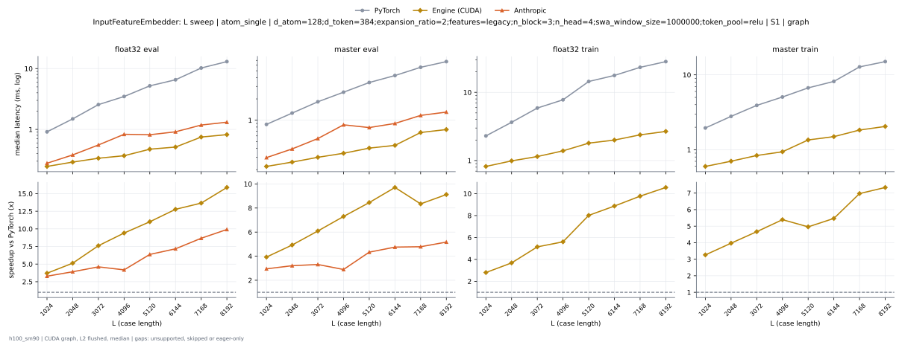
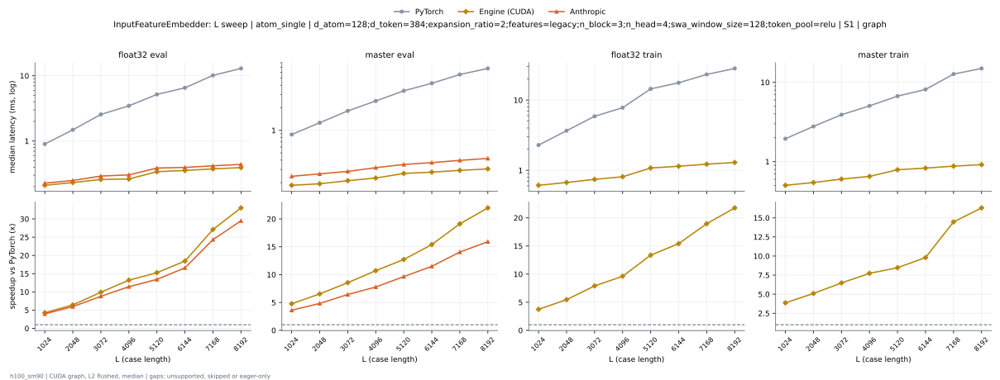

# InputFeatureEmbedder on h100_sm90

Generated by `python -m miniworld_engine.measure.plot` from speed tokens `judge/tokens/h100_sm90/`; do not edit.

### L sweep: atom_single | d_atom=128;d_token=384;expansion_ratio=2;features=esmfold2;n_block=3;n_head=4;swa_window_size=1000000;token_pool=linear | S1 | graph

**master eval** (median ms; x = speedup vs PyTorch)

| L | PyTorch | Engine (Triton) | Engine (CUDA) | Anthropic |
|---|---|---|---|---|
| 1024 | 0.9041 | 0.3256 (2.78x) | 0.2324 (3.89x) | 0.3154 (2.87x) |
| 2048 | 1.294 | 0.4074 (3.18x) | 0.2654 (4.87x) | 0.416 (3.11x) |
| 3072 | 1.852 | 0.5107 (3.63x) | 0.3057 (6.06x) | 0.5719 (3.24x) |
| 4096 | 2.499 | 0.5886 (4.25x) | 0.3438 (7.27x) | 0.8708 (2.87x) |
| 5120 | 3.42 | 0.8019 (4.26x) | 0.4115 (8.31x) | 0.8166 (4.19x) |
| 6144 | 4.302 | 0.9153 (4.70x) | 0.4507 (9.55x) | 0.9317 (4.62x) |
| 7168 | 5.64 | 1.195 (4.72x) | 0.6833 (8.25x) | 1.209 (4.66x) |
| 8192 | 6.759 | 1.328 (5.09x) | 0.7505 (9.01x) | 1.348 (5.01x) |

**master train** (median ms; x = speedup vs PyTorch)

| L | PyTorch | Engine (Triton) | Engine (CUDA) | Anthropic |
|---|---|---|---|---|
| 1024 | 1.994 | 0.7982 (2.50x) | 0.6271 (3.18x) | 7.758 (eager) |
| 2048 | 2.827 | 1.086 (2.60x) | 0.7235 (3.91x) | 7.729 (eager) |
| 3072 | 3.973 | 1.462 (2.72x) | 0.8496 (4.68x) | 9.173 (eager) |
| 4096 | 5.102 | 1.763 (2.89x) | 0.9804 (5.20x) | 9.052 (eager) |
| 5120 | 6.774 | 2.481 (2.73x) | 1.38 (4.91x) | 10.58 (eager) |
| 6144 | 8.228 | 2.852 (2.89x) | 1.525 (5.39x) | 10.67 (eager) |
| 7168 | 12.82 | 3.93 (3.26x) | 1.868 (6.86x) | 12.22 (eager) |
| 8192 | 15.1 | 4.378 (3.45x) | 2.031 (7.44x) | 12.89 (eager) |

### L sweep: atom_single | d_atom=128;d_token=384;expansion_ratio=2;features=esmfold2;n_block=3;n_head=4;swa_window_size=1000000;token_pool=relu | S1 | graph

**master eval** (median ms; x = speedup vs PyTorch)

| L | PyTorch | Engine (Triton) | Engine (CUDA) | Anthropic |
|---|---|---|---|---|
| 1024 | 0.8806 | 0.3219 (2.74x) | 0.2277 (3.87x) | 0.3098 (2.84x) |
| 2048 | 1.282 | 0.4061 (3.16x) | 0.2649 (4.84x) | 0.4069 (3.15x) |
| 3072 | 1.865 | 0.5133 (3.63x) | 0.3072 (6.07x) | 0.5633 (3.31x) |
| 4096 | 2.483 | 0.5888 (4.22x) | 0.3434 (7.23x) | 0.8623 (2.88x) |
| 5120 | 3.406 | 0.801 (4.25x) | 0.4123 (8.26x) | 0.7978 (4.27x) |
| 6144 | 4.3 | 0.9169 (4.69x) | 0.4524 (9.51x) | 0.9108 (4.72x) |
| 7168 | 5.626 | 1.19 (4.73x) | 0.6845 (8.22x) | 1.194 (4.71x) |
| 8192 | 6.744 | 1.329 (5.07x) | 0.7534 (8.95x) | 1.328 (5.08x) |

**master train** (median ms; x = speedup vs PyTorch)

| L | PyTorch | Engine (Triton) | Engine (CUDA) | Anthropic |
|---|---|---|---|---|
| 1024 | 1.963 | 0.7953 (2.47x) | 0.6163 (3.18x) | 7.672 (eager) |
| 2048 | 2.815 | 1.081 (2.60x) | 0.7241 (3.89x) | 7.688 (eager) |
| 3072 | 3.942 | 1.459 (2.70x) | 0.8027 (4.91x) | 9.223 (eager) |
| 4096 | 5.095 | 1.756 (2.90x) | 0.9568 (5.33x) | 9.269 (eager) |
| 5120 | 6.736 | 2.447 (2.75x) | 1.375 (4.90x) | 10.5 (eager) |
| 6144 | 8.217 | 2.852 (2.88x) | 1.521 (5.40x) | 10.46 (eager) |
| 7168 | 12.78 | 3.947 (3.24x) | 1.867 (6.85x) | 11.98 (eager) |
| 8192 | 15.07 | 4.381 (3.44x) | 2.031 (7.42x) | 12.82 (eager) |

### L sweep: atom_single | d_atom=128;d_token=384;expansion_ratio=2;features=esmfold2;n_block=3;n_head=4;swa_window_size=128;token_pool=linear | S1 | graph

**float32 eval** (median ms; x = speedup vs PyTorch)

| L | PyTorch | Engine (Triton) | Engine (CUDA) | Anthropic |
|---|---|---|---|---|
| 1024 | 0.9145 | 0.2874 (3.18x) | 0.2164 (4.23x) | 0.2349 (3.89x) |
| 2048 | 1.499 | 0.307 (4.88x) | 0.2368 (6.33x) | 0.2595 (5.78x) |
| 3072 | 2.564 | 0.3266 (7.85x) | 0.2564 (10.00x) | 0.296 (8.66x) |
| 4096 | 3.483 | 0.337 (10.34x) | 0.2665 (13.07x) | 0.3187 (10.93x) |
| 5120 | 5.201 | 0.4621 (11.26x) | 0.3428 (15.17x) | 0.3984 (13.05x) |
| 6144 | 6.56 | 0.5097 (12.87x) | 0.3653 (17.96x) | 0.4204 (15.60x) |
| 7168 | 10.17 | 0.5503 (18.48x) | 0.3854 (26.38x) | 0.4457 (22.81x) |
| 8192 | 12.96 | 0.5663 (22.88x) | 0.4065 (31.88x) | 0.4711 (27.50x) |

**master eval** (median ms; x = speedup vs PyTorch)

| L | PyTorch | Engine (Triton) | Engine (CUDA) | Anthropic |
|---|---|---|---|---|
| 1024 | 0.8967 | 0.2688 (3.34x) | 0.1934 (4.64x) | 0.2615 (3.43x) |
| 2048 | 1.291 | 0.2822 (4.58x) | 0.2023 (6.38x) | 0.282 (4.58x) |
| 3072 | 1.839 | 0.2995 (6.14x) | 0.2196 (8.37x) | 0.3016 (6.10x) |
| 4096 | 2.484 | 0.3031 (8.19x) | 0.2356 (10.54x) | 0.3362 (7.39x) |
| 5120 | 3.401 | 0.3425 (9.93x) | 0.275 (12.37x) | 0.38 (8.95x) |
| 6144 | 4.285 | 0.3615 (11.85x) | 0.2873 (14.92x) | 0.4018 (10.67x) |
| 7168 | 5.623 | 0.3819 (14.72x) | 0.3048 (18.44x) | 0.4327 (13.00x) |
| 8192 | 6.745 | 0.3966 (17.01x) | 0.3193 (21.13x) | 0.4586 (14.71x) |

**float32 train** (median ms; x = speedup vs PyTorch)

| L | PyTorch | Engine (Triton) | Engine (CUDA) | Anthropic |
|---|---|---|---|---|
| 1024 | 2.309 | 0.7828 (2.95x) | 0.6136 (3.76x) | 6.566 (eager) |
| 2048 | 3.671 | 0.8743 (4.20x) | 0.6762 (5.43x) | 6.565 (eager) |
| 3072 | 5.91 | 0.9756 (6.06x) | 0.7541 (7.84x) | 7.696 (eager) |
| 4096 | 7.811 | 1.054 (7.41x) | 0.825 (9.47x) | 8.86 (eager) |
| 5120 | 14.47 | 1.498 (9.66x) | 1.095 (13.21x) | 11.15 (eager) |
| 6144 | 17.72 | 1.614 (10.97x) | 1.169 (15.16x) | 12.77 (eager) |
| 7168 | 23.26 | 1.705 (13.64x) | 1.239 (18.78x) | 14.79 (eager) |
| 8192 | 28.25 | 1.779 (15.89x) | 1.298 (21.76x) | 16.49 (eager) |

**master train** (median ms; x = speedup vs PyTorch)

| L | PyTorch | Engine (Triton) | Engine (CUDA) | Anthropic |
|---|---|---|---|---|
| 1024 | 1.98 | 0.6249 (3.17x) | 0.523 (3.79x) | 8.013 (eager) |
| 2048 | 2.832 | 0.6995 (4.05x) | 0.565 (5.01x) | 7.85 (eager) |
| 3072 | 3.958 | 0.7971 (4.97x) | 0.591 (6.70x) | 9.668 (eager) |
| 4096 | 5.12 | 0.8384 (6.11x) | 0.6757 (7.58x) | 9.659 (eager) |
| 5120 | 6.774 | 1.058 (6.40x) | 0.8348 (8.11x) | 10.83 (eager) |
| 6144 | 8.229 | 1.117 (7.37x) | 0.8631 (9.53x) | 10.82 (eager) |
| 7168 | 12.81 | 1.187 (10.79x) | 0.9169 (13.97x) | 11.85 (eager) |
| 8192 | 15.15 | 1.254 (12.08x) | 0.9695 (15.62x) | 11.8 (eager) |

### L sweep: atom_single | d_atom=128;d_token=384;expansion_ratio=2;features=esmfold2;n_block=3;n_head=4;swa_window_size=128;token_pool=relu | S1 | graph

**master eval** (median ms; x = speedup vs PyTorch)

| L | PyTorch | Engine (Triton) | Engine (CUDA) | Anthropic |
|---|---|---|---|---|
| 1024 | 0.8781 | 0.2675 (3.28x) | 0.1918 (4.58x) | 0.2569 (3.42x) |
| 2048 | 1.283 | 0.2823 (4.54x) | 0.2025 (6.33x) | 0.2754 (4.66x) |
| 3072 | 1.83 | 0.3001 (6.10x) | 0.2201 (8.31x) | 0.2951 (6.20x) |
| 4096 | 2.479 | 0.3045 (8.14x) | 0.2363 (10.49x) | 0.3257 (7.61x) |
| 5120 | 3.395 | 0.3439 (9.87x) | 0.2755 (12.32x) | 0.3657 (9.28x) |
| 6144 | 4.282 | 0.3627 (11.81x) | 0.2885 (14.84x) | 0.3876 (11.05x) |
| 7168 | 5.619 | 0.3826 (14.69x) | 0.307 (18.30x) | 0.4175 (13.46x) |
| 8192 | 6.737 | 0.3996 (16.86x) | 0.3225 (20.89x) | 0.4431 (15.20x) |

**master train** (median ms; x = speedup vs PyTorch)

| L | PyTorch | Engine (Triton) | Engine (CUDA) | Anthropic |
|---|---|---|---|---|
| 1024 | 1.97 | 0.6225 (3.16x) | 0.5178 (3.80x) | 7.641 (eager) |
| 2048 | 2.81 | 0.6942 (4.05x) | 0.563 (4.99x) | 7.705 (eager) |
| 3072 | 3.942 | 0.792 (4.98x) | 0.6239 (6.32x) | 9.206 (eager) |
| 4096 | 5.084 | 0.8352 (6.09x) | 0.6722 (7.56x) | 9.119 (eager) |
| 5120 | 6.745 | 1.049 (6.43x) | 0.8169 (8.26x) | 10.51 (eager) |
| 6144 | 8.198 | 1.113 (7.37x) | 0.8616 (9.52x) | 10.59 (eager) |
| 7168 | 12.76 | 1.184 (10.78x) | 0.9155 (13.94x) | 11.22 (eager) |
| 8192 | 15.05 | 1.239 (12.14x) | 0.9532 (15.79x) | 11.38 (eager) |

### L sweep: atom_single | d_atom=128;d_token=384;expansion_ratio=2;features=legacy;n_block=3;n_head=4;swa_window_size=1000000;token_pool=relu | S1 | graph

**float32 eval** (median ms; x = speedup vs PyTorch)

| L | PyTorch | Engine (Triton) | Engine (CUDA) | Anthropic |
|---|---|---|---|---|
| 1024 | 0.9124 | 0.3372 (2.71x) | 0.2463 (3.70x) | 0.2778 (3.28x) |
| 2048 | 1.49 | 0.4232 (3.52x) | 0.2902 (5.13x) | 0.3807 (3.91x) |
| 3072 | 2.556 | 0.5435 (4.70x) | 0.3358 (7.61x) | 0.5548 (4.61x) |
| 4096 | 3.476 | 0.6117 (5.68x) | 0.3693 (9.41x) | 0.8312 (4.18x) |
| 5120 | 5.206 | 0.9124 (5.71x) | 0.4728 (11.01x) | 0.8167 (6.37x) |
| 6144 | 6.548 | 1.054 (6.21x) | 0.5125 (12.78x) | 0.9132 (7.17x) |
| 7168 | 10.23 | 1.377 (7.43x) | 0.7489 (13.66x) | 1.18 (8.67x) |
| 8192 | 13.03 | 1.514 (8.61x) | 0.8207 (15.88x) | 1.314 (9.91x) |

**master eval** (median ms; x = speedup vs PyTorch)

| L | PyTorch | Engine (Triton) | Engine (CUDA) | Anthropic |
|---|---|---|---|---|
| 1024 | 0.8724 | 0.3169 (2.75x) | 0.2222 (3.93x) | 0.296 (2.95x) |
| 2048 | 1.26 | 0.3974 (3.17x) | 0.2558 (4.93x) | 0.3929 (3.21x) |
| 3072 | 1.821 | 0.5048 (3.61x) | 0.2989 (6.09x) | 0.5504 (3.31x) |
| 4096 | 2.488 | 0.5888 (4.23x) | 0.341 (7.30x) | 0.8599 (2.89x) |
| 5120 | 3.41 | 0.7944 (4.29x) | 0.4033 (8.45x) | 0.7868 (4.33x) |
| 6144 | 4.278 | 0.9054 (4.72x) | 0.4407 (9.71x) | 0.8998 (4.75x) |
| 7168 | 5.593 | 1.182 (4.73x) | 0.6703 (8.34x) | 1.169 (4.78x) |
| 8192 | 6.732 | 1.314 (5.12x) | 0.7381 (9.12x) | 1.302 (5.17x) |

**float32 train** (median ms; x = speedup vs PyTorch)

| L | PyTorch | Engine (Triton) | Engine (CUDA) | Anthropic |
|---|---|---|---|---|
| 1024 | 2.298 | 0.944 (2.43x) | 0.82 (2.80x) | 6.196 (eager) |
| 2048 | 3.642 | 1.256 (2.90x) | 0.9892 (3.68x) | 6.234 (eager) |
| 3072 | 5.889 | 1.637 (3.60x) | 1.145 (5.14x) | 7.89 (eager) |
| 4096 | 7.779 | 1.976 (3.94x) | 1.388 (5.61x) | 9.988 (eager) |
| 5120 | 14.44 | 2.934 (4.92x) | 1.801 (8.02x) | 18.69 (eager) |
| 6144 | 17.71 | 3.364 (5.27x) | 1.997 (8.87x) | 22.55 (eager) |
| 7168 | 23.28 | 4.464 (5.22x) | 2.382 (9.77x) | 31.33 (eager) |
| 8192 | 28.26 | 4.927 (5.74x) | 2.675 (10.56x) | 35.98 (eager) |

**master train** (median ms; x = speedup vs PyTorch)

| L | PyTorch | Engine (Triton) | Engine (CUDA) | Anthropic |
|---|---|---|---|---|
| 1024 | 1.952 | 0.7845 (2.49x) | 0.5986 (3.26x) | 7.541 (eager) |
| 2048 | 2.791 | 1.07 (2.61x) | 0.7029 (3.97x) | 7.628 (eager) |
| 3072 | 3.911 | 1.444 (2.71x) | 0.8381 (4.67x) | 8.978 (eager) |
| 4096 | 5.063 | 1.722 (2.94x) | 0.939 (5.39x) | 8.933 (eager) |
| 5120 | 6.702 | 2.451 (2.73x) | 1.352 (4.96x) | 10.38 (eager) |
| 6144 | 8.176 | 2.824 (2.89x) | 1.495 (5.47x) | 10.44 (eager) |
| 7168 | 12.78 | 3.905 (3.27x) | 1.833 (6.97x) | 12.02 (eager) |
| 8192 | 15.03 | 4.362 (3.45x) | 2.048 (7.34x) | 12.83 (eager) |

### L sweep: atom_single | d_atom=128;d_token=384;expansion_ratio=2;features=legacy;n_block=3;n_head=4;swa_window_size=128;token_pool=relu | S1 | graph

**float32 eval** (median ms; x = speedup vs PyTorch)

| L | PyTorch | Engine (Triton) | Engine (CUDA) | Anthropic |
|---|---|---|---|---|
| 1024 | 0.9012 | 0.2783 (3.24x) | 0.21 (4.29x) | 0.2265 (3.98x) |
| 2048 | 1.486 | 0.3009 (4.94x) | 0.2314 (6.42x) | 0.2491 (5.97x) |
| 3072 | 2.558 | 0.3288 (7.78x) | 0.258 (9.92x) | 0.291 (8.79x) |
| 4096 | 3.468 | 0.3294 (10.53x) | 0.2625 (13.21x) | 0.3034 (11.43x) |
| 5120 | 5.184 | 0.4581 (11.32x) | 0.3396 (15.27x) | 0.3861 (13.42x) |
| 6144 | 6.542 | 0.5082 (12.87x) | 0.3546 (18.45x) | 0.3945 (16.58x) |
| 7168 | 10.16 | 0.5382 (18.87x) | 0.3748 (27.10x) | 0.4175 (24.33x) |
| 8192 | 12.95 | 0.5649 (22.92x) | 0.392 (33.03x) | 0.4391 (29.48x) |

**master eval** (median ms; x = speedup vs PyTorch)

| L | PyTorch | Engine (Triton) | Engine (CUDA) | Anthropic |
|---|---|---|---|---|
| 1024 | 0.8788 | 0.2622 (3.35x) | 0.1843 (4.77x) | 0.2433 (3.61x) |
| 2048 | 1.263 | 0.2749 (4.59x) | 0.1932 (6.54x) | 0.2618 (4.82x) |
| 3072 | 1.817 | 0.2938 (6.19x) | 0.2126 (8.55x) | 0.2828 (6.43x) |
| 4096 | 2.468 | 0.3004 (8.22x) | 0.2304 (10.71x) | 0.3172 (7.78x) |
| 5120 | 3.374 | 0.3337 (10.11x) | 0.2654 (12.71x) | 0.35 (9.64x) |
| 6144 | 4.254 | 0.3496 (12.17x) | 0.2762 (15.40x) | 0.3702 (11.49x) |
| 7168 | 5.575 | 0.3693 (15.10x) | 0.2917 (19.11x) | 0.3968 (14.05x) |
| 8192 | 6.708 | 0.3825 (17.54x) | 0.3052 (21.98x) | 0.4216 (15.91x) |

**float32 train** (median ms; x = speedup vs PyTorch)

| L | PyTorch | Engine (Triton) | Engine (CUDA) | Anthropic |
|---|---|---|---|---|
| 1024 | 2.287 | 0.7761 (2.95x) | 0.6115 (3.74x) | 6.319 (eager) |
| 2048 | 3.661 | 0.8621 (4.25x) | 0.6703 (5.46x) | 6.29 (eager) |
| 3072 | 5.873 | 0.9668 (6.07x) | 0.7432 (7.90x) | 7.651 (eager) |
| 4096 | 7.783 | 1.041 (7.48x) | 0.8092 (9.62x) | 8.779 (eager) |
| 5120 | 14.42 | 1.503 (9.59x) | 1.079 (13.36x) | 10.8 (eager) |
| 6144 | 17.62 | 1.577 (11.17x) | 1.142 (15.42x) | 12.48 (eager) |
| 7168 | 23.17 | 1.692 (13.69x) | 1.222 (18.96x) | 14.63 (eager) |
| 8192 | 28.17 | 1.757 (16.03x) | 1.294 (21.77x) | 16.44 (eager) |

**master train** (median ms; x = speedup vs PyTorch)

| L | PyTorch | Engine (Triton) | Engine (CUDA) | Anthropic |
|---|---|---|---|---|
| 1024 | 1.947 | 0.6081 (3.20x) | 0.504 (3.86x) | 7.692 (eager) |
| 2048 | 2.786 | 0.681 (4.09x) | 0.5463 (5.10x) | 7.736 (eager) |
| 3072 | 3.909 | 0.7709 (5.07x) | 0.6039 (6.47x) | 9.557 (eager) |
| 4096 | 5.051 | 0.8174 (6.18x) | 0.6528 (7.74x) | 9.332 (eager) |
| 5120 | 6.702 | 1.027 (6.53x) | 0.7917 (8.47x) | 10.03 (eager) |
| 6144 | 8.141 | 1.085 (7.50x) | 0.8305 (9.80x) | 10.06 (eager) |
| 7168 | 12.72 | 1.152 (11.04x) | 0.8789 (14.47x) | 11.13 (eager) |
| 8192 | 14.97 | 1.206 (12.41x) | 0.918 (16.30x) | 11.06 (eager) |

