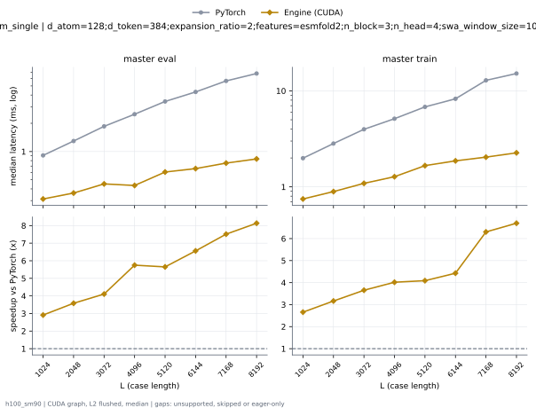
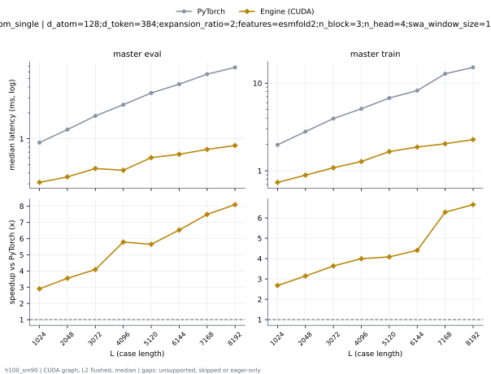
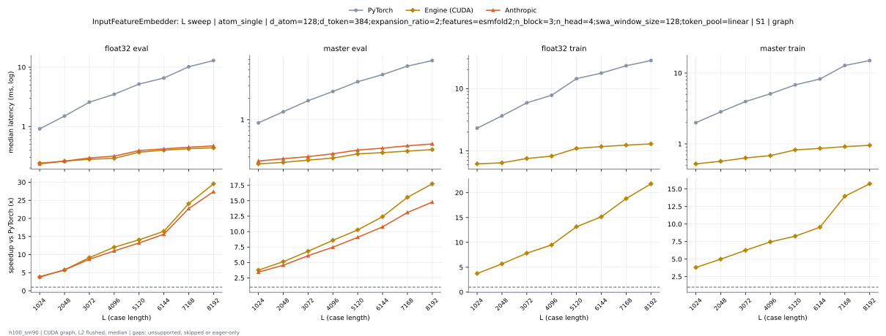
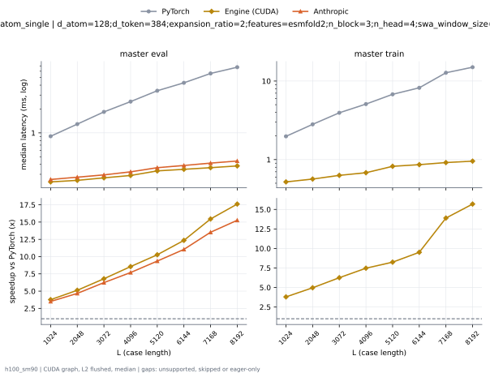
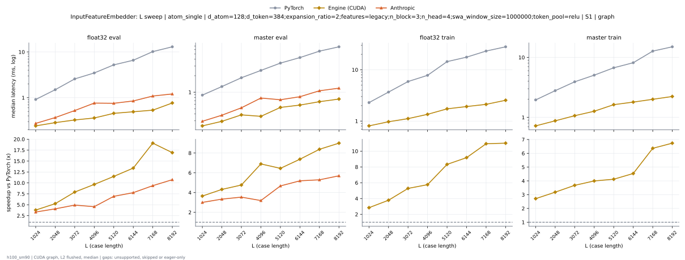
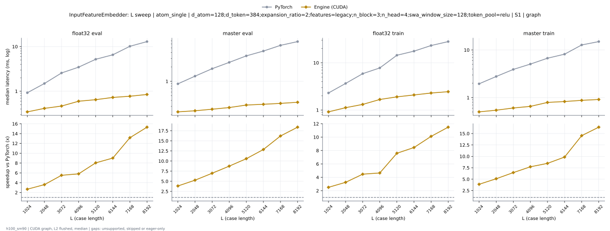

# InputFeatureEmbedder on h100_sm90

Generated by `python -m miniworld_engine.measure.plot` from speed tokens `judge/tokens/h100_sm90/`; do not edit.

### L sweep: atom_single | d_atom=128;d_token=384;expansion_ratio=2;features=esmfold2;n_block=3;n_head=4;swa_window_size=1000000;token_pool=linear | S1 | graph

**master eval** (median ms; x = speedup vs PyTorch)

| L | PyTorch | Engine (Triton) | Engine (CUDA) | Anthropic |
|---|---|---|---|---|
| 1024 | 0.9115 | unsupported | 0.3123 (2.92x) | 0.308 (2.96x) |
| 2048 | 1.298 | unsupported | 0.363 (3.58x) | 0.3989 (3.25x) |
| 3072 | 1.865 | unsupported | 0.4537 (4.11x) | 0.5365 (3.48x) |
| 4096 | 2.508 | unsupported | 0.4312 (5.81x) | 0.7992 (3.14x) |
| 5120 | 3.424 | unsupported | 0.6036 (5.67x) | 0.7512 (4.56x) |
| 6144 | 4.32 | unsupported | 0.661 (6.54x) | 0.856 (5.05x) |
| 7168 | 5.655 | unsupported | 0.7532 (7.51x) | 1.095 (5.16x) |
| 8192 | 6.77 | unsupported | 0.8373 (8.09x) | 1.218 (5.56x) |

**master train** (median ms; x = speedup vs PyTorch)

| L | PyTorch | Engine (Triton) | Engine (CUDA) | Anthropic |
|---|---|---|---|---|
| 1024 | 2.007 | unsupported | 0.7505 (2.67x) | 7.128 (eager) |
| 2048 | 2.834 | unsupported | 0.8988 (3.15x) | 7.151 (eager) |
| 3072 | 3.973 | unsupported | 1.099 (3.61x) | 8.16 (eager) |
| 4096 | 5.117 | unsupported | 1.28 (4.00x) | 8.205 (eager) |
| 5120 | 6.79 | unsupported | 1.648 (4.12x) | 11.12 (eager) |
| 6144 | 8.272 | unsupported | 1.828 (4.52x) | 13.07 (eager) |
| 7168 | 12.73 | unsupported | 2.037 (6.25x) | 18.73 (eager) |
| 8192 | 15.05 | unsupported | 2.21 (6.81x) | 24.7 (eager) |

### L sweep: atom_single | d_atom=128;d_token=384;expansion_ratio=2;features=esmfold2;n_block=3;n_head=4;swa_window_size=1000000;token_pool=relu | S1 | graph

**master eval** (median ms; x = speedup vs PyTorch)

| L | PyTorch | Engine (Triton) | Engine (CUDA) | Anthropic |
|---|---|---|---|---|
| 1024 | 0.9103 | unsupported | 0.3116 (2.92x) | 0.3019 (3.01x) |
| 2048 | 1.29 | unsupported | 0.3617 (3.57x) | 0.3899 (3.31x) |
| 3072 | 1.852 | unsupported | 0.4531 (4.09x) | 0.528 (3.51x) |
| 4096 | 2.497 | unsupported | 0.4399 (5.68x) | 0.7887 (3.17x) |
| 5120 | 3.412 | unsupported | 0.6037 (5.65x) | 0.7379 (4.62x) |
| 6144 | 4.311 | unsupported | 0.6594 (6.54x) | 0.8435 (5.11x) |
| 7168 | 5.642 | unsupported | 0.7521 (7.50x) | 1.08 (5.22x) |
| 8192 | 6.761 | unsupported | 0.8362 (8.09x) | 1.203 (5.62x) |

**master train** (median ms; x = speedup vs PyTorch)

| L | PyTorch | Engine (Triton) | Engine (CUDA) | Anthropic |
|---|---|---|---|---|
| 1024 | 1.984 | unsupported | 0.742 (2.67x) | 7.079 (eager) |
| 2048 | 2.809 | unsupported | 0.8297 (3.39x) | 7.088 (eager) |
| 3072 | 3.952 | unsupported | 1.091 (3.62x) | 8.134 (eager) |
| 4096 | 5.101 | unsupported | 1.276 (4.00x) | 8.153 (eager) |
| 5120 | 6.755 | unsupported | 1.647 (4.10x) | 11.1 (eager) |
| 6144 | 8.198 | unsupported | 1.861 (4.41x) | 13.06 (eager) |
| 7168 | 12.73 | unsupported | 2.085 (6.11x) | 18.75 (eager) |
| 8192 | 14.97 | unsupported | 2.153 (6.96x) | 24.55 (eager) |

### L sweep: atom_single | d_atom=128;d_token=384;expansion_ratio=2;features=esmfold2;n_block=3;n_head=4;swa_window_size=128;token_pool=linear | S1 | graph

**float32 eval** (median ms; x = speedup vs PyTorch)

| L | PyTorch | Engine (Triton) | Engine (CUDA) | Anthropic |
|---|---|---|---|---|
| 1024 | 0.9139 | unsupported | 0.2413 (3.79x) | 0.235 (3.89x) |
| 2048 | 1.503 | unsupported | 0.2612 (5.75x) | 0.2608 (5.76x) |
| 3072 | 2.573 | unsupported | 0.2806 (9.17x) | 0.2955 (8.71x) |
| 4096 | 3.497 | unsupported | 0.2906 (12.03x) | 0.3173 (11.02x) |
| 5120 | 5.199 | unsupported | 0.3691 (14.08x) | 0.3939 (13.20x) |
| 6144 | 6.569 | unsupported | 0.3996 (16.44x) | 0.4204 (15.63x) |
| 7168 | 10.17 | unsupported | 0.4227 (24.06x) | 0.4477 (22.71x) |
| 8192 | 12.95 | unsupported | 0.438 (29.56x) | 0.4726 (27.40x) |

**master eval** (median ms; x = speedup vs PyTorch)

| L | PyTorch | Engine (Triton) | Engine (CUDA) | Anthropic |
|---|---|---|---|---|
| 1024 | 0.9023 | unsupported | 0.2402 (3.76x) | 0.263 (3.43x) |
| 2048 | 1.291 | unsupported | 0.2518 (5.13x) | 0.2834 (4.55x) |
| 3072 | 1.847 | unsupported | 0.271 (6.82x) | 0.3031 (6.09x) |
| 4096 | 2.487 | unsupported | 0.2895 (8.59x) | 0.3328 (7.47x) |
| 5120 | 3.405 | unsupported | 0.3312 (10.28x) | 0.3752 (9.07x) |
| 6144 | 4.289 | unsupported | 0.3452 (12.42x) | 0.3985 (10.76x) |
| 7168 | 5.635 | unsupported | 0.3624 (15.55x) | 0.4303 (13.10x) |
| 8192 | 6.748 | unsupported | 0.3803 (17.74x) | 0.4566 (14.78x) |

**float32 train** (median ms; x = speedup vs PyTorch)

| L | PyTorch | Engine (Triton) | Engine (CUDA) | Anthropic |
|---|---|---|---|---|
| 1024 | 2.314 | unsupported | 0.6188 (3.74x) | 5.963 (eager) |
| 2048 | 3.649 | unsupported | 0.6424 (5.68x) | 5.971 (eager) |
| 3072 | 5.908 | unsupported | 0.7549 (7.83x) | 7.572 (eager) |
| 4096 | 7.815 | unsupported | 0.8239 (9.49x) | 8.915 (eager) |
| 5120 | 14.4 | unsupported | 1.095 (13.15x) | 11.23 (eager) |
| 6144 | 17.72 | unsupported | 1.171 (15.14x) | 12.87 (eager) |
| 7168 | 23.24 | unsupported | 1.236 (18.80x) | 15.06 (eager) |
| 8192 | 28.18 | unsupported | 1.294 (21.77x) | 16.79 (eager) |

**master train** (median ms; x = speedup vs PyTorch)

| L | PyTorch | Engine (Triton) | Engine (CUDA) | Anthropic |
|---|---|---|---|---|
| 1024 | 1.993 | unsupported | 0.5229 (3.81x) | 7.154 (eager) |
| 2048 | 2.836 | unsupported | 0.5682 (4.99x) | 7.157 (eager) |
| 3072 | 3.963 | unsupported | 0.6339 (6.25x) | 8.314 (eager) |
| 4096 | 5.094 | unsupported | 0.683 (7.46x) | 8.285 (eager) |
| 5120 | 6.804 | unsupported | 0.8233 (8.26x) | 9.484 (eager) |
| 6144 | 8.249 | unsupported | 0.8634 (9.55x) | 9.506 (eager) |
| 7168 | 12.78 | unsupported | 0.9151 (13.97x) | 10.81 (eager) |
| 8192 | 15.01 | unsupported | 0.954 (15.74x) | 11.57 (eager) |

### L sweep: atom_single | d_atom=128;d_token=384;expansion_ratio=2;features=esmfold2;n_block=3;n_head=4;swa_window_size=128;token_pool=relu | S1 | graph

**master eval** (median ms; x = speedup vs PyTorch)

| L | PyTorch | Engine (Triton) | Engine (CUDA) | Anthropic |
|---|---|---|---|---|
| 1024 | 0.9061 | unsupported | 0.2406 (3.77x) | 0.2583 (3.51x) |
| 2048 | 1.29 | unsupported | 0.2517 (5.13x) | 0.276 (4.67x) |
| 3072 | 1.839 | unsupported | 0.2707 (6.79x) | 0.2949 (6.24x) |
| 4096 | 2.482 | unsupported | 0.29 (8.56x) | 0.3224 (7.70x) |
| 5120 | 3.401 | unsupported | 0.3313 (10.27x) | 0.3636 (9.35x) |
| 6144 | 4.283 | unsupported | 0.3468 (12.35x) | 0.3878 (11.04x) |
| 7168 | 5.619 | unsupported | 0.3636 (15.45x) | 0.4153 (13.53x) |
| 8192 | 6.738 | unsupported | 0.3826 (17.61x) | 0.4414 (15.26x) |

**master train** (median ms; x = speedup vs PyTorch)

| L | PyTorch | Engine (Triton) | Engine (CUDA) | Anthropic |
|---|---|---|---|---|
| 1024 | 1.978 | unsupported | 0.5203 (3.80x) | 7.155 (eager) |
| 2048 | 2.81 | unsupported | 0.5655 (4.97x) | 7.093 (eager) |
| 3072 | 3.943 | unsupported | 0.63 (6.26x) | 8.22 (eager) |
| 4096 | 5.09 | unsupported | 0.6808 (7.48x) | 8.21 (eager) |
| 5120 | 6.775 | unsupported | 0.8215 (8.25x) | 9.365 (eager) |
| 6144 | 8.201 | unsupported | 0.8621 (9.51x) | 9.383 (eager) |
| 7168 | 12.74 | unsupported | 0.9167 (13.90x) | 10.73 (eager) |
| 8192 | 14.99 | unsupported | 0.9556 (15.69x) | 11.46 (eager) |

### L sweep: atom_single | d_atom=128;d_token=384;expansion_ratio=2;features=legacy;n_block=3;n_head=4;swa_window_size=1000000;token_pool=relu | S1 | graph

**float32 eval** (median ms; x = speedup vs PyTorch)

| L | PyTorch | Engine (Triton) | Engine (CUDA) | Anthropic |
|---|---|---|---|---|
| 1024 | 0.9251 | unsupported | 0.3045 (3.04x) | 0.2741 (3.38x) |
| 2048 | 1.504 | unsupported | 0.3642 (4.13x) | 0.3675 (4.09x) |
| 3072 | 2.571 | unsupported | 0.4283 (6.00x) | 0.5232 (4.92x) |
| 4096 | 3.475 | unsupported | 0.4991 (6.96x) | 0.7617 (4.56x) |
| 5120 | 5.228 | unsupported | 0.5623 (9.30x) | 0.7535 (6.94x) |
| 6144 | 6.575 | unsupported | 0.6153 (10.69x) | 0.8478 (7.76x) |
| 7168 | 10.19 | unsupported | 0.6917 (14.73x) | 1.087 (9.37x) |
| 8192 | 12.95 | unsupported | 0.9636 (13.44x) | 1.207 (10.72x) |

**master eval** (median ms; x = speedup vs PyTorch)

| L | PyTorch | Engine (Triton) | Engine (CUDA) | Anthropic |
|---|---|---|---|---|
| 1024 | 0.8966 | unsupported | 0.3011 (2.98x) | 0.2944 (3.05x) |
| 2048 | 1.277 | unsupported | 0.353 (3.62x) | 0.38 (3.36x) |
| 3072 | 1.845 | unsupported | 0.4456 (4.14x) | 0.5189 (3.56x) |
| 4096 | 2.488 | unsupported | 0.4265 (5.83x) | 0.7825 (3.18x) |
| 5120 | 3.412 | unsupported | 0.5928 (5.76x) | 0.728 (4.69x) |
| 6144 | 4.297 | unsupported | 0.6459 (6.65x) | 0.8271 (5.19x) |
| 7168 | 5.634 | unsupported | 0.7404 (7.61x) | 1.062 (5.30x) |
| 8192 | 6.752 | unsupported | 0.8169 (8.27x) | 1.184 (5.70x) |

**float32 train** (median ms; x = speedup vs PyTorch)

| L | PyTorch | Engine (Triton) | Engine (CUDA) | Anthropic |
|---|---|---|---|---|
| 1024 | 2.304 | unsupported | 0.815 (2.83x) | 5.815 (eager) |
| 2048 | 3.666 | unsupported | 0.9753 (3.76x) | 5.825 (eager) |
| 3072 | 5.869 | unsupported | 1.121 (5.24x) | 8.013 (eager) |
| 4096 | 7.785 | unsupported | 1.359 (5.73x) | 10.26 (eager) |
| 5120 | 14.43 | unsupported | 1.729 (8.34x) | 19 (eager) |
| 6144 | 17.65 | unsupported | 1.959 (9.01x) | 22.92 (eager) |
| 7168 | 23.2 | unsupported | 2.101 (11.05x) | 31.72 (eager) |
| 8192 | 28.07 | unsupported | 2.581 (10.87x) | 36.2 (eager) |

**master train** (median ms; x = speedup vs PyTorch)

| L | PyTorch | Engine (Triton) | Engine (CUDA) | Anthropic |
|---|---|---|---|---|
| 1024 | 1.974 | unsupported | 0.7242 (2.73x) | 6.958 (eager) |
| 2048 | 2.787 | unsupported | 0.8776 (3.18x) | 6.979 (eager) |
| 3072 | 3.923 | unsupported | 1.068 (3.67x) | 8.065 (eager) |
| 4096 | 5.064 | unsupported | 1.261 (4.02x) | 8.086 (eager) |
| 5120 | 6.723 | unsupported | 1.627 (4.13x) | 11.11 (eager) |
| 6144 | 8.16 | unsupported | 1.829 (4.46x) | 13.02 (eager) |
| 7168 | 12.73 | unsupported | 2.004 (6.35x) | 18.69 (eager) |
| 8192 | 14.93 | unsupported | 2.227 (6.70x) | 24.63 (eager) |

### L sweep: atom_single | d_atom=128;d_token=384;expansion_ratio=2;features=legacy;n_block=3;n_head=4;swa_window_size=128;token_pool=relu | S1 | graph

**float32 eval** (median ms; x = speedup vs PyTorch)

| L | PyTorch | Engine (Triton) | Engine (CUDA) | Anthropic |
|---|---|---|---|---|
| 1024 | 0.9314 | unsupported | 0.2377 (3.92x) | 0.2323 (4.01x) |
| 2048 | 1.494 | unsupported | 0.2569 (5.82x) | 0.2528 (5.91x) |
| 3072 | 2.572 | unsupported | 0.2811 (9.15x) | 0.2932 (8.77x) |
| 4096 | 3.488 | unsupported | 0.2865 (12.18x) | 0.3079 (11.33x) |
| 5120 | 5.185 | unsupported | 0.3663 (14.15x) | 0.3836 (13.52x) |
| 6144 | 6.544 | unsupported | 0.3873 (16.89x) | 0.3985 (16.42x) |
| 7168 | 10.15 | unsupported | 0.4121 (24.63x) | 0.4241 (23.93x) |
| 8192 | 12.93 | unsupported | 0.4252 (30.41x) | 0.444 (29.12x) |

**master eval** (median ms; x = speedup vs PyTorch)

| L | PyTorch | Engine (Triton) | Engine (CUDA) | Anthropic |
|---|---|---|---|---|
| 1024 | 0.8914 | unsupported | 0.2297 (3.88x) | 0.2493 (3.58x) |
| 2048 | 1.274 | unsupported | 0.2434 (5.23x) | 0.2663 (4.78x) |
| 3072 | 1.83 | unsupported | 0.2626 (6.97x) | 0.2872 (6.37x) |
| 4096 | 2.472 | unsupported | 0.2848 (8.68x) | 0.3167 (7.80x) |
| 5120 | 3.385 | unsupported | 0.3222 (10.50x) | 0.3519 (9.62x) |
| 6144 | 4.265 | unsupported | 0.3339 (12.77x) | 0.3717 (11.47x) |
| 7168 | 5.604 | unsupported | 0.3497 (16.03x) | 0.3982 (14.07x) |
| 8192 | 6.716 | unsupported | 0.366 (18.35x) | 0.4222 (15.91x) |

**float32 train** (median ms; x = speedup vs PyTorch)

| L | PyTorch | Engine (Triton) | Engine (CUDA) | Anthropic |
|---|---|---|---|---|
| 1024 | 2.304 | unsupported | 0.6034 (3.82x) | 5.84 (eager) |
| 2048 | 3.647 | unsupported | 0.6736 (5.41x) | 5.818 (eager) |
| 3072 | 5.875 | unsupported | 0.7435 (7.90x) | 7.543 (eager) |
| 4096 | 7.822 | unsupported | 0.8078 (9.68x) | 8.87 (eager) |
| 5120 | 14.42 | unsupported | 1.079 (13.36x) | 11.16 (eager) |
| 6144 | 17.63 | unsupported | 1.146 (15.38x) | 12.81 (eager) |
| 7168 | 23.17 | unsupported | 1.211 (19.14x) | 14.96 (eager) |
| 8192 | 28.1 | unsupported | 1.272 (22.10x) | 16.69 (eager) |

**master train** (median ms; x = speedup vs PyTorch)

| L | PyTorch | Engine (Triton) | Engine (CUDA) | Anthropic |
|---|---|---|---|---|
| 1024 | 1.962 | unsupported | 0.5023 (3.91x) | 7.041 (eager) |
| 2048 | 2.786 | unsupported | 0.5474 (5.09x) | 7.031 (eager) |
| 3072 | 3.915 | unsupported | 0.6075 (6.44x) | 8.152 (eager) |
| 4096 | 5.057 | unsupported | 0.6578 (7.69x) | 8.125 (eager) |
| 5120 | 6.729 | unsupported | 0.7955 (8.46x) | 9.305 (eager) |
| 6144 | 8.167 | unsupported | 0.8339 (9.79x) | 9.346 (eager) |
| 7168 | 12.72 | unsupported | 0.8805 (14.45x) | 10.68 (eager) |
| 8192 | 14.88 | unsupported | 0.9178 (16.22x) | 11.46 (eager) |

