# LayerNorm on h100_sm90

Generated by `python -m miniworld_engine.measure.plot` from speed tokens `judge/tokens/h100_sm90/`; do not edit.

### L sweep: atom_single | bias=False;elementwise_affine=True;normalized_shape=128 | S1 | graph

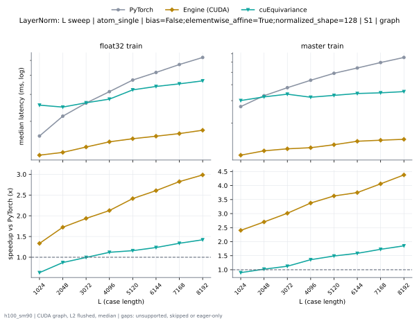

**float32 train** (median ms; x = speedup vs PyTorch)

| L | PyTorch | Engine (Triton) | Engine (CUDA) | Anthropic | cuEquivariance |
|---|---|---|---|---|---|
| 1024 | 0.01605 | 0.01414 (1.13x) | 0.01203 (1.33x) | unsupported | 0.02552 (0.63x) |
| 2048 | 0.02162 | 0.01485 (1.46x) | 0.01254 (1.72x) | unsupported | 0.02478 (0.87x) |
| 3072 | 0.02634 | 0.01546 (1.70x) | 0.0136 (1.94x) | unsupported | 0.02645 (1.00x) |
| 4096 | 0.03126 | 0.01659 (1.88x) | 0.0147 (2.13x) | unsupported | 0.02794 (1.12x) |
| 5120 | 0.03722 | 0.01698 (2.19x) | 0.01541 (2.42x) | unsupported | 0.03211 (1.16x) |
| 6144 | 0.04171 | 0.01773 (2.35x) | 0.016 (2.61x) | unsupported | 0.03379 (1.23x) |
| 7168 | 0.04699 | 0.01878 (2.50x) | 0.01664 (2.82x) | unsupported | 0.03515 (1.34x) |
| 8192 | 0.05226 | 0.02061 (2.54x) | 0.0175 (2.99x) | unsupported | 0.03677 (1.42x) |

**master train** (median ms; x = speedup vs PyTorch)

| L | PyTorch | Engine (Triton) | Engine (CUDA) | Anthropic | cuEquivariance |
|---|---|---|---|---|---|
| 1024 | 0.02694 | 0.01355 (1.99x) | 0.01122 (2.40x) | unsupported | 0.03005 (0.90x) |
| 2048 | 0.03278 | 0.0144 (2.28x) | 0.01213 (2.70x) | unsupported | 0.0321 (1.02x) |
| 3072 | 0.03789 | 0.01514 (2.50x) | 0.01258 (3.01x) | unsupported | 0.0337 (1.12x) |
| 4096 | 0.04333 | 0.01544 (2.81x) | 0.01283 (3.38x) | unsupported | 0.0319 (1.36x) |
| 5120 | 0.04912 | 0.01626 (3.02x) | 0.01354 (3.63x) | unsupported | 0.03298 (1.49x) |
| 6144 | 0.05405 | 0.01712 (3.16x) | 0.01442 (3.75x) | unsupported | 0.03411 (1.58x) |
| 7168 | 0.05965 | 0.01739 (3.43x) | 0.01469 (4.06x) | unsupported | 0.03453 (1.73x) |
| 8192 | 0.06536 | 0.01803 (3.62x) | 0.01493 (4.38x) | unsupported | 0.0353 (1.85x) |

### L sweep: atom_single | bias=False;elementwise_affine=True;normalized_shape=128 | S5 | graph

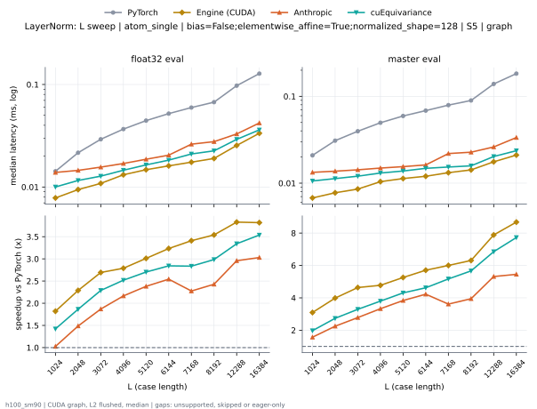

**float32 eval** (median ms; x = speedup vs PyTorch)

| L | PyTorch | Engine (Triton) | Engine (CUDA) | Anthropic | cuEquivariance |
|---|---|---|---|---|---|
| 1024 | 0.01424 | 0.008784 (1.62x) | 0.007824 (1.82x) | 0.01387 (1.03x) | 0.01002 (1.42x) |
| 2048 | 0.0216 | 0.0108 (2.00x) | 0.00944 (2.29x) | 0.01453 (1.49x) | 0.01158 (1.86x) |
| 3072 | 0.02922 | 0.01214 (2.41x) | 0.01085 (2.69x) | 0.01563 (1.87x) | 0.01277 (2.29x) |
| 4096 | 0.03672 | 0.01475 (2.49x) | 0.01317 (2.79x) | 0.01696 (2.17x) | 0.01458 (2.52x) |
| 5120 | 0.04442 | 0.01683 (2.64x) | 0.01475 (3.01x) | 0.01866 (2.38x) | 0.01643 (2.70x) |
| 6144 | 0.05198 | 0.01856 (2.80x) | 0.01608 (3.23x) | 0.02045 (2.54x) | 0.01829 (2.84x) |
| 7168 | 0.05957 | 0.02042 (2.92x) | 0.01747 (3.41x) | 0.02618 (2.28x) | 0.02101 (2.84x) |
| 8192 | 0.06723 | 0.02237 (3.01x) | 0.01899 (3.54x) | 0.0277 (2.43x) | 0.02253 (2.98x) |
| 12288 | 0.09739 | 0.02918 (3.34x) | 0.02544 (3.83x) | 0.03293 (2.96x) | 0.02915 (3.34x) |
| 16384 | 0.1276 | 0.03517 (3.63x) | 0.03344 (3.82x) | 0.04211 (3.03x) | 0.03608 (3.54x) |

**master eval** (median ms; x = speedup vs PyTorch)

| L | PyTorch | Engine (Triton) | Engine (CUDA) | Anthropic | cuEquivariance |
|---|---|---|---|---|---|
| 1024 | 0.0209 | 0.008032 (2.60x) | 0.006752 (3.09x) | 0.01331 (1.57x) | 0.01059 (1.97x) |
| 2048 | 0.03086 | 0.009056 (3.41x) | 0.007744 (3.99x) | 0.01373 (2.25x) | 0.01128 (2.74x) |
| 3072 | 0.03962 | 0.009968 (3.97x) | 0.008544 (4.64x) | 0.01424 (2.78x) | 0.01203 (3.29x) |
| 4096 | 0.04965 | 0.01069 (4.65x) | 0.0104 (4.77x) | 0.01491 (3.33x) | 0.01307 (3.80x) |
| 5120 | 0.05939 | 0.01147 (5.18x) | 0.0113 (5.26x) | 0.01549 (3.83x) | 0.01379 (4.31x) |
| 6144 | 0.06848 | 0.0135 (5.07x) | 0.012 (5.71x) | 0.01621 (4.23x) | 0.01482 (4.62x) |
| 7168 | 0.07922 | 0.01454 (5.45x) | 0.0132 (6.00x) | 0.02192 (3.61x) | 0.01533 (5.17x) |
| 8192 | 0.08963 | 0.01533 (5.85x) | 0.01421 (6.31x) | 0.02272 (3.95x) | 0.01582 (5.66x) |
| 12288 | 0.1389 | 0.01875 (7.41x) | 0.01762 (7.88x) | 0.02613 (5.32x) | 0.02027 (6.85x) |
| 16384 | 0.1827 | 0.02208 (8.27x) | 0.02106 (8.68x) | 0.0335 (5.45x) | 0.02365 (7.73x) |

### L sweep: atom_single | bias=True;elementwise_affine=True;normalized_shape=128 | S1 | graph

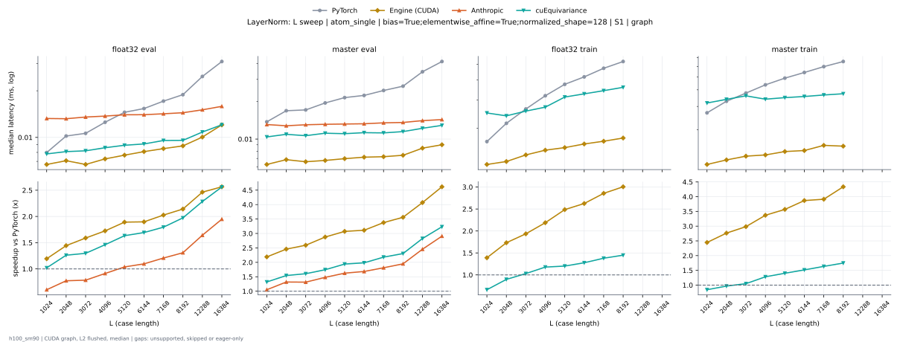

**float32 eval** (median ms; x = speedup vs PyTorch)

| L | PyTorch | Engine (Triton) | Engine (CUDA) | Anthropic | cuEquivariance |
|---|---|---|---|---|---|
| 1024 | 0.007984 | 0.006496 (1.23x) | 0.006688 (1.19x) | 0.01325 (0.60x) | 0.007824 (1.02x) |
| 2048 | 0.01021 | 0.006816 (1.50x) | 0.007072 (1.44x) | 0.0132 (0.77x) | 0.008096 (1.26x) |
| 3072 | 0.01062 | 0.006864 (1.55x) | 0.006688 (1.59x) | 0.01354 (0.78x) | 0.008192 (1.30x) |
| 4096 | 0.01253 | 0.007232 (1.73x) | 0.007264 (1.72x) | 0.01373 (0.91x) | 0.008576 (1.46x) |
| 5120 | 0.01453 | 0.00784 (1.85x) | 0.00768 (1.89x) | 0.014 (1.04x) | 0.008896 (1.63x) |
| 6144 | 0.01536 | 0.008112 (1.89x) | 0.008096 (1.90x) | 0.01402 (1.10x) | 0.009072 (1.69x) |
| 7168 | 0.01715 | 0.008416 (2.04x) | 0.008464 (2.03x) | 0.01421 (1.21x) | 0.009552 (1.80x) |
| 8192 | 0.01888 | 0.008704 (2.17x) | 0.008816 (2.14x) | 0.01443 (1.31x) | 0.009568 (1.97x) |
| 12288 | 0.02475 | 0.01011 (2.45x) | 0.01005 (2.46x) | 0.01507 (1.64x) | 0.01083 (2.29x) |
| 16384 | 0.03091 | 0.01122 (2.76x) | 0.01205 (2.57x) | 0.01587 (1.95x) | 0.01206 (2.56x) |

**master eval** (median ms; x = speedup vs PyTorch)

| L | PyTorch | Engine (Triton) | Engine (CUDA) | Anthropic | cuEquivariance |
|---|---|---|---|---|---|
| 1024 | 0.01373 | 0.00608 (2.26x) | 0.006272 (2.19x) | 0.01306 (1.05x) | 0.0104 (1.32x) |
| 2048 | 0.01683 | 0.006656 (2.53x) | 0.006848 (2.46x) | 0.01277 (1.32x) | 0.01091 (1.54x) |
| 3072 | 0.01709 | 0.006592 (2.59x) | 0.006592 (2.59x) | 0.01301 (1.31x) | 0.01064 (1.61x) |
| 4096 | 0.01942 | 0.007008 (2.77x) | 0.006752 (2.88x) | 0.01312 (1.48x) | 0.01114 (1.74x) |
| 5120 | 0.02142 | 0.006944 (3.09x) | 0.006976 (3.07x) | 0.01318 (1.62x) | 0.01104 (1.94x) |
| 6144 | 0.0223 | 0.007344 (3.04x) | 0.007168 (3.11x) | 0.01325 (1.68x) | 0.01125 (1.98x) |
| 7168 | 0.02442 | 0.007264 (3.36x) | 0.007232 (3.38x) | 0.01347 (1.81x) | 0.0112 (2.18x) |
| 8192 | 0.02643 | 0.007328 (3.61x) | 0.007424 (3.56x) | 0.01357 (1.95x) | 0.01147 (2.30x) |
| 12288 | 0.03445 | 0.008464 (4.07x) | 0.008464 (4.07x) | 0.01403 (2.45x) | 0.01219 (2.83x) |
| 16384 | 0.04158 | 0.008816 (4.72x) | 0.009008 (4.62x) | 0.0143 (2.91x) | 0.01286 (3.23x) |

**float32 train** (median ms; x = speedup vs PyTorch)

| L | PyTorch | Engine (Triton) | Engine (CUDA) | Anthropic | cuEquivariance |
|---|---|---|---|---|---|
| 1024 | 0.01648 | 0.01414 (1.17x) | 0.01186 (1.39x) | unsupported | 0.02486 (0.66x) |
| 2048 | 0.02142 | 0.01418 (1.51x) | 0.01237 (1.73x) | unsupported | 0.02386 (0.90x) |
| 3072 | 0.02632 | 0.01542 (1.71x) | 0.0136 (1.94x) | unsupported | 0.02554 (1.03x) |
| 4096 | 0.03186 | 0.01613 (1.98x) | 0.01456 (2.19x) | unsupported | 0.02704 (1.18x) |
| 5120 | 0.03755 | 0.01722 (2.18x) | 0.0151 (2.49x) | unsupported | 0.03126 (1.20x) |
| 6144 | 0.04179 | 0.01811 (2.31x) | 0.01592 (2.63x) | unsupported | 0.03274 (1.28x) |
| 7168 | 0.0473 | 0.01904 (2.48x) | 0.01656 (2.86x) | unsupported | 0.03427 (1.38x) |
| 8192 | 0.05213 | 0.02157 (2.42x) | 0.01734 (3.01x) | unsupported | 0.03597 (1.45x) |
| 12288 |  |  |  |  |  |
| 16384 |  |  |  |  |  |

**master train** (median ms; x = speedup vs PyTorch)

| L | PyTorch | Engine (Triton) | Engine (CUDA) | Anthropic | cuEquivariance |
|---|---|---|---|---|---|
| 1024 | 0.02685 | 0.01232 (2.18x) | 0.01098 (2.45x) | unsupported | 0.03184 (0.84x) |
| 2048 | 0.03282 | 0.01405 (2.34x) | 0.01187 (2.76x) | unsupported | 0.03392 (0.97x) |
| 3072 | 0.03781 | 0.01568 (2.41x) | 0.01267 (2.98x) | unsupported | 0.03605 (1.05x) |
| 4096 | 0.04362 | 0.01558 (2.80x) | 0.01294 (3.37x) | unsupported | 0.03402 (1.28x) |
| 5120 | 0.04899 | 0.01627 (3.01x) | 0.01373 (3.57x) | unsupported | 0.03494 (1.40x) |
| 6144 | 0.05403 | 0.01722 (3.14x) | 0.01397 (3.87x) | unsupported | 0.03563 (1.52x) |
| 7168 | 0.05979 | 0.01802 (3.32x) | 0.01528 (3.91x) | unsupported | 0.03658 (1.63x) |
| 8192 | 0.06534 | 0.01741 (3.75x) | 0.01507 (4.34x) | unsupported | 0.03738 (1.75x) |
| 12288 |  |  |  |  |  |
| 16384 |  |  |  |  |  |

### L sweep: token_pair | bias=False;elementwise_affine=True;normalized_shape=128 | S1 | graph

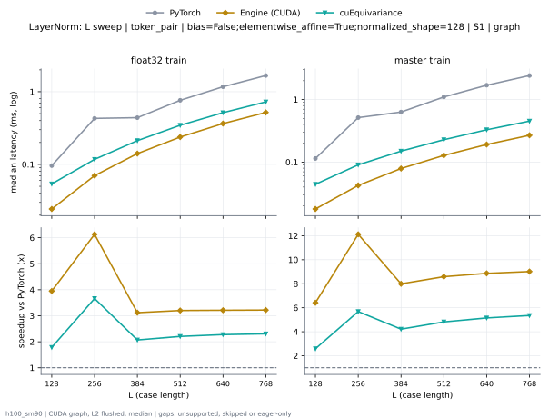

**float32 train** (median ms; x = speedup vs PyTorch)

| L | PyTorch | Engine (Triton) | Engine (CUDA) | Anthropic | cuEquivariance |
|---|---|---|---|---|---|
| 128 | 0.09619 | 0.02955 (3.26x) | 0.02435 (3.95x) | unsupported | 0.05392 (1.78x) |
| 256 | 0.4294 | 0.07146 (6.01x) | 0.07005 (6.13x) | unsupported | 0.1172 (3.66x) |
| 384 | 0.4391 | 0.1413 (3.11x) | 0.1408 (3.12x) | unsupported | 0.2122 (2.07x) |
| 512 | 0.7619 | 0.2396 (3.18x) | 0.238 (3.20x) | unsupported | 0.3455 (2.21x) |
| 640 | 1.171 | 0.3672 (3.19x) | 0.3645 (3.21x) | unsupported | 0.5148 (2.27x) |
| 768 | 1.669 | 0.519 (3.22x) | 0.5185 (3.22x) | unsupported | 0.7244 (2.30x) |

**master train** (median ms; x = speedup vs PyTorch)

| L | PyTorch | Engine (Triton) | Engine (CUDA) | Anthropic | cuEquivariance |
|---|---|---|---|---|---|
| 128 | 0.1143 | 0.0225 (5.08x) | 0.01781 (6.42x) | unsupported | 0.04421 (2.58x) |
| 256 | 0.5142 | 0.044 (11.69x) | 0.04243 (12.12x) | unsupported | 0.09046 (5.68x) |
| 384 | 0.6313 | 0.08046 (7.85x) | 0.07896 (7.99x) | unsupported | 0.1497 (4.22x) |
| 512 | 1.099 | 0.1315 (8.36x) | 0.128 (8.59x) | unsupported | 0.228 (4.82x) |
| 640 | 1.695 | 0.1951 (8.69x) | 0.1911 (8.87x) | unsupported | 0.3289 (5.15x) |
| 768 | 2.42 | 0.2726 (8.88x) | 0.2684 (9.02x) | unsupported | 0.4519 (5.35x) |

### L sweep: token_pair | bias=False;elementwise_affine=True;normalized_shape=128 | S5 | graph

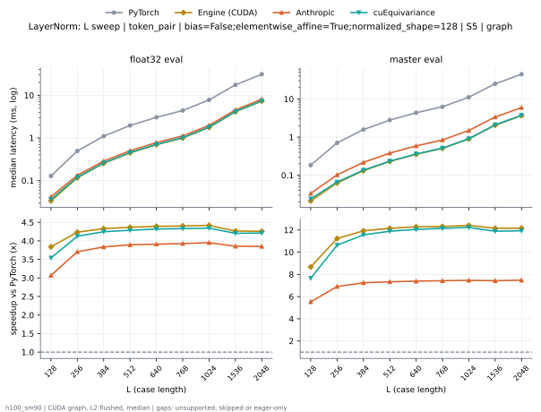

**float32 eval** (median ms; x = speedup vs PyTorch)

| L | PyTorch | Engine (Triton) | Engine (CUDA) | Anthropic | cuEquivariance |
|---|---|---|---|---|---|
| 128 | 0.1283 | 0.03552 (3.61x) | 0.03342 (3.84x) | 0.04182 (3.07x) | 0.03626 (3.54x) |
| 256 | 0.4936 | 0.1187 (4.16x) | 0.1166 (4.23x) | 0.1332 (3.71x) | 0.1197 (4.12x) |
| 384 | 1.102 | 0.2584 (4.26x) | 0.2545 (4.33x) | 0.2872 (3.84x) | 0.2594 (4.25x) |
| 512 | 1.953 | 0.4516 (4.32x) | 0.4473 (4.37x) | 0.5014 (3.89x) | 0.4557 (4.28x) |
| 640 | 3.045 | 0.7012 (4.34x) | 0.6933 (4.39x) | 0.7787 (3.91x) | 0.7049 (4.32x) |
| 768 | 4.385 | 1.005 (4.36x) | 0.9962 (4.40x) | 1.116 (3.93x) | 1.013 (4.33x) |
| 1024 | 7.79 | 1.781 (4.37x) | 1.764 (4.42x) | 1.972 (3.95x) | 1.794 (4.34x) |
| 1536 | 17.52 | 4.138 (4.23x) | 4.106 (4.27x) | 4.545 (3.85x) | 4.167 (4.20x) |
| 2048 | 31.08 | 7.352 (4.23x) | 7.298 (4.26x) | 8.071 (3.85x) | 7.379 (4.21x) |

**master eval** (median ms; x = speedup vs PyTorch)

| L | PyTorch | Engine (Triton) | Engine (CUDA) | Anthropic | cuEquivariance |
|---|---|---|---|---|---|
| 128 | 0.184 | 0.02226 (8.27x) | 0.02122 (8.67x) | 0.03328 (5.53x) | 0.02403 (7.66x) |
| 256 | 0.7052 | 0.06483 (10.88x) | 0.06278 (11.23x) | 0.1021 (6.91x) | 0.06634 (10.63x) |
| 384 | 1.573 | 0.1345 (11.70x) | 0.132 (11.92x) | 0.2171 (7.25x) | 0.1361 (11.56x) |
| 512 | 2.785 | 0.2329 (11.96x) | 0.2292 (12.15x) | 0.3797 (7.33x) | 0.2342 (11.89x) |
| 640 | 4.344 | 0.3577 (12.14x) | 0.3536 (12.29x) | 0.5876 (7.39x) | 0.3604 (12.05x) |
| 768 | 6.25 | 0.5123 (12.20x) | 0.5074 (12.32x) | 0.8415 (7.43x) | 0.5143 (12.15x) |
| 1024 | 11.11 | 0.9032 (12.30x) | 0.8947 (12.41x) | 1.488 (7.47x) | 0.9082 (12.23x) |
| 1536 | 24.98 | 2.092 (11.94x) | 2.055 (12.16x) | 3.362 (7.43x) | 2.102 (11.89x) |
| 2048 | 44.44 | 3.712 (11.97x) | 3.653 (12.16x) | 5.941 (7.48x) | 3.726 (11.93x) |

### L sweep: token_pair | bias=False;elementwise_affine=True;normalized_shape=256 | S1 | graph

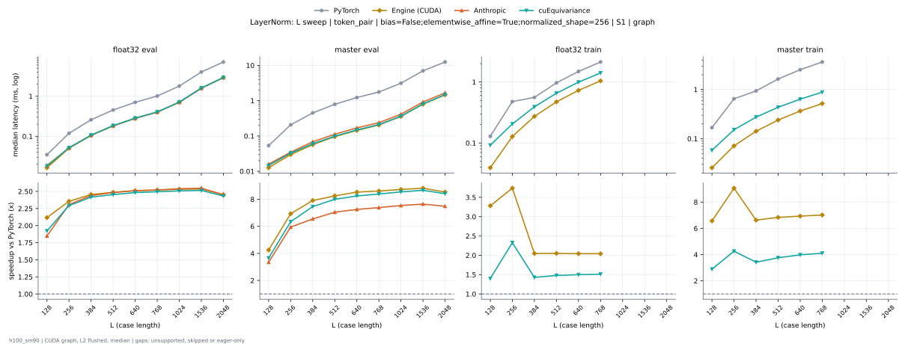

**float32 eval** (median ms; x = speedup vs PyTorch)

| L | PyTorch | Engine (Triton) | Engine (CUDA) | Anthropic | cuEquivariance |
|---|---|---|---|---|---|
| 128 | 0.03475 | 0.01811 (1.92x) | 0.01642 (2.12x) | 0.0188 (1.85x) | 0.01808 (1.92x) |
| 256 | 0.1189 | 0.05112 (2.33x) | 0.0505 (2.36x) | 0.05154 (2.31x) | 0.05187 (2.29x) |
| 384 | 0.2587 | 0.1067 (2.42x) | 0.1054 (2.45x) | 0.106 (2.44x) | 0.1071 (2.42x) |
| 512 | 0.454 | 0.1843 (2.46x) | 0.1826 (2.49x) | 0.1828 (2.48x) | 0.1851 (2.45x) |
| 640 | 0.7058 | 0.2837 (2.49x) | 0.2812 (2.51x) | 0.2811 (2.51x) | 0.2842 (2.48x) |
| 768 | 1.013 | 0.4059 (2.50x) | 0.4021 (2.52x) | 0.402 (2.52x) | 0.4061 (2.50x) |
| 1024 | 1.796 | 0.716 (2.51x) | 0.7097 (2.53x) | 0.7072 (2.54x) | 0.7163 (2.51x) |
| 1536 | 4.033 | 1.603 (2.52x) | 1.59 (2.54x) | 1.583 (2.55x) | 1.604 (2.51x) |
| 2048 | 7.165 | 2.945 (2.43x) | 2.922 (2.45x) | 2.921 (2.45x) | 2.945 (2.43x) |

**master eval** (median ms; x = speedup vs PyTorch)

| L | PyTorch | Engine (Triton) | Engine (CUDA) | Anthropic | cuEquivariance |
|---|---|---|---|---|---|
| 128 | 0.05347 | 0.01261 (4.24x) | 0.01259 (4.25x) | 0.01597 (3.35x) | 0.01464 (3.65x) |
| 256 | 0.2066 | 0.0313 (6.60x) | 0.02979 (6.93x) | 0.03475 (5.94x) | 0.03258 (6.34x) |
| 384 | 0.45 | 0.05896 (7.63x) | 0.0569 (7.91x) | 0.06874 (6.55x) | 0.06034 (7.46x) |
| 512 | 0.7906 | 0.09768 (8.09x) | 0.09582 (8.25x) | 0.1122 (7.05x) | 0.09883 (8.00x) |
| 640 | 1.228 | 0.147 (8.35x) | 0.1439 (8.53x) | 0.1694 (7.25x) | 0.149 (8.24x) |
| 768 | 1.763 | 0.2078 (8.49x) | 0.2048 (8.61x) | 0.2388 (7.39x) | 0.2102 (8.39x) |
| 1024 | 3.125 | 0.3629 (8.61x) | 0.3581 (8.73x) | 0.4144 (7.54x) | 0.3656 (8.55x) |
| 1536 | 7.023 | 0.806 (8.71x) | 0.7963 (8.82x) | 0.9188 (7.64x) | 0.8106 (8.66x) |
| 2048 | 12.48 | 1.478 (8.44x) | 1.462 (8.53x) | 1.666 (7.49x) | 1.483 (8.41x) |

**float32 train** (median ms; x = speedup vs PyTorch)

| L | PyTorch | Engine (Triton) | Engine (CUDA) | Anthropic | cuEquivariance |
|---|---|---|---|---|---|
| 128 | 0.1288 | 0.0443 (2.91x) | 0.03926 (3.28x) | unsupported | 0.09206 (1.40x) |
| 256 | 0.4772 | 0.1289 (3.70x) | 0.1277 (3.74x) | unsupported | 0.2051 (2.33x) |
| 384 | 0.5593 | 0.2663 (2.10x) | 0.2731 (2.05x) | unsupported | 0.3916 (1.43x) |
| 512 | 0.9691 | 0.4608 (2.10x) | 0.4726 (2.05x) | unsupported | 0.6551 (1.48x) |
| 640 | 1.491 | 0.7125 (2.09x) | 0.7301 (2.04x) | unsupported | 0.9946 (1.50x) |
| 768 | 2.13 | 1.016 (2.10x) | 1.044 (2.04x) | unsupported | 1.409 (1.51x) |
| 1024 |  |  |  |  |  |
| 1536 |  |  |  |  |  |
| 2048 |  |  |  |  |  |

**master train** (median ms; x = speedup vs PyTorch)

| L | PyTorch | Engine (Triton) | Engine (CUDA) | Anthropic | cuEquivariance |
|---|---|---|---|---|---|
| 128 | 0.1681 | 0.03136 (5.36x) | 0.0256 (6.57x) | unsupported | 0.05818 (2.89x) |
| 256 | 0.6475 | 0.07586 (8.54x) | 0.07147 (9.06x) | unsupported | 0.152 (4.26x) |
| 384 | 0.9389 | 0.1454 (6.46x) | 0.1417 (6.63x) | unsupported | 0.2747 (3.42x) |
| 512 | 1.638 | 0.2421 (6.76x) | 0.2396 (6.84x) | unsupported | 0.4357 (3.76x) |
| 640 | 2.533 | 0.3665 (6.91x) | 0.3655 (6.93x) | unsupported | 0.6363 (3.98x) |
| 768 | 3.637 | 0.5218 (6.97x) | 0.5182 (7.02x) | unsupported | 0.8854 (4.11x) |
| 1024 |  |  |  |  |  |
| 1536 |  |  |  |  |  |
| 2048 |  |  |  |  |  |

### L sweep: token_pair | bias=False;elementwise_affine=True;normalized_shape=267 | S1 | graph

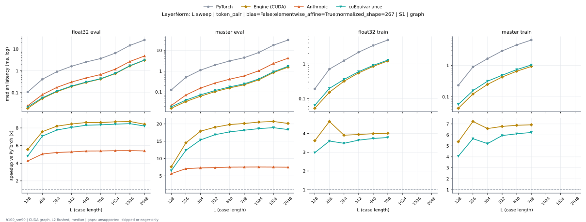

**float32 eval** (median ms; x = speedup vs PyTorch)

| L | PyTorch | Engine (Triton) | Engine (CUDA) | Anthropic | cuEquivariance |
|---|---|---|---|---|---|
| 128 | 0.1072 | 0.02208 (4.86x) | 0.01928 (5.56x) | 0.02518 (4.26x) | 0.02229 (4.81x) |
| 256 | 0.4106 | 0.05683 (7.22x) | 0.05419 (7.58x) | 0.08134 (5.05x) | 0.05805 (7.07x) |
| 384 | 0.9129 | 0.114 (8.01x) | 0.1113 (8.20x) | 0.1749 (5.22x) | 0.1175 (7.77x) |
| 512 | 1.617 | 0.1956 (8.27x) | 0.1915 (8.44x) | 0.3061 (5.28x) | 0.2007 (8.06x) |
| 640 | 2.536 | 0.3003 (8.45x) | 0.2943 (8.62x) | 0.4712 (5.38x) | 0.3053 (8.31x) |
| 768 | 3.648 | 0.4258 (8.57x) | 0.4237 (8.61x) | 0.6766 (5.39x) | 0.4368 (8.35x) |
| 1024 | 6.479 | 0.7504 (8.63x) | 0.745 (8.70x) | 1.195 (5.42x) | 0.7686 (8.43x) |
| 1536 | 14.56 | 1.68 (8.67x) | 1.668 (8.73x) | 2.681 (5.43x) | 1.717 (8.48x) |
| 2048 | 25.73 | 3.077 (8.36x) | 3.057 (8.42x) | 4.768 (5.40x) | 3.132 (8.22x) |

**master eval** (median ms; x = speedup vs PyTorch)

| L | PyTorch | Engine (Triton) | Engine (CUDA) | Anthropic | cuEquivariance |
|---|---|---|---|---|---|
| 128 | 0.1246 | 0.0175 (7.12x) | 0.01635 (7.62x) | 0.02214 (5.63x) | 0.01918 (6.50x) |
| 256 | 0.5012 | 0.04291 (11.68x) | 0.0345 (14.53x) | 0.0708 (7.08x) | 0.04046 (12.39x) |
| 384 | 1.112 | 0.08086 (13.75x) | 0.06208 (17.91x) | 0.1523 (7.30x) | 0.07229 (15.38x) |
| 512 | 1.967 | 0.1318 (14.92x) | 0.1032 (19.05x) | 0.2661 (7.39x) | 0.1164 (16.90x) |
| 640 | 3.082 | 0.1981 (15.56x) | 0.1555 (19.82x) | 0.4099 (7.52x) | 0.174 (17.71x) |
| 768 | 4.431 | 0.2785 (15.91x) | 0.22 (20.14x) | 0.5873 (7.54x) | 0.2437 (18.18x) |
| 1024 | 7.866 | 0.4829 (16.29x) | 0.383 (20.54x) | 1.04 (7.57x) | 0.4219 (18.64x) |
| 1536 | 17.6 | 1.073 (16.39x) | 0.8494 (20.72x) | 2.335 (7.54x) | 0.9299 (18.92x) |
| 2048 | 31.28 | 1.983 (15.77x) | 1.553 (20.15x) | 4.172 (7.50x) | 1.703 (18.37x) |

**float32 train** (median ms; x = speedup vs PyTorch)

| L | PyTorch | Engine (Triton) | Engine (CUDA) | Anthropic | cuEquivariance |
|---|---|---|---|---|---|
| 128 | 0.1912 | 0.05714 (3.35x) | 0.0529 (3.61x) | unsupported | 0.06421 (2.98x) |
| 256 | 0.7093 | 0.1658 (4.28x) | 0.1528 (4.64x) | unsupported | 0.1972 (3.60x) |
| 384 | 1.241 | 0.3484 (3.56x) | 0.3175 (3.91x) | unsupported | 0.357 (3.48x) |
| 512 | 2.172 | 0.5832 (3.72x) | 0.5503 (3.95x) | unsupported | 0.5959 (3.64x) |
| 640 | 3.388 | 0.8828 (3.84x) | 0.8492 (3.99x) | unsupported | 0.9074 (3.73x) |
| 768 | 4.871 | 1.253 (3.89x) | 1.214 (4.01x) | unsupported | 1.286 (3.79x) |
| 1024 |  |  |  |  |  |
| 1536 |  |  |  |  |  |
| 2048 |  |  |  |  |  |

**master train** (median ms; x = speedup vs PyTorch)

| L | PyTorch | Engine (Triton) | Engine (CUDA) | Anthropic | cuEquivariance |
|---|---|---|---|---|---|
| 128 | 0.232 | 0.04693 (4.94x) | 0.04312 (5.38x) | unsupported | 0.05712 (4.06x) |
| 256 | 0.886 | 0.1392 (6.37x) | 0.1226 (7.23x) | unsupported | 0.1567 (5.66x) |
| 384 | 1.633 | 0.2748 (5.94x) | 0.2483 (6.58x) | unsupported | 0.3139 (5.20x) |
| 512 | 2.878 | 0.4467 (6.44x) | 0.4248 (6.77x) | unsupported | 0.4843 (5.94x) |
| 640 | 4.473 | 0.6688 (6.69x) | 0.6502 (6.88x) | unsupported | 0.7331 (6.10x) |
| 768 | 6.403 | 0.9347 (6.85x) | 0.9251 (6.92x) | unsupported | 1.028 (6.23x) |
| 1024 |  |  |  |  |  |
| 1536 |  |  |  |  |  |
| 2048 |  |  |  |  |  |

### L sweep: token_pair | bias=False;elementwise_affine=True;normalized_shape=384 | S1 | graph

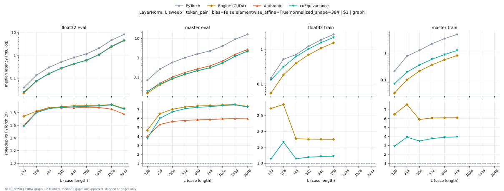

**float32 eval** (median ms; x = speedup vs PyTorch)

| L | PyTorch | Engine (Triton) | Engine (CUDA) | Anthropic | cuEquivariance |
|---|---|---|---|---|---|
| 128 | 0.03822 | 0.02419 (1.58x) | 0.02192 (1.74x) | 0.02392 (1.60x) | 0.02413 (1.58x) |
| 256 | 0.1338 | 0.07411 (1.80x) | 0.07325 (1.83x) | 0.07376 (1.81x) | 0.07427 (1.80x) |
| 384 | 0.2927 | 0.1569 (1.87x) | 0.1557 (1.88x) | 0.1563 (1.87x) | 0.157 (1.86x) |
| 512 | 0.5141 | 0.2727 (1.89x) | 0.2712 (1.90x) | 0.2732 (1.88x) | 0.2726 (1.89x) |
| 640 | 0.7998 | 0.4216 (1.90x) | 0.4186 (1.91x) | 0.4259 (1.88x) | 0.4218 (1.90x) |
| 768 | 1.148 | 0.6031 (1.90x) | 0.6001 (1.91x) | 0.6077 (1.89x) | 0.6037 (1.90x) |
| 1024 | 2.036 | 1.068 (1.91x) | 1.062 (1.92x) | 1.081 (1.88x) | 1.067 (1.91x) |
| 1536 | 4.6 | 2.39 (1.92x) | 2.382 (1.93x) | 2.478 (1.86x) | 2.391 (1.92x) |
| 2048 | 8.172 | 4.394 (1.86x) | 4.374 (1.87x) | 4.596 (1.78x) | 4.397 (1.86x) |

**master eval** (median ms; x = speedup vs PyTorch)

| L | PyTorch | Engine (Triton) | Engine (CUDA) | Anthropic | cuEquivariance |
|---|---|---|---|---|---|
| 128 | 0.07029 | 0.01578 (4.46x) | 0.01493 (4.71x) | 0.01746 (4.03x) | 0.01854 (3.79x) |
| 256 | 0.2631 | 0.04235 (6.21x) | 0.0401 (6.56x) | 0.04917 (5.35x) | 0.04355 (6.04x) |
| 384 | 0.5771 | 0.08371 (6.89x) | 0.08174 (7.06x) | 0.1014 (5.69x) | 0.08525 (6.77x) |
| 512 | 1.016 | 0.1413 (7.19x) | 0.1389 (7.31x) | 0.1753 (5.79x) | 0.1426 (7.12x) |
| 640 | 1.581 | 0.2147 (7.36x) | 0.2129 (7.43x) | 0.2691 (5.88x) | 0.217 (7.29x) |
| 768 | 2.271 | 0.3077 (7.38x) | 0.3038 (7.47x) | 0.3843 (5.91x) | 0.3089 (7.35x) |
| 1024 | 4.044 | 0.5391 (7.50x) | 0.5355 (7.55x) | 0.6764 (5.98x) | 0.5413 (7.47x) |
| 1536 | 9.086 | 1.203 (7.55x) | 1.197 (7.59x) | 1.513 (6.00x) | 1.204 (7.55x) |
| 2048 | 16.15 | 2.204 (7.33x) | 2.191 (7.37x) | 2.702 (5.98x) | 2.208 (7.31x) |

**float32 train** (median ms; x = speedup vs PyTorch)

| L | PyTorch | Engine (Triton) | Engine (CUDA) | Anthropic | cuEquivariance |
|---|---|---|---|---|---|
| 128 | 0.1476 | 0.05995 (2.46x) | 0.05434 (2.72x) | unsupported | 0.1307 (1.13x) |
| 256 | 0.5182 | 0.1844 (2.81x) | 0.1824 (2.84x) | unsupported | 0.3111 (1.67x) |
| 384 | 0.7024 | 0.3921 (1.79x) | 0.397 (1.77x) | unsupported | 0.6159 (1.14x) |
| 512 | 1.221 | 0.6845 (1.78x) | 0.6943 (1.76x) | unsupported | 1.028 (1.19x) |
| 640 | 1.886 | 1.068 (1.77x) | 1.077 (1.75x) | unsupported | 1.558 (1.21x) |
| 768 | 2.7 | 1.524 (1.77x) | 1.544 (1.75x) | unsupported | 2.21 (1.22x) |
| 1024 |  |  |  |  |  |
| 1536 |  |  |  |  |  |
| 2048 |  |  |  |  |  |

**master train** (median ms; x = speedup vs PyTorch)

| L | PyTorch | Engine (Triton) | Engine (CUDA) | Anthropic | cuEquivariance |
|---|---|---|---|---|---|
| 128 | 0.21 | 0.04458 (4.71x) | 0.03235 (6.49x) | unsupported | 0.07211 (2.91x) |
| 256 | 0.7709 | 0.1321 (5.83x) | 0.1015 (7.59x) | unsupported | 0.1963 (3.93x) |
| 384 | 1.268 | 0.2746 (4.62x) | 0.2146 (5.91x) | unsupported | 0.3633 (3.49x) |
| 512 | 2.224 | 0.4721 (4.71x) | 0.3659 (6.08x) | unsupported | 0.5904 (3.77x) |
| 640 | 3.447 | 0.7095 (4.86x) | 0.5652 (6.10x) | unsupported | 0.8822 (3.91x) |
| 768 | 4.946 | 1.005 (4.92x) | 0.8092 (6.11x) | unsupported | 1.248 (3.96x) |
| 1024 |  |  |  |  |  |
| 1536 |  |  |  |  |  |
| 2048 |  |  |  |  |  |

### L sweep: token_pair | bias=False;elementwise_affine=True;normalized_shape=512 | S1 | graph

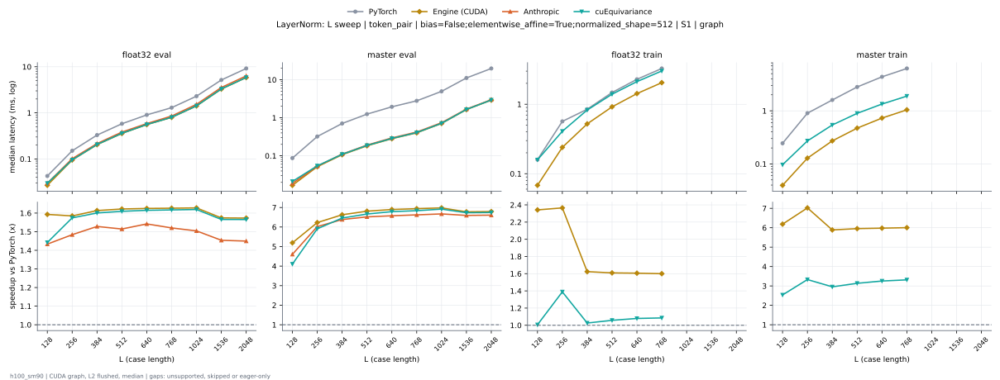

**float32 eval** (median ms; x = speedup vs PyTorch)

| L | PyTorch | Engine (Triton) | Engine (CUDA) | Anthropic | cuEquivariance |
|---|---|---|---|---|---|
| 128 | 0.04277 | 0.02928 (1.46x) | 0.02685 (1.59x) | 0.02984 (1.43x) | 0.02966 (1.44x) |
| 256 | 0.1506 | 0.09534 (1.58x) | 0.09504 (1.58x) | 0.1015 (1.48x) | 0.09566 (1.57x) |
| 384 | 0.3298 | 0.2057 (1.60x) | 0.2044 (1.61x) | 0.2158 (1.53x) | 0.2061 (1.60x) |
| 512 | 0.5808 | 0.3602 (1.61x) | 0.3581 (1.62x) | 0.3835 (1.51x) | 0.3608 (1.61x) |
| 640 | 0.9036 | 0.5588 (1.62x) | 0.5561 (1.62x) | 0.5861 (1.54x) | 0.5596 (1.61x) |
| 768 | 1.297 | 0.8017 (1.62x) | 0.7978 (1.63x) | 0.8534 (1.52x) | 0.8024 (1.62x) |
| 1024 | 2.301 | 1.42 (1.62x) | 1.414 (1.63x) | 1.53 (1.50x) | 1.421 (1.62x) |
| 1536 | 5.169 | 3.299 (1.57x) | 3.284 (1.57x) | 3.556 (1.45x) | 3.301 (1.57x) |
| 2048 | 9.184 | 5.862 (1.57x) | 5.838 (1.57x) | 6.335 (1.45x) | 5.866 (1.57x) |

**master eval** (median ms; x = speedup vs PyTorch)

| L | PyTorch | Engine (Triton) | Engine (CUDA) | Anthropic | cuEquivariance |
|---|---|---|---|---|---|
| 128 | 0.08706 | 0.01981 (4.39x) | 0.01677 (5.19x) | 0.01891 (4.60x) | 0.02122 (4.10x) |
| 256 | 0.3219 | 0.0531 (6.06x) | 0.05168 (6.23x) | 0.05344 (6.02x) | 0.05446 (5.91x) |
| 384 | 0.7082 | 0.1087 (6.51x) | 0.1068 (6.63x) | 0.111 (6.38x) | 0.1096 (6.46x) |
| 512 | 1.249 | 0.1864 (6.70x) | 0.1834 (6.81x) | 0.1916 (6.52x) | 0.1874 (6.67x) |
| 640 | 1.945 | 0.2849 (6.83x) | 0.2819 (6.90x) | 0.2957 (6.58x) | 0.2865 (6.79x) |
| 768 | 2.795 | 0.406 (6.88x) | 0.4027 (6.94x) | 0.422 (6.62x) | 0.4088 (6.84x) |
| 1024 | 4.959 | 0.7152 (6.93x) | 0.7105 (6.98x) | 0.7433 (6.67x) | 0.7169 (6.92x) |
| 1536 | 11.16 | 1.655 (6.74x) | 1.646 (6.78x) | 1.692 (6.59x) | 1.657 (6.73x) |
| 2048 | 19.81 | 2.934 (6.75x) | 2.918 (6.79x) | 2.998 (6.61x) | 2.939 (6.74x) |

**float32 train** (median ms; x = speedup vs PyTorch)

| L | PyTorch | Engine (Triton) | Engine (CUDA) | Anthropic | cuEquivariance |
|---|---|---|---|---|---|
| 128 | 0.1595 | 0.07069 (2.26x) | 0.0681 (2.34x) | unsupported | 0.1585 (1.01x) |
| 256 | 0.5671 | 0.2384 (2.38x) | 0.2398 (2.37x) | unsupported | 0.4084 (1.39x) |
| 384 | 0.848 | 0.5202 (1.63x) | 0.5222 (1.62x) | unsupported | 0.8264 (1.03x) |
| 512 | 1.477 | 0.9139 (1.62x) | 0.918 (1.61x) | unsupported | 1.397 (1.06x) |
| 640 | 2.287 | 1.419 (1.61x) | 1.424 (1.61x) | unsupported | 2.119 (1.08x) |
| 768 | 3.277 | 2.043 (1.60x) | 2.048 (1.60x) | unsupported | 3.019 (1.09x) |
| 1024 |  |  |  |  |  |
| 1536 |  |  |  |  |  |
| 2048 |  |  |  |  |  |

**master train** (median ms; x = speedup vs PyTorch)

| L | PyTorch | Engine (Triton) | Engine (CUDA) | Anthropic | cuEquivariance |
|---|---|---|---|---|---|
| 128 | 0.2448 | 0.05522 (4.43x) | 0.03958 (6.19x) | unsupported | 0.09651 (2.54x) |
| 256 | 0.9027 | 0.1739 (5.19x) | 0.1285 (7.02x) | unsupported | 0.2712 (3.33x) |
| 384 | 1.599 | 0.3606 (4.43x) | 0.2716 (5.89x) | unsupported | 0.5412 (2.95x) |
| 512 | 2.811 | 0.625 (4.50x) | 0.472 (5.95x) | unsupported | 0.8963 (3.14x) |
| 640 | 4.366 | 0.962 (4.54x) | 0.7303 (5.98x) | unsupported | 1.342 (3.25x) |
| 768 | 6.269 | 1.375 (4.56x) | 1.044 (6.00x) | unsupported | 1.892 (3.31x) |
| 1024 |  |  |  |  |  |
| 1536 |  |  |  |  |  |
| 2048 |  |  |  |  |  |

### L sweep: token_pair | bias=False;elementwise_affine=True;normalized_shape=651 | S1 | graph

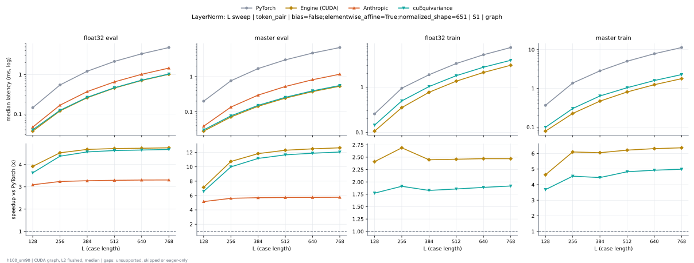

**float32 eval** (median ms; x = speedup vs PyTorch)

| L | PyTorch | Engine (Triton) | Engine (CUDA) | Anthropic | cuEquivariance |
|---|---|---|---|---|---|
| 128 | 0.145 | 0.04384 (3.31x) | 0.03701 (3.92x) | 0.04688 (3.09x) | 0.03997 (3.63x) |
| 256 | 0.5437 | 0.1397 (3.89x) | 0.1201 (4.53x) | 0.1678 (3.24x) | 0.1243 (4.37x) |
| 384 | 1.212 | 0.2979 (4.07x) | 0.259 (4.68x) | 0.3701 (3.27x) | 0.2654 (4.57x) |
| 512 | 2.146 | 0.5186 (4.14x) | 0.4549 (4.72x) | 0.6519 (3.29x) | 0.4638 (4.63x) |
| 640 | 3.349 | 0.8036 (4.17x) | 0.7079 (4.73x) | 1.013 (3.30x) | 0.72 (4.65x) |
| 768 | 4.816 | 1.152 (4.18x) | 1.014 (4.75x) | 1.456 (3.31x) | 1.03 (4.68x) |

**master eval** (median ms; x = speedup vs PyTorch)

| L | PyTorch | Engine (Triton) | Engine (CUDA) | Anthropic | cuEquivariance |
|---|---|---|---|---|---|
| 128 | 0.1996 | 0.02958 (6.75x) | 0.02797 (7.14x) | 0.03869 (5.16x) | 0.03032 (6.58x) |
| 256 | 0.7601 | 0.08334 (9.12x) | 0.07075 (10.74x) | 0.1355 (5.61x) | 0.07606 (9.99x) |
| 384 | 1.693 | 0.1725 (9.81x) | 0.143 (11.84x) | 0.2972 (5.70x) | 0.1516 (11.17x) |
| 512 | 2.998 | 0.2966 (10.11x) | 0.2436 (12.31x) | 0.5231 (5.73x) | 0.257 (11.67x) |
| 640 | 4.677 | 0.4571 (10.23x) | 0.3741 (12.50x) | 0.8145 (5.74x) | 0.3932 (11.89x) |
| 768 | 6.726 | 0.653 (10.30x) | 0.5318 (12.65x) | 1.169 (5.75x) | 0.5578 (12.06x) |

**float32 train** (median ms; x = speedup vs PyTorch)

| L | PyTorch | Engine (Triton) | Engine (CUDA) | Anthropic | cuEquivariance |
|---|---|---|---|---|---|
| 128 | 0.2552 | 0.1188 (2.15x) | 0.1059 (2.41x) | unsupported | 0.1439 (1.77x) |
| 256 | 0.9468 | 0.4148 (2.28x) | 0.352 (2.69x) | unsupported | 0.4952 (1.91x) |
| 384 | 1.88 | 0.9166 (2.05x) | 0.7682 (2.45x) | unsupported | 1.028 (1.83x) |
| 512 | 3.329 | 1.617 (2.06x) | 1.354 (2.46x) | unsupported | 1.792 (1.86x) |
| 640 | 5.213 | 2.525 (2.06x) | 2.111 (2.47x) | unsupported | 2.759 (1.89x) |
| 768 | 7.528 | 3.626 (2.08x) | 3.049 (2.47x) | unsupported | 3.926 (1.92x) |

**master train** (median ms; x = speedup vs PyTorch)

| L | PyTorch | Engine (Triton) | Engine (CUDA) | Anthropic | cuEquivariance |
|---|---|---|---|---|---|
| 128 | 0.3647 | 0.08907 (4.09x) | 0.07867 (4.64x) | unsupported | 0.09907 (3.68x) |
| 256 | 1.373 | 0.2828 (4.85x) | 0.2251 (6.10x) | unsupported | 0.302 (4.54x) |
| 384 | 2.835 | 0.5891 (4.81x) | 0.4685 (6.05x) | unsupported | 0.6363 (4.45x) |
| 512 | 5.023 | 1.093 (4.60x) | 0.8082 (6.21x) | unsupported | 1.04 (4.83x) |
| 640 | 7.855 | 1.551 (5.06x) | 1.245 (6.31x) | unsupported | 1.595 (4.93x) |
| 768 | 11.33 | 2.218 (5.11x) | 1.781 (6.36x) | unsupported | 2.271 (4.99x) |

### L sweep: token_pair | bias=True;elementwise_affine=True;normalized_shape=128 | S1 | graph

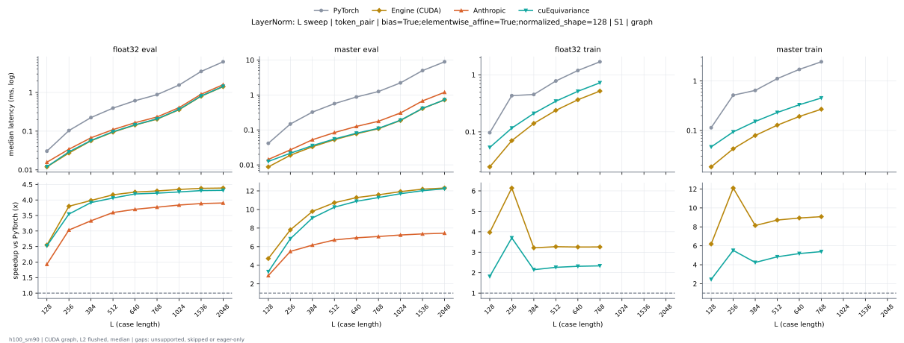

**float32 eval** (median ms; x = speedup vs PyTorch)

| L | PyTorch | Engine (Triton) | Engine (CUDA) | Anthropic | cuEquivariance |
|---|---|---|---|---|---|
| 128 | 0.03045 | 0.01109 (2.75x) | 0.01195 (2.55x) | 0.01578 (1.93x) | 0.01206 (2.52x) |
| 256 | 0.1036 | 0.02816 (3.68x) | 0.02728 (3.80x) | 0.03416 (3.03x) | 0.02922 (3.55x) |
| 384 | 0.2244 | 0.05627 (3.99x) | 0.05634 (3.98x) | 0.06741 (3.33x) | 0.05731 (3.92x) |
| 512 | 0.3937 | 0.09501 (4.14x) | 0.09446 (4.17x) | 0.1095 (3.60x) | 0.09688 (4.06x) |
| 640 | 0.6115 | 0.1452 (4.21x) | 0.1437 (4.25x) | 0.1653 (3.70x) | 0.1458 (4.19x) |
| 768 | 0.8769 | 0.2069 (4.24x) | 0.2044 (4.29x) | 0.2327 (3.77x) | 0.2078 (4.22x) |
| 1024 | 1.554 | 0.3624 (4.29x) | 0.3581 (4.34x) | 0.405 (3.84x) | 0.3649 (4.26x) |
| 1536 | 3.488 | 0.8045 (4.34x) | 0.7974 (4.37x) | 0.8977 (3.89x) | 0.8108 (4.30x) |
| 2048 | 6.194 | 1.425 (4.35x) | 1.413 (4.38x) | 1.587 (3.90x) | 1.437 (4.31x) |

**master eval** (median ms; x = speedup vs PyTorch)

| L | PyTorch | Engine (Triton) | Engine (CUDA) | Anthropic | cuEquivariance |
|---|---|---|---|---|---|
| 128 | 0.04141 | 0.008736 (4.74x) | 0.008768 (4.72x) | 0.01434 (2.89x) | 0.01254 (3.30x) |
| 256 | 0.1476 | 0.01838 (8.03x) | 0.0189 (7.81x) | 0.02688 (5.49x) | 0.02155 (6.85x) |
| 384 | 0.3228 | 0.0325 (9.93x) | 0.03296 (9.79x) | 0.05235 (6.17x) | 0.03552 (9.09x) |
| 512 | 0.5642 | 0.05213 (10.82x) | 0.05259 (10.73x) | 0.0839 (6.72x) | 0.05506 (10.25x) |
| 640 | 0.8753 | 0.07739 (11.31x) | 0.07762 (11.28x) | 0.1259 (6.95x) | 0.08045 (10.88x) |
| 768 | 1.254 | 0.1079 (11.63x) | 0.1083 (11.58x) | 0.1768 (7.09x) | 0.1111 (11.28x) |
| 1024 | 2.221 | 0.186 (11.94x) | 0.1863 (11.92x) | 0.3062 (7.25x) | 0.1899 (11.70x) |
| 1536 | 4.982 | 0.4096 (12.16x) | 0.4088 (12.18x) | 0.6758 (7.37x) | 0.4144 (12.02x) |
| 2048 | 8.89 | 0.7223 (12.31x) | 0.7225 (12.30x) | 1.193 (7.45x) | 0.7271 (12.23x) |

**float32 train** (median ms; x = speedup vs PyTorch)

| L | PyTorch | Engine (Triton) | Engine (CUDA) | Anthropic | cuEquivariance |
|---|---|---|---|---|---|
| 128 | 0.09683 | 0.03045 (3.18x) | 0.02438 (3.97x) | unsupported | 0.05334 (1.82x) |
| 256 | 0.4312 | 0.07219 (5.97x) | 0.07024 (6.14x) | unsupported | 0.1165 (3.70x) |
| 384 | 0.452 | 0.1432 (3.16x) | 0.1406 (3.22x) | unsupported | 0.2106 (2.15x) |
| 512 | 0.7797 | 0.2397 (3.25x) | 0.2384 (3.27x) | unsupported | 0.3447 (2.26x) |
| 640 | 1.189 | 0.3664 (3.25x) | 0.3655 (3.25x) | unsupported | 0.5143 (2.31x) |
| 768 | 1.691 | 0.5179 (3.26x) | 0.5189 (3.26x) | unsupported | 0.7241 (2.33x) |
| 1024 |  |  |  |  |  |
| 1536 |  |  |  |  |  |
| 2048 |  |  |  |  |  |

**master train** (median ms; x = speedup vs PyTorch)

| L | PyTorch | Engine (Triton) | Engine (CUDA) | Anthropic | cuEquivariance |
|---|---|---|---|---|---|
| 128 | 0.1139 | 0.02142 (5.32x) | 0.0184 (6.19x) | unsupported | 0.04656 (2.45x) |
| 256 | 0.516 | 0.0471 (10.95x) | 0.04264 (12.10x) | unsupported | 0.09355 (5.52x) |
| 384 | 0.6447 | 0.08293 (7.77x) | 0.07915 (8.15x) | unsupported | 0.152 (4.24x) |
| 512 | 1.116 | 0.1311 (8.52x) | 0.128 (8.72x) | unsupported | 0.2308 (4.84x) |
| 640 | 1.714 | 0.1941 (8.83x) | 0.1918 (8.94x) | unsupported | 0.3308 (5.18x) |
| 768 | 2.441 | 0.2712 (9.00x) | 0.2689 (9.08x) | unsupported | 0.4531 (5.39x) |
| 1024 |  |  |  |  |  |
| 1536 |  |  |  |  |  |
| 2048 |  |  |  |  |  |

### L sweep: token_pair | bias=True;elementwise_affine=True;normalized_shape=256 | S1 | graph

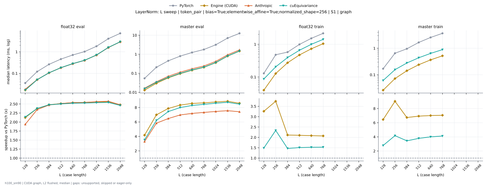

**float32 eval** (median ms; x = speedup vs PyTorch)

| L | PyTorch | Engine (Triton) | Engine (CUDA) | Anthropic | cuEquivariance |
|---|---|---|---|---|---|
| 128 | 0.03539 | 0.01629 (2.17x) | 0.01667 (2.12x) | 0.01827 (1.94x) | 0.01654 (2.14x) |
| 256 | 0.1203 | 0.04984 (2.41x) | 0.05064 (2.37x) | 0.0513 (2.34x) | 0.05059 (2.38x) |
| 384 | 0.2618 | 0.105 (2.49x) | 0.1056 (2.48x) | 0.1059 (2.47x) | 0.1057 (2.48x) |
| 512 | 0.4589 | 0.1828 (2.51x) | 0.1827 (2.51x) | 0.1827 (2.51x) | 0.1834 (2.50x) |
| 640 | 0.7137 | 0.2824 (2.53x) | 0.2814 (2.54x) | 0.2812 (2.54x) | 0.283 (2.52x) |
| 768 | 1.024 | 0.4047 (2.53x) | 0.4024 (2.54x) | 0.4028 (2.54x) | 0.405 (2.53x) |
| 1024 | 1.814 | 0.7143 (2.54x) | 0.7099 (2.56x) | 0.7074 (2.56x) | 0.7151 (2.54x) |
| 1536 | 4.076 | 1.602 (2.54x) | 1.59 (2.56x) | 1.582 (2.58x) | 1.602 (2.54x) |
| 2048 | 7.24 | 2.844 (2.55x) | 2.921 (2.48x) | 2.923 (2.48x) | 2.943 (2.46x) |

**master eval** (median ms; x = speedup vs PyTorch)

| L | PyTorch | Engine (Triton) | Engine (CUDA) | Anthropic | cuEquivariance |
|---|---|---|---|---|---|
| 128 | 0.05416 | 0.01138 (4.76x) | 0.01298 (4.17x) | 0.01648 (3.29x) | 0.01536 (3.53x) |
| 256 | 0.208 | 0.02952 (7.05x) | 0.02976 (6.99x) | 0.03566 (5.83x) | 0.03347 (6.22x) |
| 384 | 0.4529 | 0.0575 (7.88x) | 0.05757 (7.87x) | 0.06997 (6.47x) | 0.0609 (7.44x) |
| 512 | 0.7955 | 0.09653 (8.24x) | 0.09544 (8.34x) | 0.1141 (6.97x) | 0.09952 (7.99x) |
| 640 | 1.236 | 0.1456 (8.49x) | 0.1444 (8.56x) | 0.1722 (7.18x) | 0.1493 (8.28x) |
| 768 | 1.775 | 0.2065 (8.59x) | 0.2055 (8.64x) | 0.2425 (7.32x) | 0.2104 (8.44x) |
| 1024 | 3.146 | 0.3619 (8.69x) | 0.3589 (8.77x) | 0.4221 (7.45x) | 0.3662 (8.59x) |
| 1536 | 7.07 | 0.8057 (8.78x) | 0.7978 (8.86x) | 0.9352 (7.56x) | 0.8111 (8.72x) |
| 2048 | 12.55 | 1.477 (8.50x) | 1.462 (8.59x) | 1.694 (7.41x) | 1.483 (8.46x) |

**float32 train** (median ms; x = speedup vs PyTorch)

| L | PyTorch | Engine (Triton) | Engine (CUDA) | Anthropic | cuEquivariance |
|---|---|---|---|---|---|
| 128 | 0.1294 | 0.04326 (2.99x) | 0.0397 (3.26x) | unsupported | 0.08707 (1.49x) |
| 256 | 0.4789 | 0.1275 (3.76x) | 0.1279 (3.74x) | unsupported | 0.2049 (2.34x) |
| 384 | 0.5769 | 0.2653 (2.17x) | 0.2728 (2.11x) | unsupported | 0.3935 (1.47x) |
| 512 | 0.992 | 0.4605 (2.15x) | 0.4724 (2.10x) | unsupported | 0.6578 (1.51x) |
| 640 | 1.519 | 0.7109 (2.14x) | 0.7286 (2.08x) | unsupported | 0.9979 (1.52x) |
| 768 | 2.161 | 1.019 (2.12x) | 1.044 (2.07x) | unsupported | 1.415 (1.53x) |
| 1024 |  |  |  |  |  |
| 1536 |  |  |  |  |  |
| 2048 |  |  |  |  |  |

**master train** (median ms; x = speedup vs PyTorch)

| L | PyTorch | Engine (Triton) | Engine (CUDA) | Anthropic | cuEquivariance |
|---|---|---|---|---|---|
| 128 | 0.1693 | 0.03074 (5.51x) | 0.02627 (6.45x) | unsupported | 0.0609 (2.78x) |
| 256 | 0.6496 | 0.07474 (8.69x) | 0.07197 (9.03x) | unsupported | 0.1557 (4.17x) |
| 384 | 0.9559 | 0.1443 (6.62x) | 0.142 (6.73x) | unsupported | 0.2781 (3.44x) |
| 512 | 1.66 | 0.241 (6.89x) | 0.2396 (6.93x) | unsupported | 0.4383 (3.79x) |
| 640 | 2.561 | 0.365 (7.02x) | 0.3653 (7.01x) | unsupported | 0.6403 (4.00x) |
| 768 | 3.661 | 0.5204 (7.03x) | 0.5192 (7.05x) | unsupported | 0.8889 (4.12x) |
| 1024 |  |  |  |  |  |
| 1536 |  |  |  |  |  |
| 2048 |  |  |  |  |  |

### L sweep: token_pair | bias=True;elementwise_affine=True;normalized_shape=384 | S1 | graph

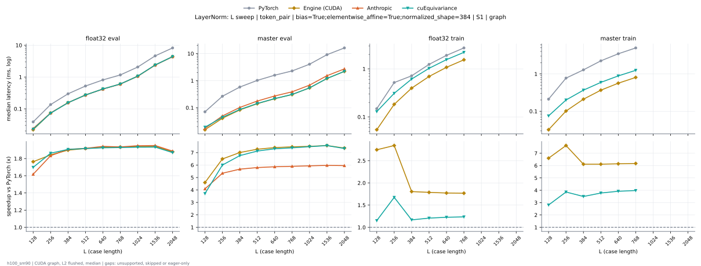

**float32 eval** (median ms; x = speedup vs PyTorch)

| L | PyTorch | Engine (Triton) | Engine (CUDA) | Anthropic | cuEquivariance |
|---|---|---|---|---|---|
| 128 | 0.03877 | 0.02278 (1.70x) | 0.02198 (1.76x) | 0.02397 (1.62x) | 0.02283 (1.70x) |
| 256 | 0.1356 | 0.07256 (1.87x) | 0.0736 (1.84x) | 0.07397 (1.83x) | 0.07282 (1.86x) |
| 384 | 0.2963 | 0.1551 (1.91x) | 0.1561 (1.90x) | 0.1553 (1.91x) | 0.1554 (1.91x) |
| 512 | 0.5206 | 0.2713 (1.92x) | 0.2716 (1.92x) | 0.2713 (1.92x) | 0.2716 (1.92x) |
| 640 | 0.81 | 0.4204 (1.93x) | 0.4195 (1.93x) | 0.4171 (1.94x) | 0.4207 (1.93x) |
| 768 | 1.163 | 0.6022 (1.93x) | 0.6009 (1.93x) | 0.6007 (1.94x) | 0.603 (1.93x) |
| 1024 | 2.062 | 1.066 (1.93x) | 1.063 (1.94x) | 1.057 (1.95x) | 1.067 (1.93x) |
| 1536 | 4.629 | 2.392 (1.94x) | 2.383 (1.94x) | 2.371 (1.95x) | 2.394 (1.93x) |
| 2048 | 8.224 | 4.398 (1.87x) | 4.378 (1.88x) | 4.358 (1.89x) | 4.399 (1.87x) |

**master eval** (median ms; x = speedup vs PyTorch)

| L | PyTorch | Engine (Triton) | Engine (CUDA) | Anthropic | cuEquivariance |
|---|---|---|---|---|---|
| 128 | 0.07072 | 0.01448 (4.88x) | 0.01539 (4.59x) | 0.0173 (4.09x) | 0.01907 (3.71x) |
| 256 | 0.2653 | 0.04078 (6.50x) | 0.04088 (6.49x) | 0.04965 (5.34x) | 0.04421 (6.00x) |
| 384 | 0.5813 | 0.08259 (7.04x) | 0.08294 (7.01x) | 0.1025 (5.67x) | 0.08602 (6.76x) |
| 512 | 1.023 | 0.14 (7.31x) | 0.1408 (7.27x) | 0.1765 (5.80x) | 0.1436 (7.12x) |
| 640 | 1.592 | 0.2133 (7.46x) | 0.2151 (7.40x) | 0.2716 (5.86x) | 0.2179 (7.31x) |
| 768 | 2.286 | 0.3063 (7.47x) | 0.3063 (7.46x) | 0.3876 (5.90x) | 0.3098 (7.38x) |
| 1024 | 4.055 | 0.537 (7.55x) | 0.5405 (7.50x) | 0.6829 (5.94x) | 0.5424 (7.48x) |
| 1536 | 9.115 | 1.202 (7.59x) | 1.204 (7.57x) | 1.526 (5.97x) | 1.205 (7.56x) |
| 2048 | 16.2 | 2.203 (7.35x) | 2.2 (7.36x) | 2.72 (5.96x) | 2.21 (7.33x) |

**float32 train** (median ms; x = speedup vs PyTorch)

| L | PyTorch | Engine (Triton) | Engine (CUDA) | Anthropic | cuEquivariance |
|---|---|---|---|---|---|
| 128 | 0.1486 | 0.05787 (2.57x) | 0.05411 (2.75x) | unsupported | 0.1291 (1.15x) |
| 256 | 0.519 | 0.1833 (2.83x) | 0.1827 (2.84x) | unsupported | 0.31 (1.67x) |
| 384 | 0.7165 | 0.3917 (1.83x) | 0.3971 (1.80x) | unsupported | 0.6138 (1.17x) |
| 512 | 1.24 | 0.685 (1.81x) | 0.6939 (1.79x) | unsupported | 1.027 (1.21x) |
| 640 | 1.909 | 1.064 (1.79x) | 1.077 (1.77x) | unsupported | 1.557 (1.23x) |
| 768 | 2.727 | 1.518 (1.80x) | 1.543 (1.77x) | unsupported | 2.208 (1.24x) |
| 1024 |  |  |  |  |  |
| 1536 |  |  |  |  |  |
| 2048 |  |  |  |  |  |

**master train** (median ms; x = speedup vs PyTorch)

| L | PyTorch | Engine (Triton) | Engine (CUDA) | Anthropic | cuEquivariance |
|---|---|---|---|---|---|
| 128 | 0.2109 | 0.04363 (4.83x) | 0.03197 (6.60x) | unsupported | 0.07509 (2.81x) |
| 256 | 0.772 | 0.1314 (5.87x) | 0.1013 (7.62x) | unsupported | 0.2 (3.86x) |
| 384 | 1.284 | 0.2723 (4.72x) | 0.2101 (6.11x) | unsupported | 0.3673 (3.50x) |
| 512 | 2.242 | 0.4717 (4.75x) | 0.3668 (6.11x) | unsupported | 0.5937 (3.78x) |
| 640 | 3.469 | 0.7074 (4.90x) | 0.5647 (6.14x) | unsupported | 0.8852 (3.92x) |
| 768 | 4.972 | 1.007 (4.94x) | 0.8059 (6.17x) | unsupported | 1.249 (3.98x) |
| 1024 |  |  |  |  |  |
| 1536 |  |  |  |  |  |
| 2048 |  |  |  |  |  |

### L sweep: token_pair | bias=True;elementwise_affine=True;normalized_shape=512 | S1 | graph

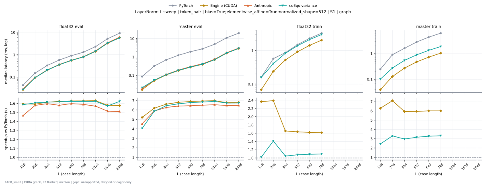

**float32 eval** (median ms; x = speedup vs PyTorch)

| L | PyTorch | Engine (Triton) | Engine (CUDA) | Anthropic | cuEquivariance |
|---|---|---|---|---|---|
| 128 | 0.0437 | 0.02744 (1.59x) | 0.02741 (1.59x) | 0.02982 (1.47x) | 0.02755 (1.59x) |
| 256 | 0.1516 | 0.09389 (1.61x) | 0.09523 (1.59x) | 0.09605 (1.58x) | 0.09437 (1.61x) |
| 384 | 0.3309 | 0.2044 (1.62x) | 0.205 (1.61x) | 0.2072 (1.60x) | 0.205 (1.61x) |
| 512 | 0.582 | 0.3592 (1.62x) | 0.3586 (1.62x) | 0.3685 (1.58x) | 0.3594 (1.62x) |
| 640 | 0.9057 | 0.5577 (1.62x) | 0.5564 (1.63x) | 0.5668 (1.60x) | 0.5583 (1.62x) |
| 768 | 1.3 | 0.8009 (1.62x) | 0.7986 (1.63x) | 0.8183 (1.59x) | 0.8018 (1.62x) |
| 1024 | 2.307 | 1.42 (1.63x) | 1.415 (1.63x) | 1.47 (1.57x) | 1.421 (1.62x) |
| 1536 | 5.191 | 3.301 (1.57x) | 3.287 (1.58x) | 3.429 (1.51x) | 3.302 (1.57x) |
| 2048 | 9.205 | 5.866 (1.57x) | 5.84 (1.58x) | 6.097 (1.51x) | 5.672 (1.62x) |

**master eval** (median ms; x = speedup vs PyTorch)

| L | PyTorch | Engine (Triton) | Engine (CUDA) | Anthropic | cuEquivariance |
|---|---|---|---|---|---|
| 128 | 0.08734 | 0.01814 (4.81x) | 0.01678 (5.20x) | 0.01923 (4.54x) | 0.02162 (4.04x) |
| 256 | 0.3221 | 0.05205 (6.19x) | 0.0521 (6.18x) | 0.05478 (5.88x) | 0.05506 (5.85x) |
| 384 | 0.7084 | 0.1072 (6.61x) | 0.1071 (6.61x) | 0.1131 (6.26x) | 0.1099 (6.45x) |
| 512 | 1.249 | 0.184 (6.79x) | 0.1837 (6.80x) | 0.1952 (6.40x) | 0.188 (6.65x) |
| 640 | 1.946 | 0.2833 (6.87x) | 0.2823 (6.89x) | 0.3017 (6.45x) | 0.2873 (6.77x) |
| 768 | 2.796 | 0.4045 (6.91x) | 0.403 (6.94x) | 0.43 (6.50x) | 0.4091 (6.83x) |
| 1024 | 4.96 | 0.713 (6.96x) | 0.7108 (6.98x) | 0.7575 (6.55x) | 0.7183 (6.90x) |
| 1536 | 11.16 | 1.655 (6.74x) | 1.647 (6.78x) | 1.725 (6.47x) | 1.659 (6.73x) |
| 2048 | 19.82 | 2.933 (6.76x) | 2.918 (6.79x) | 3.062 (6.47x) | 2.944 (6.73x) |

**float32 train** (median ms; x = speedup vs PyTorch)

| L | PyTorch | Engine (Triton) | Engine (CUDA) | Anthropic | cuEquivariance |
|---|---|---|---|---|---|
| 128 | 0.1602 | 0.06942 (2.31x) | 0.06773 (2.36x) | unsupported | 0.1574 (1.02x) |
| 256 | 0.5726 | 0.2374 (2.41x) | 0.2397 (2.39x) | unsupported | 0.4059 (1.41x) |
| 384 | 0.8652 | 0.5186 (1.67x) | 0.5228 (1.65x) | unsupported | 0.8262 (1.05x) |
| 512 | 1.5 | 0.9128 (1.64x) | 0.9177 (1.63x) | unsupported | 1.392 (1.08x) |
| 640 | 2.307 | 1.422 (1.62x) | 1.425 (1.62x) | unsupported | 2.118 (1.09x) |
| 768 | 3.3 | 2.038 (1.62x) | 2.047 (1.61x) | unsupported | 3.011 (1.10x) |
| 1024 |  |  |  |  |  |
| 1536 |  |  |  |  |  |
| 2048 |  |  |  |  |  |

**master train** (median ms; x = speedup vs PyTorch)

| L | PyTorch | Engine (Triton) | Engine (CUDA) | Anthropic | cuEquivariance |
|---|---|---|---|---|---|
| 128 | 0.2457 | 0.05469 (4.49x) | 0.03906 (6.29x) | unsupported | 0.1008 (2.44x) |
| 256 | 0.908 | 0.1727 (5.26x) | 0.1276 (7.11x) | unsupported | 0.2743 (3.31x) |
| 384 | 1.617 | 0.3593 (4.50x) | 0.2724 (5.94x) | unsupported | 0.5455 (2.97x) |
| 512 | 2.827 | 0.6206 (4.55x) | 0.4743 (5.96x) | unsupported | 0.8937 (3.16x) |
| 640 | 4.384 | 0.9554 (4.59x) | 0.7294 (6.01x) | unsupported | 1.342 (3.27x) |
| 768 | 6.286 | 1.367 (4.60x) | 1.046 (6.01x) | unsupported | 1.89 (3.33x) |
| 1024 |  |  |  |  |  |
| 1536 |  |  |  |  |  |
| 2048 |  |  |  |  |  |

### L sweep: token_pair | bias=True;elementwise_affine=True;normalized_shape=64 | S1 | graph

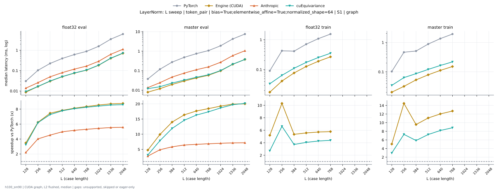

**float32 eval** (median ms; x = speedup vs PyTorch)

| L | PyTorch | Engine (Triton) | Engine (CUDA) | Anthropic | cuEquivariance |
|---|---|---|---|---|---|
| 128 | 0.03046 | 0.008608 (3.54x) | 0.008736 (3.49x) | 0.01376 (2.21x) | 0.009376 (3.25x) |
| 256 | 0.1036 | 0.01778 (5.83x) | 0.01659 (6.24x) | 0.02571 (4.03x) | 0.01672 (6.20x) |
| 384 | 0.225 | 0.03139 (7.17x) | 0.03018 (7.46x) | 0.04966 (4.53x) | 0.03094 (7.27x) |
| 512 | 0.395 | 0.05131 (7.70x) | 0.05042 (7.84x) | 0.07941 (4.97x) | 0.05077 (7.78x) |
| 640 | 0.6134 | 0.0764 (8.03x) | 0.07546 (8.13x) | 0.1186 (5.17x) | 0.076 (8.07x) |
| 768 | 0.8805 | 0.1069 (8.24x) | 0.1055 (8.35x) | 0.166 (5.30x) | 0.1067 (8.25x) |
| 1024 | 1.561 | 0.1857 (8.41x) | 0.1826 (8.55x) | 0.2871 (5.44x) | 0.1856 (8.41x) |
| 1536 | 3.504 | 0.4097 (8.55x) | 0.4024 (8.71x) | 0.6326 (5.54x) | 0.4099 (8.55x) |
| 2048 | 6.222 | 0.7244 (8.59x) | 0.7096 (8.77x) | 1.116 (5.57x) | 0.7238 (8.60x) |

**master eval** (median ms; x = speedup vs PyTorch)

| L | PyTorch | Engine (Triton) | Engine (CUDA) | Anthropic | cuEquivariance |
|---|---|---|---|---|---|
| 128 | 0.03763 | 0.00784 (4.80x) | 0.007904 (4.76x) | 0.01354 (2.78x) | 0.01194 (3.15x) |
| 256 | 0.1188 | 0.01114 (10.67x) | 0.01197 (9.92x) | 0.02429 (4.89x) | 0.01507 (7.88x) |
| 384 | 0.2751 | 0.01939 (14.19x) | 0.01965 (14.00x) | 0.04707 (5.84x) | 0.0231 (11.91x) |
| 512 | 0.4827 | 0.02995 (16.11x) | 0.02946 (16.39x) | 0.07488 (6.45x) | 0.03306 (14.60x) |
| 640 | 0.7479 | 0.04264 (17.54x) | 0.04234 (17.67x) | 0.1122 (6.67x) | 0.04586 (16.31x) |
| 768 | 1.072 | 0.05826 (18.40x) | 0.05811 (18.45x) | 0.1566 (6.85x) | 0.06165 (17.39x) |
| 1024 | 1.896 | 0.09829 (19.29x) | 0.0984 (19.27x) | 0.2705 (7.01x) | 0.1016 (18.67x) |
| 1536 | 4.254 | 0.2119 (20.08x) | 0.2135 (19.92x) | 0.5955 (7.14x) | 0.2155 (19.74x) |
| 2048 | 7.554 | 0.3709 (20.36x) | 0.3772 (20.02x) | 1.051 (7.19x) | 0.3746 (20.16x) |

**float32 train** (median ms; x = speedup vs PyTorch)

| L | PyTorch | Engine (Triton) | Engine (CUDA) | Anthropic | cuEquivariance |
|---|---|---|---|---|---|
| 128 | 0.09112 | 0.01822 (5.00x) | 0.01754 (5.20x) | unsupported | 0.03354 (2.72x) |
| 256 | 0.426 | 0.04266 (9.99x) | 0.04134 (10.30x) | unsupported | 0.06421 (6.64x) |
| 384 | 0.4128 | 0.07861 (5.25x) | 0.07717 (5.35x) | unsupported | 0.1108 (3.73x) |
| 512 | 0.7084 | 0.1267 (5.59x) | 0.127 (5.58x) | unsupported | 0.1742 (4.07x) |
| 640 | 1.086 | 0.1905 (5.70x) | 0.1899 (5.72x) | unsupported | 0.2537 (4.28x) |
| 768 | 1.548 | 0.2663 (5.81x) | 0.2674 (5.79x) | unsupported | 0.3522 (4.39x) |
| 1024 |  |  |  |  |  |
| 1536 |  |  |  |  |  |
| 2048 |  |  |  |  |  |

**master train** (median ms; x = speedup vs PyTorch)

| L | PyTorch | Engine (Triton) | Engine (CUDA) | Anthropic | cuEquivariance |
|---|---|---|---|---|---|
| 128 | 0.103 | 0.01696 (6.07x) | 0.02038 (5.05x) | unsupported | 0.0347 (2.97x) |
| 256 | 0.4646 | 0.02896 (16.04x) | 0.0321 (14.47x) | unsupported | 0.06368 (7.30x) |
| 384 | 0.5105 | 0.05126 (9.96x) | 0.05334 (9.57x) | unsupported | 0.08698 (5.87x) |
| 512 | 0.8794 | 0.07517 (11.70x) | 0.07926 (11.10x) | unsupported | 0.1212 (7.26x) |
| 640 | 1.349 | 0.1089 (12.39x) | 0.1121 (12.04x) | unsupported | 0.1648 (8.19x) |
| 768 | 1.926 | 0.1474 (13.07x) | 0.1516 (12.71x) | unsupported | 0.2181 (8.83x) |
| 1024 |  |  |  |  |  |
| 1536 |  |  |  |  |  |
| 2048 |  |  |  |  |  |

### L sweep: token_single | bias=False;elementwise_affine=True;normalized_shape=384 | S1 | graph

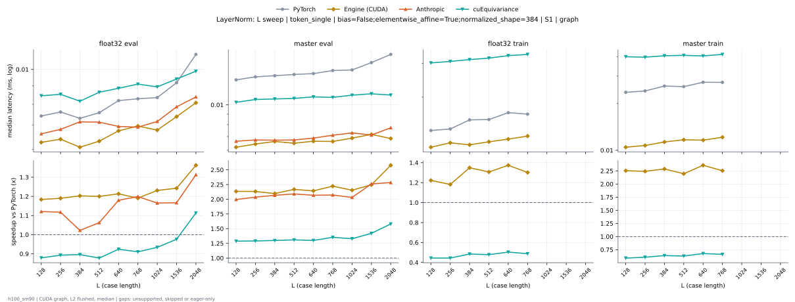

**float32 eval** (median ms; x = speedup vs PyTorch)

| L | PyTorch | Engine (Triton) | Engine (CUDA) | Anthropic | cuEquivariance |
|---|---|---|---|---|---|
| 128 | 0.007424 | 0.00808 (0.92x) | 0.006272 (1.18x) | 0.006624 (1.12x) | 0.008448 (0.88x) |
| 256 | 0.007616 | 0.008672 (0.88x) | 0.0064 (1.19x) | 0.006816 (1.12x) | 0.008528 (0.89x) |
| 384 | 0.007312 | 0.008288 (0.88x) | 0.00608 (1.20x) | 0.007152 (1.02x) | 0.00816 (0.90x) |
| 512 | 0.007584 | 0.008496 (0.89x) | 0.00632 (1.20x) | 0.007136 (1.06x) | 0.00864 (0.88x) |
| 640 | 0.008192 | 0.00896 (0.91x) | 0.006752 (1.21x) | 0.006944 (1.18x) | 0.008864 (0.92x) |
| 768 | 0.008288 | 0.00912 (0.91x) | 0.00696 (1.19x) | 0.006912 (1.20x) | 0.009104 (0.91x) |
| 1024 | 0.008352 | 0.01525 (0.55x) | 0.006784 (1.23x) | 0.007168 (1.17x) | 0.008944 (0.93x) |
| 1536 | 0.009184 | 0.01555 (0.59x) | 0.007392 (1.24x) | 0.007872 (1.17x) | 0.009408 (0.98x) |
| 2048 | 0.01101 | 0.01565 (0.70x) | 0.00808 (1.36x) | 0.008384 (1.31x) | 0.009888 (1.11x) |

**master eval** (median ms; x = speedup vs PyTorch)

| L | PyTorch | Engine (Triton) | Engine (CUDA) | Anthropic | cuEquivariance |
|---|---|---|---|---|---|
| 128 | 0.01325 | 0.00808 (1.64x) | 0.006208 (2.13x) | 0.00664 (2.00x) | 0.01029 (1.29x) |
| 256 | 0.01371 | 0.00832 (1.65x) | 0.006432 (2.13x) | 0.006736 (2.04x) | 0.01062 (1.29x) |
| 384 | 0.01389 | 0.008496 (1.63x) | 0.006624 (2.10x) | 0.00672 (2.07x) | 0.01069 (1.30x) |
| 512 | 0.01408 | 0.008416 (1.67x) | 0.006496 (2.17x) | 0.006736 (2.09x) | 0.01075 (1.31x) |
| 640 | 0.01422 | 0.008496 (1.67x) | 0.00664 (2.14x) | 0.00688 (2.07x) | 0.01094 (1.30x) |
| 768 | 0.01472 | 0.00848 (1.74x) | 0.006624 (2.22x) | 0.007104 (2.07x) | 0.01088 (1.35x) |
| 1024 | 0.01482 | 0.01542 (0.96x) | 0.00688 (2.15x) | 0.007296 (2.03x) | 0.01115 (1.33x) |
| 1536 | 0.0161 | 0.0152 (1.06x) | 0.007168 (2.25x) | 0.00712 (2.26x) | 0.01133 (1.42x) |
| 2048 | 0.01765 | 0.01504 (1.17x) | 0.006848 (2.58x) | 0.007728 (2.28x) | 0.01117 (1.58x) |

**float32 train** (median ms; x = speedup vs PyTorch)

| L | PyTorch | Engine (Triton) | Engine (CUDA) | Anthropic | cuEquivariance |
|---|---|---|---|---|---|
| 128 | 0.01338 | 0.01538 (0.87x) | 0.01094 (1.22x) | unsupported | 0.03014 (0.44x) |
| 256 | 0.01363 | 0.01566 (0.87x) | 0.01154 (1.18x) | unsupported | 0.03069 (0.44x) |
| 384 | 0.0152 | 0.01539 (0.99x) | 0.01126 (1.35x) | unsupported | 0.03138 (0.48x) |
| 512 | 0.01526 | 0.01587 (0.96x) | 0.01168 (1.31x) | unsupported | 0.03194 (0.48x) |
| 640 | 0.01658 | 0.01674 (0.99x) | 0.01206 (1.37x) | unsupported | 0.0329 (0.50x) |
| 768 | 0.01629 | 0.01747 (0.93x) | 0.01251 (1.30x) | unsupported | 0.03339 (0.49x) |
| 1024 |  |  |  |  |  |
| 1536 |  |  |  |  |  |
| 2048 |  |  |  |  |  |

**master train** (median ms; x = speedup vs PyTorch)

| L | PyTorch | Engine (Triton) | Engine (CUDA) | Anthropic | cuEquivariance |
|---|---|---|---|---|---|
| 128 | 0.02358 | 0.0149 (1.58x) | 0.01046 (2.25x) | unsupported | 0.03992 (0.59x) |
| 256 | 0.02406 | 0.01504 (1.60x) | 0.01074 (2.24x) | unsupported | 0.03966 (0.61x) |
| 384 | 0.02587 | 0.01558 (1.66x) | 0.01131 (2.29x) | unsupported | 0.04051 (0.64x) |
| 512 | 0.02565 | 0.01645 (1.56x) | 0.01168 (2.20x) | unsupported | 0.04075 (0.63x) |
| 640 | 0.02738 | 0.01581 (1.73x) | 0.01162 (2.36x) | unsupported | 0.04042 (0.68x) |
| 768 | 0.02733 | 0.01642 (1.66x) | 0.01213 (2.25x) | unsupported | 0.04133 (0.66x) |
| 1024 |  |  |  |  |  |
| 1536 |  |  |  |  |  |
| 2048 |  |  |  |  |  |

### L sweep: token_single | bias=False;elementwise_affine=True;normalized_shape=768 | S1 | graph

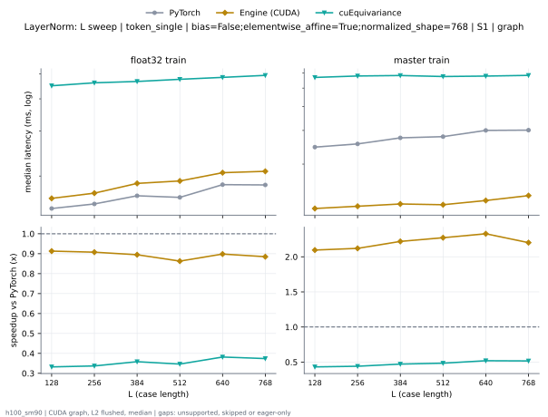

**float32 train** (median ms; x = speedup vs PyTorch)

| L | PyTorch | Engine (Triton) | Engine (CUDA) | Anthropic | cuEquivariance |
|---|---|---|---|---|---|
| 128 | 0.01494 | 0.01882 (0.79x) | 0.01637 (0.91x) | unsupported | 0.04498 (0.33x) |
| 256 | 0.01557 | 0.0192 (0.81x) | 0.01715 (0.91x) | unsupported | 0.04619 (0.34x) |
| 384 | 0.01675 | 0.01944 (0.86x) | 0.01872 (0.89x) | unsupported | 0.04675 (0.36x) |
| 512 | 0.01651 | 0.0197 (0.84x) | 0.01914 (0.86x) | unsupported | 0.04766 (0.35x) |
| 640 | 0.01851 | 0.02006 (0.92x) | 0.02061 (0.90x) | unsupported | 0.0485 (0.38x) |
| 768 | 0.01846 | 0.02048 (0.90x) | 0.02086 (0.88x) | unsupported | 0.04938 (0.37x) |

**master train** (median ms; x = speedup vs PyTorch)

| L | PyTorch | Engine (Triton) | Engine (CUDA) | Anthropic | cuEquivariance |
|---|---|---|---|---|---|
| 128 | 0.02454 | 0.01861 (1.32x) | 0.01171 (2.10x) | unsupported | 0.05683 (0.43x) |
| 256 | 0.0255 | 0.01818 (1.40x) | 0.01203 (2.12x) | unsupported | 0.05782 (0.44x) |
| 384 | 0.02744 | 0.01926 (1.42x) | 0.01237 (2.22x) | unsupported | 0.05816 (0.47x) |
| 512 | 0.02784 | 0.0193 (1.44x) | 0.01226 (2.27x) | unsupported | 0.05746 (0.48x) |
| 640 | 0.03002 | 0.01965 (1.53x) | 0.0129 (2.33x) | unsupported | 0.05776 (0.52x) |
| 768 | 0.03011 | 0.02042 (1.47x) | 0.01368 (2.20x) | unsupported | 0.05826 (0.52x) |

### L sweep: token_single | bias=False;elementwise_affine=True;normalized_shape=768 | S5 | graph

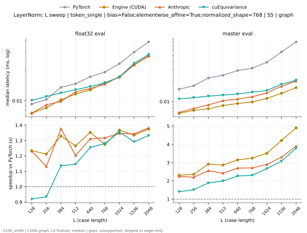

**float32 eval** (median ms; x = speedup vs PyTorch)

| L | PyTorch | Engine (Triton) | Engine (CUDA) | Anthropic | cuEquivariance |
|---|---|---|---|---|---|
| 128 | 0.00928 | 0.01138 (0.82x) | 0.00752 (1.23x) | 0.007536 (1.23x) | 0.0101 (0.92x) |
| 256 | 0.01032 | 0.0116 (0.89x) | 0.008512 (1.21x) | 0.00912 (1.13x) | 0.01104 (0.93x) |
| 384 | 0.01362 | 0.01248 (1.09x) | 0.01024 (1.33x) | 0.009888 (1.38x) | 0.01198 (1.14x) |
| 512 | 0.01478 | 0.01338 (1.11x) | 0.01168 (1.27x) | 0.01229 (1.20x) | 0.0129 (1.15x) |
| 640 | 0.01739 | 0.01502 (1.16x) | 0.01285 (1.35x) | 0.01326 (1.31x) | 0.01386 (1.26x) |
| 768 | 0.01931 | 0.01573 (1.23x) | 0.01515 (1.27x) | 0.01466 (1.32x) | 0.01507 (1.28x) |
| 1024 | 0.02344 | 0.0275 (0.85x) | 0.01714 (1.37x) | 0.01741 (1.35x) | 0.0173 (1.36x) |
| 1536 | 0.03053 | 0.03246 (0.94x) | 0.02286 (1.34x) | 0.02272 (1.34x) | 0.02363 (1.29x) |
| 2048 | 0.03856 | 0.0415 (0.93x) | 0.02805 (1.37x) | 0.02789 (1.38x) | 0.02893 (1.33x) |

**master eval** (median ms; x = speedup vs PyTorch)

| L | PyTorch | Engine (Triton) | Engine (CUDA) | Anthropic | cuEquivariance |
|---|---|---|---|---|---|
| 128 | 0.01538 | 0.009424 (1.63x) | 0.006656 (2.31x) | 0.006848 (2.25x) | 0.01094 (1.40x) |
| 256 | 0.01734 | 0.009952 (1.74x) | 0.00736 (2.36x) | 0.007888 (2.20x) | 0.01146 (1.51x) |
| 384 | 0.02275 | 0.01037 (2.19x) | 0.007792 (2.92x) | 0.008896 (2.56x) | 0.01206 (1.89x) |
| 512 | 0.02496 | 0.01075 (2.32x) | 0.008704 (2.87x) | 0.0103 (2.42x) | 0.01251 (1.99x) |
| 640 | 0.02941 | 0.01144 (2.57x) | 0.009344 (3.15x) | 0.01088 (2.70x) | 0.01299 (2.26x) |
| 768 | 0.03202 | 0.01243 (2.58x) | 0.009856 (3.25x) | 0.01181 (2.71x) | 0.01387 (2.31x) |
| 1024 | 0.03917 | 0.02587 (1.51x) | 0.01115 (3.51x) | 0.01352 (2.90x) | 0.01466 (2.67x) |
| 1536 | 0.05622 | 0.02752 (2.04x) | 0.01334 (4.21x) | 0.01702 (3.30x) | 0.01826 (3.08x) |
| 2048 | 0.07958 | 0.02774 (2.87x) | 0.01622 (4.91x) | 0.02042 (3.90x) | 0.02101 (3.79x) |

### L sweep: token_single | bias=False;elementwise_affine=True;normalized_shape=831 | S1 | graph

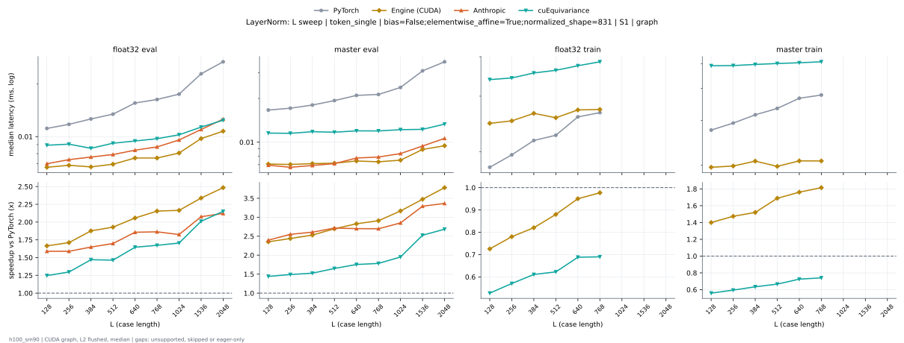

**float32 eval** (median ms; x = speedup vs PyTorch)

| L | PyTorch | Engine (Triton) | Engine (CUDA) | Anthropic | cuEquivariance |
|---|---|---|---|---|---|
| 128 | 0.01114 | 0.01094 (1.02x) | 0.006688 (1.67x) | 0.007008 (1.59x) | 0.008928 (1.25x) |
| 256 | 0.01174 | 0.01139 (1.03x) | 0.006864 (1.71x) | 0.007392 (1.59x) | 0.009056 (1.30x) |
| 384 | 0.01261 | 0.01101 (1.15x) | 0.00672 (1.88x) | 0.007648 (1.65x) | 0.008576 (1.47x) |
| 512 | 0.01342 | 0.01098 (1.22x) | 0.00696 (1.93x) | 0.007904 (1.70x) | 0.009168 (1.46x) |
| 640 | 0.01554 | 0.01162 (1.34x) | 0.007552 (2.06x) | 0.008368 (1.86x) | 0.00944 (1.65x) |
| 768 | 0.01627 | 0.01146 (1.42x) | 0.007552 (2.15x) | 0.008736 (1.86x) | 0.009728 (1.67x) |
| 1024 | 0.01746 | 0.04307 (0.41x) | 0.008064 (2.16x) | 0.009568 (1.82x) | 0.01024 (1.70x) |
| 1536 | 0.02278 | 0.04341 (0.52x) | 0.009744 (2.34x) | 0.01098 (2.08x) | 0.01133 (2.01x) |
| 2048 | 0.02667 | 0.04408 (0.61x) | 0.01074 (2.48x) | 0.01258 (2.12x) | 0.0124 (2.15x) |

**master eval** (median ms; x = speedup vs PyTorch)

| L | PyTorch | Engine (Triton) | Engine (CUDA) | Anthropic | cuEquivariance |
|---|---|---|---|---|---|
| 128 | 0.01664 | 0.01098 (1.52x) | 0.007072 (2.35x) | 0.006944 (2.40x) | 0.01155 (1.44x) |
| 256 | 0.01714 | 0.01085 (1.58x) | 0.007024 (2.44x) | 0.00672 (2.55x) | 0.0115 (1.49x) |
| 384 | 0.01802 | 0.01112 (1.62x) | 0.00712 (2.53x) | 0.006912 (2.61x) | 0.01181 (1.53x) |
| 512 | 0.01933 | 0.01128 (1.71x) | 0.007168 (2.70x) | 0.00712 (2.71x) | 0.01171 (1.65x) |
| 640 | 0.02099 | 0.01141 (1.84x) | 0.007424 (2.83x) | 0.007776 (2.70x) | 0.01197 (1.75x) |
| 768 | 0.02131 | 0.01114 (1.91x) | 0.007328 (2.91x) | 0.007904 (2.70x) | 0.01195 (1.78x) |
| 1024 | 0.02381 | 0.04314 (0.55x) | 0.00752 (3.17x) | 0.008352 (2.85x) | 0.01219 (1.95x) |
| 1536 | 0.03096 | 0.0427 (0.72x) | 0.008912 (3.47x) | 0.009408 (3.29x) | 0.01226 (2.53x) |
| 2048 | 0.03574 | 0.04312 (0.83x) | 0.009456 (3.78x) | 0.01062 (3.36x) | 0.01331 (2.69x) |

**float32 train** (median ms; x = speedup vs PyTorch)

| L | PyTorch | Engine (Triton) | Engine (CUDA) | Anthropic | cuEquivariance |
|---|---|---|---|---|---|
| 128 | 0.01786 | 0.02043 (0.87x) | 0.02461 (0.73x) | unsupported | 0.03386 (0.53x) |
| 256 | 0.01955 | 0.02144 (0.91x) | 0.02506 (0.78x) | unsupported | 0.03427 (0.57x) |
| 384 | 0.02171 | 0.02258 (0.96x) | 0.02646 (0.82x) | unsupported | 0.03554 (0.61x) |
| 512 | 0.02256 | 0.02379 (0.95x) | 0.02563 (0.88x) | unsupported | 0.03624 (0.62x) |
| 640 | 0.02579 | 0.02538 (1.02x) | 0.02714 (0.95x) | unsupported | 0.03747 (0.69x) |
| 768 | 0.02661 | 0.02734 (0.97x) | 0.02723 (0.98x) | unsupported | 0.03856 (0.69x) |
| 1024 |  |  |  |  |  |
| 1536 |  |  |  |  |  |
| 2048 |  |  |  |  |  |

**master train** (median ms; x = speedup vs PyTorch)

| L | PyTorch | Engine (Triton) | Engine (CUDA) | Anthropic | cuEquivariance |
|---|---|---|---|---|---|
| 128 | 0.02746 | 0.0208 (1.32x) | 0.01962 (1.40x) | unsupported | 0.04912 (0.56x) |
| 256 | 0.02925 | 0.02149 (1.36x) | 0.01984 (1.47x) | unsupported | 0.04918 (0.59x) |
| 384 | 0.03152 | 0.02224 (1.42x) | 0.02074 (1.52x) | unsupported | 0.0497 (0.63x) |
| 512 | 0.03339 | 0.02314 (1.44x) | 0.01978 (1.69x) | unsupported | 0.05011 (0.67x) |
| 640 | 0.03661 | 0.02432 (1.51x) | 0.02078 (1.76x) | unsupported | 0.05046 (0.73x) |
| 768 | 0.0377 | 0.02579 (1.46x) | 0.02077 (1.82x) | unsupported | 0.0509 (0.74x) |
| 1024 |  |  |  |  |  |
| 1536 |  |  |  |  |  |
| 2048 |  |  |  |  |  |

### L sweep: token_single | bias=False;elementwise_affine=True;normalized_shape=833 | S1 | graph

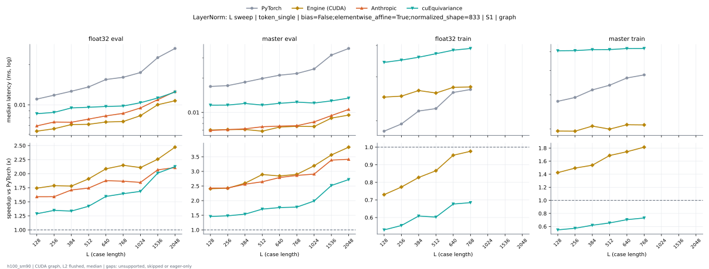

**float32 eval** (median ms; x = speedup vs PyTorch)

| L | PyTorch | Engine (Triton) | Engine (CUDA) | Anthropic | cuEquivariance |
|---|---|---|---|---|---|
| 128 | 0.01104 | 0.01058 (1.04x) | 0.006336 (1.74x) | 0.006944 (1.59x) | 0.008576 (1.29x) |
| 256 | 0.01181 | 0.01102 (1.07x) | 0.006608 (1.79x) | 0.007424 (1.59x) | 0.008768 (1.35x) |
| 384 | 0.01264 | 0.01142 (1.11x) | 0.007104 (1.78x) | 0.007392 (1.71x) | 0.009472 (1.33x) |
| 512 | 0.01362 | 0.01123 (1.21x) | 0.007136 (1.91x) | 0.007808 (1.74x) | 0.009584 (1.42x) |
| 640 | 0.01549 | 0.01141 (1.36x) | 0.007424 (2.09x) | 0.008256 (1.88x) | 0.009712 (1.59x) |
| 768 | 0.0161 | 0.01147 (1.40x) | 0.007488 (2.15x) | 0.008624 (1.87x) | 0.009792 (1.64x) |
| 1024 | 0.01747 | 0.04525 (0.39x) | 0.008288 (2.11x) | 0.009472 (1.84x) | 0.01037 (1.69x) |
| 1536 | 0.02261 | 0.04595 (0.49x) | 0.01002 (2.26x) | 0.01093 (2.07x) | 0.01125 (2.01x) |
| 2048 | 0.0265 | 0.04614 (0.57x) | 0.01072 (2.47x) | 0.01258 (2.11x) | 0.01246 (2.13x) |

**master eval** (median ms; x = speedup vs PyTorch)

| L | PyTorch | Engine (Triton) | Engine (CUDA) | Anthropic | cuEquivariance |
|---|---|---|---|---|---|
| 128 | 0.01686 | 0.01099 (1.53x) | 0.007008 (2.41x) | 0.006944 (2.43x) | 0.01157 (1.46x) |
| 256 | 0.01715 | 0.01125 (1.52x) | 0.007072 (2.43x) | 0.007056 (2.43x) | 0.01158 (1.48x) |
| 384 | 0.0184 | 0.01112 (1.65x) | 0.007088 (2.60x) | 0.007184 (2.56x) | 0.01197 (1.54x) |
| 512 | 0.01981 | 0.01102 (1.80x) | 0.006848 (2.89x) | 0.007488 (2.65x) | 0.01158 (1.71x) |
| 640 | 0.02115 | 0.01114 (1.90x) | 0.00744 (2.84x) | 0.007584 (2.79x) | 0.012 (1.76x) |
| 768 | 0.02189 | 0.01142 (1.92x) | 0.007552 (2.90x) | 0.007648 (2.86x) | 0.0123 (1.78x) |
| 1024 | 0.024 | 0.04498 (0.53x) | 0.00752 (3.19x) | 0.008256 (2.91x) | 0.01208 (1.99x) |
| 1536 | 0.03174 | 0.04502 (0.71x) | 0.008912 (3.56x) | 0.009376 (3.39x) | 0.01261 (2.52x) |
| 2048 | 0.03626 | 0.04541 (0.80x) | 0.009472 (3.83x) | 0.01062 (3.41x) | 0.01333 (2.72x) |

**float32 train** (median ms; x = speedup vs PyTorch)

| L | PyTorch | Engine (Triton) | Engine (CUDA) | Anthropic | cuEquivariance |
|---|---|---|---|---|---|
| 128 | 0.01814 | 0.02035 (0.89x) | 0.02485 (0.73x) | unsupported | 0.03424 (0.53x) |
| 256 | 0.01939 | 0.02128 (0.91x) | 0.02507 (0.77x) | unsupported | 0.03496 (0.55x) |
| 384 | 0.02186 | 0.02304 (0.95x) | 0.0264 (0.83x) | unsupported | 0.0359 (0.61x) |
| 512 | 0.02235 | 0.02371 (0.94x) | 0.02581 (0.87x) | unsupported | 0.03709 (0.60x) |
| 640 | 0.02594 | 0.02582 (1.00x) | 0.02718 (0.95x) | unsupported | 0.03832 (0.68x) |
| 768 | 0.02666 | 0.02765 (0.96x) | 0.0273 (0.98x) | unsupported | 0.03893 (0.68x) |
| 1024 |  |  |  |  |  |
| 1536 |  |  |  |  |  |
| 2048 |  |  |  |  |  |

**master train** (median ms; x = speedup vs PyTorch)

| L | PyTorch | Engine (Triton) | Engine (CUDA) | Anthropic | cuEquivariance |
|---|---|---|---|---|---|
| 128 | 0.02776 | 0.0205 (1.35x) | 0.01949 (1.42x) | unsupported | 0.05064 (0.55x) |
| 256 | 0.02906 | 0.02147 (1.35x) | 0.01946 (1.49x) | unsupported | 0.05074 (0.57x) |
| 384 | 0.03179 | 0.02243 (1.42x) | 0.02067 (1.54x) | unsupported | 0.05133 (0.62x) |
| 512 | 0.03362 | 0.02328 (1.44x) | 0.01994 (1.69x) | unsupported | 0.05136 (0.65x) |
| 640 | 0.03664 | 0.02462 (1.49x) | 0.02101 (1.74x) | unsupported | 0.052 (0.70x) |
| 768 | 0.03802 | 0.026 (1.46x) | 0.02096 (1.81x) | unsupported | 0.05205 (0.73x) |
| 1024 |  |  |  |  |  |
| 1536 |  |  |  |  |  |
| 2048 |  |  |  |  |  |

### L sweep: token_single | bias=True;elementwise_affine=True;normalized_shape=2560 | S1 | graph

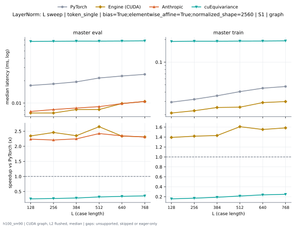

**master eval** (median ms; x = speedup vs PyTorch)

| L | PyTorch | Engine (Triton) | Engine (CUDA) | Anthropic | cuEquivariance |
|---|---|---|---|---|---|
| 128 | 0.01725 | 0.01414 (1.22x) | 0.00736 (2.34x) | 0.007712 (2.24x) | 0.06715 (0.26x) |
| 256 | 0.0181 | 0.01382 (1.31x) | 0.00736 (2.46x) | 0.008192 (2.21x) | 0.06752 (0.27x) |
| 384 | 0.01926 | 0.01406 (1.37x) | 0.008192 (2.35x) | 0.008576 (2.25x) | 0.06787 (0.28x) |
| 512 | 0.02171 | 0.01408 (1.54x) | 0.008192 (2.65x) | 0.00896 (2.42x) | 0.06784 (0.32x) |
| 640 | 0.02309 | 0.01429 (1.62x) | 0.009872 (2.34x) | 0.00984 (2.35x) | 0.06806 (0.34x) |
| 768 | 0.0243 | 0.01459 (1.67x) | 0.01051 (2.31x) | 0.01053 (2.31x) | 0.06842 (0.36x) |

**master train** (median ms; x = speedup vs PyTorch)

| L | PyTorch | Engine (Triton) | Engine (CUDA) | Anthropic | cuEquivariance |
|---|---|---|---|---|---|
| 128 | 0.02944 | 0.02851 (1.03x) | 0.02114 (1.39x) | unsupported | 0.188 (0.16x) |
| 256 | 0.03213 | 0.02957 (1.09x) | 0.02266 (1.42x) | unsupported | 0.1897 (0.17x) |
| 384 | 0.03579 | 0.03086 (1.16x) | 0.02501 (1.43x) | unsupported | 0.1895 (0.19x) |
| 512 | 0.04064 | 0.03206 (1.27x) | 0.02526 (1.61x) | unsupported | 0.1904 (0.21x) |
| 640 | 0.04512 | 0.03523 (1.28x) | 0.02906 (1.55x) | unsupported | 0.1906 (0.24x) |
| 768 | 0.0475 | 0.03654 (1.30x) | 0.02998 (1.58x) | unsupported | 0.1917 (0.25x) |

### L sweep: token_single | bias=True;elementwise_affine=True;normalized_shape=384 | S1 | graph

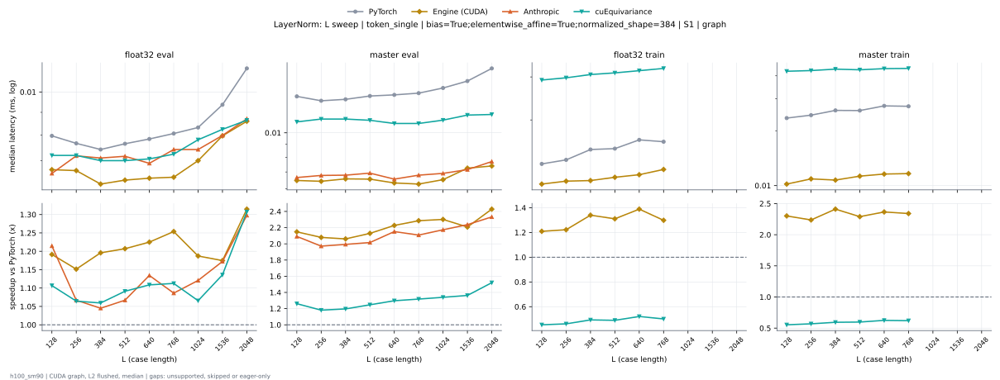

**float32 eval** (median ms; x = speedup vs PyTorch)

| L | PyTorch | Engine (Triton) | Engine (CUDA) | Anthropic | cuEquivariance |
|---|---|---|---|---|---|
| 128 | 0.007968 | 0.006976 (1.14x) | 0.006688 (1.19x) | 0.00656 (1.21x) | 0.0072 (1.11x) |
| 256 | 0.007664 | 0.007296 (1.05x) | 0.006656 (1.15x) | 0.007184 (1.07x) | 0.0072 (1.06x) |
| 384 | 0.007424 | 0.00696 (1.07x) | 0.006208 (1.20x) | 0.007104 (1.05x) | 0.007008 (1.06x) |
| 512 | 0.007648 | 0.007072 (1.08x) | 0.006336 (1.21x) | 0.007168 (1.07x) | 0.007008 (1.09x) |
| 640 | 0.00784 | 0.007072 (1.11x) | 0.0064 (1.23x) | 0.006912 (1.13x) | 0.007072 (1.11x) |
| 768 | 0.008064 | 0.00736 (1.10x) | 0.006432 (1.25x) | 0.007424 (1.09x) | 0.007248 (1.11x) |
| 1024 | 0.00832 | 0.01408 (0.59x) | 0.007008 (1.19x) | 0.007424 (1.12x) | 0.007808 (1.07x) |
| 1536 | 0.00936 | 0.01446 (0.65x) | 0.007968 (1.17x) | 0.007984 (1.17x) | 0.00824 (1.14x) |
| 2048 | 0.0113 | 0.01459 (0.77x) | 0.008592 (1.31x) | 0.008704 (1.30x) | 0.00864 (1.31x) |

**master eval** (median ms; x = speedup vs PyTorch)

| L | PyTorch | Engine (Triton) | Engine (CUDA) | Anthropic | cuEquivariance |
|---|---|---|---|---|---|
| 128 | 0.01392 | 0.0068 (2.05x) | 0.00648 (2.15x) | 0.006656 (2.09x) | 0.01104 (1.26x) |
| 256 | 0.01338 | 0.006944 (1.93x) | 0.006432 (2.08x) | 0.006784 (1.97x) | 0.01133 (1.18x) |
| 384 | 0.01355 | 0.00696 (1.95x) | 0.006576 (2.06x) | 0.0068 (1.99x) | 0.01133 (1.20x) |
| 512 | 0.01397 | 0.007072 (1.98x) | 0.00656 (2.13x) | 0.006928 (2.02x) | 0.0112 (1.25x) |
| 640 | 0.01411 | 0.006624 (2.13x) | 0.006336 (2.23x) | 0.00656 (2.15x) | 0.01088 (1.30x) |
| 768 | 0.01434 | 0.006848 (2.09x) | 0.006272 (2.29x) | 0.0068 (2.11x) | 0.01088 (1.32x) |
| 1024 | 0.01502 | 0.01358 (1.11x) | 0.006528 (2.30x) | 0.006912 (2.17x) | 0.01122 (1.34x) |
| 1536 | 0.016 | 0.01392 (1.15x) | 0.007248 (2.21x) | 0.007152 (2.24x) | 0.01174 (1.36x) |
| 2048 | 0.01795 | 0.01408 (1.28x) | 0.007392 (2.43x) | 0.007696 (2.33x) | 0.01181 (1.52x) |

**float32 train** (median ms; x = speedup vs PyTorch)

| L | PyTorch | Engine (Triton) | Engine (CUDA) | Anthropic | cuEquivariance |
|---|---|---|---|---|---|
| 128 | 0.01322 | 0.01398 (0.95x) | 0.01093 (1.21x) | unsupported | 0.02914 (0.45x) |
| 256 | 0.01373 | 0.01427 (0.96x) | 0.01123 (1.22x) | unsupported | 0.02976 (0.46x) |
| 384 | 0.01514 | 0.01456 (1.04x) | 0.0113 (1.34x) | unsupported | 0.03069 (0.49x) |
| 512 | 0.01526 | 0.01453 (1.05x) | 0.01165 (1.31x) | unsupported | 0.03117 (0.49x) |
| 640 | 0.01658 | 0.01555 (1.07x) | 0.01194 (1.39x) | unsupported | 0.03182 (0.52x) |
| 768 | 0.01629 | 0.01651 (0.99x) | 0.01254 (1.30x) | unsupported | 0.03251 (0.50x) |
| 1024 |  |  |  |  |  |
| 1536 |  |  |  |  |  |
| 2048 |  |  |  |  |  |

**master train** (median ms; x = speedup vs PyTorch)

| L | PyTorch | Engine (Triton) | Engine (CUDA) | Anthropic | cuEquivariance |
|---|---|---|---|---|---|
| 128 | 0.02346 | 0.01325 (1.77x) | 0.01019 (2.30x) | unsupported | 0.04237 (0.55x) |
| 256 | 0.02434 | 0.01408 (1.73x) | 0.01088 (2.24x) | unsupported | 0.04274 (0.57x) |
| 384 | 0.02584 | 0.01421 (1.82x) | 0.01072 (2.41x) | unsupported | 0.04352 (0.59x) |
| 512 | 0.02579 | 0.01504 (1.71x) | 0.01126 (2.29x) | unsupported | 0.04315 (0.60x) |
| 640 | 0.02736 | 0.01453 (1.88x) | 0.01157 (2.37x) | unsupported | 0.04379 (0.62x) |
| 768 | 0.02722 | 0.01485 (1.83x) | 0.01163 (2.34x) | unsupported | 0.04392 (0.62x) |
| 1024 |  |  |  |  |  |
| 1536 |  |  |  |  |  |
| 2048 |  |  |  |  |  |

### L sweep: token_single | bias=True;elementwise_affine=True;normalized_shape=451 | S1 | graph

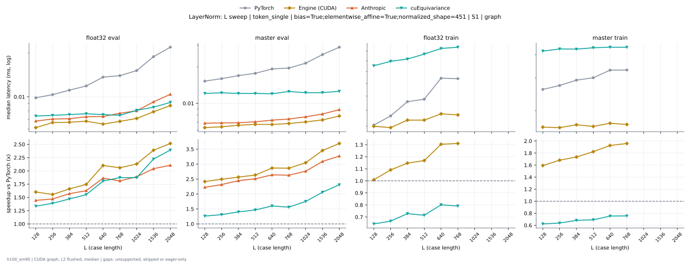

**float32 eval** (median ms; x = speedup vs PyTorch)

| L | PyTorch | Engine (Triton) | Engine (CUDA) | Anthropic | cuEquivariance |
|---|---|---|---|---|---|
| 128 | 0.00984 | 0.007472 (1.32x) | 0.006144 (1.60x) | 0.006816 (1.44x) | 0.007376 (1.33x) |
| 256 | 0.01035 | 0.007536 (1.37x) | 0.006656 (1.56x) | 0.00704 (1.47x) | 0.007456 (1.39x) |
| 384 | 0.0111 | 0.007712 (1.44x) | 0.006688 (1.66x) | 0.007072 (1.57x) | 0.007552 (1.47x) |
| 512 | 0.01187 | 0.00784 (1.51x) | 0.0068 (1.75x) | 0.007296 (1.63x) | 0.007648 (1.55x) |
| 640 | 0.01365 | 0.007648 (1.78x) | 0.006496 (2.10x) | 0.007328 (1.86x) | 0.007552 (1.81x) |
| 768 | 0.01397 | 0.007696 (1.81x) | 0.006784 (2.06x) | 0.007712 (1.81x) | 0.007456 (1.87x) |
| 1024 | 0.01514 | 0.02704 (0.56x) | 0.007104 (2.13x) | 0.008016 (1.89x) | 0.00808 (1.87x) |
| 1536 | 0.01885 | 0.0273 (0.69x) | 0.007888 (2.39x) | 0.009232 (2.04x) | 0.00848 (2.22x) |
| 2048 | 0.0219 | 0.02749 (0.80x) | 0.008704 (2.52x) | 0.0104 (2.11x) | 0.009152 (2.39x) |

**master eval** (median ms; x = speedup vs PyTorch)

| L | PyTorch | Engine (Triton) | Engine (CUDA) | Anthropic | cuEquivariance |
|---|---|---|---|---|---|
| 128 | 0.01523 | 0.007504 (2.03x) | 0.006304 (2.42x) | 0.006848 (2.22x) | 0.01206 (1.26x) |
| 256 | 0.01597 | 0.007488 (2.13x) | 0.0064 (2.50x) | 0.006896 (2.32x) | 0.01219 (1.31x) |
| 384 | 0.01691 | 0.007584 (2.23x) | 0.006592 (2.57x) | 0.006912 (2.45x) | 0.01206 (1.40x) |
| 512 | 0.01766 | 0.007584 (2.33x) | 0.006704 (2.63x) | 0.00704 (2.51x) | 0.01205 (1.47x) |
| 640 | 0.01918 | 0.007568 (2.53x) | 0.006688 (2.87x) | 0.007264 (2.64x) | 0.01198 (1.60x) |
| 768 | 0.01952 | 0.00768 (2.54x) | 0.006816 (2.86x) | 0.007424 (2.63x) | 0.01251 (1.56x) |
| 1024 | 0.02141 | 0.02717 (0.79x) | 0.007024 (3.05x) | 0.007744 (2.76x) | 0.01222 (1.75x) |
| 1536 | 0.02522 | 0.02691 (0.94x) | 0.007296 (3.46x) | 0.00816 (3.09x) | 0.01224 (2.06x) |
| 2048 | 0.02899 | 0.02694 (1.08x) | 0.007856 (3.69x) | 0.008864 (3.27x) | 0.01256 (2.31x) |

**float32 train** (median ms; x = speedup vs PyTorch)

| L | PyTorch | Engine (Triton) | Engine (CUDA) | Anthropic | cuEquivariance |
|---|---|---|---|---|---|
| 128 | 0.01613 | 0.01542 (1.05x) | 0.01598 (1.01x) | unsupported | 0.02509 (0.64x) |
| 256 | 0.01726 | 0.01627 (1.06x) | 0.01582 (1.09x) | unsupported | 0.02592 (0.67x) |
| 384 | 0.0192 | 0.01701 (1.13x) | 0.01674 (1.15x) | unsupported | 0.02637 (0.73x) |
| 512 | 0.01955 | 0.02003 (0.98x) | 0.01674 (1.17x) | unsupported | 0.02736 (0.71x) |
| 640 | 0.02286 | 0.01941 (1.18x) | 0.01754 (1.30x) | unsupported | 0.02853 (0.80x) |
| 768 | 0.02278 | 0.02019 (1.13x) | 0.01739 (1.31x) | unsupported | 0.0288 (0.79x) |
| 1024 |  |  |  |  |  |
| 1536 |  |  |  |  |  |
| 2048 |  |  |  |  |  |

**master train** (median ms; x = speedup vs PyTorch)

| L | PyTorch | Engine (Triton) | Engine (CUDA) | Anthropic | cuEquivariance |
|---|---|---|---|---|---|
| 128 | 0.02605 | 0.0157 (1.66x) | 0.01635 (1.59x) | unsupported | 0.04181 (0.62x) |
| 256 | 0.02734 | 0.01653 (1.65x) | 0.01626 (1.68x) | unsupported | 0.04291 (0.64x) |
| 384 | 0.0292 | 0.01629 (1.79x) | 0.01683 (1.73x) | unsupported | 0.04282 (0.68x) |
| 512 | 0.03008 | 0.01846 (1.63x) | 0.0165 (1.82x) | unsupported | 0.04355 (0.69x) |
| 640 | 0.03304 | 0.01813 (1.82x) | 0.01715 (1.93x) | unsupported | 0.04386 (0.75x) |
| 768 | 0.0331 | 0.01965 (1.68x) | 0.0169 (1.96x) | unsupported | 0.04381 (0.76x) |
| 1024 |  |  |  |  |  |
| 1536 |  |  |  |  |  |
| 2048 |  |  |  |  |  |

### L sweep: token_single | bias=True;elementwise_affine=True;normalized_shape=768 | S1 | graph

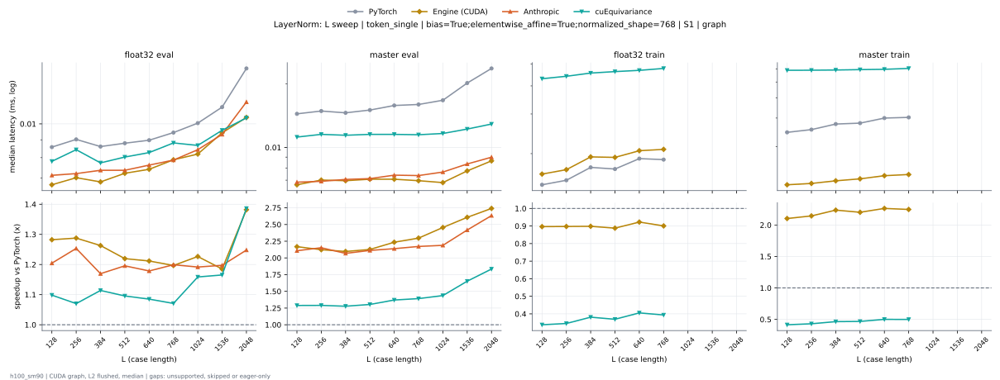

**float32 eval** (median ms; x = speedup vs PyTorch)

| L | PyTorch | Engine (Triton) | Engine (CUDA) | Anthropic | cuEquivariance |
|---|---|---|---|---|---|
| 128 | 0.008576 | 0.009072 (0.95x) | 0.006688 (1.28x) | 0.00712 (1.20x) | 0.007808 (1.10x) |
| 256 | 0.009024 | 0.00968 (0.93x) | 0.007008 (1.29x) | 0.0072 (1.25x) | 0.008432 (1.07x) |
| 384 | 0.008608 | 0.008928 (0.96x) | 0.006816 (1.26x) | 0.00736 (1.17x) | 0.007728 (1.11x) |
| 512 | 0.0088 | 0.00928 (0.95x) | 0.007216 (1.22x) | 0.00736 (1.20x) | 0.008032 (1.10x) |
| 640 | 0.008976 | 0.009472 (0.95x) | 0.007408 (1.21x) | 0.007616 (1.18x) | 0.008272 (1.09x) |
| 768 | 0.00944 | 0.009504 (0.99x) | 0.007888 (1.20x) | 0.007872 (1.20x) | 0.008816 (1.07x) |
| 1024 | 0.01005 | 0.009792 (1.03x) | 0.008192 (1.23x) | 0.008432 (1.19x) | 0.008672 (1.16x) |
| 1536 | 0.01117 | 0.01045 (1.07x) | 0.009424 (1.19x) | 0.009328 (1.20x) | 0.009584 (1.17x) |
| 2048 | 0.01442 | 0.01117 (1.29x) | 0.01043 (1.38x) | 0.01155 (1.25x) | 0.0104 (1.39x) |

**master eval** (median ms; x = speedup vs PyTorch)

| L | PyTorch | Engine (Triton) | Engine (CUDA) | Anthropic | cuEquivariance |
|---|---|---|---|---|---|
| 128 | 0.01443 | 0.008112 (1.78x) | 0.006656 (2.17x) | 0.006848 (2.11x) | 0.0112 (1.29x) |
| 256 | 0.01488 | 0.008096 (1.84x) | 0.007008 (2.12x) | 0.006912 (2.15x) | 0.01154 (1.29x) |
| 384 | 0.01459 | 0.008224 (1.77x) | 0.00696 (2.10x) | 0.007056 (2.07x) | 0.01142 (1.28x) |
| 512 | 0.01504 | 0.00832 (1.81x) | 0.007072 (2.13x) | 0.00712 (2.11x) | 0.01154 (1.30x) |
| 640 | 0.01581 | 0.008128 (1.94x) | 0.007072 (2.24x) | 0.007392 (2.14x) | 0.01154 (1.37x) |
| 768 | 0.01598 | 0.008224 (1.94x) | 0.00696 (2.30x) | 0.00736 (2.17x) | 0.01149 (1.39x) |
| 1024 | 0.01674 | 0.008352 (2.00x) | 0.006816 (2.46x) | 0.007648 (2.19x) | 0.01165 (1.44x) |
| 1536 | 0.02019 | 0.008464 (2.39x) | 0.007744 (2.61x) | 0.008352 (2.42x) | 0.01222 (1.65x) |
| 2048 | 0.02368 | 0.009152 (2.59x) | 0.00864 (2.74x) | 0.008992 (2.63x) | 0.01291 (1.83x) |

**float32 train** (median ms; x = speedup vs PyTorch)

| L | PyTorch | Engine (Triton) | Engine (CUDA) | Anthropic | cuEquivariance |
|---|---|---|---|---|---|
| 128 | 0.01454 | 0.01725 (0.84x) | 0.01622 (0.90x) | unsupported | 0.04304 (0.34x) |
| 256 | 0.01523 | 0.01765 (0.86x) | 0.01698 (0.90x) | unsupported | 0.04413 (0.35x) |
| 384 | 0.01738 | 0.01859 (0.93x) | 0.01934 (0.90x) | unsupported | 0.0456 (0.38x) |
| 512 | 0.01709 | 0.01856 (0.92x) | 0.01925 (0.89x) | unsupported | 0.04629 (0.37x) |
| 640 | 0.01901 | 0.0191 (0.99x) | 0.02061 (0.92x) | unsupported | 0.04688 (0.41x) |
| 768 | 0.01882 | 0.01979 (0.95x) | 0.0209 (0.90x) | unsupported | 0.04781 (0.39x) |
| 1024 |  |  |  |  |  |
| 1536 |  |  |  |  |  |
| 2048 |  |  |  |  |  |

**master train** (median ms; x = speedup vs PyTorch)

| L | PyTorch | Engine (Triton) | Engine (CUDA) | Anthropic | cuEquivariance |
|---|---|---|---|---|---|
| 128 | 0.0245 | 0.01699 (1.44x) | 0.01165 (2.10x) | unsupported | 0.05899 (0.42x) |
| 256 | 0.02546 | 0.01674 (1.52x) | 0.01187 (2.14x) | unsupported | 0.05907 (0.43x) |
| 384 | 0.02755 | 0.01741 (1.58x) | 0.01232 (2.24x) | unsupported | 0.05925 (0.47x) |
| 512 | 0.0279 | 0.01778 (1.57x) | 0.01267 (2.20x) | unsupported | 0.05957 (0.47x) |
| 640 | 0.02998 | 0.0188 (1.59x) | 0.01325 (2.26x) | unsupported | 0.05984 (0.50x) |
| 768 | 0.03027 | 0.01912 (1.58x) | 0.01347 (2.25x) | unsupported | 0.06058 (0.50x) |
| 1024 |  |  |  |  |  |
| 1536 |  |  |  |  |  |
| 2048 |  |  |  |  |  |

### L sweep: token_single | bias=True;elementwise_affine=True;normalized_shape=833 | S1 | graph

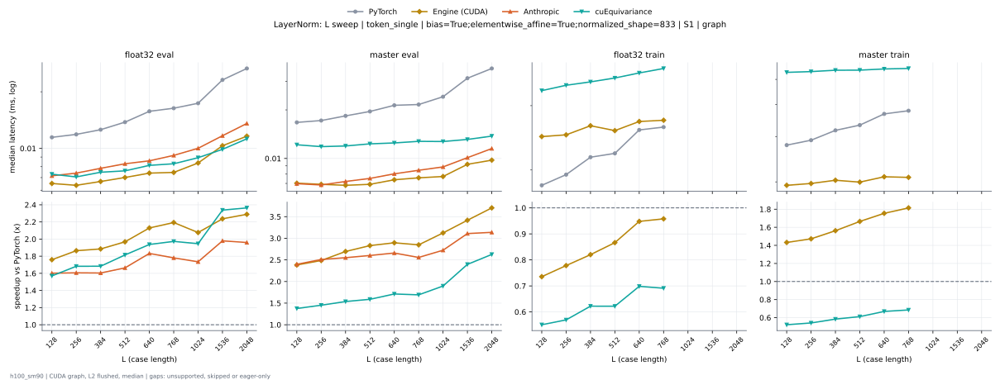

**float32 eval** (median ms; x = speedup vs PyTorch)

| L | PyTorch | Engine (Triton) | Engine (CUDA) | Anthropic | cuEquivariance |
|---|---|---|---|---|---|
| 128 | 0.01146 | 0.009568 (1.20x) | 0.006512 (1.76x) | 0.007152 (1.60x) | 0.007296 (1.57x) |
| 256 | 0.01187 | 0.009536 (1.24x) | 0.006368 (1.86x) | 0.007392 (1.61x) | 0.007056 (1.68x) |
| 384 | 0.01258 | 0.009472 (1.33x) | 0.006672 (1.88x) | 0.00784 (1.60x) | 0.007472 (1.68x) |
| 512 | 0.01379 | 0.009744 (1.42x) | 0.007008 (1.97x) | 0.008288 (1.66x) | 0.0076 (1.81x) |
| 640 | 0.01574 | 0.009856 (1.60x) | 0.007392 (2.13x) | 0.008592 (1.83x) | 0.008128 (1.94x) |
| 768 | 0.01635 | 0.01053 (1.55x) | 0.007456 (2.19x) | 0.009184 (1.78x) | 0.008288 (1.97x) |
| 1024 | 0.01738 | 0.04422 (0.39x) | 0.008368 (2.08x) | 0.01002 (1.73x) | 0.008928 (1.95x) |
| 1536 | 0.02312 | 0.04448 (0.52x) | 0.01034 (2.24x) | 0.01168 (1.98x) | 0.009888 (2.34x) |
| 2048 | 0.02659 | 0.0449 (0.59x) | 0.01162 (2.29x) | 0.01357 (1.96x) | 0.01125 (2.36x) |

**master eval** (median ms; x = speedup vs PyTorch)

| L | PyTorch | Engine (Triton) | Engine (CUDA) | Anthropic | cuEquivariance |
|---|---|---|---|---|---|
| 128 | 0.01674 | 0.0096 (1.74x) | 0.007024 (2.38x) | 0.006976 (2.40x) | 0.01216 (1.38x) |
| 256 | 0.01718 | 0.009312 (1.85x) | 0.006912 (2.49x) | 0.006848 (2.51x) | 0.01184 (1.45x) |
| 384 | 0.01837 | 0.009312 (1.97x) | 0.006816 (2.69x) | 0.0072 (2.55x) | 0.01195 (1.54x) |
| 512 | 0.01957 | 0.009472 (2.07x) | 0.006912 (2.83x) | 0.00752 (2.60x) | 0.01232 (1.59x) |
| 640 | 0.02136 | 0.009856 (2.17x) | 0.007376 (2.90x) | 0.008032 (2.66x) | 0.01248 (1.71x) |
| 768 | 0.0216 | 0.009904 (2.18x) | 0.007584 (2.85x) | 0.008448 (2.56x) | 0.01277 (1.69x) |
| 1024 | 0.02414 | 0.04437 (0.54x) | 0.007728 (3.12x) | 0.008864 (2.72x) | 0.01274 (1.90x) |
| 1536 | 0.03144 | 0.04434 (0.71x) | 0.0092 (3.42x) | 0.01011 (3.11x) | 0.01312 (2.40x) |
| 2048 | 0.03614 | 0.0444 (0.81x) | 0.00976 (3.70x) | 0.01152 (3.14x) | 0.01376 (2.63x) |

**float32 train** (median ms; x = speedup vs PyTorch)

| L | PyTorch | Engine (Triton) | Engine (CUDA) | Anthropic | cuEquivariance |
|---|---|---|---|---|---|
| 128 | 0.01816 | 0.01888 (0.96x) | 0.02469 (0.74x) | unsupported | 0.03298 (0.55x) |
| 256 | 0.01942 | 0.02005 (0.97x) | 0.02496 (0.78x) | unsupported | 0.03411 (0.57x) |
| 384 | 0.02168 | 0.02091 (1.04x) | 0.02643 (0.82x) | unsupported | 0.03485 (0.62x) |
| 512 | 0.02221 | 0.02246 (0.99x) | 0.02563 (0.87x) | unsupported | 0.03571 (0.62x) |
| 640 | 0.02574 | 0.02394 (1.08x) | 0.02715 (0.95x) | unsupported | 0.03686 (0.70x) |
| 768 | 0.02621 | 0.02598 (1.01x) | 0.02736 (0.96x) | unsupported | 0.03792 (0.69x) |
| 1024 |  |  |  |  |  |
| 1536 |  |  |  |  |  |
| 2048 |  |  |  |  |  |

**master train** (median ms; x = speedup vs PyTorch)

| L | PyTorch | Engine (Triton) | Engine (CUDA) | Anthropic | cuEquivariance |
|---|---|---|---|---|---|
| 128 | 0.02778 | 0.01901 (1.46x) | 0.01939 (1.43x) | unsupported | 0.05323 (0.52x) |
| 256 | 0.02902 | 0.02077 (1.40x) | 0.01971 (1.47x) | unsupported | 0.0536 (0.54x) |
| 384 | 0.0317 | 0.02114 (1.50x) | 0.02029 (1.56x) | unsupported | 0.05426 (0.58x) |
| 512 | 0.03322 | 0.0221 (1.50x) | 0.01995 (1.66x) | unsupported | 0.0543 (0.61x) |
| 640 | 0.03672 | 0.0233 (1.58x) | 0.02093 (1.75x) | unsupported | 0.05488 (0.67x) |
| 768 | 0.03778 | 0.02443 (1.55x) | 0.02082 (1.81x) | unsupported | 0.05512 (0.69x) |
| 1024 |  |  |  |  |  |
| 1536 |  |  |  |  |  |
| 2048 |  |  |  |  |  |

### normalized_shape sweep at L768: token_pair | bias=False;elementwise_affine=True | S1 | graph

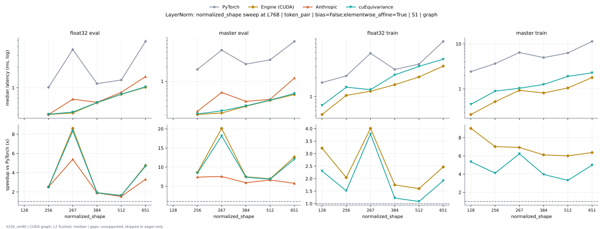

**float32 eval** (median ms; x = speedup vs PyTorch)

| normalized_shape | PyTorch | Engine (Triton) | Engine (CUDA) | Anthropic | cuEquivariance |
|---|---|---|---|---|---|
| 128 |  |  |  |  |  |
| 256 | 1.013 | 0.4059 (2.50x) | 0.4021 (2.52x) | 0.402 (2.52x) | 0.4061 (2.50x) |
| 267 | 3.648 | 0.4258 (8.57x) | 0.4237 (8.61x) | 0.6766 (5.39x) | 0.4368 (8.35x) |
| 384 | 1.148 | 0.6031 (1.90x) | 0.6001 (1.91x) | 0.6077 (1.89x) | 0.6037 (1.90x) |
| 512 | 1.297 | 0.8017 (1.62x) | 0.7978 (1.63x) | 0.8534 (1.52x) | 0.8024 (1.62x) |
| 651 | 4.816 | 1.152 (4.18x) | 1.014 (4.75x) | 1.456 (3.31x) | 1.03 (4.68x) |

**master eval** (median ms; x = speedup vs PyTorch)

| normalized_shape | PyTorch | Engine (Triton) | Engine (CUDA) | Anthropic | cuEquivariance |
|---|---|---|---|---|---|
| 128 |  |  |  |  |  |
| 256 | 1.763 | 0.2078 (8.49x) | 0.2048 (8.61x) | 0.2388 (7.39x) | 0.2102 (8.39x) |
| 267 | 4.431 | 0.2785 (15.91x) | 0.22 (20.14x) | 0.5873 (7.54x) | 0.2437 (18.18x) |
| 384 | 2.271 | 0.3077 (7.38x) | 0.3038 (7.47x) | 0.3843 (5.91x) | 0.3089 (7.35x) |
| 512 | 2.795 | 0.406 (6.88x) | 0.4027 (6.94x) | 0.422 (6.62x) | 0.4088 (6.84x) |
| 651 | 6.726 | 0.653 (10.30x) | 0.5318 (12.65x) | 1.169 (5.75x) | 0.5578 (12.06x) |

**float32 train** (median ms; x = speedup vs PyTorch)

| normalized_shape | PyTorch | Engine (Triton) | Engine (CUDA) | Anthropic | cuEquivariance |
|---|---|---|---|---|---|
| 128 | 1.669 | 0.519 (3.22x) | 0.5185 (3.22x) | unsupported | 0.7244 (2.30x) |
| 256 | 2.13 | 1.016 (2.10x) | 1.044 (2.04x) | unsupported | 1.409 (1.51x) |
| 267 | 4.871 | 1.253 (3.89x) | 1.214 (4.01x) | unsupported | 1.286 (3.79x) |
| 384 | 2.7 | 1.524 (1.77x) | 1.544 (1.75x) | unsupported | 2.21 (1.22x) |
| 512 | 3.277 | 2.043 (1.60x) | 2.048 (1.60x) | unsupported | 3.019 (1.09x) |
| 651 | 7.528 | 3.626 (2.08x) | 3.049 (2.47x) | unsupported | 3.926 (1.92x) |

**master train** (median ms; x = speedup vs PyTorch)

| normalized_shape | PyTorch | Engine (Triton) | Engine (CUDA) | Anthropic | cuEquivariance |
|---|---|---|---|---|---|
| 128 | 2.42 | 0.2726 (8.88x) | 0.2684 (9.02x) | unsupported | 0.4519 (5.35x) |
| 256 | 3.637 | 0.5218 (6.97x) | 0.5182 (7.02x) | unsupported | 0.8854 (4.11x) |
| 267 | 6.403 | 0.9347 (6.85x) | 0.9251 (6.92x) | unsupported | 1.028 (6.23x) |
| 384 | 4.946 | 1.005 (4.92x) | 0.8092 (6.11x) | unsupported | 1.248 (3.96x) |
| 512 | 6.269 | 1.375 (4.56x) | 1.044 (6.00x) | unsupported | 1.892 (3.31x) |
| 651 | 11.33 | 2.218 (5.11x) | 1.781 (6.36x) | unsupported | 2.271 (4.99x) |

### normalized_shape sweep at L2048: token_pair | bias=True;elementwise_affine=True | S1 | graph

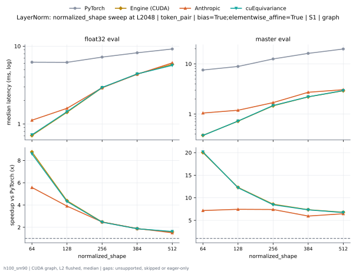

**float32 eval** (median ms; x = speedup vs PyTorch)

| normalized_shape | PyTorch | Engine (Triton) | Engine (CUDA) | Anthropic | cuEquivariance |
|---|---|---|---|---|---|
| 64 | 6.222 | 0.7244 (8.59x) | 0.7096 (8.77x) | 1.116 (5.57x) | 0.7238 (8.60x) |
| 128 | 6.194 | 1.425 (4.35x) | 1.413 (4.38x) | 1.587 (3.90x) | 1.437 (4.31x) |
| 256 | 7.24 | 2.844 (2.55x) | 2.921 (2.48x) | 2.923 (2.48x) | 2.943 (2.46x) |
| 384 | 8.224 | 4.398 (1.87x) | 4.378 (1.88x) | 4.358 (1.89x) | 4.399 (1.87x) |
| 512 | 9.205 | 5.866 (1.57x) | 5.84 (1.58x) | 6.097 (1.51x) | 5.672 (1.62x) |

**master eval** (median ms; x = speedup vs PyTorch)

| normalized_shape | PyTorch | Engine (Triton) | Engine (CUDA) | Anthropic | cuEquivariance |
|---|---|---|---|---|---|
| 64 | 7.554 | 0.3709 (20.36x) | 0.3772 (20.02x) | 1.051 (7.19x) | 0.3746 (20.16x) |
| 128 | 8.89 | 0.7223 (12.31x) | 0.7225 (12.30x) | 1.193 (7.45x) | 0.7271 (12.23x) |
| 256 | 12.55 | 1.477 (8.50x) | 1.462 (8.59x) | 1.694 (7.41x) | 1.483 (8.46x) |
| 384 | 16.2 | 2.203 (7.35x) | 2.2 (7.36x) | 2.72 (5.96x) | 2.21 (7.33x) |
| 512 | 19.82 | 2.933 (6.76x) | 2.918 (6.79x) | 3.062 (6.47x) | 2.944 (6.73x) |

### normalized_shape sweep at L768: token_single | bias=False;elementwise_affine=True | S1 | graph

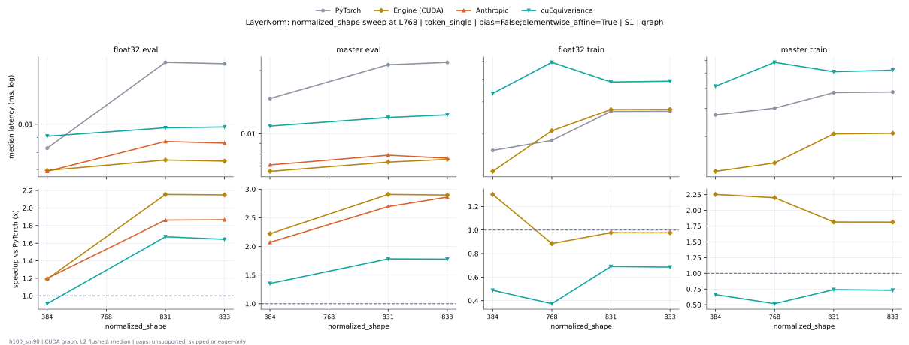

**float32 eval** (median ms; x = speedup vs PyTorch)

| normalized_shape | PyTorch | Engine (Triton) | Engine (CUDA) | Anthropic | cuEquivariance |
|---|---|---|---|---|---|
| 384 | 0.008288 | 0.00912 (0.91x) | 0.00696 (1.19x) | 0.006912 (1.20x) | 0.009104 (0.91x) |
| 768 |  |  |  |  |  |
| 831 | 0.01627 | 0.01146 (1.42x) | 0.007552 (2.15x) | 0.008736 (1.86x) | 0.009728 (1.67x) |
| 833 | 0.0161 | 0.01147 (1.40x) | 0.007488 (2.15x) | 0.008624 (1.87x) | 0.009792 (1.64x) |

**master eval** (median ms; x = speedup vs PyTorch)

| normalized_shape | PyTorch | Engine (Triton) | Engine (CUDA) | Anthropic | cuEquivariance |
|---|---|---|---|---|---|
| 384 | 0.01472 | 0.00848 (1.74x) | 0.006624 (2.22x) | 0.007104 (2.07x) | 0.01088 (1.35x) |
| 768 |  |  |  |  |  |
| 831 | 0.02131 | 0.01114 (1.91x) | 0.007328 (2.91x) | 0.007904 (2.70x) | 0.01195 (1.78x) |
| 833 | 0.02189 | 0.01142 (1.92x) | 0.007552 (2.90x) | 0.007648 (2.86x) | 0.0123 (1.78x) |

**float32 train** (median ms; x = speedup vs PyTorch)

| normalized_shape | PyTorch | Engine (Triton) | Engine (CUDA) | Anthropic | cuEquivariance |
|---|---|---|---|---|---|
| 384 | 0.01629 | 0.01747 (0.93x) | 0.01251 (1.30x) | unsupported | 0.03339 (0.49x) |
| 768 | 0.01846 | 0.02048 (0.90x) | 0.02086 (0.88x) | unsupported | 0.04938 (0.37x) |
| 831 | 0.02661 | 0.02734 (0.97x) | 0.02723 (0.98x) | unsupported | 0.03856 (0.69x) |
| 833 | 0.02666 | 0.02765 (0.96x) | 0.0273 (0.98x) | unsupported | 0.03893 (0.68x) |

**master train** (median ms; x = speedup vs PyTorch)

| normalized_shape | PyTorch | Engine (Triton) | Engine (CUDA) | Anthropic | cuEquivariance |
|---|---|---|---|---|---|
| 384 | 0.02733 | 0.01642 (1.66x) | 0.01213 (2.25x) | unsupported | 0.04133 (0.66x) |
| 768 | 0.03011 | 0.02042 (1.47x) | 0.01368 (2.20x) | unsupported | 0.05826 (0.52x) |
| 831 | 0.0377 | 0.02579 (1.46x) | 0.02077 (1.82x) | unsupported | 0.0509 (0.74x) |
| 833 | 0.03802 | 0.026 (1.46x) | 0.02096 (1.81x) | unsupported | 0.05205 (0.73x) |

### normalized_shape sweep at L768: token_single | bias=True;elementwise_affine=True | S1 | graph

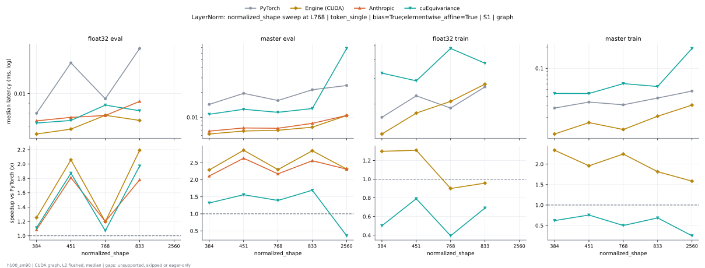

**float32 eval** (median ms; x = speedup vs PyTorch)

| normalized_shape | PyTorch | Engine (Triton) | Engine (CUDA) | Anthropic | cuEquivariance |
|---|---|---|---|---|---|
| 384 | 0.008064 | 0.00736 (1.10x) | 0.006432 (1.25x) | 0.007424 (1.09x) | 0.007248 (1.11x) |
| 451 | 0.01397 | 0.007696 (1.81x) | 0.006784 (2.06x) | 0.007712 (1.81x) | 0.007456 (1.87x) |
| 768 | 0.00944 | 0.009504 (0.99x) | 0.007888 (1.20x) | 0.007872 (1.20x) | 0.008816 (1.07x) |
| 833 | 0.01635 | 0.01053 (1.55x) | 0.007456 (2.19x) | 0.009184 (1.78x) | 0.008288 (1.97x) |
| 2560 |  |  |  |  |  |

**master eval** (median ms; x = speedup vs PyTorch)

| normalized_shape | PyTorch | Engine (Triton) | Engine (CUDA) | Anthropic | cuEquivariance |
|---|---|---|---|---|---|
| 384 | 0.01434 | 0.006848 (2.09x) | 0.006272 (2.29x) | 0.0068 (2.11x) | 0.01088 (1.32x) |
| 451 | 0.01952 | 0.00768 (2.54x) | 0.006816 (2.86x) | 0.007424 (2.63x) | 0.01251 (1.56x) |
| 768 | 0.01598 | 0.008224 (1.94x) | 0.00696 (2.30x) | 0.00736 (2.17x) | 0.01149 (1.39x) |
| 833 | 0.0216 | 0.009904 (2.18x) | 0.007584 (2.85x) | 0.008448 (2.56x) | 0.01277 (1.69x) |
| 2560 | 0.0243 | 0.01459 (1.67x) | 0.01051 (2.31x) | 0.01053 (2.31x) | 0.06842 (0.36x) |

**float32 train** (median ms; x = speedup vs PyTorch)

| normalized_shape | PyTorch | Engine (Triton) | Engine (CUDA) | Anthropic | cuEquivariance |
|---|---|---|---|---|---|
| 384 | 0.01629 | 0.01651 (0.99x) | 0.01254 (1.30x) | unsupported | 0.03251 (0.50x) |
| 451 | 0.02278 | 0.02019 (1.13x) | 0.01739 (1.31x) | unsupported | 0.0288 (0.79x) |
| 768 | 0.01882 | 0.01979 (0.95x) | 0.0209 (0.90x) | unsupported | 0.04781 (0.39x) |
| 833 | 0.02621 | 0.02598 (1.01x) | 0.02736 (0.96x) | unsupported | 0.03792 (0.69x) |
| 2560 |  |  |  |  |  |

**master train** (median ms; x = speedup vs PyTorch)

| normalized_shape | PyTorch | Engine (Triton) | Engine (CUDA) | Anthropic | cuEquivariance |
|---|---|---|---|---|---|
| 384 | 0.02722 | 0.01485 (1.83x) | 0.01163 (2.34x) | unsupported | 0.04392 (0.62x) |
| 451 | 0.0331 | 0.01965 (1.68x) | 0.0169 (1.96x) | unsupported | 0.04381 (0.76x) |
| 768 | 0.03027 | 0.01912 (1.58x) | 0.01347 (2.25x) | unsupported | 0.06058 (0.50x) |
| 833 | 0.03778 | 0.02443 (1.55x) | 0.02082 (1.81x) | unsupported | 0.05512 (0.69x) |
| 2560 | 0.0475 | 0.03654 (1.30x) | 0.02998 (1.58x) | unsupported | 0.1917 (0.25x) |

### Single-length cases (no sweep)

- noise | bias=False;elementwise_affine=True;normalized_shape=256 | S1 | graph L1 float32 train anthropic: unsupported
- noise | bias=False;elementwise_affine=True;normalized_shape=256 | S1 | graph L1 float32 train cuda: 0.009328 ms
- noise | bias=False;elementwise_affine=True;normalized_shape=256 | S1 | graph L1 float32 train cueq: 0.02395 ms
- noise | bias=False;elementwise_affine=True;normalized_shape=256 | S1 | graph L1 float32 train pytorch: 0.01206 ms
- noise | bias=False;elementwise_affine=True;normalized_shape=256 | S1 | graph L1 float32 train triton: 0.01264 ms
- noise | bias=False;elementwise_affine=True;normalized_shape=256 | S1 | graph L1 master train anthropic: unsupported
- noise | bias=False;elementwise_affine=True;normalized_shape=256 | S1 | graph L1 master train cuda: 0.008688 ms
- noise | bias=False;elementwise_affine=True;normalized_shape=256 | S1 | graph L1 master train cueq: 0.03198 ms
- noise | bias=False;elementwise_affine=True;normalized_shape=256 | S1 | graph L1 master train pytorch: 0.0191 ms
- noise | bias=False;elementwise_affine=True;normalized_shape=256 | S1 | graph L1 master train triton: 0.01248 ms
- noise | bias=False;elementwise_affine=True;normalized_shape=256 | S5 | graph L1 float32 eval anthropic: 0.006288 ms
- noise | bias=False;elementwise_affine=True;normalized_shape=256 | S5 | graph L1 float32 eval cuda: 0.00616 ms
- noise | bias=False;elementwise_affine=True;normalized_shape=256 | S5 | graph L1 float32 eval cueq: 0.008608 ms
- noise | bias=False;elementwise_affine=True;normalized_shape=256 | S5 | graph L1 float32 eval pytorch: 0.007328 ms
- noise | bias=False;elementwise_affine=True;normalized_shape=256 | S5 | graph L1 float32 eval triton: 0.007968 ms
- noise | bias=False;elementwise_affine=True;normalized_shape=256 | S5 | graph L1 master eval anthropic: 0.01006 ms
- noise | bias=False;elementwise_affine=True;normalized_shape=256 | S5 | graph L1 master eval cuda: 0.006208 ms
- noise | bias=False;elementwise_affine=True;normalized_shape=256 | S5 | graph L1 master eval cueq: 0.009632 ms
- noise | bias=False;elementwise_affine=True;normalized_shape=256 | S5 | graph L1 master eval pytorch: 0.01251 ms
- noise | bias=False;elementwise_affine=True;normalized_shape=256 | S5 | graph L1 master eval triton: 0.007968 ms
- noise | bias=True;elementwise_affine=True;normalized_shape=256 | S1 | graph L1 float32 train anthropic: unsupported
- noise | bias=True;elementwise_affine=True;normalized_shape=256 | S1 | graph L1 float32 train cuda: 0.009184 ms
- noise | bias=True;elementwise_affine=True;normalized_shape=256 | S1 | graph L1 float32 train cueq: 0.02291 ms
- noise | bias=True;elementwise_affine=True;normalized_shape=256 | S1 | graph L1 float32 train pytorch: 0.01206 ms
- noise | bias=True;elementwise_affine=True;normalized_shape=256 | S1 | graph L1 float32 train triton: 0.0112 ms
- noise | bias=True;elementwise_affine=True;normalized_shape=256 | S1 | graph L1 master train anthropic: unsupported
- noise | bias=True;elementwise_affine=True;normalized_shape=256 | S1 | graph L1 master train cuda: 0.009504 ms
- noise | bias=True;elementwise_affine=True;normalized_shape=256 | S1 | graph L1 master train cueq: 0.0347 ms
- noise | bias=True;elementwise_affine=True;normalized_shape=256 | S1 | graph L1 master train pytorch: 0.01926 ms
- noise | bias=True;elementwise_affine=True;normalized_shape=256 | S1 | graph L1 master train triton: 0.01139 ms
- noise | bias=True;elementwise_affine=True;normalized_shape=256 | S5 | graph L1 float32 eval anthropic: 0.006288 ms
- noise | bias=True;elementwise_affine=True;normalized_shape=256 | S5 | graph L1 float32 eval cuda: 0.006016 ms
- noise | bias=True;elementwise_affine=True;normalized_shape=256 | S5 | graph L1 float32 eval cueq: 0.006848 ms
- noise | bias=True;elementwise_affine=True;normalized_shape=256 | S5 | graph L1 float32 eval pytorch: 0.007328 ms
- noise | bias=True;elementwise_affine=True;normalized_shape=256 | S5 | graph L1 float32 eval triton: 0.006272 ms
- noise | bias=True;elementwise_affine=True;normalized_shape=256 | S5 | graph L1 master eval anthropic: 0.009712 ms
- noise | bias=True;elementwise_affine=True;normalized_shape=256 | S5 | graph L1 master eval cuda: 0.00624 ms
- noise | bias=True;elementwise_affine=True;normalized_shape=256 | S5 | graph L1 master eval cueq: 0.01016 ms
- noise | bias=True;elementwise_affine=True;normalized_shape=256 | S5 | graph L1 master eval pytorch: 0.01274 ms
- noise | bias=True;elementwise_affine=True;normalized_shape=256 | S5 | graph L1 master eval triton: 0.006544 ms
