# LayerNorm on h100_sm90

Generated by `python -m miniworld_engine.measure.plot` from speed tokens `judge/tokens/h100_sm90/`; do not edit.

### L sweep: atom_single | bias=False;elementwise_affine=True;normalized_shape=128 | S1 | graph

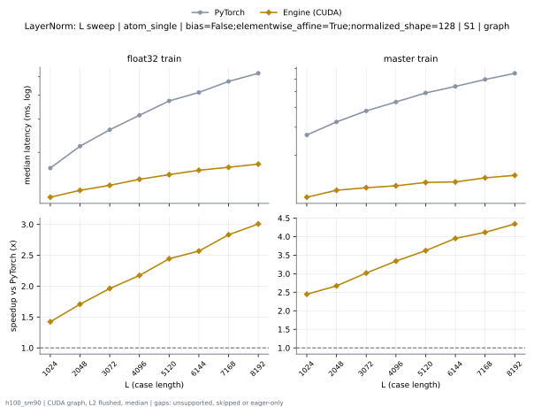

**float32 train** (median ms; x = speedup vs PyTorch)

| L | PyTorch | Engine (Triton) | Engine (CUDA) | Anthropic | cuEquivariance |
|---|---|---|---|---|---|
| 1024 | 0.01661 | 0.01437 (1.16x) | 0.01189 (1.40x) | 0.01554 (1.07x) | 0.02565 (0.65x) |
| 2048 | 0.02205 | 0.01515 (1.46x) | 0.01293 (1.71x) | 0.01699 (1.30x) | 0.02504 (0.88x) |
| 3072 | 0.02632 | 0.01582 (1.66x) | 0.01357 (1.94x) | 0.01853 (1.42x) | 0.02654 (0.99x) |
| 4096 | 0.03136 | 0.01827 (1.72x) | 0.0145 (2.16x) | 0.02045 (1.53x) | 0.02853 (1.10x) |
| 5120 | 0.03725 | 0.01822 (2.04x) | 0.0153 (2.44x) | 0.02251 (1.65x) | 0.03267 (1.14x) |
| 6144 | 0.04131 | 0.01926 (2.14x) | 0.01613 (2.56x) | 0.02555 (1.62x) | 0.03395 (1.22x) |
| 7168 | 0.0471 | 0.02008 (2.35x) | 0.01674 (2.81x) | 0.02742 (1.72x) | 0.03549 (1.33x) |
| 8192 | 0.0519 | 0.02056 (2.52x) | 0.01747 (2.97x) | 0.0292 (1.78x) | 0.03677 (1.41x) |

**master train** (median ms; x = speedup vs PyTorch)

| L | PyTorch | Engine (Triton) | Engine (CUDA) | Anthropic | cuEquivariance |
|---|---|---|---|---|---|
| 1024 | 0.02704 | 0.0137 (1.97x) | 0.01131 (2.39x) | 0.02019 (1.34x) | 0.03008 (0.90x) |
| 2048 | 0.03312 | 0.01421 (2.33x) | 0.01219 (2.72x) | 0.02125 (1.56x) | 0.03171 (1.04x) |
| 3072 | 0.03773 | 0.0153 (2.47x) | 0.01278 (2.95x) | 0.02246 (1.68x) | 0.03411 (1.11x) |
| 4096 | 0.04323 | 0.01662 (2.60x) | 0.01288 (3.36x) | 0.02362 (1.83x) | 0.03198 (1.35x) |
| 5120 | 0.04928 | 0.01618 (3.05x) | 0.01382 (3.56x) | 0.02534 (1.94x) | 0.0328 (1.50x) |
| 6144 | 0.05387 | 0.01677 (3.21x) | 0.01394 (3.87x) | 0.02661 (2.02x) | 0.0336 (1.60x) |
| 7168 | 0.05954 | 0.01738 (3.43x) | 0.01461 (4.08x) | 0.02774 (2.15x) | 0.03435 (1.73x) |
| 8192 | 0.0655 | 0.01818 (3.60x) | 0.01523 (4.30x) | 0.02872 (2.28x) | 0.03514 (1.86x) |

### L sweep: atom_single | bias=False;elementwise_affine=True;normalized_shape=128 | S5 | graph

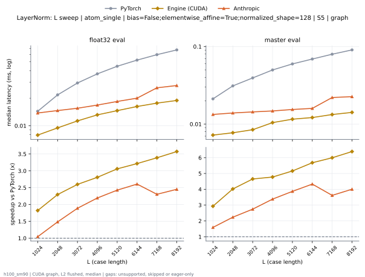

**float32 eval** (median ms; x = speedup vs PyTorch)

| L | PyTorch | Engine (Triton) | Engine (CUDA) | Anthropic | cuEquivariance |
|---|---|---|---|---|---|
| 1024 | 0.01453 | 0.00936 (1.55x) | 0.008096 (1.79x) | 0.01387 (1.05x) | 0.01034 (1.41x) |
| 2048 | 0.02157 | 0.01069 (2.02x) | 0.0096 (2.25x) | 0.01472 (1.47x) | 0.01174 (1.84x) |
| 3072 | 0.02912 | 0.01194 (2.44x) | 0.01134 (2.57x) | 0.01546 (1.88x) | 0.01314 (2.22x) |
| 4096 | 0.03678 | 0.01509 (2.44x) | 0.01376 (2.67x) | 0.0169 (2.18x) | 0.01456 (2.53x) |
| 5120 | 0.0444 | 0.01702 (2.61x) | 0.0148 (3.00x) | 0.01846 (2.40x) | 0.01637 (2.71x) |
| 6144 | 0.05203 | 0.01856 (2.80x) | 0.01587 (3.28x) | 0.02019 (2.58x) | 0.01835 (2.84x) |
| 7168 | 0.05981 | 0.02042 (2.93x) | 0.01794 (3.33x) | 0.02606 (2.29x) | 0.02106 (2.84x) |
| 8192 | 0.0672 | 0.02229 (3.02x) | 0.01891 (3.55x) | 0.02754 (2.44x) | 0.02275 (2.95x) |

**master eval** (median ms; x = speedup vs PyTorch)

| L | PyTorch | Engine (Triton) | Engine (CUDA) | Anthropic | cuEquivariance |
|---|---|---|---|---|---|
| 1024 | 0.0213 | 0.008288 (2.57x) | 0.006944 (3.07x) | 0.01328 (1.60x) | 0.01038 (2.05x) |
| 2048 | 0.03104 | 0.009344 (3.32x) | 0.008 (3.88x) | 0.01366 (2.27x) | 0.01173 (2.65x) |
| 3072 | 0.03955 | 0.009728 (4.07x) | 0.008576 (4.61x) | 0.01498 (2.64x) | 0.0121 (3.27x) |
| 4096 | 0.04979 | 0.01075 (4.63x) | 0.01067 (4.67x) | 0.01466 (3.40x) | 0.01301 (3.83x) |
| 5120 | 0.05923 | 0.01149 (5.16x) | 0.01146 (5.17x) | 0.01539 (3.85x) | 0.014 (4.23x) |
| 6144 | 0.06854 | 0.01354 (5.06x) | 0.01219 (5.62x) | 0.01594 (4.30x) | 0.0144 (4.76x) |
| 7168 | 0.0793 | 0.01458 (5.44x) | 0.01338 (5.93x) | 0.02194 (3.61x) | 0.01526 (5.19x) |
| 8192 | 0.09003 | 0.0156 (5.77x) | 0.01421 (6.34x) | 0.02274 (3.96x) | 0.01602 (5.62x) |

### L sweep: atom_single | bias=True;elementwise_affine=True;normalized_shape=128 | S1 | graph

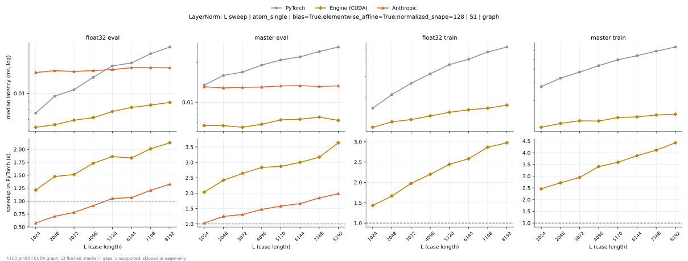

**float32 eval** (median ms; x = speedup vs PyTorch)

| L | PyTorch | Engine (Triton) | Engine (CUDA) | Anthropic | cuEquivariance |
|---|---|---|---|---|---|
| 1024 | 0.008 | 0.00656 (1.22x) | 0.006608 (1.21x) | 0.01322 (0.61x) | 0.007904 (1.01x) |
| 2048 | 0.0103 | 0.007104 (1.45x) | 0.007168 (1.44x) | 0.01355 (0.76x) | 0.00832 (1.24x) |
| 3072 | 0.01034 | 0.006784 (1.52x) | 0.006944 (1.49x) | 0.01323 (0.78x) | 0.008128 (1.27x) |
| 4096 | 0.01238 | 0.007568 (1.64x) | 0.007424 (1.67x) | 0.01363 (0.91x) | 0.00864 (1.43x) |
| 5120 | 0.01451 | 0.007904 (1.84x) | 0.00808 (1.80x) | 0.01379 (1.05x) | 0.008896 (1.63x) |
| 6144 | 0.0152 | 0.008128 (1.87x) | 0.008288 (1.83x) | 0.01387 (1.10x) | 0.009088 (1.67x) |
| 7168 | 0.01706 | 0.008416 (2.03x) | 0.008544 (2.00x) | 0.01472 (1.16x) | 0.009248 (1.84x) |
| 8192 | 0.01891 | 0.00856 (2.21x) | 0.008976 (2.11x) | 0.0143 (1.32x) | 0.009744 (1.94x) |

**master eval** (median ms; x = speedup vs PyTorch)

| L | PyTorch | Engine (Triton) | Engine (CUDA) | Anthropic | cuEquivariance |
|---|---|---|---|---|---|
| 1024 | 0.01376 | 0.006448 (2.13x) | 0.006768 (2.03x) | 0.01318 (1.04x) | 0.01059 (1.30x) |
| 2048 | 0.01661 | 0.006656 (2.50x) | 0.0068 (2.44x) | 0.01302 (1.28x) | 0.0107 (1.55x) |
| 3072 | 0.01712 | 0.00704 (2.43x) | 0.007008 (2.44x) | 0.01334 (1.28x) | 0.01096 (1.56x) |
| 4096 | 0.01904 | 0.006992 (2.72x) | 0.007104 (2.68x) | 0.01338 (1.42x) | 0.01096 (1.74x) |
| 5120 | 0.02131 | 0.006928 (3.08x) | 0.006944 (3.07x) | 0.01306 (1.63x) | 0.01082 (1.97x) |
| 6144 | 0.02221 | 0.007136 (3.11x) | 0.007088 (3.13x) | 0.01325 (1.68x) | 0.01112 (2.00x) |
| 7168 | 0.02416 | 0.007328 (3.30x) | 0.007264 (3.33x) | 0.01315 (1.84x) | 0.01094 (2.21x) |
| 8192 | 0.02645 | 0.007344 (3.60x) | 0.007408 (3.57x) | 0.01325 (2.00x) | 0.01123 (2.35x) |

**float32 train** (median ms; x = speedup vs PyTorch)

| L | PyTorch | Engine (Triton) | Engine (CUDA) | Anthropic | cuEquivariance |
|---|---|---|---|---|---|
| 1024 | 0.0164 | 0.01347 (1.22x) | 0.01187 (1.38x) | 0.01594 (1.03x) | 0.0244 (0.67x) |
| 2048 | 0.02218 | 0.0148 (1.50x) | 0.01322 (1.68x) | 0.01795 (1.24x) | 0.02395 (0.93x) |
| 3072 | 0.0265 | 0.0161 (1.65x) | 0.01355 (1.96x) | 0.01939 (1.37x) | 0.02528 (1.05x) |
| 4096 | 0.03139 | 0.01826 (1.72x) | 0.01456 (2.16x) | 0.02131 (1.47x) | 0.02696 (1.16x) |
| 5120 | 0.03744 | 0.02018 (1.86x) | 0.01542 (2.43x) | 0.02386 (1.57x) | 0.0312 (1.20x) |
| 6144 | 0.04139 | 0.02178 (1.90x) | 0.01627 (2.54x) | 0.02694 (1.54x) | 0.03269 (1.27x) |
| 7168 | 0.0473 | 0.02307 (2.05x) | 0.01675 (2.82x) | 0.02915 (1.62x) | 0.03384 (1.40x) |
| 8192 | 0.05211 | 0.02173 (2.40x) | 0.01702 (3.06x) | 0.03173 (1.64x) | 0.03544 (1.47x) |

**master train** (median ms; x = speedup vs PyTorch)

| L | PyTorch | Engine (Triton) | Engine (CUDA) | Anthropic | cuEquivariance |
|---|---|---|---|---|---|
| 1024 | 0.02707 | 0.01293 (2.09x) | 0.01123 (2.41x) | 0.02522 (1.07x) | 0.03192 (0.85x) |
| 2048 | 0.03301 | 0.01389 (2.38x) | 0.01194 (2.77x) | 0.02634 (1.25x) | 0.03338 (0.99x) |
| 3072 | 0.03778 | 0.01576 (2.40x) | 0.01274 (2.97x) | 0.02781 (1.36x) | 0.03602 (1.05x) |
| 4096 | 0.04322 | 0.01546 (2.80x) | 0.01282 (3.37x) | 0.02918 (1.48x) | 0.03382 (1.28x) |
| 5120 | 0.04918 | 0.01605 (3.06x) | 0.01386 (3.55x) | 0.0307 (1.60x) | 0.03467 (1.42x) |
| 6144 | 0.05392 | 0.01718 (3.14x) | 0.01395 (3.86x) | 0.03302 (1.63x) | 0.03541 (1.52x) |
| 7168 | 0.05941 | 0.01792 (3.32x) | 0.01458 (4.08x) | 0.03355 (1.77x) | 0.0361 (1.65x) |
| 8192 | 0.0652 | 0.01714 (3.80x) | 0.01506 (4.33x) | 0.03434 (1.90x) | 0.0369 (1.77x) |

### L sweep: token_pair | bias=False;elementwise_affine=True;normalized_shape=128 | S1 | graph

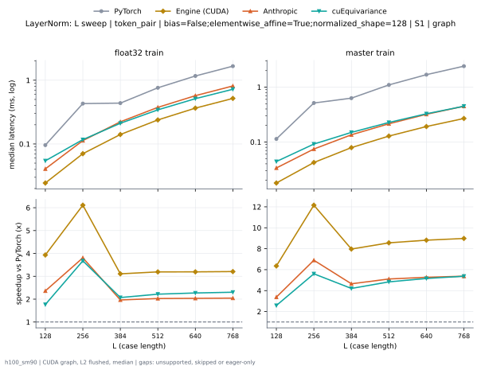

**float32 train** (median ms; x = speedup vs PyTorch)

| L | PyTorch | Engine (Triton) | Engine (CUDA) | Anthropic | cuEquivariance |
|---|---|---|---|---|---|
| 128 | 0.09611 | 0.02798 (3.43x) | 0.02427 (3.96x) | 0.04067 (2.36x) | 0.0544 (1.77x) |
| 256 | 0.43 | 0.0711 (6.05x) | 0.07053 (6.10x) | 0.113 (3.81x) | 0.117 (3.67x) |
| 384 | 0.4381 | 0.1418 (3.09x) | 0.1406 (3.12x) | 0.2226 (1.97x) | 0.2112 (2.07x) |
| 512 | 0.7614 | 0.2399 (3.17x) | 0.2381 (3.20x) | 0.3754 (2.03x) | 0.3431 (2.22x) |
| 640 | 1.166 | 0.3666 (3.18x) | 0.3652 (3.19x) | 0.5726 (2.04x) | 0.5135 (2.27x) |
| 768 | 1.662 | 0.5193 (3.20x) | 0.5183 (3.21x) | 0.8128 (2.04x) | 0.7217 (2.30x) |

**master train** (median ms; x = speedup vs PyTorch)

| L | PyTorch | Engine (Triton) | Engine (CUDA) | Anthropic | cuEquivariance |
|---|---|---|---|---|---|
| 128 | 0.1141 | 0.02264 (5.04x) | 0.01781 (6.41x) | 0.03365 (3.39x) | 0.0441 (2.59x) |
| 256 | 0.5147 | 0.04418 (11.65x) | 0.04259 (12.08x) | 0.07456 (6.90x) | 0.09178 (5.61x) |
| 384 | 0.6303 | 0.08024 (7.86x) | 0.07859 (8.02x) | 0.1355 (4.65x) | 0.1497 (4.21x) |
| 512 | 1.098 | 0.1319 (8.33x) | 0.1282 (8.57x) | 0.215 (5.11x) | 0.2272 (4.83x) |
| 640 | 1.688 | 0.1952 (8.65x) | 0.1914 (8.82x) | 0.3201 (5.27x) | 0.3271 (5.16x) |
| 768 | 2.414 | 0.2719 (8.88x) | 0.2686 (8.99x) | 0.4488 (5.38x) | 0.4491 (5.38x) |

### L sweep: token_pair | bias=False;elementwise_affine=True;normalized_shape=128 | S5 | graph

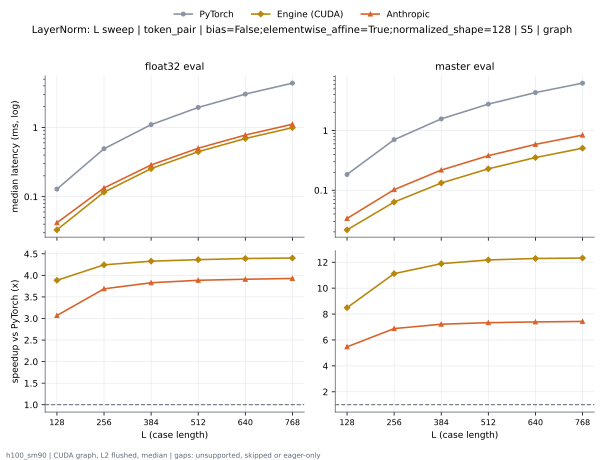

**float32 eval** (median ms; x = speedup vs PyTorch)

| L | PyTorch | Engine (Triton) | Engine (CUDA) | Anthropic | cuEquivariance |
|---|---|---|---|---|---|
| 128 | 0.1277 | 0.03533 (3.62x) | 0.03323 (3.84x) | 0.04208 (3.04x) | 0.03637 (3.51x) |
| 256 | 0.4901 | 0.1189 (4.12x) | 0.1165 (4.21x) | 0.1337 (3.67x) | 0.1196 (4.10x) |
| 384 | 1.094 | 0.2583 (4.24x) | 0.2543 (4.30x) | 0.2872 (3.81x) | 0.2588 (4.23x) |
| 512 | 1.94 | 0.4514 (4.30x) | 0.4468 (4.34x) | 0.5016 (3.87x) | 0.4548 (4.27x) |
| 640 | 3.027 | 0.7021 (4.31x) | 0.6927 (4.37x) | 0.7775 (3.89x) | 0.704 (4.30x) |
| 768 | 4.356 | 1.007 (4.33x) | 0.9972 (4.37x) | 1.115 (3.91x) | 1.011 (4.31x) |

**master eval** (median ms; x = speedup vs PyTorch)

| L | PyTorch | Engine (Triton) | Engine (CUDA) | Anthropic | cuEquivariance |
|---|---|---|---|---|---|
| 128 | 0.1834 | 0.02291 (8.00x) | 0.02166 (8.47x) | 0.03339 (5.49x) | 0.02379 (7.71x) |
| 256 | 0.7016 | 0.0645 (10.88x) | 0.06326 (11.09x) | 0.1019 (6.88x) | 0.06595 (10.64x) |
| 384 | 1.565 | 0.1344 (11.65x) | 0.1318 (11.87x) | 0.2172 (7.21x) | 0.1361 (11.50x) |
| 512 | 2.772 | 0.2327 (11.91x) | 0.2299 (12.06x) | 0.378 (7.33x) | 0.2341 (11.84x) |
| 640 | 4.325 | 0.3576 (12.09x) | 0.3529 (12.25x) | 0.5849 (7.39x) | 0.36 (12.01x) |
| 768 | 6.223 | 0.5115 (12.17x) | 0.5067 (12.28x) | 0.8375 (7.43x) | 0.5143 (12.10x) |

### L sweep: token_pair | bias=False;elementwise_affine=True;normalized_shape=256 | S1 | graph

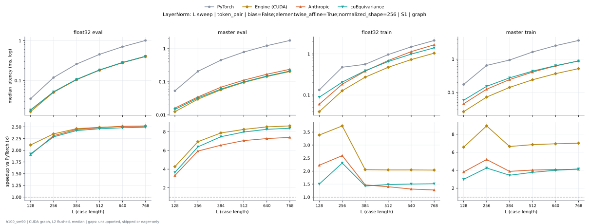

**float32 eval** (median ms; x = speedup vs PyTorch)

| L | PyTorch | Engine (Triton) | Engine (CUDA) | Anthropic | cuEquivariance |
|---|---|---|---|---|---|
| 128 | 0.03477 | 0.01779 (1.95x) | 0.01654 (2.10x) | 0.01827 (1.90x) | 0.01811 (1.92x) |
| 256 | 0.119 | 0.05149 (2.31x) | 0.05149 (2.31x) | 0.05141 (2.31x) | 0.05197 (2.29x) |
| 384 | 0.2586 | 0.1064 (2.43x) | 0.109 (2.37x) | 0.1058 (2.44x) | 0.1068 (2.42x) |
| 512 | 0.4542 | 0.1844 (2.46x) | 0.1903 (2.39x) | 0.1829 (2.48x) | 0.1846 (2.46x) |
| 640 | 0.7063 | 0.2839 (2.49x) | 0.2933 (2.41x) | 0.2812 (2.51x) | 0.2845 (2.48x) |
| 768 | 1.014 | 0.4056 (2.50x) | 0.4205 (2.41x) | 0.4025 (2.52x) | 0.4061 (2.50x) |

**master eval** (median ms; x = speedup vs PyTorch)

| L | PyTorch | Engine (Triton) | Engine (CUDA) | Anthropic | cuEquivariance |
|---|---|---|---|---|---|
| 128 | 0.05346 | 0.01274 (4.20x) | 0.01245 (4.29x) | 0.01608 (3.32x) | 0.01464 (3.65x) |
| 256 | 0.2069 | 0.03134 (6.60x) | 0.02963 (6.98x) | 0.03483 (5.94x) | 0.03237 (6.39x) |
| 384 | 0.4502 | 0.05907 (7.62x) | 0.05696 (7.90x) | 0.06858 (6.56x) | 0.06026 (7.47x) |
| 512 | 0.7905 | 0.09776 (8.09x) | 0.09494 (8.33x) | 0.112 (7.06x) | 0.09904 (7.98x) |
| 640 | 1.228 | 0.147 (8.35x) | 0.144 (8.53x) | 0.169 (7.27x) | 0.1486 (8.26x) |
| 768 | 1.764 | 0.2088 (8.45x) | 0.2048 (8.61x) | 0.2382 (7.40x) | 0.2105 (8.38x) |

**float32 train** (median ms; x = speedup vs PyTorch)

| L | PyTorch | Engine (Triton) | Engine (CUDA) | Anthropic | cuEquivariance |
|---|---|---|---|---|---|
| 128 | 0.133 | 0.04405 (3.02x) | 0.03923 (3.39x) | 0.05971 (2.23x) | 0.08845 (1.50x) |
| 256 | 0.4757 | 0.1299 (3.66x) | 0.1272 (3.74x) | 0.1832 (2.60x) | 0.206 (2.31x) |
| 384 | 0.5595 | 0.2675 (2.09x) | 0.2732 (2.05x) | 0.3807 (1.47x) | 0.3919 (1.43x) |
| 512 | 0.9682 | 0.4612 (2.10x) | 0.4746 (2.04x) | 0.6923 (1.40x) | 0.653 (1.48x) |
| 640 | 1.492 | 0.7102 (2.10x) | 0.7297 (2.04x) | 1.139 (1.31x) | 0.993 (1.50x) |
| 768 | 2.129 | 1.018 (2.09x) | 1.044 (2.04x) | 1.673 (1.27x) | 1.408 (1.51x) |

**master train** (median ms; x = speedup vs PyTorch)

| L | PyTorch | Engine (Triton) | Engine (CUDA) | Anthropic | cuEquivariance |
|---|---|---|---|---|---|
| 128 | 0.173 | 0.03222 (5.37x) | 0.02635 (6.56x) | 0.04544 (3.81x) | 0.058 (2.98x) |
| 256 | 0.6453 | 0.07698 (8.38x) | 0.07203 (8.96x) | 0.1244 (5.19x) | 0.1521 (4.24x) |
| 384 | 0.9388 | 0.146 (6.43x) | 0.1417 (6.63x) | 0.2428 (3.87x) | 0.2733 (3.44x) |
| 512 | 1.637 | 0.2434 (6.73x) | 0.2396 (6.83x) | 0.408 (4.01x) | 0.4358 (3.76x) |
| 640 | 2.533 | 0.3659 (6.92x) | 0.3649 (6.94x) | 0.6227 (4.07x) | 0.6358 (3.98x) |
| 768 | 3.627 | 0.5219 (6.95x) | 0.5186 (6.99x) | 0.8859 (4.09x) | 0.8765 (4.14x) |

### L sweep: token_pair | bias=False;elementwise_affine=True;normalized_shape=267 | S1 | graph

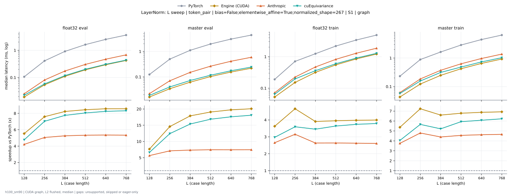

**float32 eval** (median ms; x = speedup vs PyTorch)

| L | PyTorch | Engine (Triton) | Engine (CUDA) | Anthropic | cuEquivariance |
|---|---|---|---|---|---|
| 128 | 0.1069 | 0.02171 (4.93x) | 0.02216 (4.83x) | 0.02526 (4.23x) | 0.02232 (4.79x) |
| 256 | 0.4107 | 0.05682 (7.23x) | 0.06728 (6.10x) | 0.08118 (5.06x) | 0.05837 (7.04x) |
| 384 | 0.9134 | 0.1139 (8.02x) | 0.1404 (6.51x) | 0.1736 (5.26x) | 0.1177 (7.76x) |
| 512 | 1.617 | 0.1949 (8.30x) | 0.2452 (6.60x) | 0.3034 (5.33x) | 0.2009 (8.05x) |
| 640 | 2.523 | 0.2994 (8.43x) | 0.3795 (6.65x) | 0.4712 (5.35x) | 0.3058 (8.25x) |
| 768 | 3.648 | 0.426 (8.56x) | 0.544 (6.71x) | 0.6799 (5.37x) | 0.436 (8.37x) |

**master eval** (median ms; x = speedup vs PyTorch)

| L | PyTorch | Engine (Triton) | Engine (CUDA) | Anthropic | cuEquivariance |
|---|---|---|---|---|---|
| 128 | 0.124 | 0.01734 (7.15x) | 0.01968 (6.30x) | 0.02198 (5.64x) | 0.01875 (6.62x) |
| 256 | 0.5011 | 0.04283 (11.70x) | 0.05862 (8.55x) | 0.07045 (7.11x) | 0.04038 (12.41x) |
| 384 | 1.112 | 0.08082 (13.76x) | 0.1218 (9.13x) | 0.1514 (7.34x) | 0.0723 (15.38x) |
| 512 | 1.967 | 0.1319 (14.91x) | 0.2107 (9.34x) | 0.2642 (7.44x) | 0.1167 (16.85x) |
| 640 | 3.082 | 0.1979 (15.57x) | 0.3261 (9.45x) | 0.4125 (7.47x) | 0.1743 (17.68x) |
| 768 | 4.431 | 0.2783 (15.92x) | 0.4657 (9.52x) | 0.5916 (7.49x) | 0.2438 (18.18x) |

**float32 train** (median ms; x = speedup vs PyTorch)

| L | PyTorch | Engine (Triton) | Engine (CUDA) | Anthropic | cuEquivariance |
|---|---|---|---|---|---|
| 128 | 0.1904 | 0.05597 (3.40x) | 0.06574 (2.90x) | 0.07189 (2.65x) | 0.06419 (2.97x) |
| 256 | 0.7094 | 0.1657 (4.28x) | 0.1867 (3.80x) | 0.225 (3.15x) | 0.1973 (3.59x) |
| 384 | 1.241 | 0.3506 (3.54x) | 0.3904 (3.18x) | 0.4713 (2.63x) | 0.3596 (3.45x) |
| 512 | 2.172 | 0.5834 (3.72x) | 0.6785 (3.20x) | 0.8239 (2.64x) | 0.597 (3.64x) |
| 640 | 3.389 | 0.8816 (3.84x) | 1.052 (3.22x) | 1.285 (2.64x) | 0.9019 (3.76x) |
| 768 | 4.87 | 1.255 (3.88x) | 1.51 (3.22x) | 1.856 (2.62x) | 1.279 (3.81x) |

**master train** (median ms; x = speedup vs PyTorch)

| L | PyTorch | Engine (Triton) | Engine (CUDA) | Anthropic | cuEquivariance |
|---|---|---|---|---|---|
| 128 | 0.2313 | 0.04734 (4.89x) | 0.05814 (3.98x) | 0.06154 (3.76x) | 0.05707 (4.05x) |
| 256 | 0.8861 | 0.139 (6.38x) | 0.1636 (5.41x) | 0.1849 (4.79x) | 0.1566 (5.66x) |
| 384 | 1.633 | 0.2754 (5.93x) | 0.3395 (4.81x) | 0.3717 (4.40x) | 0.3133 (5.21x) |
| 512 | 2.866 | 0.4452 (6.44x) | 0.5864 (4.89x) | 0.629 (4.56x) | 0.4828 (5.94x) |
| 640 | 4.473 | 0.6687 (6.69x) | 0.9068 (4.93x) | 0.964 (4.64x) | 0.7328 (6.10x) |
| 768 | 6.43 | 0.939 (6.85x) | 1.299 (4.95x) | 1.374 (4.68x) | 1.029 (6.25x) |

### L sweep: token_pair | bias=False;elementwise_affine=True;normalized_shape=384 | S1 | graph

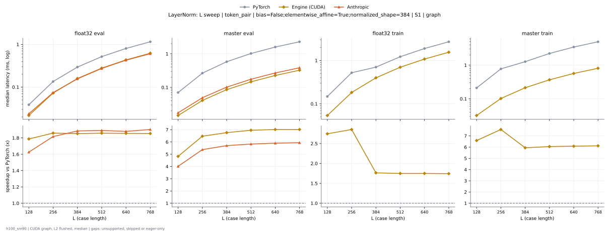

**float32 eval** (median ms; x = speedup vs PyTorch)

| L | PyTorch | Engine (Triton) | Engine (CUDA) | Anthropic | cuEquivariance |
|---|---|---|---|---|---|
| 128 | 0.03858 | 0.02421 (1.59x) | 0.02192 (1.76x) | 0.0236 (1.63x) | 0.02413 (1.60x) |
| 256 | 0.135 | 0.07421 (1.82x) | 0.074 (1.82x) | 0.07398 (1.82x) | 0.07422 (1.82x) |
| 384 | 0.2946 | 0.1569 (1.88x) | 0.1593 (1.85x) | 0.1561 (1.89x) | 0.1573 (1.87x) |
| 512 | 0.5172 | 0.2728 (1.90x) | 0.279 (1.85x) | 0.2732 (1.89x) | 0.2725 (1.90x) |
| 640 | 0.8045 | 0.4218 (1.91x) | 0.434 (1.85x) | 0.4271 (1.88x) | 0.422 (1.91x) |
| 768 | 1.155 | 0.6034 (1.91x) | 0.6222 (1.86x) | 0.6051 (1.91x) | 0.6045 (1.91x) |

**master eval** (median ms; x = speedup vs PyTorch)

| L | PyTorch | Engine (Triton) | Engine (CUDA) | Anthropic | cuEquivariance |
|---|---|---|---|---|---|
| 128 | 0.07035 | 0.01622 (4.34x) | 0.01475 (4.77x) | 0.01723 (4.08x) | 0.01917 (3.67x) |
| 256 | 0.2643 | 0.04259 (6.20x) | 0.04134 (6.39x) | 0.04909 (5.38x) | 0.0437 (6.05x) |
| 384 | 0.5796 | 0.08411 (6.89x) | 0.08534 (6.79x) | 0.1015 (5.71x) | 0.08531 (6.79x) |
| 512 | 1.02 | 0.1415 (7.21x) | 0.1477 (6.91x) | 0.1745 (5.84x) | 0.1432 (7.12x) |
| 640 | 1.587 | 0.2144 (7.40x) | 0.2263 (7.01x) | 0.2687 (5.91x) | 0.217 (7.31x) |
| 768 | 2.28 | 0.3068 (7.43x) | 0.3242 (7.03x) | 0.3837 (5.94x) | 0.309 (7.38x) |

**float32 train** (median ms; x = speedup vs PyTorch)

| L | PyTorch | Engine (Triton) | Engine (CUDA) | Anthropic | cuEquivariance |
|---|---|---|---|---|---|
| 128 | 0.1476 | 0.0596 (2.48x) | 0.05397 (2.73x) | 0.08235 (1.79x) | 0.1306 (1.13x) |
| 256 | 0.5196 | 0.1844 (2.82x) | 0.1829 (2.84x) | 0.2685 (1.94x) | 0.3116 (1.67x) |
| 384 | 0.7017 | 0.3916 (1.79x) | 0.3971 (1.77x) | 0.6285 (1.12x) | 0.6159 (1.14x) |
| 512 | 1.22 | 0.6832 (1.79x) | 0.6956 (1.75x) | 1.128 (1.08x) | 1.029 (1.19x) |
| 640 | 1.885 | 1.068 (1.77x) | 1.079 (1.75x) | 1.764 (1.07x) | 1.558 (1.21x) |
| 768 | 2.7 | 1.524 (1.77x) | 1.545 (1.75x) | 2.536 (1.06x) | 2.21 (1.22x) |

**master train** (median ms; x = speedup vs PyTorch)

| L | PyTorch | Engine (Triton) | Engine (CUDA) | Anthropic | cuEquivariance |
|---|---|---|---|---|---|
| 128 | 0.2103 | 0.04486 (4.69x) | 0.03194 (6.59x) | 0.06779 (3.10x) | 0.07222 (2.91x) |
| 256 | 0.7727 | 0.1322 (5.85x) | 0.1021 (7.57x) | 0.2025 (3.81x) | 0.197 (3.92x) |
| 384 | 1.268 | 0.2741 (4.63x) | 0.2122 (5.97x) | 0.4158 (3.05x) | 0.3639 (3.48x) |
| 512 | 2.221 | 0.4728 (4.70x) | 0.366 (6.07x) | 0.7144 (3.11x) | 0.5919 (3.75x) |
| 640 | 3.447 | 0.711 (4.85x) | 0.5633 (6.12x) | 1.099 (3.14x) | 0.883 (3.90x) |
| 768 | 4.932 | 1.021 (4.83x) | 0.8063 (6.12x) | 1.563 (3.15x) | 1.254 (3.93x) |

### L sweep: token_pair | bias=False;elementwise_affine=True;normalized_shape=512 | S1 | graph

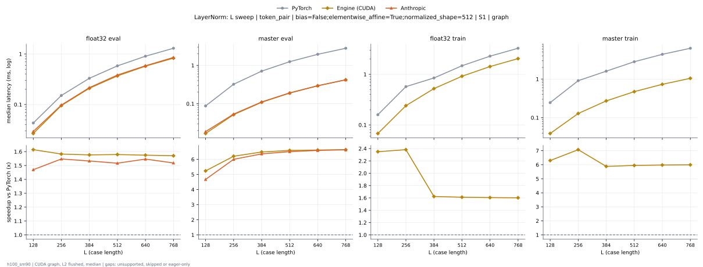

**float32 eval** (median ms; x = speedup vs PyTorch)

| L | PyTorch | Engine (Triton) | Engine (CUDA) | Anthropic | cuEquivariance |
|---|---|---|---|---|---|
| 128 | 0.04301 | 0.02899 (1.48x) | 0.02725 (1.58x) | 0.02944 (1.46x) | 0.02915 (1.48x) |
| 256 | 0.15 | 0.09546 (1.57x) | 0.0965 (1.55x) | 0.09784 (1.53x) | 0.09616 (1.56x) |
| 384 | 0.328 | 0.2059 (1.59x) | 0.2102 (1.56x) | 0.2145 (1.53x) | 0.2064 (1.59x) |
| 512 | 0.577 | 0.3604 (1.60x) | 0.3686 (1.57x) | 0.381 (1.51x) | 0.361 (1.60x) |
| 640 | 0.9036 | 0.5591 (1.62x) | 0.5734 (1.58x) | 0.5851 (1.54x) | 0.5599 (1.61x) |
| 768 | 1.297 | 0.8015 (1.62x) | 0.8249 (1.57x) | 0.8469 (1.53x) | 0.8024 (1.62x) |

**master eval** (median ms; x = speedup vs PyTorch)

| L | PyTorch | Engine (Triton) | Engine (CUDA) | Anthropic | cuEquivariance |
|---|---|---|---|---|---|
| 128 | 0.08712 | 0.01978 (4.41x) | 0.01667 (5.23x) | 0.01907 (4.57x) | 0.02173 (4.01x) |
| 256 | 0.3207 | 0.05355 (5.99x) | 0.05285 (6.07x) | 0.05357 (5.99x) | 0.05418 (5.92x) |
| 384 | 0.7052 | 0.1087 (6.49x) | 0.1108 (6.37x) | 0.1106 (6.38x) | 0.11 (6.41x) |
| 512 | 1.249 | 0.187 (6.68x) | 0.1925 (6.49x) | 0.1913 (6.53x) | 0.1873 (6.67x) |
| 640 | 1.945 | 0.285 (6.82x) | 0.2961 (6.57x) | 0.2946 (6.60x) | 0.2865 (6.79x) |
| 768 | 2.795 | 0.4061 (6.88x) | 0.4244 (6.59x) | 0.4207 (6.64x) | 0.4087 (6.84x) |

**float32 train** (median ms; x = speedup vs PyTorch)

| L | PyTorch | Engine (Triton) | Engine (CUDA) | Anthropic | cuEquivariance |
|---|---|---|---|---|---|
| 128 | 0.1586 | 0.07066 (2.24x) | 0.06757 (2.35x) | 0.1079 (1.47x) | 0.1586 (1.00x) |
| 256 | 0.5673 | 0.2373 (2.39x) | 0.2395 (2.37x) | 0.3984 (1.42x) | 0.4067 (1.39x) |
| 384 | 0.8446 | 0.5172 (1.63x) | 0.5215 (1.62x) | 0.876 (0.96x) | 0.8254 (1.02x) |
| 512 | 1.478 | 0.9077 (1.63x) | 0.9159 (1.61x) | 1.576 (0.94x) | 1.394 (1.06x) |
| 640 | 2.287 | 1.41 (1.62x) | 1.423 (1.61x) | 2.433 (0.94x) | 2.119 (1.08x) |
| 768 | 3.275 | 2.03 (1.61x) | 2.043 (1.60x) | 3.532 (0.93x) | 3.019 (1.08x) |

**master train** (median ms; x = speedup vs PyTorch)

| L | PyTorch | Engine (Triton) | Engine (CUDA) | Anthropic | cuEquivariance |
|---|---|---|---|---|---|
| 128 | 0.2446 | 0.05587 (4.38x) | 0.03957 (6.18x) | 0.07013 (3.49x) | 0.09928 (2.46x) |
| 256 | 0.9032 | 0.173 (5.22x) | 0.128 (7.06x) | 0.2034 (4.44x) | 0.2704 (3.34x) |
| 384 | 1.596 | 0.3592 (4.44x) | 0.2717 (5.87x) | 0.4284 (3.73x) | 0.5407 (2.95x) |
| 512 | 2.811 | 0.6251 (4.50x) | 0.4722 (5.95x) | 0.7998 (3.51x) | 0.8992 (3.13x) |
| 640 | 4.366 | 0.9616 (4.54x) | 0.7322 (5.96x) | 1.281 (3.41x) | 1.339 (3.26x) |
| 768 | 6.266 | 1.374 (4.56x) | 1.047 (5.99x) | 1.865 (3.36x) | 1.889 (3.32x) |

### L sweep: token_pair | bias=False;elementwise_affine=True;normalized_shape=651 | S1 | graph

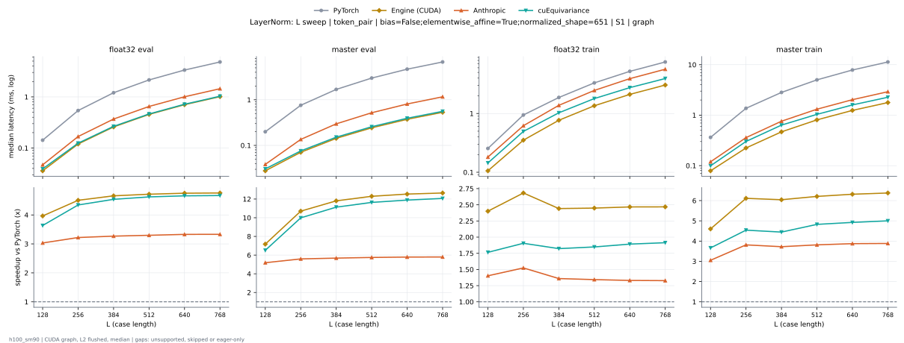

**float32 eval** (median ms; x = speedup vs PyTorch)

| L | PyTorch | Engine (Triton) | Engine (CUDA) | Anthropic | cuEquivariance |
|---|---|---|---|---|---|
| 128 | 0.1432 | 0.04355 (3.29x) | 0.04165 (3.44x) | 0.04699 (3.05x) | 0.0392 (3.65x) |
| 256 | 0.5438 | 0.1389 (3.92x) | 0.1463 (3.72x) | 0.168 (3.24x) | 0.1245 (4.37x) |
| 384 | 1.212 | 0.2981 (4.07x) | 0.3192 (3.80x) | 0.369 (3.28x) | 0.2657 (4.56x) |
| 512 | 2.147 | 0.5188 (4.14x) | 0.5616 (3.82x) | 0.6507 (3.30x) | 0.4641 (4.63x) |
| 640 | 3.334 | 0.8016 (4.16x) | 0.8727 (3.82x) | 1.006 (3.32x) | 0.7184 (4.64x) |
| 768 | 4.794 | 1.15 (4.17x) | 1.256 (3.82x) | 1.445 (3.32x) | 1.031 (4.65x) |

**master eval** (median ms; x = speedup vs PyTorch)

| L | PyTorch | Engine (Triton) | Engine (CUDA) | Anthropic | cuEquivariance |
|---|---|---|---|---|---|
| 128 | 0.1996 | 0.02995 (6.66x) | 0.03261 (6.12x) | 0.03842 (5.19x) | 0.03059 (6.52x) |
| 256 | 0.76 | 0.08354 (9.10x) | 0.1042 (7.30x) | 0.1354 (5.61x) | 0.07581 (10.03x) |
| 384 | 1.693 | 0.1723 (9.83x) | 0.2232 (7.59x) | 0.2968 (5.70x) | 0.1514 (11.19x) |
| 512 | 2.985 | 0.2966 (10.06x) | 0.3896 (7.66x) | 0.5194 (5.75x) | 0.2565 (11.64x) |
| 640 | 4.656 | 0.4568 (10.19x) | 0.6022 (7.73x) | 0.8077 (5.76x) | 0.3934 (11.84x) |
| 768 | 6.699 | 0.6522 (10.27x) | 0.864 (7.75x) | 1.16 (5.77x) | 0.5574 (12.02x) |

**float32 train** (median ms; x = speedup vs PyTorch)

| L | PyTorch | Engine (Triton) | Engine (CUDA) | Anthropic | cuEquivariance |
|---|---|---|---|---|---|
| 128 | 0.255 | 0.1192 (2.14x) | 0.09906 (2.57x) | 0.1813 (1.41x) | 0.1441 (1.77x) |
| 256 | 0.9462 | 0.416 (2.27x) | 0.3312 (2.86x) | 0.6193 (1.53x) | 0.4955 (1.91x) |
| 384 | 1.88 | 0.9173 (2.05x) | 0.717 (2.62x) | 1.378 (1.36x) | 1.028 (1.83x) |
| 512 | 3.318 | 1.615 (2.05x) | 1.261 (2.63x) | 2.47 (1.34x) | 1.795 (1.85x) |
| 640 | 5.196 | 2.514 (2.07x) | 1.965 (2.64x) | 3.917 (1.33x) | 2.755 (1.89x) |
| 768 | 7.501 | 3.633 (2.06x) | 2.828 (2.65x) | 5.671 (1.32x) | 3.933 (1.91x) |

**master train** (median ms; x = speedup vs PyTorch)

| L | PyTorch | Engine (Triton) | Engine (CUDA) | Anthropic | cuEquivariance |
|---|---|---|---|---|---|
| 128 | 0.3647 | 0.08909 (4.09x) | 0.08717 (4.18x) | 0.1191 (3.06x) | 0.09923 (3.68x) |
| 256 | 1.374 | 0.2839 (4.84x) | 0.2783 (4.94x) | 0.3591 (3.83x) | 0.3016 (4.55x) |
| 384 | 2.835 | 0.5907 (4.80x) | 0.5973 (4.75x) | 0.7592 (3.73x) | 0.6359 (4.46x) |
| 512 | 5.013 | 1.091 (4.59x) | 1.043 (4.80x) | 1.314 (3.82x) | 1.038 (4.83x) |
| 640 | 7.838 | 1.557 (5.03x) | 1.62 (4.84x) | 2.028 (3.87x) | 1.596 (4.91x) |
| 768 | 11.3 | 2.214 (5.10x) | 2.326 (4.86x) | 2.919 (3.87x) | 2.267 (4.99x) |

### L sweep: token_pair | bias=True;elementwise_affine=True;normalized_shape=128 | S1 | graph

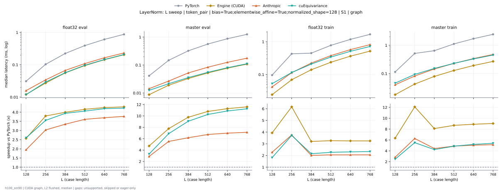

**float32 eval** (median ms; x = speedup vs PyTorch)

| L | PyTorch | Engine (Triton) | Engine (CUDA) | Anthropic | cuEquivariance |
|---|---|---|---|---|---|
| 128 | 0.03088 | 0.01112 (2.78x) | 0.0121 (2.55x) | 0.01587 (1.95x) | 0.0119 (2.59x) |
| 256 | 0.1037 | 0.02803 (3.70x) | 0.02738 (3.79x) | 0.03419 (3.03x) | 0.02917 (3.56x) |
| 384 | 0.2245 | 0.0559 (4.02x) | 0.05651 (3.97x) | 0.06707 (3.35x) | 0.05698 (3.94x) |
| 512 | 0.3936 | 0.09509 (4.14x) | 0.09443 (4.17x) | 0.109 (3.61x) | 0.09691 (4.06x) |
| 640 | 0.6117 | 0.1452 (4.21x) | 0.1436 (4.26x) | 0.1653 (3.70x) | 0.1458 (4.20x) |
| 768 | 0.8772 | 0.2066 (4.25x) | 0.2044 (4.29x) | 0.2326 (3.77x) | 0.2078 (4.22x) |

**master eval** (median ms; x = speedup vs PyTorch)

| L | PyTorch | Engine (Triton) | Engine (CUDA) | Anthropic | cuEquivariance |
|---|---|---|---|---|---|
| 128 | 0.04141 | 0.008704 (4.76x) | 0.0088 (4.71x) | 0.0143 (2.89x) | 0.01248 (3.32x) |
| 256 | 0.1478 | 0.01872 (7.90x) | 0.01902 (7.77x) | 0.02678 (5.52x) | 0.02149 (6.88x) |
| 384 | 0.3226 | 0.03245 (9.94x) | 0.0328 (9.84x) | 0.05229 (6.17x) | 0.0356 (9.06x) |
| 512 | 0.5643 | 0.05198 (10.86x) | 0.05259 (10.73x) | 0.08371 (6.74x) | 0.05499 (10.26x) |
| 640 | 0.8754 | 0.07694 (11.38x) | 0.07794 (11.23x) | 0.1254 (6.98x) | 0.08053 (10.87x) |
| 768 | 1.254 | 0.1079 (11.63x) | 0.1082 (11.60x) | 0.1761 (7.12x) | 0.1115 (11.25x) |

**float32 train** (median ms; x = speedup vs PyTorch)

| L | PyTorch | Engine (Triton) | Engine (CUDA) | Anthropic | cuEquivariance |
|---|---|---|---|---|---|
| 128 | 0.0961 | 0.02957 (3.25x) | 0.02435 (3.95x) | 0.04234 (2.27x) | 0.05302 (1.81x) |
| 256 | 0.4302 | 0.07395 (5.82x) | 0.07045 (6.11x) | 0.1145 (3.76x) | 0.1158 (3.72x) |
| 384 | 0.4513 | 0.1424 (3.17x) | 0.141 (3.20x) | 0.2244 (2.01x) | 0.2093 (2.16x) |
| 512 | 0.7786 | 0.2418 (3.22x) | 0.2387 (3.26x) | 0.3789 (2.05x) | 0.3425 (2.27x) |
| 640 | 1.185 | 0.3652 (3.25x) | 0.3652 (3.25x) | 0.5766 (2.06x) | 0.5127 (2.31x) |
| 768 | 1.684 | 0.5178 (3.25x) | 0.5186 (3.25x) | 0.818 (2.06x) | 0.7204 (2.34x) |

**master train** (median ms; x = speedup vs PyTorch)

| L | PyTorch | Engine (Triton) | Engine (CUDA) | Anthropic | cuEquivariance |
|---|---|---|---|---|---|
| 128 | 0.1137 | 0.02152 (5.28x) | 0.01818 (6.25x) | 0.04016 (2.83x) | 0.04598 (2.47x) |
| 256 | 0.5143 | 0.04766 (10.79x) | 0.04266 (12.06x) | 0.08202 (6.27x) | 0.09347 (5.50x) |
| 384 | 0.6437 | 0.0833 (7.73x) | 0.07933 (8.11x) | 0.1452 (4.43x) | 0.1518 (4.24x) |
| 512 | 1.115 | 0.1312 (8.50x) | 0.1286 (8.67x) | 0.2287 (4.87x) | 0.2293 (4.86x) |
| 640 | 1.707 | 0.1941 (8.79x) | 0.1919 (8.89x) | 0.3388 (5.04x) | 0.3289 (5.19x) |
| 768 | 2.432 | 0.2713 (8.96x) | 0.2694 (9.03x) | 0.4736 (5.14x) | 0.451 (5.39x) |

### L sweep: token_pair | bias=True;elementwise_affine=True;normalized_shape=256 | S1 | graph

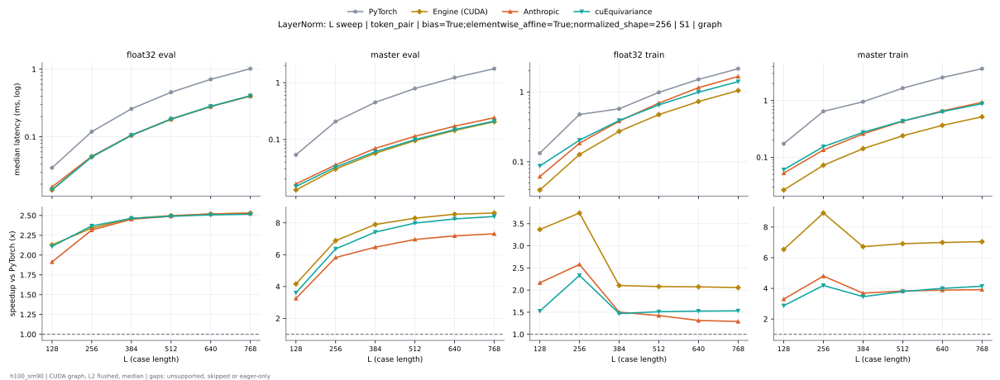

**float32 eval** (median ms; x = speedup vs PyTorch)

| L | PyTorch | Engine (Triton) | Engine (CUDA) | Anthropic | cuEquivariance |
|---|---|---|---|---|---|
| 128 | 0.03485 | 0.01638 (2.13x) | 0.0165 (2.11x) | 0.01824 (1.91x) | 0.01654 (2.11x) |
| 256 | 0.1194 | 0.04966 (2.40x) | 0.05149 (2.32x) | 0.05149 (2.32x) | 0.05035 (2.37x) |
| 384 | 0.2598 | 0.1049 (2.48x) | 0.1094 (2.37x) | 0.1059 (2.45x) | 0.1054 (2.46x) |
| 512 | 0.4559 | 0.1824 (2.50x) | 0.1905 (2.39x) | 0.1831 (2.49x) | 0.1831 (2.49x) |
| 640 | 0.7088 | 0.2824 (2.51x) | 0.2929 (2.42x) | 0.2813 (2.52x) | 0.2826 (2.51x) |
| 768 | 1.018 | 0.4038 (2.52x) | 0.4206 (2.42x) | 0.4026 (2.53x) | 0.4044 (2.52x) |

**master eval** (median ms; x = speedup vs PyTorch)

| L | PyTorch | Engine (Triton) | Engine (CUDA) | Anthropic | cuEquivariance |
|---|---|---|---|---|---|
| 128 | 0.05354 | 0.01147 (4.67x) | 0.0129 (4.15x) | 0.01643 (3.26x) | 0.01483 (3.61x) |
| 256 | 0.2073 | 0.02979 (6.96x) | 0.02989 (6.94x) | 0.03562 (5.82x) | 0.03258 (6.36x) |
| 384 | 0.4509 | 0.0576 (7.83x) | 0.05725 (7.88x) | 0.06965 (6.47x) | 0.06075 (7.42x) |
| 512 | 0.7923 | 0.09642 (8.22x) | 0.09547 (8.30x) | 0.1138 (6.96x) | 0.09923 (7.98x) |
| 640 | 1.231 | 0.1452 (8.48x) | 0.1444 (8.53x) | 0.1714 (7.18x) | 0.1493 (8.25x) |
| 768 | 1.767 | 0.2064 (8.56x) | 0.2046 (8.63x) | 0.2418 (7.31x) | 0.2105 (8.39x) |

**float32 train** (median ms; x = speedup vs PyTorch)

| L | PyTorch | Engine (Triton) | Engine (CUDA) | Anthropic | cuEquivariance |
|---|---|---|---|---|---|
| 128 | 0.133 | 0.0432 (3.08x) | 0.03947 (3.37x) | 0.06152 (2.16x) | 0.08733 (1.52x) |
| 256 | 0.4757 | 0.1285 (3.70x) | 0.1275 (3.73x) | 0.1846 (2.58x) | 0.2043 (2.33x) |
| 384 | 0.5743 | 0.266 (2.16x) | 0.273 (2.10x) | 0.3824 (1.50x) | 0.3906 (1.47x) |
| 512 | 0.9868 | 0.4595 (2.15x) | 0.4734 (2.08x) | 0.6922 (1.43x) | 0.6524 (1.51x) |
| 640 | 1.512 | 0.7099 (2.13x) | 0.7304 (2.07x) | 1.152 (1.31x) | 0.9918 (1.52x) |
| 768 | 2.153 | 1.017 (2.12x) | 1.045 (2.06x) | 1.667 (1.29x) | 1.406 (1.53x) |

**master train** (median ms; x = speedup vs PyTorch)

| L | PyTorch | Engine (Triton) | Engine (CUDA) | Anthropic | cuEquivariance |
|---|---|---|---|---|---|
| 128 | 0.1733 | 0.03106 (5.58x) | 0.02667 (6.50x) | 0.05258 (3.30x) | 0.06042 (2.87x) |
| 256 | 0.6455 | 0.07578 (8.52x) | 0.07205 (8.96x) | 0.1345 (4.80x) | 0.154 (4.19x) |
| 384 | 0.954 | 0.145 (6.58x) | 0.1421 (6.72x) | 0.2586 (3.69x) | 0.2755 (3.46x) |
| 512 | 1.655 | 0.2416 (6.85x) | 0.2398 (6.90x) | 0.4325 (3.83x) | 0.4366 (3.79x) |
| 640 | 2.554 | 0.3642 (7.01x) | 0.3649 (7.00x) | 0.6573 (3.89x) | 0.6388 (4.00x) |
| 768 | 3.651 | 0.5197 (7.02x) | 0.5204 (7.01x) | 0.9324 (3.92x) | 0.8812 (4.14x) |

### L sweep: token_pair | bias=True;elementwise_affine=True;normalized_shape=384 | S1 | graph

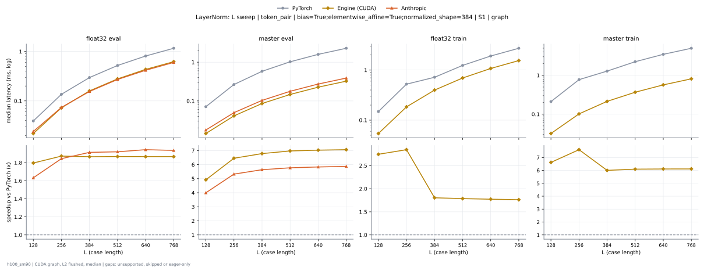

**float32 eval** (median ms; x = speedup vs PyTorch)

| L | PyTorch | Engine (Triton) | Engine (CUDA) | Anthropic | cuEquivariance |
|---|---|---|---|---|---|
| 128 | 0.03912 | 0.0228 (1.72x) | 0.02189 (1.79x) | 0.024 (1.63x) | 0.02285 (1.71x) |
| 256 | 0.1351 | 0.07262 (1.86x) | 0.07379 (1.83x) | 0.07366 (1.83x) | 0.07262 (1.86x) |
| 384 | 0.2948 | 0.1552 (1.90x) | 0.1596 (1.85x) | 0.1551 (1.90x) | 0.1555 (1.90x) |
| 512 | 0.5175 | 0.2709 (1.91x) | 0.2787 (1.86x) | 0.2711 (1.91x) | 0.2714 (1.91x) |
| 640 | 0.8102 | 0.42 (1.93x) | 0.4332 (1.87x) | 0.4172 (1.94x) | 0.4205 (1.93x) |
| 768 | 1.163 | 0.6017 (1.93x) | 0.6221 (1.87x) | 0.6009 (1.93x) | 0.6023 (1.93x) |

**master eval** (median ms; x = speedup vs PyTorch)

| L | PyTorch | Engine (Triton) | Engine (CUDA) | Anthropic | cuEquivariance |
|---|---|---|---|---|---|
| 128 | 0.07078 | 0.01462 (4.84x) | 0.01443 (4.90x) | 0.01731 (4.09x) | 0.01965 (3.60x) |
| 256 | 0.2641 | 0.04099 (6.44x) | 0.04125 (6.40x) | 0.04952 (5.33x) | 0.04429 (5.96x) |
| 384 | 0.5791 | 0.08235 (7.03x) | 0.08565 (6.76x) | 0.1026 (5.64x) | 0.08576 (6.75x) |
| 512 | 1.02 | 0.1395 (7.31x) | 0.1477 (6.90x) | 0.1764 (5.78x) | 0.1436 (7.10x) |
| 640 | 1.592 | 0.2141 (7.44x) | 0.2263 (7.04x) | 0.2726 (5.84x) | 0.2173 (7.33x) |
| 768 | 2.288 | 0.306 (7.48x) | 0.3237 (7.07x) | 0.3892 (5.88x) | 0.3095 (7.39x) |

**float32 train** (median ms; x = speedup vs PyTorch)

| L | PyTorch | Engine (Triton) | Engine (CUDA) | Anthropic | cuEquivariance |
|---|---|---|---|---|---|
| 128 | 0.148 | 0.05808 (2.55x) | 0.05416 (2.73x) | 0.08373 (1.77x) | 0.1295 (1.14x) |
| 256 | 0.5189 | 0.1833 (2.83x) | 0.1819 (2.85x) | 0.2879 (1.80x) | 0.3085 (1.68x) |
| 384 | 0.7166 | 0.3915 (1.83x) | 0.3979 (1.80x) | 0.6319 (1.13x) | 0.6145 (1.17x) |
| 512 | 1.236 | 0.684 (1.81x) | 0.6927 (1.78x) | 1.128 (1.10x) | 1.025 (1.21x) |
| 640 | 1.909 | 1.064 (1.80x) | 1.078 (1.77x) | 1.771 (1.08x) | 1.557 (1.23x) |
| 768 | 2.726 | 1.526 (1.79x) | 1.545 (1.76x) | 2.539 (1.07x) | 2.21 (1.23x) |

**master train** (median ms; x = speedup vs PyTorch)

| L | PyTorch | Engine (Triton) | Engine (CUDA) | Anthropic | cuEquivariance |
|---|---|---|---|---|---|
| 128 | 0.2105 | 0.04373 (4.81x) | 0.03181 (6.62x) | 0.07645 (2.75x) | 0.0755 (2.79x) |
| 256 | 0.7719 | 0.1306 (5.91x) | 0.1017 (7.59x) | 0.2173 (3.55x) | 0.1996 (3.87x) |
| 384 | 1.282 | 0.2724 (4.71x) | 0.211 (6.08x) | 0.4404 (2.91x) | 0.3656 (3.51x) |
| 512 | 2.236 | 0.4711 (4.75x) | 0.365 (6.13x) | 0.754 (2.97x) | 0.5932 (3.77x) |
| 640 | 3.471 | 0.7096 (4.89x) | 0.5623 (6.17x) | 1.163 (2.99x) | 0.8872 (3.91x) |
| 768 | 4.971 | 1.009 (4.93x) | 0.8052 (6.17x) | 1.66 (3.00x) | 1.245 (3.99x) |

### L sweep: token_pair | bias=True;elementwise_affine=True;normalized_shape=512 | S1 | graph

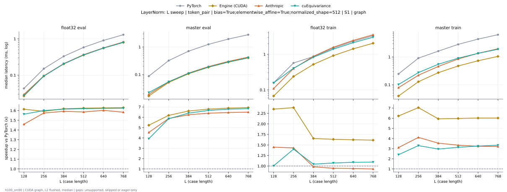

**float32 eval** (median ms; x = speedup vs PyTorch)

| L | PyTorch | Engine (Triton) | Engine (CUDA) | Anthropic | cuEquivariance |
|---|---|---|---|---|---|
| 128 | 0.04315 | 0.02746 (1.57x) | 0.0269 (1.60x) | 0.02958 (1.46x) | 0.02763 (1.56x) |
| 256 | 0.1521 | 0.09398 (1.62x) | 0.09696 (1.57x) | 0.09595 (1.59x) | 0.09443 (1.61x) |
| 384 | 0.3329 | 0.2045 (1.63x) | 0.2098 (1.59x) | 0.208 (1.60x) | 0.2051 (1.62x) |
| 512 | 0.5858 | 0.3587 (1.63x) | 0.3681 (1.59x) | 0.3672 (1.60x) | 0.3596 (1.63x) |
| 640 | 0.9117 | 0.5569 (1.64x) | 0.5731 (1.59x) | 0.5655 (1.61x) | 0.5582 (1.63x) |
| 768 | 1.309 | 0.8005 (1.64x) | 0.8243 (1.59x) | 0.8215 (1.59x) | 0.801 (1.63x) |

**master eval** (median ms; x = speedup vs PyTorch)

| L | PyTorch | Engine (Triton) | Engine (CUDA) | Anthropic | cuEquivariance |
|---|---|---|---|---|---|
| 128 | 0.08768 | 0.01797 (4.88x) | 0.01678 (5.22x) | 0.01926 (4.55x) | 0.02227 (3.94x) |
| 256 | 0.3229 | 0.05208 (6.20x) | 0.05237 (6.17x) | 0.0547 (5.90x) | 0.05493 (5.88x) |
| 384 | 0.7109 | 0.107 (6.64x) | 0.1106 (6.43x) | 0.1133 (6.27x) | 0.1105 (6.43x) |
| 512 | 1.254 | 0.1852 (6.77x) | 0.1923 (6.52x) | 0.1955 (6.42x) | 0.1876 (6.69x) |
| 640 | 1.953 | 0.2835 (6.89x) | 0.2972 (6.57x) | 0.3011 (6.49x) | 0.2868 (6.81x) |
| 768 | 2.806 | 0.4051 (6.93x) | 0.4242 (6.62x) | 0.4302 (6.52x) | 0.4089 (6.86x) |

**float32 train** (median ms; x = speedup vs PyTorch)

| L | PyTorch | Engine (Triton) | Engine (CUDA) | Anthropic | cuEquivariance |
|---|---|---|---|---|---|
| 128 | 0.1591 | 0.06909 (2.30x) | 0.06742 (2.36x) | 0.1094 (1.45x) | 0.1578 (1.01x) |
| 256 | 0.5703 | 0.2368 (2.41x) | 0.2393 (2.38x) | 0.3983 (1.43x) | 0.4066 (1.40x) |
| 384 | 0.8652 | 0.516 (1.68x) | 0.5216 (1.66x) | 0.8782 (0.99x) | 0.8261 (1.05x) |
| 512 | 1.5 | 0.9062 (1.66x) | 0.9153 (1.64x) | 1.58 (0.95x) | 1.396 (1.07x) |
| 640 | 2.314 | 1.411 (1.64x) | 1.422 (1.63x) | 2.452 (0.94x) | 2.12 (1.09x) |
| 768 | 3.307 | 2.029 (1.63x) | 2.042 (1.62x) | 3.543 (0.93x) | 3.018 (1.10x) |

**master train** (median ms; x = speedup vs PyTorch)

| L | PyTorch | Engine (Triton) | Engine (CUDA) | Anthropic | cuEquivariance |
|---|---|---|---|---|---|
| 128 | 0.2449 | 0.05502 (4.45x) | 0.0393 (6.23x) | 0.07869 (3.11x) | 0.1018 (2.41x) |
| 256 | 0.9065 | 0.1721 (5.27x) | 0.128 (7.08x) | 0.2199 (4.12x) | 0.274 (3.31x) |
| 384 | 1.618 | 0.3593 (4.50x) | 0.2721 (5.94x) | 0.4556 (3.55x) | 0.5455 (2.97x) |
| 512 | 2.833 | 0.6237 (4.54x) | 0.4714 (6.01x) | 0.8456 (3.35x) | 0.9017 (3.14x) |
| 640 | 4.393 | 0.9603 (4.57x) | 0.728 (6.03x) | 1.354 (3.24x) | 1.347 (3.26x) |
| 768 | 6.298 | 1.372 (4.59x) | 1.044 (6.03x) | 1.962 (3.21x) | 1.886 (3.34x) |

### L sweep: token_pair | bias=True;elementwise_affine=True;normalized_shape=64 | S1 | graph

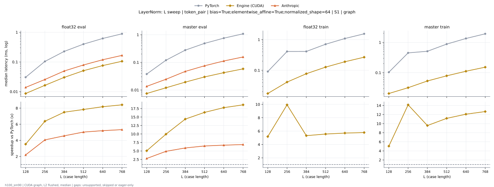

**float32 eval** (median ms; x = speedup vs PyTorch)

| L | PyTorch | Engine (Triton) | Engine (CUDA) | Anthropic | cuEquivariance |
|---|---|---|---|---|---|
| 128 | 0.03038 | 0.00848 (3.58x) | 0.009248 (3.29x) | 0.0141 (2.16x) | 0.009232 (3.29x) |
| 256 | 0.1036 | 0.01742 (5.95x) | 0.01634 (6.34x) | 0.02552 (4.06x) | 0.01677 (6.18x) |
| 384 | 0.225 | 0.03114 (7.23x) | 0.03008 (7.48x) | 0.04954 (4.54x) | 0.03075 (7.32x) |
| 512 | 0.3951 | 0.05141 (7.69x) | 0.0505 (7.83x) | 0.07882 (5.01x) | 0.05094 (7.76x) |
| 640 | 0.614 | 0.07675 (8.00x) | 0.07565 (8.12x) | 0.1184 (5.19x) | 0.07614 (8.06x) |
| 768 | 0.8809 | 0.1075 (8.20x) | 0.1053 (8.37x) | 0.1652 (5.33x) | 0.1065 (8.27x) |

**master eval** (median ms; x = speedup vs PyTorch)

| L | PyTorch | Engine (Triton) | Engine (CUDA) | Anthropic | cuEquivariance |
|---|---|---|---|---|---|
| 128 | 0.03763 | 0.007456 (5.05x) | 0.007568 (4.97x) | 0.0136 (2.77x) | 0.0113 (3.33x) |
| 256 | 0.1186 | 0.01123 (10.56x) | 0.01203 (9.86x) | 0.02419 (4.90x) | 0.01534 (7.73x) |
| 384 | 0.2754 | 0.01981 (13.90x) | 0.01962 (14.04x) | 0.0468 (5.88x) | 0.02318 (11.88x) |
| 512 | 0.483 | 0.02997 (16.12x) | 0.02963 (16.30x) | 0.07453 (6.48x) | 0.03326 (14.52x) |
| 640 | 0.7478 | 0.04269 (17.52x) | 0.04251 (17.59x) | 0.1116 (6.70x) | 0.04587 (16.30x) |
| 768 | 1.073 | 0.05837 (18.38x) | 0.05858 (18.31x) | 0.1562 (6.87x) | 0.06173 (17.38x) |

**float32 train** (median ms; x = speedup vs PyTorch)

| L | PyTorch | Engine (Triton) | Engine (CUDA) | Anthropic | cuEquivariance |
|---|---|---|---|---|---|
| 128 | 0.09053 | 0.01806 (5.01x) | 0.01792 (5.05x) | 0.03782 (2.39x) | 0.03342 (2.71x) |
| 256 | 0.4213 | 0.04224 (9.97x) | 0.04162 (10.12x) | 0.07379 (5.71x) | 0.06426 (6.56x) |
| 384 | 0.4099 | 0.07816 (5.24x) | 0.07758 (5.28x) | 0.1309 (3.13x) | 0.1107 (3.70x) |
| 512 | 0.7038 | 0.127 (5.54x) | 0.1269 (5.55x) | 0.2064 (3.41x) | 0.1728 (4.07x) |
| 640 | 1.081 | 0.1917 (5.64x) | 0.1903 (5.68x) | 0.3033 (3.56x) | 0.2538 (4.26x) |
| 768 | 1.538 | 0.2664 (5.77x) | 0.2677 (5.74x) | 0.4225 (3.64x) | 0.3512 (4.38x) |

**master train** (median ms; x = speedup vs PyTorch)

| L | PyTorch | Engine (Triton) | Engine (CUDA) | Anthropic | cuEquivariance |
|---|---|---|---|---|---|
| 128 | 0.1028 | 0.01744 (5.89x) | 0.02061 (4.99x) | 0.03934 (2.61x) | 0.03506 (2.93x) |
| 256 | 0.4596 | 0.02912 (15.78x) | 0.03218 (14.28x) | 0.05747 (8.00x) | 0.0633 (7.26x) |
| 384 | 0.5082 | 0.05138 (9.89x) | 0.05341 (9.51x) | 0.09414 (5.40x) | 0.08691 (5.85x) |
| 512 | 0.8757 | 0.07552 (11.60x) | 0.07891 (11.10x) | 0.1361 (6.43x) | 0.1213 (7.22x) |
| 640 | 1.343 | 0.1087 (12.35x) | 0.112 (11.98x) | 0.1896 (7.08x) | 0.1641 (8.18x) |
| 768 | 1.917 | 0.1461 (13.12x) | 0.1523 (12.59x) | 0.2556 (7.50x) | 0.2171 (8.83x) |

### L sweep: token_single | bias=False;elementwise_affine=True;normalized_shape=384 | S1 | graph

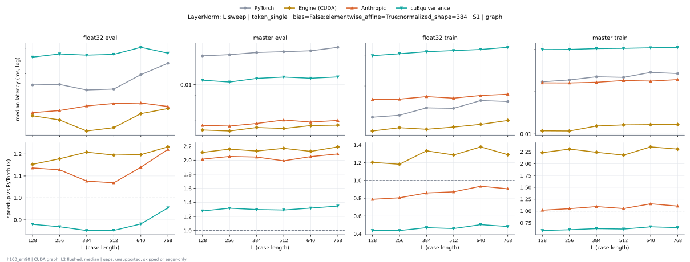

**float32 eval** (median ms; x = speedup vs PyTorch)

| L | PyTorch | Engine (Triton) | Engine (CUDA) | Anthropic | cuEquivariance |
|---|---|---|---|---|---|
| 128 | 0.007552 | 0.008576 (0.88x) | 0.006496 (1.16x) | 0.006688 (1.13x) | 0.00864 (0.87x) |
| 256 | 0.007776 | 0.008576 (0.91x) | 0.0064 (1.21x) | 0.006752 (1.15x) | 0.008768 (0.89x) |
| 384 | 0.007792 | 0.00888 (0.88x) | 0.006576 (1.18x) | 0.006896 (1.13x) | 0.00872 (0.89x) |
| 512 | 0.00792 | 0.00888 (0.89x) | 0.006768 (1.17x) | 0.006976 (1.14x) | 0.008752 (0.90x) |
| 640 | 0.007984 | 0.008832 (0.90x) | 0.006688 (1.19x) | 0.006992 (1.14x) | 0.00904 (0.88x) |
| 768 | 0.007936 | 0.008912 (0.89x) | 0.006592 (1.20x) | 0.00688 (1.15x) | 0.0088 (0.90x) |

**master eval** (median ms; x = speedup vs PyTorch)

| L | PyTorch | Engine (Triton) | Engine (CUDA) | Anthropic | cuEquivariance |
|---|---|---|---|---|---|
| 128 | 0.01354 | 0.008464 (1.60x) | 0.006656 (2.03x) | 0.00664 (2.04x) | 0.01046 (1.29x) |
| 256 | 0.0137 | 0.008384 (1.63x) | 0.006464 (2.12x) | 0.006592 (2.08x) | 0.01027 (1.33x) |
| 384 | 0.01384 | 0.008496 (1.63x) | 0.006496 (2.13x) | 0.006768 (2.04x) | 0.01066 (1.30x) |
| 512 | 0.01384 | 0.00848 (1.63x) | 0.006592 (2.10x) | 0.007008 (1.97x) | 0.0108 (1.28x) |
| 640 | 0.01402 | 0.008352 (1.68x) | 0.006576 (2.13x) | 0.006864 (2.04x) | 0.01067 (1.31x) |
| 768 | 0.01414 | 0.00864 (1.64x) | 0.006656 (2.12x) | 0.006976 (2.03x) | 0.01082 (1.31x) |

**float32 train** (median ms; x = speedup vs PyTorch)

| L | PyTorch | Engine (Triton) | Engine (CUDA) | Anthropic | cuEquivariance |
|---|---|---|---|---|---|
| 128 | 0.01336 | 0.01549 (0.86x) | 0.01107 (1.21x) | 0.01667 (0.80x) | 0.03008 (0.44x) |
| 256 | 0.01406 | 0.01563 (0.90x) | 0.0112 (1.26x) | 0.01675 (0.84x) | 0.03088 (0.46x) |
| 384 | 0.01542 | 0.016 (0.96x) | 0.0113 (1.37x) | 0.01733 (0.89x) | 0.03174 (0.49x) |
| 512 | 0.01491 | 0.01597 (0.93x) | 0.01147 (1.30x) | 0.01698 (0.88x) | 0.03222 (0.46x) |
| 640 | 0.01648 | 0.01622 (1.02x) | 0.01194 (1.38x) | 0.0176 (0.94x) | 0.0327 (0.50x) |
| 768 | 0.0161 | 0.01752 (0.92x) | 0.01248 (1.29x) | 0.0179 (0.90x) | 0.03366 (0.48x) |

**master train** (median ms; x = speedup vs PyTorch)

| L | PyTorch | Engine (Triton) | Engine (CUDA) | Anthropic | cuEquivariance |
|---|---|---|---|---|---|
| 128 | 0.02342 | 0.01488 (1.57x) | 0.01064 (2.20x) | 0.02309 (1.01x) | 0.03987 (0.59x) |
| 256 | 0.02442 | 0.01549 (1.58x) | 0.01088 (2.24x) | 0.02306 (1.06x) | 0.03994 (0.61x) |
| 384 | 0.02549 | 0.01581 (1.61x) | 0.0113 (2.26x) | 0.02331 (1.09x) | 0.0405 (0.63x) |
| 512 | 0.02546 | 0.01651 (1.54x) | 0.01174 (2.17x) | 0.024 (1.06x) | 0.04067 (0.63x) |
| 640 | 0.02728 | 0.01613 (1.69x) | 0.01158 (2.35x) | 0.02378 (1.15x) | 0.04102 (0.66x) |
| 768 | 0.0271 | 0.01667 (1.63x) | 0.01216 (2.23x) | 0.02435 (1.11x) | 0.04134 (0.66x) |

### L sweep: token_single | bias=False;elementwise_affine=True;normalized_shape=768 | S1 | graph

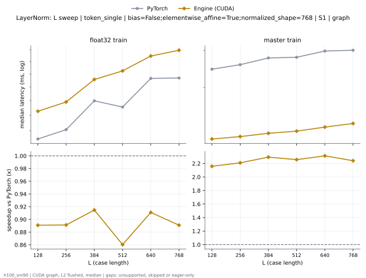

**float32 train** (median ms; x = speedup vs PyTorch)

| L | PyTorch | Engine (Triton) | Engine (CUDA) | Anthropic | cuEquivariance |
|---|---|---|---|---|---|
| 128 | 0.01498 | 0.01843 (0.81x) | 0.0169 (0.89x) | 0.02046 (0.73x) | 0.04528 (0.33x) |
| 256 | 0.01533 | 0.01862 (0.82x) | 0.01677 (0.91x) | 0.02022 (0.76x) | 0.04539 (0.34x) |
| 384 | 0.01693 | 0.01946 (0.87x) | 0.01885 (0.90x) | 0.02096 (0.81x) | 0.04637 (0.37x) |
| 512 | 0.01694 | 0.02019 (0.84x) | 0.01934 (0.88x) | 0.02144 (0.79x) | 0.04749 (0.36x) |
| 640 | 0.01859 | 0.02022 (0.92x) | 0.02061 (0.90x) | 0.02219 (0.84x) | 0.0481 (0.39x) |
| 768 | 0.01846 | 0.02054 (0.90x) | 0.02099 (0.88x) | 0.02323 (0.79x) | 0.04898 (0.38x) |

**master train** (median ms; x = speedup vs PyTorch)

| L | PyTorch | Engine (Triton) | Engine (CUDA) | Anthropic | cuEquivariance |
|---|---|---|---|---|---|
| 128 | 0.02494 | 0.01877 (1.33x) | 0.01179 (2.12x) | 0.02379 (1.05x) | 0.05651 (0.44x) |
| 256 | 0.02554 | 0.01846 (1.38x) | 0.0121 (2.11x) | 0.02435 (1.05x) | 0.05701 (0.45x) |
| 384 | 0.02731 | 0.01942 (1.41x) | 0.01235 (2.21x) | 0.02448 (1.12x) | 0.05712 (0.48x) |
| 512 | 0.028 | 0.01907 (1.47x) | 0.01238 (2.26x) | 0.02453 (1.14x) | 0.0571 (0.49x) |
| 640 | 0.02994 | 0.01973 (1.52x) | 0.01286 (2.33x) | 0.02499 (1.20x) | 0.05778 (0.52x) |
| 768 | 0.03011 | 0.02005 (1.50x) | 0.01328 (2.27x) | 0.02523 (1.19x) | 0.05838 (0.52x) |

### L sweep: token_single | bias=False;elementwise_affine=True;normalized_shape=768 | S5 | graph

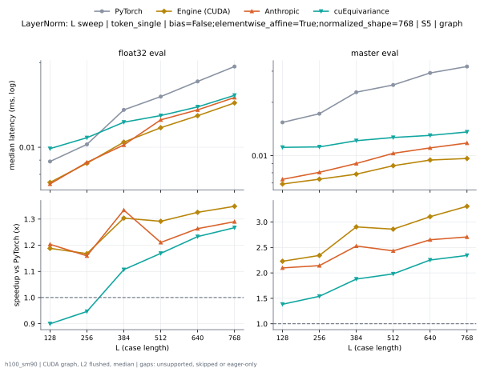

**float32 eval** (median ms; x = speedup vs PyTorch)

| L | PyTorch | Engine (Triton) | Engine (CUDA) | Anthropic | cuEquivariance |
|---|---|---|---|---|---|
| 128 | 0.008896 | 0.01099 (0.81x) | 0.007488 (1.19x) | 0.007392 (1.20x) | 0.009888 (0.90x) |
| 256 | 0.01024 | 0.01171 (0.87x) | 0.008768 (1.17x) | 0.008832 (1.16x) | 0.01082 (0.95x) |
| 384 | 0.0136 | 0.01277 (1.07x) | 0.01043 (1.30x) | 0.01019 (1.33x) | 0.01229 (1.11x) |
| 512 | 0.01517 | 0.0135 (1.12x) | 0.01174 (1.29x) | 0.01253 (1.21x) | 0.01298 (1.17x) |
| 640 | 0.01718 | 0.01458 (1.18x) | 0.01296 (1.33x) | 0.0136 (1.26x) | 0.01394 (1.23x) |
| 768 | 0.01942 | 0.01576 (1.23x) | 0.0144 (1.35x) | 0.01506 (1.29x) | 0.01533 (1.27x) |

**master eval** (median ms; x = speedup vs PyTorch)

| L | PyTorch | Engine (Triton) | Engine (CUDA) | Anthropic | cuEquivariance |
|---|---|---|---|---|---|
| 128 | 0.01541 | 0.01011 (1.52x) | 0.006912 (2.23x) | 0.007344 (2.10x) | 0.01114 (1.38x) |
| 256 | 0.01725 | 0.00976 (1.77x) | 0.00736 (2.34x) | 0.008048 (2.14x) | 0.0112 (1.54x) |
| 384 | 0.02282 | 0.0103 (2.21x) | 0.007856 (2.90x) | 0.009024 (2.53x) | 0.01214 (1.88x) |
| 512 | 0.02507 | 0.01106 (2.27x) | 0.008768 (2.86x) | 0.0103 (2.43x) | 0.01266 (1.98x) |
| 640 | 0.02931 | 0.01168 (2.51x) | 0.00944 (3.11x) | 0.01106 (2.65x) | 0.01301 (2.25x) |
| 768 | 0.03187 | 0.01205 (2.65x) | 0.009632 (3.31x) | 0.01178 (2.71x) | 0.0136 (2.34x) |

### L sweep: token_single | bias=False;elementwise_affine=True;normalized_shape=831 | S1 | graph

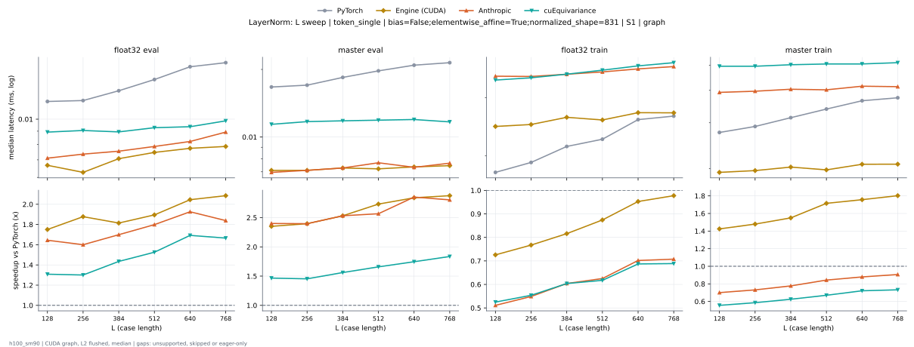

**float32 eval** (median ms; x = speedup vs PyTorch)

| L | PyTorch | Engine (Triton) | Engine (CUDA) | Anthropic | cuEquivariance |
|---|---|---|---|---|---|
| 128 | 0.01112 | 0.01117 (1.00x) | 0.007072 (1.57x) | 0.007104 (1.57x) | 0.008928 (1.25x) |
| 256 | 0.01165 | 0.01122 (1.04x) | 0.00712 (1.64x) | 0.00736 (1.58x) | 0.009056 (1.29x) |
| 384 | 0.0129 | 0.01126 (1.14x) | 0.007296 (1.77x) | 0.007552 (1.71x) | 0.008944 (1.44x) |
| 512 | 0.01344 | 0.01134 (1.18x) | 0.007344 (1.83x) | 0.007872 (1.71x) | 0.00928 (1.45x) |
| 640 | 0.01542 | 0.0113 (1.37x) | 0.007776 (1.98x) | 0.008224 (1.88x) | 0.00936 (1.65x) |
| 768 | 0.01637 | 0.0116 (1.41x) | 0.00816 (2.01x) | 0.008928 (1.83x) | 0.009856 (1.66x) |

**master eval** (median ms; x = speedup vs PyTorch)

| L | PyTorch | Engine (Triton) | Engine (CUDA) | Anthropic | cuEquivariance |
|---|---|---|---|---|---|
| 128 | 0.01656 | 0.01099 (1.51x) | 0.007392 (2.24x) | 0.00696 (2.38x) | 0.01139 (1.45x) |
| 256 | 0.01715 | 0.0113 (1.52x) | 0.007328 (2.34x) | 0.007104 (2.41x) | 0.01171 (1.46x) |
| 384 | 0.01789 | 0.01107 (1.62x) | 0.007552 (2.37x) | 0.00728 (2.46x) | 0.01181 (1.51x) |
| 512 | 0.01949 | 0.01133 (1.72x) | 0.00784 (2.49x) | 0.00768 (2.54x) | 0.01189 (1.64x) |
| 640 | 0.0211 | 0.01115 (1.89x) | 0.007536 (2.80x) | 0.007328 (2.88x) | 0.01197 (1.76x) |
| 768 | 0.02133 | 0.0111 (1.92x) | 0.007552 (2.82x) | 0.007648 (2.79x) | 0.01168 (1.83x) |

**float32 train** (median ms; x = speedup vs PyTorch)

| L | PyTorch | Engine (Triton) | Engine (CUDA) | Anthropic | cuEquivariance |
|---|---|---|---|---|---|
| 128 | 0.01811 | 0.02067 (0.88x) | 0.01744 (1.04x) | 0.03488 (0.52x) | 0.03395 (0.53x) |
| 256 | 0.01923 | 0.02118 (0.91x) | 0.01747 (1.10x) | 0.03482 (0.55x) | 0.0345 (0.56x) |
| 384 | 0.02158 | 0.0229 (0.94x) | 0.01955 (1.10x) | 0.03536 (0.61x) | 0.03538 (0.61x) |
| 512 | 0.02282 | 0.02362 (0.97x) | 0.02013 (1.13x) | 0.03594 (0.63x) | 0.03638 (0.63x) |
| 640 | 0.02566 | 0.02533 (1.01x) | 0.02157 (1.19x) | 0.0367 (0.70x) | 0.03749 (0.68x) |
| 768 | 0.02646 | 0.02726 (0.97x) | 0.02198 (1.20x) | 0.03731 (0.71x) | 0.03834 (0.69x) |

**master train** (median ms; x = speedup vs PyTorch)

| L | PyTorch | Engine (Triton) | Engine (CUDA) | Anthropic | cuEquivariance |
|---|---|---|---|---|---|
| 128 | 0.02752 | 0.02074 (1.33x) | 0.01816 (1.52x) | 0.0393 (0.70x) | 0.04954 (0.56x) |
| 256 | 0.02915 | 0.02134 (1.37x) | 0.01832 (1.59x) | 0.0397 (0.73x) | 0.04954 (0.59x) |
| 384 | 0.03138 | 0.02242 (1.40x) | 0.02034 (1.54x) | 0.0404 (0.78x) | 0.05021 (0.62x) |
| 512 | 0.03349 | 0.02309 (1.45x) | 0.02038 (1.64x) | 0.04019 (0.83x) | 0.05054 (0.66x) |
| 640 | 0.03674 | 0.02453 (1.50x) | 0.02256 (1.63x) | 0.0415 (0.89x) | 0.05056 (0.73x) |
| 768 | 0.03765 | 0.0257 (1.47x) | 0.02251 (1.67x) | 0.04133 (0.91x) | 0.05114 (0.74x) |

### L sweep: token_single | bias=False;elementwise_affine=True;normalized_shape=833 | S1 | graph

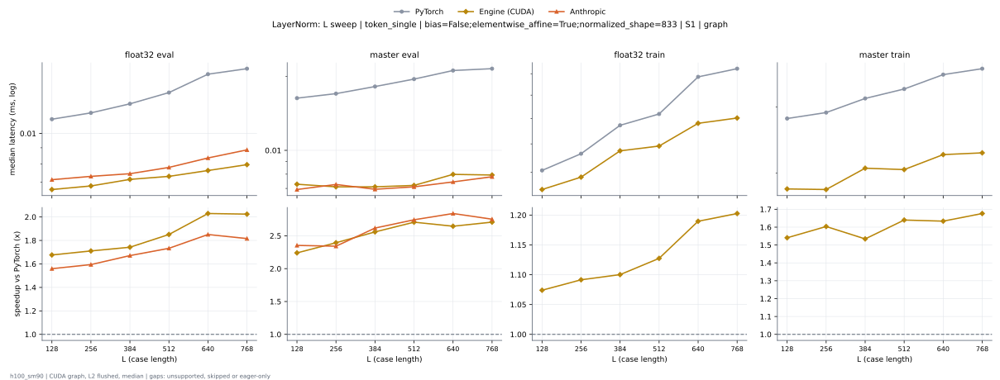

**float32 eval** (median ms; x = speedup vs PyTorch)

| L | PyTorch | Engine (Triton) | Engine (CUDA) | Anthropic | cuEquivariance |
|---|---|---|---|---|---|
| 128 | 0.01123 | 0.0113 (0.99x) | 0.007264 (1.55x) | 0.007008 (1.60x) | 0.008848 (1.27x) |
| 256 | 0.01184 | 0.01117 (1.06x) | 0.00712 (1.66x) | 0.007264 (1.63x) | 0.009136 (1.30x) |
| 384 | 0.0128 | 0.01096 (1.17x) | 0.007104 (1.80x) | 0.007392 (1.73x) | 0.009296 (1.38x) |
| 512 | 0.01342 | 0.01136 (1.18x) | 0.007584 (1.77x) | 0.007776 (1.73x) | 0.00952 (1.41x) |
| 640 | 0.01555 | 0.01133 (1.37x) | 0.007824 (1.99x) | 0.00816 (1.91x) | 0.009584 (1.62x) |
| 768 | 0.01613 | 0.01155 (1.40x) | 0.007984 (2.02x) | 0.008864 (1.82x) | 0.00976 (1.65x) |

**master eval** (median ms; x = speedup vs PyTorch)

| L | PyTorch | Engine (Triton) | Engine (CUDA) | Anthropic | cuEquivariance |
|---|---|---|---|---|---|
| 128 | 0.01651 | 0.01104 (1.50x) | 0.007456 (2.21x) | 0.006912 (2.39x) | 0.01158 (1.43x) |
| 256 | 0.01709 | 0.01117 (1.53x) | 0.007488 (2.28x) | 0.007104 (2.41x) | 0.01203 (1.42x) |
| 384 | 0.01818 | 0.0111 (1.64x) | 0.00752 (2.42x) | 0.007232 (2.51x) | 0.01178 (1.54x) |
| 512 | 0.0195 | 0.0113 (1.73x) | 0.007632 (2.56x) | 0.007456 (2.62x) | 0.01205 (1.62x) |
| 640 | 0.0212 | 0.0111 (1.91x) | 0.007664 (2.77x) | 0.007408 (2.86x) | 0.01178 (1.80x) |
| 768 | 0.02139 | 0.01107 (1.93x) | 0.007648 (2.80x) | 0.00768 (2.79x) | 0.01173 (1.82x) |

**float32 train** (median ms; x = speedup vs PyTorch)

| L | PyTorch | Engine (Triton) | Engine (CUDA) | Anthropic | cuEquivariance |
|---|---|---|---|---|---|
| 128 | 0.01811 | 0.02056 (0.88x) | 0.01754 (1.03x) | 0.03531 (0.51x) | 0.0347 (0.52x) |
| 256 | 0.01917 | 0.02112 (0.91x) | 0.01752 (1.09x) | 0.03526 (0.54x) | 0.03507 (0.55x) |
| 384 | 0.02128 | 0.02288 (0.93x) | 0.01946 (1.09x) | 0.03581 (0.59x) | 0.03589 (0.59x) |
| 512 | 0.02243 | 0.02395 (0.94x) | 0.01998 (1.12x) | 0.03629 (0.62x) | 0.0369 (0.61x) |
| 640 | 0.02541 | 0.02518 (1.01x) | 0.02166 (1.17x) | 0.0371 (0.68x) | 0.03803 (0.67x) |
| 768 | 0.02616 | 0.02701 (0.97x) | 0.02214 (1.18x) | 0.03749 (0.70x) | 0.0389 (0.67x) |

**master train** (median ms; x = speedup vs PyTorch)

| L | PyTorch | Engine (Triton) | Engine (CUDA) | Anthropic | cuEquivariance |
|---|---|---|---|---|---|
| 128 | 0.02742 | 0.02061 (1.33x) | 0.01811 (1.51x) | 0.03978 (0.69x) | 0.05058 (0.54x) |
| 256 | 0.02909 | 0.02134 (1.36x) | 0.01824 (1.59x) | 0.03992 (0.73x) | 0.05075 (0.57x) |
| 384 | 0.03152 | 0.02227 (1.42x) | 0.02014 (1.56x) | 0.0409 (0.77x) | 0.05155 (0.61x) |
| 512 | 0.0333 | 0.0232 (1.44x) | 0.02037 (1.63x) | 0.04067 (0.82x) | 0.05146 (0.65x) |
| 640 | 0.03653 | 0.02435 (1.50x) | 0.0225 (1.62x) | 0.04162 (0.88x) | 0.05202 (0.70x) |
| 768 | 0.03752 | 0.02568 (1.46x) | 0.02266 (1.66x) | 0.04157 (0.90x) | 0.05232 (0.72x) |

### L sweep: token_single | bias=True;elementwise_affine=True;normalized_shape=2560 | S1 | graph

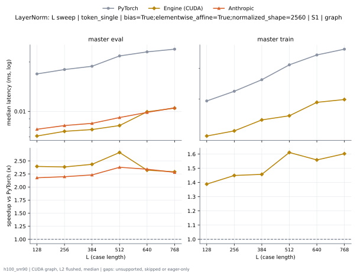

**master eval** (median ms; x = speedup vs PyTorch)

| L | PyTorch | Engine (Triton) | Engine (CUDA) | Anthropic | cuEquivariance |
|---|---|---|---|---|---|
| 128 | 0.01709 | 0.01398 (1.22x) | 0.007296 (2.34x) | 0.007936 (2.15x) | 0.06717 (0.25x) |
| 256 | 0.01826 | 0.01398 (1.31x) | 0.007296 (2.50x) | 0.008096 (2.25x) | 0.06752 (0.27x) |
| 384 | 0.01922 | 0.01368 (1.40x) | 0.007776 (2.47x) | 0.008416 (2.28x) | 0.06739 (0.29x) |
| 512 | 0.02192 | 0.01421 (1.54x) | 0.008448 (2.59x) | 0.009168 (2.39x) | 0.06774 (0.32x) |
| 640 | 0.02304 | 0.01426 (1.62x) | 0.01003 (2.30x) | 0.009856 (2.34x) | 0.06797 (0.34x) |
| 768 | 0.02405 | 0.01507 (1.60x) | 0.01053 (2.28x) | 0.01037 (2.32x) | 0.06797 (0.35x) |

**master train** (median ms; x = speedup vs PyTorch)

| L | PyTorch | Engine (Triton) | Engine (CUDA) | Anthropic | cuEquivariance |
|---|---|---|---|---|---|
| 128 | 0.02963 | 0.02882 (1.03x) | 0.02144 (1.38x) | 0.04118 (0.72x) | 0.1866 (0.16x) |
| 256 | 0.03216 | 0.0295 (1.09x) | 0.02229 (1.44x) | 0.04216 (0.76x) | 0.1888 (0.17x) |
| 384 | 0.03578 | 0.03144 (1.14x) | 0.02496 (1.43x) | 0.0433 (0.83x) | 0.189 (0.19x) |
| 512 | 0.04141 | 0.03214 (1.29x) | 0.02557 (1.62x) | 0.04416 (0.94x) | 0.1897 (0.22x) |
| 640 | 0.04501 | 0.03424 (1.31x) | 0.02912 (1.55x) | 0.04698 (0.96x) | 0.1901 (0.24x) |
| 768 | 0.04746 | 0.03646 (1.30x) | 0.02998 (1.58x) | 0.04811 (0.99x) | 0.1911 (0.25x) |

### L sweep: token_single | bias=True;elementwise_affine=True;normalized_shape=384 | S1 | graph

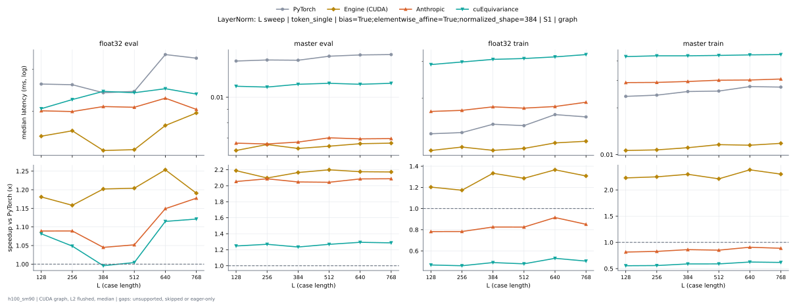

**float32 eval** (median ms; x = speedup vs PyTorch)

| L | PyTorch | Engine (Triton) | Engine (CUDA) | Anthropic | cuEquivariance |
|---|---|---|---|---|---|
| 128 | 0.007552 | 0.007136 (1.06x) | 0.006496 (1.16x) | 0.007008 (1.08x) | 0.007056 (1.07x) |
| 256 | 0.007744 | 0.007344 (1.05x) | 0.006592 (1.17x) | 0.006992 (1.11x) | 0.007264 (1.07x) |
| 384 | 0.007952 | 0.0072 (1.10x) | 0.00664 (1.20x) | 0.007104 (1.12x) | 0.007456 (1.07x) |
| 512 | 0.008 | 0.00744 (1.08x) | 0.006656 (1.20x) | 0.007088 (1.13x) | 0.007424 (1.08x) |
| 640 | 0.008128 | 0.00752 (1.08x) | 0.006752 (1.20x) | 0.007296 (1.11x) | 0.00752 (1.08x) |
| 768 | 0.008128 | 0.007296 (1.11x) | 0.006592 (1.23x) | 0.00704 (1.15x) | 0.007392 (1.10x) |

**master eval** (median ms; x = speedup vs PyTorch)

| L | PyTorch | Engine (Triton) | Engine (CUDA) | Anthropic | cuEquivariance |
|---|---|---|---|---|---|
| 128 | 0.01384 | 0.006944 (1.99x) | 0.006544 (2.11x) | 0.006688 (2.07x) | 0.01101 (1.26x) |
| 256 | 0.01363 | 0.006896 (1.98x) | 0.0064 (2.13x) | 0.00664 (2.05x) | 0.01093 (1.25x) |
| 384 | 0.01411 | 0.007008 (2.01x) | 0.006576 (2.15x) | 0.006752 (2.09x) | 0.0112 (1.26x) |
| 512 | 0.01373 | 0.007168 (1.92x) | 0.006592 (2.08x) | 0.007008 (1.96x) | 0.0113 (1.22x) |
| 640 | 0.01405 | 0.00696 (2.02x) | 0.00664 (2.12x) | 0.006944 (2.02x) | 0.0112 (1.25x) |
| 768 | 0.01437 | 0.007136 (2.01x) | 0.006688 (2.15x) | 0.00696 (2.06x) | 0.0113 (1.27x) |

**float32 train** (median ms; x = speedup vs PyTorch)

| L | PyTorch | Engine (Triton) | Engine (CUDA) | Anthropic | cuEquivariance |
|---|---|---|---|---|---|
| 128 | 0.01333 | 0.01445 (0.92x) | 0.01117 (1.19x) | 0.01726 (0.77x) | 0.02893 (0.46x) |
| 256 | 0.014 | 0.0144 (0.97x) | 0.01144 (1.22x) | 0.01747 (0.80x) | 0.02976 (0.47x) |
| 384 | 0.0156 | 0.01477 (1.06x) | 0.01134 (1.38x) | 0.01816 (0.86x) | 0.03062 (0.51x) |
| 512 | 0.01528 | 0.01466 (1.04x) | 0.01174 (1.30x) | 0.0179 (0.85x) | 0.03091 (0.49x) |
| 640 | 0.0164 | 0.01499 (1.09x) | 0.01222 (1.34x) | 0.01822 (0.90x) | 0.03147 (0.52x) |
| 768 | 0.01642 | 0.01611 (1.02x) | 0.01264 (1.30x) | 0.0191 (0.86x) | 0.03229 (0.51x) |

**master train** (median ms; x = speedup vs PyTorch)

| L | PyTorch | Engine (Triton) | Engine (CUDA) | Anthropic | cuEquivariance |
|---|---|---|---|---|---|
| 128 | 0.02384 | 0.0137 (1.74x) | 0.01069 (2.23x) | 0.02904 (0.82x) | 0.04269 (0.56x) |
| 256 | 0.02445 | 0.0145 (1.69x) | 0.01088 (2.25x) | 0.02912 (0.84x) | 0.04318 (0.57x) |
| 384 | 0.02568 | 0.01454 (1.77x) | 0.01131 (2.27x) | 0.02952 (0.87x) | 0.04318 (0.59x) |
| 512 | 0.0255 | 0.01546 (1.65x) | 0.0117 (2.18x) | 0.03008 (0.85x) | 0.04342 (0.59x) |
| 640 | 0.02731 | 0.01462 (1.87x) | 0.01147 (2.38x) | 0.03018 (0.91x) | 0.04378 (0.62x) |
| 768 | 0.0272 | 0.01533 (1.77x) | 0.01226 (2.22x) | 0.03061 (0.89x) | 0.04398 (0.62x) |

### L sweep: token_single | bias=True;elementwise_affine=True;normalized_shape=451 | S1 | graph

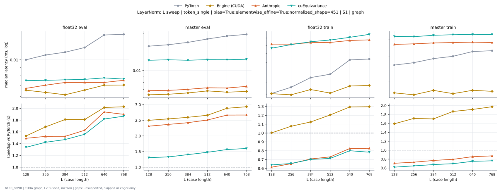

**float32 eval** (median ms; x = speedup vs PyTorch)

| L | PyTorch | Engine (Triton) | Engine (CUDA) | Anthropic | cuEquivariance |
|---|---|---|---|---|---|
| 128 | 0.009824 | 0.007616 (1.29x) | 0.006656 (1.48x) | 0.00672 (1.46x) | 0.007488 (1.31x) |
| 256 | 0.01037 | 0.007584 (1.37x) | 0.006944 (1.49x) | 0.007024 (1.48x) | 0.00752 (1.38x) |
| 384 | 0.01122 | 0.00784 (1.43x) | 0.007072 (1.59x) | 0.007296 (1.54x) | 0.007568 (1.48x) |
| 512 | 0.01184 | 0.007712 (1.54x) | 0.007008 (1.69x) | 0.007296 (1.62x) | 0.007616 (1.55x) |
| 640 | 0.01371 | 0.007872 (1.74x) | 0.006944 (1.97x) | 0.007296 (1.88x) | 0.007776 (1.76x) |
| 768 | 0.01411 | 0.007968 (1.77x) | 0.007168 (1.97x) | 0.00752 (1.88x) | 0.007648 (1.85x) |

**master eval** (median ms; x = speedup vs PyTorch)

| L | PyTorch | Engine (Triton) | Engine (CUDA) | Anthropic | cuEquivariance |
|---|---|---|---|---|---|
| 128 | 0.01539 | 0.00752 (2.05x) | 0.006624 (2.32x) | 0.006848 (2.25x) | 0.01214 (1.27x) |
| 256 | 0.01594 | 0.0076 (2.10x) | 0.006704 (2.38x) | 0.00688 (2.32x) | 0.01226 (1.30x) |
| 384 | 0.0167 | 0.007488 (2.23x) | 0.006848 (2.44x) | 0.007024 (2.38x) | 0.01214 (1.38x) |
| 512 | 0.01792 | 0.007776 (2.30x) | 0.006912 (2.59x) | 0.007232 (2.48x) | 0.01229 (1.46x) |
| 640 | 0.01907 | 0.007616 (2.50x) | 0.007072 (2.70x) | 0.0072 (2.65x) | 0.01227 (1.55x) |
| 768 | 0.01944 | 0.007776 (2.50x) | 0.00712 (2.73x) | 0.007424 (2.62x) | 0.01238 (1.57x) |

**float32 train** (median ms; x = speedup vs PyTorch)

| L | PyTorch | Engine (Triton) | Engine (CUDA) | Anthropic | cuEquivariance |
|---|---|---|---|---|---|
| 128 | 0.01606 | 0.01632 (0.98x) | 0.01686 (0.95x) | 0.02637 (0.61x) | 0.02533 (0.63x) |
| 256 | 0.0169 | 0.01645 (1.03x) | 0.01731 (0.98x) | 0.02635 (0.64x) | 0.02624 (0.64x) |
| 384 | 0.01923 | 0.01981 (0.97x) | 0.01901 (1.01x) | 0.02677 (0.72x) | 0.02699 (0.71x) |
| 512 | 0.01958 | 0.01811 (1.08x) | 0.01936 (1.01x) | 0.02682 (0.73x) | 0.02746 (0.71x) |
| 640 | 0.02275 | 0.01893 (1.20x) | 0.02093 (1.09x) | 0.02733 (0.83x) | 0.02819 (0.81x) |
| 768 | 0.02302 | 0.02019 (1.14x) | 0.02115 (1.09x) | 0.0275 (0.84x) | 0.02904 (0.79x) |

**master train** (median ms; x = speedup vs PyTorch)

| L | PyTorch | Engine (Triton) | Engine (CUDA) | Anthropic | cuEquivariance |
|---|---|---|---|---|---|
| 128 | 0.02586 | 0.01565 (1.65x) | 0.01683 (1.54x) | 0.03699 (0.70x) | 0.04227 (0.61x) |
| 256 | 0.02741 | 0.01642 (1.67x) | 0.01733 (1.58x) | 0.0373 (0.73x) | 0.04203 (0.65x) |
| 384 | 0.0292 | 0.01686 (1.73x) | 0.01902 (1.53x) | 0.03787 (0.77x) | 0.04307 (0.68x) |
| 512 | 0.03045 | 0.01827 (1.67x) | 0.0188 (1.62x) | 0.03813 (0.80x) | 0.04346 (0.70x) |
| 640 | 0.03309 | 0.01862 (1.78x) | 0.02046 (1.62x) | 0.03838 (0.86x) | 0.04374 (0.76x) |
| 768 | 0.03315 | 0.01968 (1.68x) | 0.02018 (1.64x) | 0.03814 (0.87x) | 0.04368 (0.76x) |

### L sweep: token_single | bias=True;elementwise_affine=True;normalized_shape=768 | S1 | graph

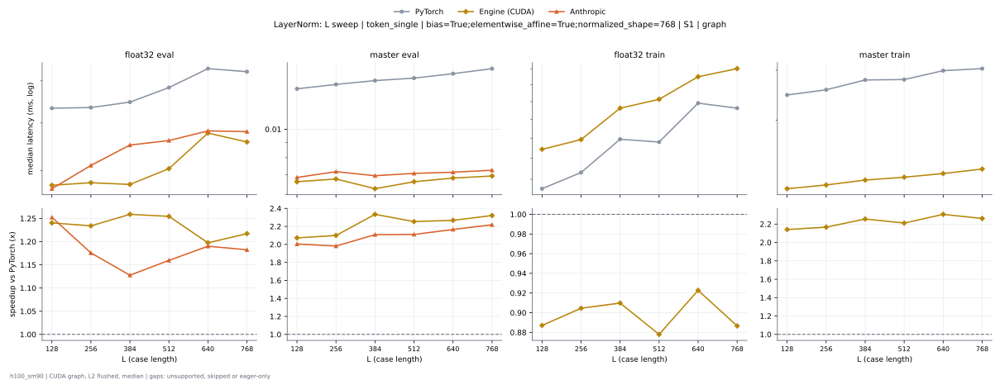

**float32 eval** (median ms; x = speedup vs PyTorch)

| L | PyTorch | Engine (Triton) | Engine (CUDA) | Anthropic | cuEquivariance |
|---|---|---|---|---|---|
| 128 | 0.008576 | 0.00896 (0.96x) | 0.006784 (1.26x) | 0.007072 (1.21x) | 0.007808 (1.10x) |
| 256 | 0.008576 | 0.009232 (0.93x) | 0.007008 (1.22x) | 0.0072 (1.19x) | 0.007936 (1.08x) |
| 384 | 0.008608 | 0.009248 (0.93x) | 0.006928 (1.24x) | 0.007152 (1.20x) | 0.007904 (1.09x) |
| 512 | 0.008896 | 0.009184 (0.97x) | 0.007264 (1.22x) | 0.00736 (1.21x) | 0.008368 (1.06x) |
| 640 | 0.009024 | 0.009344 (0.97x) | 0.007456 (1.21x) | 0.00752 (1.20x) | 0.00832 (1.08x) |
| 768 | 0.009296 | 0.009728 (0.96x) | 0.007648 (1.22x) | 0.007888 (1.18x) | 0.008432 (1.10x) |

**master eval** (median ms; x = speedup vs PyTorch)

| L | PyTorch | Engine (Triton) | Engine (CUDA) | Anthropic | cuEquivariance |
|---|---|---|---|---|---|
| 128 | 0.01414 | 0.008032 (1.76x) | 0.00672 (2.10x) | 0.006976 (2.03x) | 0.0113 (1.25x) |
| 256 | 0.01424 | 0.008048 (1.77x) | 0.006752 (2.11x) | 0.006928 (2.06x) | 0.0112 (1.27x) |
| 384 | 0.0147 | 0.008288 (1.77x) | 0.006752 (2.18x) | 0.00688 (2.14x) | 0.01134 (1.30x) |
| 512 | 0.01525 | 0.008224 (1.85x) | 0.007008 (2.18x) | 0.007296 (2.09x) | 0.01155 (1.32x) |
| 640 | 0.01549 | 0.00832 (1.86x) | 0.007072 (2.19x) | 0.007456 (2.08x) | 0.01146 (1.35x) |
| 768 | 0.01584 | 0.008064 (1.96x) | 0.006896 (2.30x) | 0.0072 (2.20x) | 0.01131 (1.40x) |

**float32 train** (median ms; x = speedup vs PyTorch)

| L | PyTorch | Engine (Triton) | Engine (CUDA) | Anthropic | cuEquivariance |
|---|---|---|---|---|---|
| 128 | 0.0149 | 0.01699 (0.88x) | 0.01688 (0.88x) | 0.0211 (0.71x) | 0.0436 (0.34x) |
| 256 | 0.01546 | 0.01757 (0.88x) | 0.01686 (0.92x) | 0.02106 (0.73x) | 0.04422 (0.35x) |
| 384 | 0.01693 | 0.01818 (0.93x) | 0.01894 (0.89x) | 0.02198 (0.77x) | 0.04494 (0.38x) |
| 512 | 0.01696 | 0.01878 (0.90x) | 0.01933 (0.88x) | 0.0221 (0.77x) | 0.0463 (0.37x) |
| 640 | 0.01866 | 0.01917 (0.97x) | 0.0207 (0.90x) | 0.02298 (0.81x) | 0.04675 (0.40x) |
| 768 | 0.01866 | 0.01978 (0.94x) | 0.02101 (0.89x) | 0.02416 (0.77x) | 0.04771 (0.39x) |

**master train** (median ms; x = speedup vs PyTorch)

| L | PyTorch | Engine (Triton) | Engine (CUDA) | Anthropic | cuEquivariance |
|---|---|---|---|---|---|
| 128 | 0.02493 | 0.01733 (1.44x) | 0.012 (2.08x) | 0.03026 (0.82x) | 0.05939 (0.42x) |
| 256 | 0.02557 | 0.01706 (1.50x) | 0.01245 (2.05x) | 0.03053 (0.84x) | 0.05994 (0.43x) |
| 384 | 0.02739 | 0.01786 (1.53x) | 0.01258 (2.18x) | 0.0311 (0.88x) | 0.0601 (0.46x) |
| 512 | 0.02813 | 0.01779 (1.58x) | 0.01259 (2.23x) | 0.0311 (0.90x) | 0.06005 (0.47x) |
| 640 | 0.02995 | 0.01854 (1.62x) | 0.01323 (2.26x) | 0.03149 (0.95x) | 0.06086 (0.49x) |
| 768 | 0.03011 | 0.01904 (1.58x) | 0.01349 (2.23x) | 0.03195 (0.94x) | 0.06128 (0.49x) |

### L sweep: token_single | bias=True;elementwise_affine=True;normalized_shape=833 | S1 | graph

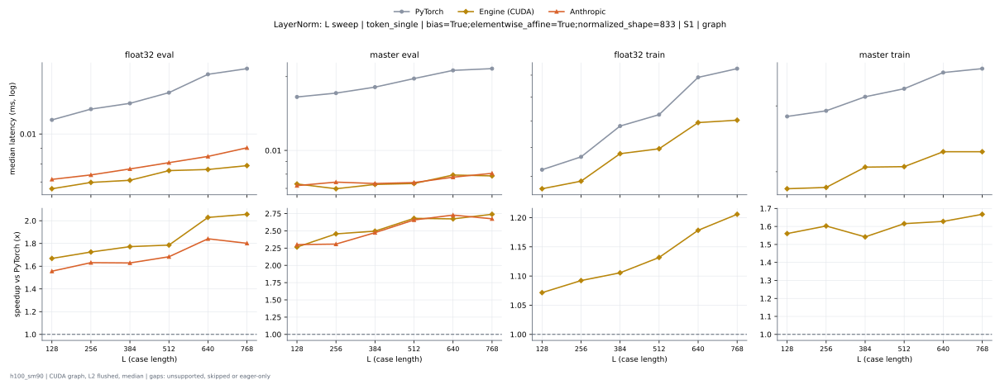

**float32 eval** (median ms; x = speedup vs PyTorch)

| L | PyTorch | Engine (Triton) | Engine (CUDA) | Anthropic | cuEquivariance |
|---|---|---|---|---|---|
| 128 | 0.0113 | 0.00968 (1.17x) | 0.007232 (1.56x) | 0.007168 (1.58x) | 0.007424 (1.52x) |
| 256 | 0.01197 | 0.009696 (1.23x) | 0.007264 (1.65x) | 0.007488 (1.60x) | 0.007536 (1.59x) |
| 384 | 0.01269 | 0.009888 (1.28x) | 0.0072 (1.76x) | 0.007648 (1.66x) | 0.007648 (1.66x) |
| 512 | 0.01382 | 0.009696 (1.43x) | 0.007616 (1.82x) | 0.00816 (1.69x) | 0.007744 (1.79x) |
| 640 | 0.01566 | 0.009856 (1.59x) | 0.007808 (2.01x) | 0.00848 (1.85x) | 0.008032 (1.95x) |
| 768 | 0.01629 | 0.01019 (1.60x) | 0.008064 (2.02x) | 0.009072 (1.80x) | 0.008416 (1.94x) |

**master eval** (median ms; x = speedup vs PyTorch)

| L | PyTorch | Engine (Triton) | Engine (CUDA) | Anthropic | cuEquivariance |
|---|---|---|---|---|---|
| 128 | 0.01669 | 0.009408 (1.77x) | 0.00736 (2.27x) | 0.007136 (2.34x) | 0.01226 (1.36x) |
| 256 | 0.01741 | 0.009536 (1.83x) | 0.00752 (2.31x) | 0.007328 (2.38x) | 0.01251 (1.39x) |
| 384 | 0.0183 | 0.0096 (1.91x) | 0.007584 (2.41x) | 0.007392 (2.48x) | 0.01242 (1.47x) |
| 512 | 0.01965 | 0.009824 (2.00x) | 0.007776 (2.53x) | 0.007808 (2.52x) | 0.01264 (1.55x) |
| 640 | 0.02134 | 0.009472 (2.25x) | 0.00768 (2.78x) | 0.007904 (2.70x) | 0.01245 (1.71x) |
| 768 | 0.02163 | 0.009504 (2.28x) | 0.007648 (2.83x) | 0.008 (2.70x) | 0.01237 (1.75x) |

**float32 train** (median ms; x = speedup vs PyTorch)

| L | PyTorch | Engine (Triton) | Engine (CUDA) | Anthropic | cuEquivariance |
|---|---|---|---|---|---|
| 128 | 0.01827 | 0.01931 (0.95x) | 0.01744 (1.05x) | 0.03723 (0.49x) | 0.03336 (0.55x) |
| 256 | 0.01928 | 0.02013 (0.96x) | 0.01754 (1.10x) | 0.03704 (0.52x) | 0.03362 (0.57x) |
| 384 | 0.02142 | 0.02112 (1.01x) | 0.01946 (1.10x) | 0.03778 (0.57x) | 0.03466 (0.62x) |
| 512 | 0.02237 | 0.02258 (0.99x) | 0.02003 (1.12x) | 0.03835 (0.58x) | 0.03594 (0.62x) |
| 640 | 0.02582 | 0.0241 (1.07x) | 0.0217 (1.19x) | 0.03914 (0.66x) | 0.03675 (0.70x) |
| 768 | 0.02619 | 0.02602 (1.01x) | 0.02202 (1.19x) | 0.0395 (0.66x) | 0.0376 (0.70x) |

**master train** (median ms; x = speedup vs PyTorch)

| L | PyTorch | Engine (Triton) | Engine (CUDA) | Anthropic | cuEquivariance |
|---|---|---|---|---|---|
| 128 | 0.02778 | 0.01942 (1.43x) | 0.01802 (1.54x) | 0.04661 (0.60x) | 0.05347 (0.52x) |
| 256 | 0.0291 | 0.02029 (1.43x) | 0.01827 (1.59x) | 0.04635 (0.63x) | 0.05341 (0.54x) |
| 384 | 0.03162 | 0.02142 (1.48x) | 0.02016 (1.57x) | 0.04731 (0.67x) | 0.0543 (0.58x) |
| 512 | 0.03336 | 0.02184 (1.53x) | 0.02048 (1.63x) | 0.04754 (0.70x) | 0.05443 (0.61x) |
| 640 | 0.03669 | 0.02358 (1.56x) | 0.02269 (1.62x) | 0.04819 (0.76x) | 0.0548 (0.67x) |
| 768 | 0.03771 | 0.02486 (1.52x) | 0.02277 (1.66x) | 0.04845 (0.78x) | 0.05517 (0.68x) |

### normalized_shape sweep at L768: token_pair | bias=False;elementwise_affine=True | S1 | graph

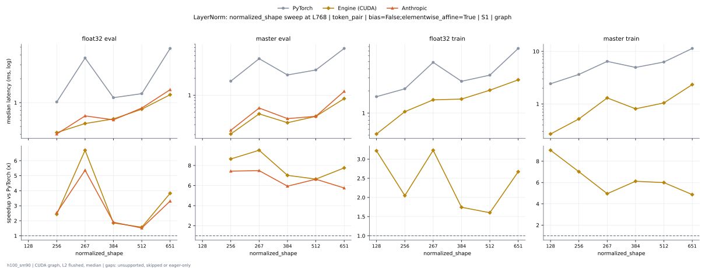

**float32 eval** (median ms; x = speedup vs PyTorch)

| normalized_shape | PyTorch | Engine (Triton) | Engine (CUDA) | Anthropic | cuEquivariance |
|---|---|---|---|---|---|
| 128 |  |  |  |  |  |
| 256 | 1.014 | 0.4056 (2.50x) | 0.4205 (2.41x) | 0.4025 (2.52x) | 0.4061 (2.50x) |
| 267 | 3.648 | 0.426 (8.56x) | 0.544 (6.71x) | 0.6799 (5.37x) | 0.436 (8.37x) |
| 384 | 1.155 | 0.6034 (1.91x) | 0.6222 (1.86x) | 0.6051 (1.91x) | 0.6045 (1.91x) |
| 512 | 1.297 | 0.8015 (1.62x) | 0.8249 (1.57x) | 0.8469 (1.53x) | 0.8024 (1.62x) |
| 651 | 4.794 | 1.15 (4.17x) | 1.256 (3.82x) | 1.445 (3.32x) | 1.031 (4.65x) |

**master eval** (median ms; x = speedup vs PyTorch)

| normalized_shape | PyTorch | Engine (Triton) | Engine (CUDA) | Anthropic | cuEquivariance |
|---|---|---|---|---|---|
| 128 |  |  |  |  |  |
| 256 | 1.764 | 0.2088 (8.45x) | 0.2048 (8.61x) | 0.2382 (7.40x) | 0.2105 (8.38x) |
| 267 | 4.431 | 0.2783 (15.92x) | 0.4657 (9.52x) | 0.5916 (7.49x) | 0.2438 (18.18x) |
| 384 | 2.28 | 0.3068 (7.43x) | 0.3242 (7.03x) | 0.3837 (5.94x) | 0.309 (7.38x) |
| 512 | 2.795 | 0.4061 (6.88x) | 0.4244 (6.59x) | 0.4207 (6.64x) | 0.4087 (6.84x) |
| 651 | 6.699 | 0.6522 (10.27x) | 0.864 (7.75x) | 1.16 (5.77x) | 0.5574 (12.02x) |

**float32 train** (median ms; x = speedup vs PyTorch)

| normalized_shape | PyTorch | Engine (Triton) | Engine (CUDA) | Anthropic | cuEquivariance |
|---|---|---|---|---|---|
| 128 | 1.662 | 0.5193 (3.20x) | 0.5183 (3.21x) | 0.8128 (2.04x) | 0.7217 (2.30x) |
| 256 | 2.129 | 1.018 (2.09x) | 1.044 (2.04x) | 1.673 (1.27x) | 1.408 (1.51x) |
| 267 | 4.87 | 1.255 (3.88x) | 1.51 (3.22x) | 1.856 (2.62x) | 1.279 (3.81x) |
| 384 | 2.7 | 1.524 (1.77x) | 1.545 (1.75x) | 2.536 (1.06x) | 2.21 (1.22x) |
| 512 | 3.275 | 2.03 (1.61x) | 2.043 (1.60x) | 3.532 (0.93x) | 3.019 (1.08x) |
| 651 | 7.501 | 3.633 (2.06x) | 2.828 (2.65x) | 5.671 (1.32x) | 3.933 (1.91x) |

**master train** (median ms; x = speedup vs PyTorch)

| normalized_shape | PyTorch | Engine (Triton) | Engine (CUDA) | Anthropic | cuEquivariance |
|---|---|---|---|---|---|
| 128 | 2.414 | 0.2719 (8.88x) | 0.2686 (8.99x) | 0.4488 (5.38x) | 0.4491 (5.38x) |
| 256 | 3.627 | 0.5219 (6.95x) | 0.5186 (6.99x) | 0.8859 (4.09x) | 0.8765 (4.14x) |
| 267 | 6.43 | 0.939 (6.85x) | 1.299 (4.95x) | 1.374 (4.68x) | 1.029 (6.25x) |
| 384 | 4.932 | 1.021 (4.83x) | 0.8063 (6.12x) | 1.563 (3.15x) | 1.254 (3.93x) |
| 512 | 6.266 | 1.374 (4.56x) | 1.047 (5.99x) | 1.865 (3.36x) | 1.889 (3.32x) |
| 651 | 11.3 | 2.214 (5.10x) | 2.326 (4.86x) | 2.919 (3.87x) | 2.267 (4.99x) |

### normalized_shape sweep at L768: token_pair | bias=True;elementwise_affine=True | S1 | graph

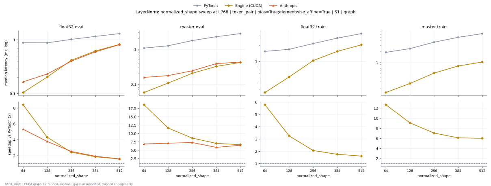

**float32 eval** (median ms; x = speedup vs PyTorch)

| normalized_shape | PyTorch | Engine (Triton) | Engine (CUDA) | Anthropic | cuEquivariance |
|---|---|---|---|---|---|
| 64 | 0.8809 | 0.1075 (8.20x) | 0.1053 (8.37x) | 0.1652 (5.33x) | 0.1065 (8.27x) |
| 128 | 0.8772 | 0.2066 (4.25x) | 0.2044 (4.29x) | 0.2326 (3.77x) | 0.2078 (4.22x) |
| 256 | 1.018 | 0.4038 (2.52x) | 0.4206 (2.42x) | 0.4026 (2.53x) | 0.4044 (2.52x) |
| 384 | 1.163 | 0.6017 (1.93x) | 0.6221 (1.87x) | 0.6009 (1.93x) | 0.6023 (1.93x) |
| 512 | 1.309 | 0.8005 (1.64x) | 0.8243 (1.59x) | 0.8215 (1.59x) | 0.801 (1.63x) |

**master eval** (median ms; x = speedup vs PyTorch)

| normalized_shape | PyTorch | Engine (Triton) | Engine (CUDA) | Anthropic | cuEquivariance |
|---|---|---|---|---|---|
| 64 | 1.073 | 0.05837 (18.38x) | 0.05858 (18.31x) | 0.1562 (6.87x) | 0.06173 (17.38x) |
| 128 | 1.254 | 0.1079 (11.63x) | 0.1082 (11.60x) | 0.1761 (7.12x) | 0.1115 (11.25x) |
| 256 | 1.767 | 0.2064 (8.56x) | 0.2046 (8.63x) | 0.2418 (7.31x) | 0.2105 (8.39x) |
| 384 | 2.288 | 0.306 (7.48x) | 0.3237 (7.07x) | 0.3892 (5.88x) | 0.3095 (7.39x) |
| 512 | 2.806 | 0.4051 (6.93x) | 0.4242 (6.62x) | 0.4302 (6.52x) | 0.4089 (6.86x) |

**float32 train** (median ms; x = speedup vs PyTorch)

| normalized_shape | PyTorch | Engine (Triton) | Engine (CUDA) | Anthropic | cuEquivariance |
|---|---|---|---|---|---|
| 64 | 1.538 | 0.2664 (5.77x) | 0.2677 (5.74x) | 0.4225 (3.64x) | 0.3512 (4.38x) |
| 128 | 1.684 | 0.5178 (3.25x) | 0.5186 (3.25x) | 0.818 (2.06x) | 0.7204 (2.34x) |
| 256 | 2.153 | 1.017 (2.12x) | 1.045 (2.06x) | 1.667 (1.29x) | 1.406 (1.53x) |
| 384 | 2.726 | 1.526 (1.79x) | 1.545 (1.76x) | 2.539 (1.07x) | 2.21 (1.23x) |
| 512 | 3.307 | 2.029 (1.63x) | 2.042 (1.62x) | 3.543 (0.93x) | 3.018 (1.10x) |

**master train** (median ms; x = speedup vs PyTorch)

| normalized_shape | PyTorch | Engine (Triton) | Engine (CUDA) | Anthropic | cuEquivariance |
|---|---|---|---|---|---|
| 64 | 1.917 | 0.1461 (13.12x) | 0.1523 (12.59x) | 0.2556 (7.50x) | 0.2171 (8.83x) |
| 128 | 2.432 | 0.2713 (8.96x) | 0.2694 (9.03x) | 0.4736 (5.14x) | 0.451 (5.39x) |
| 256 | 3.651 | 0.5197 (7.02x) | 0.5204 (7.01x) | 0.9324 (3.92x) | 0.8812 (4.14x) |
| 384 | 4.971 | 1.009 (4.93x) | 0.8052 (6.17x) | 1.66 (3.00x) | 1.245 (3.99x) |
| 512 | 6.298 | 1.372 (4.59x) | 1.044 (6.03x) | 1.962 (3.21x) | 1.886 (3.34x) |

### normalized_shape sweep at L768: token_single | bias=False;elementwise_affine=True | S1 | graph

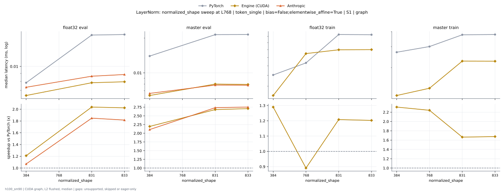

**float32 eval** (median ms; x = speedup vs PyTorch)

| normalized_shape | PyTorch | Engine (Triton) | Engine (CUDA) | Anthropic | cuEquivariance |
|---|---|---|---|---|---|
| 384 | 0.007936 | 0.008912 (0.89x) | 0.006592 (1.20x) | 0.00688 (1.15x) | 0.0088 (0.90x) |
| 768 |  |  |  |  |  |
| 831 | 0.01637 | 0.0116 (1.41x) | 0.00816 (2.01x) | 0.008928 (1.83x) | 0.009856 (1.66x) |
| 833 | 0.01613 | 0.01155 (1.40x) | 0.007984 (2.02x) | 0.008864 (1.82x) | 0.00976 (1.65x) |

**master eval** (median ms; x = speedup vs PyTorch)

| normalized_shape | PyTorch | Engine (Triton) | Engine (CUDA) | Anthropic | cuEquivariance |
|---|---|---|---|---|---|
| 384 | 0.01414 | 0.00864 (1.64x) | 0.006656 (2.12x) | 0.006976 (2.03x) | 0.01082 (1.31x) |
| 768 |  |  |  |  |  |
| 831 | 0.02133 | 0.0111 (1.92x) | 0.007552 (2.82x) | 0.007648 (2.79x) | 0.01168 (1.83x) |
| 833 | 0.02139 | 0.01107 (1.93x) | 0.007648 (2.80x) | 0.00768 (2.79x) | 0.01173 (1.82x) |

**float32 train** (median ms; x = speedup vs PyTorch)

| normalized_shape | PyTorch | Engine (Triton) | Engine (CUDA) | Anthropic | cuEquivariance |
|---|---|---|---|---|---|
| 384 | 0.0161 | 0.01752 (0.92x) | 0.01248 (1.29x) | 0.0179 (0.90x) | 0.03366 (0.48x) |
| 768 | 0.01846 | 0.02054 (0.90x) | 0.02099 (0.88x) | 0.02323 (0.79x) | 0.04898 (0.38x) |
| 831 | 0.02646 | 0.02726 (0.97x) | 0.02198 (1.20x) | 0.03731 (0.71x) | 0.03834 (0.69x) |
| 833 | 0.02616 | 0.02701 (0.97x) | 0.02214 (1.18x) | 0.03749 (0.70x) | 0.0389 (0.67x) |

**master train** (median ms; x = speedup vs PyTorch)

| normalized_shape | PyTorch | Engine (Triton) | Engine (CUDA) | Anthropic | cuEquivariance |
|---|---|---|---|---|---|
| 384 | 0.0271 | 0.01667 (1.63x) | 0.01216 (2.23x) | 0.02435 (1.11x) | 0.04134 (0.66x) |
| 768 | 0.03011 | 0.02005 (1.50x) | 0.01328 (2.27x) | 0.02523 (1.19x) | 0.05838 (0.52x) |
| 831 | 0.03765 | 0.0257 (1.47x) | 0.02251 (1.67x) | 0.04133 (0.91x) | 0.05114 (0.74x) |
| 833 | 0.03752 | 0.02568 (1.46x) | 0.02266 (1.66x) | 0.04157 (0.90x) | 0.05232 (0.72x) |

### normalized_shape sweep at L768: token_single | bias=True;elementwise_affine=True | S1 | graph

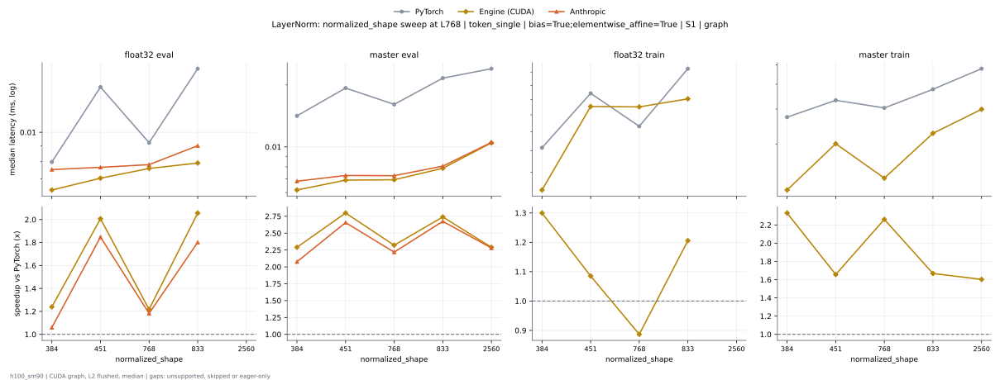

**float32 eval** (median ms; x = speedup vs PyTorch)

| normalized_shape | PyTorch | Engine (Triton) | Engine (CUDA) | Anthropic | cuEquivariance |
|---|---|---|---|---|---|
| 384 | 0.008128 | 0.007296 (1.11x) | 0.006592 (1.23x) | 0.00704 (1.15x) | 0.007392 (1.10x) |
| 451 | 0.01411 | 0.007968 (1.77x) | 0.007168 (1.97x) | 0.00752 (1.88x) | 0.007648 (1.85x) |
| 768 | 0.009296 | 0.009728 (0.96x) | 0.007648 (1.22x) | 0.007888 (1.18x) | 0.008432 (1.10x) |
| 833 | 0.01629 | 0.01019 (1.60x) | 0.008064 (2.02x) | 0.009072 (1.80x) | 0.008416 (1.94x) |
| 2560 |  |  |  |  |  |

**master eval** (median ms; x = speedup vs PyTorch)

| normalized_shape | PyTorch | Engine (Triton) | Engine (CUDA) | Anthropic | cuEquivariance |
|---|---|---|---|---|---|
| 384 | 0.01437 | 0.007136 (2.01x) | 0.006688 (2.15x) | 0.00696 (2.06x) | 0.0113 (1.27x) |
| 451 | 0.01944 | 0.007776 (2.50x) | 0.00712 (2.73x) | 0.007424 (2.62x) | 0.01238 (1.57x) |
| 768 | 0.01584 | 0.008064 (1.96x) | 0.006896 (2.30x) | 0.0072 (2.20x) | 0.01131 (1.40x) |
| 833 | 0.02163 | 0.009504 (2.28x) | 0.007648 (2.83x) | 0.008 (2.70x) | 0.01237 (1.75x) |
| 2560 | 0.02405 | 0.01507 (1.60x) | 0.01053 (2.28x) | 0.01037 (2.32x) | 0.06797 (0.35x) |

**float32 train** (median ms; x = speedup vs PyTorch)

| normalized_shape | PyTorch | Engine (Triton) | Engine (CUDA) | Anthropic | cuEquivariance |
|---|---|---|---|---|---|
| 384 | 0.01642 | 0.01611 (1.02x) | 0.01264 (1.30x) | 0.0191 (0.86x) | 0.03229 (0.51x) |
| 451 | 0.02302 | 0.02019 (1.14x) | 0.02115 (1.09x) | 0.0275 (0.84x) | 0.02904 (0.79x) |
| 768 | 0.01866 | 0.01978 (0.94x) | 0.02101 (0.89x) | 0.02416 (0.77x) | 0.04771 (0.39x) |
| 833 | 0.02619 | 0.02602 (1.01x) | 0.02202 (1.19x) | 0.0395 (0.66x) | 0.0376 (0.70x) |
| 2560 |  |  |  |  |  |

**master train** (median ms; x = speedup vs PyTorch)

| normalized_shape | PyTorch | Engine (Triton) | Engine (CUDA) | Anthropic | cuEquivariance |
|---|---|---|---|---|---|
| 384 | 0.0272 | 0.01533 (1.77x) | 0.01226 (2.22x) | 0.03061 (0.89x) | 0.04398 (0.62x) |
| 451 | 0.03315 | 0.01968 (1.68x) | 0.02018 (1.64x) | 0.03814 (0.87x) | 0.04368 (0.76x) |
| 768 | 0.03011 | 0.01904 (1.58x) | 0.01349 (2.23x) | 0.03195 (0.94x) | 0.06128 (0.49x) |
| 833 | 0.03771 | 0.02486 (1.52x) | 0.02277 (1.66x) | 0.04845 (0.78x) | 0.05517 (0.68x) |
| 2560 | 0.04746 | 0.03646 (1.30x) | 0.02998 (1.58x) | 0.04811 (0.99x) | 0.1911 (0.25x) |

### Single-length cases (no sweep)

- noise | bias=False;elementwise_affine=True;normalized_shape=256 | S1 | graph L1 float32 train anthropic: 0.01478 ms
- noise | bias=False;elementwise_affine=True;normalized_shape=256 | S1 | graph L1 float32 train cuda: 0.009152 ms
- noise | bias=False;elementwise_affine=True;normalized_shape=256 | S1 | graph L1 float32 train cueq: 0.02392 ms
- noise | bias=False;elementwise_affine=True;normalized_shape=256 | S1 | graph L1 float32 train pytorch: 0.01206 ms
- noise | bias=False;elementwise_affine=True;normalized_shape=256 | S1 | graph L1 float32 train triton: 0.01267 ms
- noise | bias=False;elementwise_affine=True;normalized_shape=256 | S1 | graph L1 master train anthropic: 0.01888 ms
- noise | bias=False;elementwise_affine=True;normalized_shape=256 | S1 | graph L1 master train cuda: 0.009536 ms
- noise | bias=False;elementwise_affine=True;normalized_shape=256 | S1 | graph L1 master train cueq: 0.03224 ms
- noise | bias=False;elementwise_affine=True;normalized_shape=256 | S1 | graph L1 master train pytorch: 0.01915 ms
- noise | bias=False;elementwise_affine=True;normalized_shape=256 | S1 | graph L1 master train triton: 0.01251 ms
- noise | bias=False;elementwise_affine=True;normalized_shape=256 | S5 | graph L1 float32 eval anthropic: 0.006304 ms
- noise | bias=False;elementwise_affine=True;normalized_shape=256 | S5 | graph L1 float32 eval cuda: 0.00608 ms
- noise | bias=False;elementwise_affine=True;normalized_shape=256 | S5 | graph L1 float32 eval cueq: 0.00832 ms
- noise | bias=False;elementwise_affine=True;normalized_shape=256 | S5 | graph L1 float32 eval pytorch: 0.007328 ms
- noise | bias=False;elementwise_affine=True;normalized_shape=256 | S5 | graph L1 float32 eval triton: 0.007616 ms
- noise | bias=False;elementwise_affine=True;normalized_shape=256 | S5 | graph L1 master eval anthropic: 0.009744 ms
- noise | bias=False;elementwise_affine=True;normalized_shape=256 | S5 | graph L1 master eval cuda: 0.006416 ms
- noise | bias=False;elementwise_affine=True;normalized_shape=256 | S5 | graph L1 master eval cueq: 0.009952 ms
- noise | bias=False;elementwise_affine=True;normalized_shape=256 | S5 | graph L1 master eval pytorch: 0.01264 ms
- noise | bias=False;elementwise_affine=True;normalized_shape=256 | S5 | graph L1 master eval triton: 0.008 ms
- noise | bias=True;elementwise_affine=True;normalized_shape=256 | S1 | graph L1 float32 train anthropic: 0.01496 ms
- noise | bias=True;elementwise_affine=True;normalized_shape=256 | S1 | graph L1 float32 train cuda: 0.009312 ms
- noise | bias=True;elementwise_affine=True;normalized_shape=256 | S1 | graph L1 float32 train cueq: 0.02307 ms
- noise | bias=True;elementwise_affine=True;normalized_shape=256 | S1 | graph L1 float32 train pytorch: 0.01219 ms
- noise | bias=True;elementwise_affine=True;normalized_shape=256 | S1 | graph L1 float32 train triton: 0.01133 ms
- noise | bias=True;elementwise_affine=True;normalized_shape=256 | S1 | graph L1 master train anthropic: 0.02414 ms
- noise | bias=True;elementwise_affine=True;normalized_shape=256 | S1 | graph L1 master train cuda: 0.0096 ms
- noise | bias=True;elementwise_affine=True;normalized_shape=256 | S1 | graph L1 master train cueq: 0.03558 ms
- noise | bias=True;elementwise_affine=True;normalized_shape=256 | S1 | graph L1 master train pytorch: 0.0193 ms
- noise | bias=True;elementwise_affine=True;normalized_shape=256 | S1 | graph L1 master train triton: 0.01163 ms
- noise | bias=True;elementwise_affine=True;normalized_shape=256 | S5 | graph L1 float32 eval anthropic: 0.006304 ms
- noise | bias=True;elementwise_affine=True;normalized_shape=256 | S5 | graph L1 float32 eval cuda: 0.006 ms
- noise | bias=True;elementwise_affine=True;normalized_shape=256 | S5 | graph L1 float32 eval cueq: 0.006864 ms
- noise | bias=True;elementwise_affine=True;normalized_shape=256 | S5 | graph L1 float32 eval pytorch: 0.007328 ms
- noise | bias=True;elementwise_affine=True;normalized_shape=256 | S5 | graph L1 float32 eval triton: 0.006304 ms
- noise | bias=True;elementwise_affine=True;normalized_shape=256 | S5 | graph L1 master eval anthropic: 0.01024 ms
- noise | bias=True;elementwise_affine=True;normalized_shape=256 | S5 | graph L1 master eval cuda: 0.0064 ms
- noise | bias=True;elementwise_affine=True;normalized_shape=256 | S5 | graph L1 master eval cueq: 0.01034 ms
- noise | bias=True;elementwise_affine=True;normalized_shape=256 | S5 | graph L1 master eval pytorch: 0.01267 ms
- noise | bias=True;elementwise_affine=True;normalized_shape=256 | S5 | graph L1 master eval triton: 0.006592 ms
