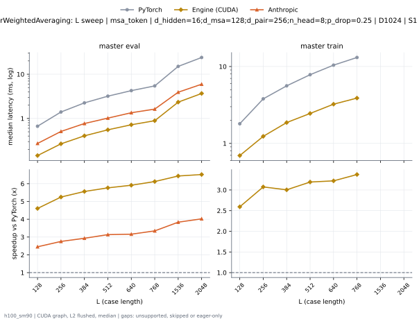
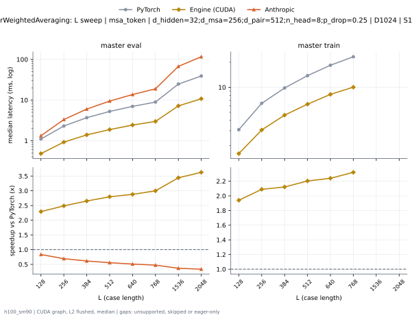
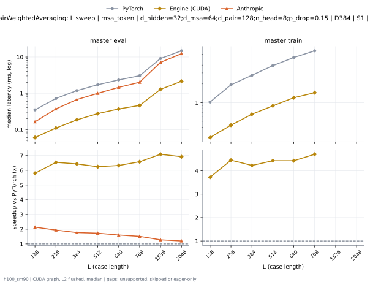
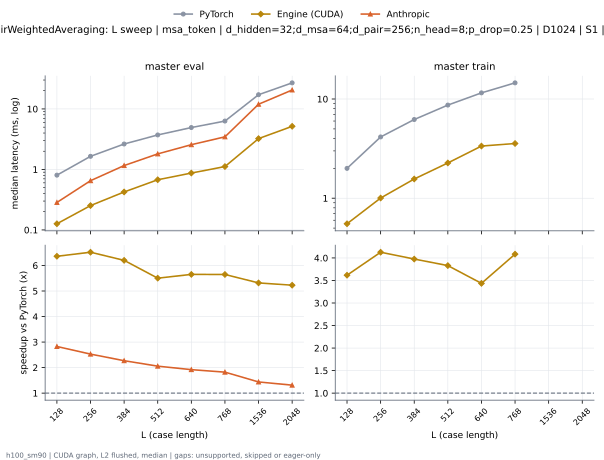
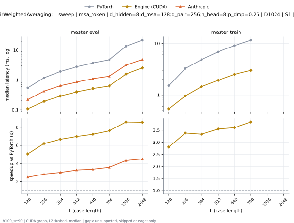

# MSAPairWeightedAveraging on h100_sm90

Generated by `python -m miniworld_engine.measure.plot` from speed tokens `judge/tokens/h100_sm90/`; do not edit.

### L sweep: msa_token | d_hidden=16;d_msa=128;d_pair=256;n_head=8;p_drop=0.25 | D1024 | S1 | graph

**master eval** (median ms; x = speedup vs PyTorch)

| L | PyTorch | Engine (Triton) | Engine (CUDA) | Anthropic |
|---|---|---|---|---|
| 128 | 0.6671 | 0.1571 (4.25x) | 0.1448 (4.61x) | 0.2721 (2.45x) |
| 256 | 1.4 | 0.3009 (4.65x) | 0.2668 (5.25x) | 0.5086 (2.75x) |
| 384 | 2.251 | 0.4641 (4.85x) | 0.4048 (5.56x) | 0.7683 (2.93x) |
| 512 | 3.192 | 0.6348 (5.03x) | 0.5537 (5.76x) | 1.018 (3.14x) |
| 640 | 4.258 | 0.8692 (4.90x) | 0.7203 (5.91x) | 1.348 (3.16x) |
| 768 | 5.444 | 1.064 (5.12x) | 0.8897 (6.12x) | 1.627 (3.35x) |
| 1536 | 15.04 | 3.022 (4.98x) | 2.338 (6.43x) | 3.922 (3.83x) |
| 2048 | 23.93 | 4.836 (4.95x) | 3.674 (6.51x) | 5.948 (4.02x) |

**master train** (median ms; x = speedup vs PyTorch)

| L | PyTorch | Engine (Triton) | Engine (CUDA) | Anthropic |
|---|---|---|---|---|
| 128 | 1.801 | 0.8194 (2.20x) | 0.6945 (2.59x) | unsupported |
| 256 | 3.796 | 1.512 (2.51x) | 1.235 (3.07x) | unsupported |
| 384 | 5.607 | 2.326 (2.41x) | 1.867 (3.00x) | unsupported |
| 512 | 7.825 | 3.168 (2.47x) | 2.451 (3.19x) | unsupported |
| 640 | 10.42 | 4.246 (2.45x) | 3.236 (3.22x) | unsupported |
| 768 | 13.11 | 5.212 (2.51x) | 3.885 (3.37x) | unsupported |
| 1536 |  |  |  |  |
| 2048 |  |  |  |  |

### L sweep: msa_token | d_hidden=32;d_msa=256;d_pair=512;n_head=8;p_drop=0.25 | D1024 | S1 | graph

**master eval** (median ms; x = speedup vs PyTorch)

| L | PyTorch | Engine (Triton) | Engine (CUDA) | Anthropic |
|---|---|---|---|---|
| 128 | 1.101 | 0.47 (2.34x) | 0.4803 (2.29x) | 1.321 (0.83x) |
| 256 | 2.293 | 0.9275 (2.47x) | 0.9218 (2.49x) | 3.311 (0.69x) |
| 384 | 3.683 | 1.448 (2.54x) | 1.389 (2.65x) | 5.989 (0.61x) |
| 512 | 5.244 | 1.961 (2.67x) | 1.875 (2.80x) | 9.425 (0.56x) |
| 640 | 6.979 | 2.607 (2.68x) | 2.424 (2.88x) | 13.68 (0.51x) |
| 768 | 8.93 | 3.247 (2.75x) | 2.978 (3.00x) | 18.87 (0.47x) |
| 1536 | 24.72 | 8.409 (2.94x) | 7.181 (3.44x) | 67.35 (0.37x) |
| 2048 | 39.03 | 13.02 (3.00x) | 10.76 (3.63x) | 116.3 (0.34x) |

**master train** (median ms; x = speedup vs PyTorch)

| L | PyTorch | Engine (Triton) | Engine (CUDA) | Anthropic |
|---|---|---|---|---|
| 128 | 3.093 | 2.142 (1.44x) | 1.595 (1.94x) | unsupported |
| 256 | 6.413 | 4.01 (1.60x) | 3.07 (2.09x) | unsupported |
| 384 | 9.817 | 6.166 (1.59x) | 4.628 (2.12x) | unsupported |
| 512 | 13.8 | 8.339 (1.65x) | 6.263 (2.20x) | unsupported |
| 640 | 18.41 | 11.03 (1.67x) | 8.22 (2.24x) | unsupported |
| 768 | 23.27 | 13.56 (1.72x) | 10.03 (2.32x) | unsupported |
| 1536 |  |  |  |  |
| 2048 |  |  |  |  |

### L sweep: msa_token | d_hidden=32;d_msa=64;d_pair=128;n_head=8;p_drop=0.15 | D384 | S1 | graph

**master eval** (median ms; x = speedup vs PyTorch)

| L | PyTorch | Engine (Triton) | Engine (CUDA) | Anthropic |
|---|---|---|---|---|
| 128 | 0.3405 | 0.07794 (4.37x) | 0.06038 (5.64x) | 0.1627 (2.09x) |
| 256 | 0.7165 | 0.1524 (4.70x) | 0.1094 (6.55x) | 0.3704 (1.93x) |
| 384 | 1.184 | 0.2337 (5.07x) | 0.1844 (6.42x) | 0.6704 (1.77x) |
| 512 | 1.72 | 0.3128 (5.50x) | 0.2738 (6.28x) | 0.9944 (1.73x) |
| 640 | 2.336 | 0.4191 (5.57x) | 0.3684 (6.34x) | 1.456 (1.60x) |
| 768 | 3.006 | 0.5354 (5.61x) | 0.4584 (6.56x) | 2.009 (1.50x) |
| 1536 | 9.094 | 1.547 (5.88x) | 1.28 (7.10x) | 7.129 (1.28x) |
| 2048 | 14.79 | 2.605 (5.68x) | 2.084 (7.10x) | 12.35 (1.20x) |

**master train** (median ms; x = speedup vs PyTorch)

| L | PyTorch | Engine (Triton) | Engine (CUDA) | Anthropic |
|---|---|---|---|---|
| 128 | 1.023 | 0.3377 (3.03x) | 0.2985 (3.43x) | unsupported |
| 256 | 1.923 | 0.61 (3.15x) | 0.4639 (4.15x) | unsupported |
| 384 | 2.756 | 0.891 (3.09x) | 0.7084 (3.89x) | unsupported |
| 512 | 3.927 | 1.228 (3.20x) | 0.9714 (4.04x) | unsupported |
| 640 | 5.293 | 1.609 (3.29x) | 1.364 (3.88x) | unsupported |
| 768 | 6.778 | 1.988 (3.41x) | 1.688 (4.02x) | unsupported |
| 1536 |  |  |  |  |
| 2048 |  |  |  |  |

### L sweep: msa_token | d_hidden=32;d_msa=64;d_pair=256;n_head=8;p_drop=0.25 | D1024 | S1 | graph

**master eval** (median ms; x = speedup vs PyTorch)

| L | PyTorch | Engine (Triton) | Engine (CUDA) | Anthropic |
|---|---|---|---|---|
| 128 | 0.8044 | 0.1853 (4.34x) | 0.1265 (6.36x) | 0.2846 (2.83x) |
| 256 | 1.647 | 0.3449 (4.78x) | 0.2527 (6.52x) | 0.6516 (2.53x) |
| 384 | 2.632 | 0.5345 (4.92x) | 0.4244 (6.20x) | 1.159 (2.27x) |
| 512 | 3.717 | 0.7497 (4.96x) | 0.6754 (5.50x) | 1.807 (2.06x) |
| 640 | 4.924 | 0.9928 (4.96x) | 0.8714 (5.65x) | 2.565 (1.92x) |
| 768 | 6.302 | 1.282 (4.92x) | 1.116 (5.65x) | 3.459 (1.82x) |
| 1536 | 17.18 | 3.931 (4.37x) | 3.232 (5.32x) | 11.95 (1.44x) |
| 2048 | 26.98 | 6.299 (4.28x) | 5.161 (5.23x) | 20.55 (1.31x) |

**master train** (median ms; x = speedup vs PyTorch)

| L | PyTorch | Engine (Triton) | Engine (CUDA) | Anthropic |
|---|---|---|---|---|
| 128 | 2 | 0.7415 (2.70x) | 0.5529 (3.62x) | unsupported |
| 256 | 4.147 | 1.352 (3.07x) | 1.005 (4.13x) | unsupported |
| 384 | 6.213 | 2.069 (3.00x) | 1.563 (3.98x) | unsupported |
| 512 | 8.686 | 2.83 (3.07x) | 2.268 (3.83x) | unsupported |
| 640 | 11.53 | 3.863 (2.98x) | 3.355 (3.44x) | unsupported |
| 768 | 14.55 | 4.869 (2.99x) | 3.561 (4.08x) | unsupported |
| 1536 |  |  |  |  |
| 2048 |  |  |  |  |

### L sweep: msa_token | d_hidden=8;d_msa=128;d_pair=256;n_head=8;p_drop=0.25 | D1024 | S1 | graph

**master eval** (median ms; x = speedup vs PyTorch)

| L | PyTorch | Engine (Triton) | Engine (CUDA) | Anthropic |
|---|---|---|---|---|
| 128 | 0.5443 | 0.1455 (3.74x) | 0.1076 (5.06x) | 0.2196 (2.48x) |
| 256 | 1.186 | 0.2747 (4.32x) | 0.191 (6.21x) | 0.4206 (2.82x) |
| 384 | 1.928 | 0.4219 (4.57x) | 0.2889 (6.67x) | 0.6419 (3.00x) |
| 512 | 2.776 | 0.5771 (4.81x) | 0.3975 (6.98x) | 0.8481 (3.27x) |
| 640 | 3.732 | 0.7679 (4.86x) | 0.5154 (7.24x) | 1.109 (3.36x) |
| 768 | 4.789 | 0.9544 (5.02x) | 0.6285 (7.62x) | 1.339 (3.58x) |
| 1536 | 13.58 | 2.483 (5.47x) | 1.581 (8.59x) | 3.141 (4.32x) |
| 2048 | 21.7 | 3.893 (5.57x) | 2.536 (8.56x) | 4.825 (4.50x) |

**master train** (median ms; x = speedup vs PyTorch)

| L | PyTorch | Engine (Triton) | Engine (CUDA) | Anthropic |
|---|---|---|---|---|
| 128 | 1.517 | 0.7509 (2.02x) | 0.5409 (2.81x) | unsupported |
| 256 | 3.247 | 1.407 (2.31x) | 0.9591 (3.39x) | unsupported |
| 384 | 4.851 | 2.182 (2.22x) | 1.454 (3.34x) | unsupported |
| 512 | 6.818 | 2.96 (2.30x) | 1.921 (3.55x) | unsupported |
| 640 | 9.044 | 3.899 (2.32x) | 2.507 (3.61x) | unsupported |
| 768 | 11.5 | 4.764 (2.41x) | 2.992 (3.84x) | unsupported |
| 1536 |  |  |  |  |
| 2048 |  |  |  |  |

### L sweep: msa_token | d_hidden=8;d_msa=128;d_pair=384;n_head=8;p_drop=0.25 | D1024 | S1 | graph

**master eval** (median ms; x = speedup vs PyTorch)

| L | PyTorch | Engine (Triton) | Engine (CUDA) | Anthropic |
|---|---|---|---|---|
| 128 | 0.573 | 0.1585 (3.62x) | 0.1148 (4.99x) | 0.6353 (0.90x) |
| 256 | 1.252 | 0.3175 (3.94x) | 0.2074 (6.04x) | 1.433 (0.87x) |
| 384 | 2.073 | 0.5291 (3.92x) | 0.3151 (6.58x) | 2.398 (0.86x) |
| 512 | 3.006 | 0.7384 (4.07x) | 0.4291 (7.01x) | 3.521 (0.85x) |
| 640 | 4.106 | 1.074 (3.82x) | 0.5659 (7.26x) | 4.813 (0.85x) |
| 768 | 5.35 | 1.325 (4.04x) | 0.7083 (7.55x) | 6.279 (0.85x) |
| 1536 | 15.76 | 4.009 (3.93x) | 1.921 (8.20x) | 19.05 (0.83x) |
| 2048 | 25.68 | 6.592 (3.90x) | 3.067 (8.37x) | 31.27 (0.82x) |

**master train** (median ms; x = speedup vs PyTorch)

| L | PyTorch | Engine (Triton) | Engine (CUDA) | Anthropic |
|---|---|---|---|---|
| 128 | 1.558 | 0.8094 (1.92x) | 0.5639 (2.76x) | unsupported |
| 256 | 3.406 | 1.62 (2.10x) | 1.047 (3.25x) | unsupported |
| 384 | 5.216 | 2.678 (1.95x) | 1.561 (3.34x) | unsupported |
| 512 | 7.479 | 3.712 (2.02x) | 2.115 (3.54x) | unsupported |
| 640 | 10.09 | 5.167 (1.95x) | 2.729 (3.70x) | unsupported |
| 768 | 12.91 | 6.435 (2.01x) | 3.364 (3.84x) | unsupported |
| 1536 |  |  |  |  |
| 2048 |  |  |  |  |

### L sweep: msa_token | d_hidden=8;d_msa=64;d_pair=128;n_head=8;p_drop=0.25 | D1024 | S1 | graph

**master eval** (median ms; x = speedup vs PyTorch)

| L | PyTorch | Engine (Triton) | Engine (CUDA) | Anthropic |
|---|---|---|---|---|
| 128 | 0.4445 | 0.09394 (4.73x) | 0.07254 (6.13x) | 0.1794 (2.48x) |
| 256 | 0.964 | 0.177 (5.45x) | 0.1266 (7.62x) | 0.3834 (2.51x) |
| 384 | 1.566 | 0.2668 (5.87x) | 0.1895 (8.26x) | 0.597 (2.62x) |
| 512 | 2.208 | 0.3588 (6.15x) | 0.2497 (8.84x) | 0.7888 (2.80x) |
| 640 | 2.935 | 0.4688 (6.26x) | 0.3305 (8.88x) | 1.004 (2.92x) |
| 768 | 3.776 | 0.5903 (6.40x) | 0.4066 (9.29x) | 1.23 (3.07x) |
| 1536 | 10.43 | 1.547 (6.74x) | 1.053 (9.91x) | 2.795 (3.73x) |
| 2048 | 16.51 | 2.474 (6.67x) | 1.699 (9.72x) | 4.081 (4.05x) |

**master train** (median ms; x = speedup vs PyTorch)

| L | PyTorch | Engine (Triton) | Engine (CUDA) | Anthropic |
|---|---|---|---|---|
| 128 | 1.121 | 0.4158 (2.70x) | 0.3673 (3.05x) | unsupported |
| 256 | 2.481 | 0.7735 (3.21x) | 0.6264 (3.96x) | unsupported |
| 384 | 3.573 | 1.171 (3.05x) | 0.9024 (3.96x) | unsupported |
| 512 | 4.991 | 1.594 (3.13x) | 1.176 (4.24x) | unsupported |
| 640 | 6.598 | 2.074 (3.18x) | 1.529 (4.31x) | unsupported |
| 768 | 8.289 | 2.528 (3.28x) | 1.84 (4.51x) | unsupported |
| 1536 |  |  |  |  |
| 2048 |  |  |  |  |

### d_hidden sweep at L2048: msa_token | p_drop=0.25 | D1024 | S1 | graph

**master eval** (median ms; x = speedup vs PyTorch)

| d_hidden | PyTorch | Engine (Triton) | Engine (CUDA) | Anthropic |
|---|---|---|---|---|
| 8 d_msa=128 d_pair=256 | 21.7 | 3.893 (5.57x) | 2.536 (8.56x) | 4.825 (4.50x) |
| 16 d_msa=128 d_pair=256 | 23.93 | 4.836 (4.95x) | 3.674 (6.51x) | 5.948 (4.02x) |
| 32 d_msa=256 d_pair=512 | 39.03 | 13.02 (3.00x) | 10.76 (3.63x) | 116.3 (0.34x) |

### d_msa sweep at L2048: msa_token | p_drop=0.25 | D1024 | S1 | graph

**master eval** (median ms; x = speedup vs PyTorch)

| d_msa | PyTorch | Engine (Triton) | Engine (CUDA) | Anthropic |
|---|---|---|---|---|
| 64 d_hidden=32 d_pair=256 | 26.98 | 6.299 (4.28x) | 5.161 (5.23x) | 20.55 (1.31x) |
| 128 d_hidden=16 d_pair=256 | 23.93 | 4.836 (4.95x) | 3.674 (6.51x) | 5.948 (4.02x) |
| 256 d_hidden=32 d_pair=512 | 39.03 | 13.02 (3.00x) | 10.76 (3.63x) | 116.3 (0.34x) |

### d_pair sweep at L2048: msa_token | p_drop=0.25 | D1024 | S1 | graph

**master eval** (median ms; x = speedup vs PyTorch)

| d_pair | PyTorch | Engine (Triton) | Engine (CUDA) | Anthropic |
|---|---|---|---|---|
| 128 d_hidden=8 d_msa=64 | 16.51 | 2.474 (6.67x) | 1.699 (9.72x) | 4.081 (4.05x) |
| 256 d_hidden=16 d_msa=128 | 23.93 | 4.836 (4.95x) | 3.674 (6.51x) | 5.948 (4.02x) |
| 384 d_hidden=8 d_msa=128 | 25.68 | 6.592 (3.90x) | 3.067 (8.37x) | 31.27 (0.82x) |
| 512 d_hidden=32 d_msa=256 | 39.03 | 13.02 (3.00x) | 10.76 (3.63x) | 116.3 (0.34x) |

