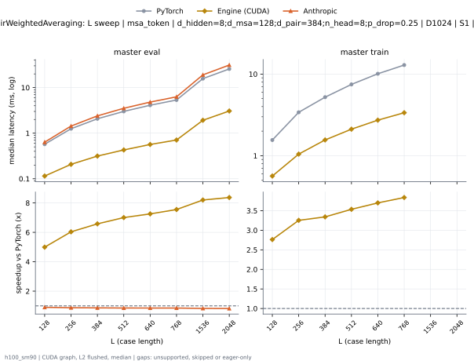
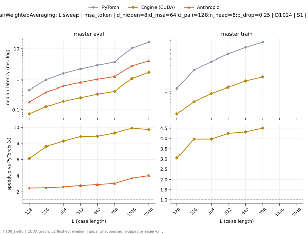
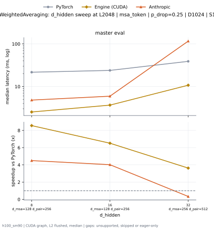
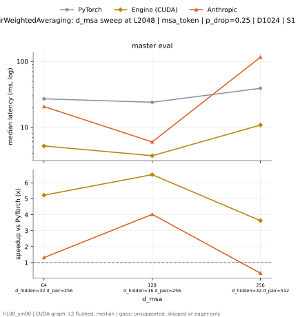
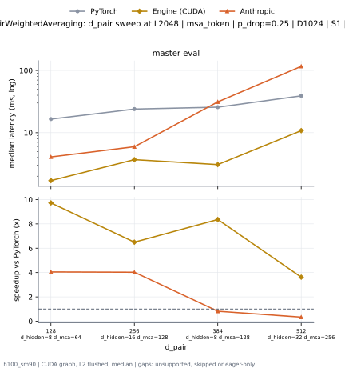

# MSAPairWeightedAveraging on h100_sm90

Generated by `python -m foldjet_engine.measure.plot` from speed tokens `judge/tokens/h100_sm90/`; do not edit.

### L sweep: msa_token | d_hidden=16;d_msa=128;d_pair=256;n_head=8;p_drop=0.25 | D1024 | S1 | graph

**master eval** (median ms; x = speedup vs PyTorch)

| L | PyTorch | Engine (Triton) | Engine (CUDA) | Anthropic |
|---|---|---|---|---|
| 128 | 0.6706 | 0.1571 (4.27x) | 0.1453 (4.62x) | 0.2721 (2.46x) |
| 256 | 1.406 | 0.3009 (4.67x) | 0.2678 (5.25x) | 0.5086 (2.76x) |
| 384 | 2.257 | 0.4641 (4.86x) | 0.4051 (5.57x) | 0.7683 (2.94x) |
| 512 | 3.192 | 0.6348 (5.03x) | 0.556 (5.74x) | 1.018 (3.14x) |
| 640 | 4.26 | 0.8692 (4.90x) | 0.7191 (5.92x) | 1.348 (3.16x) |
| 768 | 5.414 | 1.064 (5.09x) | 0.8929 (6.06x) | 1.627 (3.33x) |
| 1536 | 15.15 | 3.022 (5.01x) | 2.367 (6.40x) | 3.922 (3.86x) |
| 2048 | 23.96 | 4.836 (4.95x) | 3.688 (6.50x) | 5.948 (4.03x) |

**master train** (median ms; x = speedup vs PyTorch)

| L | PyTorch | Engine (Triton) | Engine (CUDA) | Anthropic |
|---|---|---|---|---|
| 128 | 1.805 | 0.8194 (2.20x) | 0.6497 (2.78x) | unsupported |
| 256 | 3.793 | 1.512 (2.51x) | 1.147 (3.31x) | unsupported |
| 384 | 5.623 | 2.326 (2.42x) | 1.736 (3.24x) | unsupported |
| 512 | 7.858 | 3.168 (2.48x) | 2.287 (3.44x) | unsupported |
| 640 | 10.42 | 4.246 (2.45x) | 3.023 (3.45x) | unsupported |
| 768 | 13.18 | 5.212 (2.53x) | 3.645 (3.61x) | unsupported |
| 1536 |  |  |  |  |
| 2048 |  |  |  |  |

### L sweep: msa_token | d_hidden=32;d_msa=256;d_pair=512;n_head=8;p_drop=0.25 | D1024 | S1 | graph

**master eval** (median ms; x = speedup vs PyTorch)

| L | PyTorch | Engine (Triton) | Engine (CUDA) | Anthropic |
|---|---|---|---|---|
| 128 | 1.124 | 0.47 (2.39x) | 0.4799 (2.34x) | 1.321 (0.85x) |
| 256 | 2.303 | 0.9275 (2.48x) | 0.9145 (2.52x) | 3.311 (0.70x) |
| 384 | 3.682 | 1.448 (2.54x) | 1.386 (2.66x) | 5.989 (0.61x) |
| 512 | 5.242 | 1.961 (2.67x) | 1.866 (2.81x) | 9.425 (0.56x) |
| 640 | 6.982 | 2.607 (2.68x) | 2.414 (2.89x) | 13.68 (0.51x) |
| 768 | 8.936 | 3.247 (2.75x) | 2.97 (3.01x) | 18.87 (0.47x) |
| 1536 | 24.75 | 8.409 (2.94x) | 7.184 (3.45x) | 67.35 (0.37x) |
| 2048 | 39.07 | 13.02 (3.00x) | 10.79 (3.62x) | 116.3 (0.34x) |

**master train** (median ms; x = speedup vs PyTorch)

| L | PyTorch | Engine (Triton) | Engine (CUDA) | Anthropic |
|---|---|---|---|---|
| 128 | 3.093 | 2.142 (1.44x) | 1.464 (2.11x) | unsupported |
| 256 | 6.41 | 4.01 (1.60x) | 2.815 (2.28x) | unsupported |
| 384 | 9.814 | 6.166 (1.59x) | 4.27 (2.30x) | unsupported |
| 512 | 13.8 | 8.339 (1.66x) | 5.799 (2.38x) | unsupported |
| 640 | 18.37 | 11.03 (1.67x) | 7.664 (2.40x) | unsupported |
| 768 | 23.29 | 13.56 (1.72x) | 9.361 (2.49x) | unsupported |
| 1536 |  |  |  |  |
| 2048 |  |  |  |  |

### L sweep: msa_token | d_hidden=32;d_msa=64;d_pair=128;n_head=8;p_drop=0.15 | D384 | S1 | graph

**master eval** (median ms; x = speedup vs PyTorch)

| L | PyTorch | Engine (Triton) | Engine (CUDA) | Anthropic |
|---|---|---|---|---|
| 128 | 0.348 | 0.07794 (4.47x) | 0.06003 (5.80x) | 0.1627 (2.14x) |
| 256 | 0.7185 | 0.1524 (4.71x) | 0.1098 (6.54x) | 0.3704 (1.94x) |
| 384 | 1.186 | 0.2337 (5.07x) | 0.1843 (6.43x) | 0.6704 (1.77x) |
| 512 | 1.717 | 0.3128 (5.49x) | 0.2749 (6.24x) | 0.9944 (1.73x) |
| 640 | 2.336 | 0.4191 (5.57x) | 0.3693 (6.33x) | 1.456 (1.60x) |
| 768 | 3.041 | 0.5354 (5.68x) | 0.462 (6.58x) | 2.009 (1.51x) |
| 1536 | 9.103 | 1.547 (5.88x) | 1.284 (7.09x) | 7.129 (1.28x) |
| 2048 | 14.82 | 2.605 (5.69x) | 2.141 (6.92x) | 12.35 (1.20x) |

**master train** (median ms; x = speedup vs PyTorch)

| L | PyTorch | Engine (Triton) | Engine (CUDA) | Anthropic |
|---|---|---|---|---|
| 128 | 1.021 | 0.3377 (3.02x) | 0.2744 (3.72x) | unsupported |
| 256 | 1.93 | 0.61 (3.16x) | 0.4336 (4.45x) | unsupported |
| 384 | 2.746 | 0.891 (3.08x) | 0.6497 (4.23x) | unsupported |
| 512 | 3.925 | 1.228 (3.20x) | 0.8865 (4.43x) | unsupported |
| 640 | 5.297 | 1.609 (3.29x) | 1.197 (4.43x) | unsupported |
| 768 | 6.788 | 1.988 (3.41x) | 1.443 (4.70x) | unsupported |
| 1536 |  |  |  |  |
| 2048 |  |  |  |  |

### L sweep: msa_token | d_hidden=32;d_msa=64;d_pair=256;n_head=8;p_drop=0.25 | D1024 | S1 | graph

**master eval** (median ms; x = speedup vs PyTorch)

| L | PyTorch | Engine (Triton) | Engine (CUDA) | Anthropic |
|---|---|---|---|---|
| 128 | 0.8013 | 0.1853 (4.32x) | 0.1275 (6.29x) | 0.2846 (2.82x) |
| 256 | 1.652 | 0.3449 (4.79x) | 0.2523 (6.55x) | 0.6516 (2.54x) |
| 384 | 2.634 | 0.5345 (4.93x) | 0.4247 (6.20x) | 1.159 (2.27x) |
| 512 | 3.727 | 0.7497 (4.97x) | 0.6759 (5.51x) | 1.807 (2.06x) |
| 640 | 4.927 | 0.9928 (4.96x) | 0.8753 (5.63x) | 2.565 (1.92x) |
| 768 | 6.289 | 1.282 (4.91x) | 1.124 (5.60x) | 3.459 (1.82x) |
| 1536 | 17.21 | 3.931 (4.38x) | 3.25 (5.30x) | 11.95 (1.44x) |
| 2048 | 27.02 | 6.299 (4.29x) | 5.225 (5.17x) | 20.55 (1.31x) |

**master train** (median ms; x = speedup vs PyTorch)

| L | PyTorch | Engine (Triton) | Engine (CUDA) | Anthropic |
|---|---|---|---|---|
| 128 | 2.002 | 0.7415 (2.70x) | 0.5324 (3.76x) | unsupported |
| 256 | 4.184 | 1.352 (3.09x) | 0.9689 (4.32x) | unsupported |
| 384 | 6.21 | 2.069 (3.00x) | 1.502 (4.13x) | unsupported |
| 512 | 8.699 | 2.83 (3.07x) | 2.087 (4.17x) | unsupported |
| 640 | 11.53 | 3.863 (2.98x) | 2.894 (3.98x) | unsupported |
| 768 | 14.56 | 4.869 (2.99x) | 3.573 (4.08x) | unsupported |
| 1536 |  |  |  |  |
| 2048 |  |  |  |  |

### L sweep: msa_token | d_hidden=8;d_msa=128;d_pair=256;n_head=8;p_drop=0.25 | D1024 | S1 | graph

**master eval** (median ms; x = speedup vs PyTorch)

| L | PyTorch | Engine (Triton) | Engine (CUDA) | Anthropic |
|---|---|---|---|---|
| 128 | 0.5502 | 0.1455 (3.78x) | 0.1064 (5.17x) | 0.2196 (2.51x) |
| 256 | 1.193 | 0.2747 (4.34x) | 0.1935 (6.17x) | 0.4206 (2.84x) |
| 384 | 1.945 | 0.4219 (4.61x) | 0.2912 (6.68x) | 0.6419 (3.03x) |
| 512 | 2.776 | 0.5771 (4.81x) | 0.3986 (6.97x) | 0.8481 (3.27x) |
| 640 | 3.731 | 0.7679 (4.86x) | 0.5169 (7.22x) | 1.109 (3.36x) |
| 768 | 4.776 | 0.9544 (5.00x) | 0.6247 (7.65x) | 1.339 (3.57x) |
| 1536 | 13.58 | 2.483 (5.47x) | 1.598 (8.50x) | 3.141 (4.32x) |
| 2048 | 21.7 | 3.893 (5.58x) | 2.549 (8.51x) | 4.825 (4.50x) |

**master train** (median ms; x = speedup vs PyTorch)

| L | PyTorch | Engine (Triton) | Engine (CUDA) | Anthropic |
|---|---|---|---|---|
| 128 | 1.517 | 0.7509 (2.02x) | 0.4965 (3.06x) | unsupported |
| 256 | 3.263 | 1.407 (2.32x) | 0.8729 (3.74x) | unsupported |
| 384 | 4.848 | 2.182 (2.22x) | 1.326 (3.66x) | unsupported |
| 512 | 6.816 | 2.96 (2.30x) | 1.748 (3.90x) | unsupported |
| 640 | 9.068 | 3.899 (2.33x) | 2.317 (3.91x) | unsupported |
| 768 | 11.48 | 4.764 (2.41x) | 2.762 (4.15x) | unsupported |
| 1536 |  |  |  |  |
| 2048 |  |  |  |  |

### L sweep: msa_token | d_hidden=8;d_msa=128;d_pair=384;n_head=8;p_drop=0.25 | D1024 | S1 | graph

**master eval** (median ms; x = speedup vs PyTorch)

| L | PyTorch | Engine (Triton) | Engine (CUDA) | Anthropic |
|---|---|---|---|---|
| 128 | 0.5762 | 0.1585 (3.64x) | 0.1128 (5.11x) | 0.6353 (0.91x) |
| 256 | 1.253 | 0.3175 (3.95x) | 0.2087 (6.00x) | 1.433 (0.87x) |
| 384 | 2.079 | 0.5291 (3.93x) | 0.3146 (6.61x) | 2.398 (0.87x) |
| 512 | 3.027 | 0.7384 (4.10x) | 0.4297 (7.04x) | 3.521 (0.86x) |
| 640 | 4.121 | 1.074 (3.84x) | 0.5667 (7.27x) | 4.813 (0.86x) |
| 768 | 5.34 | 1.325 (4.03x) | 0.71 (7.52x) | 6.279 (0.85x) |
| 1536 | 15.78 | 4.009 (3.94x) | 1.912 (8.25x) | 19.05 (0.83x) |
| 2048 | 25.68 | 6.592 (3.90x) | 3.073 (8.36x) | 31.27 (0.82x) |

**master train** (median ms; x = speedup vs PyTorch)

| L | PyTorch | Engine (Triton) | Engine (CUDA) | Anthropic |
|---|---|---|---|---|
| 128 | 1.557 | 0.8094 (1.92x) | 0.5178 (3.01x) | unsupported |
| 256 | 3.414 | 1.62 (2.11x) | 0.9617 (3.55x) | unsupported |
| 384 | 5.217 | 2.678 (1.95x) | 1.433 (3.64x) | unsupported |
| 512 | 7.476 | 3.712 (2.01x) | 1.946 (3.84x) | unsupported |
| 640 | 10.09 | 5.167 (1.95x) | 2.548 (3.96x) | unsupported |
| 768 | 12.99 | 6.435 (2.02x) | 3.132 (4.15x) | unsupported |
| 1536 |  |  |  |  |
| 2048 |  |  |  |  |

### L sweep: msa_token | d_hidden=8;d_msa=64;d_pair=128;n_head=8;p_drop=0.25 | D1024 | S1 | graph

**master eval** (median ms; x = speedup vs PyTorch)

| L | PyTorch | Engine (Triton) | Engine (CUDA) | Anthropic |
|---|---|---|---|---|
| 128 | 0.4462 | 0.09394 (4.75x) | 0.07234 (6.17x) | 0.1794 (2.49x) |
| 256 | 0.9674 | 0.177 (5.46x) | 0.1272 (7.61x) | 0.3834 (2.52x) |
| 384 | 1.57 | 0.2668 (5.88x) | 0.1897 (8.28x) | 0.597 (2.63x) |
| 512 | 2.216 | 0.3588 (6.18x) | 0.2513 (8.82x) | 0.7888 (2.81x) |
| 640 | 2.957 | 0.4688 (6.31x) | 0.3312 (8.93x) | 1.004 (2.95x) |
| 768 | 3.782 | 0.5903 (6.41x) | 0.4076 (9.28x) | 1.23 (3.07x) |
| 1536 | 10.44 | 1.547 (6.75x) | 1.066 (9.79x) | 2.795 (3.73x) |
| 2048 | 16.53 | 2.474 (6.68x) | 1.7 (9.72x) | 4.081 (4.05x) |

**master train** (median ms; x = speedup vs PyTorch)

| L | PyTorch | Engine (Triton) | Engine (CUDA) | Anthropic |
|---|---|---|---|---|
| 128 | 1.116 | 0.4158 (2.68x) | 0.3433 (3.25x) | unsupported |
| 256 | 2.487 | 0.7735 (3.21x) | 0.5838 (4.26x) | unsupported |
| 384 | 3.589 | 1.171 (3.06x) | 0.8357 (4.29x) | unsupported |
| 512 | 4.965 | 1.594 (3.12x) | 1.091 (4.55x) | unsupported |
| 640 | 6.587 | 2.074 (3.18x) | 1.428 (4.61x) | unsupported |
| 768 | 8.296 | 2.528 (3.28x) | 1.715 (4.84x) | unsupported |
| 1536 |  |  |  |  |
| 2048 |  |  |  |  |

### d_hidden sweep at L2048: msa_token | p_drop=0.25 | D1024 | S1 | graph

**master eval** (median ms; x = speedup vs PyTorch)

| d_hidden | PyTorch | Engine (Triton) | Engine (CUDA) | Anthropic |
|---|---|---|---|---|
| 8 d_msa=128 d_pair=256 | 21.7 | 3.893 (5.58x) | 2.549 (8.51x) | 4.825 (4.50x) |
| 16 d_msa=128 d_pair=256 | 23.96 | 4.836 (4.95x) | 3.688 (6.50x) | 5.948 (4.03x) |
| 32 d_msa=256 d_pair=512 | 39.07 | 13.02 (3.00x) | 10.79 (3.62x) | 116.3 (0.34x) |

### d_msa sweep at L2048: msa_token | p_drop=0.25 | D1024 | S1 | graph

**master eval** (median ms; x = speedup vs PyTorch)

| d_msa | PyTorch | Engine (Triton) | Engine (CUDA) | Anthropic |
|---|---|---|---|---|
| 64 d_hidden=32 d_pair=256 | 27.02 | 6.299 (4.29x) | 5.225 (5.17x) | 20.55 (1.31x) |
| 128 d_hidden=16 d_pair=256 | 23.96 | 4.836 (4.95x) | 3.688 (6.50x) | 5.948 (4.03x) |
| 256 d_hidden=32 d_pair=512 | 39.07 | 13.02 (3.00x) | 10.79 (3.62x) | 116.3 (0.34x) |

### d_pair sweep at L2048: msa_token | p_drop=0.25 | D1024 | S1 | graph

**master eval** (median ms; x = speedup vs PyTorch)

| d_pair | PyTorch | Engine (Triton) | Engine (CUDA) | Anthropic |
|---|---|---|---|---|
| 128 d_hidden=8 d_msa=64 | 16.53 | 2.474 (6.68x) | 1.7 (9.72x) | 4.081 (4.05x) |
| 256 d_hidden=16 d_msa=128 | 23.96 | 4.836 (4.95x) | 3.688 (6.50x) | 5.948 (4.03x) |
| 384 d_hidden=8 d_msa=128 | 25.68 | 6.592 (3.90x) | 3.073 (8.36x) | 31.27 (0.82x) |
| 512 d_hidden=32 d_msa=256 | 39.07 | 13.02 (3.00x) | 10.79 (3.62x) | 116.3 (0.34x) |

