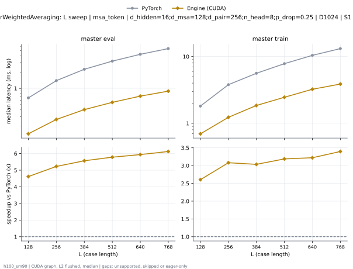
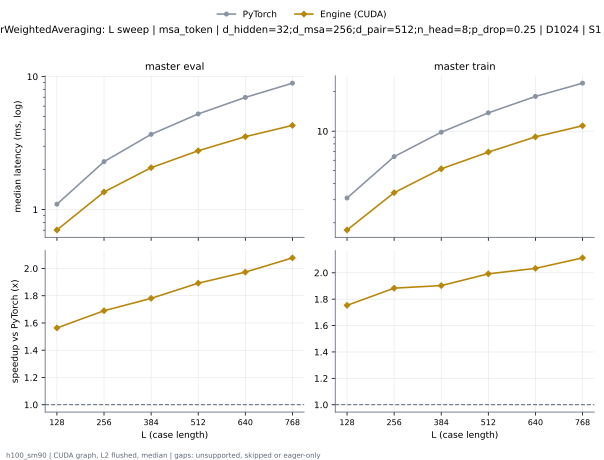
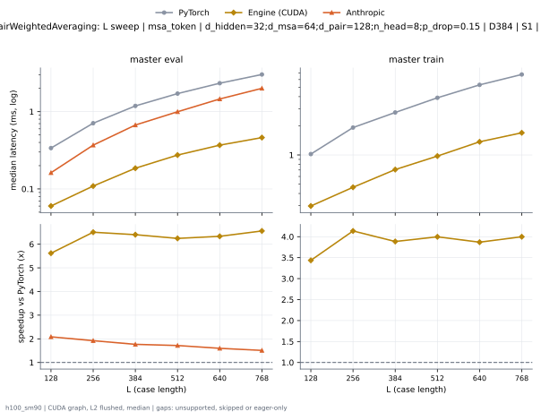
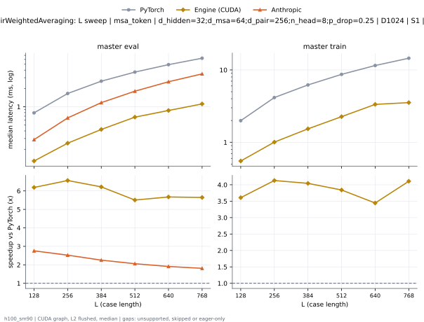
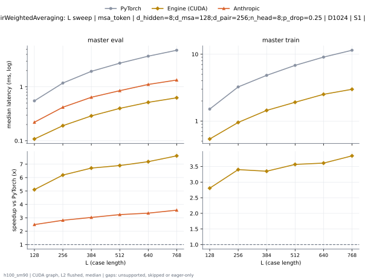
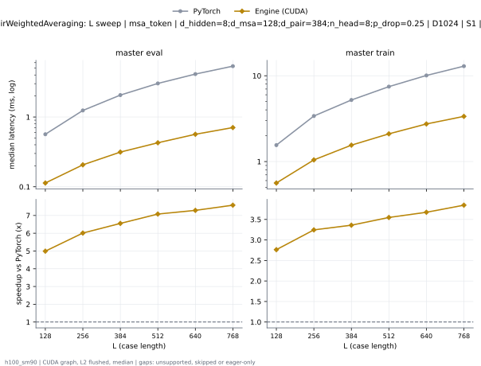
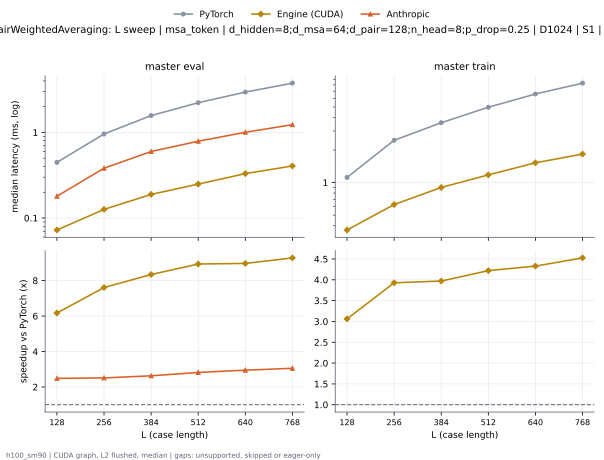
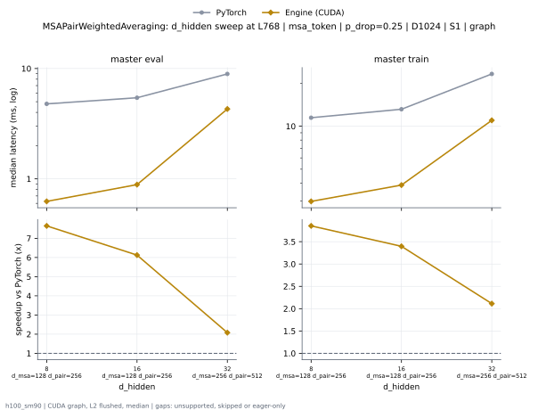
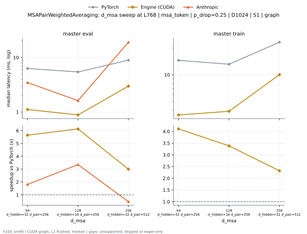
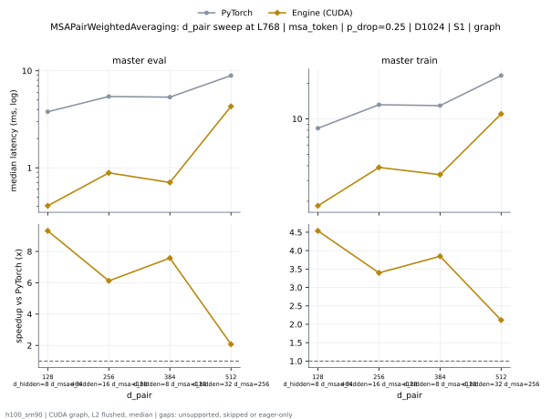

# MSAPairWeightedAveraging on h100_sm90

Generated by `python -m miniworld_engine.measure.plot` from speed tokens `judge/tokens/h100_sm90/`; do not edit.

### L sweep: msa_token | d_hidden=16;d_msa=128;d_pair=256;n_head=8;p_drop=0.25 | D1024 | S1 | graph

**master eval** (median ms; x = speedup vs PyTorch)

| L | PyTorch | Engine (Triton) | Engine (CUDA) |
|---|---|---|---|
| 128 | 0.6651 | 0.1579 (4.21x) | 0.144 (4.62x) |
| 256 | 1.387 | 0.2991 (4.64x) | 0.2655 (5.23x) |
| 384 | 2.251 | 0.462 (4.87x) | 0.4044 (5.57x) |
| 512 | 3.183 | 0.6332 (5.03x) | 0.5505 (5.78x) |
| 640 | 4.259 | 0.8508 (5.01x) | 0.7172 (5.94x) |
| 768 | 5.432 | 1.064 (5.11x) | 0.8868 (6.13x) |

**master train** (median ms; x = speedup vs PyTorch)

| L | PyTorch | Engine (Triton) | Engine (CUDA) |
|---|---|---|---|
| 128 | 1.811 | 0.8232 (2.20x) | 0.6957 (2.60x) |
| 256 | 3.787 | 1.517 (2.50x) | 1.23 (3.08x) |
| 384 | 5.61 | 2.329 (2.41x) | 1.849 (3.03x) |
| 512 | 7.822 | 3.168 (2.47x) | 2.454 (3.19x) |
| 640 | 10.42 | 4.235 (2.46x) | 3.234 (3.22x) |
| 768 | 13.15 | 5.198 (2.53x) | 3.872 (3.40x) |

### L sweep: msa_token | d_hidden=32;d_msa=256;d_pair=512;n_head=8;p_drop=0.25 | D1024 | S1 | graph

**master eval** (median ms; x = speedup vs PyTorch)

| L | PyTorch | Engine (Triton) | Engine (CUDA) |
|---|---|---|---|
| 128 | 1.098 | 0.4723 (2.33x) | 0.7025 (1.56x) |
| 256 | 2.293 | 0.9267 (2.47x) | 1.357 (1.69x) |
| 384 | 3.681 | 1.446 (2.55x) | 2.067 (1.78x) |
| 512 | 5.24 | 1.975 (2.65x) | 2.77 (1.89x) |
| 640 | 6.975 | 2.602 (2.68x) | 3.535 (1.97x) |
| 768 | 8.926 | 3.228 (2.77x) | 4.296 (2.08x) |

**master train** (median ms; x = speedup vs PyTorch)

| L | PyTorch | Engine (Triton) | Engine (CUDA) |
|---|---|---|---|
| 128 | 3.092 | 2.127 (1.45x) | 1.764 (1.75x) |
| 256 | 6.399 | 4.015 (1.59x) | 3.397 (1.88x) |
| 384 | 9.825 | 6.187 (1.59x) | 5.163 (1.90x) |
| 512 | 13.8 | 8.333 (1.66x) | 6.925 (1.99x) |
| 640 | 18.4 | 11.04 (1.67x) | 9.05 (2.03x) |
| 768 | 23.24 | 13.49 (1.72x) | 11 (2.11x) |

### L sweep: msa_token | d_hidden=32;d_msa=64;d_pair=128;n_head=8;p_drop=0.15 | D384 | S1 | graph

**master eval** (median ms; x = speedup vs PyTorch)

| L | PyTorch | Engine (Triton) | Engine (CUDA) |
|---|---|---|---|
| 128 | 0.3392 | 0.07822 (4.34x) | 0.06013 (5.64x) |
| 256 | 0.7131 | 0.1516 (4.70x) | 0.1094 (6.52x) |
| 384 | 1.183 | 0.232 (5.10x) | 0.1846 (6.41x) |
| 512 | 1.718 | 0.3124 (5.50x) | 0.2733 (6.29x) |
| 640 | 2.336 | 0.4155 (5.62x) | 0.3666 (6.37x) |
| 768 | 3.029 | 0.5326 (5.69x) | 0.4592 (6.60x) |

**master train** (median ms; x = speedup vs PyTorch)

| L | PyTorch | Engine (Triton) | Engine (CUDA) |
|---|---|---|---|
| 128 | 1.012 | 0.3392 (2.98x) | 0.2988 (3.39x) |
| 256 | 1.931 | 0.6103 (3.17x) | 0.4658 (4.15x) |
| 384 | 2.746 | 0.8967 (3.06x) | 0.7086 (3.88x) |
| 512 | 3.922 | 1.223 (3.21x) | 0.9727 (4.03x) |
| 640 | 5.295 | 1.613 (3.28x) | 1.366 (3.88x) |
| 768 | 6.769 | 1.988 (3.40x) | 1.698 (3.99x) |

### L sweep: msa_token | d_hidden=32;d_msa=64;d_pair=256;n_head=8;p_drop=0.25 | D1024 | S1 | graph

**master eval** (median ms; x = speedup vs PyTorch)

| L | PyTorch | Engine (Triton) | Engine (CUDA) |
|---|---|---|---|
| 128 | 0.7951 | 0.1848 (4.30x) | 0.128 (6.21x) |
| 256 | 1.648 | 0.344 (4.79x) | 0.2511 (6.56x) |
| 384 | 2.618 | 0.535 (4.89x) | 0.4247 (6.16x) |
| 512 | 3.721 | 0.7472 (4.98x) | 0.6741 (5.52x) |
| 640 | 4.935 | 0.9873 (5.00x) | 0.8682 (5.68x) |
| 768 | 6.294 | 1.303 (4.83x) | 1.114 (5.65x) |

**master train** (median ms; x = speedup vs PyTorch)

| L | PyTorch | Engine (Triton) | Engine (CUDA) |
|---|---|---|---|
| 128 | 1.995 | 0.7379 (2.70x) | 0.5508 (3.62x) |
| 256 | 4.147 | 1.339 (3.10x) | 1.001 (4.14x) |
| 384 | 6.221 | 2.075 (3.00x) | 1.54 (4.04x) |
| 512 | 8.686 | 2.843 (3.05x) | 2.273 (3.82x) |
| 640 | 11.54 | 3.927 (2.94x) | 3.355 (3.44x) |
| 768 | 14.52 | 4.871 (2.98x) | 3.582 (4.05x) |

### L sweep: msa_token | d_hidden=8;d_msa=128;d_pair=256;n_head=8;p_drop=0.25 | D1024 | S1 | graph

**master eval** (median ms; x = speedup vs PyTorch)

| L | PyTorch | Engine (Triton) | Engine (CUDA) |
|---|---|---|---|
| 128 | 0.5532 | 0.147 (3.76x) | 0.1085 (5.10x) |
| 256 | 1.182 | 0.275 (4.30x) | 0.1912 (6.18x) |
| 384 | 1.938 | 0.4212 (4.60x) | 0.2897 (6.69x) |
| 512 | 2.759 | 0.5764 (4.79x) | 0.3968 (6.95x) |
| 640 | 3.734 | 0.768 (4.86x) | 0.5151 (7.25x) |
| 768 | 4.782 | 0.9552 (5.01x) | 0.6251 (7.65x) |

**master train** (median ms; x = speedup vs PyTorch)

| L | PyTorch | Engine (Triton) | Engine (CUDA) |
|---|---|---|---|
| 128 | 1.521 | 0.7466 (2.04x) | 0.5404 (2.81x) |
| 256 | 3.261 | 1.415 (2.31x) | 0.9589 (3.40x) |
| 384 | 4.849 | 2.182 (2.22x) | 1.45 (3.34x) |
| 512 | 6.8 | 2.961 (2.30x) | 1.912 (3.56x) |
| 640 | 9.05 | 3.903 (2.32x) | 2.506 (3.61x) |
| 768 | 11.47 | 4.761 (2.41x) | 2.977 (3.85x) |

### L sweep: msa_token | d_hidden=8;d_msa=128;d_pair=384;n_head=8;p_drop=0.25 | D1024 | S1 | graph

**master eval** (median ms; x = speedup vs PyTorch)

| L | PyTorch | Engine (Triton) | Engine (CUDA) |
|---|---|---|---|
| 128 | 0.5656 | 0.1585 (3.57x) | 0.1133 (4.99x) |
| 256 | 1.241 | 0.316 (3.93x) | 0.2064 (6.01x) |
| 384 | 2.06 | 0.5267 (3.91x) | 0.3143 (6.55x) |
| 512 | 3.026 | 0.7365 (4.11x) | 0.4273 (7.08x) |
| 640 | 4.121 | 1.072 (3.84x) | 0.5654 (7.29x) |
| 768 | 5.35 | 1.318 (4.06x) | 0.7057 (7.58x) |

**master train** (median ms; x = speedup vs PyTorch)

| L | PyTorch | Engine (Triton) | Engine (CUDA) |
|---|---|---|---|
| 128 | 1.554 | 0.812 (1.91x) | 0.5624 (2.76x) |
| 256 | 3.393 | 1.623 (2.09x) | 1.045 (3.25x) |
| 384 | 5.216 | 2.682 (1.94x) | 1.553 (3.36x) |
| 512 | 7.465 | 3.714 (2.01x) | 2.104 (3.55x) |
| 640 | 10.07 | 5.182 (1.94x) | 2.741 (3.67x) |
| 768 | 12.93 | 6.44 (2.01x) | 3.361 (3.85x) |

### L sweep: msa_token | d_hidden=8;d_msa=64;d_pair=128;n_head=8;p_drop=0.25 | D1024 | S1 | graph

**master eval** (median ms; x = speedup vs PyTorch)

| L | PyTorch | Engine (Triton) | Engine (CUDA) |
|---|---|---|---|
| 128 | 0.4476 | 0.09483 (4.72x) | 0.07264 (6.16x) |
| 256 | 0.9617 | 0.1762 (5.46x) | 0.1264 (7.61x) |
| 384 | 1.56 | 0.2651 (5.88x) | 0.1881 (8.30x) |
| 512 | 2.225 | 0.3571 (6.23x) | 0.2489 (8.94x) |
| 640 | 2.947 | 0.4662 (6.32x) | 0.3294 (8.95x) |
| 768 | 3.781 | 0.5879 (6.43x) | 0.4057 (9.32x) |

**master train** (median ms; x = speedup vs PyTorch)

| L | PyTorch | Engine (Triton) | Engine (CUDA) |
|---|---|---|---|
| 128 | 1.117 | 0.4148 (2.69x) | 0.3633 (3.07x) |
| 256 | 2.48 | 0.7757 (3.20x) | 0.6234 (3.98x) |
| 384 | 3.582 | 1.164 (3.08x) | 0.8989 (3.98x) |
| 512 | 4.979 | 1.589 (3.13x) | 1.176 (4.24x) |
| 640 | 6.6 | 2.067 (3.19x) | 1.523 (4.33x) |
| 768 | 8.311 | 2.52 (3.30x) | 1.831 (4.54x) |

### d_hidden sweep at L768: msa_token | p_drop=0.25 | D1024 | S1 | graph

**master eval** (median ms; x = speedup vs PyTorch)

| d_hidden | PyTorch | Engine (Triton) | Engine (CUDA) |
|---|---|---|---|
| 8 d_msa=128 d_pair=256 | 4.782 | 0.9552 (5.01x) | 0.6251 (7.65x) |
| 16 d_msa=128 d_pair=256 | 5.432 | 1.064 (5.11x) | 0.8868 (6.13x) |
| 32 d_msa=256 d_pair=512 | 8.926 | 3.228 (2.77x) | 4.296 (2.08x) |

**master train** (median ms; x = speedup vs PyTorch)

| d_hidden | PyTorch | Engine (Triton) | Engine (CUDA) |
|---|---|---|---|
| 8 d_msa=128 d_pair=256 | 11.47 | 4.761 (2.41x) | 2.977 (3.85x) |
| 16 d_msa=128 d_pair=256 | 13.15 | 5.198 (2.53x) | 3.872 (3.40x) |
| 32 d_msa=256 d_pair=512 | 23.24 | 13.49 (1.72x) | 11 (2.11x) |

### d_msa sweep at L768: msa_token | p_drop=0.25 | D1024 | S1 | graph

**master eval** (median ms; x = speedup vs PyTorch)

| d_msa | PyTorch | Engine (Triton) | Engine (CUDA) |
|---|---|---|---|
| 64 d_hidden=32 d_pair=256 | 6.294 | 1.303 (4.83x) | 1.114 (5.65x) |
| 128 d_hidden=16 d_pair=256 | 5.432 | 1.064 (5.11x) | 0.8868 (6.13x) |
| 256 d_hidden=32 d_pair=512 | 8.926 | 3.228 (2.77x) | 4.296 (2.08x) |

**master train** (median ms; x = speedup vs PyTorch)

| d_msa | PyTorch | Engine (Triton) | Engine (CUDA) |
|---|---|---|---|
| 64 d_hidden=32 d_pair=256 | 14.52 | 4.871 (2.98x) | 3.582 (4.05x) |
| 128 d_hidden=16 d_pair=256 | 13.15 | 5.198 (2.53x) | 3.872 (3.40x) |
| 256 d_hidden=32 d_pair=512 | 23.24 | 13.49 (1.72x) | 11 (2.11x) |

### d_pair sweep at L768: msa_token | p_drop=0.25 | D1024 | S1 | graph

**master eval** (median ms; x = speedup vs PyTorch)

| d_pair | PyTorch | Engine (Triton) | Engine (CUDA) |
|---|---|---|---|
| 128 d_hidden=8 d_msa=64 | 3.781 | 0.5879 (6.43x) | 0.4057 (9.32x) |
| 256 d_hidden=16 d_msa=128 | 5.432 | 1.064 (5.11x) | 0.8868 (6.13x) |
| 384 d_hidden=8 d_msa=128 | 5.35 | 1.318 (4.06x) | 0.7057 (7.58x) |
| 512 d_hidden=32 d_msa=256 | 8.926 | 3.228 (2.77x) | 4.296 (2.08x) |

**master train** (median ms; x = speedup vs PyTorch)

| d_pair | PyTorch | Engine (Triton) | Engine (CUDA) |
|---|---|---|---|
| 128 d_hidden=8 d_msa=64 | 8.311 | 2.52 (3.30x) | 1.831 (4.54x) |
| 256 d_hidden=16 d_msa=128 | 13.15 | 5.198 (2.53x) | 3.872 (3.40x) |
| 384 d_hidden=8 d_msa=128 | 12.93 | 6.44 (2.01x) | 3.361 (3.85x) |
| 512 d_hidden=32 d_msa=256 | 23.24 | 13.49 (1.72x) | 11 (2.11x) |

