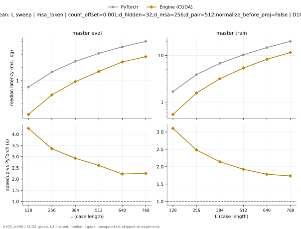
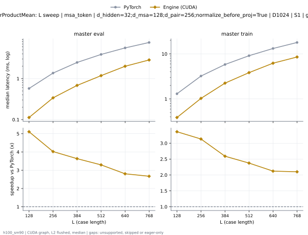
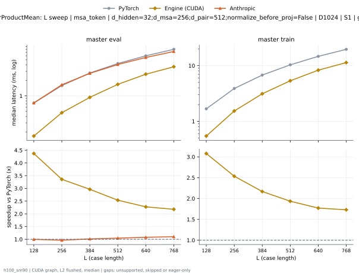
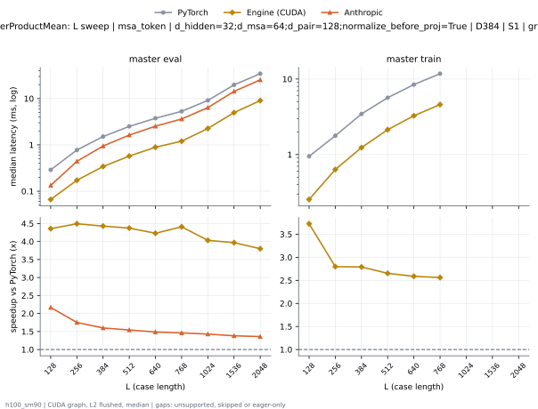

# OuterProductMean on h100_sm90

Generated by `python -m miniworld_engine.measure.plot` from speed tokens `judge/tokens/h100_sm90/`; do not edit.

### L sweep: msa_token | count_offset=0.001;d_hidden=32;d_msa=128;d_pair=256;normalize_before_proj=False | D1024 | S1 | graph

**master eval** (median ms; x = speedup vs PyTorch)

| L | PyTorch | Engine (Triton) | Engine (CUDA) | Anthropic |
|---|---|---|---|---|
| 128 | 0.519 | 0.1319 (3.94x) | 0.1121 (4.63x) | unsupported |
| 256 | 1.232 | 0.3846 (3.20x) | 0.3401 (3.62x) | unsupported |
| 384 | 2.175 | 0.8307 (2.62x) | 0.6817 (3.19x) | unsupported |
| 512 | 3.353 | 1.364 (2.46x) | 1.239 (2.71x) | unsupported |
| 640 | 4.775 | 2.108 (2.26x) | 2.008 (2.38x) | unsupported |
| 768 | 6.406 | 3.002 (2.13x) | 2.858 (2.24x) | unsupported |
| 1024 | 10.51 | 5.35 (1.97x) | 5.057 (2.08x) | unsupported |
| 1536 | 21.62 | 11.76 (1.84x) | 11.12 (1.94x) | unsupported |
| 2048 | 37.23 | 20.99 (1.77x) | 19.5 (1.91x) | unsupported |

**master train** (median ms; x = speedup vs PyTorch)

| L | PyTorch | Engine (Triton) | Engine (CUDA) | Anthropic |
|---|---|---|---|---|
| 128 | 1.251 | 0.5624 (2.22x) | 0.392 (3.19x) | unsupported |
| 256 | 2.965 | 1.546 (1.92x) | 1.031 (2.88x) | unsupported |
| 384 | 5.214 | 2.94 (1.77x) | 2.269 (2.30x) | unsupported |
| 512 | 8.034 | 4.854 (1.66x) | 3.926 (2.05x) | unsupported |
| 640 | 11.54 | 7.363 (1.57x) | 6.016 (1.92x) | unsupported |
| 768 | 15.57 | 10.27 (1.52x) | 8.514 (1.83x) | unsupported |
| 1024 |  |  |  |  |
| 1536 |  |  |  |  |
| 2048 |  |  |  |  |

### L sweep: msa_token | count_offset=0.001;d_hidden=32;d_msa=128;d_pair=384;normalize_before_proj=False | D1024 | S1 | graph

**master eval** (median ms; x = speedup vs PyTorch)

| L | PyTorch | Engine (Triton) | Engine (CUDA) | Anthropic |
|---|---|---|---|---|
| 128 | 0.5408 | 0.1537 (3.52x) | 0.1288 (4.20x) | unsupported |
| 256 | 1.277 | 0.4426 (2.89x) | 0.3696 (3.46x) | unsupported |
| 384 | 2.258 | 0.9319 (2.42x) | 0.7529 (3.00x) | unsupported |
| 512 | 3.505 | 1.619 (2.17x) | 1.385 (2.53x) | unsupported |
| 640 | 5.019 | 2.492 (2.01x) | 2.266 (2.21x) | unsupported |
| 768 | 6.76 | 3.536 (1.91x) | 3.048 (2.22x) | unsupported |
| 1024 | 11.21 | 6.126 (1.83x) | 5.774 (1.94x) | unsupported |
| 1536 | 23.24 | 13.93 (1.67x) | 12.59 (1.85x) | unsupported |
| 2048 | 39.79 | 24.61 (1.62x) | 22.33 (1.78x) | unsupported |

**master train** (median ms; x = speedup vs PyTorch)

| L | PyTorch | Engine (Triton) | Engine (CUDA) | Anthropic |
|---|---|---|---|---|
| 128 | 1.277 | 0.6183 (2.07x) | 0.4233 (3.02x) | unsupported |
| 256 | 3.08 | 1.719 (1.79x) | 1.17 (2.63x) | unsupported |
| 384 | 5.411 | 3.429 (1.58x) | 2.564 (2.11x) | unsupported |
| 512 | 8.439 | 5.877 (1.44x) | 4.43 (1.91x) | unsupported |
| 640 | 12.29 | 8.81 (1.39x) | 6.951 (1.77x) | unsupported |
| 768 | 16.62 | 12.26 (1.36x) | 9.557 (1.74x) | unsupported |
| 1024 |  |  |  |  |
| 1536 |  |  |  |  |
| 2048 |  |  |  |  |

### L sweep: msa_token | count_offset=0.001;d_hidden=32;d_msa=256;d_pair=512;normalize_before_proj=False | D1024 | S1 | graph

**master eval** (median ms; x = speedup vs PyTorch)

| L | PyTorch | Engine (Triton) | Engine (CUDA) | Anthropic |
|---|---|---|---|---|
| 128 | 0.6965 | 0.1772 (3.93x) | 0.1461 (4.77x) | unsupported |
| 256 | 1.58 | 0.5361 (2.95x) | 0.4321 (3.66x) | unsupported |
| 384 | 2.769 | 1.077 (2.57x) | 0.8717 (3.18x) | unsupported |
| 512 | 4.237 | 1.88 (2.25x) | 1.634 (2.59x) | unsupported |
| 640 | 5.983 | 2.915 (2.05x) | 2.574 (2.32x) | unsupported |
| 768 | 7.983 | 4.268 (1.87x) | 3.583 (2.23x) | unsupported |

**master train** (median ms; x = speedup vs PyTorch)

| L | PyTorch | Engine (Triton) | Engine (CUDA) | Anthropic |
|---|---|---|---|---|
| 128 | 1.687 | 1 (1.69x) | 0.5218 (3.23x) | unsupported |
| 256 | 3.879 | 2.382 (1.63x) | 1.517 (2.56x) | unsupported |
| 384 | 6.759 | 4.399 (1.54x) | 3.072 (2.20x) | unsupported |
| 512 | 10.33 | 7.156 (1.44x) | 5.349 (1.93x) | unsupported |
| 640 | 14.76 | 10.83 (1.36x) | 8.24 (1.79x) | unsupported |
| 768 | 19.78 | 14.76 (1.34x) | 11.52 (1.72x) | unsupported |

### L sweep: msa_token | count_offset=0.001;d_hidden=32;d_msa=64;d_pair=128;normalize_before_proj=False | D1024 | S1 | graph

**master eval** (median ms; x = speedup vs PyTorch)

| L | PyTorch | Engine (Triton) | Engine (CUDA) | Anthropic |
|---|---|---|---|---|
| 128 | 0.4575 | 0.1148 (3.98x) | 0.0905 (5.06x) | 0.1132 (4.04x) |
| 256 | 1.076 | 0.31 (3.47x) | 0.2681 (4.01x) | 0.3329 (3.23x) |
| 384 | 1.939 | 0.6389 (3.03x) | 0.5541 (3.50x) | 0.7177 (2.70x) |
| 512 | 3.035 | 1.1 (2.76x) | 0.9766 (3.11x) | 1.284 (2.36x) |
| 640 | 4.315 | 1.71 (2.52x) | 1.618 (2.67x) | 1.98 (2.18x) |
| 768 | 5.83 | 2.464 (2.37x) | 2.25 (2.59x) | 2.854 (2.04x) |
| 1024 | 9.598 | 4.561 (2.10x) | 3.922 (2.45x) | 4.937 (1.94x) |
| 1536 | 19.8 | 9.962 (1.99x) | 8.959 (2.21x) | 11.31 (1.75x) |
| 2048 | 33.98 | 17.83 (1.91x) | 16.06 (2.12x) | 20.13 (1.69x) |

**master train** (median ms; x = speedup vs PyTorch)

| L | PyTorch | Engine (Triton) | Engine (CUDA) | Anthropic |
|---|---|---|---|---|
| 128 | 1.048 | 0.3706 (2.83x) | 0.3411 (3.07x) | unsupported |
| 256 | 2.522 | 1.079 (2.34x) | 0.9197 (2.74x) | unsupported |
| 384 | 4.568 | 2.226 (2.05x) | 1.956 (2.33x) | unsupported |
| 512 | 7.139 | 3.824 (1.87x) | 3.472 (2.06x) | unsupported |
| 640 | 10.29 | 5.929 (1.74x) | 5.358 (1.92x) | unsupported |
| 768 | 13.99 | 8.383 (1.67x) | 7.506 (1.86x) | unsupported |
| 1024 |  |  |  |  |
| 1536 |  |  |  |  |
| 2048 |  |  |  |  |

### L sweep: msa_token | d_hidden=32;d_msa=128;d_pair=256;normalize_before_proj=False | D1024 | S1 | graph

**master eval** (median ms; x = speedup vs PyTorch)

| L | PyTorch | Engine (Triton) | Engine (CUDA) | Anthropic |
|---|---|---|---|---|
| 128 | 0.5194 | 0.1289 (4.03x) | 0.111 (4.68x) | 0.1746 (2.98x) |
| 256 | 1.215 | 0.3853 (3.15x) | 0.3369 (3.61x) | 0.4642 (2.62x) |
| 384 | 2.167 | 0.786 (2.76x) | 0.6776 (3.20x) | 0.8927 (2.43x) |
| 512 | 3.344 | 1.382 (2.42x) | 1.229 (2.72x) | 1.466 (2.28x) |
| 640 | 4.765 | 2.042 (2.33x) | 1.79 (2.66x) | 2.306 (2.07x) |
| 768 | 6.38 | 3.055 (2.09x) | 2.814 (2.27x) | 3.247 (1.96x) |
| 1024 | 10.45 | 5.367 (1.95x) | 5.069 (2.06x) | 5.733 (1.82x) |
| 1536 | 21.5 | 11.79 (1.82x) | 11.03 (1.95x) | 12.66 (1.70x) |
| 2048 | 37.07 | 21.1 (1.76x) | 19.69 (1.88x) | 22.14 (1.67x) |

**master train** (median ms; x = speedup vs PyTorch)

| L | PyTorch | Engine (Triton) | Engine (CUDA) | Anthropic |
|---|---|---|---|---|
| 128 | 1.288 | 0.5618 (2.29x) | 0.3928 (3.28x) | unsupported |
| 256 | 2.964 | 1.516 (1.96x) | 1.039 (2.85x) | unsupported |
| 384 | 5.209 | 2.961 (1.76x) | 2.262 (2.30x) | unsupported |
| 512 | 8.045 | 4.952 (1.62x) | 3.832 (2.10x) | unsupported |
| 640 | 11.55 | 7.444 (1.55x) | 6.227 (1.85x) | unsupported |
| 768 | 15.61 | 10.54 (1.48x) | 8.459 (1.85x) | unsupported |
| 1024 |  |  |  |  |
| 1536 |  |  |  |  |
| 2048 |  |  |  |  |

### L sweep: msa_token | d_hidden=32;d_msa=128;d_pair=256;normalize_before_proj=True | D1024 | S1 | graph

**master eval** (median ms; x = speedup vs PyTorch)

| L | PyTorch | Engine (Triton) | Engine (CUDA) | Anthropic |
|---|---|---|---|---|
| 128 | 0.5746 | 0.13 (4.42x) | 0.1125 (5.11x) | unsupported |
| 256 | 1.366 | 0.3846 (3.55x) | 0.3395 (4.02x) | unsupported |
| 384 | 2.479 | 0.7961 (3.11x) | 0.6822 (3.63x) | unsupported |
| 512 | 3.891 | 1.359 (2.86x) | 1.181 (3.29x) | unsupported |
| 640 | 5.612 | 2.104 (2.67x) | 2.001 (2.80x) | unsupported |
| 768 | 7.614 | 3.05 (2.50x) | 2.851 (2.67x) | unsupported |

**master train** (median ms; x = speedup vs PyTorch)

| L | PyTorch | Engine (Triton) | Engine (CUDA) | Anthropic |
|---|---|---|---|---|
| 128 | 1.304 | 0.5599 (2.33x) | 0.388 (3.36x) | unsupported |
| 256 | 3.227 | 1.516 (2.13x) | 1.031 (3.13x) | unsupported |
| 384 | 5.816 | 2.947 (1.97x) | 2.246 (2.59x) | unsupported |
| 512 | 9.115 | 4.978 (1.83x) | 3.84 (2.37x) | unsupported |
| 640 | 13.19 | 7.459 (1.77x) | 6.218 (2.12x) | unsupported |
| 768 | 17.91 | 10.33 (1.73x) | 8.53 (2.10x) | unsupported |

### L sweep: msa_token | d_hidden=32;d_msa=128;d_pair=384;normalize_before_proj=False | D1024 | S1 | graph

**master eval** (median ms; x = speedup vs PyTorch)

| L | PyTorch | Engine (Triton) | Engine (CUDA) | Anthropic |
|---|---|---|---|---|
| 128 | 0.5594 | 0.1519 (3.68x) | 0.1267 (4.42x) | unsupported |
| 256 | 1.26 | 0.4437 (2.84x) | 0.3685 (3.42x) | unsupported |
| 384 | 2.265 | 0.9164 (2.47x) | 0.7574 (2.99x) | unsupported |
| 512 | 3.516 | 1.575 (2.23x) | 1.409 (2.49x) | unsupported |
| 640 | 5.036 | 2.407 (2.09x) | 2.256 (2.23x) | unsupported |
| 768 | 6.784 | 3.51 (1.93x) | 3.245 (2.09x) | unsupported |
| 1024 | 11.23 | 6.257 (1.79x) | 5.729 (1.96x) | unsupported |
| 1536 | 23.31 | 13.74 (1.70x) | 12.58 (1.85x) | unsupported |
| 2048 | 39.86 | 24.24 (1.64x) | 22.31 (1.79x) | unsupported |

**master train** (median ms; x = speedup vs PyTorch)

| L | PyTorch | Engine (Triton) | Engine (CUDA) | Anthropic |
|---|---|---|---|---|
| 128 | 1.294 | 0.6185 (2.09x) | 0.4253 (3.04x) | unsupported |
| 256 | 3.082 | 1.704 (1.81x) | 1.172 (2.63x) | unsupported |
| 384 | 5.426 | 3.402 (1.59x) | 2.524 (2.15x) | unsupported |
| 512 | 8.434 | 5.793 (1.46x) | 4.43 (1.90x) | unsupported |
| 640 | 12.17 | 8.724 (1.40x) | 6.927 (1.76x) | unsupported |
| 768 | 16.57 | 12.06 (1.37x) | 9.644 (1.72x) | unsupported |
| 1024 |  |  |  |  |
| 1536 |  |  |  |  |
| 2048 |  |  |  |  |

### L sweep: msa_token | d_hidden=32;d_msa=128;d_pair=384;normalize_before_proj=True | D1024 | S1 | graph

**master eval** (median ms; x = speedup vs PyTorch)

| L | PyTorch | Engine (Triton) | Engine (CUDA) | Anthropic |
|---|---|---|---|---|
| 128 | 0.558 | 0.1517 (3.68x) | 0.1267 (4.40x) | unsupported |
| 256 | 1.387 | 0.4434 (3.13x) | 0.3682 (3.77x) | unsupported |
| 384 | 2.508 | 0.9343 (2.68x) | 0.7563 (3.32x) | unsupported |
| 512 | 3.956 | 1.64 (2.41x) | 1.408 (2.81x) | unsupported |
| 640 | 5.725 | 2.462 (2.33x) | 2.241 (2.55x) | unsupported |
| 768 | 7.773 | 3.672 (2.12x) | 3.201 (2.43x) | unsupported |

**master train** (median ms; x = speedup vs PyTorch)

| L | PyTorch | Engine (Triton) | Engine (CUDA) | Anthropic |
|---|---|---|---|---|
| 128 | 1.335 | 0.616 (2.17x) | 0.4227 (3.16x) | unsupported |
| 256 | 3.292 | 1.7 (1.94x) | 1.19 (2.77x) | unsupported |
| 384 | 5.913 | 3.386 (1.75x) | 2.557 (2.31x) | unsupported |
| 512 | 9.313 | 5.819 (1.60x) | 4.494 (2.07x) | unsupported |
| 640 | 13.54 | 8.814 (1.54x) | 6.915 (1.96x) | unsupported |
| 768 | 18.55 | 12.28 (1.51x) | 9.8 (1.89x) | unsupported |

### L sweep: msa_token | d_hidden=32;d_msa=256;d_pair=512;normalize_before_proj=False | D1024 | S1 | graph

**master eval** (median ms; x = speedup vs PyTorch)

| L | PyTorch | Engine (Triton) | Engine (CUDA) | Anthropic |
|---|---|---|---|---|
| 128 | 0.7009 | 0.1768 (3.96x) | 0.1463 (4.79x) | 0.7301 (0.96x) |
| 256 | 1.581 | 0.5383 (2.94x) | 0.4345 (3.64x) | 1.645 (0.96x) |
| 384 | 2.777 | 1.086 (2.56x) | 0.8796 (3.16x) | 2.737 (1.01x) |
| 512 | 4.248 | 1.881 (2.26x) | 1.734 (2.45x) | 4.06 (1.05x) |
| 640 | 5.998 | 2.794 (2.15x) | 2.59 (2.32x) | 5.558 (1.08x) |
| 768 | 8.007 | 4.156 (1.93x) | 3.53 (2.27x) | 7.266 (1.10x) |

**master train** (median ms; x = speedup vs PyTorch)

| L | PyTorch | Engine (Triton) | Engine (CUDA) | Anthropic |
|---|---|---|---|---|
| 128 | 1.676 | 1.004 (1.67x) | 0.5187 (3.23x) | unsupported |
| 256 | 3.888 | 2.374 (1.64x) | 1.503 (2.59x) | unsupported |
| 384 | 6.781 | 4.388 (1.55x) | 3.12 (2.17x) | unsupported |
| 512 | 10.37 | 7.14 (1.45x) | 5.337 (1.94x) | unsupported |
| 640 | 14.74 | 10.64 (1.38x) | 8.202 (1.80x) | unsupported |
| 768 | 19.76 | 14.69 (1.34x) | 11.53 (1.71x) | unsupported |

### L sweep: msa_token | d_hidden=32;d_msa=256;d_pair=512;normalize_before_proj=True | D1024 | S1 | graph

**master eval** (median ms; x = speedup vs PyTorch)

| L | PyTorch | Engine (Triton) | Engine (CUDA) | Anthropic |
|---|---|---|---|---|
| 128 | 0.7164 | 0.1791 (4.00x) | 0.1467 (4.88x) | unsupported |
| 256 | 1.675 | 0.5393 (3.11x) | 0.4329 (3.87x) | unsupported |
| 384 | 2.971 | 1.102 (2.70x) | 0.8791 (3.38x) | unsupported |
| 512 | 4.595 | 1.876 (2.45x) | 1.623 (2.83x) | unsupported |
| 640 | 6.542 | 2.939 (2.23x) | 2.573 (2.54x) | unsupported |
| 768 | 8.788 | 4.389 (2.00x) | 3.53 (2.49x) | unsupported |

**master train** (median ms; x = speedup vs PyTorch)

| L | PyTorch | Engine (Triton) | Engine (CUDA) | Anthropic |
|---|---|---|---|---|
| 128 | 1.727 | 1.002 (1.72x) | 0.5247 (3.29x) | unsupported |
| 256 | 4.062 | 2.379 (1.71x) | 1.493 (2.72x) | unsupported |
| 384 | 7.17 | 4.419 (1.62x) | 3.111 (2.30x) | unsupported |
| 512 | 11.06 | 7.259 (1.52x) | 5.38 (2.06x) | unsupported |
| 640 | 15.8 | 10.84 (1.46x) | 8.016 (1.97x) | unsupported |
| 768 | 21.43 | 14.86 (1.44x) | 11.33 (1.89x) | unsupported |

### L sweep: msa_token | d_hidden=32;d_msa=64;d_pair=128;normalize_before_proj=False | D1024 | S1 | graph

**master eval** (median ms; x = speedup vs PyTorch)

| L | PyTorch | Engine (Triton) | Engine (CUDA) | Anthropic |
|---|---|---|---|---|
| 128 | 0.4436 | 0.1143 (3.88x) | 0.09091 (4.88x) | 0.1142 (3.88x) |
| 256 | 1.087 | 0.3075 (3.54x) | 0.2673 (4.07x) | 0.3328 (3.27x) |
| 384 | 1.932 | 0.639 (3.02x) | 0.5552 (3.48x) | 0.7204 (2.68x) |
| 512 | 3.034 | 1.1 (2.76x) | 0.9554 (3.18x) | 1.268 (2.39x) |
| 640 | 4.321 | 1.745 (2.48x) | 1.51 (2.86x) | 1.994 (2.17x) |
| 768 | 5.835 | 2.456 (2.38x) | 2.085 (2.80x) | 2.847 (2.05x) |
| 1024 | 9.587 | 4.591 (2.09x) | 3.951 (2.43x) | 4.935 (1.94x) |
| 1536 | 19.69 | 10.05 (1.96x) | 9.136 (2.15x) | 11.22 (1.75x) |
| 2048 | 34.13 | 17.73 (1.93x) | 16.09 (2.12x) | 20.25 (1.69x) |

**master train** (median ms; x = speedup vs PyTorch)

| L | PyTorch | Engine (Triton) | Engine (CUDA) | Anthropic |
|---|---|---|---|---|
| 128 | 1.035 | 0.3694 (2.80x) | 0.3406 (3.04x) | unsupported |
| 256 | 2.527 | 1.071 (2.36x) | 0.9204 (2.75x) | unsupported |
| 384 | 4.584 | 2.217 (2.07x) | 1.901 (2.41x) | unsupported |
| 512 | 7.155 | 3.794 (1.89x) | 3.393 (2.11x) | unsupported |
| 640 | 10.29 | 5.959 (1.73x) | 5.296 (1.94x) | unsupported |
| 768 | 13.98 | 8.317 (1.68x) | 7.442 (1.88x) | unsupported |
| 1024 |  |  |  |  |
| 1536 |  |  |  |  |
| 2048 |  |  |  |  |

### L sweep: msa_token | d_hidden=32;d_msa=64;d_pair=128;normalize_before_proj=False;projection_bias=True | D1024 | S1 | graph

**master eval** (median ms; x = speedup vs PyTorch)

| L | PyTorch | Engine (Triton) | Engine (CUDA) | Anthropic |
|---|---|---|---|---|
| 128 | 0.4459 | 0.1153 (3.87x) | 0.08554 (5.21x) | unsupported |
| 256 | 1.086 | 0.3105 (3.50x) | 0.2623 (4.14x) | unsupported |
| 384 | 1.938 | 0.636 (3.05x) | 0.5464 (3.55x) | unsupported |
| 512 | 3.04 | 1.121 (2.71x) | 0.9465 (3.21x) | unsupported |
| 640 | 4.318 | 1.654 (2.61x) | 1.588 (2.72x) | unsupported |
| 768 | 5.827 | 2.459 (2.37x) | 2.225 (2.62x) | unsupported |
| 1024 | 9.557 | 4.543 (2.10x) | 3.928 (2.43x) | unsupported |
| 1536 | 19.61 | 9.972 (1.97x) | 9.038 (2.17x) | unsupported |
| 2048 | 33.89 | 17.78 (1.91x) | 15.91 (2.13x) | unsupported |

**master train** (median ms; x = speedup vs PyTorch)

| L | PyTorch | Engine (Triton) | Engine (CUDA) | Anthropic |
|---|---|---|---|---|
| 128 | 1.084 | 0.4042 (2.68x) | 0.3636 (2.98x) | unsupported |
| 256 | 2.594 | 1.139 (2.28x) | 0.9462 (2.74x) | unsupported |
| 384 | 4.673 | 2.264 (2.06x) | 1.964 (2.38x) | unsupported |
| 512 | 7.259 | 3.89 (1.87x) | 3.452 (2.10x) | unsupported |
| 640 | 10.4 | 6.057 (1.72x) | 5.425 (1.92x) | unsupported |
| 768 | 14.14 | 8.492 (1.66x) | 7.585 (1.86x) | unsupported |
| 1024 |  |  |  |  |
| 1536 |  |  |  |  |
| 2048 |  |  |  |  |

### L sweep: msa_token | d_hidden=32;d_msa=64;d_pair=128;normalize_before_proj=True | D384 | S1 | graph

**master eval** (median ms; x = speedup vs PyTorch)

| L | PyTorch | Engine (Triton) | Engine (CUDA) | Anthropic |
|---|---|---|---|---|
| 128 | 0.3128 | 0.07938 (3.94x) | 0.07608 (4.11x) | 0.1335 (2.34x) |
| 256 | 0.7797 | 0.1968 (3.96x) | 0.173 (4.51x) | 0.4414 (1.77x) |
| 384 | 1.5 | 0.3853 (3.89x) | 0.3404 (4.41x) | 0.9453 (1.59x) |
| 512 | 2.508 | 0.6276 (4.00x) | 0.5829 (4.30x) | 1.628 (1.54x) |
| 640 | 3.755 | 0.9666 (3.88x) | 0.8862 (4.24x) | 2.529 (1.48x) |
| 768 | 5.287 | 1.415 (3.74x) | 1.215 (4.35x) | 3.627 (1.46x) |
| 1024 | 9.095 | 2.541 (3.58x) | 2.104 (4.32x) | 6.378 (1.43x) |
| 1536 | 19.61 | 5.687 (3.45x) | 4.883 (4.02x) | 14.28 (1.37x) |
| 2048 | 34.23 | 10.03 (3.41x) | 8.736 (3.92x) | 25.3 (1.35x) |

**master train** (median ms; x = speedup vs PyTorch)

| L | PyTorch | Engine (Triton) | Engine (CUDA) | Anthropic |
|---|---|---|---|---|
| 128 | 0.822 | 0.2445 (3.36x) | 0.2558 (3.21x) | unsupported |
| 256 | 1.759 | 0.6543 (2.69x) | 0.6353 (2.77x) | unsupported |
| 384 | 3.465 | 1.307 (2.65x) | 1.229 (2.82x) | unsupported |
| 512 | 5.67 | 2.199 (2.58x) | 2.091 (2.71x) | unsupported |
| 640 | 8.454 | 3.4 (2.49x) | 3.245 (2.61x) | unsupported |
| 768 | 11.78 | 4.752 (2.48x) | 4.5 (2.62x) | unsupported |
| 1024 |  |  |  |  |
| 1536 |  |  |  |  |
| 2048 |  |  |  |  |

### L sweep: msa_token | d_hidden=32;d_msa=64;d_pair=128;normalize_before_proj=True;projection_bias=True | D1024 | S1 | graph

**master eval** (median ms; x = speedup vs PyTorch)

| L | PyTorch | Engine (Triton) | Engine (CUDA) | Anthropic |
|---|---|---|---|---|
| 128 | 0.5165 | 0.1156 (4.47x) | 0.0863 (5.98x) | 0.1708 (3.02x) |
| 256 | 1.246 | 0.3123 (3.99x) | 0.2633 (4.73x) | 0.5701 (2.19x) |
| 384 | 2.304 | 0.6588 (3.50x) | 0.5478 (4.21x) | 1.196 (1.93x) |
| 512 | 3.674 | 1.118 (3.29x) | 0.95 (3.87x) | 2.084 (1.76x) |
| 640 | 5.307 | 1.763 (3.01x) | 1.513 (3.51x) | 3.191 (1.66x) |
| 768 | 7.253 | 2.465 (2.94x) | 2.236 (3.24x) | 4.492 (1.61x) |
| 1024 | 12.09 | 4.51 (2.68x) | 3.894 (3.10x) | 7.908 (1.53x) |
| 1536 | 25.37 | 10.03 (2.53x) | 8.955 (2.83x) | 17.8 (1.43x) |
| 2048 | 44.05 | 18.06 (2.44x) | 16.08 (2.74x) | 31.48 (1.40x) |

**master train** (median ms; x = speedup vs PyTorch)

| L | PyTorch | Engine (Triton) | Engine (CUDA) | Anthropic |
|---|---|---|---|---|
| 128 | 1.22 | 0.403 (3.03x) | 0.3632 (3.36x) | unsupported |
| 256 | 2.913 | 1.136 (2.56x) | 0.948 (3.07x) | unsupported |
| 384 | 5.384 | 2.386 (2.26x) | 1.944 (2.77x) | unsupported |
| 512 | 8.533 | 3.923 (2.18x) | 3.407 (2.50x) | unsupported |
| 640 | 12.37 | 6.218 (1.99x) | 5.341 (2.32x) | unsupported |
| 768 | 16.91 | 8.479 (1.99x) | 7.413 (2.28x) | unsupported |
| 1024 |  |  |  |  |
| 1536 |  |  |  |  |
| 2048 |  |  |  |  |

### L sweep: msa_token | d_hidden=64;d_msa=64;d_pair=256;groups=8;normalize_before_proj=False | D1024 | S1 | graph

**master eval** (median ms; x = speedup vs PyTorch)

| L | PyTorch | Engine (Triton) | Engine (CUDA) | Anthropic |
|---|---|---|---|---|
| 128 | 0.6337 | 0.08787 (7.21x) | 0.08304 (7.63x) | unsupported |
| 256 | 1.441 | 0.2483 (5.80x) | 0.2306 (6.25x) | unsupported |
| 384 | 2.576 | 0.4971 (5.18x) | 0.4587 (5.62x) | unsupported |
| 512 | 3.957 | 0.8109 (4.88x) | 0.7385 (5.36x) | unsupported |
| 640 | 5.612 | 1.266 (4.43x) | 1.131 (4.96x) | unsupported |
| 768 | 7.537 | 1.76 (4.28x) | 1.638 (4.60x) | unsupported |
| 1024 | 12.22 | 3.157 (3.87x) | 2.861 (4.27x) | unsupported |
| 1536 | 24.42 | 7.12 (3.43x) | 6.495 (3.76x) | unsupported |
| 2048 | 41.29 | 12.19 (3.39x) | 11.76 (3.51x) | unsupported |

**master train** (median ms; x = speedup vs PyTorch)

| L | PyTorch | Engine (Triton) | Engine (CUDA) | Anthropic |
|---|---|---|---|---|
| 128 | 1.337 | 0.3644 (3.67x) | 0.3793 (3.53x) | unsupported |
| 256 | 3.365 | 0.9529 (3.53x) | 0.9248 (3.64x) | unsupported |
| 384 | 5.66 | 1.768 (3.20x) | 1.712 (3.31x) | unsupported |
| 512 | 8.787 | 2.845 (3.09x) | 2.783 (3.16x) | unsupported |
| 640 | 12.54 | 4.259 (2.95x) | 4.182 (3.00x) | unsupported |
| 768 | 16.92 | 5.86 (2.89x) | 5.861 (2.89x) | unsupported |
| 1024 |  |  |  |  |
| 1536 |  |  |  |  |
| 2048 |  |  |  |  |

### L sweep: msa_token | d_hidden=64;d_msa=64;d_pair=256;groups=8;normalize_before_proj=True | D1024 | S1 | graph

**master eval** (median ms; x = speedup vs PyTorch)

| L | PyTorch | Engine (Triton) | Engine (CUDA) | Anthropic |
|---|---|---|---|---|
| 128 | 0.6126 | 0.08939 (6.85x) | 0.08251 (7.42x) | unsupported |
| 256 | 1.428 | 0.2513 (5.68x) | 0.2281 (6.26x) | unsupported |
| 384 | 2.568 | 0.501 (5.13x) | 0.4585 (5.60x) | unsupported |
| 512 | 3.958 | 0.8225 (4.81x) | 0.7429 (5.33x) | unsupported |
| 640 | 5.614 | 1.271 (4.42x) | 1.129 (4.97x) | unsupported |
| 768 | 7.539 | 1.786 (4.22x) | 1.661 (4.54x) | unsupported |

**master train** (median ms; x = speedup vs PyTorch)

| L | PyTorch | Engine (Triton) | Engine (CUDA) | Anthropic |
|---|---|---|---|---|
| 128 | 1.319 | 0.3658 (3.61x) | 0.371 (3.56x) | unsupported |
| 256 | 3.354 | 0.9499 (3.53x) | 0.9233 (3.63x) | unsupported |
| 384 | 5.671 | 1.764 (3.21x) | 1.713 (3.31x) | unsupported |
| 512 | 8.795 | 2.849 (3.09x) | 2.796 (3.15x) | unsupported |
| 640 | 12.54 | 4.253 (2.95x) | 4.203 (2.98x) | unsupported |
| 768 | 16.9 | 5.851 (2.89x) | 5.845 (2.89x) | unsupported |

### d_msa sweep at L768: msa_token | count_offset=0.001;normalize_before_proj=False | D1024 | S1 | graph

**master eval** (median ms; x = speedup vs PyTorch)

| d_msa | PyTorch | Engine (Triton) | Engine (CUDA) | Anthropic |
|---|---|---|---|---|
| 64 d_pair=128 | 5.83 | 2.464 (2.37x) | 2.25 (2.59x) | 2.854 (2.04x) |
| 128 d_pair=256 | 6.406 | 3.002 (2.13x) | 2.858 (2.24x) | unsupported |
| 256 d_pair=512 | 7.983 | 4.268 (1.87x) | 3.583 (2.23x) | unsupported |

**master train** (median ms; x = speedup vs PyTorch)

| d_msa | PyTorch | Engine (Triton) | Engine (CUDA) | Anthropic |
|---|---|---|---|---|
| 64 d_pair=128 | 13.99 | 8.383 (1.67x) | 7.506 (1.86x) | unsupported |
| 128 d_pair=256 | 15.57 | 10.27 (1.52x) | 8.514 (1.83x) | unsupported |
| 256 d_pair=512 | 19.78 | 14.76 (1.34x) | 11.52 (1.72x) | unsupported |

### d_msa sweep at L768: msa_token | normalize_before_proj=False | D1024 | S1 | graph

**master eval** (median ms; x = speedup vs PyTorch)

| d_msa | PyTorch | Engine (Triton) | Engine (CUDA) | Anthropic |
|---|---|---|---|---|
| 64 d_pair=128 | 5.835 | 2.456 (2.38x) | 2.085 (2.80x) | 2.847 (2.05x) |
| 128 d_pair=256 | 6.38 | 3.055 (2.09x) | 2.814 (2.27x) | 3.247 (1.96x) |
| 256 d_pair=512 | 8.007 | 4.156 (1.93x) | 3.53 (2.27x) | 7.266 (1.10x) |

**master train** (median ms; x = speedup vs PyTorch)

| d_msa | PyTorch | Engine (Triton) | Engine (CUDA) | Anthropic |
|---|---|---|---|---|
| 64 d_pair=128 | 13.98 | 8.317 (1.68x) | 7.442 (1.88x) | unsupported |
| 128 d_pair=256 | 15.61 | 10.54 (1.48x) | 8.459 (1.85x) | unsupported |
| 256 d_pair=512 | 19.76 | 14.69 (1.34x) | 11.53 (1.71x) | unsupported |

### d_pair sweep at L768: msa_token | count_offset=0.001;normalize_before_proj=False | D1024 | S1 | graph

**master eval** (median ms; x = speedup vs PyTorch)

| d_pair | PyTorch | Engine (Triton) | Engine (CUDA) | Anthropic |
|---|---|---|---|---|
| 128 d_msa=64 | 5.83 | 2.464 (2.37x) | 2.25 (2.59x) | 2.854 (2.04x) |
| 256 d_msa=128 | 6.406 | 3.002 (2.13x) | 2.858 (2.24x) | unsupported |
| 384 d_msa=128 | 6.76 | 3.536 (1.91x) | 3.048 (2.22x) | unsupported |
| 512 d_msa=256 | 7.983 | 4.268 (1.87x) | 3.583 (2.23x) | unsupported |

**master train** (median ms; x = speedup vs PyTorch)

| d_pair | PyTorch | Engine (Triton) | Engine (CUDA) | Anthropic |
|---|---|---|---|---|
| 128 d_msa=64 | 13.99 | 8.383 (1.67x) | 7.506 (1.86x) | unsupported |
| 256 d_msa=128 | 15.57 | 10.27 (1.52x) | 8.514 (1.83x) | unsupported |
| 384 d_msa=128 | 16.62 | 12.26 (1.36x) | 9.557 (1.74x) | unsupported |
| 512 d_msa=256 | 19.78 | 14.76 (1.34x) | 11.52 (1.72x) | unsupported |

### d_pair sweep at L768: msa_token | normalize_before_proj=False | D1024 | S1 | graph

**master eval** (median ms; x = speedup vs PyTorch)

| d_pair | PyTorch | Engine (Triton) | Engine (CUDA) | Anthropic |
|---|---|---|---|---|
| 128 d_msa=64 | 5.835 | 2.456 (2.38x) | 2.085 (2.80x) | 2.847 (2.05x) |
| 256 d_msa=128 | 6.38 | 3.055 (2.09x) | 2.814 (2.27x) | 3.247 (1.96x) |
| 384 d_msa=128 | 6.784 | 3.51 (1.93x) | 3.245 (2.09x) | unsupported |
| 512 d_msa=256 | 8.007 | 4.156 (1.93x) | 3.53 (2.27x) | 7.266 (1.10x) |

**master train** (median ms; x = speedup vs PyTorch)

| d_pair | PyTorch | Engine (Triton) | Engine (CUDA) | Anthropic |
|---|---|---|---|---|
| 128 d_msa=64 | 13.98 | 8.317 (1.68x) | 7.442 (1.88x) | unsupported |
| 256 d_msa=128 | 15.61 | 10.54 (1.48x) | 8.459 (1.85x) | unsupported |
| 384 d_msa=128 | 16.57 | 12.06 (1.37x) | 9.644 (1.72x) | unsupported |
| 512 d_msa=256 | 19.76 | 14.69 (1.34x) | 11.53 (1.71x) | unsupported |

### d_pair sweep at L768: msa_token | normalize_before_proj=True | D1024 | S1 | graph

**master eval** (median ms; x = speedup vs PyTorch)

| d_pair | PyTorch | Engine (Triton) | Engine (CUDA) | Anthropic |
|---|---|---|---|---|
| 256 d_msa=128 | 7.614 | 3.05 (2.50x) | 2.851 (2.67x) | unsupported |
| 384 d_msa=128 | 7.773 | 3.672 (2.12x) | 3.201 (2.43x) | unsupported |
| 512 d_msa=256 | 8.788 | 4.389 (2.00x) | 3.53 (2.49x) | unsupported |

**master train** (median ms; x = speedup vs PyTorch)

| d_pair | PyTorch | Engine (Triton) | Engine (CUDA) | Anthropic |
|---|---|---|---|---|
| 256 d_msa=128 | 17.91 | 10.33 (1.73x) | 8.53 (2.10x) | unsupported |
| 384 d_msa=128 | 18.55 | 12.28 (1.51x) | 9.8 (1.89x) | unsupported |
| 512 d_msa=256 | 21.43 | 14.86 (1.44x) | 11.33 (1.89x) | unsupported |

