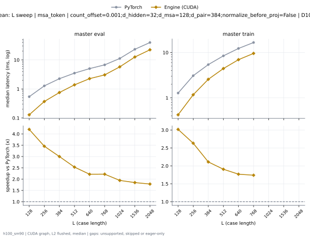
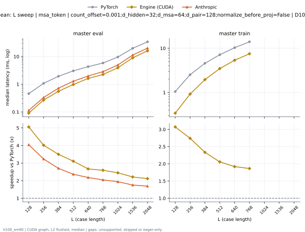
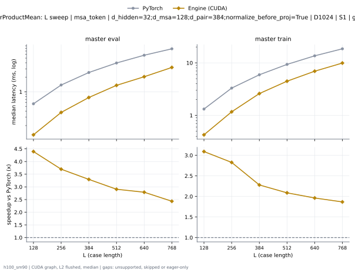
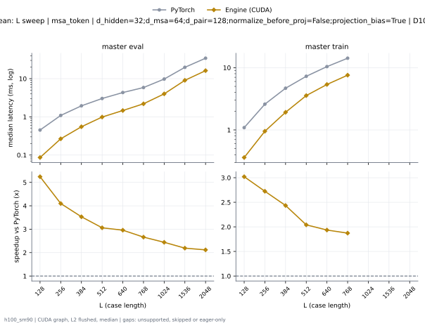
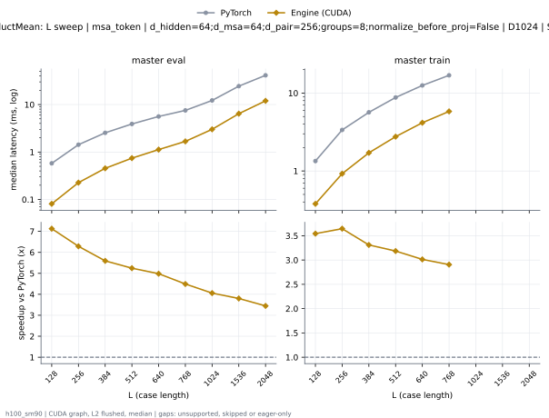
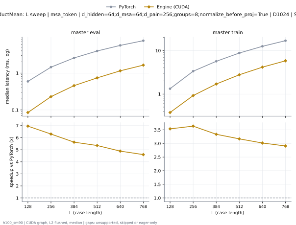
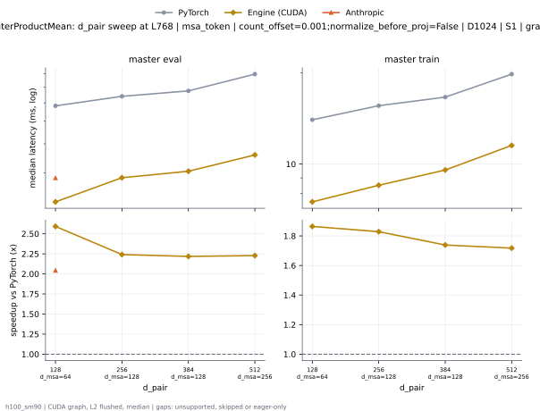

# OuterProductMean on h100_sm90

Generated by `python -m miniworld_engine.measure.plot` from speed tokens `judge/tokens/h100_sm90/`; do not edit.

### L sweep: msa_token | count_offset=0.001;d_hidden=32;d_msa=128;d_pair=256;normalize_before_proj=False | D1024 | S1 | graph

**master eval** (median ms; x = speedup vs PyTorch)

| L | PyTorch | Engine (Triton) | Engine (CUDA) | Anthropic |
|---|---|---|---|---|
| 128 | 0.5523 | 0.1319 (4.19x) | 0.1195 (4.62x) | unsupported |
| 256 | 1.237 | 0.3846 (3.22x) | 0.3388 (3.65x) | unsupported |
| 384 | 2.174 | 0.8307 (2.62x) | 0.6841 (3.18x) | unsupported |
| 512 | 3.356 | 1.364 (2.46x) | 1.258 (2.67x) | unsupported |
| 640 | 4.808 | 2.108 (2.28x) | 2.032 (2.37x) | unsupported |
| 768 | 6.457 | 3.002 (2.15x) | 3.145 (2.05x) | unsupported |
| 1024 | 10.62 | 5.35 (1.99x) | 5.181 (2.05x) | unsupported |
| 1536 | 22.01 | 11.76 (1.87x) | 11.24 (1.96x) | unsupported |
| 2048 | 38.41 | 20.99 (1.83x) | 19.9 (1.93x) | unsupported |

**master train** (median ms; x = speedup vs PyTorch)

| L | PyTorch | Engine (Triton) | Engine (CUDA) | Anthropic |
|---|---|---|---|---|
| 128 | 1.266 | 0.5624 (2.25x) | 0.3927 (3.22x) | unsupported |
| 256 | 2.971 | 1.546 (1.92x) | 1.036 (2.87x) | unsupported |
| 384 | 5.237 | 2.94 (1.78x) | 2.252 (2.33x) | unsupported |
| 512 | 8.048 | 4.854 (1.66x) | 3.844 (2.09x) | unsupported |
| 640 | 11.55 | 7.363 (1.57x) | 6.031 (1.92x) | unsupported |
| 768 | 15.61 | 10.27 (1.52x) | 8.456 (1.85x) | unsupported |
| 1024 |  |  |  |  |
| 1536 |  |  |  |  |
| 2048 |  |  |  |  |

### L sweep: msa_token | count_offset=0.001;d_hidden=32;d_msa=128;d_pair=384;normalize_before_proj=False | D1024 | S1 | graph

**master eval** (median ms; x = speedup vs PyTorch)

| L | PyTorch | Engine (Triton) | Engine (CUDA) | Anthropic |
|---|---|---|---|---|
| 128 | 0.5469 | 0.1537 (3.56x) | 0.1282 (4.27x) | unsupported |
| 256 | 1.275 | 0.4426 (2.88x) | 0.3708 (3.44x) | unsupported |
| 384 | 2.263 | 0.9319 (2.43x) | 0.7997 (2.83x) | unsupported |
| 512 | 3.52 | 1.619 (2.17x) | 1.435 (2.45x) | unsupported |
| 640 | 5.06 | 2.492 (2.03x) | 2.175 (2.33x) | unsupported |
| 768 | 6.899 | 3.536 (1.95x) | 3.146 (2.19x) | unsupported |
| 1024 | 11.37 | 6.126 (1.86x) | 5.744 (1.98x) | unsupported |
| 1536 | 23.7 | 13.93 (1.70x) | 12.63 (1.88x) | unsupported |
| 2048 | 39.94 | 24.61 (1.62x) | 22.57 (1.77x) | unsupported |

**master train** (median ms; x = speedup vs PyTorch)

| L | PyTorch | Engine (Triton) | Engine (CUDA) | Anthropic |
|---|---|---|---|---|
| 128 | 1.276 | 0.6183 (2.06x) | 0.422 (3.02x) | unsupported |
| 256 | 3.09 | 1.719 (1.80x) | 1.18 (2.62x) | unsupported |
| 384 | 5.442 | 3.429 (1.59x) | 2.597 (2.10x) | unsupported |
| 512 | 8.465 | 5.877 (1.44x) | 4.392 (1.93x) | unsupported |
| 640 | 12.2 | 8.81 (1.39x) | 7.113 (1.72x) | unsupported |
| 768 | 16.57 | 12.26 (1.35x) | 9.702 (1.71x) | unsupported |
| 1024 |  |  |  |  |
| 1536 |  |  |  |  |
| 2048 |  |  |  |  |

### L sweep: msa_token | count_offset=0.001;d_hidden=32;d_msa=256;d_pair=512;normalize_before_proj=False | D1024 | S1 | graph

**master eval** (median ms; x = speedup vs PyTorch)

| L | PyTorch | Engine (Triton) | Engine (CUDA) | Anthropic |
|---|---|---|---|---|
| 128 | 0.7238 | 0.1772 (4.09x) | 0.1476 (4.90x) | unsupported |
| 256 | 1.586 | 0.5361 (2.96x) | 0.4346 (3.65x) | unsupported |
| 384 | 2.776 | 1.077 (2.58x) | 0.8774 (3.16x) | unsupported |
| 512 | 4.25 | 1.88 (2.26x) | 1.675 (2.54x) | unsupported |
| 640 | 6.022 | 2.915 (2.07x) | 2.647 (2.28x) | unsupported |
| 768 | 8.075 | 4.268 (1.89x) | 3.752 (2.15x) | unsupported |

**master train** (median ms; x = speedup vs PyTorch)

| L | PyTorch | Engine (Triton) | Engine (CUDA) | Anthropic |
|---|---|---|---|---|
| 128 | 1.687 | 1 (1.69x) | 0.5234 (3.22x) | unsupported |
| 256 | 3.885 | 2.382 (1.63x) | 1.518 (2.56x) | unsupported |
| 384 | 6.795 | 4.399 (1.54x) | 3.287 (2.07x) | unsupported |
| 512 | 10.44 | 7.156 (1.46x) | 5.505 (1.90x) | unsupported |
| 640 | 14.92 | 10.83 (1.38x) | 8.311 (1.80x) | unsupported |
| 768 | 19.82 | 14.76 (1.34x) | 11.57 (1.71x) | unsupported |

### L sweep: msa_token | count_offset=0.001;d_hidden=32;d_msa=64;d_pair=128;normalize_before_proj=False | D1024 | S1 | graph

**master eval** (median ms; x = speedup vs PyTorch)

| L | PyTorch | Engine (Triton) | Engine (CUDA) | Anthropic |
|---|---|---|---|---|
| 128 | 0.4549 | 0.1148 (3.96x) | 0.09165 (4.96x) | 0.1132 (4.02x) |
| 256 | 1.079 | 0.31 (3.48x) | 0.2699 (4.00x) | 0.3329 (3.24x) |
| 384 | 1.946 | 0.6389 (3.05x) | 0.5601 (3.47x) | 0.7177 (2.71x) |
| 512 | 3.049 | 1.1 (2.77x) | 0.9774 (3.12x) | 1.284 (2.38x) |
| 640 | 4.335 | 1.71 (2.54x) | 1.563 (2.77x) | 1.98 (2.19x) |
| 768 | 5.866 | 2.464 (2.38x) | 2.309 (2.54x) | 2.854 (2.06x) |
| 1024 | 9.789 | 4.561 (2.15x) | 4.082 (2.40x) | 4.937 (1.98x) |
| 1536 | 20.06 | 9.962 (2.01x) | 9.777 (2.05x) | 11.31 (1.77x) |
| 2048 | 34.71 | 17.83 (1.95x) | 17 (2.04x) | 20.13 (1.72x) |

**master train** (median ms; x = speedup vs PyTorch)

| L | PyTorch | Engine (Triton) | Engine (CUDA) | Anthropic |
|---|---|---|---|---|
| 128 | 1.034 | 0.3706 (2.79x) | 0.3408 (3.03x) | unsupported |
| 256 | 2.53 | 1.079 (2.35x) | 0.9282 (2.73x) | unsupported |
| 384 | 4.595 | 2.226 (2.06x) | 1.841 (2.50x) | unsupported |
| 512 | 7.169 | 3.824 (1.87x) | 3.427 (2.09x) | unsupported |
| 640 | 10.35 | 5.929 (1.75x) | 5.248 (1.97x) | unsupported |
| 768 | 14.01 | 8.383 (1.67x) | 7.388 (1.90x) | unsupported |
| 1024 |  |  |  |  |
| 1536 |  |  |  |  |
| 2048 |  |  |  |  |

### L sweep: msa_token | d_hidden=32;d_msa=128;d_pair=256;normalize_before_proj=False | D1024 | S1 | graph

**master eval** (median ms; x = speedup vs PyTorch)

| L | PyTorch | Engine (Triton) | Engine (CUDA) | Anthropic |
|---|---|---|---|---|
| 128 | 0.5307 | 0.1289 (4.12x) | 0.1109 (4.78x) | 0.1746 (3.04x) |
| 256 | 1.222 | 0.3853 (3.17x) | 0.3389 (3.60x) | 0.4642 (2.63x) |
| 384 | 2.174 | 0.786 (2.77x) | 0.6824 (3.19x) | 0.8927 (2.44x) |
| 512 | 3.356 | 1.382 (2.43x) | 1.234 (2.72x) | 1.466 (2.29x) |
| 640 | 4.805 | 2.042 (2.35x) | 2.067 (2.32x) | 2.306 (2.08x) |
| 768 | 6.438 | 3.055 (2.11x) | 2.985 (2.16x) | 3.247 (1.98x) |
| 1024 | 10.64 | 5.367 (1.98x) | 5.241 (2.03x) | 5.733 (1.86x) |
| 1536 | 21.99 | 11.79 (1.87x) | 11.36 (1.94x) | 12.66 (1.74x) |
| 2048 | 38.09 | 21.1 (1.81x) | 18.91 (2.01x) | 22.14 (1.72x) |

**master train** (median ms; x = speedup vs PyTorch)

| L | PyTorch | Engine (Triton) | Engine (CUDA) | Anthropic |
|---|---|---|---|---|
| 128 | 1.264 | 0.5618 (2.25x) | 0.389 (3.25x) | unsupported |
| 256 | 2.959 | 1.516 (1.95x) | 1.029 (2.88x) | unsupported |
| 384 | 5.207 | 2.961 (1.76x) | 2.25 (2.31x) | unsupported |
| 512 | 8.069 | 4.952 (1.63x) | 3.931 (2.05x) | unsupported |
| 640 | 11.67 | 7.444 (1.57x) | 6.183 (1.89x) | unsupported |
| 768 | 15.67 | 10.54 (1.49x) | 8.411 (1.86x) | unsupported |
| 1024 |  |  |  |  |
| 1536 |  |  |  |  |
| 2048 |  |  |  |  |

### L sweep: msa_token | d_hidden=32;d_msa=128;d_pair=256;normalize_before_proj=True | D1024 | S1 | graph

**master eval** (median ms; x = speedup vs PyTorch)

| L | PyTorch | Engine (Triton) | Engine (CUDA) | Anthropic |
|---|---|---|---|---|
| 128 | 0.558 | 0.13 (4.29x) | 0.1125 (4.96x) | unsupported |
| 256 | 1.363 | 0.3846 (3.54x) | 0.3385 (4.03x) | unsupported |
| 384 | 2.478 | 0.7961 (3.11x) | 0.6827 (3.63x) | unsupported |
| 512 | 3.895 | 1.359 (2.87x) | 1.249 (3.12x) | unsupported |
| 640 | 5.621 | 2.104 (2.67x) | 2.037 (2.76x) | unsupported |
| 768 | 7.626 | 3.05 (2.50x) | 2.912 (2.62x) | unsupported |

**master train** (median ms; x = speedup vs PyTorch)

| L | PyTorch | Engine (Triton) | Engine (CUDA) | Anthropic |
|---|---|---|---|---|
| 128 | 1.316 | 0.5599 (2.35x) | 0.3903 (3.37x) | unsupported |
| 256 | 3.231 | 1.516 (2.13x) | 1.027 (3.15x) | unsupported |
| 384 | 5.812 | 2.947 (1.97x) | 2.288 (2.54x) | unsupported |
| 512 | 9.135 | 4.978 (1.83x) | 4.054 (2.25x) | unsupported |
| 640 | 13.35 | 7.459 (1.79x) | 6.175 (2.16x) | unsupported |
| 768 | 18.17 | 10.33 (1.76x) | 8.621 (2.11x) | unsupported |

### L sweep: msa_token | d_hidden=32;d_msa=128;d_pair=384;normalize_before_proj=False | D1024 | S1 | graph

**master eval** (median ms; x = speedup vs PyTorch)

| L | PyTorch | Engine (Triton) | Engine (CUDA) | Anthropic |
|---|---|---|---|---|
| 128 | 0.5414 | 0.1519 (3.57x) | 0.1273 (4.25x) | unsupported |
| 256 | 1.271 | 0.4437 (2.86x) | 0.3713 (3.42x) | unsupported |
| 384 | 2.264 | 0.9164 (2.47x) | 0.7607 (2.98x) | unsupported |
| 512 | 3.521 | 1.575 (2.23x) | 1.422 (2.48x) | unsupported |
| 640 | 5.06 | 2.407 (2.10x) | 2.279 (2.22x) | unsupported |
| 768 | 6.842 | 3.51 (1.95x) | 3.341 (2.05x) | unsupported |
| 1024 | 11.39 | 6.257 (1.82x) | 5.539 (2.06x) | unsupported |
| 1536 | 23.66 | 13.74 (1.72x) | 12.73 (1.86x) | unsupported |
| 2048 | 40.1 | 24.24 (1.65x) | 22.09 (1.82x) | unsupported |

**master train** (median ms; x = speedup vs PyTorch)

| L | PyTorch | Engine (Triton) | Engine (CUDA) | Anthropic |
|---|---|---|---|---|
| 128 | 1.267 | 0.6185 (2.05x) | 0.4218 (3.00x) | unsupported |
| 256 | 3.08 | 1.704 (1.81x) | 1.19 (2.59x) | unsupported |
| 384 | 5.432 | 3.402 (1.60x) | 2.512 (2.16x) | unsupported |
| 512 | 8.438 | 5.793 (1.46x) | 4.39 (1.92x) | unsupported |
| 640 | 12.17 | 8.724 (1.39x) | 7.035 (1.73x) | unsupported |
| 768 | 16.53 | 12.06 (1.37x) | 9.705 (1.70x) | unsupported |
| 1024 |  |  |  |  |
| 1536 |  |  |  |  |
| 2048 |  |  |  |  |

### L sweep: msa_token | d_hidden=32;d_msa=128;d_pair=384;normalize_before_proj=True | D1024 | S1 | graph

**master eval** (median ms; x = speedup vs PyTorch)

| L | PyTorch | Engine (Triton) | Engine (CUDA) | Anthropic |
|---|---|---|---|---|
| 128 | 0.569 | 0.1517 (3.75x) | 0.1274 (4.47x) | unsupported |
| 256 | 1.386 | 0.4434 (3.13x) | 0.37 (3.75x) | unsupported |
| 384 | 2.514 | 0.9343 (2.69x) | 0.7587 (3.31x) | unsupported |
| 512 | 3.965 | 1.64 (2.42x) | 1.46 (2.72x) | unsupported |
| 640 | 5.741 | 2.462 (2.33x) | 2.328 (2.47x) | unsupported |
| 768 | 7.802 | 3.672 (2.12x) | 3.313 (2.35x) | unsupported |

**master train** (median ms; x = speedup vs PyTorch)

| L | PyTorch | Engine (Triton) | Engine (CUDA) | Anthropic |
|---|---|---|---|---|
| 128 | 1.321 | 0.616 (2.14x) | 0.4191 (3.15x) | unsupported |
| 256 | 3.302 | 1.7 (1.94x) | 1.181 (2.80x) | unsupported |
| 384 | 5.928 | 3.386 (1.75x) | 2.635 (2.25x) | unsupported |
| 512 | 9.373 | 5.819 (1.61x) | 4.52 (2.07x) | unsupported |
| 640 | 13.69 | 8.814 (1.55x) | 6.969 (1.96x) | unsupported |
| 768 | 18.82 | 12.28 (1.53x) | 9.795 (1.92x) | unsupported |

### L sweep: msa_token | d_hidden=32;d_msa=256;d_pair=512;normalize_before_proj=False | D1024 | S1 | graph

**master eval** (median ms; x = speedup vs PyTorch)

| L | PyTorch | Engine (Triton) | Engine (CUDA) | Anthropic |
|---|---|---|---|---|
| 128 | 0.7312 | 0.1768 (4.14x) | 0.1466 (4.99x) | 0.7301 (1.00x) |
| 256 | 1.581 | 0.5383 (2.94x) | 0.4333 (3.65x) | 1.645 (0.96x) |
| 384 | 2.777 | 1.086 (2.56x) | 0.88 (3.16x) | 2.737 (1.01x) |
| 512 | 4.252 | 1.881 (2.26x) | 1.728 (2.46x) | 4.06 (1.05x) |
| 640 | 6.026 | 2.794 (2.16x) | 2.706 (2.23x) | 5.558 (1.08x) |
| 768 | 8.08 | 4.156 (1.94x) | 3.803 (2.12x) | 7.266 (1.11x) |

**master train** (median ms; x = speedup vs PyTorch)

| L | PyTorch | Engine (Triton) | Engine (CUDA) | Anthropic |
|---|---|---|---|---|
| 128 | 1.687 | 1.004 (1.68x) | 0.5236 (3.22x) | unsupported |
| 256 | 3.884 | 2.374 (1.64x) | 1.499 (2.59x) | unsupported |
| 384 | 6.788 | 4.388 (1.55x) | 3.18 (2.13x) | unsupported |
| 512 | 10.45 | 7.14 (1.46x) | 5.598 (1.87x) | unsupported |
| 640 | 14.95 | 10.64 (1.40x) | 8.434 (1.77x) | unsupported |
| 768 | 19.94 | 14.69 (1.36x) | 11.53 (1.73x) | unsupported |

### L sweep: msa_token | d_hidden=32;d_msa=256;d_pair=512;normalize_before_proj=True | D1024 | S1 | graph

**master eval** (median ms; x = speedup vs PyTorch)

| L | PyTorch | Engine (Triton) | Engine (CUDA) | Anthropic |
|---|---|---|---|---|
| 128 | 0.7402 | 0.1791 (4.13x) | 0.1497 (4.94x) | unsupported |
| 256 | 1.672 | 0.5393 (3.10x) | 0.4328 (3.86x) | unsupported |
| 384 | 2.973 | 1.102 (2.70x) | 0.8774 (3.39x) | unsupported |
| 512 | 4.6 | 1.876 (2.45x) | 1.509 (3.05x) | unsupported |
| 640 | 6.554 | 2.939 (2.23x) | 2.634 (2.49x) | unsupported |
| 768 | 8.86 | 4.389 (2.02x) | 3.596 (2.46x) | unsupported |

**master train** (median ms; x = speedup vs PyTorch)

| L | PyTorch | Engine (Triton) | Engine (CUDA) | Anthropic |
|---|---|---|---|---|
| 128 | 1.736 | 1.002 (1.73x) | 0.5233 (3.32x) | unsupported |
| 256 | 4.052 | 2.379 (1.70x) | 1.579 (2.57x) | unsupported |
| 384 | 7.178 | 4.419 (1.62x) | 3.087 (2.33x) | unsupported |
| 512 | 11.14 | 7.259 (1.53x) | 5.418 (2.06x) | unsupported |
| 640 | 15.93 | 10.84 (1.47x) | 8.295 (1.92x) | unsupported |
| 768 | 21.57 | 14.86 (1.45x) | 11.59 (1.86x) | unsupported |

### L sweep: msa_token | d_hidden=32;d_msa=64;d_pair=128;normalize_before_proj=False | D1024 | S1 | graph

**master eval** (median ms; x = speedup vs PyTorch)

| L | PyTorch | Engine (Triton) | Engine (CUDA) | Anthropic |
|---|---|---|---|---|
| 128 | 0.4439 | 0.1143 (3.88x) | 0.09053 (4.90x) | 0.1142 (3.89x) |
| 256 | 1.084 | 0.3075 (3.53x) | 0.266 (4.08x) | 0.3328 (3.26x) |
| 384 | 1.932 | 0.639 (3.02x) | 0.5544 (3.48x) | 0.7204 (2.68x) |
| 512 | 3.005 | 1.1 (2.73x) | 0.953 (3.15x) | 1.268 (2.37x) |
| 640 | 4.313 | 1.745 (2.47x) | 1.577 (2.73x) | 1.994 (2.16x) |
| 768 | 5.829 | 2.456 (2.37x) | 2.157 (2.70x) | 2.847 (2.05x) |
| 1024 | 9.595 | 4.591 (2.09x) | 4.01 (2.39x) | 4.935 (1.94x) |
| 1536 | 19.88 | 10.05 (1.98x) | 9.01 (2.21x) | 11.22 (1.77x) |
| 2048 | 34.23 | 17.73 (1.93x) | 16.16 (2.12x) | 20.25 (1.69x) |

**master train** (median ms; x = speedup vs PyTorch)

| L | PyTorch | Engine (Triton) | Engine (CUDA) | Anthropic |
|---|---|---|---|---|
| 128 | 1.03 | 0.3694 (2.79x) | 0.3392 (3.04x) | unsupported |
| 256 | 2.524 | 1.071 (2.36x) | 0.9185 (2.75x) | unsupported |
| 384 | 4.573 | 2.217 (2.06x) | 1.928 (2.37x) | unsupported |
| 512 | 7.184 | 3.794 (1.89x) | 3.476 (2.07x) | unsupported |
| 640 | 10.4 | 5.959 (1.75x) | 5.442 (1.91x) | unsupported |
| 768 | 14.08 | 8.317 (1.69x) | 7.456 (1.89x) | unsupported |
| 1024 |  |  |  |  |
| 1536 |  |  |  |  |
| 2048 |  |  |  |  |

### L sweep: msa_token | d_hidden=32;d_msa=64;d_pair=128;normalize_before_proj=False;projection_bias=True | D1024 | S1 | graph

**master eval** (median ms; x = speedup vs PyTorch)

| L | PyTorch | Engine (Triton) | Engine (CUDA) | Anthropic |
|---|---|---|---|---|
| 128 | 0.4517 | 0.1153 (3.92x) | 0.08616 (5.24x) | unsupported |
| 256 | 1.09 | 0.3105 (3.51x) | 0.2661 (4.10x) | unsupported |
| 384 | 1.944 | 0.636 (3.06x) | 0.5507 (3.53x) | unsupported |
| 512 | 3.026 | 1.121 (2.70x) | 0.9887 (3.06x) | unsupported |
| 640 | 4.332 | 1.654 (2.62x) | 1.464 (2.96x) | unsupported |
| 768 | 5.853 | 2.459 (2.38x) | 2.199 (2.66x) | unsupported |
| 1024 | 9.761 | 4.543 (2.15x) | 4 (2.44x) | unsupported |
| 1536 | 19.82 | 9.972 (1.99x) | 9.045 (2.19x) | unsupported |
| 2048 | 34.33 | 17.78 (1.93x) | 16.21 (2.12x) | unsupported |

**master train** (median ms; x = speedup vs PyTorch)

| L | PyTorch | Engine (Triton) | Engine (CUDA) | Anthropic |
|---|---|---|---|---|
| 128 | 1.088 | 0.4042 (2.69x) | 0.3604 (3.02x) | unsupported |
| 256 | 2.593 | 1.139 (2.28x) | 0.9519 (2.72x) | unsupported |
| 384 | 4.675 | 2.264 (2.06x) | 1.92 (2.43x) | unsupported |
| 512 | 7.269 | 3.89 (1.87x) | 3.562 (2.04x) | unsupported |
| 640 | 10.4 | 6.057 (1.72x) | 5.373 (1.94x) | unsupported |
| 768 | 14.2 | 8.492 (1.67x) | 7.581 (1.87x) | unsupported |
| 1024 |  |  |  |  |
| 1536 |  |  |  |  |
| 2048 |  |  |  |  |

### L sweep: msa_token | d_hidden=32;d_msa=64;d_pair=128;normalize_before_proj=True | D384 | S1 | graph

**master eval** (median ms; x = speedup vs PyTorch)

| L | PyTorch | Engine (Triton) | Engine (CUDA) | Anthropic |
|---|---|---|---|---|
| 128 | 0.2893 | 0.07938 (3.65x) | 0.0664 (4.36x) | 0.1335 (2.17x) |
| 256 | 0.7736 | 0.1968 (3.93x) | 0.1722 (4.49x) | 0.4414 (1.75x) |
| 384 | 1.511 | 0.3853 (3.92x) | 0.3412 (4.43x) | 0.9453 (1.60x) |
| 512 | 2.511 | 0.6276 (4.00x) | 0.5743 (4.37x) | 1.628 (1.54x) |
| 640 | 3.761 | 0.9666 (3.89x) | 0.8892 (4.23x) | 2.529 (1.49x) |
| 768 | 5.3 | 1.415 (3.75x) | 1.202 (4.41x) | 3.627 (1.46x) |
| 1024 | 9.114 | 2.541 (3.59x) | 2.26 (4.03x) | 6.378 (1.43x) |
| 1536 | 19.72 | 5.687 (3.47x) | 4.969 (3.97x) | 14.28 (1.38x) |
| 2048 | 34.39 | 10.03 (3.43x) | 9.05 (3.80x) | 25.3 (1.36x) |

**master train** (median ms; x = speedup vs PyTorch)

| L | PyTorch | Engine (Triton) | Engine (CUDA) | Anthropic |
|---|---|---|---|---|
| 128 | 0.9483 | 0.2445 (3.88x) | 0.2544 (3.73x) | unsupported |
| 256 | 1.774 | 0.6543 (2.71x) | 0.634 (2.80x) | unsupported |
| 384 | 3.45 | 1.307 (2.64x) | 1.236 (2.79x) | unsupported |
| 512 | 5.663 | 2.199 (2.58x) | 2.135 (2.65x) | unsupported |
| 640 | 8.446 | 3.4 (2.48x) | 3.264 (2.59x) | unsupported |
| 768 | 11.77 | 4.752 (2.48x) | 4.597 (2.56x) | unsupported |
| 1024 |  |  |  |  |
| 1536 |  |  |  |  |
| 2048 |  |  |  |  |

### L sweep: msa_token | d_hidden=32;d_msa=64;d_pair=128;normalize_before_proj=True;projection_bias=True | D1024 | S1 | graph

**master eval** (median ms; x = speedup vs PyTorch)

| L | PyTorch | Engine (Triton) | Engine (CUDA) | Anthropic |
|---|---|---|---|---|
| 128 | 0.5461 | 0.1156 (4.73x) | 0.08685 (6.29x) | 0.1708 (3.20x) |
| 256 | 1.257 | 0.3123 (4.02x) | 0.2672 (4.70x) | 0.5701 (2.20x) |
| 384 | 2.309 | 0.6588 (3.50x) | 0.5532 (4.17x) | 1.196 (1.93x) |
| 512 | 3.683 | 1.118 (3.29x) | 1.002 (3.68x) | 2.084 (1.77x) |
| 640 | 5.324 | 1.763 (3.02x) | 1.47 (3.62x) | 3.191 (1.67x) |
| 768 | 7.285 | 2.465 (2.96x) | 2.175 (3.35x) | 4.492 (1.62x) |
| 1024 | 12.17 | 4.51 (2.70x) | 4.003 (3.04x) | 7.908 (1.54x) |
| 1536 | 25.67 | 10.03 (2.56x) | 9.142 (2.81x) | 17.8 (1.44x) |
| 2048 | 44.6 | 18.06 (2.47x) | 16.37 (2.72x) | 31.48 (1.42x) |

**master train** (median ms; x = speedup vs PyTorch)

| L | PyTorch | Engine (Triton) | Engine (CUDA) | Anthropic |
|---|---|---|---|---|
| 128 | 1.16 | 0.403 (2.88x) | 0.362 (3.21x) | unsupported |
| 256 | 2.91 | 1.136 (2.56x) | 0.9516 (3.06x) | unsupported |
| 384 | 5.389 | 2.386 (2.26x) | 1.959 (2.75x) | unsupported |
| 512 | 8.549 | 3.923 (2.18x) | 3.492 (2.45x) | unsupported |
| 640 | 12.41 | 6.218 (2.00x) | 5.406 (2.30x) | unsupported |
| 768 | 16.94 | 8.479 (2.00x) | 7.52 (2.25x) | unsupported |
| 1024 |  |  |  |  |
| 1536 |  |  |  |  |
| 2048 |  |  |  |  |

### L sweep: msa_token | d_hidden=64;d_msa=64;d_pair=256;groups=8;normalize_before_proj=False | D1024 | S1 | graph

**master eval** (median ms; x = speedup vs PyTorch)

| L | PyTorch | Engine (Triton) | Engine (CUDA) | Anthropic |
|---|---|---|---|---|
| 128 | 0.6253 | 0.08787 (7.12x) | 0.08258 (7.57x) | unsupported |
| 256 | 1.43 | 0.2483 (5.76x) | 0.227 (6.30x) | unsupported |
| 384 | 2.564 | 0.4971 (5.16x) | 0.4585 (5.59x) | unsupported |
| 512 | 3.953 | 0.8109 (4.88x) | 0.7636 (5.18x) | unsupported |
| 640 | 5.61 | 1.266 (4.43x) | 1.165 (4.82x) | unsupported |
| 768 | 7.535 | 1.76 (4.28x) | 1.756 (4.29x) | unsupported |
| 1024 | 12.19 | 3.157 (3.86x) | 3.088 (3.95x) | unsupported |
| 1536 | 24.5 | 7.12 (3.44x) | 6.779 (3.61x) | unsupported |
| 2048 | 41.32 | 12.19 (3.39x) | 12.11 (3.41x) | unsupported |

**master train** (median ms; x = speedup vs PyTorch)

| L | PyTorch | Engine (Triton) | Engine (CUDA) | Anthropic |
|---|---|---|---|---|
| 128 | 1.317 | 0.3644 (3.61x) | 0.3744 (3.52x) | unsupported |
| 256 | 3.346 | 0.9529 (3.51x) | 0.9203 (3.64x) | unsupported |
| 384 | 5.651 | 1.768 (3.20x) | 1.699 (3.33x) | unsupported |
| 512 | 8.752 | 2.845 (3.08x) | 2.782 (3.15x) | unsupported |
| 640 | 12.5 | 4.259 (2.93x) | 4.175 (2.99x) | unsupported |
| 768 | 16.84 | 5.86 (2.87x) | 5.852 (2.88x) | unsupported |
| 1024 |  |  |  |  |
| 1536 |  |  |  |  |
| 2048 |  |  |  |  |

### L sweep: msa_token | d_hidden=64;d_msa=64;d_pair=256;groups=8;normalize_before_proj=True | D1024 | S1 | graph

**master eval** (median ms; x = speedup vs PyTorch)

| L | PyTorch | Engine (Triton) | Engine (CUDA) | Anthropic |
|---|---|---|---|---|
| 128 | 0.5901 | 0.08939 (6.60x) | 0.08342 (7.07x) | unsupported |
| 256 | 1.442 | 0.2513 (5.74x) | 0.2281 (6.32x) | unsupported |
| 384 | 2.564 | 0.501 (5.12x) | 0.4555 (5.63x) | unsupported |
| 512 | 3.953 | 0.8225 (4.81x) | 0.7355 (5.37x) | unsupported |
| 640 | 5.607 | 1.271 (4.41x) | 1.148 (4.88x) | unsupported |
| 768 | 7.531 | 1.786 (4.22x) | 1.72 (4.38x) | unsupported |

**master train** (median ms; x = speedup vs PyTorch)

| L | PyTorch | Engine (Triton) | Engine (CUDA) | Anthropic |
|---|---|---|---|---|
| 128 | 1.319 | 0.3658 (3.60x) | 0.3736 (3.53x) | unsupported |
| 256 | 3.342 | 0.9499 (3.52x) | 0.9204 (3.63x) | unsupported |
| 384 | 5.662 | 1.764 (3.21x) | 1.712 (3.31x) | unsupported |
| 512 | 8.748 | 2.849 (3.07x) | 2.783 (3.14x) | unsupported |
| 640 | 12.5 | 4.253 (2.94x) | 4.177 (2.99x) | unsupported |
| 768 | 16.86 | 5.851 (2.88x) | 5.922 (2.85x) | unsupported |

### d_msa sweep at L768: msa_token | count_offset=0.001;normalize_before_proj=False | D1024 | S1 | graph

**master eval** (median ms; x = speedup vs PyTorch)

| d_msa | PyTorch | Engine (Triton) | Engine (CUDA) | Anthropic |
|---|---|---|---|---|
| 64 d_pair=128 | 5.866 | 2.464 (2.38x) | 2.309 (2.54x) | 2.854 (2.06x) |
| 128 d_pair=256 | 6.457 | 3.002 (2.15x) | 3.145 (2.05x) | unsupported |
| 256 d_pair=512 | 8.075 | 4.268 (1.89x) | 3.752 (2.15x) | unsupported |

**master train** (median ms; x = speedup vs PyTorch)

| d_msa | PyTorch | Engine (Triton) | Engine (CUDA) | Anthropic |
|---|---|---|---|---|
| 64 d_pair=128 | 14.01 | 8.383 (1.67x) | 7.388 (1.90x) | unsupported |
| 128 d_pair=256 | 15.61 | 10.27 (1.52x) | 8.456 (1.85x) | unsupported |
| 256 d_pair=512 | 19.82 | 14.76 (1.34x) | 11.57 (1.71x) | unsupported |

### d_msa sweep at L768: msa_token | normalize_before_proj=False | D1024 | S1 | graph

**master eval** (median ms; x = speedup vs PyTorch)

| d_msa | PyTorch | Engine (Triton) | Engine (CUDA) | Anthropic |
|---|---|---|---|---|
| 64 d_pair=128 | 5.829 | 2.456 (2.37x) | 2.157 (2.70x) | 2.847 (2.05x) |
| 128 d_pair=256 | 6.438 | 3.055 (2.11x) | 2.985 (2.16x) | 3.247 (1.98x) |
| 256 d_pair=512 | 8.08 | 4.156 (1.94x) | 3.803 (2.12x) | 7.266 (1.11x) |

**master train** (median ms; x = speedup vs PyTorch)

| d_msa | PyTorch | Engine (Triton) | Engine (CUDA) | Anthropic |
|---|---|---|---|---|
| 64 d_pair=128 | 14.08 | 8.317 (1.69x) | 7.456 (1.89x) | unsupported |
| 128 d_pair=256 | 15.67 | 10.54 (1.49x) | 8.411 (1.86x) | unsupported |
| 256 d_pair=512 | 19.94 | 14.69 (1.36x) | 11.53 (1.73x) | unsupported |

### d_pair sweep at L768: msa_token | count_offset=0.001;normalize_before_proj=False | D1024 | S1 | graph

**master eval** (median ms; x = speedup vs PyTorch)

| d_pair | PyTorch | Engine (Triton) | Engine (CUDA) | Anthropic |
|---|---|---|---|---|
| 128 d_msa=64 | 5.866 | 2.464 (2.38x) | 2.309 (2.54x) | 2.854 (2.06x) |
| 256 d_msa=128 | 6.457 | 3.002 (2.15x) | 3.145 (2.05x) | unsupported |
| 384 d_msa=128 | 6.899 | 3.536 (1.95x) | 3.146 (2.19x) | unsupported |
| 512 d_msa=256 | 8.075 | 4.268 (1.89x) | 3.752 (2.15x) | unsupported |

**master train** (median ms; x = speedup vs PyTorch)

| d_pair | PyTorch | Engine (Triton) | Engine (CUDA) | Anthropic |
|---|---|---|---|---|
| 128 d_msa=64 | 14.01 | 8.383 (1.67x) | 7.388 (1.90x) | unsupported |
| 256 d_msa=128 | 15.61 | 10.27 (1.52x) | 8.456 (1.85x) | unsupported |
| 384 d_msa=128 | 16.57 | 12.26 (1.35x) | 9.702 (1.71x) | unsupported |
| 512 d_msa=256 | 19.82 | 14.76 (1.34x) | 11.57 (1.71x) | unsupported |

### d_pair sweep at L768: msa_token | normalize_before_proj=False | D1024 | S1 | graph

**master eval** (median ms; x = speedup vs PyTorch)

| d_pair | PyTorch | Engine (Triton) | Engine (CUDA) | Anthropic |
|---|---|---|---|---|
| 128 d_msa=64 | 5.829 | 2.456 (2.37x) | 2.157 (2.70x) | 2.847 (2.05x) |
| 256 d_msa=128 | 6.438 | 3.055 (2.11x) | 2.985 (2.16x) | 3.247 (1.98x) |
| 384 d_msa=128 | 6.842 | 3.51 (1.95x) | 3.341 (2.05x) | unsupported |
| 512 d_msa=256 | 8.08 | 4.156 (1.94x) | 3.803 (2.12x) | 7.266 (1.11x) |

**master train** (median ms; x = speedup vs PyTorch)

| d_pair | PyTorch | Engine (Triton) | Engine (CUDA) | Anthropic |
|---|---|---|---|---|
| 128 d_msa=64 | 14.08 | 8.317 (1.69x) | 7.456 (1.89x) | unsupported |
| 256 d_msa=128 | 15.67 | 10.54 (1.49x) | 8.411 (1.86x) | unsupported |
| 384 d_msa=128 | 16.53 | 12.06 (1.37x) | 9.705 (1.70x) | unsupported |
| 512 d_msa=256 | 19.94 | 14.69 (1.36x) | 11.53 (1.73x) | unsupported |

### d_pair sweep at L768: msa_token | normalize_before_proj=True | D1024 | S1 | graph

**master eval** (median ms; x = speedup vs PyTorch)

| d_pair | PyTorch | Engine (Triton) | Engine (CUDA) | Anthropic |
|---|---|---|---|---|
| 256 d_msa=128 | 7.626 | 3.05 (2.50x) | 2.912 (2.62x) | unsupported |
| 384 d_msa=128 | 7.802 | 3.672 (2.12x) | 3.313 (2.35x) | unsupported |
| 512 d_msa=256 | 8.86 | 4.389 (2.02x) | 3.596 (2.46x) | unsupported |

**master train** (median ms; x = speedup vs PyTorch)

| d_pair | PyTorch | Engine (Triton) | Engine (CUDA) | Anthropic |
|---|---|---|---|---|
| 256 d_msa=128 | 18.17 | 10.33 (1.76x) | 8.621 (2.11x) | unsupported |
| 384 d_msa=128 | 18.82 | 12.28 (1.53x) | 9.795 (1.92x) | unsupported |
| 512 d_msa=256 | 21.57 | 14.86 (1.45x) | 11.59 (1.86x) | unsupported |

