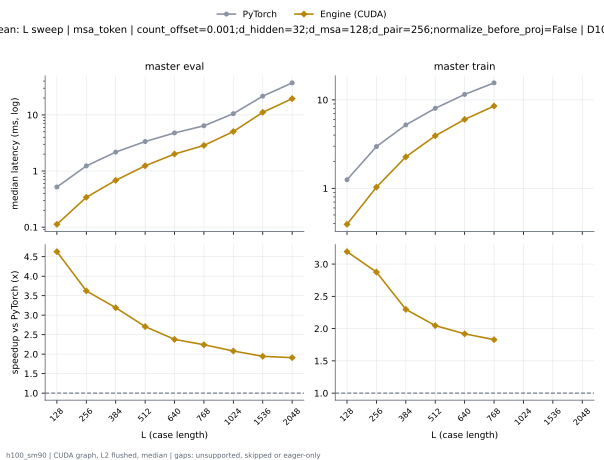
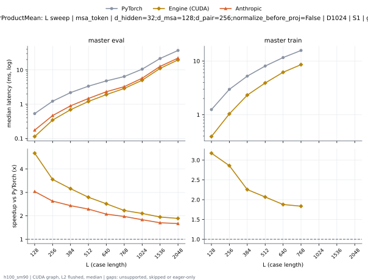
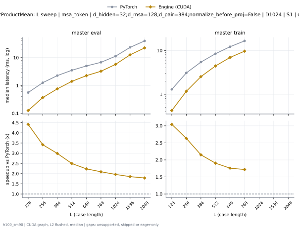
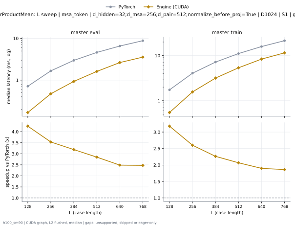
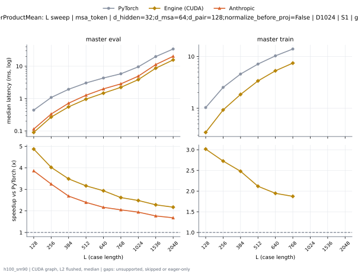
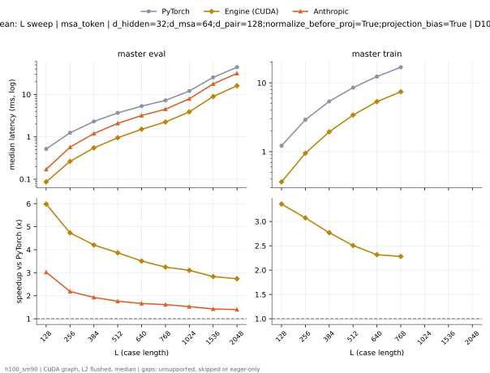
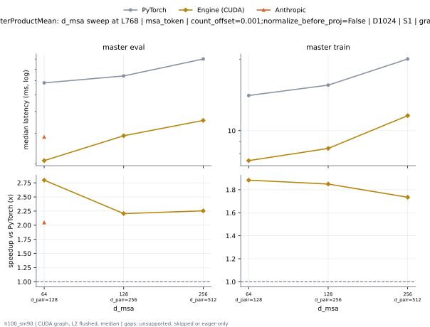
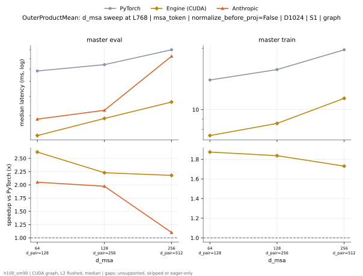
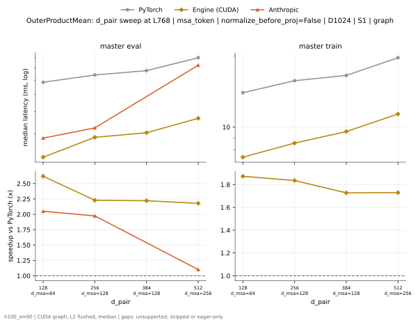
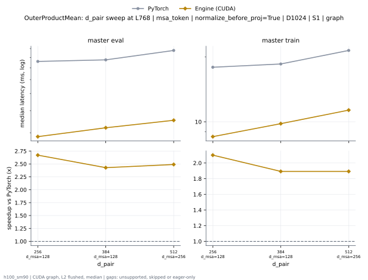

# OuterProductMean on h100_sm90

Generated by `python -m miniworld_engine.measure.plot` from speed tokens `judge/tokens/h100_sm90/`; do not edit.

### L sweep: msa_token | count_offset=0.001;d_hidden=32;d_msa=128;d_pair=256;normalize_before_proj=False | D1024 | S1 | graph

**master eval** (median ms; x = speedup vs PyTorch)

| L | PyTorch | Engine (Triton) | Engine (CUDA) | Anthropic |
|---|---|---|---|---|
| 128 | 0.5312 | 0.1319 (4.03x) | 0.1157 (4.59x) | unsupported |
| 256 | 1.231 | 0.3846 (3.20x) | 0.3421 (3.60x) | unsupported |
| 384 | 2.171 | 0.8307 (2.61x) | 0.6865 (3.16x) | unsupported |
| 512 | 3.349 | 1.364 (2.46x) | 1.183 (2.83x) | unsupported |
| 640 | 4.773 | 2.108 (2.26x) | 2.032 (2.35x) | unsupported |
| 768 | 6.4 | 3.002 (2.13x) | 2.902 (2.21x) | unsupported |
| 1024 | 10.49 | 5.35 (1.96x) | 5.019 (2.09x) | unsupported |
| 1536 | 21.58 | 11.76 (1.83x) | 11.06 (1.95x) | unsupported |
| 2048 | 36.98 | 20.99 (1.76x) | 19.55 (1.89x) | unsupported |

**master train** (median ms; x = speedup vs PyTorch)

| L | PyTorch | Engine (Triton) | Engine (CUDA) | Anthropic |
|---|---|---|---|---|
| 128 | 1.257 | 0.5624 (2.24x) | 0.3963 (3.17x) | unsupported |
| 256 | 2.966 | 1.546 (1.92x) | 1.047 (2.83x) | unsupported |
| 384 | 5.218 | 2.94 (1.78x) | 2.281 (2.29x) | unsupported |
| 512 | 8.044 | 4.854 (1.66x) | 3.873 (2.08x) | unsupported |
| 640 | 11.54 | 7.363 (1.57x) | 6.171 (1.87x) | unsupported |
| 768 | 15.56 | 10.27 (1.52x) | 8.416 (1.85x) | unsupported |
| 1024 |  |  |  |  |
| 1536 |  |  |  |  |
| 2048 |  |  |  |  |

### L sweep: msa_token | count_offset=0.001;d_hidden=32;d_msa=128;d_pair=384;normalize_before_proj=False | D1024 | S1 | graph

**master eval** (median ms; x = speedup vs PyTorch)

| L | PyTorch | Engine (Triton) | Engine (CUDA) | Anthropic |
|---|---|---|---|---|
| 128 | 0.5616 | 0.1537 (3.65x) | 0.1307 (4.30x) | unsupported |
| 256 | 1.275 | 0.4426 (2.88x) | 0.3747 (3.40x) | unsupported |
| 384 | 2.265 | 0.9319 (2.43x) | 0.7656 (2.96x) | unsupported |
| 512 | 3.52 | 1.619 (2.17x) | 1.31 (2.69x) | unsupported |
| 640 | 5.038 | 2.492 (2.02x) | 2.204 (2.29x) | unsupported |
| 768 | 6.788 | 3.536 (1.92x) | 3.137 (2.16x) | unsupported |
| 1024 | 11.3 | 6.126 (1.84x) | 5.679 (1.99x) | unsupported |
| 1536 | 23.36 | 13.93 (1.68x) | 12.49 (1.87x) | unsupported |
| 2048 | 39.9 | 24.61 (1.62x) | 22.34 (1.79x) | unsupported |

**master train** (median ms; x = speedup vs PyTorch)

| L | PyTorch | Engine (Triton) | Engine (CUDA) | Anthropic |
|---|---|---|---|---|
| 128 | 1.287 | 0.6183 (2.08x) | 0.4276 (3.01x) | unsupported |
| 256 | 3.081 | 1.719 (1.79x) | 1.18 (2.61x) | unsupported |
| 384 | 5.432 | 3.429 (1.58x) | 2.604 (2.09x) | unsupported |
| 512 | 8.458 | 5.877 (1.44x) | 4.531 (1.87x) | unsupported |
| 640 | 12.27 | 8.81 (1.39x) | 7.009 (1.75x) | unsupported |
| 768 | 16.68 | 12.26 (1.36x) | 9.864 (1.69x) | unsupported |
| 1024 |  |  |  |  |
| 1536 |  |  |  |  |
| 2048 |  |  |  |  |

### L sweep: msa_token | count_offset=0.001;d_hidden=32;d_msa=256;d_pair=512;normalize_before_proj=False | D1024 | S1 | graph

**master eval** (median ms; x = speedup vs PyTorch)

| L | PyTorch | Engine (Triton) | Engine (CUDA) | Anthropic |
|---|---|---|---|---|
| 128 | 0.7097 | 0.1772 (4.01x) | 0.1664 (4.26x) | unsupported |
| 256 | 1.581 | 0.5361 (2.95x) | 0.4711 (3.36x) | unsupported |
| 384 | 2.777 | 1.077 (2.58x) | 0.9485 (2.93x) | unsupported |
| 512 | 4.246 | 1.88 (2.26x) | 1.627 (2.61x) | unsupported |
| 640 | 6.001 | 2.915 (2.06x) | 2.694 (2.23x) | unsupported |
| 768 | 8.011 | 4.268 (1.88x) | 3.554 (2.25x) | unsupported |

**master train** (median ms; x = speedup vs PyTorch)

| L | PyTorch | Engine (Triton) | Engine (CUDA) | Anthropic |
|---|---|---|---|---|
| 128 | 1.682 | 1 (1.68x) | 0.542 (3.10x) | unsupported |
| 256 | 3.888 | 2.382 (1.63x) | 1.567 (2.48x) | unsupported |
| 384 | 6.784 | 4.399 (1.54x) | 3.167 (2.14x) | unsupported |
| 512 | 10.37 | 7.156 (1.45x) | 5.383 (1.93x) | unsupported |
| 640 | 14.78 | 10.83 (1.36x) | 8.293 (1.78x) | unsupported |
| 768 | 20.07 | 14.76 (1.36x) | 11.57 (1.73x) | unsupported |

### L sweep: msa_token | count_offset=0.001;d_hidden=32;d_msa=64;d_pair=128;normalize_before_proj=False | D1024 | S1 | graph

**master eval** (median ms; x = speedup vs PyTorch)

| L | PyTorch | Engine (Triton) | Engine (CUDA) | Anthropic |
|---|---|---|---|---|
| 128 | 0.4857 | 0.1148 (4.23x) | 0.09101 (5.34x) | 0.1132 (4.29x) |
| 256 | 1.078 | 0.31 (3.48x) | 0.2701 (3.99x) | 0.3329 (3.24x) |
| 384 | 1.945 | 0.6389 (3.04x) | 0.5562 (3.50x) | 0.7177 (2.71x) |
| 512 | 3.044 | 1.1 (2.77x) | 0.9735 (3.13x) | 1.284 (2.37x) |
| 640 | 4.329 | 1.71 (2.53x) | 1.538 (2.82x) | 1.98 (2.19x) |
| 768 | 5.841 | 2.464 (2.37x) | 2.089 (2.80x) | 2.854 (2.05x) |
| 1024 | 9.646 | 4.561 (2.11x) | 4.019 (2.40x) | 4.937 (1.95x) |
| 1536 | 19.91 | 9.962 (2.00x) | 8.79 (2.26x) | 11.31 (1.76x) |
| 2048 | 34.2 | 17.83 (1.92x) | 15.93 (2.15x) | 20.13 (1.70x) |

**master train** (median ms; x = speedup vs PyTorch)

| L | PyTorch | Engine (Triton) | Engine (CUDA) | Anthropic |
|---|---|---|---|---|
| 128 | 1.063 | 0.3706 (2.87x) | 0.3423 (3.10x) | unsupported |
| 256 | 2.527 | 1.079 (2.34x) | 0.9272 (2.73x) | unsupported |
| 384 | 4.59 | 2.226 (2.06x) | 1.903 (2.41x) | unsupported |
| 512 | 7.163 | 3.824 (1.87x) | 3.44 (2.08x) | unsupported |
| 640 | 10.34 | 5.929 (1.74x) | 5.356 (1.93x) | unsupported |
| 768 | 14.08 | 8.383 (1.68x) | 7.476 (1.88x) | unsupported |
| 1024 |  |  |  |  |
| 1536 |  |  |  |  |
| 2048 |  |  |  |  |

### L sweep: msa_token | d_hidden=32;d_msa=128;d_pair=256;normalize_before_proj=False | D1024 | S1 | graph

**master eval** (median ms; x = speedup vs PyTorch)

| L | PyTorch | Engine (Triton) | Engine (CUDA) | Anthropic |
|---|---|---|---|---|
| 128 | 0.5305 | 0.1289 (4.12x) | 0.1135 (4.68x) | 0.1746 (3.04x) |
| 256 | 1.22 | 0.3853 (3.17x) | 0.3432 (3.56x) | 0.4642 (2.63x) |
| 384 | 2.174 | 0.786 (2.77x) | 0.6878 (3.16x) | 0.8927 (2.44x) |
| 512 | 3.354 | 1.382 (2.43x) | 1.2 (2.79x) | 1.466 (2.29x) |
| 640 | 4.782 | 2.042 (2.34x) | 1.902 (2.51x) | 2.306 (2.07x) |
| 768 | 6.409 | 3.055 (2.10x) | 2.876 (2.23x) | 3.247 (1.97x) |
| 1024 | 10.52 | 5.367 (1.96x) | 5.004 (2.10x) | 5.733 (1.84x) |
| 1536 | 21.58 | 11.79 (1.83x) | 11.06 (1.95x) | 12.66 (1.70x) |
| 2048 | 37 | 21.1 (1.75x) | 19.57 (1.89x) | 22.14 (1.67x) |

**master train** (median ms; x = speedup vs PyTorch)

| L | PyTorch | Engine (Triton) | Engine (CUDA) | Anthropic |
|---|---|---|---|---|
| 128 | 1.247 | 0.5618 (2.22x) | 0.3927 (3.17x) | unsupported |
| 256 | 2.966 | 1.516 (1.96x) | 1.037 (2.86x) | unsupported |
| 384 | 5.226 | 2.961 (1.77x) | 2.317 (2.26x) | unsupported |
| 512 | 8.061 | 4.952 (1.63x) | 3.898 (2.07x) | unsupported |
| 640 | 11.58 | 7.444 (1.56x) | 6.167 (1.88x) | unsupported |
| 768 | 15.71 | 10.54 (1.49x) | 8.56 (1.84x) | unsupported |
| 1024 |  |  |  |  |
| 1536 |  |  |  |  |
| 2048 |  |  |  |  |

### L sweep: msa_token | d_hidden=32;d_msa=128;d_pair=256;normalize_before_proj=True | D1024 | S1 | graph

**master eval** (median ms; x = speedup vs PyTorch)

| L | PyTorch | Engine (Triton) | Engine (CUDA) | Anthropic |
|---|---|---|---|---|
| 128 | 0.5579 | 0.13 (4.29x) | 0.115 (4.85x) | unsupported |
| 256 | 1.36 | 0.3846 (3.54x) | 0.3417 (3.98x) | unsupported |
| 384 | 2.476 | 0.7961 (3.11x) | 0.6866 (3.61x) | unsupported |
| 512 | 3.891 | 1.359 (2.86x) | 1.182 (3.29x) | unsupported |
| 640 | 5.616 | 2.104 (2.67x) | 1.919 (2.93x) | unsupported |
| 768 | 7.591 | 3.05 (2.49x) | 2.759 (2.75x) | unsupported |

**master train** (median ms; x = speedup vs PyTorch)

| L | PyTorch | Engine (Triton) | Engine (CUDA) | Anthropic |
|---|---|---|---|---|
| 128 | 1.317 | 0.5599 (2.35x) | 0.3949 (3.34x) | unsupported |
| 256 | 3.236 | 1.516 (2.13x) | 1.052 (3.08x) | unsupported |
| 384 | 5.811 | 2.947 (1.97x) | 2.26 (2.57x) | unsupported |
| 512 | 9.121 | 4.978 (1.83x) | 3.866 (2.36x) | unsupported |
| 640 | 13.2 | 7.459 (1.77x) | 6.239 (2.12x) | unsupported |
| 768 | 17.92 | 10.33 (1.73x) | 8.375 (2.14x) | unsupported |

### L sweep: msa_token | d_hidden=32;d_msa=128;d_pair=384;normalize_before_proj=False | D1024 | S1 | graph

**master eval** (median ms; x = speedup vs PyTorch)

| L | PyTorch | Engine (Triton) | Engine (CUDA) | Anthropic |
|---|---|---|---|---|
| 128 | 0.5782 | 0.1519 (3.81x) | 0.1292 (4.47x) | unsupported |
| 256 | 1.278 | 0.4437 (2.88x) | 0.3742 (3.41x) | unsupported |
| 384 | 2.264 | 0.9164 (2.47x) | 0.7644 (2.96x) | unsupported |
| 512 | 3.513 | 1.575 (2.23x) | 1.345 (2.61x) | unsupported |
| 640 | 5.033 | 2.407 (2.09x) | 2.228 (2.26x) | unsupported |
| 768 | 6.776 | 3.51 (1.93x) | 3.051 (2.22x) | unsupported |
| 1024 | 11.23 | 6.257 (1.79x) | 5.583 (2.01x) | unsupported |
| 1536 | 23.19 | 13.74 (1.69x) | 12.48 (1.86x) | unsupported |
| 2048 | 39.83 | 24.24 (1.64x) | 22.09 (1.80x) | unsupported |

**master train** (median ms; x = speedup vs PyTorch)

| L | PyTorch | Engine (Triton) | Engine (CUDA) | Anthropic |
|---|---|---|---|---|
| 128 | 1.285 | 0.6185 (2.08x) | 0.4264 (3.01x) | unsupported |
| 256 | 3.079 | 1.704 (1.81x) | 1.199 (2.57x) | unsupported |
| 384 | 5.425 | 3.402 (1.59x) | 2.492 (2.18x) | unsupported |
| 512 | 8.438 | 5.793 (1.46x) | 4.427 (1.91x) | unsupported |
| 640 | 12.17 | 8.724 (1.39x) | 6.969 (1.75x) | unsupported |
| 768 | 16.54 | 12.06 (1.37x) | 9.574 (1.73x) | unsupported |
| 1024 |  |  |  |  |
| 1536 |  |  |  |  |
| 2048 |  |  |  |  |

### L sweep: msa_token | d_hidden=32;d_msa=128;d_pair=384;normalize_before_proj=True | D1024 | S1 | graph

**master eval** (median ms; x = speedup vs PyTorch)

| L | PyTorch | Engine (Triton) | Engine (CUDA) | Anthropic |
|---|---|---|---|---|
| 128 | 0.566 | 0.1517 (3.73x) | 0.1288 (4.39x) | unsupported |
| 256 | 1.385 | 0.4434 (3.12x) | 0.3747 (3.70x) | unsupported |
| 384 | 2.517 | 0.9343 (2.69x) | 0.7637 (3.30x) | unsupported |
| 512 | 3.963 | 1.64 (2.42x) | 1.364 (2.91x) | unsupported |
| 640 | 5.739 | 2.462 (2.33x) | 2.058 (2.79x) | unsupported |
| 768 | 7.799 | 3.672 (2.12x) | 3.206 (2.43x) | unsupported |

**master train** (median ms; x = speedup vs PyTorch)

| L | PyTorch | Engine (Triton) | Engine (CUDA) | Anthropic |
|---|---|---|---|---|
| 128 | 1.321 | 0.616 (2.14x) | 0.4274 (3.09x) | unsupported |
| 256 | 3.309 | 1.7 (1.95x) | 1.17 (2.83x) | unsupported |
| 384 | 5.931 | 3.386 (1.75x) | 2.602 (2.28x) | unsupported |
| 512 | 9.341 | 5.819 (1.61x) | 4.474 (2.09x) | unsupported |
| 640 | 13.61 | 8.814 (1.54x) | 6.936 (1.96x) | unsupported |
| 768 | 18.51 | 12.28 (1.51x) | 9.916 (1.87x) | unsupported |

### L sweep: msa_token | d_hidden=32;d_msa=256;d_pair=512;normalize_before_proj=False | D1024 | S1 | graph

**master eval** (median ms; x = speedup vs PyTorch)

| L | PyTorch | Engine (Triton) | Engine (CUDA) | Anthropic |
|---|---|---|---|---|
| 128 | 0.7278 | 0.1768 (4.12x) | 0.1665 (4.37x) | 0.7301 (1.00x) |
| 256 | 1.585 | 0.5383 (2.94x) | 0.4722 (3.36x) | 1.645 (0.96x) |
| 384 | 2.775 | 1.086 (2.56x) | 0.9363 (2.96x) | 2.737 (1.01x) |
| 512 | 4.244 | 1.881 (2.26x) | 1.674 (2.54x) | 4.06 (1.05x) |
| 640 | 5.993 | 2.794 (2.14x) | 2.634 (2.27x) | 5.558 (1.08x) |
| 768 | 8 | 4.156 (1.92x) | 3.673 (2.18x) | 7.266 (1.10x) |

**master train** (median ms; x = speedup vs PyTorch)

| L | PyTorch | Engine (Triton) | Engine (CUDA) | Anthropic |
|---|---|---|---|---|
| 128 | 1.676 | 1.004 (1.67x) | 0.5442 (3.08x) | unsupported |
| 256 | 3.888 | 2.374 (1.64x) | 1.533 (2.54x) | unsupported |
| 384 | 6.779 | 4.388 (1.54x) | 3.128 (2.17x) | unsupported |
| 512 | 10.35 | 7.14 (1.45x) | 5.348 (1.93x) | unsupported |
| 640 | 14.7 | 10.64 (1.38x) | 8.3 (1.77x) | unsupported |
| 768 | 19.65 | 14.69 (1.34x) | 11.36 (1.73x) | unsupported |

### L sweep: msa_token | d_hidden=32;d_msa=256;d_pair=512;normalize_before_proj=True | D1024 | S1 | graph

**master eval** (median ms; x = speedup vs PyTorch)

| L | PyTorch | Engine (Triton) | Engine (CUDA) | Anthropic |
|---|---|---|---|---|
| 128 | 0.715 | 0.1791 (3.99x) | 0.1683 (4.25x) | unsupported |
| 256 | 1.67 | 0.5393 (3.10x) | 0.4729 (3.53x) | unsupported |
| 384 | 2.975 | 1.102 (2.70x) | 0.9332 (3.19x) | unsupported |
| 512 | 4.607 | 1.876 (2.46x) | 1.618 (2.85x) | unsupported |
| 640 | 6.558 | 2.939 (2.23x) | 2.639 (2.49x) | unsupported |
| 768 | 8.81 | 4.389 (2.01x) | 3.561 (2.47x) | unsupported |

**master train** (median ms; x = speedup vs PyTorch)

| L | PyTorch | Engine (Triton) | Engine (CUDA) | Anthropic |
|---|---|---|---|---|
| 128 | 1.74 | 1.002 (1.74x) | 0.5471 (3.18x) | unsupported |
| 256 | 4.07 | 2.379 (1.71x) | 1.565 (2.60x) | unsupported |
| 384 | 7.186 | 4.419 (1.63x) | 3.175 (2.26x) | unsupported |
| 512 | 11.1 | 7.259 (1.53x) | 5.368 (2.07x) | unsupported |
| 640 | 15.89 | 10.84 (1.47x) | 8.369 (1.90x) | unsupported |
| 768 | 21.44 | 14.86 (1.44x) | 11.52 (1.86x) | unsupported |

### L sweep: msa_token | d_hidden=32;d_msa=64;d_pair=128;normalize_before_proj=False | D1024 | S1 | graph

**master eval** (median ms; x = speedup vs PyTorch)

| L | PyTorch | Engine (Triton) | Engine (CUDA) | Anthropic |
|---|---|---|---|---|
| 128 | 0.4406 | 0.1143 (3.85x) | 0.09046 (4.87x) | 0.1142 (3.86x) |
| 256 | 1.081 | 0.3075 (3.51x) | 0.2686 (4.02x) | 0.3328 (3.25x) |
| 384 | 1.936 | 0.639 (3.03x) | 0.5551 (3.49x) | 0.7204 (2.69x) |
| 512 | 3.039 | 1.1 (2.76x) | 0.9604 (3.16x) | 1.268 (2.40x) |
| 640 | 4.321 | 1.745 (2.48x) | 1.472 (2.94x) | 1.994 (2.17x) |
| 768 | 5.834 | 2.456 (2.38x) | 2.228 (2.62x) | 2.847 (2.05x) |
| 1024 | 9.586 | 4.591 (2.09x) | 3.86 (2.48x) | 4.935 (1.94x) |
| 1536 | 19.83 | 10.05 (1.97x) | 8.687 (2.28x) | 11.22 (1.77x) |
| 2048 | 34.02 | 17.73 (1.92x) | 15.65 (2.17x) | 20.25 (1.68x) |

**master train** (median ms; x = speedup vs PyTorch)

| L | PyTorch | Engine (Triton) | Engine (CUDA) | Anthropic |
|---|---|---|---|---|
| 128 | 1.031 | 0.3694 (2.79x) | 0.3419 (3.02x) | unsupported |
| 256 | 2.529 | 1.071 (2.36x) | 0.9274 (2.73x) | unsupported |
| 384 | 4.583 | 2.217 (2.07x) | 1.848 (2.48x) | unsupported |
| 512 | 7.152 | 3.794 (1.88x) | 3.378 (2.12x) | unsupported |
| 640 | 10.3 | 5.959 (1.73x) | 5.295 (1.95x) | unsupported |
| 768 | 13.98 | 8.317 (1.68x) | 7.462 (1.87x) | unsupported |
| 1024 |  |  |  |  |
| 1536 |  |  |  |  |
| 2048 |  |  |  |  |

### L sweep: msa_token | d_hidden=32;d_msa=64;d_pair=128;normalize_before_proj=False;projection_bias=True | D1024 | S1 | graph

**master eval** (median ms; x = speedup vs PyTorch)

| L | PyTorch | Engine (Triton) | Engine (CUDA) | Anthropic |
|---|---|---|---|---|
| 128 | 0.4471 | 0.1153 (3.88x) | 0.08536 (5.24x) | unsupported |
| 256 | 1.09 | 0.3105 (3.51x) | 0.2641 (4.13x) | unsupported |
| 384 | 1.919 | 0.636 (3.02x) | 0.5478 (3.50x) | unsupported |
| 512 | 3.047 | 1.121 (2.72x) | 0.948 (3.21x) | unsupported |
| 640 | 4.332 | 1.654 (2.62x) | 1.479 (2.93x) | unsupported |
| 768 | 5.849 | 2.459 (2.38x) | 2.225 (2.63x) | unsupported |
| 1024 | 9.618 | 4.543 (2.12x) | 3.888 (2.47x) | unsupported |
| 1536 | 19.73 | 9.972 (1.98x) | 8.841 (2.23x) | unsupported |
| 2048 | 34.16 | 17.78 (1.92x) | 15.84 (2.16x) | unsupported |

**master train** (median ms; x = speedup vs PyTorch)

| L | PyTorch | Engine (Triton) | Engine (CUDA) | Anthropic |
|---|---|---|---|---|
| 128 | 1.098 | 0.4042 (2.72x) | 0.3676 (2.99x) | unsupported |
| 256 | 2.597 | 1.139 (2.28x) | 0.9596 (2.71x) | unsupported |
| 384 | 4.689 | 2.264 (2.07x) | 1.925 (2.44x) | unsupported |
| 512 | 7.284 | 3.89 (1.87x) | 3.513 (2.07x) | unsupported |
| 640 | 10.47 | 6.057 (1.73x) | 5.416 (1.93x) | unsupported |
| 768 | 14.19 | 8.492 (1.67x) | 7.564 (1.88x) | unsupported |
| 1024 |  |  |  |  |
| 1536 |  |  |  |  |
| 2048 |  |  |  |  |

### L sweep: msa_token | d_hidden=32;d_msa=64;d_pair=128;normalize_before_proj=True | D384 | S1 | graph

**master eval** (median ms; x = speedup vs PyTorch)

| L | PyTorch | Engine (Triton) | Engine (CUDA) | Anthropic |
|---|---|---|---|---|
| 128 | 0.2876 | 0.07938 (3.62x) | 0.06613 (4.35x) | 0.1335 (2.15x) |
| 256 | 0.7722 | 0.1968 (3.92x) | 0.1731 (4.46x) | 0.4414 (1.75x) |
| 384 | 1.516 | 0.3853 (3.94x) | 0.3407 (4.45x) | 0.9453 (1.60x) |
| 512 | 2.507 | 0.6276 (4.00x) | 0.5706 (4.39x) | 1.628 (1.54x) |
| 640 | 3.756 | 0.9666 (3.89x) | 0.8589 (4.37x) | 2.529 (1.49x) |
| 768 | 5.291 | 1.415 (3.74x) | 1.229 (4.31x) | 3.627 (1.46x) |
| 1024 | 9.084 | 2.541 (3.57x) | 2.204 (4.12x) | 6.378 (1.42x) |
| 1536 | 19.36 | 5.687 (3.40x) | 4.895 (3.95x) | 14.28 (1.36x) |
| 2048 | 34.24 | 10.03 (3.41x) | 8.584 (3.99x) | 25.3 (1.35x) |

**master train** (median ms; x = speedup vs PyTorch)

| L | PyTorch | Engine (Triton) | Engine (CUDA) | Anthropic |
|---|---|---|---|---|
| 128 | 0.8269 | 0.2445 (3.38x) | 0.2556 (3.24x) | unsupported |
| 256 | 1.775 | 0.6543 (2.71x) | 0.6348 (2.80x) | unsupported |
| 384 | 3.459 | 1.307 (2.65x) | 1.224 (2.83x) | unsupported |
| 512 | 5.663 | 2.199 (2.58x) | 2.082 (2.72x) | unsupported |
| 640 | 8.457 | 3.4 (2.49x) | 3.241 (2.61x) | unsupported |
| 768 | 11.78 | 4.752 (2.48x) | 4.488 (2.62x) | unsupported |
| 1024 |  |  |  |  |
| 1536 |  |  |  |  |
| 2048 |  |  |  |  |

### L sweep: msa_token | d_hidden=32;d_msa=64;d_pair=128;normalize_before_proj=True;projection_bias=True | D1024 | S1 | graph

**master eval** (median ms; x = speedup vs PyTorch)

| L | PyTorch | Engine (Triton) | Engine (CUDA) | Anthropic |
|---|---|---|---|---|
| 128 | 0.5021 | 0.1156 (4.34x) | 0.08851 (5.67x) | 0.1708 (2.94x) |
| 256 | 1.241 | 0.3123 (3.98x) | 0.2651 (4.68x) | 0.5701 (2.18x) |
| 384 | 2.312 | 0.6588 (3.51x) | 0.5541 (4.17x) | 1.196 (1.93x) |
| 512 | 3.681 | 1.118 (3.29x) | 0.966 (3.81x) | 2.084 (1.77x) |
| 640 | 5.322 | 1.763 (3.02x) | 1.526 (3.49x) | 3.191 (1.67x) |
| 768 | 7.275 | 2.465 (2.95x) | 2.152 (3.38x) | 4.492 (1.62x) |
| 1024 | 12.12 | 4.51 (2.69x) | 3.853 (3.15x) | 7.908 (1.53x) |
| 1536 | 25.52 | 10.03 (2.54x) | 8.884 (2.87x) | 17.8 (1.43x) |
| 2048 | 44.28 | 18.06 (2.45x) | 15.95 (2.78x) | 31.48 (1.41x) |

**master train** (median ms; x = speedup vs PyTorch)

| L | PyTorch | Engine (Triton) | Engine (CUDA) | Anthropic |
|---|---|---|---|---|
| 128 | 1.193 | 0.403 (2.96x) | 0.3688 (3.23x) | unsupported |
| 256 | 2.916 | 1.136 (2.57x) | 0.9594 (3.04x) | unsupported |
| 384 | 5.402 | 2.386 (2.26x) | 1.926 (2.80x) | unsupported |
| 512 | 8.557 | 3.923 (2.18x) | 3.466 (2.47x) | unsupported |
| 640 | 12.42 | 6.218 (2.00x) | 5.411 (2.30x) | unsupported |
| 768 | 16.97 | 8.479 (2.00x) | 7.5 (2.26x) | unsupported |
| 1024 |  |  |  |  |
| 1536 |  |  |  |  |
| 2048 |  |  |  |  |

### L sweep: msa_token | d_hidden=64;d_msa=64;d_pair=256;groups=8;normalize_before_proj=False | D1024 | S1 | graph

**master eval** (median ms; x = speedup vs PyTorch)

| L | PyTorch | Engine (Triton) | Engine (CUDA) | Anthropic |
|---|---|---|---|---|
| 128 | 0.5787 | 0.08787 (6.59x) | 0.08118 (7.13x) | unsupported |
| 256 | 1.428 | 0.2483 (5.75x) | 0.2271 (6.29x) | unsupported |
| 384 | 2.54 | 0.4971 (5.11x) | 0.4541 (5.59x) | unsupported |
| 512 | 3.902 | 0.8109 (4.81x) | 0.7439 (5.24x) | unsupported |
| 640 | 5.612 | 1.266 (4.43x) | 1.127 (4.98x) | unsupported |
| 768 | 7.531 | 1.76 (4.28x) | 1.677 (4.49x) | unsupported |
| 1024 | 12.2 | 3.157 (3.87x) | 3.008 (4.06x) | unsupported |
| 1536 | 24.4 | 7.12 (3.43x) | 6.421 (3.80x) | unsupported |
| 2048 | 41.25 | 12.19 (3.38x) | 11.97 (3.45x) | unsupported |

**master train** (median ms; x = speedup vs PyTorch)

| L | PyTorch | Engine (Triton) | Engine (CUDA) | Anthropic |
|---|---|---|---|---|
| 128 | 1.341 | 0.3644 (3.68x) | 0.3784 (3.54x) | unsupported |
| 256 | 3.363 | 0.9529 (3.53x) | 0.9226 (3.65x) | unsupported |
| 384 | 5.661 | 1.768 (3.20x) | 1.71 (3.31x) | unsupported |
| 512 | 8.78 | 2.845 (3.09x) | 2.757 (3.19x) | unsupported |
| 640 | 12.54 | 4.259 (2.94x) | 4.161 (3.01x) | unsupported |
| 768 | 16.91 | 5.86 (2.89x) | 5.819 (2.91x) | unsupported |
| 1024 |  |  |  |  |
| 1536 |  |  |  |  |
| 2048 |  |  |  |  |

### L sweep: msa_token | d_hidden=64;d_msa=64;d_pair=256;groups=8;normalize_before_proj=True | D1024 | S1 | graph

**master eval** (median ms; x = speedup vs PyTorch)

| L | PyTorch | Engine (Triton) | Engine (CUDA) | Anthropic |
|---|---|---|---|---|
| 128 | 0.5938 | 0.08939 (6.64x) | 0.08536 (6.96x) | unsupported |
| 256 | 1.445 | 0.2513 (5.75x) | 0.2294 (6.30x) | unsupported |
| 384 | 2.569 | 0.501 (5.13x) | 0.4565 (5.63x) | unsupported |
| 512 | 3.958 | 0.8225 (4.81x) | 0.7399 (5.35x) | unsupported |
| 640 | 5.612 | 1.271 (4.42x) | 1.149 (4.88x) | unsupported |
| 768 | 7.534 | 1.786 (4.22x) | 1.639 (4.60x) | unsupported |

**master train** (median ms; x = speedup vs PyTorch)

| L | PyTorch | Engine (Triton) | Engine (CUDA) | Anthropic |
|---|---|---|---|---|
| 128 | 1.329 | 0.3658 (3.63x) | 0.3759 (3.53x) | unsupported |
| 256 | 3.35 | 0.9499 (3.53x) | 0.9218 (3.63x) | unsupported |
| 384 | 5.67 | 1.764 (3.21x) | 1.7 (3.34x) | unsupported |
| 512 | 8.788 | 2.849 (3.08x) | 2.775 (3.17x) | unsupported |
| 640 | 12.54 | 4.253 (2.95x) | 4.158 (3.02x) | unsupported |
| 768 | 16.91 | 5.851 (2.89x) | 5.818 (2.91x) | unsupported |

### d_msa sweep at L768: msa_token | count_offset=0.001;normalize_before_proj=False | D1024 | S1 | graph

**master eval** (median ms; x = speedup vs PyTorch)

| d_msa | PyTorch | Engine (Triton) | Engine (CUDA) | Anthropic |
|---|---|---|---|---|
| 64 d_pair=128 | 5.841 | 2.464 (2.37x) | 2.089 (2.80x) | 2.854 (2.05x) |
| 128 d_pair=256 | 6.4 | 3.002 (2.13x) | 2.902 (2.21x) | unsupported |
| 256 d_pair=512 | 8.011 | 4.268 (1.88x) | 3.554 (2.25x) | unsupported |

**master train** (median ms; x = speedup vs PyTorch)

| d_msa | PyTorch | Engine (Triton) | Engine (CUDA) | Anthropic |
|---|---|---|---|---|
| 64 d_pair=128 | 14.08 | 8.383 (1.68x) | 7.476 (1.88x) | unsupported |
| 128 d_pair=256 | 15.56 | 10.27 (1.52x) | 8.416 (1.85x) | unsupported |
| 256 d_pair=512 | 20.07 | 14.76 (1.36x) | 11.57 (1.73x) | unsupported |

### d_msa sweep at L768: msa_token | normalize_before_proj=False | D1024 | S1 | graph

**master eval** (median ms; x = speedup vs PyTorch)

| d_msa | PyTorch | Engine (Triton) | Engine (CUDA) | Anthropic |
|---|---|---|---|---|
| 64 d_pair=128 | 5.834 | 2.456 (2.38x) | 2.228 (2.62x) | 2.847 (2.05x) |
| 128 d_pair=256 | 6.409 | 3.055 (2.10x) | 2.876 (2.23x) | 3.247 (1.97x) |
| 256 d_pair=512 | 8 | 4.156 (1.92x) | 3.673 (2.18x) | 7.266 (1.10x) |

**master train** (median ms; x = speedup vs PyTorch)

| d_msa | PyTorch | Engine (Triton) | Engine (CUDA) | Anthropic |
|---|---|---|---|---|
| 64 d_pair=128 | 13.98 | 8.317 (1.68x) | 7.462 (1.87x) | unsupported |
| 128 d_pair=256 | 15.71 | 10.54 (1.49x) | 8.56 (1.84x) | unsupported |
| 256 d_pair=512 | 19.65 | 14.69 (1.34x) | 11.36 (1.73x) | unsupported |

### d_pair sweep at L768: msa_token | count_offset=0.001;normalize_before_proj=False | D1024 | S1 | graph

**master eval** (median ms; x = speedup vs PyTorch)

| d_pair | PyTorch | Engine (Triton) | Engine (CUDA) | Anthropic |
|---|---|---|---|---|
| 128 d_msa=64 | 5.841 | 2.464 (2.37x) | 2.089 (2.80x) | 2.854 (2.05x) |
| 256 d_msa=128 | 6.4 | 3.002 (2.13x) | 2.902 (2.21x) | unsupported |
| 384 d_msa=128 | 6.788 | 3.536 (1.92x) | 3.137 (2.16x) | unsupported |
| 512 d_msa=256 | 8.011 | 4.268 (1.88x) | 3.554 (2.25x) | unsupported |

**master train** (median ms; x = speedup vs PyTorch)

| d_pair | PyTorch | Engine (Triton) | Engine (CUDA) | Anthropic |
|---|---|---|---|---|
| 128 d_msa=64 | 14.08 | 8.383 (1.68x) | 7.476 (1.88x) | unsupported |
| 256 d_msa=128 | 15.56 | 10.27 (1.52x) | 8.416 (1.85x) | unsupported |
| 384 d_msa=128 | 16.68 | 12.26 (1.36x) | 9.864 (1.69x) | unsupported |
| 512 d_msa=256 | 20.07 | 14.76 (1.36x) | 11.57 (1.73x) | unsupported |

### d_pair sweep at L768: msa_token | normalize_before_proj=False | D1024 | S1 | graph

**master eval** (median ms; x = speedup vs PyTorch)

| d_pair | PyTorch | Engine (Triton) | Engine (CUDA) | Anthropic |
|---|---|---|---|---|
| 128 d_msa=64 | 5.834 | 2.456 (2.38x) | 2.228 (2.62x) | 2.847 (2.05x) |
| 256 d_msa=128 | 6.409 | 3.055 (2.10x) | 2.876 (2.23x) | 3.247 (1.97x) |
| 384 d_msa=128 | 6.776 | 3.51 (1.93x) | 3.051 (2.22x) | unsupported |
| 512 d_msa=256 | 8 | 4.156 (1.92x) | 3.673 (2.18x) | 7.266 (1.10x) |

**master train** (median ms; x = speedup vs PyTorch)

| d_pair | PyTorch | Engine (Triton) | Engine (CUDA) | Anthropic |
|---|---|---|---|---|
| 128 d_msa=64 | 13.98 | 8.317 (1.68x) | 7.462 (1.87x) | unsupported |
| 256 d_msa=128 | 15.71 | 10.54 (1.49x) | 8.56 (1.84x) | unsupported |
| 384 d_msa=128 | 16.54 | 12.06 (1.37x) | 9.574 (1.73x) | unsupported |
| 512 d_msa=256 | 19.65 | 14.69 (1.34x) | 11.36 (1.73x) | unsupported |

### d_pair sweep at L768: msa_token | normalize_before_proj=True | D1024 | S1 | graph

**master eval** (median ms; x = speedup vs PyTorch)

| d_pair | PyTorch | Engine (Triton) | Engine (CUDA) | Anthropic |
|---|---|---|---|---|
| 256 d_msa=128 | 7.591 | 3.05 (2.49x) | 2.759 (2.75x) | unsupported |
| 384 d_msa=128 | 7.799 | 3.672 (2.12x) | 3.206 (2.43x) | unsupported |
| 512 d_msa=256 | 8.81 | 4.389 (2.01x) | 3.561 (2.47x) | unsupported |

**master train** (median ms; x = speedup vs PyTorch)

| d_pair | PyTorch | Engine (Triton) | Engine (CUDA) | Anthropic |
|---|---|---|---|---|
| 256 d_msa=128 | 17.92 | 10.33 (1.73x) | 8.375 (2.14x) | unsupported |
| 384 d_msa=128 | 18.51 | 12.28 (1.51x) | 9.916 (1.87x) | unsupported |
| 512 d_msa=256 | 21.44 | 14.86 (1.44x) | 11.52 (1.86x) | unsupported |

