# OuterProductMean on h100_sm90

Generated by `python -m miniworld_engine.measure.plot` from speed tokens `judge/tokens/h100_sm90/`; do not edit.

### L sweep: msa_token | d_hidden=32;d_msa=128;d_pair=256;normalize_before_proj=False | D1024 | S1 | graph

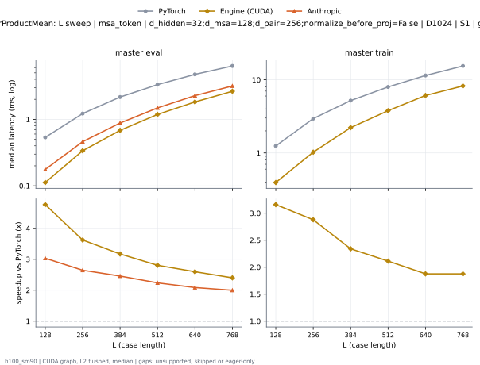

**master eval** (median ms; x = speedup vs PyTorch)

| L | PyTorch | Engine (Triton) | Engine (CUDA) |
|---|---|---|---|
| 128 | 0.5352 | 0.1299 (4.12x) | 0.1136 (4.71x) |
| 256 | 1.222 | 0.3813 (3.21x) | 0.3356 (3.64x) |
| 384 | 2.161 | 0.7806 (2.77x) | 0.6728 (3.21x) |
| 512 | 3.326 | 1.354 (2.46x) | 1.194 (2.78x) |
| 640 | 4.743 | 2.088 (2.27x) | 1.89 (2.51x) |
| 768 | 6.348 | 2.948 (2.15x) | 2.488 (2.55x) |

**master train** (median ms; x = speedup vs PyTorch)

| L | PyTorch | Engine (Triton) | Engine (CUDA) |
|---|---|---|---|
| 128 | 1.243 | 0.5585 (2.23x) | 0.3925 (3.17x) |
| 256 | 2.946 | 1.494 (1.97x) | 1.018 (2.89x) |
| 384 | 5.186 | 2.92 (1.78x) | 2.252 (2.30x) |
| 512 | 8.003 | 5.025 (1.59x) | 3.833 (2.09x) |
| 640 | 11.51 | 7.312 (1.57x) | 6.273 (1.84x) |
| 768 | 15.57 | 10.33 (1.51x) | 8.363 (1.86x) |

### L sweep: msa_token | d_hidden=32;d_msa=128;d_pair=256;normalize_before_proj=True | D1024 | S1 | graph

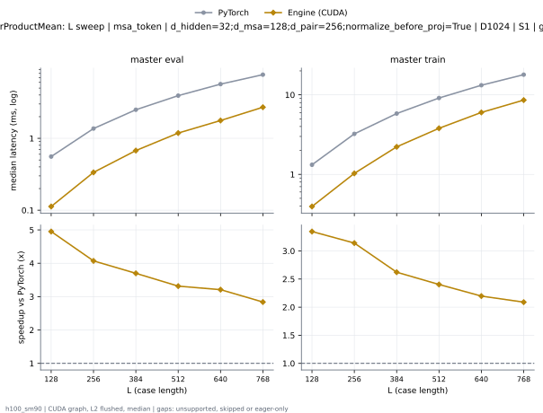

**master eval** (median ms; x = speedup vs PyTorch)

| L | PyTorch | Engine (Triton) | Engine (CUDA) |
|---|---|---|---|
| 128 | 0.5679 | 0.1307 (4.35x) | 0.114 (4.98x) |
| 256 | 1.369 | 0.3824 (3.58x) | 0.3366 (4.07x) |
| 384 | 2.499 | 0.7916 (3.16x) | 0.6799 (3.68x) |
| 512 | 3.928 | 1.36 (2.89x) | 1.169 (3.36x) |
| 640 | 5.681 | 2.115 (2.69x) | 1.928 (2.95x) |
| 768 | 7.695 | 2.993 (2.57x) | 2.721 (2.83x) |

**master train** (median ms; x = speedup vs PyTorch)

| L | PyTorch | Engine (Triton) | Engine (CUDA) |
|---|---|---|---|
| 128 | 1.32 | 0.557 (2.37x) | 0.3933 (3.35x) |
| 256 | 3.23 | 1.561 (2.07x) | 1.028 (3.14x) |
| 384 | 5.816 | 2.95 (1.97x) | 2.273 (2.56x) |
| 512 | 9.135 | 5.027 (1.82x) | 3.978 (2.30x) |
| 640 | 13.27 | 7.403 (1.79x) | 6.246 (2.12x) |
| 768 | 18.19 | 10.47 (1.74x) | 8.571 (2.12x) |

### L sweep: msa_token | d_hidden=32;d_msa=128;d_pair=384;normalize_before_proj=False | D1024 | S1 | graph

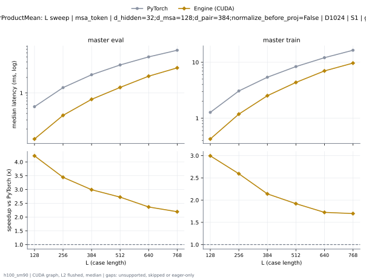

**master eval** (median ms; x = speedup vs PyTorch)

| L | PyTorch | Engine (Triton) | Engine (CUDA) |
|---|---|---|---|
| 128 | 0.5338 | 0.1505 (3.55x) | 0.1279 (4.17x) |
| 256 | 1.27 | 0.4398 (2.89x) | 0.3678 (3.45x) |
| 384 | 2.249 | 0.9182 (2.45x) | 0.7521 (2.99x) |
| 512 | 3.486 | 1.594 (2.19x) | 1.326 (2.63x) |
| 640 | 4.998 | 2.452 (2.04x) | 2.194 (2.28x) |
| 768 | 6.722 | 3.461 (1.94x) | 3.059 (2.20x) |

**master train** (median ms; x = speedup vs PyTorch)

| L | PyTorch | Engine (Triton) | Engine (CUDA) |
|---|---|---|---|
| 128 | 1.271 | 0.6172 (2.06x) | 0.4244 (3.00x) |
| 256 | 3.062 | 1.701 (1.80x) | 1.176 (2.60x) |
| 384 | 5.393 | 3.383 (1.59x) | 2.547 (2.12x) |
| 512 | 8.42 | 5.747 (1.47x) | 4.482 (1.88x) |
| 640 | 12.26 | 8.687 (1.41x) | 7.09 (1.73x) |
| 768 | 16.59 | 12.29 (1.35x) | 9.605 (1.73x) |

### L sweep: msa_token | d_hidden=32;d_msa=128;d_pair=384;normalize_before_proj=True | D1024 | S1 | graph

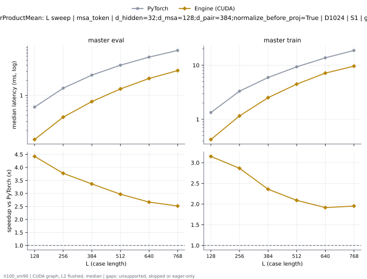

**master eval** (median ms; x = speedup vs PyTorch)

| L | PyTorch | Engine (Triton) | Engine (CUDA) |
|---|---|---|---|
| 128 | 0.5847 | 0.1524 (3.84x) | 0.1322 (4.42x) |
| 256 | 1.393 | 0.4448 (3.13x) | 0.369 (3.77x) |
| 384 | 2.534 | 0.9153 (2.77x) | 0.7528 (3.37x) |
| 512 | 3.995 | 1.601 (2.50x) | 1.345 (2.97x) |
| 640 | 5.792 | 2.442 (2.37x) | 2.172 (2.67x) |
| 768 | 7.858 | 3.504 (2.24x) | 3.121 (2.52x) |

**master train** (median ms; x = speedup vs PyTorch)

| L | PyTorch | Engine (Triton) | Engine (CUDA) |
|---|---|---|---|
| 128 | 1.336 | 0.6133 (2.18x) | 0.4241 (3.15x) |
| 256 | 3.314 | 1.701 (1.95x) | 1.157 (2.86x) |
| 384 | 5.936 | 3.42 (1.74x) | 2.517 (2.36x) |
| 512 | 9.349 | 5.768 (1.62x) | 4.474 (2.09x) |
| 640 | 13.71 | 8.738 (1.57x) | 7.16 (1.92x) |
| 768 | 18.79 | 12.16 (1.55x) | 9.628 (1.95x) |

### L sweep: msa_token | d_hidden=32;d_msa=256;d_pair=512;normalize_before_proj=False | D1024 | S1 | graph

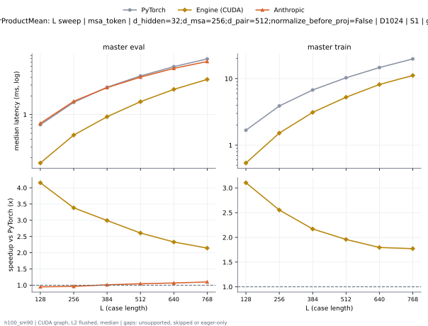

**master eval** (median ms; x = speedup vs PyTorch)

| L | PyTorch | Engine (Triton) | Engine (CUDA) |
|---|---|---|---|
| 128 | 0.6835 | 0.1774 (3.85x) | 0.7159 (0.95x) |
| 256 | 1.577 | 0.535 (2.95x) | 1.626 (0.97x) |
| 384 | 2.752 | 1.077 (2.56x) | 2.783 (0.99x) |
| 512 | 4.217 | 1.871 (2.25x) | 4.189 (1.01x) |
| 640 | 5.959 | 2.889 (2.06x) | 5.863 (1.02x) |
| 768 | 7.94 | 4.029 (1.97x) | 7.741 (1.03x) |

**master train** (median ms; x = speedup vs PyTorch)

| L | PyTorch | Engine (Triton) | Engine (CUDA) |
|---|---|---|---|
| 128 | 1.685 | 1.001 (1.68x) | 0.5412 (3.11x) |
| 256 | 3.872 | 2.368 (1.64x) | 1.521 (2.55x) |
| 384 | 6.75 | 4.403 (1.53x) | 3.136 (2.15x) |
| 512 | 10.35 | 7.131 (1.45x) | 5.53 (1.87x) |
| 640 | 14.8 | 10.78 (1.37x) | 8.297 (1.78x) |
| 768 | 19.85 | 14.77 (1.34x) | 11.41 (1.74x) |

### L sweep: msa_token | d_hidden=32;d_msa=256;d_pair=512;normalize_before_proj=True | D1024 | S1 | graph

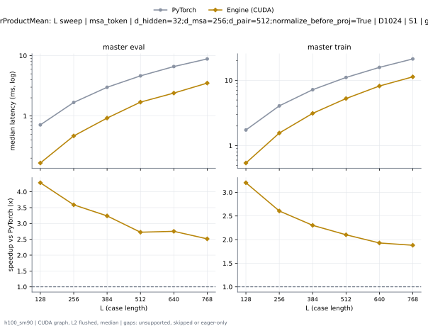

**master eval** (median ms; x = speedup vs PyTorch)

| L | PyTorch | Engine (Triton) | Engine (CUDA) |
|---|---|---|---|
| 128 | 0.7212 | 0.1782 (4.05x) | 0.7449 (0.97x) |
| 256 | 1.678 | 0.5369 (3.13x) | 1.727 (0.97x) |
| 384 | 2.993 | 1.078 (2.78x) | 3.014 (0.99x) |
| 512 | 4.632 | 1.841 (2.52x) | 4.6 (1.01x) |
| 640 | 6.606 | 2.919 (2.26x) | 6.498 (1.02x) |
| 768 | 8.847 | 4.026 (2.20x) | 8.648 (1.02x) |

**master train** (median ms; x = speedup vs PyTorch)

| L | PyTorch | Engine (Triton) | Engine (CUDA) |
|---|---|---|---|
| 128 | 1.738 | 0.9953 (1.75x) | 0.5421 (3.21x) |
| 256 | 4.062 | 2.372 (1.71x) | 1.524 (2.67x) |
| 384 | 7.181 | 4.405 (1.63x) | 3.12 (2.30x) |
| 512 | 11.08 | 7.139 (1.55x) | 5.595 (1.98x) |
| 640 | 15.86 | 10.8 (1.47x) | 8.291 (1.91x) |
| 768 | 21.56 | 14.72 (1.46x) | 11.19 (1.93x) |

### L sweep: msa_token | d_hidden=32;d_msa=64;d_pair=128;normalize_before_proj=False | D1024 | S1 | graph

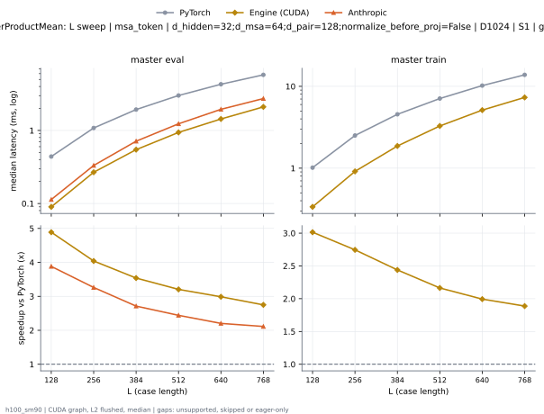

**master eval** (median ms; x = speedup vs PyTorch)

| L | PyTorch | Engine (Triton) | Engine (CUDA) |
|---|---|---|---|
| 128 | 0.4424 | 0.114 (3.88x) | 0.09109 (4.86x) |
| 256 | 1.082 | 0.3046 (3.55x) | 0.2679 (4.04x) |
| 384 | 1.93 | 0.6255 (3.08x) | 0.5463 (3.53x) |
| 512 | 3.014 | 1.071 (2.81x) | 0.9308 (3.24x) |
| 640 | 4.294 | 1.688 (2.54x) | 1.489 (2.88x) |
| 768 | 5.792 | 2.359 (2.46x) | 2.024 (2.86x) |

**master train** (median ms; x = speedup vs PyTorch)

| L | PyTorch | Engine (Triton) | Engine (CUDA) |
|---|---|---|---|
| 128 | 1.018 | 0.3664 (2.78x) | 0.339 (3.00x) |
| 256 | 2.504 | 1.051 (2.38x) | 0.9144 (2.74x) |
| 384 | 4.545 | 2.148 (2.12x) | 1.805 (2.52x) |
| 512 | 7.092 | 3.721 (1.91x) | 3.336 (2.13x) |
| 640 | 10.22 | 5.778 (1.77x) | 5.166 (1.98x) |
| 768 | 13.87 | 8.259 (1.68x) | 7.154 (1.94x) |

### L sweep: msa_token | d_hidden=32;d_msa=64;d_pair=128;normalize_before_proj=False;projection_bias=True | D1024 | S1 | graph

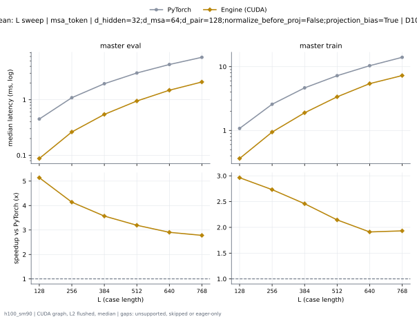

**master eval** (median ms; x = speedup vs PyTorch)

| L | PyTorch | Engine (Triton) | Engine (CUDA) |
|---|---|---|---|
| 128 | 0.4494 | 0.1159 (3.88x) | 0.08746 (5.14x) |
| 256 | 1.088 | 0.3052 (3.56x) | 0.2629 (4.14x) |
| 384 | 1.943 | 0.6298 (3.09x) | 0.5444 (3.57x) |
| 512 | 3.029 | 1.096 (2.76x) | 0.9483 (3.19x) |
| 640 | 4.308 | 1.694 (2.54x) | 1.483 (2.90x) |
| 768 | 5.804 | 2.419 (2.40x) | 2.088 (2.78x) |

**master train** (median ms; x = speedup vs PyTorch)

| L | PyTorch | Engine (Triton) | Engine (CUDA) |
|---|---|---|---|
| 128 | 1.076 | 0.404 (2.66x) | 0.3632 (2.96x) |
| 256 | 2.576 | 1.118 (2.30x) | 0.9429 (2.73x) |
| 384 | 4.655 | 2.257 (2.06x) | 1.894 (2.46x) |
| 512 | 7.222 | 3.826 (1.89x) | 3.368 (2.14x) |
| 640 | 10.36 | 5.944 (1.74x) | 5.418 (1.91x) |
| 768 | 14.02 | 8.391 (1.67x) | 7.258 (1.93x) |

### L sweep: msa_token | d_hidden=32;d_msa=64;d_pair=128;normalize_before_proj=True | D384 | S1 | graph

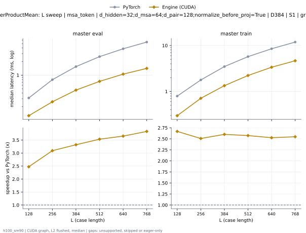

**master eval** (median ms; x = speedup vs PyTorch)

| L | PyTorch | Engine (Triton) | Engine (CUDA) |
|---|---|---|---|
| 128 | 0.3122 | 0.0795 (3.93x) | 0.1262 (2.47x) |
| 256 | 0.7937 | 0.1968 (4.03x) | 0.2567 (3.09x) |
| 384 | 1.548 | 0.3859 (4.01x) | 0.4663 (3.32x) |
| 512 | 2.575 | 0.6299 (4.09x) | 0.7286 (3.53x) |
| 640 | 3.849 | 0.9613 (4.00x) | 1.054 (3.65x) |
| 768 | 5.416 | 1.4 (3.87x) | 1.413 (3.83x) |

**master train** (median ms; x = speedup vs PyTorch)

| L | PyTorch | Engine (Triton) | Engine (CUDA) |
|---|---|---|---|
| 128 | 0.7931 | 0.2444 (3.24x) | 0.2973 (2.67x) |
| 256 | 1.781 | 0.6523 (2.73x) | 0.7103 (2.51x) |
| 384 | 3.481 | 1.297 (2.68x) | 1.338 (2.60x) |
| 512 | 5.728 | 2.174 (2.63x) | 2.226 (2.57x) |
| 640 | 8.504 | 3.364 (2.53x) | 3.368 (2.53x) |
| 768 | 11.87 | 4.722 (2.51x) | 4.661 (2.55x) |

### L sweep: msa_token | d_hidden=32;d_msa=64;d_pair=128;normalize_before_proj=True;projection_bias=True | D1024 | S1 | graph

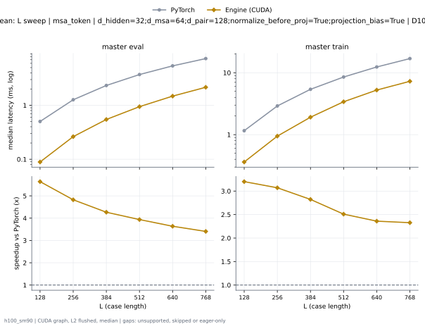

**master eval** (median ms; x = speedup vs PyTorch)

| L | PyTorch | Engine (Triton) | Engine (CUDA) |
|---|---|---|---|
| 128 | 0.5016 | 0.1168 (4.29x) | 0.08898 (5.64x) |
| 256 | 1.267 | 0.3061 (4.14x) | 0.2627 (4.82x) |
| 384 | 2.331 | 0.6357 (3.67x) | 0.5464 (4.27x) |
| 512 | 3.715 | 1.093 (3.40x) | 0.9438 (3.94x) |
| 640 | 5.381 | 1.697 (3.17x) | 1.479 (3.64x) |
| 768 | 7.348 | 2.348 (3.13x) | 2.158 (3.41x) |

**master train** (median ms; x = speedup vs PyTorch)

| L | PyTorch | Engine (Triton) | Engine (CUDA) |
|---|---|---|---|
| 128 | 1.159 | 0.4017 (2.88x) | 0.362 (3.20x) |
| 256 | 2.907 | 1.115 (2.61x) | 0.9471 (3.07x) |
| 384 | 5.399 | 2.256 (2.39x) | 1.913 (2.82x) |
| 512 | 8.528 | 3.808 (2.24x) | 3.399 (2.51x) |
| 640 | 12.39 | 6.012 (2.06x) | 5.249 (2.36x) |
| 768 | 16.92 | 8.448 (2.00x) | 7.272 (2.33x) |

### L sweep: msa_token | d_hidden=64;d_msa=64;d_pair=256;groups=8;normalize_before_proj=False | D1024 | S1 | graph

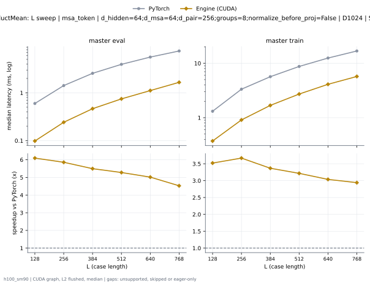

**master eval** (median ms; x = speedup vs PyTorch)

| L | PyTorch | Engine (Triton) | Engine (CUDA) |
|---|---|---|---|
| 128 | 0.5993 | 0.08699 (6.89x) | 0.09835 (6.09x) |
| 256 | 1.419 | 0.2456 (5.78x) | 0.2423 (5.86x) |
| 384 | 2.561 | 0.4889 (5.24x) | 0.466 (5.49x) |
| 512 | 3.945 | 0.8007 (4.93x) | 0.7476 (5.28x) |
| 640 | 5.596 | 1.241 (4.51x) | 1.116 (5.02x) |
| 768 | 7.509 | 1.732 (4.33x) | 1.659 (4.53x) |

**master train** (median ms; x = speedup vs PyTorch)

| L | PyTorch | Engine (Triton) | Engine (CUDA) |
|---|---|---|---|
| 128 | 1.314 | 0.3595 (3.65x) | 0.3731 (3.52x) |
| 256 | 3.338 | 0.942 (3.54x) | 0.9101 (3.67x) |
| 384 | 5.665 | 1.758 (3.22x) | 1.682 (3.37x) |
| 512 | 8.74 | 2.82 (3.10x) | 2.718 (3.22x) |
| 640 | 12.47 | 4.232 (2.95x) | 4.107 (3.04x) |
| 768 | 16.82 | 5.921 (2.84x) | 5.721 (2.94x) |

### L sweep: msa_token | d_hidden=64;d_msa=64;d_pair=256;groups=8;normalize_before_proj=True | D1024 | S1 | graph

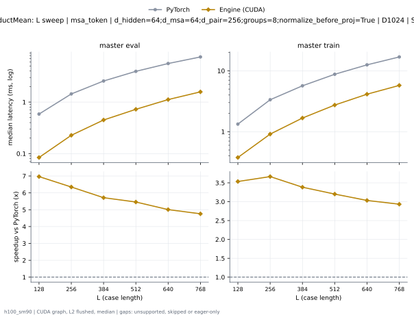

**master eval** (median ms; x = speedup vs PyTorch)

| L | PyTorch | Engine (Triton) | Engine (CUDA) |
|---|---|---|---|
| 128 | 0.634 | 0.08782 (7.22x) | 0.09982 (6.35x) |
| 256 | 1.439 | 0.248 (5.80x) | 0.2452 (5.87x) |
| 384 | 2.563 | 0.4903 (5.23x) | 0.4681 (5.48x) |
| 512 | 3.949 | 0.8003 (4.93x) | 0.7419 (5.32x) |
| 640 | 5.6 | 1.26 (4.44x) | 1.153 (4.86x) |
| 768 | 7.516 | 1.747 (4.30x) | 1.655 (4.54x) |

**master train** (median ms; x = speedup vs PyTorch)

| L | PyTorch | Engine (Triton) | Engine (CUDA) |
|---|---|---|---|
| 128 | 1.326 | 0.363 (3.65x) | 0.3762 (3.52x) |
| 256 | 3.34 | 0.9455 (3.53x) | 0.9134 (3.66x) |
| 384 | 5.669 | 1.752 (3.24x) | 1.67 (3.39x) |
| 512 | 8.747 | 2.838 (3.08x) | 2.743 (3.19x) |
| 640 | 12.48 | 4.245 (2.94x) | 4.137 (3.02x) |
| 768 | 16.84 | 5.906 (2.85x) | 5.767 (2.92x) |

### d_msa sweep at L768: msa_token | normalize_before_proj=False | D1024 | S1 | graph

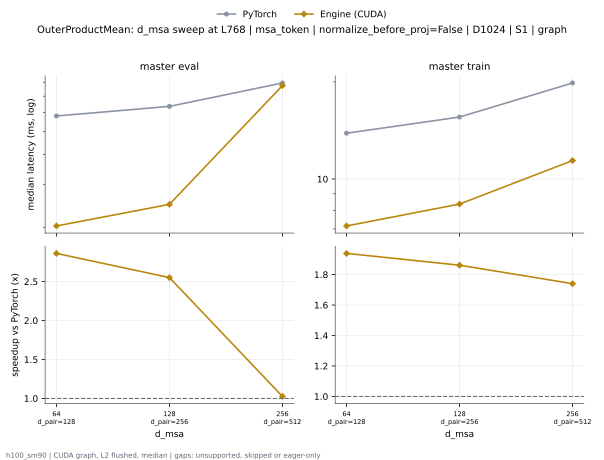

**master eval** (median ms; x = speedup vs PyTorch)

| d_msa | PyTorch | Engine (Triton) | Engine (CUDA) |
|---|---|---|---|
| 64 d_pair=128 | 5.792 | 2.359 (2.46x) | 2.024 (2.86x) |
| 128 d_pair=256 | 6.348 | 2.948 (2.15x) | 2.488 (2.55x) |
| 256 d_pair=512 | 7.94 | 4.029 (1.97x) | 7.741 (1.03x) |

**master train** (median ms; x = speedup vs PyTorch)

| d_msa | PyTorch | Engine (Triton) | Engine (CUDA) |
|---|---|---|---|
| 64 d_pair=128 | 13.87 | 8.259 (1.68x) | 7.154 (1.94x) |
| 128 d_pair=256 | 15.57 | 10.33 (1.51x) | 8.363 (1.86x) |
| 256 d_pair=512 | 19.85 | 14.77 (1.34x) | 11.41 (1.74x) |

### d_pair sweep at L768: msa_token | normalize_before_proj=False | D1024 | S1 | graph

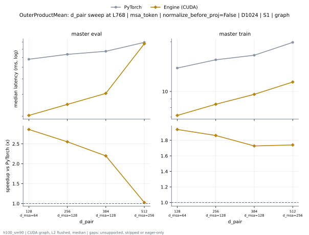

**master eval** (median ms; x = speedup vs PyTorch)

| d_pair | PyTorch | Engine (Triton) | Engine (CUDA) |
|---|---|---|---|
| 128 d_msa=64 | 5.792 | 2.359 (2.46x) | 2.024 (2.86x) |
| 256 d_msa=128 | 6.348 | 2.948 (2.15x) | 2.488 (2.55x) |
| 384 d_msa=128 | 6.722 | 3.461 (1.94x) | 3.059 (2.20x) |
| 512 d_msa=256 | 7.94 | 4.029 (1.97x) | 7.741 (1.03x) |

**master train** (median ms; x = speedup vs PyTorch)

| d_pair | PyTorch | Engine (Triton) | Engine (CUDA) |
|---|---|---|---|
| 128 d_msa=64 | 13.87 | 8.259 (1.68x) | 7.154 (1.94x) |
| 256 d_msa=128 | 15.57 | 10.33 (1.51x) | 8.363 (1.86x) |
| 384 d_msa=128 | 16.59 | 12.29 (1.35x) | 9.605 (1.73x) |
| 512 d_msa=256 | 19.85 | 14.77 (1.34x) | 11.41 (1.74x) |

### d_pair sweep at L768: msa_token | normalize_before_proj=True | D1024 | S1 | graph

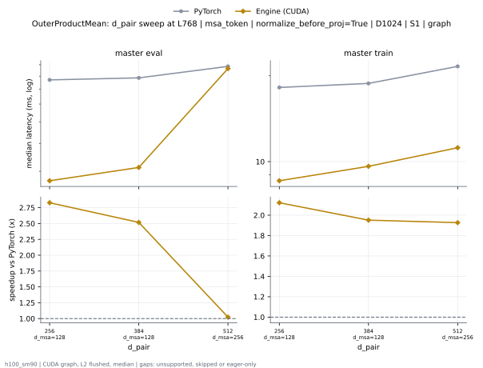

**master eval** (median ms; x = speedup vs PyTorch)

| d_pair | PyTorch | Engine (Triton) | Engine (CUDA) |
|---|---|---|---|
| 256 d_msa=128 | 7.695 | 2.993 (2.57x) | 2.721 (2.83x) |
| 384 d_msa=128 | 7.858 | 3.504 (2.24x) | 3.121 (2.52x) |
| 512 d_msa=256 | 8.847 | 4.026 (2.20x) | 8.648 (1.02x) |

**master train** (median ms; x = speedup vs PyTorch)

| d_pair | PyTorch | Engine (Triton) | Engine (CUDA) |
|---|---|---|---|
| 256 d_msa=128 | 18.19 | 10.47 (1.74x) | 8.571 (2.12x) |
| 384 d_msa=128 | 18.79 | 12.16 (1.55x) | 9.628 (1.95x) |
| 512 d_msa=256 | 21.56 | 14.72 (1.46x) | 11.19 (1.93x) |

