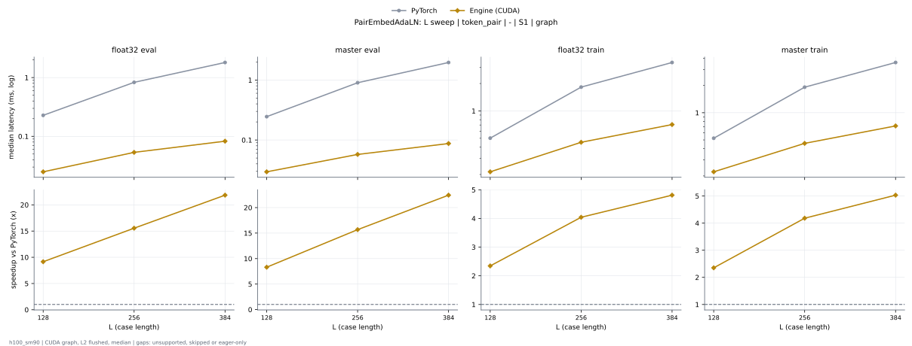

# PairEmbedAdaLN on h100_sm90

Generated by `python -m foldjet_engine.measure.plot` from speed tokens `judge/tokens/h100_sm90/`; do not edit.

### L sweep: token_pair | - | S1 | graph

**float32 eval** (median ms; x = speedup vs PyTorch)

| L | PyTorch | Engine (Triton) | Engine (CUDA) |
|---|---|---|---|
| 128 | 0.228 | 0.02882 (7.91x) | 0.02491 (9.15x) |
| 256 | 0.8303 | 0.06755 (12.29x) | 0.05339 (15.55x) |
| 384 | 1.808 | 0.1283 (14.09x) | 0.08274 (21.85x) |

**master eval** (median ms; x = speedup vs PyTorch)

| L | PyTorch | Engine (Triton) | Engine (CUDA) |
|---|---|---|---|
| 128 | 0.245 | 0.03358 (7.30x) | 0.02949 (8.31x) |
| 256 | 0.9005 | 0.07187 (12.53x) | 0.05746 (15.67x) |
| 384 | 1.959 | 0.1331 (14.72x) | 0.08733 (22.44x) |

**float32 train** (median ms; x = speedup vs PyTorch)

| L | PyTorch | Engine (Triton) | Engine (CUDA) |
|---|---|---|---|
| 128 | 0.502 | 0.479 (1.05x) | 0.214 (2.35x) |
| 256 | 1.827 | 0.9989 (1.83x) | 0.4522 (4.04x) |
| 384 | 3.407 | 1.52 (2.24x) | 0.708 (4.81x) |

**master train** (median ms; x = speedup vs PyTorch)

| L | PyTorch | Engine (Triton) | Engine (CUDA) |
|---|---|---|---|
| 128 | 0.5222 | 0.4853 (1.08x) | 0.222 (2.35x) |
| 256 | 1.916 | 1.005 (1.91x) | 0.4583 (4.18x) |
| 384 | 3.595 | 1.528 (2.35x) | 0.7144 (5.03x) |

