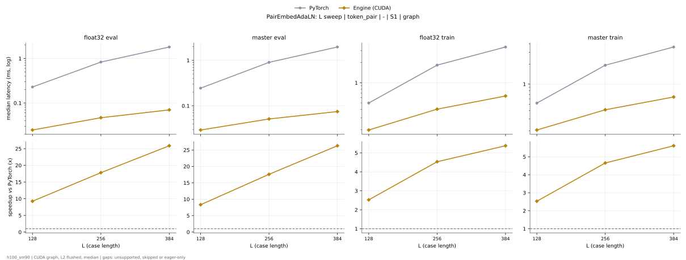

# PairEmbedAdaLN on h100_sm90

Generated by `python -m miniworld_engine.measure.plot` from speed tokens `judge/tokens/h100_sm90/`; do not edit.

### L sweep: token_pair | - | S1 | graph

**float32 eval** (median ms; x = speedup vs PyTorch)

| L | PyTorch | Engine (Triton) | Engine (CUDA) |
|---|---|---|---|
| 128 | 0.2289 | 0.02856 (8.01x) | 0.02474 (9.25x) |
| 256 | 0.8316 | 0.06624 (12.56x) | 0.04669 (17.81x) |
| 384 | 1.813 | 0.1266 (14.32x) | 0.07006 (25.88x) |

**master eval** (median ms; x = speedup vs PyTorch)

| L | PyTorch | Engine (Triton) | Engine (CUDA) |
|---|---|---|---|
| 128 | 0.2446 | 0.03323 (7.36x) | 0.02938 (8.33x) |
| 256 | 0.9034 | 0.0711 (12.71x) | 0.05136 (17.59x) |
| 384 | 1.966 | 0.1314 (14.96x) | 0.07477 (26.29x) |

**float32 train** (median ms; x = speedup vs PyTorch)

| L | PyTorch | Engine (Triton) | Engine (CUDA) |
|---|---|---|---|
| 128 | 0.4985 | 0.4698 (1.06x) | 0.1975 (2.52x) |
| 256 | 1.832 | 0.988 (1.85x) | 0.4039 (4.54x) |
| 384 | 3.413 | 1.507 (2.26x) | 0.6346 (5.38x) |

**master train** (median ms; x = speedup vs PyTorch)

| L | PyTorch | Engine (Triton) | Engine (CUDA) |
|---|---|---|---|
| 128 | 0.5191 | 0.4788 (1.08x) | 0.2051 (2.53x) |
| 256 | 1.919 | 0.9965 (1.93x) | 0.4122 (4.66x) |
| 384 | 3.6 | 1.516 (2.38x) | 0.6415 (5.61x) |

