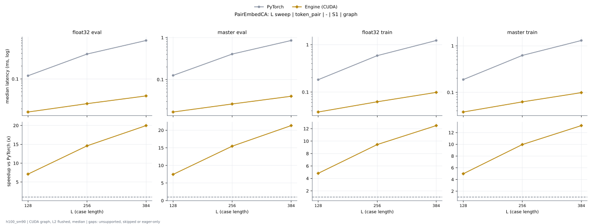
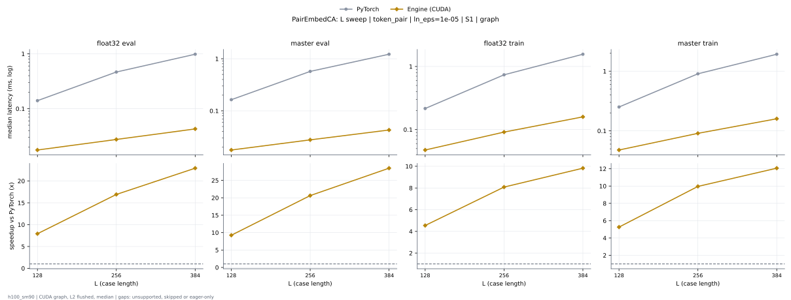

# PairEmbedCA on h100_sm90

Generated by `python -m foldjet_engine.measure.plot` from speed tokens `judge/tokens/h100_sm90/`; do not edit.

### L sweep: token_pair | - | S1 | graph

**float32 eval** (median ms; x = speedup vs PyTorch)

| L | PyTorch | Engine (Triton) | Engine (CUDA) |
|---|---|---|---|
| 128 | 0.119 | 0.01715 (6.94x) | 0.01677 (7.10x) |
| 256 | 0.3843 | 0.02589 (14.84x) | 0.02632 (14.60x) |
| 384 | 0.7991 | 0.04136 (19.32x) | 0.04 (19.98x) |

**master eval** (median ms; x = speedup vs PyTorch)

| L | PyTorch | Engine (Triton) | Engine (CUDA) |
|---|---|---|---|
| 128 | 0.1252 | 0.0171 (7.32x) | 0.0168 (7.45x) |
| 256 | 0.4037 | 0.02606 (15.49x) | 0.0261 (15.47x) |
| 384 | 0.8508 | 0.04138 (20.56x) | 0.03989 (21.33x) |

**float32 train** (median ms; x = speedup vs PyTorch)

| L | PyTorch | Engine (Triton) | Engine (CUDA) |
|---|---|---|---|
| 128 | 0.1824 | 0.0575 (3.17x) | 0.03787 (4.82x) |
| 256 | 0.5883 | 0.08725 (6.74x) | 0.06229 (9.45x) |
| 384 | 1.23 | 0.1211 (10.16x) | 0.09842 (12.49x) |

**master train** (median ms; x = speedup vs PyTorch)

| L | PyTorch | Engine (Triton) | Engine (CUDA) |
|---|---|---|---|
| 128 | 0.1886 | 0.05725 (3.29x) | 0.03786 (4.98x) |
| 256 | 0.6229 | 0.08712 (7.15x) | 0.06251 (9.96x) |
| 384 | 1.303 | 0.1208 (10.79x) | 0.09875 (13.20x) |

### L sweep: token_pair | ln_eps=1e-05 | S1 | graph

**float32 eval** (median ms; x = speedup vs PyTorch)

| L | PyTorch | Engine (Triton) | Engine (CUDA) |
|---|---|---|---|
| 128 | 0.1402 | 0.01765 (7.94x) | 0.0177 (7.92x) |
| 256 | 0.4658 | 0.02632 (17.70x) | 0.02754 (16.92x) |
| 384 | 0.9826 | 0.04182 (23.49x) | 0.04285 (22.93x) |

**master eval** (median ms; x = speedup vs PyTorch)

| L | PyTorch | Engine (Triton) | Engine (CUDA) |
|---|---|---|---|
| 128 | 0.1636 | 0.01754 (9.33x) | 0.0177 (9.25x) |
| 256 | 0.5718 | 0.0265 (21.58x) | 0.02771 (20.63x) |
| 384 | 1.222 | 0.04187 (29.18x) | 0.04286 (28.51x) |

**float32 train** (median ms; x = speedup vs PyTorch)

| L | PyTorch | Engine (Triton) | Engine (CUDA) |
|---|---|---|---|
| 128 | 0.2157 | 0.0625 (3.45x) | 0.04746 (4.54x) |
| 256 | 0.7373 | 0.1146 (6.43x) | 0.09122 (8.08x) |
| 384 | 1.562 | 0.1783 (8.77x) | 0.159 (9.82x) |

**master train** (median ms; x = speedup vs PyTorch)

| L | PyTorch | Engine (Triton) | Engine (CUDA) |
|---|---|---|---|
| 128 | 0.2513 | 0.06213 (4.04x) | 0.04778 (5.26x) |
| 256 | 0.9046 | 0.1142 (7.92x) | 0.09085 (9.96x) |
| 384 | 1.925 | 0.1777 (10.83x) | 0.1596 (12.06x) |

