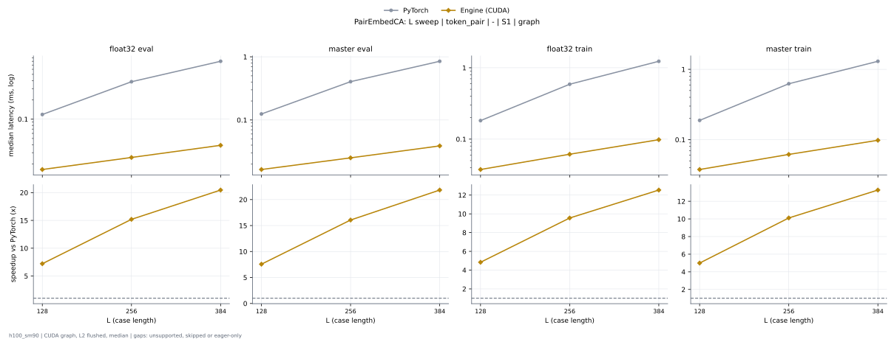
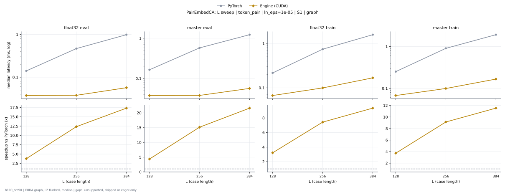

# PairEmbedCA on h100_sm90

Generated by `python -m miniworld_engine.measure.plot` from speed tokens `judge/tokens/h100_sm90/`; do not edit.

### L sweep: token_pair | - | S1 | graph

**float32 eval** (median ms; x = speedup vs PyTorch)

| L | PyTorch | Engine (Triton) | Engine (CUDA) |
|---|---|---|---|
| 128 | 0.1183 | 0.01696 (6.98x) | 0.0164 (7.22x) |
| 256 | 0.3839 | 0.02592 (14.81x) | 0.02526 (15.19x) |
| 384 | 0.8002 | 0.0413 (19.38x) | 0.0391 (20.46x) |

**master eval** (median ms; x = speedup vs PyTorch)

| L | PyTorch | Engine (Triton) | Engine (CUDA) |
|---|---|---|---|
| 128 | 0.1245 | 0.01704 (7.31x) | 0.01646 (7.56x) |
| 256 | 0.4044 | 0.02586 (15.64x) | 0.02517 (16.07x) |
| 384 | 0.8497 | 0.04104 (20.71x) | 0.03891 (21.84x) |

**float32 train** (median ms; x = speedup vs PyTorch)

| L | PyTorch | Engine (Triton) | Engine (CUDA) |
|---|---|---|---|
| 128 | 0.1818 | 0.05525 (3.29x) | 0.03757 (4.84x) |
| 256 | 0.5874 | 0.08419 (6.98x) | 0.06147 (9.56x) |
| 384 | 1.232 | 0.1202 (10.25x) | 0.09826 (12.54x) |

**master train** (median ms; x = speedup vs PyTorch)

| L | PyTorch | Engine (Triton) | Engine (CUDA) |
|---|---|---|---|
| 128 | 0.1881 | 0.05531 (3.40x) | 0.03766 (4.99x) |
| 256 | 0.6236 | 0.08413 (7.41x) | 0.06168 (10.11x) |
| 384 | 1.301 | 0.1201 (10.84x) | 0.09803 (13.28x) |

### L sweep: token_pair | ln_eps=1e-05 | S1 | graph

**float32 eval** (median ms; x = speedup vs PyTorch)

| L | PyTorch | Engine (Triton) | Engine (CUDA) |
|---|---|---|---|
| 128 | 0.1402 | 0.01754 (7.99x) | 0.01738 (8.07x) |
| 256 | 0.4671 | 0.02651 (17.62x) | 0.02725 (17.14x) |
| 384 | 0.9868 | 0.04122 (23.94x) | 0.04165 (23.69x) |

**master eval** (median ms; x = speedup vs PyTorch)

| L | PyTorch | Engine (Triton) | Engine (CUDA) |
|---|---|---|---|
| 128 | 0.1647 | 0.01763 (9.34x) | 0.01754 (9.39x) |
| 256 | 0.5735 | 0.02634 (21.78x) | 0.0271 (21.16x) |
| 384 | 1.223 | 0.04149 (29.47x) | 0.04166 (29.34x) |

**float32 train** (median ms; x = speedup vs PyTorch)

| L | PyTorch | Engine (Triton) | Engine (CUDA) |
|---|---|---|---|
| 128 | 0.2152 | 0.05987 (3.59x) | 0.04691 (4.59x) |
| 256 | 0.7395 | 0.1086 (6.81x) | 0.0875 (8.45x) |
| 384 | 1.567 | 0.1725 (9.08x) | 0.1514 (10.35x) |

**master train** (median ms; x = speedup vs PyTorch)

| L | PyTorch | Engine (Triton) | Engine (CUDA) |
|---|---|---|---|
| 128 | 0.252 | 0.05989 (4.21x) | 0.04749 (5.31x) |
| 256 | 0.9065 | 0.1082 (8.38x) | 0.08699 (10.42x) |
| 384 | 1.93 | 0.1722 (11.21x) | 0.1517 (12.72x) |

