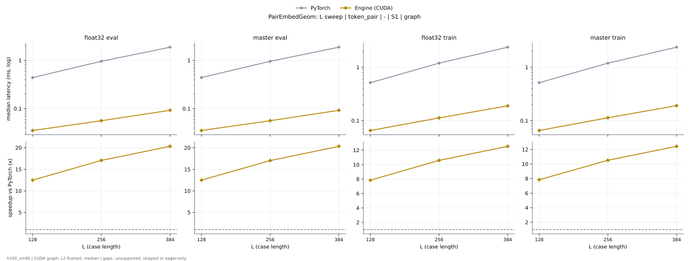
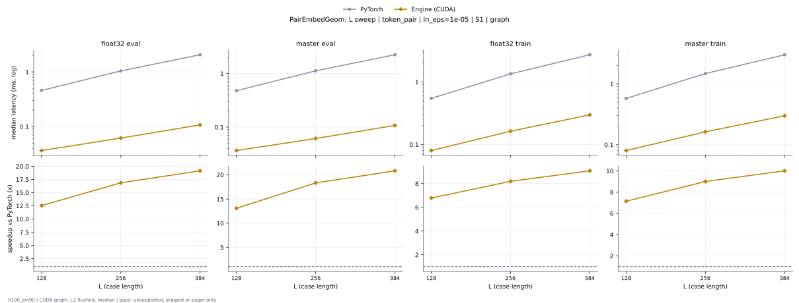

# PairEmbedGeom on h100_sm90

Generated by `python -m foldjet_engine.measure.plot` from speed tokens `judge/tokens/h100_sm90/`; do not edit.

### L sweep: token_pair | - | S1 | graph

**float32 eval** (median ms; x = speedup vs PyTorch)

| L | PyTorch | Engine (Triton) | Engine (CUDA) |
|---|---|---|---|
| 128 | 0.4384 | 0.03442 (12.74x) | 0.03515 (12.47x) |
| 256 | 0.9565 | 0.05582 (17.13x) | 0.05608 (17.06x) |
| 384 | 1.874 | 0.09206 (20.36x) | 0.09224 (20.32x) |

**master eval** (median ms; x = speedup vs PyTorch)

| L | PyTorch | Engine (Triton) | Engine (CUDA) |
|---|---|---|---|
| 128 | 0.4398 | 0.03451 (12.74x) | 0.0352 (12.50x) |
| 256 | 0.9564 | 0.0559 (17.11x) | 0.05619 (17.02x) |
| 384 | 1.874 | 0.09251 (20.25x) | 0.09216 (20.33x) |

**float32 train** (median ms; x = speedup vs PyTorch)

| L | PyTorch | Engine (Triton) | Engine (CUDA) |
|---|---|---|---|
| 128 | 0.5132 | 0.1125 (4.56x) | 0.06541 (7.85x) |
| 256 | 1.192 | 0.1815 (6.57x) | 0.1126 (10.59x) |
| 384 | 2.375 | 0.2724 (8.72x) | 0.1895 (12.53x) |

**master train** (median ms; x = speedup vs PyTorch)

| L | PyTorch | Engine (Triton) | Engine (CUDA) |
|---|---|---|---|
| 128 | 0.5137 | 0.1125 (4.56x) | 0.06549 (7.84x) |
| 256 | 1.193 | 0.1814 (6.58x) | 0.1135 (10.51x) |
| 384 | 2.374 | 0.2718 (8.74x) | 0.1911 (12.42x) |

### L sweep: token_pair | ln_eps=1e-05 | S1 | graph

**float32 eval** (median ms; x = speedup vs PyTorch)

| L | PyTorch | Engine (Triton) | Engine (CUDA) |
|---|---|---|---|
| 128 | 0.4587 | 0.03654 (12.55x) | 0.03651 (12.56x) |
| 256 | 1.041 | 0.06138 (16.96x) | 0.06171 (16.87x) |
| 384 | 2.058 | 0.105 (19.60x) | 0.1076 (19.14x) |

**master eval** (median ms; x = speedup vs PyTorch)

| L | PyTorch | Engine (Triton) | Engine (CUDA) |
|---|---|---|---|
| 128 | 0.4787 | 0.03638 (13.16x) | 0.03656 (13.09x) |
| 256 | 1.124 | 0.06136 (18.33x) | 0.0613 (18.34x) |
| 384 | 2.245 | 0.1048 (21.42x) | 0.1077 (20.85x) |

**float32 train** (median ms; x = speedup vs PyTorch)

| L | PyTorch | Engine (Triton) | Engine (CUDA) |
|---|---|---|---|
| 128 | 0.5467 | 0.1241 (4.41x) | 0.08056 (6.79x) |
| 256 | 1.343 | 0.2274 (5.91x) | 0.1639 (8.20x) |
| 384 | 2.709 | 0.3709 (7.30x) | 0.2984 (9.08x) |

**master train** (median ms; x = speedup vs PyTorch)

| L | PyTorch | Engine (Triton) | Engine (CUDA) |
|---|---|---|---|
| 128 | 0.577 | 0.1241 (4.65x) | 0.08064 (7.16x) |
| 256 | 1.473 | 0.2264 (6.51x) | 0.1635 (9.01x) |
| 384 | 2.995 | 0.3707 (8.08x) | 0.2992 (10.01x) |

