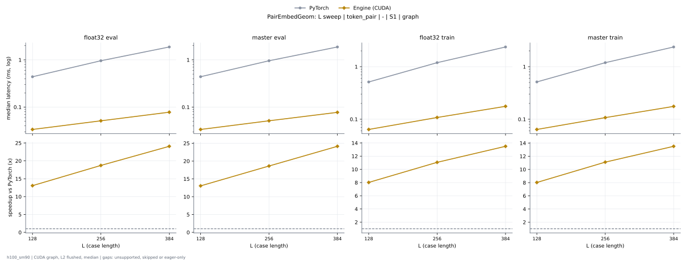
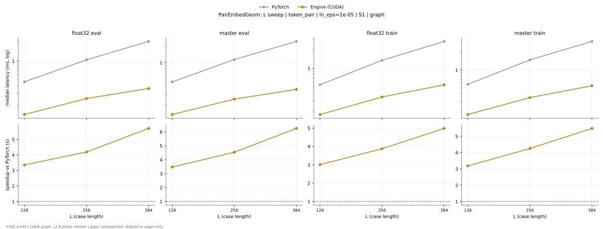

# PairEmbedGeom on h100_sm90

Generated by `python -m miniworld_engine.measure.plot` from speed tokens `judge/tokens/h100_sm90/`; do not edit.

### L sweep: token_pair | - | S1 | graph

**float32 eval** (median ms; x = speedup vs PyTorch)

| L | PyTorch | Engine (Triton) | Engine (CUDA) |
|---|---|---|---|
| 128 | 0.438 | 0.03413 (12.83x) | 0.03357 (13.05x) |
| 256 | 0.9575 | 0.05478 (17.48x) | 0.05069 (18.89x) |
| 384 | 1.878 | 0.08874 (21.16x) | 0.07776 (24.15x) |

**master eval** (median ms; x = speedup vs PyTorch)

| L | PyTorch | Engine (Triton) | Engine (CUDA) |
|---|---|---|---|
| 128 | 0.4385 | 0.03424 (12.81x) | 0.03362 (13.05x) |
| 256 | 0.9575 | 0.05514 (17.37x) | 0.05102 (18.76x) |
| 384 | 1.874 | 0.0885 (21.18x) | 0.07734 (24.24x) |

**float32 train** (median ms; x = speedup vs PyTorch)

| L | PyTorch | Engine (Triton) | Engine (CUDA) |
|---|---|---|---|
| 128 | 0.5126 | 0.1104 (4.64x) | 0.06374 (8.04x) |
| 256 | 1.195 | 0.1745 (6.85x) | 0.1078 (11.09x) |
| 384 | 2.372 | 0.2695 (8.80x) | 0.176 (13.48x) |

**master train** (median ms; x = speedup vs PyTorch)

| L | PyTorch | Engine (Triton) | Engine (CUDA) |
|---|---|---|---|
| 128 | 0.5131 | 0.1105 (4.64x) | 0.06386 (8.04x) |
| 256 | 1.194 | 0.1745 (6.84x) | 0.1075 (11.11x) |
| 384 | 2.373 | 0.2692 (8.82x) | 0.176 (13.48x) |

### L sweep: token_pair | ln_eps=1e-05 | S1 | graph

**float32 eval** (median ms; x = speedup vs PyTorch)

| L | PyTorch | Engine (Triton) | Engine (CUDA) |
|---|---|---|---|
| 128 | 0.4598 | 0.03616 (12.72x) | 0.03498 (13.15x) |
| 256 | 1.041 | 0.06069 (17.16x) | 0.05662 (18.39x) |
| 384 | 2.064 | 0.1019 (20.26x) | 0.09019 (22.88x) |

**master eval** (median ms; x = speedup vs PyTorch)

| L | PyTorch | Engine (Triton) | Engine (CUDA) |
|---|---|---|---|
| 128 | 0.4766 | 0.03619 (13.17x) | 0.03501 (13.61x) |
| 256 | 1.127 | 0.0607 (18.57x) | 0.0572 (19.71x) |
| 384 | 2.257 | 0.1018 (22.18x) | 0.09045 (24.95x) |

**float32 train** (median ms; x = speedup vs PyTorch)

| L | PyTorch | Engine (Triton) | Engine (CUDA) |
|---|---|---|---|
| 128 | 0.5444 | 0.1208 (4.51x) | 0.0777 (7.01x) |
| 256 | 1.346 | 0.2195 (6.13x) | 0.1547 (8.70x) |
| 384 | 2.712 | 0.3688 (7.35x) | 0.2727 (9.95x) |

**master train** (median ms; x = speedup vs PyTorch)

| L | PyTorch | Engine (Triton) | Engine (CUDA) |
|---|---|---|---|
| 128 | 0.5764 | 0.1212 (4.76x) | 0.07805 (7.38x) |
| 256 | 1.477 | 0.2192 (6.74x) | 0.1545 (9.56x) |
| 384 | 3.001 | 0.3653 (8.21x) | 0.2728 (11.00x) |

