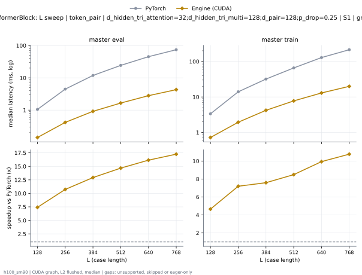

# PairformerBlock on h100_sm90

Generated by `python -m miniworld_engine.measure.plot` from speed tokens `judge/tokens/h100_sm90/`; do not edit.

### L sweep: token_pair | d_hidden_tri_attention=32;d_hidden_tri_multi=128;d_pair=128;p_drop=0.25 | S1 | graph

**master eval** (median ms; x = speedup vs PyTorch)

| L | PyTorch | Engine (Triton) | Engine (CUDA) | Anthropic |
|---|---|---|---|---|
| 128 | 1.052 | 0.3979 (2.64x) | 0.1382 (7.61x) | 0.187 (5.62x) |
| 256 | 4.454 | 1.136 (3.92x) | 0.4136 (10.77x) | 0.6496 (6.86x) |
| 384 | 11.82 | 2.576 (4.59x) | 0.9081 (13.02x) | 1.473 (8.02x) |
| 512 | 24.32 | 4.695 (5.18x) | 1.672 (14.54x) | 2.704 (8.99x) |
| 640 | 45.3 | 7.495 (6.04x) | 2.759 (16.42x) | 4.419 (10.25x) |
| 768 | 74.24 | 11.14 (6.66x) | 4.25 (17.47x) | 6.783 (10.94x) |

**master train** (median ms; x = speedup vs PyTorch)

| L | PyTorch | Engine (Triton) | Engine (CUDA) | Anthropic |
|---|---|---|---|---|
| 128 | 3.35 | 1.433 (2.34x) | 0.72 (4.65x) | unsupported |
| 256 | 13.94 | 4.477 (3.11x) | 1.931 (7.22x) | unsupported |
| 384 | 31.89 | 9.031 (3.53x) | 4.19 (7.61x) | unsupported |
| 512 | 65.75 | 16.34 (4.02x) | 7.737 (8.50x) | unsupported |
| 640 | 128.6 | 26.68 (4.82x) | 12.92 (9.95x) | unsupported |
| 768 | 214.1 | 40.28 (5.32x) | 19.88 (10.77x) | unsupported |

