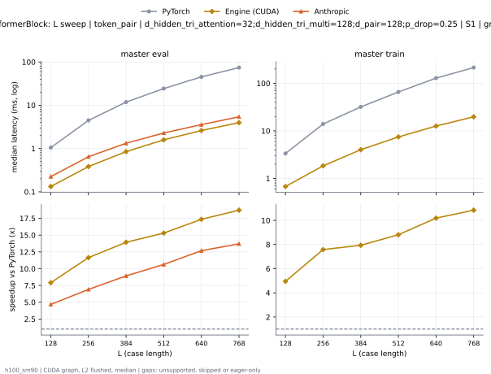
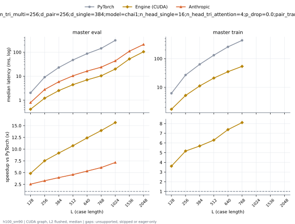
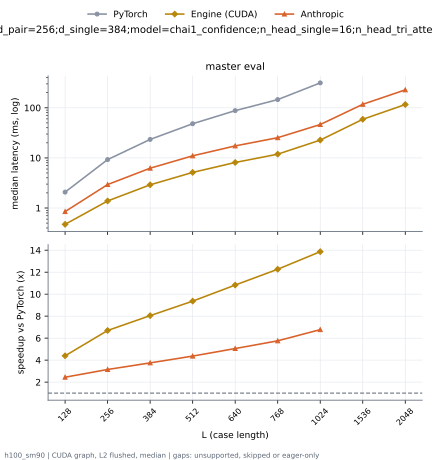
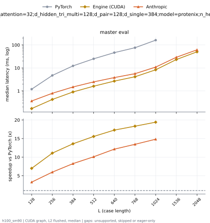

# PairformerBlock on h100_sm90

Generated by `python -m miniworld_engine.measure.plot` from speed tokens `judge/tokens/h100_sm90/`; do not edit.

### L sweep: token_pair | d_hidden_tri_attention=32;d_hidden_tri_multi=128;d_pair=128;p_drop=0.25 | S1 | graph

**master eval** (median ms; x = speedup vs PyTorch)

| L | PyTorch | Engine (Triton) | Engine (CUDA) | Anthropic |
|---|---|---|---|---|
| 128 | 1.05 | 0.3955 (2.66x) | 0.1327 (7.92x) | 0.2244 (4.68x) |
| 256 | 4.462 | 1.146 (3.89x) | 0.3831 (11.65x) | 0.6459 (6.91x) |
| 384 | 11.83 | 2.611 (4.53x) | 0.8488 (13.94x) | 1.325 (8.93x) |
| 512 | 24.31 | 4.695 (5.18x) | 1.588 (15.31x) | 2.287 (10.63x) |
| 640 | 45.28 | 7.495 (6.04x) | 2.608 (17.36x) | 3.569 (12.69x) |
| 768 | 74.22 | 11.15 (6.66x) | 3.964 (18.72x) | 5.415 (13.71x) |

**master train** (median ms; x = speedup vs PyTorch)

| L | PyTorch | Engine (Triton) | Engine (CUDA) | Anthropic |
|---|---|---|---|---|
| 128 | 3.352 | 1.434 (2.34x) | 0.6768 (4.95x) | unsupported |
| 256 | 13.96 | 4.482 (3.11x) | 1.84 (7.58x) | unsupported |
| 384 | 31.91 | 9.089 (3.51x) | 4.019 (7.94x) | unsupported |
| 512 | 65.74 | 16.42 (4.00x) | 7.46 (8.81x) | unsupported |
| 640 | 128.8 | 26.68 (4.83x) | 12.64 (10.19x) | unsupported |
| 768 | 214.2 | 40.33 (5.31x) | 19.75 (10.85x) | unsupported |

### L sweep: chai1 | token_pair | d_hidden_tri_attention=64;d_hidden_tri_multi=256;d_pair=256;d_single=384;model=chai1;n_head_single=16;n_head_tri_attention=4;p_drop=0.0;pair_transition_n=2;parallel=True;single_gate_bias=1.0;single_transition_n=2 | S1 | graph

**master eval** (median ms; x = speedup vs PyTorch)

| L | PyTorch | Engine (Triton) | Engine (CUDA) | Anthropic |
|---|---|---|---|---|
| 128 | 2.024 | 0.8323 (2.43x) | 0.4192 (4.83x) | 0.7955 (2.54x) |
| 256 | 9.091 | 2.822 (3.22x) | 1.209 (7.52x) | 2.776 (3.28x) |
| 384 | 23.02 | 6.06 (3.80x) | 2.511 (9.17x) | 5.84 (3.94x) |
| 512 | 47.35 | 10.66 (4.44x) | 4.418 (10.72x) | 10.34 (4.58x) |
| 640 | 86.81 | 16.92 (5.13x) | 7.012 (12.38x) | 16.3 (5.33x) |
| 768 | 144.4 | 24.69 (5.85x) | 10.35 (13.95x) | 23.75 (6.08x) |
| 1024 | 311.4 | 46.4 (6.71x) | 19.89 (15.65x) | 43.5 (7.16x) |
| 1536 | skipped | 119.2 | 52.36 | 110.3 |
| 2048 | skipped | 236.5 | 104.5 | 210.5 |

**master train** (median ms; x = speedup vs PyTorch)

| L | PyTorch | Engine (Triton) | Engine (CUDA) | Anthropic |
|---|---|---|---|---|
| 128 | 6.161 | 2.615 (2.36x) | 1.706 (3.61x) | unsupported |
| 256 | 26.76 | 9.009 (2.97x) | 5.179 (5.17x) | unsupported |
| 384 | 63.3 | 17.91 (3.53x) | 11.12 (5.69x) | unsupported |
| 512 | 132.1 | 32.03 (4.12x) | 20.97 (6.30x) | unsupported |
| 640 | 258.3 | 51.78 (4.99x) | 35.01 (7.38x) | unsupported |
| 768 | 435.8 | 76.97 (5.66x) | 53.74 (8.11x) | unsupported |
| 1024 |  |  |  |  |
| 1536 |  |  |  |  |
| 2048 |  |  |  |  |

### L sweep: chai1_confidence | token_pair | d_hidden_tri_attention=64;d_hidden_tri_multi=256;d_pair=256;d_single=384;model=chai1_confidence;n_head_single=16;n_head_tri_attention=4;p_drop=0.0;pair_transition_n=2;parallel=True;single_gate_bias=1.0;single_transition_n=2 | S1 | graph

**master eval** (median ms; x = speedup vs PyTorch)

| L | PyTorch | Engine (Triton) | Engine (CUDA) | Anthropic |
|---|---|---|---|---|
| 128 | 2.077 | 0.887 (2.34x) | 0.4726 (4.39x) | 0.8487 (2.45x) |
| 256 | 9.266 | 2.997 (3.09x) | 1.384 (6.70x) | 2.942 (3.15x) |
| 384 | 23.39 | 6.447 (3.63x) | 2.906 (8.05x) | 6.236 (3.75x) |
| 512 | 48.13 | 11.33 (4.25x) | 5.138 (9.37x) | 11.02 (4.37x) |
| 640 | 87.83 | 17.94 (4.90x) | 8.11 (10.83x) | 17.38 (5.05x) |
| 768 | 145.9 | 26.3 (5.55x) | 11.89 (12.27x) | 25.34 (5.76x) |
| 1024 | 314.5 | 49.71 (6.33x) | 22.68 (13.87x) | 46.42 (6.78x) |
| 1536 | skipped | 126.5 | 59.01 | 117.5 |
| 2048 | skipped | 250 | 116.4 | 228.3 |

### L sweep: protenix | token_pair | d_hidden_tri_attention=32;d_hidden_tri_multi=128;d_pair=128;d_single=384;model=protenix;n_head_single=16;n_head_tri_attention=4;p_drop=0.0 | S1 | graph

**master eval** (median ms; x = speedup vs PyTorch)

| L | PyTorch | Engine (Triton) | Engine (CUDA) | Anthropic |
|---|---|---|---|---|
| 128 | 1.197 | 0.5131 (2.33x) | 0.1714 (6.98x) | 0.3657 (3.27x) |
| 256 | 4.733 | 1.384 (3.42x) | 0.427 (11.08x) | 0.793 (5.97x) |
| 384 | 12.31 | 3.04 (4.05x) | 0.9053 (13.60x) | 1.491 (8.26x) |
| 512 | 25.06 | 5.408 (4.63x) | 1.61 (15.57x) | 2.481 (10.10x) |
| 640 | 46.4 | 8.548 (5.43x) | 2.684 (17.28x) | 3.818 (12.15x) |
| 768 | 75.94 | 12.62 (6.02x) | 4.142 (18.33x) | 5.645 (13.45x) |
| 1024 | 161.6 | 24.07 (6.71x) | 8.327 (19.41x) | 10.9 (14.83x) |
| 1536 | skipped | 62.78 | 23.25 | 29.2 |
| 2048 | skipped | 130.7 | 50.38 | 61.47 |

