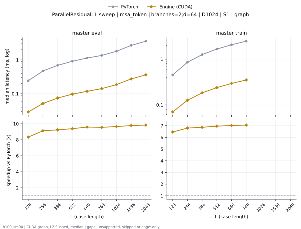
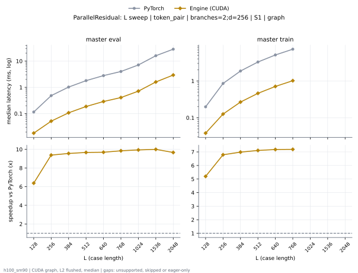
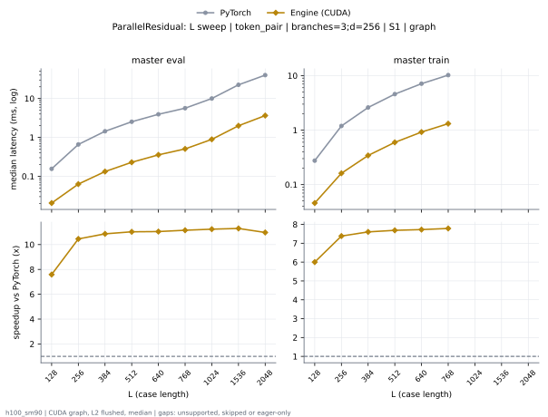

# ParallelResidual on h100_sm90

Generated by `python -m foldjet_engine.measure.plot` from speed tokens `judge/tokens/h100_sm90/`; do not edit.

### L sweep: msa_token | branches=2;d=64 | D1024 | S1 | graph

**master eval** (median ms; x = speedup vs PyTorch)

| L | PyTorch | Engine (Triton) | Engine (CUDA) |
|---|---|---|---|
| 128 | 0.2424 | 0.02984 (8.12x) | 0.02909 (8.33x) |
| 256 | 0.4698 | 0.05142 (9.14x) | 0.0515 (9.12x) |
| 384 | 0.6912 | 0.07363 (9.39x) | 0.07482 (9.24x) |
| 512 | 0.9125 | 0.09478 (9.63x) | 0.09723 (9.38x) |
| 640 | 1.134 | 0.1157 (9.80x) | 0.1182 (9.59x) |
| 768 | 1.355 | 0.1372 (9.88x) | 0.1419 (9.55x) |
| 1024 | 1.798 | 0.1804 (9.97x) | 0.1862 (9.66x) |
| 1536 | 2.683 | 0.2651 (10.12x) | 0.2744 (9.78x) |
| 2048 | 3.568 | 0.3498 (10.20x) | 0.3628 (9.84x) |

**master train** (median ms; x = speedup vs PyTorch)

| L | PyTorch | Engine (Triton) | Engine (CUDA) |
|---|---|---|---|
| 128 | 0.4534 | 0.1216 (3.73x) | 0.07018 (6.46x) |
| 256 | 0.8554 | 0.2339 (3.66x) | 0.1258 (6.80x) |
| 384 | 1.259 | 0.3412 (3.69x) | 0.1835 (6.86x) |
| 512 | 1.663 | 0.4479 (3.71x) | 0.2389 (6.96x) |
| 640 | 2.067 | 0.5547 (3.73x) | 0.2948 (7.01x) |
| 768 | 2.472 | 0.6617 (3.74x) | 0.3505 (7.05x) |
| 1024 |  |  |  |
| 1536 |  |  |  |
| 2048 |  |  |  |

### L sweep: token_pair | branches=2;d=256 | S1 | graph

**master eval** (median ms; x = speedup vs PyTorch)

| L | PyTorch | Engine (Triton) | Engine (CUDA) |
|---|---|---|---|
| 128 | 0.1148 | 0.01862 (6.16x) | 0.018 (6.38x) |
| 256 | 0.4828 | 0.05155 (9.37x) | 0.05146 (9.38x) |
| 384 | 1.024 | 0.1052 (9.73x) | 0.1071 (9.56x) |
| 512 | 1.799 | 0.1804 (9.98x) | 0.1861 (9.67x) |
| 640 | 2.796 | 0.2759 (10.13x) | 0.2885 (9.69x) |
| 768 | 4.015 | 0.3926 (10.23x) | 0.4079 (9.84x) |
| 1024 | 7.118 | 0.6897 (10.32x) | 0.7164 (9.94x) |
| 1536 | 16 | 1.539 (10.40x) | 1.601 (10.00x) |
| 2048 | 28.41 | 2.825 (10.06x) | 2.94 (9.67x) |

**master train** (median ms; x = speedup vs PyTorch)

| L | PyTorch | Engine (Triton) | Engine (CUDA) |
|---|---|---|---|
| 128 | 0.1982 | 0.06003 (3.30x) | 0.03814 (5.20x) |
| 256 | 0.8548 | 0.2341 (3.65x) | 0.1259 (6.79x) |
| 384 | 1.866 | 0.5018 (3.72x) | 0.2671 (6.99x) |
| 512 | 3.28 | 0.8756 (3.75x) | 0.4614 (7.11x) |
| 640 | 5.098 | 1.355 (3.76x) | 0.7101 (7.18x) |
| 768 | 7.32 | 1.94 (3.77x) | 1.018 (7.19x) |
| 1024 |  |  |  |
| 1536 |  |  |  |
| 2048 |  |  |  |

### L sweep: token_pair | branches=3;d=256 | S1 | graph

**master eval** (median ms; x = speedup vs PyTorch)

| L | PyTorch | Engine (Triton) | Engine (CUDA) |
|---|---|---|---|
| 128 | 0.1556 | 0.02182 (7.13x) | 0.0205 (7.59x) |
| 256 | 0.6581 | 0.06414 (10.26x) | 0.06294 (10.46x) |
| 384 | 1.437 | 0.1306 (11.00x) | 0.1322 (10.86x) |
| 512 | 2.526 | 0.2234 (11.31x) | 0.2291 (11.03x) |
| 640 | 3.928 | 0.3428 (11.46x) | 0.3555 (11.05x) |
| 768 | 5.64 | 0.4896 (11.52x) | 0.5057 (11.15x) |
| 1024 | 10.01 | 0.8618 (11.61x) | 0.8903 (11.24x) |
| 1536 | 22.51 | 1.924 (11.70x) | 1.993 (11.30x) |
| 2048 | 39.96 | 3.523 (11.34x) | 3.642 (10.97x) |

**master train** (median ms; x = speedup vs PyTorch)

| L | PyTorch | Engine (Triton) | Engine (CUDA) |
|---|---|---|---|
| 128 | 0.2753 | 0.06787 (4.06x) | 0.04589 (6.00x) |
| 256 | 1.192 | 0.2701 (4.41x) | 0.1615 (7.38x) |
| 384 | 2.604 | 0.5779 (4.51x) | 0.3426 (7.60x) |
| 512 | 4.581 | 1.008 (4.55x) | 0.5961 (7.69x) |
| 640 | 7.122 | 1.561 (4.56x) | 0.922 (7.72x) |
| 768 | 10.23 | 2.237 (4.57x) | 1.314 (7.78x) |
| 1024 |  |  |  |
| 1536 |  |  |  |
| 2048 |  |  |  |

