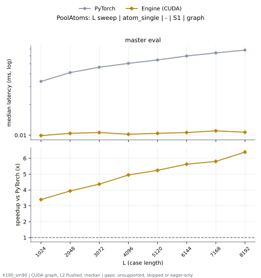

# PoolAtoms on h100_sm90

Generated by `python -m miniworld_engine.measure.plot` from speed tokens `judge/tokens/h100_sm90/`; do not edit.

### L sweep: atom_single | - | S1 | graph

**master eval** (median ms; x = speedup vs PyTorch)

| L | PyTorch | Engine (Triton) | Engine (CUDA) | Anthropic |
|---|---|---|---|---|
| 1024 | 0.03746 | 0.01086 (3.45x) | 0.00992 (3.78x) | 0.02973 (1.26x) |
| 2048 | 0.04099 | 0.01107 (3.70x) | 0.01043 (3.93x) | 0.03032 (1.35x) |
| 3072 | 0.04635 | 0.01101 (4.21x) | 0.01062 (4.36x) | 0.03072 (1.51x) |
| 4096 | 0.0503 | 0.01082 (4.65x) | 0.01022 (4.92x) | 0.03157 (1.59x) |
| 5120 | 0.05466 | 0.01107 (4.94x) | 0.01043 (5.24x) | 0.0313 (1.75x) |
| 6144 | 0.05976 | 0.01117 (5.35x) | 0.01062 (5.63x) | 0.03171 (1.88x) |
| 7168 | 0.06406 | 0.01139 (5.62x) | 0.01104 (5.80x) | 0.0313 (2.05x) |
| 8192 | 0.06874 | 0.01136 (6.05x) | 0.01069 (6.43x) | 0.0312 (2.20x) |

