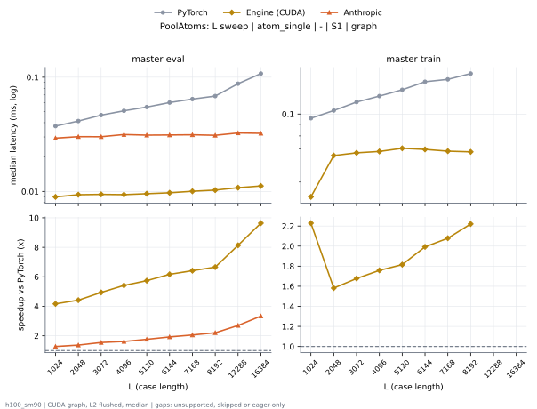

# PoolAtoms on h100_sm90

Generated by `python -m foldjet_engine.measure.plot` from speed tokens `judge/tokens/h100_sm90/`; do not edit.

### L sweep: atom_single | - | S1 | graph

**master eval** (median ms; x = speedup vs PyTorch)

| L | PyTorch | Engine (Triton) | Engine (CUDA) | Anthropic |
|---|---|---|---|---|
| 1024 | 0.03733 | 0.009632 (3.88x) | 0.00896 (4.17x) | 0.0293 (1.27x) |
| 2048 | 0.04134 | 0.01002 (4.13x) | 0.00936 (4.42x) | 0.03016 (1.37x) |
| 3072 | 0.04658 | 0.0101 (4.61x) | 0.009424 (4.94x) | 0.03013 (1.55x) |
| 4096 | 0.05078 | 0.01032 (4.92x) | 0.009376 (5.42x) | 0.03147 (1.61x) |
| 5120 | 0.05482 | 0.01024 (5.35x) | 0.009552 (5.74x) | 0.0311 (1.76x) |
| 6144 | 0.06 | 0.01043 (5.75x) | 0.009728 (6.17x) | 0.0312 (1.92x) |
| 7168 | 0.06435 | 0.01037 (6.21x) | 0.01003 (6.41x) | 0.03133 (2.05x) |
| 8192 | 0.06838 | 0.01058 (6.47x) | 0.01027 (6.66x) | 0.03101 (2.21x) |
| 12288 | 0.08774 | 0.01096 (8.01x) | 0.01078 (8.14x) | 0.03248 (2.70x) |
| 16384 | 0.1076 | 0.01194 (9.02x) | 0.01117 (9.64x) | 0.03226 (3.34x) |

**master train** (median ms; x = speedup vs PyTorch)

| L | PyTorch | Engine (Triton) | Engine (CUDA) | Anthropic |
|---|---|---|---|---|
| 1024 | 0.09581 | 0.04698 (2.04x) | 0.04299 (2.23x) | unsupported |
| 2048 | 0.1036 | 0.07178 (1.44x) | 0.06552 (1.58x) | unsupported |
| 3072 | 0.113 | 0.07373 (1.53x) | 0.06736 (1.68x) | unsupported |
| 4096 | 0.1201 | 0.07426 (1.62x) | 0.0683 (1.76x) | unsupported |
| 5120 | 0.128 | 0.07674 (1.67x) | 0.07053 (1.82x) | unsupported |
| 6144 | 0.139 | 0.07653 (1.82x) | 0.06974 (1.99x) | unsupported |
| 7168 | 0.1424 | 0.07355 (1.94x) | 0.06851 (2.08x) | unsupported |
| 8192 | 0.1511 | 0.07306 (2.07x) | 0.06803 (2.22x) | unsupported |
| 12288 |  |  |  |  |
| 16384 |  |  |  |  |

