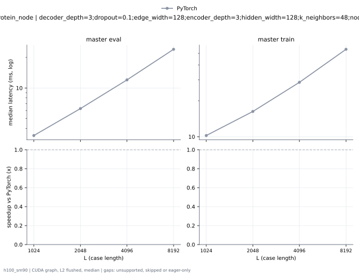

# ProteinMPNN on h100_sm90

Generated by `python -m miniworld_engine.measure.plot` from speed tokens `judge/tokens/h100_sm90/`; do not edit.

### L sweep: protein_node | decoder_depth=3;dropout=0.1;edge_width=128;encoder_depth=3;hidden_width=128;k_neighbors=48;node_width=128 | S1 | graph

**master eval** (median ms; x = speedup vs PyTorch)

| L | PyTorch | Engine (Triton) | Engine (CUDA) |
|---|---|---|---|
| 1024 | 3.398 | 2.654 (1.28x) | unsupported |
| 2048 | 6.271 | 4.676 (1.34x) | unsupported |
| 4096 | 12.03 | 8.665 (1.39x) | unsupported |
| 8192 | 24.06 | 17.58 (1.37x) | unsupported |

**master train** (median ms; x = speedup vs PyTorch)

| L | PyTorch | Engine (Triton) | Engine (CUDA) |
|---|---|---|---|
| 1024 | 10.25 | 8.105 (1.26x) | unsupported |
| 2048 | 16.31 | 12.67 (1.29x) | unsupported |
| 4096 | 28.67 | 21.93 (1.31x) | unsupported |
| 8192 | 54.12 | 42.09 (1.29x) | unsupported |

