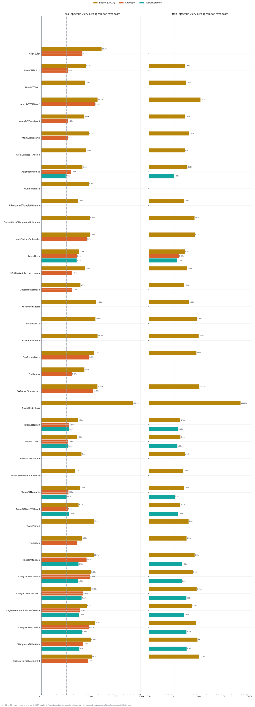
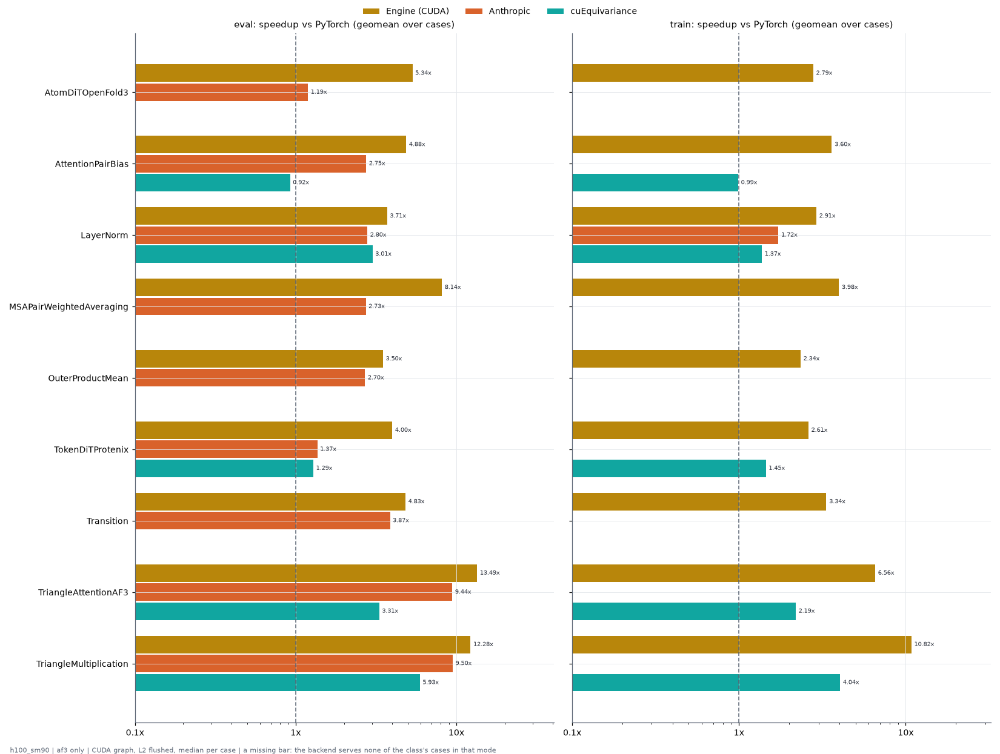

# Benchmarks on h100_sm90

Generated by `python -m miniworld_engine.measure.plot --gpu h100_sm90` from speed tokens `judge/tokens/h100_sm90/` (speed measurer v3); nothing here is measured by the plotter. Timing: CUDA graph, L2 flushed before every call (docs/measure.md).

## Summary

Per class and mode: the geometric mean over its cases of the speedup vs PyTorch (PyTorch time / backend time), over the cases both ran (n = cases).

| class | eval Engine (CUDA) | eval Anthropic | eval cuEquivariance | train Engine (CUDA) | train Anthropic | train cuEquivariance |
|---|---|---|---|---|---|---|
| AlignEuler | 26.77x (n=8) | 4.52x (n=8) |  |  |  |  |
| AtomDiTBoltz2 | 6.13x (n=32) | 1.16x (n=16) |  | 2.72x (n=32) |  |  |
| AtomDiTChai1 | 5.68x (n=32) |  |  | 3.01x (n=32) |  |  |
| AtomDiTESMFold2 | 18.17x (n=16) | 14.06x (n=16) |  | 11.56x (n=16) |  |  |
| AtomDiTOpenFold3 | 5.29x (n=32) | 1.19x (n=32) |  | 2.78x (n=32) |  |  |
| AtomDiTProtenix | 7.99x (n=32) | 1.14x (n=32) |  | 3.95x (n=32) |  |  |
| AtomDiTRoseTTAFold3 | 6.29x (n=32) |  |  | 2.67x (n=32) |  |  |
| AttentionPairBias | 4.54x (n=108) | 1.55x (n=108) | 0.93x (n=108) | 3.41x (n=108) |  | 0.99x (n=108) |
| AugmentNoise | 8.24x (n=16) |  |  |  |  |  |
| BidirectionalTriangleAttention | 2.98x (n=6) |  |  | 2.47x (n=6) |  |  |
| BidirectionalTriangleMultiplication | 8.98x (n=30) |  |  | 6.53x (n=30) |  |  |
| InputFeatureEmbedder | 9.19x (n=72) | 6.71x (n=72) |  | 6.67x (n=72) |  |  |
| LayerNorm | 3.25x (n=270) | 2.63x (n=270) | 2.59x (n=270) | 2.66x (n=270) | 1.54x (n=270) | 1.29x (n=270) |
| MSAPairWeightedAveraging | 5.68x (n=42) | 1.74x (n=42) |  | 3.33x (n=42) |  |  |
| OuterProductMean | 3.75x (n=72) | 1.75x (n=30) |  | 2.53x (n=72) |  |  |
| PairEmbedAdaLN | 15.94x (n=6) |  |  | 4.00x (n=6) |  |  |
| PairEmbedCA | 14.84x (n=12) |  |  | 8.32x (n=12) |  |  |
| PairEmbedGeom | 18.18x (n=12) |  |  | 9.68x (n=12) |  |  |
| PairformerBlock | 12.83x (n=6) | 8.24x (n=6) |  | 7.84x (n=6) |  |  |
| PoolAtoms | 5.00x (n=8) | 1.67x (n=8) |  |  |  |  |
| SWAAtomTransformer | 17.99x (n=48) | 11.80x (n=48) |  | 10.39x (n=44) |  |  |
| SmoothLddtLoss | 476.79x (n=16) |  |  | 455.83x (n=16) |  |  |
| TokenDiTBoltz2 | 2.98x (n=12) | 1.31x (n=12) | 1.28x (n=12) | 1.58x (n=12) |  | 1.42x (n=12) |
| TokenDiTChai1 | 2.68x (n=24) | 1.18x (n=24) | 1.15x (n=24) | 1.54x (n=24) |  | 1.35x (n=24) |
| TokenDiTMiniWorld | 4.14x (n=12) |  |  | 2.63x (n=12) |  |  |
| TokenDiTMiniWorldBiasOnly | 2.19x (n=48) |  |  | 2.27x (n=48) |  |  |
| TokenDiTProtenix | 3.56x (n=84) | 1.22x (n=84) | 1.02x (n=84) | 2.50x (n=84) |  | 1.05x (n=84) |
| TokenDiTRoseTTAFold3 | 3.06x (n=12) | 1.14x (n=12) | 1.32x (n=12) | 1.56x (n=12) |  | 1.45x (n=12) |
| TokenPairInit | 12.65x (n=6) |  |  | 3.82x (n=6) |  |  |
| Transition | 4.11x (n=192) | 2.91x (n=126) |  | 2.84x (n=192) |  |  |
| TriangleAttention | 12.57x (n=72) | 6.53x (n=71) | 3.11x (n=70) | 6.59x (n=70) |  | 2.08x (n=68) |
| TriangleAttentionAF3 | 9.90x (n=48) | 9.02x (n=36) | 2.98x (n=46) | 5.48x (n=48) |  | 2.01x (n=46) |
| TriangleAttentionChai1 | 10.00x (n=24) | 4.72x (n=24) | 4.17x (n=24) | 8.00x (n=24) |  | 3.11x (n=24) |
| TriangleAttentionChai1Confidence | 6.74x (n=12) | 3.49x (n=12) | 3.26x (n=12) | 5.14x (n=12) |  | 2.52x (n=12) |
| TriangleAttentionRF3 | 14.00x (n=24) | 8.17x (n=24) | 4.26x (n=24) | 7.42x (n=24) |  | 3.11x (n=24) |
| TriangleMultiplication | 9.76x (n=72) | 4.64x (n=72) | 3.39x (n=70) | 8.67x (n=72) |  | 3.16x (n=70) |
| TriangleMultiplicationRF3 | 10.71x (n=24) | 7.40x (n=24) |  | 10.34x (n=24) |  |  |

## Summary: af3 only

The same over the requirement rows whose `source` names af3 (25 rows).

| class | eval Engine (CUDA) | eval Anthropic | eval cuEquivariance | train Engine (CUDA) | train Anthropic | train cuEquivariance |
|---|---|---|---|---|---|---|
| AtomDiTOpenFold3 | 5.34x (n=16) | 1.19x (n=16) |  | 2.79x (n=16) |  |  |
| AttentionPairBias | 4.88x (n=12) | 2.75x (n=12) | 0.92x (n=12) | 3.60x (n=12) |  | 0.99x (n=12) |
| LayerNorm | 3.71x (n=114) | 2.80x (n=114) | 3.01x (n=114) | 2.91x (n=114) | 1.72x (n=114) | 1.37x (n=114) |
| MSAPairWeightedAveraging | 8.14x (n=6) | 2.73x (n=6) |  | 3.98x (n=6) |  |  |
| OuterProductMean | 3.50x (n=6) | 2.70x (n=6) |  | 2.34x (n=6) |  |  |
| TokenDiTProtenix | 4.00x (n=12) | 1.37x (n=12) | 1.29x (n=12) | 2.61x (n=12) |  | 1.45x (n=12) |
| Transition | 4.83x (n=72) | 3.87x (n=66) |  | 3.34x (n=72) |  |  |
| TriangleAttentionAF3 | 13.49x (n=24) | 9.44x (n=24) | 3.31x (n=22) | 6.56x (n=24) |  | 2.19x (n=22) |
| TriangleMultiplication | 12.28x (n=24) | 9.50x (n=24) | 5.93x (n=24) | 10.82x (n=24) |  | 4.04x (n=24) |

## Classes

| class | cases | L sweeps | D sweeps |
|---|---|---|---|
| [AlignEuler](AlignEuler/README.md) | 8 | 1 | 0 |
| [AtomDiTBoltz2](AtomDiTBoltz2/README.md) | 64 | 2 | 0 |
| [AtomDiTChai1](AtomDiTChai1/README.md) | 64 | 2 | 0 |
| [AtomDiTESMFold2](AtomDiTESMFold2/README.md) | 32 | 1 | 0 |
| [AtomDiTOpenFold3](AtomDiTOpenFold3/README.md) | 64 | 2 | 0 |
| [AtomDiTProtenix](AtomDiTProtenix/README.md) | 64 | 3 | 0 |
| [AtomDiTRoseTTAFold3](AtomDiTRoseTTAFold3/README.md) | 64 | 2 | 0 |
| [AttentionPairBias](AttentionPairBias/README.md) | 216 | 9 | 2 |
| [AugmentNoise](AugmentNoise/README.md) | 16 | 2 | 0 |
| [BidirectionalTriangleAttention](BidirectionalTriangleAttention/README.md) | 12 | 1 | 0 |
| [BidirectionalTriangleMultiplication](BidirectionalTriangleMultiplication/README.md) | 60 | 5 | 1 |
| [InputFeatureEmbedder](InputFeatureEmbedder/README.md) | 144 | 6 | 0 |
| [LayerNorm](LayerNorm/README.md) | 540 | 25 | 4 |
| [MSAPairWeightedAveraging](MSAPairWeightedAveraging/README.md) | 84 | 7 | 3 |
| [OuterProductMean](OuterProductMean/README.md) | 144 | 12 | 3 |
| [PairEmbedAdaLN](PairEmbedAdaLN/README.md) | 12 | 1 | 0 |
| [PairEmbedCA](PairEmbedCA/README.md) | 24 | 2 | 0 |
| [PairEmbedGeom](PairEmbedGeom/README.md) | 24 | 2 | 0 |
| [PairformerBlock](PairformerBlock/README.md) | 12 | 1 | 0 |
| [PoolAtoms](PoolAtoms/README.md) | 8 | 1 | 0 |
| [ProteinMPNN](ProteinMPNN/README.md) | 8 | 1 | 0 |
| [SWAAtomTransformer](SWAAtomTransformer/README.md) | 96 | 6 | 0 |
| [SmoothLddtLoss](SmoothLddtLoss/README.md) | 32 | 1 | 0 |
| [TokenDiTBoltz2](TokenDiTBoltz2/README.md) | 24 | 2 | 0 |
| [TokenDiTChai1](TokenDiTChai1/README.md) | 48 | 4 | 0 |
| [TokenDiTMiniWorld](TokenDiTMiniWorld/README.md) | 24 | 2 | 0 |
| [TokenDiTMiniWorldBiasOnly](TokenDiTMiniWorldBiasOnly/README.md) | 96 | 8 | 0 |
| [TokenDiTProtenix](TokenDiTProtenix/README.md) | 168 | 11 | 3 |
| [TokenDiTRoseTTAFold3](TokenDiTRoseTTAFold3/README.md) | 24 | 2 | 0 |
| [TokenPairInit](TokenPairInit/README.md) | 12 | 1 | 0 |
| [Transition](Transition/README.md) | 384 | 16 | 2 |
| [TriangleAttention](TriangleAttention/README.md) | 144 | 12 | 4 |
| [TriangleAttentionAF3](TriangleAttentionAF3/README.md) | 96 | 8 | 2 |
| [TriangleAttentionChai1](TriangleAttentionChai1/README.md) | 48 | 4 | 0 |
| [TriangleAttentionChai1Confidence](TriangleAttentionChai1Confidence/README.md) | 24 | 2 | 0 |
| [TriangleAttentionRF3](TriangleAttentionRF3/README.md) | 48 | 4 | 0 |
| [TriangleMultiplication](TriangleMultiplication/README.md) | 144 | 12 | 2 |
| [TriangleMultiplicationRF3](TriangleMultiplicationRF3/README.md) | 48 | 4 | 0 |
