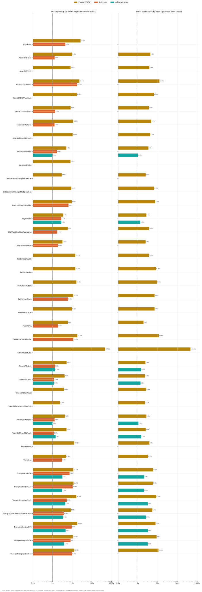
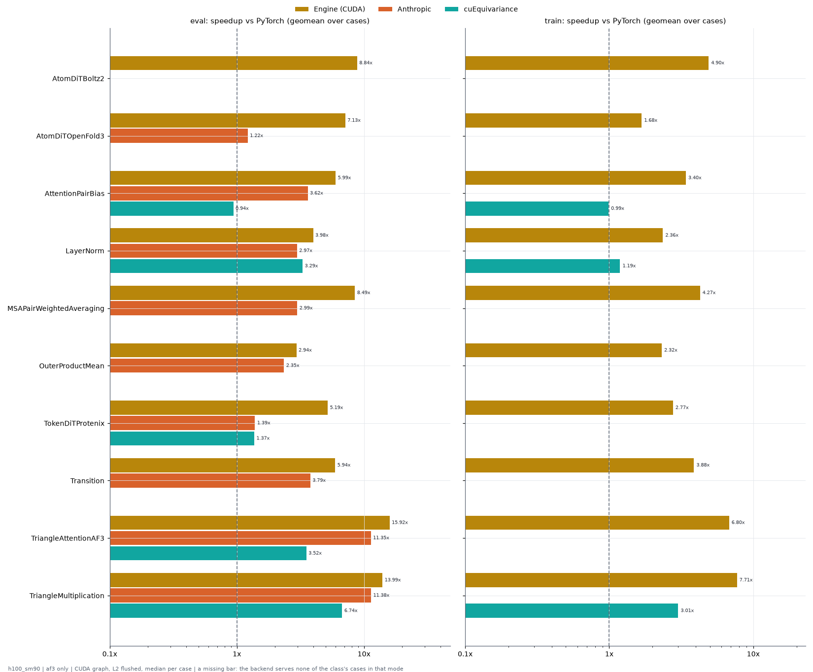

# Benchmarks on h100_sm90

Generated by `python -m miniworld_engine.measure.plot --gpu h100_sm90` from speed tokens `judge/tokens/h100_sm90/` (speed measurer v4); nothing here is measured by the plotter. Timing: CUDA graph, L2 flushed before every call (docs/measure.md).

## Summary

Per class and mode: the geometric mean over its cases of the speedup vs PyTorch (PyTorch time / backend time), over the cases both ran (n = cases).

| class | eval Engine (CUDA) | eval Anthropic | eval cuEquivariance | train Engine (CUDA) | train Anthropic | train cuEquivariance |
|---|---|---|---|---|---|---|
| AlignEuler | 26.65x (n=10) | 4.49x (n=10) |  |  |  |  |
| AtomDiTBoltz2 | 9.82x (n=80) | 1.27x (n=40) |  | 4.23x (n=32) |  |  |
| AtomDiTChai1 | 8.26x (n=120) |  |  | 3.80x (n=32) |  |  |
| AtomDiTESMFold2 | 23.44x (n=20) | 17.70x (n=20) |  | 12.29x (n=16) |  |  |
| AtomDiTESMFold2Pair | 17.21x (n=40) |  |  | 6.41x (n=16) |  |  |
| AtomDiTOpenFold3 | 8.33x (n=76) | 1.36x (n=76) |  | 3.58x (n=34) |  |  |
| AtomDiTProtenix | 11.09x (n=84) | 1.26x (n=84) |  | 4.74x (n=48) |  |  |
| AtomDiTRoseTTAFold3 | 10.65x (n=80) |  |  | 4.19x (n=32) |  |  |
| AttentionPairBias | 5.00x (n=160) | 1.64x (n=160) | 0.94x (n=138) | 3.39x (n=108) |  | 0.99x (n=108) |
| AugmentNoise | 8.19x (n=20) |  |  |  |  |  |
| BidirectionalTriangleAttention | 2.96x (n=6) |  |  | 2.47x (n=6) |  |  |
| BidirectionalTriangleMultiplication | 9.17x (n=30) |  |  | 6.51x (n=30) |  |  |
| InputFeatureEmbedder | 9.51x (n=72) | 6.51x (n=72) |  | 7.44x (n=72) |  |  |
| LayerNorm | 3.42x (n=386) | 2.77x (n=386) | 2.80x (n=386) | 2.66x (n=270) |  | 1.29x (n=270) |
| MSAPairWeightedAveraging | 5.92x (n=56) | 1.73x (n=56) |  | 3.60x (n=42) |  |  |
| OuterProductMean | 3.20x (n=126) | 1.87x (n=51) |  | 2.43x (n=96) |  |  |
| PairEmbedAdaLN | 14.45x (n=6) |  |  | 3.62x (n=6) |  |  |
| PairEmbedCA | 14.48x (n=12) |  |  | 8.14x (n=12) |  |  |
| PairEmbedGeom | 16.40x (n=12) |  |  | 9.16x (n=12) |  |  |
| PairformerBlock | 11.27x (n=27) | 6.13x (n=27) |  | 6.90x (n=12) |  |  |
| ParallelResidual | 9.72x (n=27) |  |  | 6.96x (n=18) |  |  |
| PoolAtoms | 5.98x (n=10) | 1.90x (n=10) |  | 1.91x (n=8) |  |  |
| SWAAtomTransformer | 18.39x (n=48) | 11.49x (n=48) |  | 11.43x (n=44) |  |  |
| SmoothLddtLoss | 477.23x (n=16) |  |  | 456.34x (n=16) |  |  |
| TokenDiTBoltz2 | 5.21x (n=36) | 1.32x (n=36) | 1.35x (n=36) | 2.39x (n=12) |  | 1.42x (n=12) |
| TokenDiTChai1 | 4.13x (n=90) | 1.20x (n=90) | 1.18x (n=90) | 2.28x (n=24) |  | 1.35x (n=24) |
| TokenDiTMiniWorld | 3.80x (n=12) |  |  | 2.60x (n=12) |  |  |
| TokenDiTMiniWorldBiasOnly | 2.38x (n=48) |  |  | 2.27x (n=48) |  |  |
| TokenDiTProtenix | 4.23x (n=172) | 1.27x (n=172) | 0.99x (n=172) | 2.65x (n=96) |  | 1.05x (n=96) |
| TokenDiTRoseTTAFold3 | 5.15x (n=36) | 1.17x (n=36) | 1.42x (n=36) | 2.48x (n=12) |  | 1.45x (n=12) |
| TokenPairInit | 12.61x (n=6) |  |  | 3.81x (n=6) |  |  |
| Transition | 4.79x (n=180) | 3.05x (n=117) |  | 3.17x (n=126) |  |  |
| TriangleAttention | 11.42x (n=88) | 7.35x (n=75) | 3.18x (n=74) | 5.82x (n=82) |  | 2.08x (n=68) |
| TriangleAttentionAF3 | 11.76x (n=52) | 10.64x (n=40) | 3.10x (n=50) | 5.71x (n=48) |  | 2.00x (n=46) |
| TriangleAttentionChai1 | 16.29x (n=27) | 5.30x (n=27) | 4.46x (n=27) | 8.39x (n=24) |  | 3.10x (n=24) |
| TriangleAttentionChai1Confidence | 8.56x (n=13) | 3.75x (n=13) | 3.38x (n=13) | 5.31x (n=12) |  | 2.52x (n=12) |
| TriangleAttentionRF3 | 18.04x (n=28) | 9.43x (n=28) | 4.61x (n=28) | 7.75x (n=24) |  | 3.10x (n=24) |
| TriangleMultiplication | 11.15x (n=104) | 8.27x (n=92) | 3.91x (n=102) | 8.81x (n=72) |  | 3.14x (n=70) |
| TriangleMultiplicationRF3 | 12.45x (n=36) | 9.91x (n=36) |  | 10.93x (n=24) |  |  |

## Summary: af3 only

The same over the requirement rows whose `source` names af3 (56 rows).

| class | eval Engine (CUDA) | eval Anthropic | eval cuEquivariance | train Engine (CUDA) | train Anthropic | train cuEquivariance |
|---|---|---|---|---|---|---|
| AtomDiTBoltz2 | 8.84x (n=20) |  |  | 4.90x (n=16) |  |  |
| AtomDiTOpenFold3 | 7.13x (n=24) | 1.22x (n=24) |  | 1.68x (n=2) |  |  |
| AttentionPairBias | 5.99x (n=18) | 3.62x (n=18) | 0.94x (n=18) | 3.40x (n=24) |  | 0.99x (n=24) |
| LayerNorm | 3.98x (n=166) | 2.97x (n=166) | 3.29x (n=166) | 2.36x (n=98) |  | 1.19x (n=98) |
| MSAPairWeightedAveraging | 8.49x (n=8) | 2.99x (n=8) |  | 4.27x (n=6) |  |  |
| OuterProductMean | 2.94x (n=18) | 2.35x (n=18) |  | 2.32x (n=12) |  |  |
| TokenDiTProtenix | 5.19x (n=36) | 1.39x (n=18) | 1.37x (n=18) | 2.77x (n=24) |  |  |
| Transition | 5.94x (n=74) | 3.79x (n=56) |  | 3.88x (n=48) |  |  |
| TriangleAttentionAF3 | 15.92x (n=28) | 11.35x (n=28) | 3.52x (n=26) | 6.80x (n=24) |  |  |
| TriangleMultiplication | 13.99x (n=36) | 11.38x (n=36) | 6.74x (n=36) | 7.71x (n=24) |  | 3.01x (n=24) |

## Classes

| class | cases | L sweeps | D sweeps |
|---|---|---|---|
| [AlignEuler](AlignEuler/README.md) | 10 | 1 | 0 |
| [AtomDiTBoltz2](AtomDiTBoltz2/README.md) | 112 | 4 | 0 |
| [AtomDiTChai1](AtomDiTChai1/README.md) | 152 | 8 | 0 |
| [AtomDiTESMFold2](AtomDiTESMFold2/README.md) | 36 | 1 | 0 |
| [AtomDiTESMFold2Pair](AtomDiTESMFold2Pair/README.md) | 56 | 2 | 0 |
| [AtomDiTOpenFold3](AtomDiTOpenFold3/README.md) | 110 | 4 | 0 |
| [AtomDiTProtenix](AtomDiTProtenix/README.md) | 132 | 8 | 0 |
| [AtomDiTRoseTTAFold3](AtomDiTRoseTTAFold3/README.md) | 112 | 4 | 0 |
| [AttentionPairBias](AttentionPairBias/README.md) | 268 | 10 | 2 |
| [AugmentNoise](AugmentNoise/README.md) | 20 | 2 | 0 |
| [BidirectionalTriangleAttention](BidirectionalTriangleAttention/README.md) | 12 | 1 | 0 |
| [BidirectionalTriangleMultiplication](BidirectionalTriangleMultiplication/README.md) | 60 | 5 | 1 |
| [InputFeatureEmbedder](InputFeatureEmbedder/README.md) | 144 | 6 | 0 |
| [LayerNorm](LayerNorm/README.md) | 656 | 25 | 4 |
| [MSAPairWeightedAveraging](MSAPairWeightedAveraging/README.md) | 98 | 7 | 3 |
| [OuterProductMean](OuterProductMean/README.md) | 222 | 16 | 5 |
| [PairEmbedAdaLN](PairEmbedAdaLN/README.md) | 12 | 1 | 0 |
| [PairEmbedCA](PairEmbedCA/README.md) | 24 | 2 | 0 |
| [PairEmbedGeom](PairEmbedGeom/README.md) | 24 | 2 | 0 |
| [PairformerBlock](PairformerBlock/README.md) | 45 | 4 | 0 |
| [ParallelResidual](ParallelResidual/README.md) | 45 | 3 | 0 |
| [PoolAtoms](PoolAtoms/README.md) | 18 | 1 | 0 |
| [ProteinMPNN](ProteinMPNN/README.md) | 8 | 1 | 0 |
| [SWAAtomTransformer](SWAAtomTransformer/README.md) | 96 | 6 | 0 |
| [SmoothLddtLoss](SmoothLddtLoss/README.md) | 32 | 1 | 0 |
| [TokenDiTBoltz2](TokenDiTBoltz2/README.md) | 48 | 3 | 0 |
| [TokenDiTChai1](TokenDiTChai1/README.md) | 114 | 8 | 0 |
| [TokenDiTMiniWorld](TokenDiTMiniWorld/README.md) | 24 | 2 | 0 |
| [TokenDiTMiniWorldBiasOnly](TokenDiTMiniWorldBiasOnly/README.md) | 96 | 8 | 0 |
| [TokenDiTProtenix](TokenDiTProtenix/README.md) | 268 | 18 | 4 |
| [TokenDiTRoseTTAFold3](TokenDiTRoseTTAFold3/README.md) | 48 | 3 | 0 |
| [TokenPairInit](TokenPairInit/README.md) | 12 | 1 | 0 |
| [Transition](Transition/README.md) | 307 | 16 | 2 |
| [TriangleAttention](TriangleAttention/README.md) | 202 | 14 | 4 |
| [TriangleAttentionAF3](TriangleAttentionAF3/README.md) | 108 | 8 | 2 |
| [TriangleAttentionChai1](TriangleAttentionChai1/README.md) | 60 | 4 | 0 |
| [TriangleAttentionChai1Confidence](TriangleAttentionChai1Confidence/README.md) | 30 | 2 | 0 |
| [TriangleAttentionRF3](TriangleAttentionRF3/README.md) | 60 | 4 | 0 |
| [TriangleMultiplication](TriangleMultiplication/README.md) | 178 | 12 | 2 |
| [TriangleMultiplicationRF3](TriangleMultiplicationRF3/README.md) | 60 | 4 | 0 |
