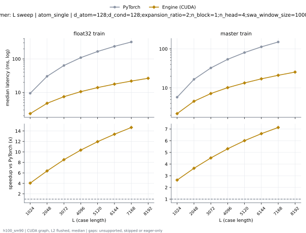
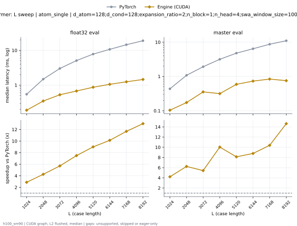
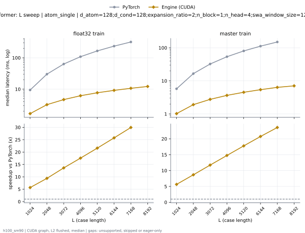
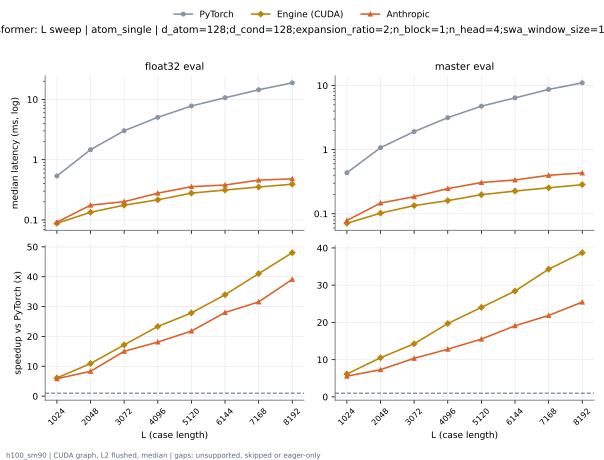
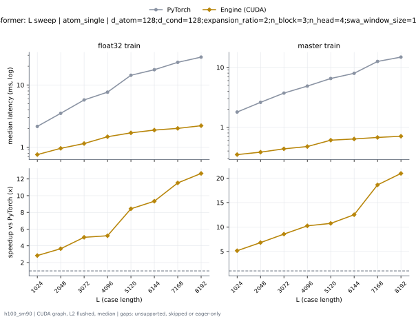
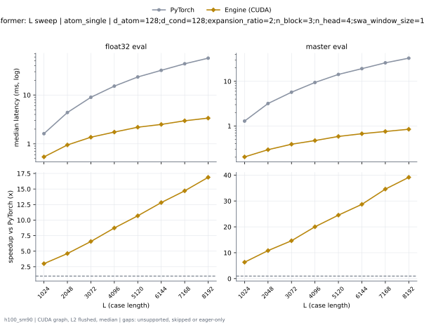

# SWAAtomTransformer on h100_sm90

Generated by `python -m miniworld_engine.measure.plot` from speed tokens `judge/tokens/h100_sm90/`; do not edit.

### L sweep: atom_single | d_atom=128;d_cond=128;expansion_ratio=2;n_block=1;n_head=4;swa_window_size=1000000 | S48 | graph

**float32 train** (median ms; x = speedup vs PyTorch)

| L | PyTorch | Engine (CUDA) | Anthropic |
|---|---|---|---|
| 1024 | 9.439 | 3.708 (2.55x) | 11.53 (eager) |
| 2048 | 30.24 | 7.599 (3.98x) | 33.84 (eager) |
| 3072 | 63.58 | 11.72 (5.42x) | 70.57 (eager) |
| 4096 | 109 | 15.77 (6.91x) | 117.7 (eager) |
| 5120 | 166.8 | 20.4 (8.18x) | 184.5 (eager) |
| 6144 | 237 | 25.39 (9.34x) | 258.1 (eager) |
| 7168 | 319.9 | 30.84 (10.37x) | 357.7 (eager) |
| 8192 | skipped | 36.97 | 456 (eager) |

**master train** (median ms; x = speedup vs PyTorch)

| L | PyTorch | Engine (CUDA) | Anthropic |
|---|---|---|---|
| 1024 | 5.774 | 2.172 (2.66x) | 6.573 (eager) |
| 2048 | 16.58 | 4.527 (3.66x) | 17.68 (eager) |
| 3072 | 32.54 | 7.141 (4.56x) | 35.94 (eager) |
| 4096 | 54.03 | 10.12 (5.34x) | 57.6 (eager) |
| 5120 | 80.84 | 13.44 (6.02x) | 91.7 (eager) |
| 6144 | 112.8 | 17.08 (6.61x) | 126.7 (eager) |
| 7168 | 150.2 | 21.04 (7.14x) | 181.4 (eager) |
| 8192 | skipped | 25.44 | 230.8 (eager) |

### L sweep: atom_single | d_atom=128;d_cond=128;expansion_ratio=2;n_block=1;n_head=4;swa_window_size=1000000 | S5 | graph

**float32 eval** (median ms; x = speedup vs PyTorch)

| L | PyTorch | Engine (CUDA) | Anthropic |
|---|---|---|---|
| 1024 | 0.545 | 0.1896 (2.87x) | 0.8236 (eager) |
| 2048 | 1.485 | 0.3489 (4.26x) | 1.844 (eager) |
| 3072 | 3.012 | 0.5278 (5.71x) | 3.669 (eager) |
| 4096 | 5.073 | 0.6772 (7.49x) | 5.809 (eager) |
| 5120 | 7.81 | 0.8682 (9.00x) | 8.806 (eager) |
| 6144 | 10.69 | 1.055 (10.13x) | 11.96 (eager) |
| 7168 | 14.53 | 1.244 (11.68x) | 16.16 (eager) |
| 8192 | 18.93 | 1.455 (13.02x) | 20.58 (eager) |

**master eval** (median ms; x = speedup vs PyTorch)

| L | PyTorch | Engine (CUDA) | Anthropic |
|---|---|---|---|
| 1024 | 0.436 | 0.1036 (4.21x) | 0.9889 (eager) |
| 2048 | 1.081 | 0.1733 (6.24x) | 1.34 (eager) |
| 3072 | 1.921 | 0.3542 (5.42x) | 2.485 (eager) |
| 4096 | 3.165 | 0.3154 (10.03x) | 3.911 (eager) |
| 5120 | 4.787 | 0.5892 (8.12x) | 5.788 (eager) |
| 6144 | 6.429 | 0.7319 (8.78x) | 7.914 (eager) |
| 7168 | 8.706 | 0.8385 (10.38x) | 10.54 (eager) |
| 8192 | 11.02 | 0.7533 (14.63x) | 13.43 (eager) |

### L sweep: atom_single | d_atom=128;d_cond=128;expansion_ratio=2;n_block=1;n_head=4;swa_window_size=128 | S48 | graph

**float32 train** (median ms; x = speedup vs PyTorch)

| L | PyTorch | Engine (CUDA) | Anthropic |
|---|---|---|---|
| 1024 | 9.44 | 3.66 (2.58x) | 11.52 (eager) |
| 2048 | 30.24 | 7.126 (4.24x) | 33.83 (eager) |
| 3072 | 63.56 | 10.54 (6.03x) | 54.81 (eager) |
| 4096 | 109 | 13.6 (8.01x) | 80.23 (eager) |
| 5120 | 166.8 | 16.83 (9.91x) | 101.1 (eager) |
| 6144 | 237 | 20.15 (11.76x) | 126.8 (eager) |
| 7168 | 319.8 | 23.38 (13.68x) | 147.9 (eager) |
| 8192 | skipped | 26.79 | 173.8 (eager) |

**master train** (median ms; x = speedup vs PyTorch)

| L | PyTorch | Engine (CUDA) | Anthropic |
|---|---|---|---|
| 1024 | 5.784 | 1.02 (5.67x) | 6.573 (eager) |
| 2048 | 16.57 | 1.911 (8.67x) | 17.66 (eager) |
| 3072 | 32.53 | 2.772 (11.74x) | 28.52 (eager) |
| 4096 | 54 | 3.627 (14.89x) | 41.07 (eager) |
| 5120 | 80.75 | 4.504 (17.93x) | 51.76 (eager) |
| 6144 | 112.7 | 5.364 (21.02x) | 64.36 (eager) |
| 7168 | 150.1 | 6.204 (24.19x) | 75.11 (eager) |
| 8192 | skipped | 7.071 | 87.77 (eager) |

### L sweep: atom_single | d_atom=128;d_cond=128;expansion_ratio=2;n_block=1;n_head=4;swa_window_size=128 | S5 | graph

**float32 eval** (median ms; x = speedup vs PyTorch)

| L | PyTorch | Engine (CUDA) | Anthropic |
|---|---|---|---|
| 1024 | 0.5376 | 0.1803 (2.98x) | 0.8158 (eager) |
| 2048 | 1.462 | 0.3194 (4.58x) | 1.831 (eager) |
| 3072 | 3.019 | 0.4582 (6.59x) | 2.895 (eager) |
| 4096 | 5.059 | 0.5924 (8.54x) | 4.046 (eager) |
| 5120 | 7.817 | 0.7252 (10.78x) | 5.156 (eager) |
| 6144 | 10.67 | 0.8426 (12.67x) | 6.301 (eager) |
| 7168 | 14.52 | 0.9901 (14.66x) | 7.399 (eager) |
| 8192 | 18.92 | 1.125 (16.81x) | 8.565 (eager) |

**master eval** (median ms; x = speedup vs PyTorch)

| L | PyTorch | Engine (CUDA) | Anthropic |
|---|---|---|---|
| 1024 | 0.4362 | 0.07093 (6.15x) | 0.9773 (eager) |
| 2048 | 1.074 | 0.1021 (10.52x) | 1.335 (eager) |
| 3072 | 1.917 | 0.1333 (14.38x) | 2.022 (eager) |
| 4096 | 3.148 | 0.1602 (19.65x) | 2.797 (eager) |
| 5120 | 4.781 | 0.1971 (24.26x) | 3.474 (eager) |
| 6144 | 6.426 | 0.2261 (28.43x) | 4.236 (eager) |
| 7168 | 8.678 | 0.2543 (34.12x) | 4.92 (eager) |
| 8192 | 11 | 0.2847 (38.65x) | 5.71 (eager) |

### L sweep: atom_single | d_atom=128;d_cond=128;expansion_ratio=2;n_block=3;n_head=4;swa_window_size=128 | S1 | graph

**float32 train** (median ms; x = speedup vs PyTorch)

| L | PyTorch | Engine (CUDA) | Anthropic |
|---|---|---|---|
| 1024 | 2.154 | 0.7593 (2.84x) | 5.13 (eager) |
| 2048 | 3.498 | 0.9565 (3.66x) | 5.321 (eager) |
| 3072 | 5.739 | 1.143 (5.02x) | 7.278 (eager) |
| 4096 | 7.654 | 1.471 (5.20x) | 9.075 (eager) |
| 5120 | 14.31 | 1.697 (8.43x) | 11.34 (eager) |
| 6144 | 17.57 | 1.881 (9.34x) | 13.15 (eager) |
| 7168 | 23.09 | 2.003 (11.53x) | 15.35 (eager) |
| 8192 | 28 | 2.211 (12.66x) | 17.11 (eager) |

**master train** (median ms; x = speedup vs PyTorch)

| L | PyTorch | Engine (CUDA) | Anthropic |
|---|---|---|---|
| 1024 | 1.791 | 0.3486 (5.14x) | 5.987 (eager) |
| 2048 | 2.602 | 0.3827 (6.80x) | 6.005 (eager) |
| 3072 | 3.714 | 0.435 (8.54x) | 7.19 (eager) |
| 4096 | 4.862 | 0.4751 (10.23x) | 7.203 (eager) |
| 5120 | 6.512 | 0.6067 (10.73x) | 7.919 (eager) |
| 6144 | 7.952 | 0.6357 (12.51x) | 8.445 (eager) |
| 7168 | 12.55 | 0.674 (18.62x) | 10.04 (eager) |
| 8192 | 14.82 | 0.7066 (20.97x) | 10.89 (eager) |

### L sweep: atom_single | d_atom=128;d_cond=128;expansion_ratio=2;n_block=3;n_head=4;swa_window_size=128 | S5 | graph

**float32 eval** (median ms; x = speedup vs PyTorch)

| L | PyTorch | Engine (CUDA) | Anthropic |
|---|---|---|---|
| 1024 | 1.617 | 0.5398 (2.99x) | 2.457 (eager) |
| 2048 | 4.382 | 0.9485 (4.62x) | 5.47 (eager) |
| 3072 | 8.966 | 1.366 (6.56x) | 8.647 (eager) |
| 4096 | 15.2 | 1.741 (8.73x) | 12.29 (eager) |
| 5120 | 23.4 | 2.189 (10.69x) | 15.35 (eager) |
| 6144 | 32.01 | 2.497 (12.82x) | 19 (eager) |
| 7168 | 43.6 | 2.964 (14.71x) | 22.15 (eager) |
| 8192 | 56.77 | 3.363 (16.88x) | 25.53 (eager) |

**master eval** (median ms; x = speedup vs PyTorch)

| L | PyTorch | Engine (CUDA) | Anthropic |
|---|---|---|---|
| 1024 | 1.287 | 0.2026 (6.35x) | 2.861 (eager) |
| 2048 | 3.184 | 0.2938 (10.84x) | 3.974 (eager) |
| 3072 | 5.702 | 0.3895 (14.64x) | 6.027 (eager) |
| 4096 | 9.424 | 0.4705 (20.03x) | 8.35 (eager) |
| 5120 | 14.28 | 0.5822 (24.53x) | 10.38 (eager) |
| 6144 | 19.23 | 0.67 (28.71x) | 12.7 (eager) |
| 7168 | 25.99 | 0.7518 (34.58x) | 14.76 (eager) |
| 8192 | 33.02 | 0.8437 (39.14x) | 17.13 (eager) |

