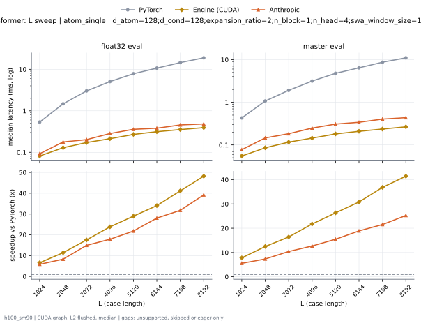
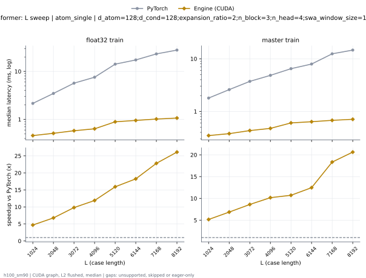
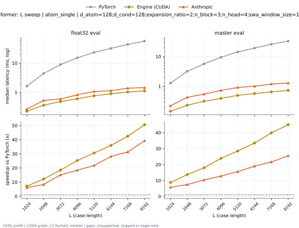

# SWAAtomTransformer on h100_sm90

Generated by `python -m miniworld_engine.measure.plot` from speed tokens `judge/tokens/h100_sm90/`; do not edit.

### L sweep: atom_single | d_atom=128;d_cond=128;expansion_ratio=2;n_block=1;n_head=4;swa_window_size=1000000 | S48 | graph

**float32 train** (median ms; x = speedup vs PyTorch)

| L | PyTorch | Engine (Triton) | Engine (CUDA) | Anthropic |
|---|---|---|---|---|
| 1024 | 9.411 | 3.157 (2.98x) | 2.384 (3.95x) | 10.06 (eager) |
| 2048 | 30.15 | 7.461 (4.04x) | 4.938 (6.11x) | 31.06 (eager) |
| 3072 | 63.32 | 12.81 (4.94x) | 7.923 (7.99x) | 66.38 (eager) |
| 4096 | 108.7 | 19.75 (5.50x) | 11.39 (9.55x) | 112.3 (eager) |
| 5120 | 166.5 | 28.06 (5.93x) | 15.26 (10.91x) | 177.6 (eager) |
| 6144 | 236.8 | 37.35 (6.34x) | 19.65 (12.05x) | 249.7 (eager) |
| 7168 | 319.6 | 48.25 (6.62x) | 24.56 (13.02x) | 347.6 (eager) |
| 8192 | skipped | 60.48 | 29.82 | 444.6 (eager) |

**master train** (median ms; x = speedup vs PyTorch)

| L | PyTorch | Engine (Triton) | Engine (CUDA) | Anthropic |
|---|---|---|---|---|
| 1024 | 5.76 | 2.076 (2.77x) | 1.295 (4.45x) | 5.431 (eager) |
| 2048 | 16.51 | 5.349 (3.09x) | 2.882 (5.73x) | 13.48 (eager) |
| 3072 | 32.41 | 9.845 (3.29x) | 4.934 (6.57x) | 25.63 (eager) |
| 4096 | 53.81 | 15.77 (3.41x) | 7.434 (7.24x) | 40.34 (eager) |
| 5120 | 80.52 | 22.95 (3.51x) | 10.48 (7.69x) | 59.28 (eager) |
| 6144 | 112.4 | 31.34 (3.59x) | 13.7 (8.20x) | 80.65 (eager) |
| 7168 | 149.7 | 41.43 (3.61x) | 17.83 (8.40x) | 106.3 (eager) |
| 8192 | skipped | 52.65 | 22.24 | 135.2 (eager) |

### L sweep: atom_single | d_atom=128;d_cond=128;expansion_ratio=2;n_block=1;n_head=4;swa_window_size=1000000 | S5 | graph

**float32 eval** (median ms; x = speedup vs PyTorch)

| L | PyTorch | Engine (Triton) | Engine (CUDA) | Anthropic |
|---|---|---|---|---|
| 1024 | 0.5463 | 0.1471 (3.71x) | 0.09238 (5.91x) | 0.1167 (4.68x) |
| 2048 | 1.461 | 0.2927 (4.99x) | 0.1636 (8.93x) | 0.2667 (5.48x) |
| 3072 | 2.983 | 0.4826 (6.18x) | 0.2491 (11.98x) | 0.4054 (7.36x) |
| 4096 | 5.036 | 0.7025 (7.17x) | 0.3502 (14.38x) | 0.6165 (8.17x) |
| 5120 | 7.848 | 1.016 (7.72x) | 0.4851 (16.18x) | 0.9076 (8.65x) |
| 6144 | 10.69 | 1.308 (8.17x) | 0.5675 (18.84x) | 1.137 (9.41x) |
| 7168 | 14.54 | 1.654 (8.79x) | 0.7114 (20.44x) | 1.477 (9.84x) |
| 8192 | 18.94 | 2.064 (9.17x) | 0.8731 (21.69x) | 1.828 (10.36x) |

**master eval** (median ms; x = speedup vs PyTorch)

| L | PyTorch | Engine (Triton) | Engine (CUDA) | Anthropic |
|---|---|---|---|---|
| 1024 | 0.4272 | 0.1005 (4.25x) | 0.0651 (6.56x) | 0.1022 (4.18x) |
| 2048 | 1.061 | 0.2197 (4.83x) | 0.1239 (8.56x) | 0.2327 (4.56x) |
| 3072 | 1.888 | 0.362 (5.21x) | 0.1988 (9.49x) | 0.3871 (4.88x) |
| 4096 | 3.148 | 0.558 (5.64x) | 0.2896 (10.87x) | 0.5864 (5.37x) |
| 5120 | 4.772 | 0.8197 (5.82x) | 0.4052 (11.78x) | 0.8658 (5.51x) |
| 6144 | 6.413 | 1.069 (6.00x) | 0.4725 (13.57x) | 1.101 (5.83x) |
| 7168 | 8.698 | 1.378 (6.31x) | 0.6053 (14.37x) | 1.406 (6.18x) |
| 8192 | 11.02 | 1.739 (6.34x) | 0.7581 (14.53x) | 1.783 (6.18x) |

### L sweep: atom_single | d_atom=128;d_cond=128;expansion_ratio=2;n_block=1;n_head=4;swa_window_size=128 | S48 | graph

**float32 train** (median ms; x = speedup vs PyTorch)

| L | PyTorch | Engine (Triton) | Engine (CUDA) | Anthropic |
|---|---|---|---|---|
| 1024 | 9.404 | 2.561 (3.67x) | 1.659 (5.67x) | 10.09 (eager) |
| 2048 | 30.14 | 4.937 (6.10x) | 3.196 (9.43x) | 31.15 (eager) |
| 3072 | 63.31 | 7.181 (8.82x) | 4.629 (13.68x) | 50.88 (eager) |
| 4096 | 108.7 | 9.519 (11.42x) | 6.139 (17.71x) | 75.31 (eager) |
| 5120 | 166.6 | 11.82 (14.09x) | 7.648 (21.78x) | 94.97 (eager) |
| 6144 | 236.8 | 14.09 (16.81x) | 9.111 (25.99x) | 119.4 (eager) |
| 7168 | 319.8 | 16.44 (19.45x) | 10.64 (30.04x) | 138.8 (eager) |
| 8192 | skipped | 18.76 | 12.16 | 163.4 (eager) |

**master train** (median ms; x = speedup vs PyTorch)

| L | PyTorch | Engine (Triton) | Engine (CUDA) | Anthropic |
|---|---|---|---|---|
| 1024 | 5.767 | 1.504 (3.83x) | 1.033 (5.58x) | 5.436 (eager) |
| 2048 | 16.56 | 2.881 (5.75x) | 1.93 (8.58x) | 13.46 (eager) |
| 3072 | 32.38 | 4.175 (7.76x) | 2.799 (11.57x) | 21.71 (eager) |
| 4096 | 53.8 | 5.502 (9.78x) | 3.677 (14.63x) | 30.67 (eager) |
| 5120 | 80.47 | 6.827 (11.79x) | 4.572 (17.60x) | 38.7 (eager) |
| 6144 | 112.2 | 8.124 (13.82x) | 5.464 (20.54x) | 47.57 (eager) |
| 7168 | 149.4 | 9.429 (15.85x) | 6.314 (23.66x) | 55.81 (eager) |
| 8192 | skipped | 10.78 | 7.365 | 64.78 (eager) |

### L sweep: atom_single | d_atom=128;d_cond=128;expansion_ratio=2;n_block=1;n_head=4;swa_window_size=128 | S5 | graph

**float32 eval** (median ms; x = speedup vs PyTorch)

| L | PyTorch | Engine (Triton) | Engine (CUDA) | Anthropic |
|---|---|---|---|---|
| 1024 | 0.5366 | 0.1199 (4.48x) | 0.08163 (6.57x) | 0.09232 (5.81x) |
| 2048 | 1.472 | 0.1984 (7.42x) | 0.129 (11.40x) | 0.1776 (8.29x) |
| 3072 | 3.018 | 0.2698 (11.19x) | 0.172 (17.54x) | 0.202 (14.94x) |
| 4096 | 5.068 | 0.3348 (15.14x) | 0.2126 (23.84x) | 0.2836 (17.87x) |
| 5120 | 7.816 | 0.4346 (17.98x) | 0.2698 (28.97x) | 0.3584 (21.81x) |
| 6144 | 10.68 | 0.4947 (21.60x) | 0.3137 (34.05x) | 0.3808 (28.05x) |
| 7168 | 14.53 | 0.5602 (25.93x) | 0.3531 (41.14x) | 0.4571 (31.78x) |
| 8192 | 18.93 | 0.6301 (30.04x) | 0.3928 (48.20x) | 0.4831 (39.19x) |

**master eval** (median ms; x = speedup vs PyTorch)

| L | PyTorch | Engine (Triton) | Engine (CUDA) | Anthropic |
|---|---|---|---|---|
| 1024 | 0.4294 | 0.07568 (5.67x) | 0.0551 (7.79x) | 0.07752 (5.54x) |
| 2048 | 1.069 | 0.126 (8.49x) | 0.08573 (12.47x) | 0.146 (7.32x) |
| 3072 | 1.907 | 0.1475 (12.93x) | 0.1163 (16.39x) | 0.1831 (10.41x) |
| 4096 | 3.143 | 0.1965 (16.00x) | 0.1445 (21.75x) | 0.248 (12.67x) |
| 5120 | 4.768 | 0.232 (20.55x) | 0.1811 (26.33x) | 0.3084 (15.46x) |
| 6144 | 6.419 | 0.2622 (24.49x) | 0.2084 (30.81x) | 0.3398 (18.89x) |
| 7168 | 8.68 | 0.3011 (28.82x) | 0.2356 (36.83x) | 0.4033 (21.52x) |
| 8192 | 11.01 | 0.3268 (33.71x) | 0.2657 (41.45x) | 0.4361 (25.25x) |

### L sweep: atom_single | d_atom=128;d_cond=128;expansion_ratio=2;n_block=3;n_head=4;swa_window_size=128 | S1 | graph

**float32 train** (median ms; x = speedup vs PyTorch)

| L | PyTorch | Engine (Triton) | Engine (CUDA) | Anthropic |
|---|---|---|---|---|
| 1024 | 2.154 | 0.6256 (3.44x) | 0.4596 (4.69x) | 5.426 (eager) |
| 2048 | 3.47 | 0.6931 (5.01x) | 0.5124 (6.77x) | 5.434 (eager) |
| 3072 | 5.688 | 0.8008 (7.10x) | 0.5797 (9.81x) | 7.193 (eager) |
| 4096 | 7.562 | 0.865 (8.74x) | 0.636 (11.89x) | 8.33 (eager) |
| 5120 | 14.17 | 1.287 (11.01x) | 0.8901 (15.91x) | 10.49 (eager) |
| 6144 | 17.34 | 1.376 (12.60x) | 0.9505 (18.24x) | 12.25 (eager) |
| 7168 | 23.16 | 1.484 (15.60x) | 1.016 (22.80x) | 14.39 (eager) |
| 8192 | 27.82 | 1.543 (18.03x) | 1.066 (26.11x) | 16.13 (eager) |

**master train** (median ms; x = speedup vs PyTorch)

| L | PyTorch | Engine (Triton) | Engine (CUDA) | Anthropic |
|---|---|---|---|---|
| 1024 | 1.794 | 0.4551 (3.94x) | 0.3479 (5.16x) | 6.796 (eager) |
| 2048 | 2.594 | 0.5137 (5.05x) | 0.3784 (6.86x) | 6.684 (eager) |
| 3072 | 3.722 | 0.6031 (6.17x) | 0.4327 (8.60x) | 7.932 (eager) |
| 4096 | 4.843 | 0.6329 (7.65x) | 0.4763 (10.17x) | 7.874 (eager) |
| 5120 | 6.481 | 0.8272 (7.83x) | 0.605 (10.71x) | 8.934 (eager) |
| 6144 | 7.94 | 0.8838 (8.98x) | 0.6372 (12.46x) | 8.989 (eager) |
| 7168 | 12.42 | 0.9461 (13.13x) | 0.6775 (18.34x) | 10.43 (eager) |
| 8192 | 14.61 | 0.9913 (14.74x) | 0.7084 (20.63x) | 10.36 (eager) |

### L sweep: atom_single | d_atom=128;d_cond=128;expansion_ratio=2;n_block=3;n_head=4;swa_window_size=128 | S5 | graph

**float32 eval** (median ms; x = speedup vs PyTorch)

| L | PyTorch | Engine (Triton) | Engine (CUDA) | Anthropic |
|---|---|---|---|---|
| 1024 | 1.624 | 0.3487 (4.66x) | 0.2262 (7.18x) | 0.2662 (6.10x) |
| 2048 | 4.404 | 0.5829 (7.55x) | 0.3619 (12.17x) | 0.5288 (8.33x) |
| 3072 | 8.911 | 0.7869 (11.32x) | 0.4824 (18.47x) | 0.5913 (15.07x) |
| 4096 | 15.17 | 0.9855 (15.39x) | 0.6001 (25.27x) | 0.8235 (18.42x) |
| 5120 | 23.34 | 1.297 (18.00x) | 0.7635 (30.58x) | 1.072 (21.78x) |
| 6144 | 31.92 | 1.46 (21.87x) | 0.8886 (35.92x) | 1.134 (28.15x) |
| 7168 | 43.55 | 1.689 (25.78x) | 1.025 (42.47x) | 1.391 (31.31x) |
| 8192 | 56.78 | 1.898 (29.92x) | 1.123 (50.57x) | 1.443 (39.33x) |

**master eval** (median ms; x = speedup vs PyTorch)

| L | PyTorch | Engine (Triton) | Engine (CUDA) | Anthropic |
|---|---|---|---|---|
| 1024 | 1.28 | 0.216 (5.93x) | 0.1466 (8.73x) | 0.2226 (5.75x) |
| 2048 | 3.184 | 0.3685 (8.64x) | 0.2322 (13.71x) | 0.4294 (7.41x) |
| 3072 | 5.683 | 0.4336 (13.11x) | 0.317 (17.93x) | 0.5492 (10.35x) |
| 4096 | 9.394 | 0.5776 (16.26x) | 0.3937 (23.86x) | 0.7345 (12.79x) |
| 5120 | 14.21 | 0.6834 (20.79x) | 0.4988 (28.49x) | 0.9138 (15.55x) |
| 6144 | 19.2 | 0.7709 (24.90x) | 0.5734 (33.48x) | 1.01 (19.01x) |
| 7168 | 25.89 | 0.888 (29.16x) | 0.6497 (39.85x) | 1.197 (21.64x) |
| 8192 | 32.96 | 0.9664 (34.11x) | 0.7332 (44.96x) | 1.292 (25.51x) |

