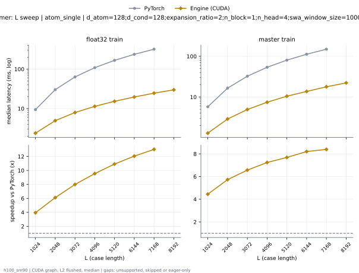
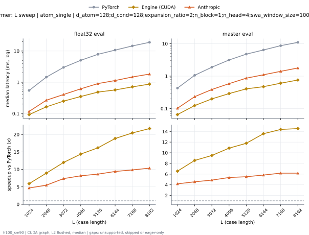
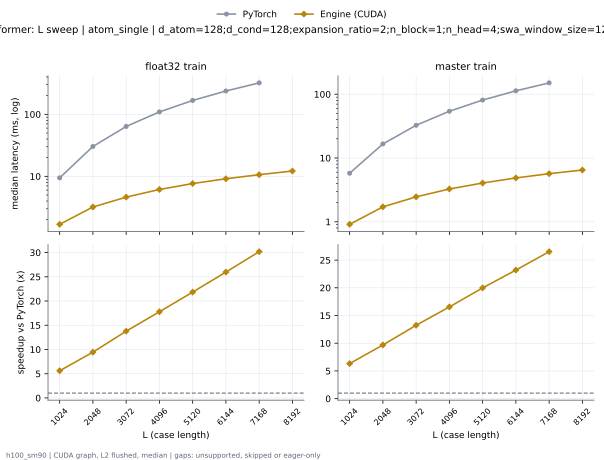

# SWAAtomTransformer on h100_sm90

Generated by `python -m miniworld_engine.measure.plot` from speed tokens `judge/tokens/h100_sm90/`; do not edit.

### L sweep: atom_single | d_atom=128;d_cond=128;expansion_ratio=2;n_block=1;n_head=4;swa_window_size=1000000 | S48 | graph

**float32 train** (median ms; x = speedup vs PyTorch)

| L | PyTorch | Engine (Triton) | Engine (CUDA) | Anthropic |
|---|---|---|---|---|
| 1024 | 9.443 | 3.157 (2.99x) | 2.388 (3.95x) | 10.06 (eager) |
| 2048 | 30.29 | 7.461 (4.06x) | 4.942 (6.13x) | 31.06 (eager) |
| 3072 | 63.83 | 12.81 (4.98x) | 7.956 (8.02x) | 66.38 (eager) |
| 4096 | 109.5 | 19.75 (5.54x) | 11.43 (9.58x) | 112.3 (eager) |
| 5120 | 167.4 | 28.06 (5.96x) | 15.31 (10.93x) | 177.6 (eager) |
| 6144 | 237.8 | 37.35 (6.37x) | 19.54 (12.17x) | 249.7 (eager) |
| 7168 | 321.2 | 48.25 (6.66x) | 24.55 (13.08x) | 347.6 (eager) |
| 8192 | skipped | 60.48 | 29.83 | 444.6 (eager) |

**master train** (median ms; x = speedup vs PyTorch)

| L | PyTorch | Engine (Triton) | Engine (CUDA) | Anthropic |
|---|---|---|---|---|
| 1024 | 5.768 | 2.076 (2.78x) | 1.176 (4.90x) | 5.431 (eager) |
| 2048 | 16.58 | 5.349 (3.10x) | 2.68 (6.19x) | 13.48 (eager) |
| 3072 | 32.66 | 9.845 (3.32x) | 4.569 (7.15x) | 25.63 (eager) |
| 4096 | 54.22 | 15.77 (3.44x) | 7.032 (7.71x) | 40.34 (eager) |
| 5120 | 81.15 | 22.95 (3.53x) | 9.896 (8.20x) | 59.28 (eager) |
| 6144 | 113.3 | 31.34 (3.61x) | 13.13 (8.63x) | 80.65 (eager) |
| 7168 | 150.8 | 41.43 (3.64x) | 16.97 (8.89x) | 106.3 (eager) |
| 8192 | skipped | 52.65 | 21.35 | 135.2 (eager) |

### L sweep: atom_single | d_atom=128;d_cond=128;expansion_ratio=2;n_block=1;n_head=4;swa_window_size=1000000 | S5 | graph

**float32 eval** (median ms; x = speedup vs PyTorch)

| L | PyTorch | Engine (Triton) | Engine (CUDA) | Anthropic |
|---|---|---|---|---|
| 1024 | 0.5444 | 0.1471 (3.70x) | 0.09194 (5.92x) | 0.1167 (4.67x) |
| 2048 | 1.483 | 0.2927 (5.07x) | 0.1655 (8.96x) | 0.2667 (5.56x) |
| 3072 | 3.023 | 0.4826 (6.26x) | 0.2508 (12.06x) | 0.4054 (7.46x) |
| 4096 | 5.071 | 0.7025 (7.22x) | 0.3523 (14.39x) | 0.6165 (8.23x) |
| 5120 | 7.849 | 1.016 (7.73x) | 0.4874 (16.11x) | 0.9076 (8.65x) |
| 6144 | 10.73 | 1.308 (8.20x) | 0.5684 (18.87x) | 1.137 (9.44x) |
| 7168 | 14.59 | 1.654 (8.82x) | 0.7157 (20.39x) | 1.477 (9.88x) |
| 8192 | 18.99 | 2.064 (9.20x) | 0.8784 (21.62x) | 1.828 (10.39x) |

**master eval** (median ms; x = speedup vs PyTorch)

| L | PyTorch | Engine (Triton) | Engine (CUDA) | Anthropic |
|---|---|---|---|---|
| 1024 | 0.4365 | 0.1005 (4.34x) | 0.0671 (6.51x) | 0.1022 (4.27x) |
| 2048 | 1.079 | 0.2197 (4.91x) | 0.1255 (8.60x) | 0.2327 (4.64x) |
| 3072 | 1.917 | 0.362 (5.30x) | 0.2006 (9.55x) | 0.3871 (4.95x) |
| 4096 | 3.165 | 0.558 (5.67x) | 0.2894 (10.94x) | 0.5864 (5.40x) |
| 5120 | 4.791 | 0.8197 (5.84x) | 0.4045 (11.84x) | 0.8658 (5.53x) |
| 6144 | 6.446 | 1.069 (6.03x) | 0.475 (13.57x) | 1.101 (5.86x) |
| 7168 | 8.708 | 1.378 (6.32x) | 0.6082 (14.32x) | 1.406 (6.19x) |
| 8192 | 11.03 | 1.739 (6.35x) | 0.7609 (14.50x) | 1.783 (6.19x) |

### L sweep: atom_single | d_atom=128;d_cond=128;expansion_ratio=2;n_block=1;n_head=4;swa_window_size=128 | S48 | graph

**float32 train** (median ms; x = speedup vs PyTorch)

| L | PyTorch | Engine (Triton) | Engine (CUDA) | Anthropic |
|---|---|---|---|---|
| 1024 | 9.463 | 2.561 (3.69x) | 1.687 (5.61x) | 10.09 (eager) |
| 2048 | 30.32 | 4.937 (6.14x) | 3.209 (9.45x) | 31.15 (eager) |
| 3072 | 63.8 | 7.181 (8.88x) | 4.63 (13.78x) | 50.88 (eager) |
| 4096 | 109.4 | 9.519 (11.49x) | 6.15 (17.78x) | 75.31 (eager) |
| 5120 | 167.4 | 11.82 (14.16x) | 7.663 (21.84x) | 94.97 (eager) |
| 6144 | 237.7 | 14.09 (16.87x) | 9.151 (25.98x) | 119.4 (eager) |
| 7168 | 321.2 | 16.44 (19.53x) | 10.64 (30.19x) | 138.8 (eager) |
| 8192 | skipped | 18.76 | 12.2 | 163.4 (eager) |

**master train** (median ms; x = speedup vs PyTorch)

| L | PyTorch | Engine (Triton) | Engine (CUDA) | Anthropic |
|---|---|---|---|---|
| 1024 | 5.774 | 1.504 (3.84x) | 0.9126 (6.33x) | 5.436 (eager) |
| 2048 | 16.62 | 2.881 (5.77x) | 1.715 (9.69x) | 13.46 (eager) |
| 3072 | 32.63 | 4.175 (7.81x) | 2.463 (13.25x) | 21.71 (eager) |
| 4096 | 54.17 | 5.502 (9.85x) | 3.272 (16.56x) | 30.67 (eager) |
| 5120 | 81.06 | 6.827 (11.87x) | 4.055 (19.99x) | 38.7 (eager) |
| 6144 | 113.1 | 8.124 (13.93x) | 4.876 (23.20x) | 47.57 (eager) |
| 7168 | 150.7 | 9.429 (15.98x) | 5.68 (26.53x) | 55.81 (eager) |
| 8192 | skipped | 10.78 | 6.484 | 64.78 (eager) |

### L sweep: atom_single | d_atom=128;d_cond=128;expansion_ratio=2;n_block=1;n_head=4;swa_window_size=128 | S5 | graph

**float32 eval** (median ms; x = speedup vs PyTorch)

| L | PyTorch | Engine (Triton) | Engine (CUDA) | Anthropic |
|---|---|---|---|---|
| 1024 | 0.5384 | 0.1199 (4.49x) | 0.08186 (6.58x) | 0.09232 (5.83x) |
| 2048 | 1.463 | 0.1984 (7.38x) | 0.1279 (11.44x) | 0.1776 (8.24x) |
| 3072 | 3.023 | 0.2698 (11.21x) | 0.1743 (17.35x) | 0.202 (14.97x) |
| 4096 | 5.059 | 0.3348 (15.11x) | 0.2127 (23.79x) | 0.2836 (17.84x) |
| 5120 | 7.839 | 0.4346 (18.04x) | 0.2696 (29.08x) | 0.3584 (21.87x) |
| 6144 | 10.71 | 0.4947 (21.64x) | 0.3151 (33.97x) | 0.3808 (28.11x) |
| 7168 | 14.56 | 0.5602 (25.98x) | 0.3552 (40.97x) | 0.4571 (31.84x) |
| 8192 | 18.96 | 0.6301 (30.10x) | 0.3944 (48.08x) | 0.4831 (39.26x) |

**master eval** (median ms; x = speedup vs PyTorch)

| L | PyTorch | Engine (Triton) | Engine (CUDA) | Anthropic |
|---|---|---|---|---|
| 1024 | 0.4371 | 0.07568 (5.78x) | 0.05654 (7.73x) | 0.07752 (5.64x) |
| 2048 | 1.076 | 0.126 (8.54x) | 0.08598 (12.51x) | 0.146 (7.37x) |
| 3072 | 1.918 | 0.1475 (13.00x) | 0.1164 (16.48x) | 0.1831 (10.47x) |
| 4096 | 3.18 | 0.1965 (16.19x) | 0.1451 (21.92x) | 0.248 (12.82x) |
| 5120 | 4.774 | 0.232 (20.58x) | 0.183 (26.08x) | 0.3084 (15.48x) |
| 6144 | 6.428 | 0.2622 (24.52x) | 0.2098 (30.64x) | 0.3398 (18.91x) |
| 7168 | 8.694 | 0.3011 (28.87x) | 0.2378 (36.55x) | 0.4033 (21.56x) |
| 8192 | 11.01 | 0.3268 (33.70x) | 0.2681 (41.06x) | 0.4361 (25.25x) |

### L sweep: atom_single | d_atom=128;d_cond=128;expansion_ratio=2;n_block=3;n_head=4;swa_window_size=128 | S1 | graph

**float32 train** (median ms; x = speedup vs PyTorch)

| L | PyTorch | Engine (Triton) | Engine (CUDA) | Anthropic |
|---|---|---|---|---|
| 1024 | 2.152 | 0.6256 (3.44x) | 0.4589 (4.69x) | 5.426 (eager) |
| 2048 | 3.488 | 0.6931 (5.03x) | 0.5154 (6.77x) | 5.434 (eager) |
| 3072 | 5.729 | 0.8008 (7.15x) | 0.5828 (9.83x) | 7.193 (eager) |
| 4096 | 7.622 | 0.865 (8.81x) | 0.6401 (11.91x) | 8.33 (eager) |
| 5120 | 14.37 | 1.287 (11.17x) | 0.8886 (16.17x) | 10.49 (eager) |
| 6144 | 17.49 | 1.376 (12.71x) | 0.9686 (18.06x) | 12.25 (eager) |
| 7168 | 23.15 | 1.484 (15.60x) | 1.036 (22.36x) | 14.39 (eager) |
| 8192 | 28.12 | 1.543 (18.22x) | 1.073 (26.21x) | 16.13 (eager) |

**master train** (median ms; x = speedup vs PyTorch)

| L | PyTorch | Engine (Triton) | Engine (CUDA) | Anthropic |
|---|---|---|---|---|
| 1024 | 1.787 | 0.4551 (3.93x) | 0.3084 (5.80x) | 6.796 (eager) |
| 2048 | 2.597 | 0.5137 (5.05x) | 0.3368 (7.71x) | 6.684 (eager) |
| 3072 | 3.708 | 0.6031 (6.15x) | 0.3799 (9.76x) | 7.932 (eager) |
| 4096 | 4.835 | 0.6329 (7.64x) | 0.4147 (11.66x) | 7.874 (eager) |
| 5120 | 6.503 | 0.8272 (7.86x) | 0.5353 (12.15x) | 8.934 (eager) |
| 6144 | 7.945 | 0.8838 (8.99x) | 0.5619 (14.14x) | 8.989 (eager) |
| 7168 | 12.61 | 0.9461 (13.33x) | 0.5933 (21.25x) | 10.43 (eager) |
| 8192 | 14.85 | 0.9913 (14.98x) | 0.6198 (23.95x) | 10.36 (eager) |

### L sweep: atom_single | d_atom=128;d_cond=128;expansion_ratio=2;n_block=3;n_head=4;swa_window_size=128 | S5 | graph

**float32 eval** (median ms; x = speedup vs PyTorch)

| L | PyTorch | Engine (Triton) | Engine (CUDA) | Anthropic |
|---|---|---|---|---|
| 1024 | 1.615 | 0.3487 (4.63x) | 0.2256 (7.16x) | 0.2662 (6.07x) |
| 2048 | 4.388 | 0.5829 (7.53x) | 0.3622 (12.11x) | 0.5288 (8.30x) |
| 3072 | 9.028 | 0.7869 (11.47x) | 0.4853 (18.60x) | 0.5913 (15.27x) |
| 4096 | 15.12 | 0.9855 (15.34x) | 0.6015 (25.13x) | 0.8235 (18.36x) |
| 5120 | 23.42 | 1.297 (18.05x) | 0.7689 (30.45x) | 1.072 (21.84x) |
| 6144 | 32.11 | 1.46 (22.00x) | 0.9031 (35.56x) | 1.134 (28.32x) |
| 7168 | 43.73 | 1.689 (25.89x) | 1.012 (43.21x) | 1.391 (31.44x) |
| 8192 | 57.01 | 1.898 (30.04x) | 1.128 (50.52x) | 1.443 (39.49x) |

**master eval** (median ms; x = speedup vs PyTorch)

| L | PyTorch | Engine (Triton) | Engine (CUDA) | Anthropic |
|---|---|---|---|---|
| 1024 | 1.279 | 0.216 (5.92x) | 0.1471 (8.70x) | 0.2226 (5.75x) |
| 2048 | 3.177 | 0.3685 (8.62x) | 0.2322 (13.69x) | 0.4294 (7.40x) |
| 3072 | 5.691 | 0.4336 (13.12x) | 0.3169 (17.96x) | 0.5492 (10.36x) |
| 4096 | 9.435 | 0.5776 (16.33x) | 0.3965 (23.80x) | 0.7345 (12.85x) |
| 5120 | 14.29 | 0.6834 (20.91x) | 0.5013 (28.51x) | 0.9138 (15.64x) |
| 6144 | 19.23 | 0.7709 (24.95x) | 0.5791 (33.21x) | 1.01 (19.04x) |
| 7168 | 25.99 | 0.888 (29.27x) | 0.6567 (39.58x) | 1.197 (21.72x) |
| 8192 | 32.97 | 0.9664 (34.12x) | 0.7414 (44.47x) | 1.292 (25.52x) |

