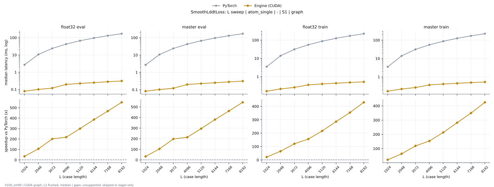

# SmoothLddtLoss on h100_sm90

Generated by `python -m miniworld_engine.measure.plot` from speed tokens `judge/tokens/h100_sm90/`; do not edit.

### L sweep: atom_single | - | S1 | graph

**float32 eval** (median ms; x = speedup vs PyTorch)

| L | PyTorch | Engine (Triton) | Engine (CUDA) |
|---|---|---|---|
| 1024 | 2.695 | 0.08392 (32.11x) | 0.0789 (34.15x) |
| 2048 | 10.63 | 0.1473 (72.13x) | 0.1002 (106.06x) |
| 3072 | 23.95 | 0.2014 (118.92x) | 0.1192 (201.02x) |
| 4096 | 42.54 | 0.271 (156.99x) | 0.1954 (217.68x) |
| 5120 | 66.43 | 0.3406 (195.01x) | 0.2217 (299.59x) |
| 6144 | 95.73 | 0.4158 (230.25x) | 0.2479 (386.10x) |
| 7168 | 130.3 | 0.4912 (265.19x) | 0.2786 (467.53x) |
| 8192 | 170.3 | 0.5737 (296.78x) | 0.3086 (551.66x) |

**master eval** (median ms; x = speedup vs PyTorch)

| L | PyTorch | Engine (Triton) | Engine (CUDA) |
|---|---|---|---|
| 1024 | 2.699 | 0.07622 (35.41x) | 0.08195 (32.94x) |
| 2048 | 10.63 | 0.1393 (76.33x) | 0.1022 (103.98x) |
| 3072 | 23.96 | 0.1957 (122.46x) | 0.1212 (197.80x) |
| 4096 | 42.53 | 0.257 (165.51x) | 0.1994 (213.33x) |
| 5120 | 66.43 | 0.321 (206.95x) | 0.2253 (294.85x) |
| 6144 | 95.66 | 0.3886 (246.14x) | 0.2513 (380.67x) |
| 7168 | 130.3 | 0.4601 (283.10x) | 0.2822 (461.62x) |
| 8192 | 170.3 | 0.5281 (322.44x) | 0.3132 (543.59x) |

**float32 train** (median ms; x = speedup vs PyTorch)

| L | PyTorch | Engine (Triton) | Engine (CUDA) |
|---|---|---|---|
| 1024 | 3.519 | 0.1886 (18.66x) | 0.1614 (21.80x) |
| 2048 | 13.9 | 0.3731 (37.24x) | 0.2147 (64.71x) |
| 3072 | 31.38 | 0.51 (61.52x) | 0.2602 (120.60x) |
| 4096 | 55.73 | 0.6982 (79.82x) | 0.3575 (155.87x) |
| 5120 | 87.15 | 0.8966 (97.21x) | 0.4027 (216.41x) |
| 6144 | 125.8 | 1.115 (112.82x) | 0.4402 (285.85x) |
| 7168 | 171.4 | 1.297 (132.19x) | 0.4844 (353.85x) |
| 8192 | 224.4 | 1.49 (150.60x) | 0.5216 (430.15x) |

**master train** (median ms; x = speedup vs PyTorch)

| L | PyTorch | Engine (Triton) | Engine (CUDA) |
|---|---|---|---|
| 1024 | 3.525 | 0.1799 (19.59x) | 0.1666 (21.16x) |
| 2048 | 13.9 | 0.3431 (40.51x) | 0.2189 (63.49x) |
| 3072 | 31.38 | 0.4961 (63.26x) | 0.2636 (119.05x) |
| 4096 | 55.78 | 0.6551 (85.14x) | 0.3638 (153.30x) |
| 5120 | 87.16 | 0.8254 (105.60x) | 0.4083 (213.47x) |
| 6144 | 125.6 | 1.003 (125.30x) | 0.4451 (282.19x) |
| 7168 | 171.4 | 1.189 (144.20x) | 0.49 (349.83x) |
| 8192 | 224.4 | 1.319 (170.04x) | 0.5275 (425.30x) |

