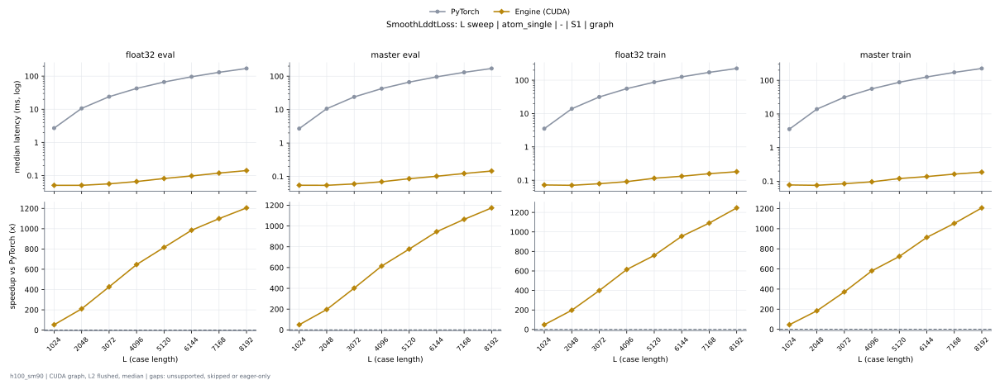

# SmoothLddtLoss on h100_sm90

Generated by `python -m miniworld_engine.measure.plot` from speed tokens `judge/tokens/h100_sm90/`; do not edit.

### L sweep: atom_single | - | S1 | graph

**float32 eval** (median ms; x = speedup vs PyTorch)

| L | PyTorch | Engine (Triton) | Engine (CUDA) |
|---|---|---|---|
| 1024 | 2.695 | 0.05626 (47.91x) | 0.05069 (53.17x) |
| 2048 | 10.63 | 0.08315 (127.81x) | 0.05066 (209.80x) |
| 3072 | 23.94 | 0.1126 (212.62x) | 0.0561 (426.82x) |
| 4096 | 42.53 | 0.1454 (292.45x) | 0.06579 (646.42x) |
| 5120 | 66.41 | 0.2086 (318.38x) | 0.08141 (815.80x) |
| 6144 | 95.71 | 0.2511 (381.22x) | 0.09718 (984.80x) |
| 7168 | 130.2 | 0.297 (438.46x) | 0.1185 (1099.20x) |
| 8192 | 170.2 | 0.3439 (494.93x) | 0.1412 (1205.04x) |

**master eval** (median ms; x = speedup vs PyTorch)

| L | PyTorch | Engine (Triton) | Engine (CUDA) |
|---|---|---|---|
| 1024 | 2.699 | 0.05677 (47.55x) | 0.05438 (49.63x) |
| 2048 | 10.63 | 0.0835 (127.32x) | 0.05416 (196.31x) |
| 3072 | 23.96 | 0.113 (212.00x) | 0.0596 (401.97x) |
| 4096 | 42.53 | 0.1451 (293.18x) | 0.06922 (614.48x) |
| 5120 | 66.41 | 0.2076 (319.91x) | 0.08541 (777.60x) |
| 6144 | 95.63 | 0.2499 (382.65x) | 0.1012 (945.13x) |
| 7168 | 130.2 | 0.2946 (442.14x) | 0.1224 (1064.04x) |
| 8192 | 170.2 | 0.3418 (498.04x) | 0.145 (1174.18x) |

**float32 train** (median ms; x = speedup vs PyTorch)

| L | PyTorch | Engine (Triton) | Engine (CUDA) |
|---|---|---|---|
| 1024 | 3.519 | 0.1057 (33.30x) | 0.07219 (48.75x) |
| 2048 | 13.9 | 0.174 (79.90x) | 0.07046 (197.25x) |
| 3072 | 31.38 | 0.245 (128.09x) | 0.0787 (398.66x) |
| 4096 | 55.78 | 0.3185 (175.12x) | 0.0907 (614.93x) |
| 5120 | 87.16 | 0.4822 (180.74x) | 0.1148 (759.11x) |
| 6144 | 125.8 | 0.5776 (217.87x) | 0.1317 (955.37x) |
| 7168 | 171.4 | 0.6758 (253.69x) | 0.1572 (1090.46x) |
| 8192 | 224.3 | 0.7773 (288.60x) | 0.18 (1246.09x) |

**master train** (median ms; x = speedup vs PyTorch)

| L | PyTorch | Engine (Triton) | Engine (CUDA) |
|---|---|---|---|
| 1024 | 3.531 | 0.106 (33.31x) | 0.07752 (45.55x) |
| 2048 | 13.9 | 0.1738 (80.00x) | 0.07563 (183.80x) |
| 3072 | 31.38 | 0.2445 (128.33x) | 0.0844 (371.84x) |
| 4096 | 55.78 | 0.3176 (175.60x) | 0.09597 (581.24x) |
| 5120 | 87.16 | 0.4804 (181.44x) | 0.1203 (724.52x) |
| 6144 | 125.6 | 0.5775 (217.53x) | 0.1375 (913.88x) |
| 7168 | 171.4 | 0.6735 (254.55x) | 0.1629 (1052.70x) |
| 8192 | 224.3 | 0.776 (289.10x) | 0.1859 (1206.83x) |

