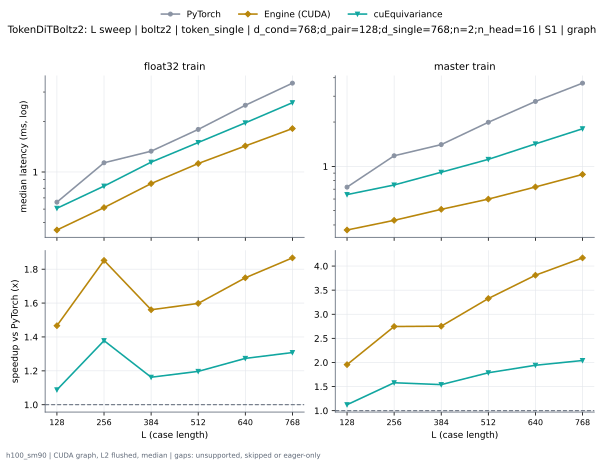
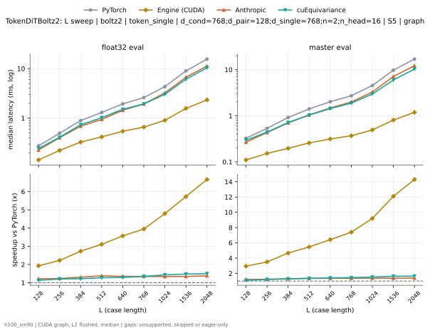
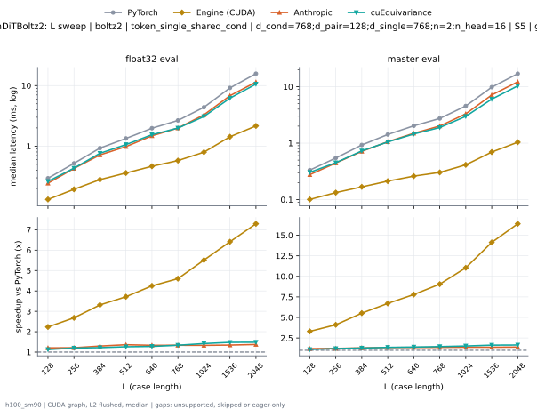

# TokenDiTBoltz2 on h100_sm90

Generated by `python -m miniworld_engine.measure.plot` from speed tokens `judge/tokens/h100_sm90/`; do not edit.

### L sweep: boltz2 | token_single | d_cond=768;d_pair=128;d_single=768;n=2;n_head=16 | S1 | graph

**float32 train** (median ms; x = speedup vs PyTorch)

| L | PyTorch | Engine (Triton) | Engine (CUDA) | Anthropic | cuEquivariance |
|---|---|---|---|---|---|
| 128 | 0.667 | 0.634 (1.05x) | 0.4511 (1.48x) | unsupported | 0.6071 (1.10x) |
| 256 | 1.127 | 1.097 (1.03x) | 0.6145 (1.83x) | unsupported | 0.8233 (1.37x) |
| 384 | 1.332 | 1.288 (1.03x) | 0.8491 (1.57x) | unsupported | 1.145 (1.16x) |
| 512 | 1.839 | 1.757 (1.05x) | 1.121 (1.64x) | unsupported | 1.5 (1.23x) |
| 640 | 2.497 | 2.381 (1.05x) | 1.43 (1.75x) | unsupported | 1.965 (1.27x) |
| 768 | 3.394 | 3.149 (1.08x) | 1.817 (1.87x) | unsupported | 2.592 (1.31x) |

**master train** (median ms; x = speedup vs PyTorch)

| L | PyTorch | Engine (Triton) | Engine (CUDA) | Anthropic | cuEquivariance |
|---|---|---|---|---|---|
| 128 | 0.7195 | 0.6824 (1.05x) | 0.3626 (1.98x) | unsupported | 0.6433 (1.12x) |
| 256 | 1.181 | 1.141 (1.03x) | 0.4094 (2.88x) | unsupported | 0.7476 (1.58x) |
| 384 | 1.405 | 1.342 (1.05x) | 0.4668 (3.01x) | unsupported | 0.9126 (1.54x) |
| 512 | 1.991 | 1.88 (1.06x) | 0.53 (3.76x) | unsupported | 1.116 (1.78x) |
| 640 | 2.762 | 2.605 (1.06x) | 0.6103 (4.53x) | unsupported | 1.422 (1.94x) |
| 768 | 3.674 | 3.446 (1.07x) | 0.7173 (5.12x) | unsupported | 1.801 (2.04x) |

### L sweep: boltz2 | token_single | d_cond=768;d_pair=128;d_single=768;n=2;n_head=16 | S5 | graph

**float32 eval** (median ms; x = speedup vs PyTorch)

| L | PyTorch | Engine (Triton) | Engine (CUDA) | Anthropic | cuEquivariance |
|---|---|---|---|---|---|
| 128 | 0.2766 | 0.2458 (1.13x) | 0.1427 (1.94x) | 0.2274 (1.22x) | 0.2439 (1.13x) |
| 256 | 0.4969 | 0.425 (1.17x) | 0.2231 (2.23x) | 0.403 (1.23x) | 0.4118 (1.21x) |
| 384 | 0.8965 | 0.7121 (1.26x) | 0.3282 (2.73x) | 0.6878 (1.30x) | 0.737 (1.22x) |
| 512 | 1.299 | 1 (1.30x) | 0.421 (3.09x) | 0.9441 (1.38x) | 1.024 (1.27x) |
| 640 | 1.928 | 1.466 (1.32x) | 0.5457 (3.53x) | 1.445 (1.33x) | 1.507 (1.28x) |
| 768 | 2.606 | 1.942 (1.34x) | 0.6625 (3.93x) | 1.94 (1.34x) | 1.935 (1.35x) |
| 1024 | 4.362 | 3.23 (1.35x) | 0.9044 (4.82x) | 3.244 (1.34x) | 3.04 (1.44x) |
| 1536 | 9.065 | 6.668 (1.36x) | 1.577 (5.75x) | 6.709 (1.35x) | 6.117 (1.48x) |
| 2048 | 15.6 | 11.2 (1.39x) | 2.343 (6.66x) | 11.31 (1.38x) | 10.44 (1.49x) |

**master eval** (median ms; x = speedup vs PyTorch)

| L | PyTorch | Engine (Triton) | Engine (CUDA) | Anthropic | cuEquivariance |
|---|---|---|---|---|---|
| 128 | 0.3247 | 0.2842 (1.14x) | 0.1101 (2.95x) | 0.2682 (1.21x) | 0.2948 (1.10x) |
| 256 | 0.5332 | 0.4384 (1.22x) | 0.1516 (3.52x) | 0.4319 (1.23x) | 0.4412 (1.21x) |
| 384 | 0.9159 | 0.7019 (1.30x) | 0.1972 (4.65x) | 0.7003 (1.31x) | 0.7136 (1.28x) |
| 512 | 1.407 | 1.032 (1.36x) | 0.2559 (5.50x) | 1.045 (1.35x) | 1.034 (1.36x) |
| 640 | 2.018 | 1.448 (1.39x) | 0.3156 (6.39x) | 1.477 (1.37x) | 1.434 (1.41x) |
| 768 | 2.729 | 1.935 (1.41x) | 0.3676 (7.42x) | 1.99 (1.37x) | 1.877 (1.45x) |
| 1024 | 4.542 | 3.161 (1.44x) | 0.4941 (9.19x) | 3.281 (1.38x) | 2.969 (1.53x) |
| 1536 | 9.766 | 6.779 (1.44x) | 0.802 (12.18x) | 7.111 (1.37x) | 5.985 (1.63x) |
| 2048 | 16.96 | 11.61 (1.46x) | 1.189 (14.27x) | 12.18 (1.39x) | 10.32 (1.64x) |

### L sweep: boltz2 | token_single_shared_cond | d_cond=768;d_pair=128;d_single=768;n=2;n_head=16 | S5 | graph

**float32 eval** (median ms; x = speedup vs PyTorch)

| L | PyTorch | Engine (Triton) | Engine (CUDA) | Anthropic | cuEquivariance |
|---|---|---|---|---|---|
| 128 | 0.2947 | 0.2631 (1.12x) | 0.1319 (2.23x) | 0.2442 (1.21x) | 0.2617 (1.13x) |
| 256 | 0.5185 | 0.4471 (1.16x) | 0.1923 (2.70x) | 0.4278 (1.21x) | 0.433 (1.20x) |
| 384 | 0.9242 | 0.7375 (1.25x) | 0.2787 (3.32x) | 0.7159 (1.29x) | 0.7616 (1.21x) |
| 512 | 1.337 | 1.034 (1.29x) | 0.3597 (3.72x) | 0.983 (1.36x) | 1.06 (1.26x) |
| 640 | 1.968 | 1.509 (1.30x) | 0.4668 (4.22x) | 1.48 (1.33x) | 1.543 (1.27x) |
| 768 | 2.657 | 1.991 (1.33x) | 0.5787 (4.59x) | 1.988 (1.34x) | 1.986 (1.34x) |
| 1024 | 4.407 | 3.256 (1.35x) | 0.797 (5.53x) | 3.289 (1.34x) | 3.086 (1.43x) |
| 1536 | 9.147 | 6.751 (1.36x) | 1.425 (6.42x) | 6.798 (1.35x) | 6.189 (1.48x) |
| 2048 | 15.72 | 11.35 (1.39x) | 2.156 (7.29x) | 11.43 (1.38x) | 10.59 (1.49x) |

**master eval** (median ms; x = speedup vs PyTorch)

| L | PyTorch | Engine (Triton) | Engine (CUDA) | Anthropic | cuEquivariance |
|---|---|---|---|---|---|
| 128 | 0.3321 | 0.2917 (1.14x) | 0.1004 (3.31x) | 0.2763 (1.20x) | 0.3037 (1.09x) |
| 256 | 0.5459 | 0.4488 (1.22x) | 0.1331 (4.10x) | 0.4442 (1.23x) | 0.45 (1.21x) |
| 384 | 0.9267 | 0.7158 (1.29x) | 0.1674 (5.53x) | 0.7154 (1.30x) | 0.7281 (1.27x) |
| 512 | 1.423 | 1.052 (1.35x) | 0.2126 (6.69x) | 1.06 (1.34x) | 1.05 (1.36x) |
| 640 | 2.034 | 1.459 (1.39x) | 0.2608 (7.80x) | 1.496 (1.36x) | 1.452 (1.40x) |
| 768 | 2.75 | 1.949 (1.41x) | 0.3049 (9.02x) | 2.012 (1.37x) | 1.89 (1.46x) |
| 1024 | 4.567 | 3.175 (1.44x) | 0.4123 (11.08x) | 3.304 (1.38x) | 2.986 (1.53x) |
| 1536 | 9.795 | 6.81 (1.44x) | 0.694 (14.11x) | 7.142 (1.37x) | 6.023 (1.63x) |
| 2048 | 16.99 | 11.64 (1.46x) | 1.044 (16.27x) | 12.22 (1.39x) | 10.35 (1.64x) |

