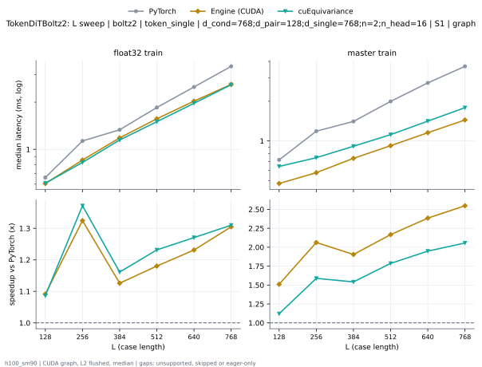
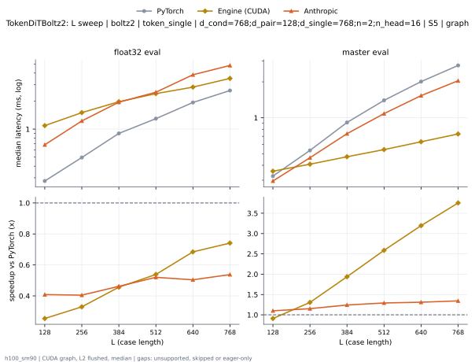

# TokenDiTBoltz2 on h100_sm90

Generated by `python -m miniworld_engine.measure.plot` from speed tokens `judge/tokens/h100_sm90/`; do not edit.

### L sweep: boltz2 | token_single | d_cond=768;d_pair=128;d_single=768;n=2;n_head=16 | S1 | graph

**float32 train** (median ms; x = speedup vs PyTorch)

| L | PyTorch | Engine (Triton) | Engine (CUDA) | Anthropic | cuEquivariance |
|---|---|---|---|---|---|
| 128 | 0.6633 | 0.6316 (1.05x) | 0.4494 (1.48x) | unsupported | 0.6081 (1.09x) |
| 256 | 1.13 | 1.099 (1.03x) | 0.6128 (1.84x) | unsupported | 0.8249 (1.37x) |
| 384 | 1.336 | 1.287 (1.04x) | 0.8528 (1.57x) | unsupported | 1.147 (1.16x) |
| 512 | 1.84 | 1.758 (1.05x) | 1.125 (1.64x) | unsupported | 1.502 (1.23x) |
| 640 | 2.456 | 2.363 (1.04x) | 1.432 (1.72x) | unsupported | 1.968 (1.25x) |
| 768 | 3.385 | 3.159 (1.07x) | 1.823 (1.86x) | unsupported | 2.585 (1.31x) |

**master train** (median ms; x = speedup vs PyTorch)

| L | PyTorch | Engine (Triton) | Engine (CUDA) | Anthropic | cuEquivariance |
|---|---|---|---|---|---|
| 128 | 0.7216 | 0.6827 (1.06x) | 0.3703 (1.95x) | unsupported | 0.6412 (1.13x) |
| 256 | 1.183 | 1.135 (1.04x) | 0.432 (2.74x) | unsupported | 0.7468 (1.58x) |
| 384 | 1.403 | 1.341 (1.05x) | 0.5096 (2.75x) | unsupported | 0.9119 (1.54x) |
| 512 | 1.989 | 1.887 (1.05x) | 0.6024 (3.30x) | unsupported | 1.117 (1.78x) |
| 640 | 2.757 | 2.601 (1.06x) | 0.7213 (3.82x) | unsupported | 1.413 (1.95x) |
| 768 | 3.672 | 3.444 (1.07x) | 0.8833 (4.16x) | unsupported | 1.788 (2.05x) |

### L sweep: boltz2 | token_single | d_cond=768;d_pair=128;d_single=768;n=2;n_head=16 | S5 | graph

**float32 eval** (median ms; x = speedup vs PyTorch)

| L | PyTorch | Engine (Triton) | Engine (CUDA) | Anthropic | cuEquivariance |
|---|---|---|---|---|---|
| 128 | 0.2781 | 0.2473 (1.12x) | 0.1424 (1.95x) | 0.2272 (1.22x) | 0.245 (1.14x) |
| 256 | 0.4967 | 0.4266 (1.16x) | 0.2217 (2.24x) | 0.4029 (1.23x) | 0.4112 (1.21x) |
| 384 | 0.9007 | 0.7108 (1.27x) | 0.3283 (2.74x) | 0.6872 (1.31x) | 0.7373 (1.22x) |
| 512 | 1.297 | 0.9974 (1.30x) | 0.4175 (3.11x) | 0.9451 (1.37x) | 1.017 (1.27x) |
| 640 | 1.934 | 1.452 (1.33x) | 0.5459 (3.54x) | 1.449 (1.34x) | 1.491 (1.30x) |
| 768 | 2.601 | 1.922 (1.35x) | 0.6584 (3.95x) | 1.919 (1.36x) | 1.925 (1.35x) |

**master eval** (median ms; x = speedup vs PyTorch)

| L | PyTorch | Engine (Triton) | Engine (CUDA) | Anthropic | cuEquivariance |
|---|---|---|---|---|---|
| 128 | 0.3248 | 0.2838 (1.14x) | 0.07952 (4.08x) | 0.2694 (1.21x) | 0.2957 (1.10x) |
| 256 | 0.5356 | 0.4411 (1.21x) | 0.1176 (4.56x) | 0.4325 (1.24x) | 0.4408 (1.22x) |
| 384 | 0.9165 | 0.7028 (1.30x) | 0.1624 (5.64x) | 0.7007 (1.31x) | 0.7135 (1.28x) |
| 512 | 1.403 | 1.038 (1.35x) | 0.2206 (6.36x) | 1.044 (1.34x) | 1.026 (1.37x) |
| 640 | 2.018 | 1.455 (1.39x) | 0.2835 (7.12x) | 1.48 (1.36x) | 1.427 (1.41x) |
| 768 | 2.745 | 1.943 (1.41x) | 0.3374 (8.13x) | 1.992 (1.38x) | 1.862 (1.47x) |

