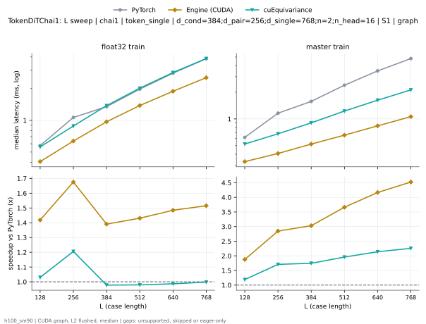
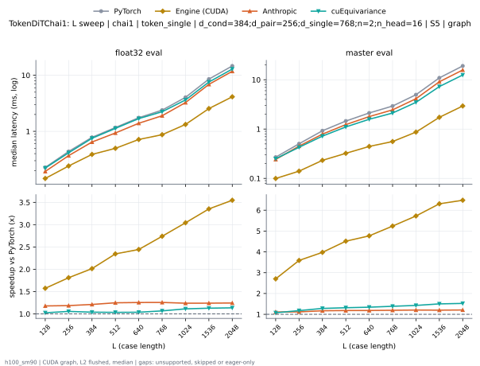
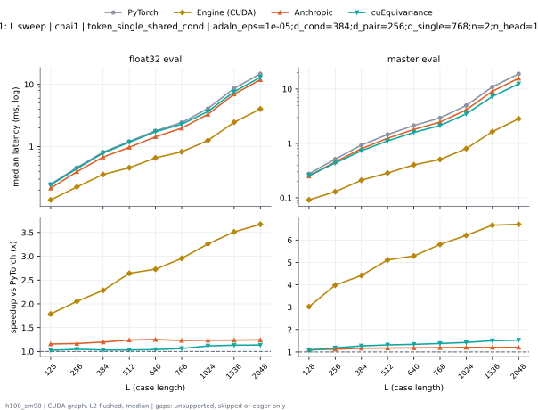
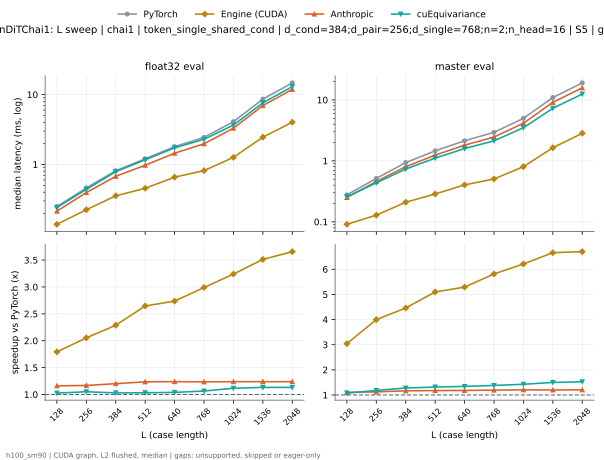

# TokenDiTChai1 on h100_sm90

Generated by `python -m miniworld_engine.measure.plot` from speed tokens `judge/tokens/h100_sm90/`; do not edit.

### L sweep: chai1 | token_single | adaln_eps=1e-05;d_cond=384;d_pair=256;d_single=768;n=2;n_head=16 | S1 | graph

**float32 train** (median ms; x = speedup vs PyTorch)

| L | PyTorch | Engine (Triton) | Engine (CUDA) | Anthropic | cuEquivariance |
|---|---|---|---|---|---|
| 128 | 0.5783 | 0.5591 (1.03x) | 0.4054 (1.43x) | unsupported | 0.5595 (1.03x) |
| 256 | 1.063 | 1.043 (1.02x) | 0.634 (1.68x) | unsupported | 0.8848 (1.20x) |
| 384 | 1.351 | 1.326 (1.02x) | 0.9691 (1.39x) | unsupported | 1.383 (0.98x) |
| 512 | 1.973 | 1.932 (1.02x) | 1.383 (1.43x) | unsupported | 2.026 (0.97x) |
| 640 | 2.786 | 2.721 (1.02x) | 1.89 (1.47x) | unsupported | 2.859 (0.97x) |
| 768 | 3.839 | 3.73 (1.03x) | 2.538 (1.51x) | unsupported | 3.877 (0.99x) |

**master train** (median ms; x = speedup vs PyTorch)

| L | PyTorch | Engine (Triton) | Engine (CUDA) | Anthropic | cuEquivariance |
|---|---|---|---|---|---|
| 128 | 0.619 | 0.5917 (1.05x) | 0.3309 (1.87x) | unsupported | 0.5211 (1.19x) |
| 256 | 1.172 | 1.126 (1.04x) | 0.4023 (2.91x) | unsupported | 0.6779 (1.73x) |
| 384 | 1.577 | 1.524 (1.04x) | 0.4886 (3.23x) | unsupported | 0.9036 (1.75x) |
| 512 | 2.396 | 2.32 (1.03x) | 0.591 (4.05x) | unsupported | 1.227 (1.95x) |
| 640 | 3.477 | 3.354 (1.04x) | 0.7212 (4.82x) | unsupported | 1.638 (2.12x) |
| 768 | 4.799 | 4.605 (1.04x) | 0.8786 (5.46x) | unsupported | 2.137 (2.25x) |

### L sweep: chai1 | token_single | adaln_eps=1e-05;d_cond=384;d_pair=256;d_single=768;n=2;n_head=16 | S5 | graph

**float32 eval** (median ms; x = speedup vs PyTorch)

| L | PyTorch | Engine (Triton) | Engine (CUDA) | Anthropic | cuEquivariance |
|---|---|---|---|---|---|
| 128 | 0.2268 | 0.2085 (1.09x) | 0.1438 (1.58x) | 0.1925 (1.18x) | 0.2209 (1.03x) |
| 256 | 0.437 | 0.3941 (1.11x) | 0.2425 (1.80x) | 0.3705 (1.18x) | 0.4159 (1.05x) |
| 384 | 0.7767 | 0.6678 (1.16x) | 0.3863 (2.01x) | 0.6447 (1.20x) | 0.7536 (1.03x) |
| 512 | 1.164 | 0.988 (1.18x) | 0.4937 (2.36x) | 0.933 (1.25x) | 1.136 (1.02x) |
| 640 | 1.75 | 1.477 (1.19x) | 0.718 (2.44x) | 1.393 (1.26x) | 1.684 (1.04x) |
| 768 | 2.389 | 2.014 (1.19x) | 0.8662 (2.76x) | 1.905 (1.25x) | 2.239 (1.07x) |
| 1024 | 4.049 | 3.422 (1.18x) | 1.338 (3.03x) | 3.26 (1.24x) | 3.64 (1.11x) |
| 1536 | 8.511 | 7.238 (1.18x) | 2.535 (3.36x) | 6.913 (1.23x) | 7.546 (1.13x) |
| 2048 | 14.63 | 12.31 (1.19x) | 4.122 (3.55x) | 11.83 (1.24x) | 12.92 (1.13x) |

**master eval** (median ms; x = speedup vs PyTorch)

| L | PyTorch | Engine (Triton) | Engine (CUDA) | Anthropic | cuEquivariance |
|---|---|---|---|---|---|
| 128 | 0.2683 | 0.2355 (1.14x) | 0.09504 (2.82x) | 0.2416 (1.11x) | 0.2491 (1.08x) |
| 256 | 0.5047 | 0.4315 (1.17x) | 0.1249 (4.04x) | 0.4489 (1.12x) | 0.4268 (1.18x) |
| 384 | 0.9235 | 0.7499 (1.23x) | 0.1822 (5.07x) | 0.788 (1.17x) | 0.7198 (1.28x) |
| 512 | 1.451 | 1.171 (1.24x) | 0.235 (6.17x) | 1.232 (1.18x) | 1.111 (1.31x) |
| 640 | 2.127 | 1.705 (1.25x) | 0.3079 (6.91x) | 1.792 (1.19x) | 1.587 (1.34x) |
| 768 | 2.943 | 2.338 (1.26x) | 0.3612 (8.15x) | 2.449 (1.20x) | 2.114 (1.39x) |
| 1024 | 4.984 | 3.956 (1.26x) | 0.5148 (9.68x) | 4.121 (1.21x) | 3.48 (1.43x) |
| 1536 | 10.87 | 8.753 (1.24x) | 0.9259 (11.74x) | 9.098 (1.19x) | 7.24 (1.50x) |
| 2048 | 18.93 | 15.24 (1.24x) | 1.466 (12.91x) | 15.77 (1.20x) | 12.45 (1.52x) |

### L sweep: chai1 | token_single | d_cond=384;d_pair=256;d_single=768;n=2;n_head=16 | S1 | graph

**float32 train** (median ms; x = speedup vs PyTorch)

| L | PyTorch | Engine (Triton) | Engine (CUDA) | Anthropic | cuEquivariance |
|---|---|---|---|---|---|
| 128 | 0.5744 | 0.5581 (1.03x) | 0.4061 (1.41x) | unsupported | 0.5595 (1.03x) |
| 256 | 1.066 | 1.048 (1.02x) | 0.6334 (1.68x) | unsupported | 0.8841 (1.21x) |
| 384 | 1.344 | 1.326 (1.01x) | 0.968 (1.39x) | unsupported | 1.38 (0.97x) |
| 512 | 1.98 | 1.934 (1.02x) | 1.384 (1.43x) | unsupported | 2.022 (0.98x) |
| 640 | 2.79 | 2.716 (1.03x) | 1.89 (1.48x) | unsupported | 2.844 (0.98x) |
| 768 | 3.84 | 3.729 (1.03x) | 2.538 (1.51x) | unsupported | 3.861 (0.99x) |

**master train** (median ms; x = speedup vs PyTorch)

| L | PyTorch | Engine (Triton) | Engine (CUDA) | Anthropic | cuEquivariance |
|---|---|---|---|---|---|
| 128 | 0.6181 | 0.5888 (1.05x) | 0.3302 (1.87x) | unsupported | 0.5213 (1.19x) |
| 256 | 1.161 | 1.129 (1.03x) | 0.401 (2.89x) | unsupported | 0.6795 (1.71x) |
| 384 | 1.571 | 1.525 (1.03x) | 0.4918 (3.19x) | unsupported | 0.9036 (1.74x) |
| 512 | 2.399 | 2.32 (1.03x) | 0.5911 (4.06x) | unsupported | 1.227 (1.95x) |
| 640 | 3.476 | 3.353 (1.04x) | 0.7222 (4.81x) | unsupported | 1.628 (2.14x) |
| 768 | 4.798 | 4.597 (1.04x) | 0.8759 (5.48x) | unsupported | 2.128 (2.25x) |

### L sweep: chai1 | token_single | d_cond=384;d_pair=256;d_single=768;n=2;n_head=16 | S5 | graph

**float32 eval** (median ms; x = speedup vs PyTorch)

| L | PyTorch | Engine (Triton) | Engine (CUDA) | Anthropic | cuEquivariance |
|---|---|---|---|---|---|
| 128 | 0.2277 | 0.2087 (1.09x) | 0.1434 (1.59x) | 0.1928 (1.18x) | 0.2216 (1.03x) |
| 256 | 0.4371 | 0.3928 (1.11x) | 0.2423 (1.80x) | 0.3687 (1.19x) | 0.4143 (1.05x) |
| 384 | 0.7763 | 0.6675 (1.16x) | 0.3862 (2.01x) | 0.6453 (1.20x) | 0.7528 (1.03x) |
| 512 | 1.164 | 1.001 (1.16x) | 0.4976 (2.34x) | 0.9353 (1.24x) | 1.13 (1.03x) |
| 640 | 1.743 | 1.479 (1.18x) | 0.7175 (2.43x) | 1.395 (1.25x) | 1.688 (1.03x) |
| 768 | 2.389 | 2.014 (1.19x) | 0.8808 (2.71x) | 1.9 (1.26x) | 2.238 (1.07x) |
| 1024 | 4.051 | 3.411 (1.19x) | 1.322 (3.06x) | 3.263 (1.24x) | 3.633 (1.12x) |
| 1536 | 8.536 | 7.19 (1.19x) | 2.536 (3.37x) | 6.887 (1.24x) | 7.576 (1.13x) |
| 2048 | 14.63 | 12.32 (1.19x) | 4.143 (3.53x) | 11.79 (1.24x) | 12.92 (1.13x) |

**master eval** (median ms; x = speedup vs PyTorch)

| L | PyTorch | Engine (Triton) | Engine (CUDA) | Anthropic | cuEquivariance |
|---|---|---|---|---|---|
| 128 | 0.2694 | 0.2349 (1.15x) | 0.09565 (2.82x) | 0.2422 (1.11x) | 0.2505 (1.08x) |
| 256 | 0.5036 | 0.4301 (1.17x) | 0.1245 (4.05x) | 0.4508 (1.12x) | 0.4271 (1.18x) |
| 384 | 0.9212 | 0.7479 (1.23x) | 0.1825 (5.05x) | 0.7892 (1.17x) | 0.7202 (1.28x) |
| 512 | 1.452 | 1.182 (1.23x) | 0.2344 (6.19x) | 1.231 (1.18x) | 1.105 (1.31x) |
| 640 | 2.127 | 1.707 (1.25x) | 0.3082 (6.90x) | 1.791 (1.19x) | 1.58 (1.35x) |
| 768 | 2.934 | 2.334 (1.26x) | 0.3621 (8.10x) | 2.451 (1.20x) | 2.113 (1.39x) |
| 1024 | 4.981 | 3.944 (1.26x) | 0.5159 (9.65x) | 4.123 (1.21x) | 3.482 (1.43x) |
| 1536 | 10.9 | 8.754 (1.25x) | 0.9285 (11.74x) | 9.094 (1.20x) | 7.269 (1.50x) |
| 2048 | 18.99 | 15.24 (1.25x) | 1.467 (12.95x) | 15.76 (1.21x) | 12.49 (1.52x) |

### L sweep: chai1 | token_single_fp32_cond | adaln_eps=1e-05;d_cond=384;d_pair=256;d_single=768;n=2;n_head=16 | S5 | graph

**master eval** (median ms; x = speedup vs PyTorch)

| L | PyTorch | Engine (Triton) | Engine (CUDA) | Anthropic | cuEquivariance |
|---|---|---|---|---|---|
| 128 | 0.269 | 0.2344 (1.15x) | 0.1073 (2.51x) | 0.2407 (1.12x) | 0.2602 (1.03x) |
| 256 | 0.4637 | 0.391 (1.19x) | 0.1608 (2.88x) | 0.4096 (1.13x) | 0.4423 (1.05x) |
| 384 | 0.8193 | 0.6491 (1.26x) | 0.2613 (3.14x) | 0.687 (1.19x) | 0.7421 (1.10x) |
| 512 | 1.264 | 0.9823 (1.29x) | 0.3707 (3.41x) | 1.045 (1.21x) | 1.134 (1.11x) |
| 640 | 1.825 | 1.396 (1.31x) | 0.5168 (3.53x) | 1.493 (1.22x) | 1.618 (1.13x) |
| 768 | 2.492 | 1.898 (1.31x) | 0.6602 (3.77x) | 2.017 (1.24x) | 2.169 (1.15x) |
| 1024 | 4.188 | 3.151 (1.33x) | 1.041 (4.02x) | 3.345 (1.25x) | 3.575 (1.17x) |
| 1536 | 9.126 | 6.955 (1.31x) | 2.104 (4.34x) | 7.31 (1.25x) | 7.461 (1.22x) |
| 2048 | 15.82 | 12.06 (1.31x) | 3.529 (4.48x) | 12.55 (1.26x) | 12.82 (1.23x) |

### L sweep: chai1 | token_single_fp32_cond | d_cond=384;d_pair=256;d_single=768;n=2;n_head=16 | S5 | graph

**master eval** (median ms; x = speedup vs PyTorch)

| L | PyTorch | Engine (Triton) | Engine (CUDA) | Anthropic | cuEquivariance |
|---|---|---|---|---|---|
| 128 | 0.2682 | 0.2338 (1.15x) | 0.1086 (2.47x) | 0.2412 (1.11x) | 0.26 (1.03x) |
| 256 | 0.4648 | 0.3903 (1.19x) | 0.1606 (2.89x) | 0.4111 (1.13x) | 0.4438 (1.05x) |
| 384 | 0.8182 | 0.6523 (1.25x) | 0.2619 (3.12x) | 0.687 (1.19x) | 0.7447 (1.10x) |
| 512 | 1.258 | 0.9915 (1.27x) | 0.3708 (3.39x) | 1.044 (1.21x) | 1.135 (1.11x) |
| 640 | 1.823 | 1.402 (1.30x) | 0.5173 (3.52x) | 1.493 (1.22x) | 1.618 (1.13x) |
| 768 | 2.49 | 1.903 (1.31x) | 0.661 (3.77x) | 2.016 (1.24x) | 2.17 (1.15x) |
| 1024 | 4.188 | 3.169 (1.32x) | 1.04 (4.03x) | 3.343 (1.25x) | 3.573 (1.17x) |
| 1536 | 9.121 | 6.951 (1.31x) | 2.103 (4.34x) | 7.31 (1.25x) | 7.465 (1.22x) |
| 2048 | 15.75 | 12.06 (1.31x) | 3.527 (4.47x) | 12.58 (1.25x) | 12.77 (1.23x) |

### L sweep: chai1 | token_single_shared_cond | adaln_eps=1e-05;d_cond=384;d_pair=256;d_single=768;n=2;n_head=16 | S5 | graph

**float32 eval** (median ms; x = speedup vs PyTorch)

| L | PyTorch | Engine (Triton) | Engine (CUDA) | Anthropic | cuEquivariance |
|---|---|---|---|---|---|
| 128 | 0.2482 | 0.2291 (1.08x) | 0.1383 (1.79x) | 0.2141 (1.16x) | 0.2421 (1.03x) |
| 256 | 0.4623 | 0.4184 (1.10x) | 0.2251 (2.05x) | 0.3942 (1.17x) | 0.4399 (1.05x) |
| 384 | 0.8106 | 0.7016 (1.16x) | 0.3536 (2.29x) | 0.6782 (1.20x) | 0.788 (1.03x) |
| 512 | 1.199 | 1.039 (1.15x) | 0.456 (2.63x) | 0.9727 (1.23x) | 1.171 (1.02x) |
| 640 | 1.789 | 1.525 (1.17x) | 0.6591 (2.71x) | 1.437 (1.25x) | 1.729 (1.03x) |
| 768 | 2.437 | 2.066 (1.18x) | 0.8116 (3.00x) | 1.977 (1.23x) | 2.292 (1.06x) |
| 1024 | 4.099 | 3.447 (1.19x) | 1.251 (3.28x) | 3.307 (1.24x) | 3.661 (1.12x) |
| 1536 | 8.594 | 7.351 (1.17x) | 2.447 (3.51x) | 6.973 (1.23x) | 7.625 (1.13x) |
| 2048 | 14.73 | 12.41 (1.19x) | 4.007 (3.68x) | 11.88 (1.24x) | 13.02 (1.13x) |

**master eval** (median ms; x = speedup vs PyTorch)

| L | PyTorch | Engine (Triton) | Engine (CUDA) | Anthropic | cuEquivariance |
|---|---|---|---|---|---|
| 128 | 0.2775 | 0.2436 (1.14x) | 0.08923 (3.11x) | 0.2506 (1.11x) | 0.2579 (1.08x) |
| 256 | 0.5145 | 0.4389 (1.17x) | 0.1128 (4.56x) | 0.4584 (1.12x) | 0.4357 (1.18x) |
| 384 | 0.9307 | 0.7602 (1.22x) | 0.1608 (5.79x) | 0.8001 (1.16x) | 0.7341 (1.27x) |
| 512 | 1.459 | 1.184 (1.23x) | 0.1983 (7.36x) | 1.244 (1.17x) | 1.111 (1.31x) |
| 640 | 2.141 | 1.712 (1.25x) | 0.2661 (8.04x) | 1.806 (1.18x) | 1.593 (1.34x) |
| 768 | 2.952 | 2.365 (1.25x) | 0.3107 (9.50x) | 2.468 (1.20x) | 2.134 (1.38x) |
| 1024 | 4.988 | 3.962 (1.26x) | 0.4487 (11.12x) | 4.145 (1.20x) | 3.501 (1.42x) |
| 1536 | 10.94 | 8.784 (1.25x) | 0.8439 (12.96x) | 9.122 (1.20x) | 7.301 (1.50x) |
| 2048 | 18.96 | 15.27 (1.24x) | 1.361 (13.94x) | 15.79 (1.20x) | 12.47 (1.52x) |

### L sweep: chai1 | token_single_shared_cond | d_cond=384;d_pair=256;d_single=768;n=2;n_head=16 | S5 | graph

**float32 eval** (median ms; x = speedup vs PyTorch)

| L | PyTorch | Engine (Triton) | Engine (CUDA) | Anthropic | cuEquivariance |
|---|---|---|---|---|---|
| 128 | 0.249 | 0.2288 (1.09x) | 0.1392 (1.79x) | 0.214 (1.16x) | 0.2422 (1.03x) |
| 256 | 0.4609 | 0.4171 (1.11x) | 0.2245 (2.05x) | 0.3945 (1.17x) | 0.4384 (1.05x) |
| 384 | 0.8095 | 0.7022 (1.15x) | 0.3533 (2.29x) | 0.6763 (1.20x) | 0.7885 (1.03x) |
| 512 | 1.201 | 1.037 (1.16x) | 0.4554 (2.64x) | 0.9736 (1.23x) | 1.166 (1.03x) |
| 640 | 1.792 | 1.528 (1.17x) | 0.6616 (2.71x) | 1.45 (1.24x) | 1.729 (1.04x) |
| 768 | 2.444 | 2.067 (1.18x) | 0.8118 (3.01x) | 1.974 (1.24x) | 2.291 (1.07x) |
| 1024 | 4.098 | 3.455 (1.19x) | 1.267 (3.24x) | 3.303 (1.24x) | 3.663 (1.12x) |
| 1536 | 8.594 | 7.273 (1.18x) | 2.444 (3.52x) | 6.971 (1.23x) | 7.623 (1.13x) |
| 2048 | 14.73 | 12.38 (1.19x) | 4.014 (3.67x) | 11.89 (1.24x) | 13.02 (1.13x) |

**master eval** (median ms; x = speedup vs PyTorch)

| L | PyTorch | Engine (Triton) | Engine (CUDA) | Anthropic | cuEquivariance |
|---|---|---|---|---|---|
| 128 | 0.2776 | 0.2434 (1.14x) | 0.08912 (3.11x) | 0.2507 (1.11x) | 0.2577 (1.08x) |
| 256 | 0.5125 | 0.4415 (1.16x) | 0.1129 (4.54x) | 0.4586 (1.12x) | 0.4363 (1.17x) |
| 384 | 0.9338 | 0.7606 (1.23x) | 0.1612 (5.79x) | 0.8033 (1.16x) | 0.7339 (1.27x) |
| 512 | 1.465 | 1.183 (1.24x) | 0.198 (7.40x) | 1.243 (1.18x) | 1.11 (1.32x) |
| 640 | 2.14 | 1.712 (1.25x) | 0.2672 (8.01x) | 1.808 (1.18x) | 1.593 (1.34x) |
| 768 | 2.951 | 2.352 (1.25x) | 0.3086 (9.56x) | 2.466 (1.20x) | 2.132 (1.38x) |
| 1024 | 5.005 | 3.976 (1.26x) | 0.4507 (11.11x) | 4.145 (1.21x) | 3.501 (1.43x) |
| 1536 | 10.93 | 8.784 (1.24x) | 0.8429 (12.97x) | 9.122 (1.20x) | 7.296 (1.50x) |
| 2048 | 19.02 | 15.27 (1.25x) | 1.361 (13.98x) | 15.79 (1.20x) | 12.48 (1.52x) |

