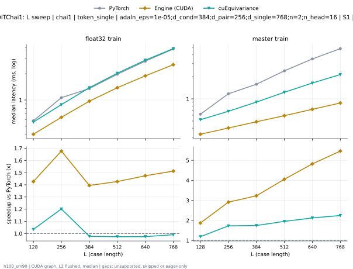
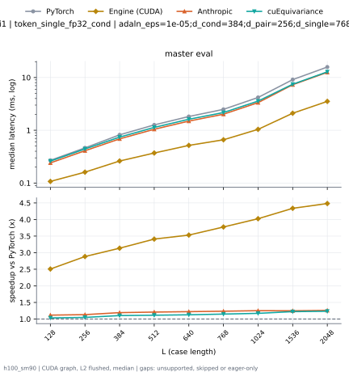
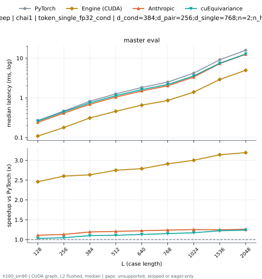

# TokenDiTChai1 on h100_sm90

Generated by `python -m miniworld_engine.measure.plot` from speed tokens `judge/tokens/h100_sm90/`; do not edit.

### L sweep: chai1 | token_single | adaln_eps=1e-05;d_cond=384;d_pair=256;d_single=768;n=2;n_head=16 | S1 | graph

**float32 train** (median ms; x = speedup vs PyTorch)

| L | PyTorch | Engine (Triton) | Engine (CUDA) | Anthropic | cuEquivariance |
|---|---|---|---|---|---|
| 128 | 0.5755 | 0.5591 (1.03x) | 0.4049 (1.42x) | unsupported | 0.5595 (1.03x) |
| 256 | 1.062 | 1.043 (1.02x) | 0.634 (1.67x) | unsupported | 0.8848 (1.20x) |
| 384 | 1.349 | 1.326 (1.02x) | 0.9696 (1.39x) | unsupported | 1.383 (0.98x) |
| 512 | 1.975 | 1.932 (1.02x) | 1.385 (1.43x) | unsupported | 2.026 (0.97x) |
| 640 | 2.793 | 2.721 (1.03x) | 1.889 (1.48x) | unsupported | 2.859 (0.98x) |
| 768 | 3.845 | 3.73 (1.03x) | 2.543 (1.51x) | unsupported | 3.877 (0.99x) |

**master train** (median ms; x = speedup vs PyTorch)

| L | PyTorch | Engine (Triton) | Engine (CUDA) | Anthropic | cuEquivariance |
|---|---|---|---|---|---|
| 128 | 0.6195 | 0.5917 (1.05x) | 0.3311 (1.87x) | unsupported | 0.5211 (1.19x) |
| 256 | 1.166 | 1.126 (1.04x) | 0.408 (2.86x) | unsupported | 0.6779 (1.72x) |
| 384 | 1.577 | 1.524 (1.03x) | 0.5216 (3.02x) | unsupported | 0.9036 (1.75x) |
| 512 | 2.404 | 2.32 (1.04x) | 0.6563 (3.66x) | unsupported | 1.227 (1.96x) |
| 640 | 3.479 | 3.354 (1.04x) | 0.8336 (4.17x) | unsupported | 1.638 (2.12x) |
| 768 | 4.797 | 4.605 (1.04x) | 1.061 (4.52x) | unsupported | 2.137 (2.24x) |

### L sweep: chai1 | token_single | adaln_eps=1e-05;d_cond=384;d_pair=256;d_single=768;n=2;n_head=16 | S5 | graph

**float32 eval** (median ms; x = speedup vs PyTorch)

| L | PyTorch | Engine (Triton) | Engine (CUDA) | Anthropic | cuEquivariance |
|---|---|---|---|---|---|
| 128 | 0.2271 | 0.2085 (1.09x) | 0.1443 (1.57x) | 0.1925 (1.18x) | 0.2209 (1.03x) |
| 256 | 0.4366 | 0.3941 (1.11x) | 0.2423 (1.80x) | 0.3705 (1.18x) | 0.4159 (1.05x) |
| 384 | 0.7784 | 0.6678 (1.17x) | 0.3871 (2.01x) | 0.6447 (1.21x) | 0.7536 (1.03x) |
| 512 | 1.169 | 0.988 (1.18x) | 0.4954 (2.36x) | 0.933 (1.25x) | 1.136 (1.03x) |
| 640 | 1.752 | 1.477 (1.19x) | 0.7185 (2.44x) | 1.393 (1.26x) | 1.684 (1.04x) |
| 768 | 2.391 | 2.014 (1.19x) | 0.8715 (2.74x) | 1.905 (1.26x) | 2.239 (1.07x) |
| 1024 | 4.043 | 3.422 (1.18x) | 1.331 (3.04x) | 3.26 (1.24x) | 3.64 (1.11x) |
| 1536 | 8.54 | 7.238 (1.18x) | 2.563 (3.33x) | 6.913 (1.24x) | 7.546 (1.13x) |
| 2048 | 14.67 | 12.31 (1.19x) | 4.159 (3.53x) | 11.83 (1.24x) | 12.92 (1.14x) |

**master eval** (median ms; x = speedup vs PyTorch)

| L | PyTorch | Engine (Triton) | Engine (CUDA) | Anthropic | cuEquivariance |
|---|---|---|---|---|---|
| 128 | 0.2687 | 0.2355 (1.14x) | 0.09848 (2.73x) | 0.2416 (1.11x) | 0.2491 (1.08x) |
| 256 | 0.5039 | 0.4315 (1.17x) | 0.1414 (3.56x) | 0.4489 (1.12x) | 0.4268 (1.18x) |
| 384 | 0.9231 | 0.7499 (1.23x) | 0.2318 (3.98x) | 0.788 (1.17x) | 0.7198 (1.28x) |
| 512 | 1.453 | 1.171 (1.24x) | 0.3224 (4.51x) | 1.232 (1.18x) | 1.111 (1.31x) |
| 640 | 2.126 | 1.705 (1.25x) | 0.4452 (4.78x) | 1.792 (1.19x) | 1.587 (1.34x) |
| 768 | 2.934 | 2.338 (1.26x) | 0.5579 (5.26x) | 2.449 (1.20x) | 2.114 (1.39x) |
| 1024 | 4.983 | 3.956 (1.26x) | 0.8694 (5.73x) | 4.121 (1.21x) | 3.48 (1.43x) |
| 1536 | 10.91 | 8.753 (1.25x) | 1.728 (6.31x) | 9.098 (1.20x) | 7.24 (1.51x) |
| 2048 | 19 | 15.24 (1.25x) | 2.94 (6.46x) | 15.77 (1.20x) | 12.45 (1.53x) |

### L sweep: chai1 | token_single | d_cond=384;d_pair=256;d_single=768;n=2;n_head=16 | S1 | graph

**float32 train** (median ms; x = speedup vs PyTorch)

| L | PyTorch | Engine (Triton) | Engine (CUDA) | Anthropic | cuEquivariance |
|---|---|---|---|---|---|
| 128 | 0.5762 | 0.5581 (1.03x) | 0.4062 (1.42x) | unsupported | 0.5595 (1.03x) |
| 256 | 1.066 | 1.048 (1.02x) | 0.6362 (1.68x) | unsupported | 0.8841 (1.21x) |
| 384 | 1.35 | 1.326 (1.02x) | 0.9704 (1.39x) | unsupported | 1.38 (0.98x) |
| 512 | 1.98 | 1.934 (1.02x) | 1.384 (1.43x) | unsupported | 2.022 (0.98x) |
| 640 | 2.805 | 2.716 (1.03x) | 1.889 (1.48x) | unsupported | 2.844 (0.99x) |
| 768 | 3.853 | 3.729 (1.03x) | 2.543 (1.52x) | unsupported | 3.861 (1.00x) |

**master train** (median ms; x = speedup vs PyTorch)

| L | PyTorch | Engine (Triton) | Engine (CUDA) | Anthropic | cuEquivariance |
|---|---|---|---|---|---|
| 128 | 0.6193 | 0.5888 (1.05x) | 0.3302 (1.88x) | unsupported | 0.5213 (1.19x) |
| 256 | 1.161 | 1.129 (1.03x) | 0.4077 (2.85x) | unsupported | 0.6795 (1.71x) |
| 384 | 1.578 | 1.525 (1.03x) | 0.5205 (3.03x) | unsupported | 0.9036 (1.75x) |
| 512 | 2.404 | 2.32 (1.04x) | 0.6564 (3.66x) | unsupported | 1.227 (1.96x) |
| 640 | 3.484 | 3.353 (1.04x) | 0.8358 (4.17x) | unsupported | 1.628 (2.14x) |
| 768 | 4.801 | 4.597 (1.04x) | 1.061 (4.52x) | unsupported | 2.128 (2.26x) |

### L sweep: chai1 | token_single | d_cond=384;d_pair=256;d_single=768;n=2;n_head=16 | S5 | graph

**float32 eval** (median ms; x = speedup vs PyTorch)

| L | PyTorch | Engine (Triton) | Engine (CUDA) | Anthropic | cuEquivariance |
|---|---|---|---|---|---|
| 128 | 0.2272 | 0.2087 (1.09x) | 0.1444 (1.57x) | 0.1928 (1.18x) | 0.2216 (1.03x) |
| 256 | 0.4372 | 0.3928 (1.11x) | 0.2414 (1.81x) | 0.3687 (1.19x) | 0.4143 (1.06x) |
| 384 | 0.7818 | 0.6675 (1.17x) | 0.388 (2.01x) | 0.6453 (1.21x) | 0.7528 (1.04x) |
| 512 | 1.168 | 1.001 (1.17x) | 0.498 (2.35x) | 0.9353 (1.25x) | 1.13 (1.03x) |
| 640 | 1.751 | 1.479 (1.18x) | 0.7165 (2.44x) | 1.395 (1.26x) | 1.688 (1.04x) |
| 768 | 2.388 | 2.014 (1.19x) | 0.8716 (2.74x) | 1.9 (1.26x) | 2.238 (1.07x) |
| 1024 | 4.043 | 3.411 (1.19x) | 1.329 (3.04x) | 3.263 (1.24x) | 3.633 (1.11x) |
| 1536 | 8.544 | 7.19 (1.19x) | 2.548 (3.35x) | 6.887 (1.24x) | 7.576 (1.13x) |
| 2048 | 14.67 | 12.32 (1.19x) | 4.135 (3.55x) | 11.79 (1.24x) | 12.92 (1.14x) |

**master eval** (median ms; x = speedup vs PyTorch)

| L | PyTorch | Engine (Triton) | Engine (CUDA) | Anthropic | cuEquivariance |
|---|---|---|---|---|---|
| 128 | 0.2691 | 0.2349 (1.15x) | 0.09955 (2.70x) | 0.2422 (1.11x) | 0.2505 (1.07x) |
| 256 | 0.5032 | 0.4301 (1.17x) | 0.1402 (3.59x) | 0.4508 (1.12x) | 0.4271 (1.18x) |
| 384 | 0.9238 | 0.7479 (1.24x) | 0.2323 (3.98x) | 0.7892 (1.17x) | 0.7202 (1.28x) |
| 512 | 1.454 | 1.182 (1.23x) | 0.3222 (4.51x) | 1.231 (1.18x) | 1.105 (1.32x) |
| 640 | 2.12 | 1.707 (1.24x) | 0.4445 (4.77x) | 1.791 (1.18x) | 1.58 (1.34x) |
| 768 | 2.927 | 2.334 (1.25x) | 0.5588 (5.24x) | 2.451 (1.19x) | 2.113 (1.39x) |
| 1024 | 4.968 | 3.944 (1.26x) | 0.868 (5.72x) | 4.123 (1.20x) | 3.482 (1.43x) |
| 1536 | 10.91 | 8.754 (1.25x) | 1.729 (6.31x) | 9.094 (1.20x) | 7.269 (1.50x) |
| 2048 | 19.03 | 15.24 (1.25x) | 2.937 (6.48x) | 15.76 (1.21x) | 12.49 (1.52x) |

### L sweep: chai1 | token_single_fp32_cond | adaln_eps=1e-05;d_cond=384;d_pair=256;d_single=768;n=2;n_head=16 | S5 | graph

**master eval** (median ms; x = speedup vs PyTorch)

| L | PyTorch | Engine (Triton) | Engine (CUDA) | Anthropic | cuEquivariance |
|---|---|---|---|---|---|
| 128 | 0.268 | 0.2344 (1.14x) | 0.1085 (2.47x) | 0.2407 (1.11x) | 0.2602 (1.03x) |
| 256 | 0.4642 | 0.391 (1.19x) | 0.1779 (2.61x) | 0.4096 (1.13x) | 0.4423 (1.05x) |
| 384 | 0.8193 | 0.6491 (1.26x) | 0.3109 (2.64x) | 0.687 (1.19x) | 0.7421 (1.10x) |
| 512 | 1.265 | 0.9823 (1.29x) | 0.4594 (2.75x) | 1.045 (1.21x) | 1.134 (1.12x) |
| 640 | 1.829 | 1.396 (1.31x) | 0.6546 (2.79x) | 1.493 (1.23x) | 1.618 (1.13x) |
| 768 | 2.493 | 1.898 (1.31x) | 0.858 (2.91x) | 2.017 (1.24x) | 2.169 (1.15x) |
| 1024 | 4.188 | 3.151 (1.33x) | 1.396 (3.00x) | 3.345 (1.25x) | 3.575 (1.17x) |
| 1536 | 9.147 | 6.955 (1.32x) | 2.908 (3.15x) | 7.31 (1.25x) | 7.461 (1.23x) |
| 2048 | 15.8 | 12.06 (1.31x) | 4.945 (3.19x) | 12.55 (1.26x) | 12.82 (1.23x) |

### L sweep: chai1 | token_single_fp32_cond | d_cond=384;d_pair=256;d_single=768;n=2;n_head=16 | S5 | graph

**master eval** (median ms; x = speedup vs PyTorch)

| L | PyTorch | Engine (Triton) | Engine (CUDA) | Anthropic | cuEquivariance |
|---|---|---|---|---|---|
| 128 | 0.2676 | 0.2338 (1.14x) | 0.1088 (2.46x) | 0.2412 (1.11x) | 0.26 (1.03x) |
| 256 | 0.4645 | 0.3903 (1.19x) | 0.1785 (2.60x) | 0.4111 (1.13x) | 0.4438 (1.05x) |
| 384 | 0.8191 | 0.6523 (1.26x) | 0.3109 (2.63x) | 0.687 (1.19x) | 0.7447 (1.10x) |
| 512 | 1.259 | 0.9915 (1.27x) | 0.458 (2.75x) | 1.044 (1.21x) | 1.135 (1.11x) |
| 640 | 1.826 | 1.402 (1.30x) | 0.6545 (2.79x) | 1.493 (1.22x) | 1.618 (1.13x) |
| 768 | 2.498 | 1.903 (1.31x) | 0.8579 (2.91x) | 2.016 (1.24x) | 2.17 (1.15x) |
| 1024 | 4.187 | 3.169 (1.32x) | 1.395 (3.00x) | 3.343 (1.25x) | 3.573 (1.17x) |
| 1536 | 9.124 | 6.951 (1.31x) | 2.905 (3.14x) | 7.31 (1.25x) | 7.465 (1.22x) |
| 2048 | 15.82 | 12.06 (1.31x) | 4.953 (3.19x) | 12.58 (1.26x) | 12.77 (1.24x) |

### L sweep: chai1 | token_single_shared_cond | adaln_eps=1e-05;d_cond=384;d_pair=256;d_single=768;n=2;n_head=16 | S5 | graph

**float32 eval** (median ms; x = speedup vs PyTorch)

| L | PyTorch | Engine (Triton) | Engine (CUDA) | Anthropic | cuEquivariance |
|---|---|---|---|---|---|
| 128 | 0.2479 | 0.2291 (1.08x) | 0.1386 (1.79x) | 0.2141 (1.16x) | 0.2421 (1.02x) |
| 256 | 0.4603 | 0.4184 (1.10x) | 0.2243 (2.05x) | 0.3942 (1.17x) | 0.4399 (1.05x) |
| 384 | 0.8125 | 0.7016 (1.16x) | 0.3558 (2.28x) | 0.6782 (1.20x) | 0.788 (1.03x) |
| 512 | 1.207 | 1.039 (1.16x) | 0.4568 (2.64x) | 0.9727 (1.24x) | 1.171 (1.03x) |
| 640 | 1.797 | 1.525 (1.18x) | 0.6588 (2.73x) | 1.437 (1.25x) | 1.729 (1.04x) |
| 768 | 2.435 | 2.066 (1.18x) | 0.8237 (2.96x) | 1.977 (1.23x) | 2.292 (1.06x) |
| 1024 | 4.088 | 3.447 (1.19x) | 1.255 (3.26x) | 3.307 (1.24x) | 3.661 (1.12x) |
| 1536 | 8.633 | 7.351 (1.17x) | 2.459 (3.51x) | 6.973 (1.24x) | 7.625 (1.13x) |
| 2048 | 14.77 | 12.41 (1.19x) | 4.025 (3.67x) | 11.88 (1.24x) | 13.02 (1.13x) |

**master eval** (median ms; x = speedup vs PyTorch)

| L | PyTorch | Engine (Triton) | Engine (CUDA) | Anthropic | cuEquivariance |
|---|---|---|---|---|---|
| 128 | 0.2765 | 0.2436 (1.14x) | 0.09147 (3.02x) | 0.2506 (1.10x) | 0.2579 (1.07x) |
| 256 | 0.5152 | 0.4389 (1.17x) | 0.1293 (3.98x) | 0.4584 (1.12x) | 0.4357 (1.18x) |
| 384 | 0.932 | 0.7602 (1.23x) | 0.211 (4.42x) | 0.8001 (1.16x) | 0.7341 (1.27x) |
| 512 | 1.461 | 1.184 (1.23x) | 0.2859 (5.11x) | 1.244 (1.17x) | 1.111 (1.31x) |
| 640 | 2.136 | 1.712 (1.25x) | 0.4039 (5.29x) | 1.806 (1.18x) | 1.593 (1.34x) |
| 768 | 2.943 | 2.365 (1.24x) | 0.5071 (5.80x) | 2.468 (1.19x) | 2.134 (1.38x) |
| 1024 | 4.989 | 3.962 (1.26x) | 0.8035 (6.21x) | 4.145 (1.20x) | 3.501 (1.43x) |
| 1536 | 10.96 | 8.784 (1.25x) | 1.646 (6.66x) | 9.122 (1.20x) | 7.301 (1.50x) |
| 2048 | 19.03 | 15.27 (1.25x) | 2.839 (6.70x) | 15.79 (1.20x) | 12.47 (1.53x) |

### L sweep: chai1 | token_single_shared_cond | d_cond=384;d_pair=256;d_single=768;n=2;n_head=16 | S5 | graph

**float32 eval** (median ms; x = speedup vs PyTorch)

| L | PyTorch | Engine (Triton) | Engine (CUDA) | Anthropic | cuEquivariance |
|---|---|---|---|---|---|
| 128 | 0.2485 | 0.2288 (1.09x) | 0.1386 (1.79x) | 0.214 (1.16x) | 0.2422 (1.03x) |
| 256 | 0.4609 | 0.4171 (1.11x) | 0.2245 (2.05x) | 0.3945 (1.17x) | 0.4384 (1.05x) |
| 384 | 0.8124 | 0.7022 (1.16x) | 0.355 (2.29x) | 0.6763 (1.20x) | 0.7885 (1.03x) |
| 512 | 1.204 | 1.037 (1.16x) | 0.4548 (2.65x) | 0.9736 (1.24x) | 1.166 (1.03x) |
| 640 | 1.798 | 1.528 (1.18x) | 0.6571 (2.74x) | 1.45 (1.24x) | 1.729 (1.04x) |
| 768 | 2.439 | 2.067 (1.18x) | 0.8157 (2.99x) | 1.974 (1.24x) | 2.291 (1.06x) |
| 1024 | 4.091 | 3.455 (1.18x) | 1.263 (3.24x) | 3.303 (1.24x) | 3.663 (1.12x) |
| 1536 | 8.635 | 7.273 (1.19x) | 2.458 (3.51x) | 6.971 (1.24x) | 7.623 (1.13x) |
| 2048 | 14.73 | 12.38 (1.19x) | 4.03 (3.66x) | 11.89 (1.24x) | 13.02 (1.13x) |

**master eval** (median ms; x = speedup vs PyTorch)

| L | PyTorch | Engine (Triton) | Engine (CUDA) | Anthropic | cuEquivariance |
|---|---|---|---|---|---|
| 128 | 0.2771 | 0.2434 (1.14x) | 0.09104 (3.04x) | 0.2507 (1.11x) | 0.2577 (1.07x) |
| 256 | 0.5151 | 0.4415 (1.17x) | 0.1288 (4.00x) | 0.4586 (1.12x) | 0.4363 (1.18x) |
| 384 | 0.9367 | 0.7606 (1.23x) | 0.21 (4.46x) | 0.8033 (1.17x) | 0.7339 (1.28x) |
| 512 | 1.462 | 1.183 (1.24x) | 0.2867 (5.10x) | 1.243 (1.18x) | 1.11 (1.32x) |
| 640 | 2.137 | 1.712 (1.25x) | 0.4038 (5.29x) | 1.808 (1.18x) | 1.593 (1.34x) |
| 768 | 2.942 | 2.352 (1.25x) | 0.5059 (5.81x) | 2.466 (1.19x) | 2.132 (1.38x) |
| 1024 | 4.992 | 3.976 (1.26x) | 0.8037 (6.21x) | 4.145 (1.20x) | 3.501 (1.43x) |
| 1536 | 10.94 | 8.784 (1.24x) | 1.642 (6.66x) | 9.122 (1.20x) | 7.296 (1.50x) |
| 2048 | 19.03 | 15.27 (1.25x) | 2.839 (6.70x) | 15.79 (1.20x) | 12.48 (1.52x) |

