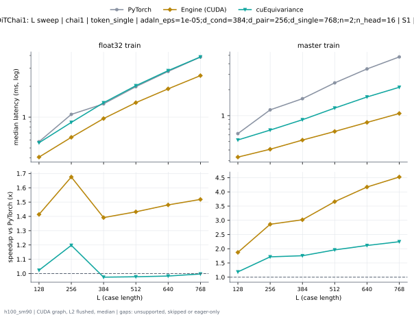
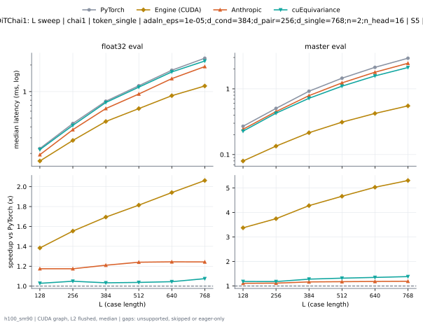
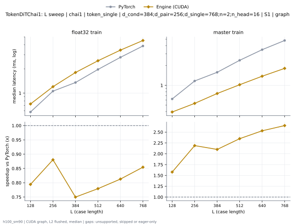
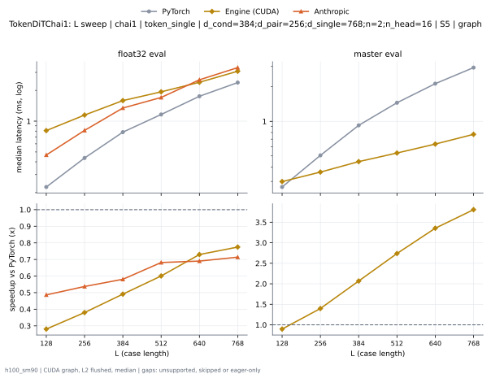

# TokenDiTChai1 on h100_sm90

Generated by `python -m miniworld_engine.measure.plot` from speed tokens `judge/tokens/h100_sm90/`; do not edit.

### L sweep: chai1 | token_single | adaln_eps=1e-05;d_cond=384;d_pair=256;d_single=768;n=2;n_head=16 | S1 | graph

**float32 train** (median ms; x = speedup vs PyTorch)

| L | PyTorch | Engine (Triton) | Engine (CUDA) | Anthropic | cuEquivariance |
|---|---|---|---|---|---|
| 128 | 0.5771 | 0.5686 (1.01x) | 0.5517 (1.05x) | unsupported | 0.5622 (1.03x) |
| 256 | 1.065 | 1.066 (1.00x) | 0.8741 (1.22x) | unsupported | 0.8884 (1.20x) |
| 384 | 1.35 | 1.338 (1.01x) | 1.332 (1.01x) | unsupported | 1.382 (0.98x) |
| 512 | 1.98 | 1.956 (1.01x) | 1.918 (1.03x) | unsupported | 2.028 (0.98x) |
| 640 | 2.793 | 2.76 (1.01x) | 2.643 (1.06x) | unsupported | 2.846 (0.98x) |
| 768 | 3.857 | 3.764 (1.02x) | 3.54 (1.09x) | unsupported | 3.872 (1.00x) |

**master train** (median ms; x = speedup vs PyTorch)

| L | PyTorch | Engine (Triton) | Engine (CUDA) | Anthropic | cuEquivariance |
|---|---|---|---|---|---|
| 128 | 0.619 | 0.5988 (1.03x) | 0.3904 (1.59x) | unsupported | 0.5224 (1.19x) |
| 256 | 1.167 | 1.142 (1.02x) | 0.531 (2.20x) | unsupported | 0.6803 (1.71x) |
| 384 | 1.576 | 1.549 (1.02x) | 0.7484 (2.11x) | unsupported | 0.8967 (1.76x) |
| 512 | 2.398 | 2.356 (1.02x) | 1.027 (2.34x) | unsupported | 1.224 (1.96x) |
| 640 | 3.48 | 3.408 (1.02x) | 1.375 (2.53x) | unsupported | 1.646 (2.11x) |
| 768 | 4.797 | 4.689 (1.02x) | 1.815 (2.64x) | unsupported | 2.133 (2.25x) |

### L sweep: chai1 | token_single | adaln_eps=1e-05;d_cond=384;d_pair=256;d_single=768;n=2;n_head=16 | S5 | graph

**float32 eval** (median ms; x = speedup vs PyTorch)

| L | PyTorch | Engine (Triton) | Engine (CUDA) | Anthropic | cuEquivariance |
|---|---|---|---|---|---|
| 128 | 0.2272 | 0.2076 (1.09x) | 0.5144 (0.44x) | 0.1932 (1.18x) | 0.2208 (1.03x) |
| 256 | 0.4357 | 0.3833 (1.14x) | 0.6222 (0.70x) | 0.371 (1.17x) | 0.4154 (1.05x) |
| 384 | 0.7782 | 0.6801 (1.14x) | 0.8228 (0.95x) | 0.6435 (1.21x) | 0.7535 (1.03x) |
| 512 | 1.167 | 1.001 (1.17x) | 1.006 (1.16x) | 0.9402 (1.24x) | 1.124 (1.04x) |
| 640 | 1.748 | 1.482 (1.18x) | 1.23 (1.42x) | 1.404 (1.25x) | 1.671 (1.05x) |
| 768 | 2.39 | 2.018 (1.18x) | 1.589 (1.50x) | 1.921 (1.24x) | 2.222 (1.08x) |

**master eval** (median ms; x = speedup vs PyTorch)

| L | PyTorch | Engine (Triton) | Engine (CUDA) | Anthropic | cuEquivariance |
|---|---|---|---|---|---|
| 128 | 0.2683 | 0.2361 (1.14x) | 0.3005 (0.89x) | 0.2425 (1.11x) | 0.2273 (1.18x) |
| 256 | 0.5047 | 0.4306 (1.17x) | 0.3586 (1.41x) | 0.4509 (1.12x) | 0.4263 (1.18x) |
| 384 | 0.9233 | 0.7484 (1.23x) | 0.4425 (2.09x) | 0.7884 (1.17x) | 0.7187 (1.28x) |
| 512 | 1.447 | 1.169 (1.24x) | 0.5284 (2.74x) | 1.233 (1.17x) | 1.099 (1.32x) |
| 640 | 2.12 | 1.688 (1.26x) | 0.6358 (3.33x) | 1.791 (1.18x) | 1.573 (1.35x) |
| 768 | 2.926 | 2.327 (1.26x) | 0.7731 (3.78x) | 2.45 (1.19x) | 2.111 (1.39x) |

### L sweep: chai1 | token_single | d_cond=384;d_pair=256;d_single=768;n=2;n_head=16 | S1 | graph

**float32 train** (median ms; x = speedup vs PyTorch)

| L | PyTorch | Engine (Triton) | Engine (CUDA) | Anthropic | cuEquivariance |
|---|---|---|---|---|---|
| 128 | 0.5788 | 0.5666 (1.02x) | 0.5508 (1.05x) | unsupported | 0.56 (1.03x) |
| 256 | 1.065 | 1.063 (1.00x) | 0.8701 (1.22x) | unsupported | 0.8851 (1.20x) |
| 384 | 1.349 | 1.342 (1.01x) | 1.332 (1.01x) | unsupported | 1.382 (0.98x) |
| 512 | 1.985 | 1.951 (1.02x) | 1.918 (1.03x) | unsupported | 2.032 (0.98x) |
| 640 | 2.799 | 2.761 (1.01x) | 2.643 (1.06x) | unsupported | 2.865 (0.98x) |
| 768 | 3.857 | 3.763 (1.03x) | 3.54 (1.09x) | unsupported | 3.877 (0.99x) |

**master train** (median ms; x = speedup vs PyTorch)

| L | PyTorch | Engine (Triton) | Engine (CUDA) | Anthropic | cuEquivariance |
|---|---|---|---|---|---|
| 128 | 0.6211 | 0.5972 (1.04x) | 0.392 (1.58x) | unsupported | 0.5226 (1.19x) |
| 256 | 1.169 | 1.143 (1.02x) | 0.5283 (2.21x) | unsupported | 0.6779 (1.72x) |
| 384 | 1.573 | 1.551 (1.01x) | 0.7483 (2.10x) | unsupported | 0.9 (1.75x) |
| 512 | 2.403 | 2.356 (1.02x) | 1.023 (2.35x) | unsupported | 1.231 (1.95x) |
| 640 | 3.479 | 3.408 (1.02x) | 1.376 (2.53x) | unsupported | 1.632 (2.13x) |
| 768 | 4.794 | 4.678 (1.02x) | 1.813 (2.64x) | unsupported | 2.136 (2.24x) |

### L sweep: chai1 | token_single | d_cond=384;d_pair=256;d_single=768;n=2;n_head=16 | S5 | graph

**float32 eval** (median ms; x = speedup vs PyTorch)

| L | PyTorch | Engine (Triton) | Engine (CUDA) | Anthropic | cuEquivariance |
|---|---|---|---|---|---|
| 128 | 0.2267 | 0.2067 (1.10x) | 0.5166 (0.44x) | 0.1926 (1.18x) | 0.2201 (1.03x) |
| 256 | 0.4365 | 0.38 (1.15x) | 0.6213 (0.70x) | 0.3704 (1.18x) | 0.4136 (1.06x) |
| 384 | 0.779 | 0.6781 (1.15x) | 0.8261 (0.94x) | 0.6415 (1.21x) | 0.753 (1.03x) |
| 512 | 1.17 | 0.9875 (1.19x) | 1.013 (1.16x) | 0.9371 (1.25x) | 1.125 (1.04x) |
| 640 | 1.748 | 1.481 (1.18x) | 1.233 (1.42x) | 1.401 (1.25x) | 1.673 (1.04x) |
| 768 | 2.39 | 2.018 (1.18x) | 1.596 (1.50x) | 1.921 (1.24x) | 2.227 (1.07x) |

**master eval** (median ms; x = speedup vs PyTorch)

| L | PyTorch | Engine (Triton) | Engine (CUDA) | Anthropic | cuEquivariance |
|---|---|---|---|---|---|
| 128 | 0.2688 | 0.2347 (1.15x) | 0.2993 (0.90x) | 0.2425 (1.11x) | 0.2488 (1.08x) |
| 256 | 0.5041 | 0.4306 (1.17x) | 0.3594 (1.40x) | 0.4509 (1.12x) | 0.4265 (1.18x) |
| 384 | 0.9237 | 0.7504 (1.23x) | 0.4436 (2.08x) | 0.7881 (1.17x) | 0.7212 (1.28x) |
| 512 | 1.447 | 1.167 (1.24x) | 0.5278 (2.74x) | 1.231 (1.18x) | 1.1 (1.32x) |
| 640 | 2.12 | 1.688 (1.26x) | 0.6377 (3.32x) | 1.792 (1.18x) | 1.572 (1.35x) |
| 768 | 2.925 | 2.326 (1.26x) | 0.7704 (3.80x) | 2.45 (1.19x) | 2.11 (1.39x) |

