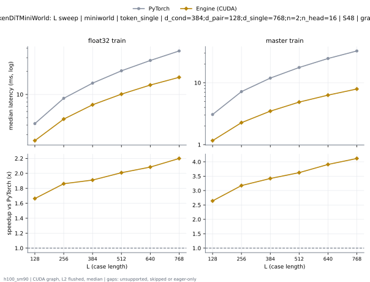

# TokenDiTMiniWorld on h100_sm90

Generated by `python -m miniworld_engine.measure.plot` from speed tokens `judge/tokens/h100_sm90/`; do not edit.

### L sweep: miniworld | token_single | d_cond=384;d_pair=128;d_single=768;n=2;n_head=16 | S48 | graph

**float32 train** (median ms; x = speedup vs PyTorch)

| L | PyTorch | Engine (Triton) | Engine (CUDA) |
|---|---|---|---|
| 128 | 4.154 | 3.801 (1.09x) | 2.505 (1.66x) |
| 256 | 8.893 | 7.768 (1.14x) | 4.785 (1.86x) |
| 384 | 14.01 | 11.53 (1.21x) | 7.339 (1.91x) |
| 512 | 20.23 | 16.2 (1.25x) | 10.14 (2.00x) |
| 640 | 27.56 | 20.09 (1.37x) | 13.36 (2.06x) |
| 768 | 36.64 | 25.41 (1.44x) | 17.04 (2.15x) |

**master train** (median ms; x = speedup vs PyTorch)

| L | PyTorch | Engine (Triton) | Engine (CUDA) |
|---|---|---|---|
| 128 | 3.073 | 2.797 (1.10x) | 1.144 (2.69x) |
| 256 | 7.173 | 6.11 (1.17x) | 2.232 (3.21x) |
| 384 | 11.86 | 9.437 (1.26x) | 3.435 (3.45x) |
| 512 | 17.69 | 13.83 (1.28x) | 4.745 (3.73x) |
| 640 | 24.61 | 17.3 (1.42x) | 6.213 (3.96x) |
| 768 | 32.57 | 22.12 (1.47x) | 7.727 (4.21x) |

### L sweep: miniworld | token_single | d_cond=384;d_pair=128;d_single=768;n=2;n_head=16 | S5 | graph

**float32 eval** (median ms; x = speedup vs PyTorch)

| L | PyTorch | Engine (Triton) | Engine (CUDA) |
|---|---|---|---|
| 128 | 0.2699 | 0.2402 (1.12x) | 0.1465 (1.84x) |
| 256 | 0.4934 | 0.4231 (1.17x) | 0.2267 (2.18x) |
| 384 | 0.8775 | 0.6919 (1.27x) | 0.3174 (2.76x) |
| 512 | 1.294 | 1.002 (1.29x) | 0.3925 (3.30x) |
| 640 | 1.928 | 1.453 (1.33x) | 0.5172 (3.73x) |
| 768 | 2.598 | 1.936 (1.34x) | 0.6032 (4.31x) |

**master eval** (median ms; x = speedup vs PyTorch)

| L | PyTorch | Engine (Triton) | Engine (CUDA) |
|---|---|---|---|
| 128 | 0.3312 | 0.3025 (1.09x) | 0.1185 (2.79x) |
| 256 | 0.5524 | 0.4902 (1.13x) | 0.1488 (3.71x) |
| 384 | 0.9378 | 0.767 (1.22x) | 0.2002 (4.69x) |
| 512 | 1.44 | 1.154 (1.25x) | 0.244 (5.90x) |
| 640 | 2.052 | 1.618 (1.27x) | 0.3094 (6.63x) |
| 768 | 2.774 | 2.221 (1.25x) | 0.347 (8.00x) |

