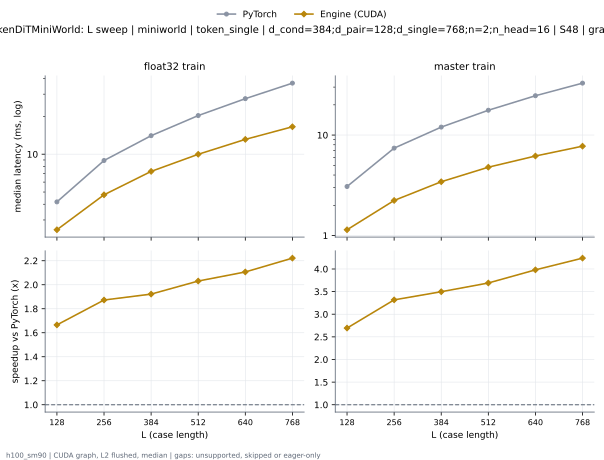
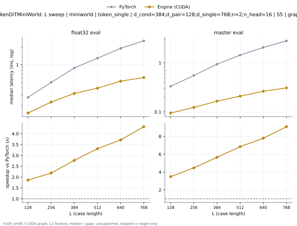

# TokenDiTMiniWorld on h100_sm90

Generated by `python -m miniworld_engine.measure.plot` from speed tokens `judge/tokens/h100_sm90/`; do not edit.

### L sweep: miniworld | token_single | d_cond=384;d_pair=128;d_single=768;n=2;n_head=16 | S48 | graph

**float32 train** (median ms; x = speedup vs PyTorch)

| L | PyTorch | Engine (Triton) | Engine (CUDA) |
|---|---|---|---|
| 128 | 4.176 | 3.805 (1.10x) | 2.513 (1.66x) |
| 256 | 8.911 | 7.671 (1.16x) | 4.735 (1.88x) |
| 384 | 14.02 | 11.7 (1.20x) | 7.269 (1.93x) |
| 512 | 20.27 | 16.22 (1.25x) | 9.978 (2.03x) |
| 640 | 27.59 | 20.14 (1.37x) | 13.1 (2.11x) |
| 768 | 36.69 | 25.49 (1.44x) | 16.53 (2.22x) |

**master train** (median ms; x = speedup vs PyTorch)

| L | PyTorch | Engine (Triton) | Engine (CUDA) |
|---|---|---|---|
| 128 | 3.07 | 2.77 (1.11x) | 1.14 (2.69x) |
| 256 | 7.432 | 6.013 (1.24x) | 2.23 (3.33x) |
| 384 | 11.93 | 9.583 (1.25x) | 3.431 (3.48x) |
| 512 | 17.57 | 13.81 (1.27x) | 4.809 (3.65x) |
| 640 | 24.6 | 17.31 (1.42x) | 6.236 (3.94x) |
| 768 | 33 | 22.14 (1.49x) | 7.814 (4.22x) |

### L sweep: miniworld | token_single | d_cond=384;d_pair=128;d_single=768;n=2;n_head=16 | S5 | graph

**float32 eval** (median ms; x = speedup vs PyTorch)

| L | PyTorch | Engine (Triton) | Engine (CUDA) |
|---|---|---|---|
| 128 | 0.2708 | 0.2404 (1.13x) | 0.146 (1.86x) |
| 256 | 0.497 | 0.4128 (1.20x) | 0.2269 (2.19x) |
| 384 | 0.8774 | 0.7044 (1.25x) | 0.3173 (2.77x) |
| 512 | 1.301 | 0.991 (1.31x) | 0.3929 (3.31x) |
| 640 | 1.925 | 1.455 (1.32x) | 0.5169 (3.72x) |
| 768 | 2.599 | 1.936 (1.34x) | 0.6064 (4.29x) |

**master eval** (median ms; x = speedup vs PyTorch)

| L | PyTorch | Engine (Triton) | Engine (CUDA) |
|---|---|---|---|
| 128 | 0.3304 | 0.3018 (1.09x) | 0.09496 (3.48x) |
| 256 | 0.5528 | 0.4807 (1.15x) | 0.1231 (4.49x) |
| 384 | 0.9373 | 0.7811 (1.20x) | 0.1646 (5.69x) |
| 512 | 1.406 | 1.153 (1.22x) | 0.2089 (6.73x) |
| 640 | 2.057 | 1.599 (1.29x) | 0.2631 (7.82x) |
| 768 | 2.797 | 2.203 (1.27x) | 0.3077 (9.09x) |

