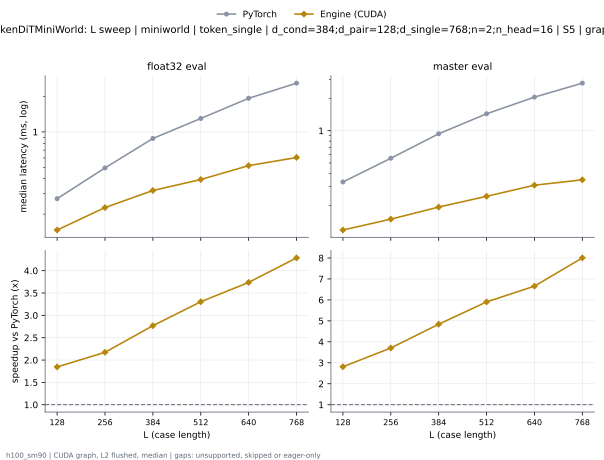

# TokenDiTMiniWorld on h100_sm90

Generated by `python -m miniworld_engine.measure.plot` from speed tokens `judge/tokens/h100_sm90/`; do not edit.

### L sweep: miniworld | token_single | d_cond=384;d_pair=128;d_single=768;n=2;n_head=16 | S48 | graph

**float32 train** (median ms; x = speedup vs PyTorch)

| L | PyTorch | Engine (Triton) | Engine (CUDA) |
|---|---|---|---|
| 128 | 4.183 | 3.801 (1.10x) | 2.515 (1.66x) |
| 256 | 8.911 | 7.768 (1.15x) | 4.787 (1.86x) |
| 384 | 14.03 | 11.53 (1.22x) | 7.344 (1.91x) |
| 512 | 20.28 | 16.2 (1.25x) | 10.09 (2.01x) |
| 640 | 27.62 | 20.09 (1.37x) | 13.25 (2.08x) |
| 768 | 36.71 | 25.41 (1.44x) | 16.69 (2.20x) |

**master train** (median ms; x = speedup vs PyTorch)

| L | PyTorch | Engine (Triton) | Engine (CUDA) |
|---|---|---|---|
| 128 | 3.067 | 2.797 (1.10x) | 1.161 (2.64x) |
| 256 | 7.188 | 6.11 (1.18x) | 2.264 (3.17x) |
| 384 | 11.89 | 9.437 (1.26x) | 3.474 (3.42x) |
| 512 | 17.64 | 13.83 (1.28x) | 4.868 (3.62x) |
| 640 | 24.64 | 17.3 (1.42x) | 6.304 (3.91x) |
| 768 | 32.62 | 22.12 (1.47x) | 7.924 (4.12x) |

### L sweep: miniworld | token_single | d_cond=384;d_pair=128;d_single=768;n=2;n_head=16 | S5 | graph

**float32 eval** (median ms; x = speedup vs PyTorch)

| L | PyTorch | Engine (Triton) | Engine (CUDA) |
|---|---|---|---|
| 128 | 0.2705 | 0.2402 (1.13x) | 0.1465 (1.85x) |
| 256 | 0.4942 | 0.4231 (1.17x) | 0.2274 (2.17x) |
| 384 | 0.8794 | 0.6919 (1.27x) | 0.3176 (2.77x) |
| 512 | 1.301 | 1.002 (1.30x) | 0.3937 (3.30x) |
| 640 | 1.932 | 1.453 (1.33x) | 0.5168 (3.74x) |
| 768 | 2.598 | 1.936 (1.34x) | 0.606 (4.29x) |

**master eval** (median ms; x = speedup vs PyTorch)

| L | PyTorch | Engine (Triton) | Engine (CUDA) |
|---|---|---|---|
| 128 | 0.3321 | 0.3025 (1.10x) | 0.1181 (2.81x) |
| 256 | 0.5532 | 0.4902 (1.13x) | 0.1492 (3.71x) |
| 384 | 0.9367 | 0.767 (1.22x) | 0.1935 (4.84x) |
| 512 | 1.44 | 1.154 (1.25x) | 0.2439 (5.90x) |
| 640 | 2.062 | 1.618 (1.27x) | 0.3098 (6.66x) |
| 768 | 2.785 | 2.221 (1.25x) | 0.3479 (8.00x) |

