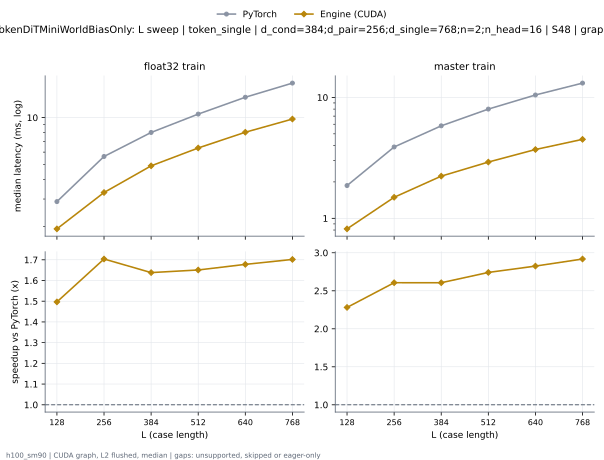
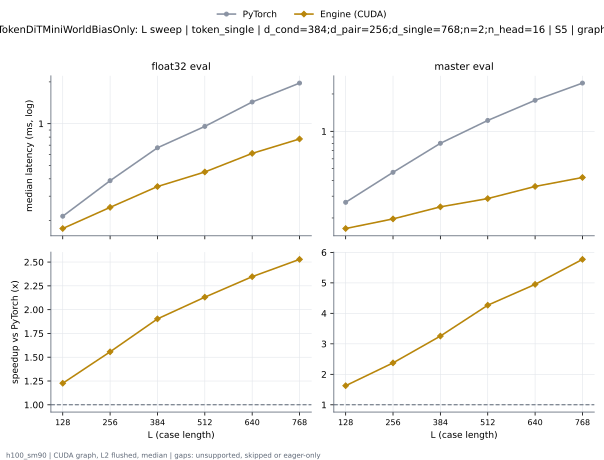
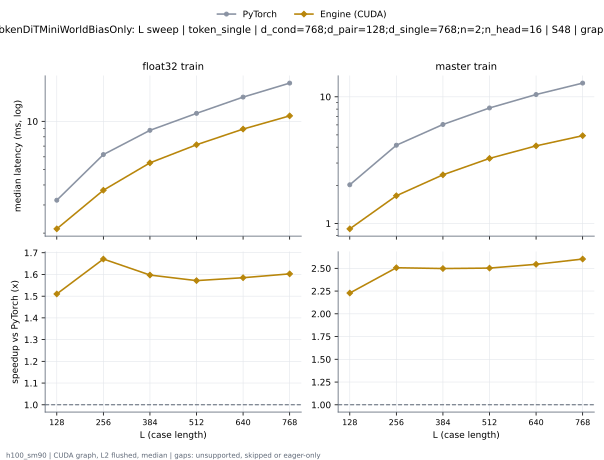
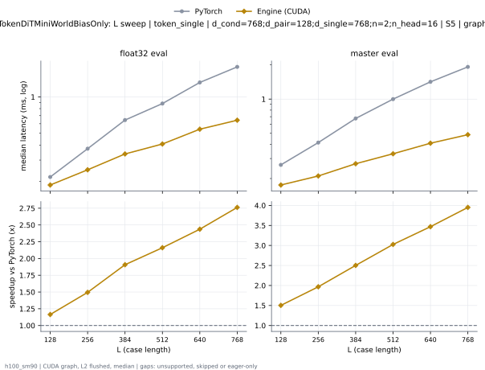
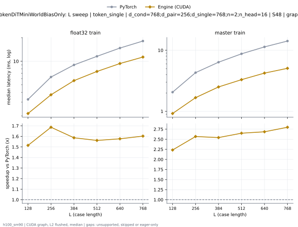
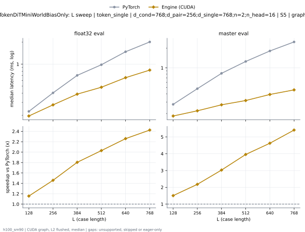
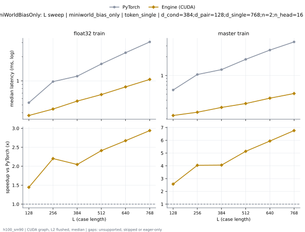
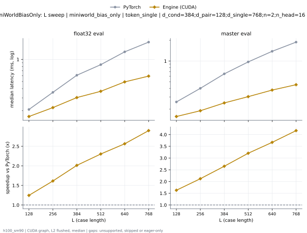

# TokenDiTMiniWorldBiasOnly on h100_sm90

Generated by `python -m miniworld_engine.measure.plot` from speed tokens `judge/tokens/h100_sm90/`; do not edit.

### L sweep: token_single | d_cond=384;d_pair=256;d_single=768;n=2;n_head=16 | S48 | graph

**float32 train** (median ms; x = speedup vs PyTorch)

| L | PyTorch | Engine (Triton) | Engine (CUDA) |
|---|---|---|---|
| 128 | 2.887 | 2.662 (1.08x) | 1.929 (1.50x) |
| 256 | 5.627 | 4.481 (1.26x) | 3.303 (1.70x) |
| 384 | 8.027 | 6.566 (1.22x) | 4.9 (1.64x) |
| 512 | 10.53 | 8.454 (1.25x) | 6.381 (1.65x) |
| 640 | 13.51 | 10.61 (1.27x) | 8.054 (1.68x) |
| 768 | 16.66 | 12.87 (1.29x) | 9.788 (1.70x) |

**master train** (median ms; x = speedup vs PyTorch)

| L | PyTorch | Engine (Triton) | Engine (CUDA) |
|---|---|---|---|
| 128 | 1.866 | 1.6 (1.17x) | 0.8182 (2.28x) |
| 256 | 3.891 | 2.692 (1.45x) | 1.493 (2.61x) |
| 384 | 5.82 | 2.953 (1.97x) | 2.234 (2.61x) |
| 512 | 8.005 | 3.856 (2.08x) | 2.92 (2.74x) |
| 640 | 10.47 | 4.825 (2.17x) | 3.707 (2.82x) |
| 768 | 13.13 | 5.713 (2.30x) | 4.5 (2.92x) |

### L sweep: token_single | d_cond=384;d_pair=256;d_single=768;n=2;n_head=16 | S5 | graph

**float32 eval** (median ms; x = speedup vs PyTorch)

| L | PyTorch | Engine (Triton) | Engine (CUDA) |
|---|---|---|---|
| 128 | 0.2151 | 0.2277 (0.94x) | 0.1754 (1.23x) |
| 256 | 0.388 | 0.2855 (1.36x) | 0.2492 (1.56x) |
| 384 | 0.6701 | 0.4367 (1.53x) | 0.3521 (1.90x) |
| 512 | 0.9557 | 0.5226 (1.83x) | 0.4485 (2.13x) |
| 640 | 1.433 | 0.7694 (1.86x) | 0.6106 (2.35x) |
| 768 | 1.961 | 0.9262 (2.12x) | 0.7757 (2.53x) |

**master eval** (median ms; x = speedup vs PyTorch)

| L | PyTorch | Engine (Triton) | Engine (CUDA) |
|---|---|---|---|
| 128 | 0.2675 | 0.1892 (1.41x) | 0.1645 (1.63x) |
| 256 | 0.467 | 0.2233 (2.09x) | 0.1966 (2.38x) |
| 384 | 0.8006 | 0.2878 (2.78x) | 0.246 (3.25x) |
| 512 | 1.224 | 0.3398 (3.60x) | 0.2868 (4.27x) |
| 640 | 1.779 | 0.4425 (4.02x) | 0.3592 (4.95x) |
| 768 | 2.449 | 0.5314 (4.61x) | 0.4244 (5.77x) |

### L sweep: token_single | d_cond=768;d_pair=128;d_single=768;n=2;n_head=16 | S48 | graph

**float32 train** (median ms; x = speedup vs PyTorch)

| L | PyTorch | Engine (Triton) | Engine (CUDA) |
|---|---|---|---|
| 128 | 3.212 | 3.595 (0.89x) | 2.127 (1.51x) |
| 256 | 6.196 | 5.908 (1.05x) | 3.708 (1.67x) |
| 384 | 8.786 | 8.563 (1.03x) | 5.5 (1.60x) |
| 512 | 11.22 | 10.83 (1.04x) | 7.138 (1.57x) |
| 640 | 14.18 | 13.34 (1.06x) | 8.945 (1.58x) |
| 768 | 17.34 | 16.03 (1.08x) | 10.82 (1.60x) |

**master train** (median ms; x = speedup vs PyTorch)

| L | PyTorch | Engine (Triton) | Engine (CUDA) |
|---|---|---|---|
| 128 | 2.019 | 2.409 (0.84x) | 0.906 (2.23x) |
| 256 | 4.146 | 3.745 (1.11x) | 1.654 (2.51x) |
| 384 | 6.046 | 3.336 (1.81x) | 2.421 (2.50x) |
| 512 | 8.164 | 4.336 (1.88x) | 3.263 (2.50x) |
| 640 | 10.42 | 5.35 (1.95x) | 4.098 (2.54x) |
| 768 | 12.83 | 6.506 (1.97x) | 4.932 (2.60x) |

### L sweep: token_single | d_cond=768;d_pair=128;d_single=768;n=2;n_head=16 | S5 | graph

**float32 eval** (median ms; x = speedup vs PyTorch)

| L | PyTorch | Engine (Triton) | Engine (CUDA) |
|---|---|---|---|
| 128 | 0.2174 | 0.2676 (0.81x) | 0.1867 (1.16x) |
| 256 | 0.3728 | 0.3183 (1.17x) | 0.2494 (1.49x) |
| 384 | 0.6434 | 0.4808 (1.34x) | 0.3374 (1.91x) |
| 512 | 0.881 | 0.5269 (1.67x) | 0.4077 (2.16x) |
| 640 | 1.317 | 0.7683 (1.71x) | 0.5406 (2.44x) |
| 768 | 1.772 | 0.8733 (2.03x) | 0.6416 (2.76x) |

**master eval** (median ms; x = speedup vs PyTorch)

| L | PyTorch | Engine (Triton) | Engine (CUDA) |
|---|---|---|---|
| 128 | 0.2639 | 0.2155 (1.22x) | 0.1755 (1.50x) |
| 256 | 0.4145 | 0.2403 (1.73x) | 0.2107 (1.97x) |
| 384 | 0.6759 | 0.3034 (2.23x) | 0.2701 (2.50x) |
| 512 | 0.9999 | 0.3423 (2.92x) | 0.3305 (3.03x) |
| 640 | 1.42 | 0.4445 (3.19x) | 0.4093 (3.47x) |
| 768 | 1.921 | 0.5217 (3.68x) | 0.4864 (3.95x) |

### L sweep: token_single | d_cond=768;d_pair=256;d_single=768;n=2;n_head=16 | S48 | graph

**float32 train** (median ms; x = speedup vs PyTorch)

| L | PyTorch | Engine (Triton) | Engine (CUDA) |
|---|---|---|---|
| 128 | 3.253 | 3.611 (0.90x) | 2.148 (1.51x) |
| 256 | 6.284 | 5.964 (1.05x) | 3.726 (1.69x) |
| 384 | 8.97 | 8.644 (1.04x) | 5.653 (1.59x) |
| 512 | 11.56 | 11.02 (1.05x) | 7.403 (1.56x) |
| 640 | 14.74 | 13.68 (1.08x) | 9.35 (1.58x) |
| 768 | 18.13 | 16.5 (1.10x) | 11.31 (1.60x) |

**master train** (median ms; x = speedup vs PyTorch)

| L | PyTorch | Engine (Triton) | Engine (CUDA) |
|---|---|---|---|
| 128 | 2.058 | 2.421 (0.85x) | 0.9214 (2.23x) |
| 256 | 4.301 | 3.779 (1.14x) | 1.675 (2.57x) |
| 384 | 6.378 | 3.376 (1.89x) | 2.509 (2.54x) |
| 512 | 8.75 | 4.436 (1.97x) | 3.301 (2.65x) |
| 640 | 11.36 | 5.505 (2.06x) | 4.229 (2.69x) |
| 768 | 14.17 | 6.569 (2.16x) | 5.064 (2.80x) |

### L sweep: token_single | d_cond=768;d_pair=256;d_single=768;n=2;n_head=16 | S5 | graph

**float32 eval** (median ms; x = speedup vs PyTorch)

| L | PyTorch | Engine (Triton) | Engine (CUDA) |
|---|---|---|---|
| 128 | 0.226 | 0.2756 (0.82x) | 0.1956 (1.16x) |
| 256 | 0.405 | 0.3403 (1.19x) | 0.2777 (1.46x) |
| 384 | 0.7022 | 0.5238 (1.34x) | 0.3891 (1.80x) |
| 512 | 0.9816 | 0.61 (1.61x) | 0.4836 (2.03x) |
| 640 | 1.476 | 0.8925 (1.65x) | 0.6532 (2.26x) |
| 768 | 2.01 | 1.053 (1.91x) | 0.8289 (2.42x) |

**master eval** (median ms; x = speedup vs PyTorch)

| L | PyTorch | Engine (Triton) | Engine (CUDA) |
|---|---|---|---|
| 128 | 0.276 | 0.2172 (1.27x) | 0.1833 (1.51x) |
| 256 | 0.4793 | 0.252 (1.90x) | 0.2201 (2.18x) |
| 384 | 0.8229 | 0.3227 (2.55x) | 0.2718 (3.03x) |
| 512 | 1.25 | 0.3715 (3.36x) | 0.3159 (3.96x) |
| 640 | 1.809 | 0.4856 (3.73x) | 0.3912 (4.62x) |
| 768 | 2.485 | 0.578 (4.30x) | 0.4595 (5.41x) |

### L sweep: miniworld_bias_only | token_single | d_cond=384;d_pair=128;d_single=768;n=2;n_head=16 | S1 | graph

**float32 train** (median ms; x = speedup vs PyTorch)

| L | PyTorch | Engine (Triton) | Engine (CUDA) |
|---|---|---|---|
| 128 | 0.5332 | 0.7629 (0.70x) | 0.3691 (1.44x) |
| 256 | 0.9783 | 0.8547 (1.14x) | 0.4443 (2.20x) |
| 384 | 1.143 | 0.7712 (1.48x) | 0.5585 (2.05x) |
| 512 | 1.626 | 1.118 (1.45x) | 0.6738 (2.41x) |
| 640 | 2.245 | 1.286 (1.75x) | 0.8398 (2.67x) |
| 768 | 3.064 | 1.358 (2.26x) | 1.042 (2.94x) |

**master train** (median ms; x = speedup vs PyTorch)

| L | PyTorch | Engine (Triton) | Engine (CUDA) |
|---|---|---|---|
| 128 | 0.586 | 0.6997 (0.84x) | 0.2278 (2.57x) |
| 256 | 1.039 | 0.7475 (1.39x) | 0.257 (4.04x) |
| 384 | 1.246 | 0.5467 (2.28x) | 0.3071 (4.06x) |
| 512 | 1.822 | 0.9201 (1.98x) | 0.3546 (5.14x) |
| 640 | 2.57 | 1.052 (2.44x) | 0.4325 (5.94x) |
| 768 | 3.476 | 0.947 (3.67x) | 0.514 (6.76x) |

### L sweep: miniworld_bias_only | token_single | d_cond=384;d_pair=128;d_single=768;n=2;n_head=16 | S5 | graph

**float32 eval** (median ms; x = speedup vs PyTorch)

| L | PyTorch | Engine (Triton) | Engine (CUDA) |
|---|---|---|---|
| 128 | 0.2083 | 0.2206 (0.94x) | 0.1672 (1.25x) |
| 256 | 0.3563 | 0.2632 (1.35x) | 0.2208 (1.61x) |
| 384 | 0.6087 | 0.3912 (1.56x) | 0.3024 (2.01x) |
| 512 | 0.8481 | 0.4382 (1.94x) | 0.3682 (2.30x) |
| 640 | 1.267 | 0.6359 (1.99x) | 0.4942 (2.56x) |
| 768 | 1.719 | 0.7405 (2.32x) | 0.5925 (2.90x) |

**master eval** (median ms; x = speedup vs PyTorch)

| L | PyTorch | Engine (Triton) | Engine (CUDA) |
|---|---|---|---|
| 128 | 0.2536 | 0.1847 (1.37x) | 0.1557 (1.63x) |
| 256 | 0.4005 | 0.2113 (1.90x) | 0.1889 (2.12x) |
| 384 | 0.6507 | 0.2686 (2.42x) | 0.2454 (2.65x) |
| 512 | 0.9715 | 0.3109 (3.13x) | 0.3031 (3.21x) |
| 640 | 1.387 | 0.4026 (3.44x) | 0.3779 (3.67x) |
| 768 | 1.886 | 0.4732 (3.99x) | 0.4524 (4.17x) |

