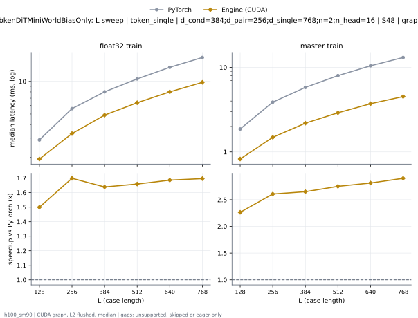
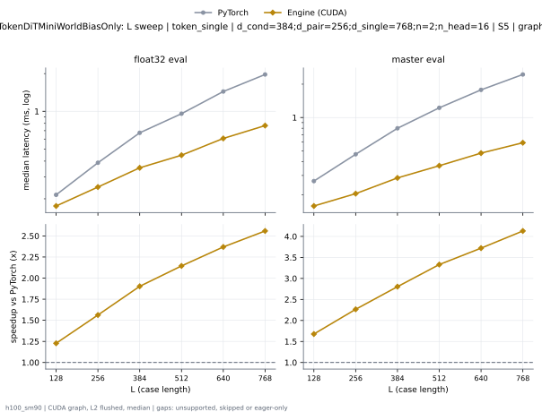
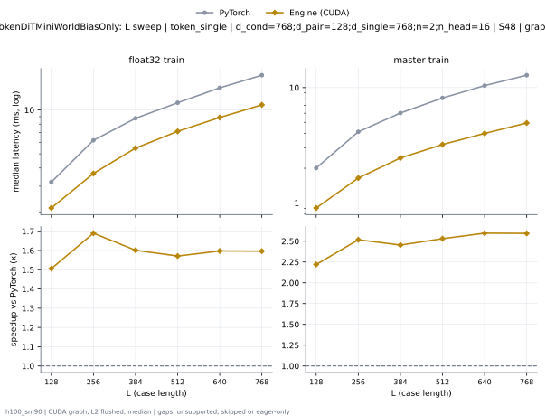
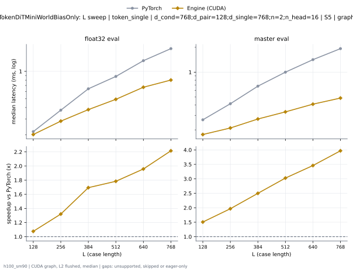
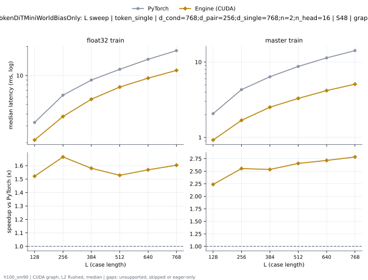
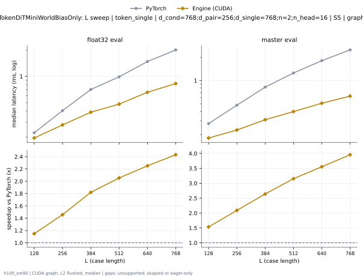
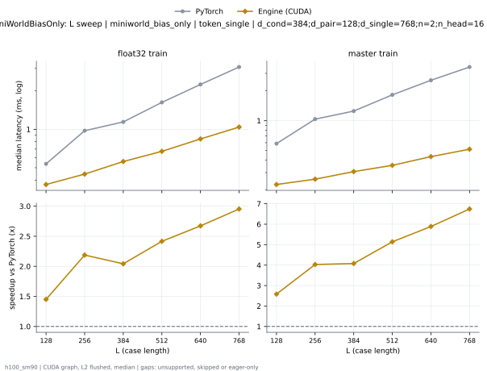
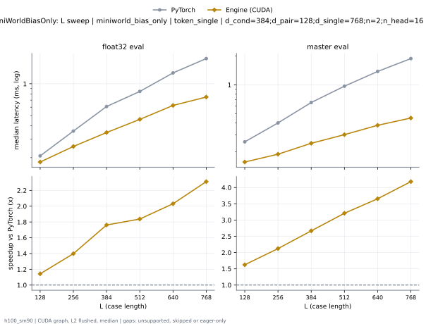

# TokenDiTMiniWorldBiasOnly on h100_sm90

Generated by `python -m miniworld_engine.measure.plot` from speed tokens `judge/tokens/h100_sm90/`; do not edit.

### L sweep: token_single | d_cond=384;d_pair=256;d_single=768;n=2;n_head=16 | S48 | graph

**float32 train** (median ms; x = speedup vs PyTorch)

| L | PyTorch | Engine (CUDA) |
|---|---|---|
| 128 | 2.885 | 1.924 (1.50x) |
| 256 | 5.609 | 3.302 (1.70x) |
| 384 | 8.011 | 4.888 (1.64x) |
| 512 | 10.55 | 6.357 (1.66x) |
| 640 | 13.5 | 8.007 (1.69x) |
| 768 | 16.63 | 9.8 (1.70x) |

**master train** (median ms; x = speedup vs PyTorch)

| L | PyTorch | Engine (CUDA) |
|---|---|---|
| 128 | 1.867 | 0.8244 (2.26x) |
| 256 | 3.881 | 1.489 (2.61x) |
| 384 | 5.8 | 2.188 (2.65x) |
| 512 | 7.995 | 2.906 (2.75x) |
| 640 | 10.46 | 3.719 (2.81x) |
| 768 | 13.12 | 4.519 (2.90x) |

### L sweep: token_single | d_cond=384;d_pair=256;d_single=768;n=2;n_head=16 | S5 | graph

**float32 eval** (median ms; x = speedup vs PyTorch)

| L | PyTorch | Engine (CUDA) |
|---|---|---|
| 128 | 0.2152 | 0.1753 (1.23x) |
| 256 | 0.3882 | 0.2484 (1.56x) |
| 384 | 0.6732 | 0.3538 (1.90x) |
| 512 | 0.9565 | 0.446 (2.14x) |
| 640 | 1.438 | 0.6071 (2.37x) |
| 768 | 1.967 | 0.7689 (2.56x) |

**master eval** (median ms; x = speedup vs PyTorch)

| L | PyTorch | Engine (CUDA) |
|---|---|---|
| 128 | 0.2669 | 0.1591 (1.68x) |
| 256 | 0.466 | 0.2057 (2.27x) |
| 384 | 0.7996 | 0.2851 (2.80x) |
| 512 | 1.224 | 0.3674 (3.33x) |
| 640 | 1.777 | 0.4775 (3.72x) |
| 768 | 2.445 | 0.5922 (4.13x) |

### L sweep: token_single | d_cond=768;d_pair=128;d_single=768;n=2;n_head=16 | S48 | graph

**float32 train** (median ms; x = speedup vs PyTorch)

| L | PyTorch | Engine (CUDA) |
|---|---|---|
| 128 | 3.201 | 2.126 (1.51x) |
| 256 | 6.196 | 3.667 (1.69x) |
| 384 | 8.769 | 5.476 (1.60x) |
| 512 | 11.21 | 7.135 (1.57x) |
| 640 | 14.19 | 8.884 (1.60x) |
| 768 | 17.32 | 10.85 (1.60x) |

**master train** (median ms; x = speedup vs PyTorch)

| L | PyTorch | Engine (CUDA) |
|---|---|---|
| 128 | 2.009 | 0.9049 (2.22x) |
| 256 | 4.141 | 1.645 (2.52x) |
| 384 | 6.025 | 2.456 (2.45x) |
| 512 | 8.131 | 3.213 (2.53x) |
| 640 | 10.4 | 4.007 (2.60x) |
| 768 | 12.8 | 4.936 (2.59x) |

### L sweep: token_single | d_cond=768;d_pair=128;d_single=768;n=2;n_head=16 | S5 | graph

**float32 eval** (median ms; x = speedup vs PyTorch)

| L | PyTorch | Engine (CUDA) |
|---|---|---|
| 128 | 0.2187 | 0.2027 (1.08x) |
| 256 | 0.3772 | 0.2827 (1.33x) |
| 384 | 0.6442 | 0.3799 (1.70x) |
| 512 | 0.8811 | 0.495 (1.78x) |
| 640 | 1.313 | 0.6679 (1.97x) |
| 768 | 1.776 | 0.8022 (2.21x) |

**master eval** (median ms; x = speedup vs PyTorch)

| L | PyTorch | Engine (CUDA) |
|---|---|---|
| 128 | 0.2648 | 0.1758 (1.51x) |
| 256 | 0.4146 | 0.2108 (1.97x) |
| 384 | 0.6767 | 0.2708 (2.50x) |
| 512 | 0.9999 | 0.3304 (3.03x) |
| 640 | 1.417 | 0.4097 (3.46x) |
| 768 | 1.928 | 0.4856 (3.97x) |

### L sweep: token_single | d_cond=768;d_pair=256;d_single=768;n=2;n_head=16 | S48 | graph

**float32 train** (median ms; x = speedup vs PyTorch)

| L | PyTorch | Engine (CUDA) |
|---|---|---|
| 128 | 3.263 | 2.145 (1.52x) |
| 256 | 6.275 | 3.72 (1.69x) |
| 384 | 8.982 | 5.607 (1.60x) |
| 512 | 11.58 | 7.361 (1.57x) |
| 640 | 14.71 | 9.373 (1.57x) |
| 768 | 18.09 | 11.34 (1.60x) |

**master train** (median ms; x = speedup vs PyTorch)

| L | PyTorch | Engine (CUDA) |
|---|---|---|
| 128 | 2.068 | 0.9244 (2.24x) |
| 256 | 4.305 | 1.687 (2.55x) |
| 384 | 6.379 | 2.517 (2.53x) |
| 512 | 8.747 | 3.294 (2.66x) |
| 640 | 11.36 | 4.183 (2.72x) |
| 768 | 14.18 | 5.093 (2.78x) |

### L sweep: token_single | d_cond=768;d_pair=256;d_single=768;n=2;n_head=16 | S5 | graph

**float32 eval** (median ms; x = speedup vs PyTorch)

| L | PyTorch | Engine (CUDA) |
|---|---|---|
| 128 | 0.2255 | 0.1964 (1.15x) |
| 256 | 0.4044 | 0.2775 (1.46x) |
| 384 | 0.7063 | 0.388 (1.82x) |
| 512 | 0.9872 | 0.4806 (2.05x) |
| 640 | 1.478 | 0.6564 (2.25x) |
| 768 | 2.01 | 0.8266 (2.43x) |

**master eval** (median ms; x = speedup vs PyTorch)

| L | PyTorch | Engine (CUDA) |
|---|---|---|
| 128 | 0.2774 | 0.1809 (1.53x) |
| 256 | 0.4797 | 0.2296 (2.09x) |
| 384 | 0.8224 | 0.3117 (2.64x) |
| 512 | 1.252 | 0.397 (3.15x) |
| 640 | 1.808 | 0.5089 (3.55x) |
| 768 | 2.49 | 0.6293 (3.96x) |

### L sweep: miniworld_bias_only | token_single | d_cond=384;d_pair=128;d_single=768;n=2;n_head=16 | S1 | graph

**float32 train** (median ms; x = speedup vs PyTorch)

| L | PyTorch | Engine (CUDA) |
|---|---|---|
| 128 | 0.5338 | 0.3689 (1.45x) |
| 256 | 0.9789 | 0.4434 (2.21x) |
| 384 | 1.146 | 0.5579 (2.05x) |
| 512 | 1.624 | 0.6739 (2.41x) |
| 640 | 2.247 | 0.841 (2.67x) |
| 768 | 3.068 | 1.042 (2.94x) |

**master train** (median ms; x = speedup vs PyTorch)

| L | PyTorch | Engine (CUDA) |
|---|---|---|
| 128 | 0.5872 | 0.2274 (2.58x) |
| 256 | 1.037 | 0.2573 (4.03x) |
| 384 | 1.25 | 0.3066 (4.08x) |
| 512 | 1.824 | 0.3548 (5.14x) |
| 640 | 2.557 | 0.4343 (5.89x) |
| 768 | 3.478 | 0.5158 (6.74x) |

### L sweep: miniworld_bias_only | token_single | d_cond=384;d_pair=128;d_single=768;n=2;n_head=16 | S5 | graph

**float32 eval** (median ms; x = speedup vs PyTorch)

| L | PyTorch | Engine (CUDA) |
|---|---|---|
| 128 | 0.2079 | 0.1819 (1.14x) |
| 256 | 0.3568 | 0.2552 (1.40x) |
| 384 | 0.6092 | 0.3458 (1.76x) |
| 512 | 0.8458 | 0.4603 (1.84x) |
| 640 | 1.266 | 0.6234 (2.03x) |
| 768 | 1.73 | 0.7486 (2.31x) |

**master eval** (median ms; x = speedup vs PyTorch)

| L | PyTorch | Engine (CUDA) |
|---|---|---|
| 128 | 0.2538 | 0.1562 (1.62x) |
| 256 | 0.4001 | 0.1885 (2.12x) |
| 384 | 0.654 | 0.2451 (2.67x) |
| 512 | 0.9688 | 0.3018 (3.21x) |
| 640 | 1.382 | 0.378 (3.66x) |
| 768 | 1.883 | 0.4503 (4.18x) |

