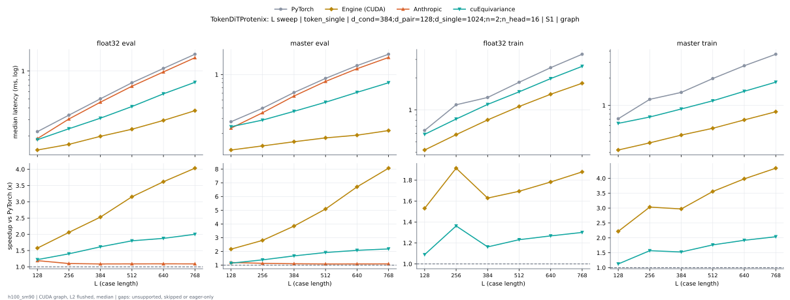
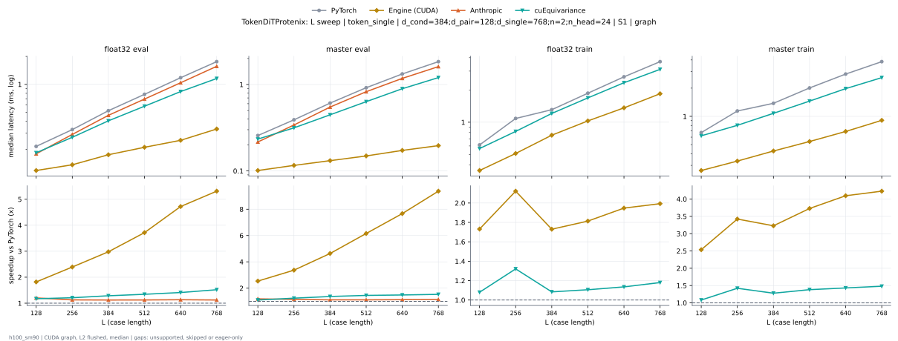
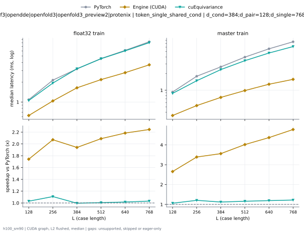
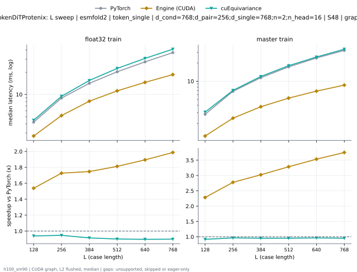
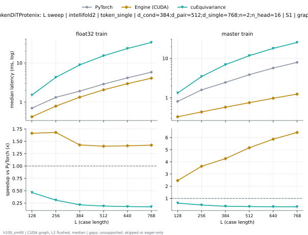
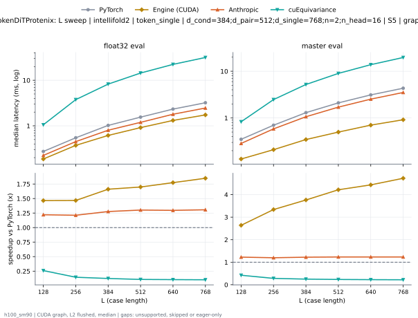
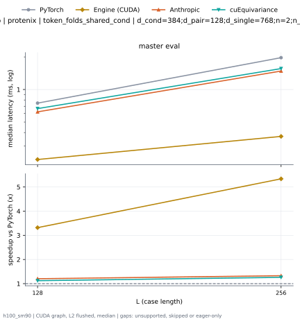
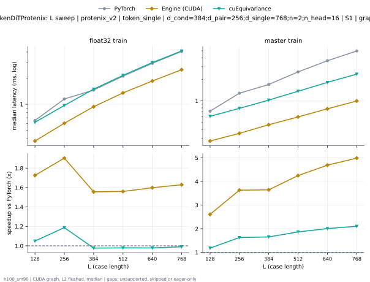
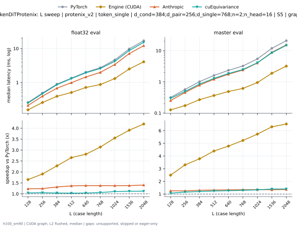
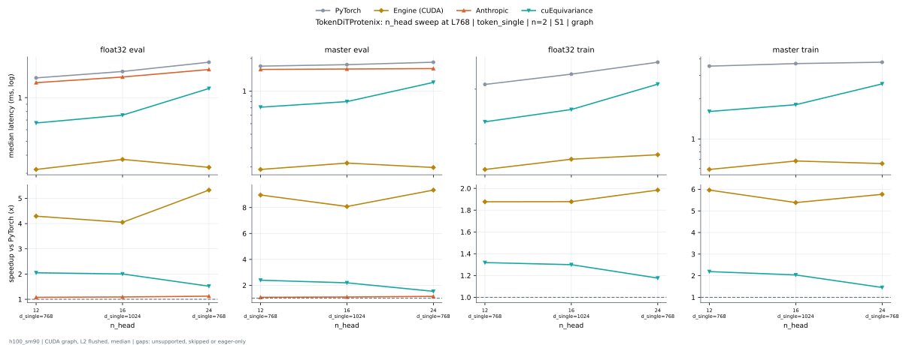

# TokenDiTProtenix on h100_sm90

Generated by `python -m miniworld_engine.measure.plot` from speed tokens `judge/tokens/h100_sm90/`; do not edit.

### L sweep: token_single | d_cond=384;d_pair=128;d_single=1024;n=2;n_head=16 | S1 | graph

**float32 eval** (median ms; x = speedup vs PyTorch)

| L | PyTorch | Engine (Triton) | Engine (CUDA) | Anthropic | cuEquivariance |
|---|---|---|---|---|---|
| 128 | 0.2235 | 0.2066 (1.08x) | 0.1419 (1.57x) | 0.188 (1.19x) | 0.1831 (1.22x) |
| 256 | 0.3359 | 0.3146 (1.07x) | 0.1632 (2.06x) | 0.3054 (1.10x) | 0.24 (1.40x) |
| 384 | 0.5032 | 0.4699 (1.07x) | 0.199 (2.53x) | 0.4628 (1.09x) | 0.3117 (1.61x) |
| 512 | 0.748 | 0.696 (1.07x) | 0.2372 (3.15x) | 0.6862 (1.09x) | 0.4155 (1.80x) |
| 640 | 1.066 | 0.9758 (1.09x) | 0.2948 (3.62x) | 0.9774 (1.09x) | 0.5688 (1.87x) |
| 768 | 1.513 | 1.366 (1.11x) | 0.3751 (4.03x) | 1.388 (1.09x) | 0.7565 (2.00x) |

**master eval** (median ms; x = speedup vs PyTorch)

| L | PyTorch | Engine (Triton) | Engine (CUDA) | Anthropic | cuEquivariance |
|---|---|---|---|---|---|
| 128 | 0.2752 | 0.2538 (1.08x) | 0.1271 (2.17x) | 0.2309 (1.19x) | 0.2405 (1.14x) |
| 256 | 0.3984 | 0.3721 (1.07x) | 0.1421 (2.80x) | 0.352 (1.13x) | 0.2878 (1.38x) |
| 384 | 0.6124 | 0.5745 (1.07x) | 0.1592 (3.85x) | 0.556 (1.10x) | 0.3659 (1.67x) |
| 512 | 0.9005 | 0.8484 (1.06x) | 0.177 (5.09x) | 0.8288 (1.09x) | 0.4691 (1.92x) |
| 640 | 1.277 | 1.193 (1.07x) | 0.1905 (6.70x) | 1.174 (1.09x) | 0.6147 (2.08x) |
| 768 | 1.743 | 1.614 (1.08x) | 0.2162 (8.06x) | 1.596 (1.09x) | 0.7995 (2.18x) |

**float32 train** (median ms; x = speedup vs PyTorch)

| L | PyTorch | Engine (Triton) | Engine (CUDA) | Anthropic | cuEquivariance |
|---|---|---|---|---|---|
| 128 | 0.6411 | 0.6134 (1.05x) | 0.4189 (1.53x) | unsupported | 0.5887 (1.09x) |
| 256 | 1.119 | 1.097 (1.02x) | 0.5849 (1.91x) | unsupported | 0.8214 (1.36x) |
| 384 | 1.312 | 1.258 (1.04x) | 0.8056 (1.63x) | unsupported | 1.128 (1.16x) |
| 512 | 1.826 | 1.738 (1.05x) | 1.078 (1.69x) | unsupported | 1.483 (1.23x) |
| 640 | 2.506 | 2.361 (1.06x) | 1.407 (1.78x) | unsupported | 1.977 (1.27x) |
| 768 | 3.357 | 3.143 (1.07x) | 1.787 (1.88x) | unsupported | 2.58 (1.30x) |

**master train** (median ms; x = speedup vs PyTorch)

| L | PyTorch | Engine (Triton) | Engine (CUDA) | Anthropic | cuEquivariance |
|---|---|---|---|---|---|
| 128 | 0.7102 | 0.6689 (1.06x) | 0.32 (2.22x) | unsupported | 0.6314 (1.12x) |
| 256 | 1.166 | 1.119 (1.04x) | 0.3842 (3.03x) | unsupported | 0.7424 (1.57x) |
| 384 | 1.391 | 1.325 (1.05x) | 0.4683 (2.97x) | unsupported | 0.9113 (1.53x) |
| 512 | 1.981 | 1.883 (1.05x) | 0.557 (3.56x) | unsupported | 1.123 (1.76x) |
| 640 | 2.746 | 2.596 (1.06x) | 0.6898 (3.98x) | unsupported | 1.431 (1.92x) |
| 768 | 3.683 | 3.437 (1.07x) | 0.8489 (4.34x) | unsupported | 1.807 (2.04x) |

### L sweep: token_single | d_cond=384;d_pair=128;d_single=768;n=2;n_head=12 | S1 | graph

**float32 eval** (median ms; x = speedup vs PyTorch)

| L | PyTorch | Engine (Triton) | Engine (CUDA) | Anthropic | cuEquivariance |
|---|---|---|---|---|---|
| 128 | 0.2109 | 0.1947 (1.08x) | 0.1188 (1.78x) | 0.1778 (1.19x) | 0.172 (1.23x) |
| 256 | 0.312 | 0.2925 (1.07x) | 0.1362 (2.29x) | 0.285 (1.09x) | 0.2186 (1.43x) |
| 384 | 0.488 | 0.4604 (1.06x) | 0.1735 (2.81x) | 0.4504 (1.08x) | 0.2933 (1.66x) |
| 512 | 0.6989 | 0.6601 (1.06x) | 0.2062 (3.39x) | 0.6579 (1.06x) | 0.3784 (1.85x) |
| 640 | 0.9822 | 0.9117 (1.08x) | 0.2426 (4.05x) | 0.9104 (1.08x) | 0.4954 (1.98x) |
| 768 | 1.365 | 1.265 (1.08x) | 0.3179 (4.29x) | 1.269 (1.08x) | 0.6679 (2.04x) |

**master eval** (median ms; x = speedup vs PyTorch)

| L | PyTorch | Engine (Triton) | Engine (CUDA) | Anthropic | cuEquivariance |
|---|---|---|---|---|---|
| 128 | 0.2568 | 0.2361 (1.09x) | 0.1016 (2.53x) | 0.2164 (1.19x) | 0.2228 (1.15x) |
| 256 | 0.3813 | 0.3592 (1.06x) | 0.1162 (3.28x) | 0.3387 (1.13x) | 0.2661 (1.43x) |
| 384 | 0.5909 | 0.5576 (1.06x) | 0.1315 (4.49x) | 0.5382 (1.10x) | 0.3384 (1.75x) |
| 512 | 0.8742 | 0.8228 (1.06x) | 0.1491 (5.87x) | 0.8112 (1.08x) | 0.4278 (2.04x) |
| 640 | 1.237 | 1.164 (1.06x) | 0.1707 (7.24x) | 1.156 (1.07x) | 0.5545 (2.23x) |
| 768 | 1.697 | 1.594 (1.06x) | 0.1886 (9.00x) | 1.582 (1.07x) | 0.7099 (2.39x) |

**float32 train** (median ms; x = speedup vs PyTorch)

| L | PyTorch | Engine (Triton) | Engine (CUDA) | Anthropic | cuEquivariance |
|---|---|---|---|---|---|
| 128 | 0.6044 | 0.5798 (1.04x) | 0.3586 (1.69x) | unsupported | 0.5553 (1.09x) |
| 256 | 1.064 | 1.036 (1.03x) | 0.5057 (2.10x) | unsupported | 0.7558 (1.41x) |
| 384 | 1.241 | 1.204 (1.03x) | 0.7232 (1.72x) | unsupported | 1.048 (1.18x) |
| 512 | 1.713 | 1.654 (1.04x) | 0.9708 (1.76x) | unsupported | 1.37 (1.25x) |
| 640 | 2.325 | 2.239 (1.04x) | 1.266 (1.84x) | unsupported | 1.806 (1.29x) |
| 768 | 3.115 | 2.997 (1.04x) | 1.653 (1.88x) | unsupported | 2.356 (1.32x) |

**master train** (median ms; x = speedup vs PyTorch)

| L | PyTorch | Engine (Triton) | Engine (CUDA) | Anthropic | cuEquivariance |
|---|---|---|---|---|---|
| 128 | 0.6696 | 0.6263 (1.07x) | 0.2659 (2.52x) | unsupported | 0.5879 (1.14x) |
| 256 | 1.121 | 1.077 (1.04x) | 0.3277 (3.42x) | unsupported | 0.6816 (1.64x) |
| 384 | 1.33 | 1.273 (1.04x) | 0.41 (3.25x) | unsupported | 0.8384 (1.59x) |
| 512 | 1.907 | 1.828 (1.04x) | 0.4891 (3.90x) | unsupported | 1.022 (1.87x) |
| 640 | 2.628 | 2.516 (1.04x) | 0.603 (4.36x) | unsupported | 1.285 (2.04x) |
| 768 | 3.523 | 3.364 (1.05x) | 0.7596 (4.64x) | unsupported | 1.607 (2.19x) |

### L sweep: token_single | d_cond=384;d_pair=128;d_single=768;n=2;n_head=24 | S1 | graph

**float32 eval** (median ms; x = speedup vs PyTorch)

| L | PyTorch | Engine (Triton) | Engine (CUDA) | Anthropic | cuEquivariance |
|---|---|---|---|---|---|
| 128 | 0.2149 | 0.1969 (1.09x) | 0.1182 (1.82x) | 0.1787 (1.20x) | 0.1835 (1.17x) |
| 256 | 0.3258 | 0.298 (1.09x) | 0.1362 (2.39x) | 0.289 (1.13x) | 0.2693 (1.21x) |
| 384 | 0.5204 | 0.4712 (1.10x) | 0.1747 (2.98x) | 0.4639 (1.12x) | 0.4049 (1.29x) |
| 512 | 0.7808 | 0.6918 (1.13x) | 0.2101 (3.72x) | 0.6944 (1.12x) | 0.5815 (1.34x) |
| 640 | 1.179 | 1.025 (1.15x) | 0.2497 (4.72x) | 1.04 (1.13x) | 0.836 (1.41x) |
| 768 | 1.756 | 1.53 (1.15x) | 0.3306 (5.31x) | 1.564 (1.12x) | 1.157 (1.52x) |

**master eval** (median ms; x = speedup vs PyTorch)

| L | PyTorch | Engine (Triton) | Engine (CUDA) | Anthropic | cuEquivariance |
|---|---|---|---|---|---|
| 128 | 0.2568 | 0.2348 (1.09x) | 0.1012 (2.54x) | 0.2165 (1.19x) | 0.2338 (1.10x) |
| 256 | 0.3906 | 0.3577 (1.09x) | 0.116 (3.37x) | 0.3401 (1.15x) | 0.3152 (1.24x) |
| 384 | 0.6096 | 0.5636 (1.08x) | 0.1315 (4.64x) | 0.5486 (1.11x) | 0.4461 (1.37x) |
| 512 | 0.9181 | 0.8388 (1.09x) | 0.1491 (6.16x) | 0.8255 (1.11x) | 0.6333 (1.45x) |
| 640 | 1.325 | 1.184 (1.12x) | 0.1728 (7.67x) | 1.178 (1.13x) | 0.8939 (1.48x) |
| 768 | 1.84 | 1.608 (1.14x) | 0.1963 (9.37x) | 1.611 (1.14x) | 1.203 (1.53x) |

**float32 train** (median ms; x = speedup vs PyTorch)

| L | PyTorch | Engine (Triton) | Engine (CUDA) | Anthropic | cuEquivariance |
|---|---|---|---|---|---|
| 128 | 0.6132 | 0.5796 (1.06x) | 0.3542 (1.73x) | unsupported | 0.5677 (1.08x) |
| 256 | 1.084 | 1.031 (1.05x) | 0.5106 (2.12x) | unsupported | 0.8204 (1.32x) |
| 384 | 1.308 | 1.214 (1.08x) | 0.7563 (1.73x) | unsupported | 1.207 (1.08x) |
| 512 | 1.865 | 1.681 (1.11x) | 1.028 (1.81x) | unsupported | 1.686 (1.11x) |
| 640 | 2.651 | 2.341 (1.13x) | 1.361 (1.95x) | unsupported | 2.335 (1.14x) |
| 768 | 3.674 | 3.242 (1.13x) | 1.844 (1.99x) | unsupported | 3.113 (1.18x) |

**master train** (median ms; x = speedup vs PyTorch)

| L | PyTorch | Engine (Triton) | Engine (CUDA) | Anthropic | cuEquivariance |
|---|---|---|---|---|---|
| 128 | 0.6708 | 0.6272 (1.07x) | 0.2645 (2.54x) | unsupported | 0.6201 (1.08x) |
| 256 | 1.141 | 1.084 (1.05x) | 0.3334 (3.42x) | unsupported | 0.8024 (1.42x) |
| 384 | 1.378 | 1.28 (1.08x) | 0.427 (3.23x) | unsupported | 1.078 (1.28x) |
| 512 | 2.01 | 1.843 (1.09x) | 0.5391 (3.73x) | unsupported | 1.455 (1.38x) |
| 640 | 2.827 | 2.547 (1.11x) | 0.69 (4.10x) | unsupported | 1.975 (1.43x) |
| 768 | 3.835 | 3.427 (1.12x) | 0.907 (4.23x) | unsupported | 2.59 (1.48x) |

### L sweep: af3|opendde|openfold3|openfold3_preview2|protenix | token_single | d_cond=384;d_pair=128;d_single=768;n=2;n_head=16 | S1 | graph

**float32 train** (median ms; x = speedup vs PyTorch)

| L | PyTorch | Engine (Triton) | Engine (CUDA) | Anthropic | cuEquivariance |
|---|---|---|---|---|---|
| 128 | 0.6108 | 0.5816 (1.05x) | 0.358 (1.71x) | unsupported | 0.5548 (1.10x) |
| 256 | 1.068 | 1.034 (1.03x) | 0.5068 (2.11x) | unsupported | 0.7605 (1.41x) |
| 384 | 1.253 | 1.204 (1.04x) | 0.7296 (1.72x) | unsupported | 1.064 (1.18x) |
| 512 | 1.759 | 1.674 (1.05x) | 0.9895 (1.78x) | unsupported | 1.415 (1.24x) |
| 640 | 2.416 | 2.306 (1.05x) | 1.294 (1.87x) | unsupported | 1.884 (1.28x) |
| 768 | 3.289 | 3.048 (1.08x) | 1.69 (1.95x) | unsupported | 2.481 (1.33x) |

**master train** (median ms; x = speedup vs PyTorch)

| L | PyTorch | Engine (Triton) | Engine (CUDA) | Anthropic | cuEquivariance |
|---|---|---|---|---|---|
| 128 | 0.6711 | 0.6263 (1.07x) | 0.2656 (2.53x) | unsupported | 0.5887 (1.14x) |
| 256 | 1.132 | 1.083 (1.05x) | 0.3253 (3.48x) | unsupported | 0.6869 (1.65x) |
| 384 | 1.347 | 1.276 (1.06x) | 0.4019 (3.35x) | unsupported | 0.854 (1.58x) |
| 512 | 1.935 | 1.824 (1.06x) | 0.4881 (3.96x) | unsupported | 1.056 (1.83x) |
| 640 | 2.689 | 2.524 (1.07x) | 0.6052 (4.44x) | unsupported | 1.353 (1.99x) |
| 768 | 3.609 | 3.364 (1.07x) | 0.7534 (4.79x) | unsupported | 1.718 (2.10x) |

### L sweep: af3|opendde|openfold3|openfold3_preview2|protenix | token_single | d_cond=384;d_pair=128;d_single=768;n=2;n_head=16 | S5 | graph

**float32 eval** (median ms; x = speedup vs PyTorch)

| L | PyTorch | Engine (Triton) | Engine (CUDA) | Anthropic | cuEquivariance |
|---|---|---|---|---|---|
| 128 | 0.252 | 0.2216 (1.14x) | 0.1433 (1.76x) | 0.202 (1.25x) | 0.2211 (1.14x) |
| 256 | 0.4586 | 0.3875 (1.18x) | 0.2212 (2.07x) | 0.3649 (1.26x) | 0.3776 (1.21x) |
| 384 | 0.8281 | 0.6414 (1.29x) | 0.312 (2.65x) | 0.617 (1.34x) | 0.6657 (1.24x) |
| 512 | 1.232 | 0.924 (1.33x) | 0.3857 (3.19x) | 0.8774 (1.40x) | 0.9555 (1.29x) |
| 640 | 1.843 | 1.369 (1.35x) | 0.5052 (3.65x) | 1.295 (1.42x) | 1.408 (1.31x) |
| 768 | 2.501 | 1.837 (1.36x) | 0.5853 (4.27x) | 1.75 (1.43x) | 1.826 (1.37x) |
| 1024 | 4.215 | 3.092 (1.36x) | 0.8019 (5.26x) | 2.976 (1.42x) | 2.899 (1.45x) |
| 1536 | 8.846 | 6.484 (1.36x) | 1.405 (6.30x) | 6.23 (1.42x) | 5.901 (1.50x) |
| 2048 | 15.37 | 10.87 (1.41x) | 2.124 (7.24x) | 10.49 (1.47x) | 10.16 (1.51x) |

**master eval** (median ms; x = speedup vs PyTorch)

| L | PyTorch | Engine (Triton) | Engine (CUDA) | Anthropic | cuEquivariance |
|---|---|---|---|---|---|
| 128 | 0.3024 | 0.2609 (1.16x) | 0.1151 (2.63x) | 0.2383 (1.27x) | 0.2721 (1.11x) |
| 256 | 0.504 | 0.4082 (1.23x) | 0.1449 (3.48x) | 0.3905 (1.29x) | 0.4096 (1.23x) |
| 384 | 0.8708 | 0.6549 (1.33x) | 0.195 (4.46x) | 0.6374 (1.37x) | 0.6664 (1.31x) |
| 512 | 1.354 | 0.9806 (1.38x) | 0.2374 (5.70x) | 0.9617 (1.41x) | 0.9739 (1.39x) |
| 640 | 1.954 | 1.385 (1.41x) | 0.3021 (6.47x) | 1.366 (1.43x) | 1.369 (1.43x) |
| 768 | 2.649 | 1.855 (1.43x) | 0.3395 (7.80x) | 1.838 (1.44x) | 1.791 (1.48x) |
| 1024 | 4.433 | 3.051 (1.45x) | 0.458 (9.68x) | 3.025 (1.47x) | 2.869 (1.55x) |
| 1536 | 9.638 | 6.625 (1.45x) | 0.7691 (12.53x) | 6.601 (1.46x) | 5.836 (1.65x) |
| 2048 | 16.8 | 11.41 (1.47x) | 1.132 (14.84x) | 11.26 (1.49x) | 10.1 (1.66x) |

### L sweep: af3|opendde|openfold3|openfold3_preview2|protenix | token_single_shared_cond | d_cond=384;d_pair=128;d_single=768;n=2;n_head=16 | S5 | graph

**float32 eval** (median ms; x = speedup vs PyTorch)

| L | PyTorch | Engine (Triton) | Engine (CUDA) | Anthropic | cuEquivariance |
|---|---|---|---|---|---|
| 128 | 0.267 | 0.2378 (1.12x) | 0.1373 (1.95x) | 0.2188 (1.22x) | 0.2374 (1.12x) |
| 256 | 0.4798 | 0.4101 (1.17x) | 0.2014 (2.38x) | 0.3855 (1.24x) | 0.3964 (1.21x) |
| 384 | 0.857 | 0.6697 (1.28x) | 0.2805 (3.06x) | 0.6423 (1.33x) | 0.6928 (1.24x) |
| 512 | 1.261 | 0.9686 (1.30x) | 0.3422 (3.68x) | 0.9065 (1.39x) | 0.9872 (1.28x) |
| 640 | 1.874 | 1.401 (1.34x) | 0.4505 (4.16x) | 1.335 (1.40x) | 1.444 (1.30x) |
| 768 | 2.531 | 1.876 (1.35x) | 0.5304 (4.77x) | 1.791 (1.41x) | 1.867 (1.36x) |
| 1024 | 4.254 | 3.108 (1.37x) | 0.7353 (5.78x) | 3.002 (1.42x) | 2.939 (1.45x) |
| 1536 | 8.912 | 6.56 (1.36x) | 1.308 (6.81x) | 6.243 (1.43x) | 5.974 (1.49x) |
| 2048 | 15.44 | 10.87 (1.42x) | 2.002 (7.71x) | 10.56 (1.46x) | 10.23 (1.51x) |

**master eval** (median ms; x = speedup vs PyTorch)

| L | PyTorch | Engine (Triton) | Engine (CUDA) | Anthropic | cuEquivariance |
|---|---|---|---|---|---|
| 128 | 0.3112 | 0.2696 (1.15x) | 0.1084 (2.87x) | 0.2473 (1.26x) | 0.2802 (1.11x) |
| 256 | 0.5161 | 0.4185 (1.23x) | 0.1304 (3.96x) | 0.4006 (1.29x) | 0.4204 (1.23x) |
| 384 | 0.8805 | 0.6686 (1.32x) | 0.1727 (5.10x) | 0.6495 (1.36x) | 0.6792 (1.30x) |
| 512 | 1.363 | 0.9919 (1.37x) | 0.2034 (6.70x) | 0.9722 (1.40x) | 0.988 (1.38x) |
| 640 | 1.968 | 1.412 (1.39x) | 0.2609 (7.54x) | 1.381 (1.43x) | 1.381 (1.42x) |
| 768 | 2.673 | 1.878 (1.42x) | 0.2896 (9.23x) | 1.854 (1.44x) | 1.818 (1.47x) |
| 1024 | 4.466 | 3.086 (1.45x) | 0.3948 (11.31x) | 3.05 (1.46x) | 2.898 (1.54x) |
| 1536 | 9.672 | 6.653 (1.45x) | 0.6832 (14.16x) | 6.627 (1.46x) | 5.876 (1.65x) |
| 2048 | 16.82 | 11.44 (1.47x) | 1.016 (16.56x) | 11.29 (1.49x) | 10.15 (1.66x) |

### L sweep: af3|opendde|openfold3|openfold3_preview2|protenix | token_single_shared_cond | d_cond=384;d_pair=128;d_single=768;n=2;n_head=16 | S8 | graph

**float32 train** (median ms; x = speedup vs PyTorch)

| L | PyTorch | Engine (Triton) | Engine (CUDA) | Anthropic | cuEquivariance |
|---|---|---|---|---|---|
| 128 | 1.083 | 1.011 (1.07x) | 0.6703 (1.62x) | unsupported | 1.054 (1.03x) |
| 256 | 2.155 | 1.957 (1.10x) | 1.123 (1.92x) | unsupported | 1.943 (1.11x) |
| 384 | 3.195 | 2.73 (1.17x) | 1.768 (1.81x) | unsupported | 3.209 (1.00x) |
| 512 | 4.59 | 3.837 (1.20x) | 2.318 (1.98x) | unsupported | 4.564 (1.01x) |
| 640 | 6.11 | 4.774 (1.28x) | 2.996 (2.04x) | unsupported | 6.016 (1.02x) |
| 768 | 8.273 | 6.436 (1.29x) | 3.948 (2.10x) | unsupported | 8.014 (1.03x) |

**master train** (median ms; x = speedup vs PyTorch)

| L | PyTorch | Engine (Triton) | Engine (CUDA) | Anthropic | cuEquivariance |
|---|---|---|---|---|---|
| 128 | 0.9352 | 0.8349 (1.12x) | 0.3613 (2.59x) | unsupported | 0.8782 (1.06x) |
| 256 | 1.798 | 1.514 (1.19x) | 0.5652 (3.18x) | unsupported | 1.486 (1.21x) |
| 384 | 2.641 | 2.015 (1.31x) | 0.8165 (3.23x) | unsupported | 2.362 (1.12x) |
| 512 | 3.969 | 2.936 (1.35x) | 1.11 (3.58x) | unsupported | 3.424 (1.16x) |
| 640 | 5.61 | 3.937 (1.43x) | 1.465 (3.83x) | unsupported | 4.709 (1.19x) |
| 768 | 7.514 | 5.212 (1.44x) | 1.824 (4.12x) | unsupported | 6.161 (1.22x) |

### L sweep: esmfold2 | token_single | d_cond=768;d_pair=256;d_single=768;n=2;n_head=16 | S48 | graph

**float32 train** (median ms; x = speedup vs PyTorch)

| L | PyTorch | Engine (Triton) | Engine (CUDA) | Anthropic | cuEquivariance |
|---|---|---|---|---|---|
| 128 | 4.207 | 3.841 (1.10x) | 2.735 (1.54x) | unsupported | 4.479 (0.94x) |
| 256 | 8.941 | 7.787 (1.15x) | 5.176 (1.73x) | unsupported | 9.446 (0.95x) |
| 384 | 14.15 | 11.69 (1.21x) | 8.095 (1.75x) | unsupported | 15.47 (0.91x) |
| 512 | 20.28 | 16.21 (1.25x) | 11.19 (1.81x) | unsupported | 22.52 (0.90x) |
| 640 | 27.62 | 20.19 (1.37x) | 14.58 (1.89x) | unsupported | 30.8 (0.90x) |
| 768 | 36.93 | 25.76 (1.43x) | 18.59 (1.99x) | unsupported | 41.07 (0.90x) |

**master train** (median ms; x = speedup vs PyTorch)

| L | PyTorch | Engine (Triton) | Engine (CUDA) | Anthropic | cuEquivariance |
|---|---|---|---|---|---|
| 128 | 2.832 | 2.374 (1.19x) | 1.24 (2.28x) | unsupported | 3.084 (0.92x) |
| 256 | 6.798 | 5.041 (1.35x) | 2.447 (2.78x) | unsupported | 7.045 (0.96x) |
| 384 | 11.43 | 7.739 (1.48x) | 3.781 (3.02x) | unsupported | 11.97 (0.96x) |
| 512 | 17.25 | 11.34 (1.52x) | 5.251 (3.29x) | unsupported | 18.07 (0.95x) |
| 640 | 24.21 | 14.64 (1.65x) | 6.851 (3.53x) | unsupported | 25.12 (0.96x) |
| 768 | 32.33 | 18.63 (1.74x) | 8.617 (3.75x) | unsupported | 33.87 (0.95x) |

### L sweep: esmfold2 | token_single | d_cond=768;d_pair=256;d_single=768;n=2;n_head=16 | S5 | graph

**float32 eval** (median ms; x = speedup vs PyTorch)

| L | PyTorch | Engine (Triton) | Engine (CUDA) | Anthropic | cuEquivariance |
|---|---|---|---|---|---|
| 128 | 0.2698 | 0.2406 (1.12x) | 0.1677 (1.61x) | 0.2191 (1.23x) | 0.2573 (1.05x) |
| 256 | 0.5046 | 0.4345 (1.16x) | 0.276 (1.83x) | 0.4099 (1.23x) | 0.4814 (1.05x) |
| 384 | 0.926 | 0.7386 (1.25x) | 0.4167 (2.22x) | 0.7106 (1.30x) | 0.8934 (1.04x) |
| 512 | 1.371 | 1.069 (1.28x) | 0.5321 (2.58x) | 1.014 (1.35x) | 1.326 (1.03x) |
| 640 | 2.048 | 1.558 (1.31x) | 0.7544 (2.71x) | 1.494 (1.37x) | 1.974 (1.04x) |
| 768 | 2.778 | 2.126 (1.31x) | 0.903 (3.08x) | 2.033 (1.37x) | 2.625 (1.06x) |
| 1024 | 4.683 | 3.573 (1.31x) | 1.348 (3.47x) | 3.473 (1.35x) | 4.278 (1.09x) |
| 1536 | 9.881 | 7.509 (1.32x) | 2.592 (3.81x) | 7.262 (1.36x) | 8.908 (1.11x) |
| 2048 | 17.14 | 12.52 (1.37x) | 4.215 (4.07x) | 12.22 (1.40x) | 15.32 (1.12x) |

**master eval** (median ms; x = speedup vs PyTorch)

| L | PyTorch | Engine (Triton) | Engine (CUDA) | Anthropic | cuEquivariance |
|---|---|---|---|---|---|
| 128 | 0.3248 | 0.2826 (1.15x) | 0.1371 (2.37x) | 0.2611 (1.24x) | 0.3041 (1.07x) |
| 256 | 0.5829 | 0.4862 (1.20x) | 0.187 (3.12x) | 0.4685 (1.24x) | 0.5082 (1.15x) |
| 384 | 1.036 | 0.8205 (1.26x) | 0.2854 (3.63x) | 0.8027 (1.29x) | 0.8728 (1.19x) |
| 512 | 1.63 | 1.257 (1.30x) | 0.3834 (4.25x) | 1.235 (1.32x) | 1.32 (1.23x) |
| 640 | 2.375 | 1.798 (1.32x) | 0.5223 (4.55x) | 1.786 (1.33x) | 1.888 (1.26x) |
| 768 | 3.253 | 2.434 (1.34x) | 0.6432 (5.06x) | 2.434 (1.34x) | 2.518 (1.29x) |
| 1024 | 5.475 | 4.078 (1.34x) | 0.9795 (5.59x) | 4.07 (1.35x) | 4.137 (1.32x) |
| 1536 | 11.93 | 8.943 (1.33x) | 1.922 (6.21x) | 8.922 (1.34x) | 8.598 (1.39x) |
| 2048 | 20.86 | 15.5 (1.35x) | 3.237 (6.44x) | 15.37 (1.36x) | 14.94 (1.40x) |

### L sweep: esmfold2 | token_single_shared_cond | d_cond=768;d_pair=256;d_single=768;n=2;n_head=16 | S5 | graph

**float32 eval** (median ms; x = speedup vs PyTorch)

| L | PyTorch | Engine (Triton) | Engine (CUDA) | Anthropic | cuEquivariance |
|---|---|---|---|---|---|
| 128 | 0.2855 | 0.2565 (1.11x) | 0.1569 (1.82x) | 0.2369 (1.21x) | 0.2736 (1.04x) |
| 256 | 0.5272 | 0.4579 (1.15x) | 0.2428 (2.17x) | 0.4345 (1.21x) | 0.5043 (1.05x) |
| 384 | 0.9493 | 0.7694 (1.23x) | 0.3667 (2.59x) | 0.7386 (1.29x) | 0.9197 (1.03x) |
| 512 | 1.4 | 1.105 (1.27x) | 0.4755 (2.94x) | 1.045 (1.34x) | 1.355 (1.03x) |
| 640 | 2.092 | 1.593 (1.31x) | 0.6684 (3.13x) | 1.539 (1.36x) | 2.014 (1.04x) |
| 768 | 2.831 | 2.173 (1.30x) | 0.8206 (3.45x) | 2.099 (1.35x) | 2.674 (1.06x) |
| 1024 | 4.741 | 3.621 (1.31x) | 1.242 (3.82x) | 3.491 (1.36x) | 4.307 (1.10x) |
| 1536 | 9.932 | 7.586 (1.31x) | 2.44 (4.07x) | 7.346 (1.35x) | 8.981 (1.11x) |
| 2048 | 17.26 | 12.88 (1.34x) | 4.04 (4.27x) | 12.35 (1.40x) | 15.5 (1.11x) |

**master eval** (median ms; x = speedup vs PyTorch)

| L | PyTorch | Engine (Triton) | Engine (CUDA) | Anthropic | cuEquivariance |
|---|---|---|---|---|---|
| 128 | 0.3315 | 0.2913 (1.14x) | 0.1287 (2.58x) | 0.2698 (1.23x) | 0.3116 (1.06x) |
| 256 | 0.5912 | 0.4955 (1.19x) | 0.1665 (3.55x) | 0.479 (1.23x) | 0.5164 (1.14x) |
| 384 | 1.047 | 0.834 (1.25x) | 0.2549 (4.11x) | 0.8154 (1.28x) | 0.884 (1.18x) |
| 512 | 1.642 | 1.262 (1.30x) | 0.3393 (4.84x) | 1.251 (1.31x) | 1.329 (1.24x) |
| 640 | 2.384 | 1.805 (1.32x) | 0.4666 (5.11x) | 1.797 (1.33x) | 1.894 (1.26x) |
| 768 | 3.264 | 2.451 (1.33x) | 0.577 (5.66x) | 2.456 (1.33x) | 2.537 (1.29x) |
| 1024 | 5.52 | 4.096 (1.35x) | 0.8958 (6.16x) | 4.095 (1.35x) | 4.152 (1.33x) |
| 1536 | 11.97 | 8.973 (1.33x) | 1.811 (6.61x) | 8.949 (1.34x) | 8.608 (1.39x) |
| 2048 | 20.89 | 15.54 (1.34x) | 3.091 (6.76x) | 15.4 (1.36x) | 15.03 (1.39x) |

### L sweep: intellifold2 | token_single | d_cond=384;d_pair=512;d_single=768;n=2;n_head=16 | S1 | graph

**float32 train** (median ms; x = speedup vs PyTorch)

| L | PyTorch | Engine (Triton) | Engine (CUDA) | Anthropic | cuEquivariance |
|---|---|---|---|---|---|
| 128 | 0.6991 | 0.6654 (1.05x) | 0.4215 (1.66x) | unsupported | 1.511 (0.46x) |
| 256 | 1.323 | 1.273 (1.04x) | 0.7867 (1.68x) | unsupported | 4.282 (0.31x) |
| 384 | 1.914 | 1.862 (1.03x) | 1.333 (1.44x) | unsupported | 8.895 (0.22x) |
| 512 | 2.915 | 2.81 (1.04x) | 2.056 (1.42x) | unsupported | 15.23 (0.19x) |
| 640 | 4.165 | 4.032 (1.03x) | 2.954 (1.41x) | unsupported | 23.35 (0.18x) |
| 768 | 5.799 | 5.552 (1.04x) | 4.084 (1.42x) | unsupported | 33.32 (0.17x) |

**master train** (median ms; x = speedup vs PyTorch)

| L | PyTorch | Engine (Triton) | Engine (CUDA) | Anthropic | cuEquivariance |
|---|---|---|---|---|---|
| 128 | 0.8064 | 0.7622 (1.06x) | 0.2936 (2.75x) | unsupported | 1.314 (0.61x) |
| 256 | 1.575 | 1.533 (1.03x) | 0.4201 (3.75x) | unsupported | 3.446 (0.46x) |
| 384 | 2.444 | 2.375 (1.03x) | 0.6131 (3.99x) | unsupported | 6.924 (0.35x) |
| 512 | 3.851 | 3.75 (1.03x) | 0.8573 (4.49x) | unsupported | 11.74 (0.33x) |
| 640 | 5.686 | 5.509 (1.03x) | 1.177 (4.83x) | unsupported | 17.94 (0.32x) |
| 768 | 7.917 | 7.672 (1.03x) | 1.565 (5.06x) | unsupported | 25.43 (0.31x) |

### L sweep: intellifold2 | token_single | d_cond=384;d_pair=512;d_single=768;n=2;n_head=16 | S5 | graph

**float32 eval** (median ms; x = speedup vs PyTorch)

| L | PyTorch | Engine (Triton) | Engine (CUDA) | Anthropic | cuEquivariance |
|---|---|---|---|---|---|
| 128 | 0.2737 | 0.2424 (1.13x) | 0.1868 (1.46x) | 0.2242 (1.22x) | 1.054 (0.26x) |
| 256 | 0.546 | 0.4728 (1.15x) | 0.3722 (1.47x) | 0.4503 (1.21x) | 3.761 (0.15x) |
| 384 | 1.022 | 0.8269 (1.24x) | 0.6154 (1.66x) | 0.8006 (1.28x) | 8.241 (0.12x) |
| 512 | 1.552 | 1.283 (1.21x) | 0.914 (1.70x) | 1.193 (1.30x) | 14.42 (0.11x) |
| 640 | 2.33 | 1.83 (1.27x) | 1.313 (1.77x) | 1.797 (1.30x) | 22.35 (0.10x) |
| 768 | 3.212 | 2.501 (1.28x) | 1.737 (1.85x) | 2.458 (1.31x) | 31.67 (0.10x) |

**master eval** (median ms; x = speedup vs PyTorch)

| L | PyTorch | Engine (Triton) | Engine (CUDA) | Anthropic | cuEquivariance |
|---|---|---|---|---|---|
| 128 | 0.3503 | 0.3087 (1.13x) | 0.1328 (2.64x) | 0.2858 (1.23x) | 0.8316 (0.42x) |
| 256 | 0.7014 | 0.5947 (1.18x) | 0.2102 (3.34x) | 0.5855 (1.20x) | 2.478 (0.28x) |
| 384 | 1.303 | 1.065 (1.22x) | 0.3463 (3.76x) | 1.065 (1.22x) | 5.213 (0.25x) |
| 512 | 2.107 | 1.702 (1.24x) | 0.4999 (4.22x) | 1.709 (1.23x) | 8.998 (0.23x) |
| 640 | 3.123 | 2.514 (1.24x) | 0.7046 (4.43x) | 2.534 (1.23x) | 13.84 (0.23x) |
| 768 | 4.338 | 3.516 (1.23x) | 0.9181 (4.73x) | 3.521 (1.23x) | 19.72 (0.22x) |

### L sweep: intellifold2 | token_single_shared_cond | d_cond=384;d_pair=512;d_single=768;n=2;n_head=16 | S5 | graph

**float32 eval** (median ms; x = speedup vs PyTorch)

| L | PyTorch | Engine (Triton) | Engine (CUDA) | Anthropic | cuEquivariance |
|---|---|---|---|---|---|
| 128 | 0.2896 | 0.2593 (1.12x) | 0.1805 (1.60x) | 0.2403 (1.21x) | 1.084 (0.27x) |
| 256 | 0.5711 | 0.4911 (1.16x) | 0.3519 (1.62x) | 0.4714 (1.21x) | 3.735 (0.15x) |
| 384 | 1.039 | 0.8463 (1.23x) | 0.5833 (1.78x) | 0.8232 (1.26x) | 8.18 (0.13x) |
| 512 | 1.584 | 1.262 (1.25x) | 0.8722 (1.82x) | 1.234 (1.28x) | 14.26 (0.11x) |
| 640 | 2.375 | 1.867 (1.27x) | 1.255 (1.89x) | 1.822 (1.30x) | 22.02 (0.11x) |
| 768 | 3.243 | 2.543 (1.28x) | 1.68 (1.93x) | 2.499 (1.30x) | 31.27 (0.10x) |

**master eval** (median ms; x = speedup vs PyTorch)

| L | PyTorch | Engine (Triton) | Engine (CUDA) | Anthropic | cuEquivariance |
|---|---|---|---|---|---|
| 128 | 0.3585 | 0.3142 (1.14x) | 0.1248 (2.87x) | 0.2948 (1.22x) | 0.8353 (0.43x) |
| 256 | 0.7095 | 0.6034 (1.18x) | 0.1956 (3.63x) | 0.5959 (1.19x) | 2.495 (0.28x) |
| 384 | 1.311 | 1.081 (1.21x) | 0.3236 (4.05x) | 1.076 (1.22x) | 5.24 (0.25x) |
| 512 | 2.115 | 1.722 (1.23x) | 0.4659 (4.54x) | 1.724 (1.23x) | 9.034 (0.23x) |
| 640 | 3.138 | 2.523 (1.24x) | 0.6644 (4.72x) | 2.55 (1.23x) | 13.89 (0.23x) |
| 768 | 4.352 | 3.51 (1.24x) | 0.8676 (5.02x) | 3.547 (1.23x) | 19.79 (0.22x) |

### L sweep: protenix | token_folds | d_cond=384;d_pair=128;d_single=768;n=2;n_head=16 | D5 | S5 | graph

**master eval** (median ms; x = speedup vs PyTorch)

| L | PyTorch | Engine (Triton) | Engine (CUDA) | Anthropic | cuEquivariance |
|---|---|---|---|---|---|
| 128 | 0.7494 | 0.6201 (1.21x) | 0.2256 (3.32x) | 0.6191 (1.21x) | 0.6694 (1.12x) |
| 256 | 1.974 | 1.471 (1.34x) | 0.3664 (5.39x) | 1.479 (1.33x) | 1.556 (1.27x) |

### L sweep: protenix | token_folds_shared_cond | d_cond=384;d_pair=128;d_single=768;n=2;n_head=16 | D5 | S5 | graph

**master eval** (median ms; x = speedup vs PyTorch)

| L | PyTorch | Engine (Triton) | Engine (CUDA) | Anthropic | cuEquivariance |
|---|---|---|---|---|---|
| 128 | 0.7507 | 0.6164 (1.22x) | 0.225 (3.34x) | 0.6217 (1.21x) | 0.6664 (1.13x) |
| 256 | 1.97 | 1.471 (1.34x) | 0.3655 (5.39x) | 1.481 (1.33x) | 1.561 (1.26x) |

### L sweep: protenix_v2 | token_single | d_cond=384;d_pair=256;d_single=768;n=2;n_head=16 | S1 | graph

**float32 train** (median ms; x = speedup vs PyTorch)

| L | PyTorch | Engine (Triton) | Engine (CUDA) | Anthropic | cuEquivariance |
|---|---|---|---|---|---|
| 128 | 0.6502 | 0.6204 (1.05x) | 0.3768 (1.73x) | unsupported | 0.6198 (1.05x) |
| 256 | 1.15 | 1.118 (1.03x) | 0.6042 (1.90x) | unsupported | 0.9685 (1.19x) |
| 384 | 1.459 | 1.409 (1.04x) | 0.9374 (1.56x) | unsupported | 1.494 (0.98x) |
| 512 | 2.109 | 2.02 (1.04x) | 1.352 (1.56x) | unsupported | 2.155 (0.98x) |
| 640 | 2.964 | 2.818 (1.05x) | 1.855 (1.60x) | unsupported | 3.03 (0.98x) |
| 768 | 4.077 | 3.834 (1.06x) | 2.503 (1.63x) | unsupported | 4.117 (0.99x) |

**master train** (median ms; x = speedup vs PyTorch)

| L | PyTorch | Engine (Triton) | Engine (CUDA) | Anthropic | cuEquivariance |
|---|---|---|---|---|---|
| 128 | 0.7196 | 0.6787 (1.06x) | 0.276 (2.61x) | unsupported | 0.6107 (1.18x) |
| 256 | 1.281 | 1.224 (1.05x) | 0.3526 (3.63x) | unsupported | 0.7876 (1.63x) |
| 384 | 1.697 | 1.628 (1.04x) | 0.4656 (3.65x) | unsupported | 1.028 (1.65x) |
| 512 | 2.543 | 2.425 (1.05x) | 0.5983 (4.25x) | unsupported | 1.364 (1.86x) |
| 640 | 3.641 | 3.473 (1.05x) | 0.7763 (4.69x) | unsupported | 1.815 (2.01x) |
| 768 | 4.978 | 4.719 (1.05x) | 0.9977 (4.99x) | unsupported | 2.367 (2.10x) |

### L sweep: protenix_v2 | token_single | d_cond=384;d_pair=256;d_single=768;n=2;n_head=16 | S5 | graph

**float32 eval** (median ms; x = speedup vs PyTorch)

| L | PyTorch | Engine (Triton) | Engine (CUDA) | Anthropic | cuEquivariance |
|---|---|---|---|---|---|
| 128 | 0.2572 | 0.2286 (1.13x) | 0.1557 (1.65x) | 0.2093 (1.23x) | 0.2466 (1.04x) |
| 256 | 0.4885 | 0.4176 (1.17x) | 0.2563 (1.91x) | 0.3939 (1.24x) | 0.4647 (1.05x) |
| 384 | 0.8911 | 0.7007 (1.27x) | 0.391 (2.28x) | 0.6786 (1.31x) | 0.8574 (1.04x) |
| 512 | 1.342 | 1.03 (1.30x) | 0.5055 (2.66x) | 0.9838 (1.36x) | 1.302 (1.03x) |
| 640 | 2.002 | 1.52 (1.32x) | 0.7119 (2.81x) | 1.452 (1.38x) | 1.929 (1.04x) |
| 768 | 2.727 | 2.073 (1.32x) | 0.8687 (3.14x) | 1.983 (1.37x) | 2.577 (1.06x) |
| 1024 | 4.629 | 3.49 (1.33x) | 1.303 (3.55x) | 3.372 (1.37x) | 4.194 (1.10x) |
| 1536 | 9.777 | 7.289 (1.34x) | 2.501 (3.91x) | 7.099 (1.38x) | 8.749 (1.12x) |
| 2048 | 17.03 | 12.45 (1.37x) | 4.062 (4.19x) | 12.16 (1.40x) | 15.21 (1.12x) |

**master eval** (median ms; x = speedup vs PyTorch)

| L | PyTorch | Engine (Triton) | Engine (CUDA) | Anthropic | cuEquivariance |
|---|---|---|---|---|---|
| 128 | 0.3156 | 0.2729 (1.16x) | 0.1267 (2.49x) | 0.2511 (1.26x) | 0.2943 (1.07x) |
| 256 | 0.571 | 0.4745 (1.20x) | 0.1729 (3.30x) | 0.4557 (1.25x) | 0.493 (1.16x) |
| 384 | 1.014 | 0.8006 (1.27x) | 0.2682 (3.78x) | 0.7809 (1.30x) | 0.848 (1.20x) |
| 512 | 1.604 | 1.227 (1.31x) | 0.3649 (4.39x) | 1.214 (1.32x) | 1.29 (1.24x) |
| 640 | 2.338 | 1.761 (1.33x) | 0.489 (4.78x) | 1.755 (1.33x) | 1.85 (1.26x) |
| 768 | 3.219 | 2.403 (1.34x) | 0.6157 (5.23x) | 2.396 (1.34x) | 2.48 (1.30x) |
| 1024 | 5.435 | 4.029 (1.35x) | 0.9492 (5.73x) | 4.023 (1.35x) | 4.079 (1.33x) |
| 1536 | 11.87 | 8.867 (1.34x) | 1.883 (6.30x) | 8.84 (1.34x) | 8.508 (1.39x) |
| 2048 | 20.79 | 15.39 (1.35x) | 3.187 (6.52x) | 15.26 (1.36x) | 14.82 (1.40x) |

### L sweep: protenix_v2 | token_single_shared_cond | d_cond=384;d_pair=256;d_single=768;n=2;n_head=16 | S5 | graph

**float32 eval** (median ms; x = speedup vs PyTorch)

| L | PyTorch | Engine (Triton) | Engine (CUDA) | Anthropic | cuEquivariance |
|---|---|---|---|---|---|
| 128 | 0.2752 | 0.2457 (1.12x) | 0.1509 (1.82x) | 0.2256 (1.22x) | 0.2638 (1.04x) |
| 256 | 0.5101 | 0.4395 (1.16x) | 0.2359 (2.16x) | 0.4139 (1.23x) | 0.4835 (1.06x) |
| 384 | 0.9165 | 0.7325 (1.25x) | 0.359 (2.55x) | 0.7012 (1.31x) | 0.8871 (1.03x) |
| 512 | 1.371 | 1.072 (1.28x) | 0.4632 (2.96x) | 1.013 (1.35x) | 1.323 (1.04x) |
| 640 | 2.033 | 1.569 (1.30x) | 0.662 (3.07x) | 1.502 (1.35x) | 1.966 (1.03x) |
| 768 | 2.773 | 2.107 (1.32x) | 0.8105 (3.42x) | 2.025 (1.37x) | 2.612 (1.06x) |
| 1024 | 4.664 | 3.523 (1.32x) | 1.231 (3.79x) | 3.422 (1.36x) | 4.256 (1.10x) |
| 1536 | 9.842 | 7.5 (1.31x) | 2.398 (4.10x) | 7.162 (1.37x) | 8.829 (1.11x) |
| 2048 | 17.11 | 12.49 (1.37x) | 3.952 (4.33x) | 12.2 (1.40x) | 15.35 (1.11x) |

**master eval** (median ms; x = speedup vs PyTorch)

| L | PyTorch | Engine (Triton) | Engine (CUDA) | Anthropic | cuEquivariance |
|---|---|---|---|---|---|
| 128 | 0.325 | 0.2821 (1.15x) | 0.1187 (2.74x) | 0.2608 (1.25x) | 0.3046 (1.07x) |
| 256 | 0.5819 | 0.4834 (1.20x) | 0.1586 (3.67x) | 0.4666 (1.25x) | 0.5055 (1.15x) |
| 384 | 1.028 | 0.8122 (1.27x) | 0.2451 (4.19x) | 0.7921 (1.30x) | 0.8615 (1.19x) |
| 512 | 1.621 | 1.253 (1.29x) | 0.3295 (4.92x) | 1.222 (1.33x) | 1.308 (1.24x) |
| 640 | 2.351 | 1.783 (1.32x) | 0.4561 (5.15x) | 1.77 (1.33x) | 1.867 (1.26x) |
| 768 | 3.234 | 2.448 (1.32x) | 0.5664 (5.71x) | 2.414 (1.34x) | 2.503 (1.29x) |
| 1024 | 5.449 | 4.055 (1.34x) | 0.8855 (6.15x) | 4.05 (1.35x) | 4.109 (1.33x) |
| 1536 | 11.92 | 8.893 (1.34x) | 1.798 (6.63x) | 8.873 (1.34x) | 8.577 (1.39x) |
| 2048 | 20.79 | 15.42 (1.35x) | 3.074 (6.76x) | 15.35 (1.35x) | 14.86 (1.40x) |

### d_pair sweep at L768: token_single | n=2 | S1 | graph

**float32 eval** (median ms; x = speedup vs PyTorch)

| d_pair | PyTorch | Engine (Triton) | Engine (CUDA) | Anthropic | cuEquivariance |
|---|---|---|---|---|---|
| 128 d_single=1024 | 1.513 | 1.366 (1.11x) | 0.3751 (4.03x) | 1.388 (1.09x) | 0.7565 (2.00x) |
| 256 d_single=768 |  |  |  |  |  |
| 512 d_single=768 |  |  |  |  |  |

**master eval** (median ms; x = speedup vs PyTorch)

| d_pair | PyTorch | Engine (Triton) | Engine (CUDA) | Anthropic | cuEquivariance |
|---|---|---|---|---|---|
| 128 d_single=1024 | 1.743 | 1.614 (1.08x) | 0.2162 (8.06x) | 1.596 (1.09x) | 0.7995 (2.18x) |
| 256 d_single=768 |  |  |  |  |  |
| 512 d_single=768 |  |  |  |  |  |

**float32 train** (median ms; x = speedup vs PyTorch)

| d_pair | PyTorch | Engine (Triton) | Engine (CUDA) | Anthropic | cuEquivariance |
|---|---|---|---|---|---|
| 128 d_single=1024 | 3.357 | 3.143 (1.07x) | 1.787 (1.88x) | unsupported | 2.58 (1.30x) |
| 256 d_single=768 | 4.077 | 3.834 (1.06x) | 2.503 (1.63x) | unsupported | 4.117 (0.99x) |
| 512 d_single=768 | 5.799 | 5.552 (1.04x) | 4.084 (1.42x) | unsupported | 33.32 (0.17x) |

**master train** (median ms; x = speedup vs PyTorch)

| d_pair | PyTorch | Engine (Triton) | Engine (CUDA) | Anthropic | cuEquivariance |
|---|---|---|---|---|---|
| 128 d_single=1024 | 3.683 | 3.437 (1.07x) | 0.8489 (4.34x) | unsupported | 1.807 (2.04x) |
| 256 d_single=768 | 4.978 | 4.719 (1.05x) | 0.9977 (4.99x) | unsupported | 2.367 (2.10x) |
| 512 d_single=768 | 7.917 | 7.672 (1.03x) | 1.565 (5.06x) | unsupported | 25.43 (0.31x) |

### d_pair sweep at L768: token_single | n=2 | S5 | graph

**float32 eval** (median ms; x = speedup vs PyTorch)

| d_pair | PyTorch | Engine (Triton) | Engine (CUDA) | Anthropic | cuEquivariance |
|---|---|---|---|---|---|
| 128 d_cond=384 | 2.501 | 1.837 (1.36x) | 0.5853 (4.27x) | 1.75 (1.43x) | 1.826 (1.37x) |
| 256 d_cond=768 | 2.778 | 2.126 (1.31x) | 0.903 (3.08x) | 2.033 (1.37x) | 2.625 (1.06x) |
| 512 d_cond=384 | 3.212 | 2.501 (1.28x) | 1.737 (1.85x) | 2.458 (1.31x) | 31.67 (0.10x) |

**master eval** (median ms; x = speedup vs PyTorch)

| d_pair | PyTorch | Engine (Triton) | Engine (CUDA) | Anthropic | cuEquivariance |
|---|---|---|---|---|---|
| 128 d_cond=384 | 2.649 | 1.855 (1.43x) | 0.3395 (7.80x) | 1.838 (1.44x) | 1.791 (1.48x) |
| 256 d_cond=768 | 3.253 | 2.434 (1.34x) | 0.6432 (5.06x) | 2.434 (1.34x) | 2.518 (1.29x) |
| 512 d_cond=384 | 4.338 | 3.516 (1.23x) | 0.9181 (4.73x) | 3.521 (1.23x) | 19.72 (0.22x) |

### d_pair sweep at L768: token_single_shared_cond | n=2 | S5 | graph

**float32 eval** (median ms; x = speedup vs PyTorch)

| d_pair | PyTorch | Engine (Triton) | Engine (CUDA) | Anthropic | cuEquivariance |
|---|---|---|---|---|---|
| 128 d_cond=384 | 2.531 | 1.876 (1.35x) | 0.5304 (4.77x) | 1.791 (1.41x) | 1.867 (1.36x) |
| 256 d_cond=768 | 2.831 | 2.173 (1.30x) | 0.8206 (3.45x) | 2.099 (1.35x) | 2.674 (1.06x) |
| 512 d_cond=384 | 3.243 | 2.543 (1.28x) | 1.68 (1.93x) | 2.499 (1.30x) | 31.27 (0.10x) |

**master eval** (median ms; x = speedup vs PyTorch)

| d_pair | PyTorch | Engine (Triton) | Engine (CUDA) | Anthropic | cuEquivariance |
|---|---|---|---|---|---|
| 128 d_cond=384 | 2.673 | 1.878 (1.42x) | 0.2896 (9.23x) | 1.854 (1.44x) | 1.818 (1.47x) |
| 256 d_cond=768 | 3.264 | 2.451 (1.33x) | 0.577 (5.66x) | 2.456 (1.33x) | 2.537 (1.29x) |
| 512 d_cond=384 | 4.352 | 3.51 (1.24x) | 0.8676 (5.02x) | 3.547 (1.23x) | 19.79 (0.22x) |

### n_head sweep at L768: token_single | n=2 | S1 | graph

**float32 eval** (median ms; x = speedup vs PyTorch)

| n_head | PyTorch | Engine (Triton) | Engine (CUDA) | Anthropic | cuEquivariance |
|---|---|---|---|---|---|
| 12 d_single=768 | 1.365 | 1.265 (1.08x) | 0.3179 (4.29x) | 1.269 (1.08x) | 0.6679 (2.04x) |
| 16 d_single=1024 | 1.513 | 1.366 (1.11x) | 0.3751 (4.03x) | 1.388 (1.09x) | 0.7565 (2.00x) |
| 24 d_single=768 | 1.756 | 1.53 (1.15x) | 0.3306 (5.31x) | 1.564 (1.12x) | 1.157 (1.52x) |

**master eval** (median ms; x = speedup vs PyTorch)

| n_head | PyTorch | Engine (Triton) | Engine (CUDA) | Anthropic | cuEquivariance |
|---|---|---|---|---|---|
| 12 d_single=768 | 1.697 | 1.594 (1.06x) | 0.1886 (9.00x) | 1.582 (1.07x) | 0.7099 (2.39x) |
| 16 d_single=1024 | 1.743 | 1.614 (1.08x) | 0.2162 (8.06x) | 1.596 (1.09x) | 0.7995 (2.18x) |
| 24 d_single=768 | 1.84 | 1.608 (1.14x) | 0.1963 (9.37x) | 1.611 (1.14x) | 1.203 (1.53x) |

**float32 train** (median ms; x = speedup vs PyTorch)

| n_head | PyTorch | Engine (Triton) | Engine (CUDA) | Anthropic | cuEquivariance |
|---|---|---|---|---|---|
| 12 d_single=768 | 3.115 | 2.997 (1.04x) | 1.653 (1.88x) | unsupported | 2.356 (1.32x) |
| 16 d_single=1024 | 3.357 | 3.143 (1.07x) | 1.787 (1.88x) | unsupported | 2.58 (1.30x) |
| 24 d_single=768 | 3.674 | 3.242 (1.13x) | 1.844 (1.99x) | unsupported | 3.113 (1.18x) |

**master train** (median ms; x = speedup vs PyTorch)

| n_head | PyTorch | Engine (Triton) | Engine (CUDA) | Anthropic | cuEquivariance |
|---|---|---|---|---|---|
| 12 d_single=768 | 3.523 | 3.364 (1.05x) | 0.7596 (4.64x) | unsupported | 1.607 (2.19x) |
| 16 d_single=1024 | 3.683 | 3.437 (1.07x) | 0.8489 (4.34x) | unsupported | 1.807 (2.04x) |
| 24 d_single=768 | 3.835 | 3.427 (1.12x) | 0.907 (4.23x) | unsupported | 2.59 (1.48x) |

