# TokenDiTProtenix on h100_sm90

Generated by `python -m foldjet_engine.measure.plot` from speed tokens `judge/tokens/h100_sm90/`; do not edit.

### L sweep: token_single | d_cond=384;d_pair=128;d_single=1024;n=2;n_head=16 | S1 | graph

**float32 eval** (median ms; x = speedup vs PyTorch)

| L | PyTorch | Engine (Triton) | Engine (CUDA) | Anthropic | cuEquivariance |
|---|---|---|---|---|---|
| 128 | 0.2241 | 0.2066 (1.09x) | 0.1426 (1.57x) | 0.188 (1.19x) | 0.1831 (1.22x) |
| 256 | 0.3352 | 0.3146 (1.07x) | 0.1646 (2.04x) | 0.3054 (1.10x) | 0.24 (1.40x) |
| 384 | 0.5035 | 0.4699 (1.07x) | 0.1989 (2.53x) | 0.4628 (1.09x) | 0.3117 (1.62x) |
| 512 | 0.7335 | 0.696 (1.05x) | 0.2387 (3.07x) | 0.6862 (1.07x) | 0.4155 (1.77x) |
| 640 | 1.07 | 0.9758 (1.10x) | 0.2939 (3.64x) | 0.9774 (1.09x) | 0.5688 (1.88x) |
| 768 | 1.516 | 1.366 (1.11x) | 0.3742 (4.05x) | 1.388 (1.09x) | 0.7565 (2.00x) |

**master eval** (median ms; x = speedup vs PyTorch)

| L | PyTorch | Engine (Triton) | Engine (CUDA) | Anthropic | cuEquivariance |
|---|---|---|---|---|---|
| 128 | 0.2749 | 0.2538 (1.08x) | 0.1261 (2.18x) | 0.2309 (1.19x) | 0.2405 (1.14x) |
| 256 | 0.4001 | 0.3721 (1.08x) | 0.1419 (2.82x) | 0.352 (1.14x) | 0.2878 (1.39x) |
| 384 | 0.6158 | 0.5745 (1.07x) | 0.16 (3.85x) | 0.556 (1.11x) | 0.3659 (1.68x) |
| 512 | 0.904 | 0.8484 (1.07x) | 0.1777 (5.09x) | 0.8288 (1.09x) | 0.4691 (1.93x) |
| 640 | 1.284 | 1.193 (1.08x) | 0.1916 (6.70x) | 1.174 (1.09x) | 0.6147 (2.09x) |
| 768 | 1.752 | 1.614 (1.08x) | 0.2167 (8.08x) | 1.596 (1.10x) | 0.7995 (2.19x) |

**float32 train** (median ms; x = speedup vs PyTorch)

| L | PyTorch | Engine (Triton) | Engine (CUDA) | Anthropic | cuEquivariance |
|---|---|---|---|---|---|
| 128 | 0.6417 | 0.6134 (1.05x) | 0.4198 (1.53x) | unsupported | 0.5887 (1.09x) |
| 256 | 1.118 | 1.097 (1.02x) | 0.585 (1.91x) | unsupported | 0.8214 (1.36x) |
| 384 | 1.311 | 1.258 (1.04x) | 0.8071 (1.62x) | unsupported | 1.128 (1.16x) |
| 512 | 1.821 | 1.738 (1.05x) | 1.08 (1.69x) | unsupported | 1.483 (1.23x) |
| 640 | 2.494 | 2.361 (1.06x) | 1.406 (1.77x) | unsupported | 1.977 (1.26x) |
| 768 | 3.353 | 3.143 (1.07x) | 1.785 (1.88x) | unsupported | 2.58 (1.30x) |

**master train** (median ms; x = speedup vs PyTorch)

| L | PyTorch | Engine (Triton) | Engine (CUDA) | Anthropic | cuEquivariance |
|---|---|---|---|---|---|
| 128 | 0.7075 | 0.6689 (1.06x) | 0.3105 (2.28x) | unsupported | 0.6314 (1.12x) |
| 256 | 1.17 | 1.119 (1.05x) | 0.3615 (3.24x) | unsupported | 0.7424 (1.58x) |
| 384 | 1.395 | 1.325 (1.05x) | 0.4232 (3.30x) | unsupported | 0.9113 (1.53x) |
| 512 | 1.984 | 1.883 (1.05x) | 0.4854 (4.09x) | unsupported | 1.123 (1.77x) |
| 640 | 2.746 | 2.596 (1.06x) | 0.5774 (4.76x) | unsupported | 1.431 (1.92x) |
| 768 | 3.678 | 3.437 (1.07x) | 0.683 (5.38x) | unsupported | 1.807 (2.04x) |

### L sweep: token_single | d_cond=384;d_pair=128;d_single=768;n=2;n_head=12 | S1 | graph

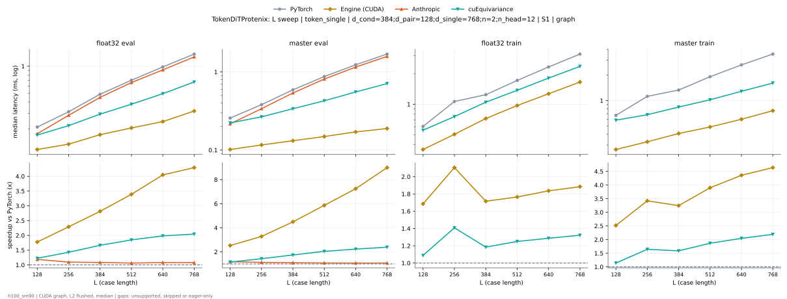

**float32 eval** (median ms; x = speedup vs PyTorch)

| L | PyTorch | Engine (Triton) | Engine (CUDA) | Anthropic | cuEquivariance |
|---|---|---|---|---|---|
| 128 | 0.2111 | 0.1947 (1.08x) | 0.1188 (1.78x) | 0.1778 (1.19x) | 0.172 (1.23x) |
| 256 | 0.3118 | 0.2925 (1.07x) | 0.1367 (2.28x) | 0.285 (1.09x) | 0.2186 (1.43x) |
| 384 | 0.4837 | 0.4604 (1.05x) | 0.1727 (2.80x) | 0.4504 (1.07x) | 0.2933 (1.65x) |
| 512 | 0.698 | 0.6601 (1.06x) | 0.2054 (3.40x) | 0.6579 (1.06x) | 0.3784 (1.84x) |
| 640 | 0.9792 | 0.9117 (1.07x) | 0.2423 (4.04x) | 0.9104 (1.08x) | 0.4954 (1.98x) |
| 768 | 1.369 | 1.265 (1.08x) | 0.3189 (4.29x) | 1.269 (1.08x) | 0.6679 (2.05x) |

**master eval** (median ms; x = speedup vs PyTorch)

| L | PyTorch | Engine (Triton) | Engine (CUDA) | Anthropic | cuEquivariance |
|---|---|---|---|---|---|
| 128 | 0.2574 | 0.2361 (1.09x) | 0.1014 (2.54x) | 0.2164 (1.19x) | 0.2228 (1.16x) |
| 256 | 0.3832 | 0.3592 (1.07x) | 0.1153 (3.32x) | 0.3387 (1.13x) | 0.2661 (1.44x) |
| 384 | 0.5912 | 0.5576 (1.06x) | 0.1312 (4.51x) | 0.5382 (1.10x) | 0.3384 (1.75x) |
| 512 | 0.8765 | 0.8228 (1.07x) | 0.1485 (5.90x) | 0.8112 (1.08x) | 0.4278 (2.05x) |
| 640 | 1.237 | 1.164 (1.06x) | 0.1701 (7.27x) | 1.156 (1.07x) | 0.5545 (2.23x) |
| 768 | 1.697 | 1.594 (1.06x) | 0.1893 (8.97x) | 1.582 (1.07x) | 0.7099 (2.39x) |

**float32 train** (median ms; x = speedup vs PyTorch)

| L | PyTorch | Engine (Triton) | Engine (CUDA) | Anthropic | cuEquivariance |
|---|---|---|---|---|---|
| 128 | 0.6062 | 0.5798 (1.05x) | 0.3599 (1.68x) | unsupported | 0.5553 (1.09x) |
| 256 | 1.066 | 1.036 (1.03x) | 0.5065 (2.11x) | unsupported | 0.7558 (1.41x) |
| 384 | 1.238 | 1.204 (1.03x) | 0.725 (1.71x) | unsupported | 1.048 (1.18x) |
| 512 | 1.721 | 1.654 (1.04x) | 0.9703 (1.77x) | unsupported | 1.37 (1.26x) |
| 640 | 2.339 | 2.239 (1.04x) | 1.269 (1.84x) | unsupported | 1.806 (1.29x) |
| 768 | 3.107 | 2.997 (1.04x) | 1.655 (1.88x) | unsupported | 2.356 (1.32x) |

**master train** (median ms; x = speedup vs PyTorch)

| L | PyTorch | Engine (Triton) | Engine (CUDA) | Anthropic | cuEquivariance |
|---|---|---|---|---|---|
| 128 | 0.6679 | 0.6263 (1.07x) | 0.2573 (2.60x) | unsupported | 0.5879 (1.14x) |
| 256 | 1.123 | 1.077 (1.04x) | 0.3027 (3.71x) | unsupported | 0.6816 (1.65x) |
| 384 | 1.33 | 1.273 (1.04x) | 0.3627 (3.67x) | unsupported | 0.8384 (1.59x) |
| 512 | 1.908 | 1.828 (1.04x) | 0.4147 (4.60x) | unsupported | 1.022 (1.87x) |
| 640 | 2.629 | 2.516 (1.04x) | 0.4888 (5.38x) | unsupported | 1.285 (2.05x) |
| 768 | 3.519 | 3.364 (1.05x) | 0.59 (5.96x) | unsupported | 1.607 (2.19x) |

### L sweep: token_single | d_cond=384;d_pair=128;d_single=768;n=2;n_head=24 | S1 | graph

**float32 eval** (median ms; x = speedup vs PyTorch)

| L | PyTorch | Engine (Triton) | Engine (CUDA) | Anthropic | cuEquivariance |
|---|---|---|---|---|---|
| 128 | 0.2135 | 0.1969 (1.08x) | 0.1171 (1.82x) | 0.1787 (1.19x) | 0.1835 (1.16x) |
| 256 | 0.327 | 0.298 (1.10x) | 0.136 (2.40x) | 0.289 (1.13x) | 0.2693 (1.21x) |
| 384 | 0.5203 | 0.4712 (1.10x) | 0.1749 (2.97x) | 0.4639 (1.12x) | 0.4049 (1.28x) |
| 512 | 0.7844 | 0.6918 (1.13x) | 0.21 (3.73x) | 0.6944 (1.13x) | 0.5815 (1.35x) |
| 640 | 1.179 | 1.025 (1.15x) | 0.2493 (4.73x) | 1.04 (1.13x) | 0.836 (1.41x) |
| 768 | 1.757 | 1.53 (1.15x) | 0.3297 (5.33x) | 1.564 (1.12x) | 1.157 (1.52x) |

**master eval** (median ms; x = speedup vs PyTorch)

| L | PyTorch | Engine (Triton) | Engine (CUDA) | Anthropic | cuEquivariance |
|---|---|---|---|---|---|
| 128 | 0.2568 | 0.2348 (1.09x) | 0.1009 (2.55x) | 0.2165 (1.19x) | 0.2338 (1.10x) |
| 256 | 0.3906 | 0.3577 (1.09x) | 0.1171 (3.34x) | 0.3401 (1.15x) | 0.3152 (1.24x) |
| 384 | 0.6101 | 0.5636 (1.08x) | 0.1323 (4.61x) | 0.5486 (1.11x) | 0.4461 (1.37x) |
| 512 | 0.9188 | 0.8388 (1.10x) | 0.1498 (6.13x) | 0.8255 (1.11x) | 0.6333 (1.45x) |
| 640 | 1.325 | 1.184 (1.12x) | 0.1732 (7.65x) | 1.178 (1.12x) | 0.8939 (1.48x) |
| 768 | 1.845 | 1.608 (1.15x) | 0.1973 (9.35x) | 1.611 (1.14x) | 1.203 (1.53x) |

**float32 train** (median ms; x = speedup vs PyTorch)

| L | PyTorch | Engine (Triton) | Engine (CUDA) | Anthropic | cuEquivariance |
|---|---|---|---|---|---|
| 128 | 0.6159 | 0.5796 (1.06x) | 0.3545 (1.74x) | unsupported | 0.5677 (1.08x) |
| 256 | 1.081 | 1.031 (1.05x) | 0.5094 (2.12x) | unsupported | 0.8204 (1.32x) |
| 384 | 1.309 | 1.214 (1.08x) | 0.7551 (1.73x) | unsupported | 1.207 (1.08x) |
| 512 | 1.868 | 1.681 (1.11x) | 1.03 (1.81x) | unsupported | 1.686 (1.11x) |
| 640 | 2.648 | 2.341 (1.13x) | 1.363 (1.94x) | unsupported | 2.335 (1.13x) |
| 768 | 3.662 | 3.242 (1.13x) | 1.846 (1.98x) | unsupported | 3.113 (1.18x) |

**master train** (median ms; x = speedup vs PyTorch)

| L | PyTorch | Engine (Triton) | Engine (CUDA) | Anthropic | cuEquivariance |
|---|---|---|---|---|---|
| 128 | 0.669 | 0.6272 (1.07x) | 0.2562 (2.61x) | unsupported | 0.6201 (1.08x) |
| 256 | 1.143 | 1.084 (1.05x) | 0.3045 (3.75x) | unsupported | 0.8024 (1.42x) |
| 384 | 1.383 | 1.28 (1.08x) | 0.3652 (3.79x) | unsupported | 1.078 (1.28x) |
| 512 | 2.013 | 1.843 (1.09x) | 0.4334 (4.65x) | unsupported | 1.455 (1.38x) |
| 640 | 2.826 | 2.547 (1.11x) | 0.5169 (5.47x) | unsupported | 1.975 (1.43x) |
| 768 | 3.766 | 3.427 (1.10x) | 0.6528 (5.77x) | unsupported | 2.59 (1.45x) |

### L sweep: af3|opendde|openfold3|openfold3_preview2|protenix | token_single | d_cond=384;d_pair=128;d_single=768;n=2;n_head=16 | S1 | graph

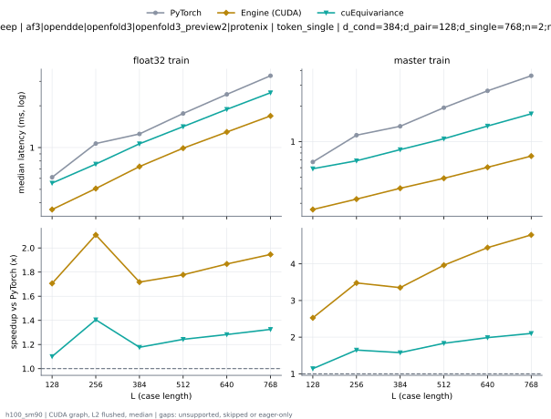

**float32 train** (median ms; x = speedup vs PyTorch)

| L | PyTorch | Engine (Triton) | Engine (CUDA) | Anthropic | cuEquivariance |
|---|---|---|---|---|---|
| 128 | 0.6087 | 0.5816 (1.05x) | 0.356 (1.71x) | unsupported | 0.5548 (1.10x) |
| 256 | 1.068 | 1.034 (1.03x) | 0.5059 (2.11x) | unsupported | 0.7605 (1.41x) |
| 384 | 1.21 | 1.204 (1.01x) | 0.7307 (1.66x) | unsupported | 1.064 (1.14x) |
| 512 | 1.757 | 1.674 (1.05x) | 0.9868 (1.78x) | unsupported | 1.415 (1.24x) |
| 640 | 2.415 | 2.306 (1.05x) | 1.296 (1.86x) | unsupported | 1.884 (1.28x) |
| 768 | 3.284 | 3.048 (1.08x) | 1.691 (1.94x) | unsupported | 2.481 (1.32x) |

**master train** (median ms; x = speedup vs PyTorch)

| L | PyTorch | Engine (Triton) | Engine (CUDA) | Anthropic | cuEquivariance |
|---|---|---|---|---|---|
| 128 | 0.6674 | 0.6263 (1.07x) | 0.2561 (2.61x) | unsupported | 0.5887 (1.13x) |
| 256 | 1.13 | 1.083 (1.04x) | 0.2996 (3.77x) | unsupported | 0.6869 (1.64x) |
| 384 | 1.345 | 1.276 (1.05x) | 0.3577 (3.76x) | unsupported | 0.854 (1.58x) |
| 512 | 1.936 | 1.824 (1.06x) | 0.4166 (4.65x) | unsupported | 1.056 (1.83x) |
| 640 | 2.685 | 2.524 (1.06x) | 0.4922 (5.45x) | unsupported | 1.353 (1.98x) |
| 768 | 3.604 | 3.364 (1.07x) | 0.5893 (6.12x) | unsupported | 1.718 (2.10x) |

### L sweep: af3|opendde|openfold3|openfold3_preview2|protenix | token_single | d_cond=384;d_pair=128;d_single=768;n=2;n_head=16 | S5 | graph

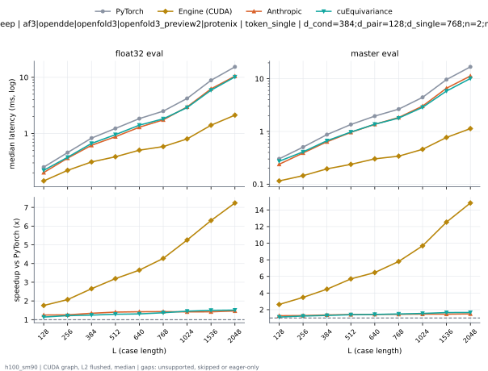

**float32 eval** (median ms; x = speedup vs PyTorch)

| L | PyTorch | Engine (Triton) | Engine (CUDA) | Anthropic | cuEquivariance |
|---|---|---|---|---|---|
| 128 | 0.252 | 0.2216 (1.14x) | 0.1436 (1.76x) | 0.202 (1.25x) | 0.2211 (1.14x) |
| 256 | 0.4604 | 0.3875 (1.19x) | 0.2221 (2.07x) | 0.3649 (1.26x) | 0.3776 (1.22x) |
| 384 | 0.8288 | 0.6414 (1.29x) | 0.3116 (2.66x) | 0.617 (1.34x) | 0.6657 (1.24x) |
| 512 | 1.228 | 0.924 (1.33x) | 0.3845 (3.19x) | 0.8774 (1.40x) | 0.9555 (1.29x) |
| 640 | 1.845 | 1.369 (1.35x) | 0.5052 (3.65x) | 1.295 (1.42x) | 1.408 (1.31x) |
| 768 | 2.508 | 1.837 (1.37x) | 0.5846 (4.29x) | 1.75 (1.43x) | 1.826 (1.37x) |
| 1024 | 4.206 | 3.092 (1.36x) | 0.8013 (5.25x) | 2.976 (1.41x) | 2.899 (1.45x) |
| 1536 | 8.83 | 6.484 (1.36x) | 1.407 (6.28x) | 6.23 (1.42x) | 5.901 (1.50x) |
| 2048 | 15.4 | 10.87 (1.42x) | 2.131 (7.23x) | 10.49 (1.47x) | 10.16 (1.52x) |

**master eval** (median ms; x = speedup vs PyTorch)

| L | PyTorch | Engine (Triton) | Engine (CUDA) | Anthropic | cuEquivariance |
|---|---|---|---|---|---|
| 128 | 0.3042 | 0.2609 (1.17x) | 0.115 (2.65x) | 0.2383 (1.28x) | 0.2721 (1.12x) |
| 256 | 0.5043 | 0.4082 (1.24x) | 0.1454 (3.47x) | 0.3905 (1.29x) | 0.4096 (1.23x) |
| 384 | 0.8689 | 0.6549 (1.33x) | 0.196 (4.43x) | 0.6374 (1.36x) | 0.6664 (1.30x) |
| 512 | 1.355 | 0.9806 (1.38x) | 0.2384 (5.68x) | 0.9617 (1.41x) | 0.9739 (1.39x) |
| 640 | 1.955 | 1.385 (1.41x) | 0.303 (6.45x) | 1.366 (1.43x) | 1.369 (1.43x) |
| 768 | 2.654 | 1.855 (1.43x) | 0.3392 (7.83x) | 1.838 (1.44x) | 1.791 (1.48x) |
| 1024 | 4.445 | 3.051 (1.46x) | 0.4595 (9.67x) | 3.025 (1.47x) | 2.869 (1.55x) |
| 1536 | 9.613 | 6.625 (1.45x) | 0.7633 (12.59x) | 6.601 (1.46x) | 5.836 (1.65x) |
| 2048 | 16.81 | 11.41 (1.47x) | 1.134 (14.82x) | 11.26 (1.49x) | 10.1 (1.66x) |

### L sweep: af3|opendde|openfold3|openfold3_preview2|protenix | token_single_shared_cond | d_cond=384;d_pair=128;d_single=768;n=2;n_head=16 | S5 | graph

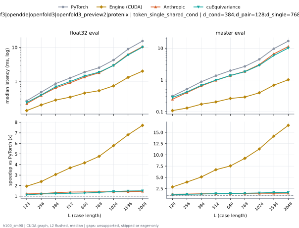

**float32 eval** (median ms; x = speedup vs PyTorch)

| L | PyTorch | Engine (Triton) | Engine (CUDA) | Anthropic | cuEquivariance |
|---|---|---|---|---|---|
| 128 | 0.2685 | 0.2378 (1.13x) | 0.1383 (1.94x) | 0.2188 (1.23x) | 0.2374 (1.13x) |
| 256 | 0.478 | 0.4101 (1.17x) | 0.2018 (2.37x) | 0.3855 (1.24x) | 0.3964 (1.21x) |
| 384 | 0.8577 | 0.6697 (1.28x) | 0.2806 (3.06x) | 0.6423 (1.34x) | 0.6928 (1.24x) |
| 512 | 1.258 | 0.9686 (1.30x) | 0.3426 (3.67x) | 0.9065 (1.39x) | 0.9872 (1.27x) |
| 640 | 1.875 | 1.401 (1.34x) | 0.4497 (4.17x) | 1.335 (1.40x) | 1.444 (1.30x) |
| 768 | 2.535 | 1.876 (1.35x) | 0.53 (4.78x) | 1.791 (1.41x) | 1.867 (1.36x) |
| 1024 | 4.251 | 3.108 (1.37x) | 0.7294 (5.83x) | 3.002 (1.42x) | 2.939 (1.45x) |
| 1536 | 8.885 | 6.56 (1.35x) | 1.307 (6.80x) | 6.243 (1.42x) | 5.974 (1.49x) |
| 2048 | 15.49 | 10.87 (1.43x) | 2.008 (7.71x) | 10.56 (1.47x) | 10.23 (1.51x) |

**master eval** (median ms; x = speedup vs PyTorch)

| L | PyTorch | Engine (Triton) | Engine (CUDA) | Anthropic | cuEquivariance |
|---|---|---|---|---|---|
| 128 | 0.3105 | 0.2696 (1.15x) | 0.1074 (2.89x) | 0.2473 (1.26x) | 0.2802 (1.11x) |
| 256 | 0.5113 | 0.4185 (1.22x) | 0.1301 (3.93x) | 0.4006 (1.28x) | 0.4204 (1.22x) |
| 384 | 0.8813 | 0.6686 (1.32x) | 0.1727 (5.10x) | 0.6495 (1.36x) | 0.6792 (1.30x) |
| 512 | 1.363 | 0.9919 (1.37x) | 0.2029 (6.72x) | 0.9722 (1.40x) | 0.988 (1.38x) |
| 640 | 1.968 | 1.412 (1.39x) | 0.2614 (7.53x) | 1.381 (1.43x) | 1.381 (1.43x) |
| 768 | 2.664 | 1.878 (1.42x) | 0.2886 (9.23x) | 1.854 (1.44x) | 1.818 (1.46x) |
| 1024 | 4.455 | 3.086 (1.44x) | 0.3942 (11.30x) | 3.05 (1.46x) | 2.898 (1.54x) |
| 1536 | 9.642 | 6.653 (1.45x) | 0.6793 (14.19x) | 6.627 (1.45x) | 5.876 (1.64x) |
| 2048 | 16.79 | 11.44 (1.47x) | 1.022 (16.42x) | 11.29 (1.49x) | 10.15 (1.65x) |

### L sweep: af3|opendde|openfold3|openfold3_preview2|protenix | token_single_shared_cond | d_cond=384;d_pair=128;d_single=768;n=2;n_head=16 | S8 | graph

**float32 train** (median ms; x = speedup vs PyTorch)

| L | PyTorch | Engine (Triton) | Engine (CUDA) | Anthropic | cuEquivariance |
|---|---|---|---|---|---|
| 128 | 1.086 | 1.011 (1.07x) | 0.6237 (1.74x) | unsupported | 1.054 (1.03x) |
| 256 | 2.153 | 1.957 (1.10x) | 1.04 (2.07x) | unsupported | 1.943 (1.11x) |
| 384 | 3.194 | 2.73 (1.17x) | 1.646 (1.94x) | unsupported | 3.209 (1.00x) |
| 512 | 4.587 | 3.837 (1.20x) | 2.195 (2.09x) | unsupported | 4.564 (1.00x) |
| 640 | 6.112 | 4.774 (1.28x) | 2.798 (2.18x) | unsupported | 6.016 (1.02x) |
| 768 | 8.269 | 6.436 (1.28x) | 3.684 (2.24x) | unsupported | 8.014 (1.03x) |

**master train** (median ms; x = speedup vs PyTorch)

| L | PyTorch | Engine (Triton) | Engine (CUDA) | Anthropic | cuEquivariance |
|---|---|---|---|---|---|
| 128 | 0.9302 | 0.8349 (1.11x) | 0.35 (2.66x) | unsupported | 0.8782 (1.06x) |
| 256 | 1.791 | 1.514 (1.18x) | 0.5286 (3.39x) | unsupported | 1.486 (1.21x) |
| 384 | 2.645 | 2.015 (1.31x) | 0.7432 (3.56x) | unsupported | 2.362 (1.12x) |
| 512 | 3.968 | 2.936 (1.35x) | 0.9878 (4.02x) | unsupported | 3.424 (1.16x) |
| 640 | 5.612 | 3.937 (1.43x) | 1.285 (4.37x) | unsupported | 4.709 (1.19x) |
| 768 | 7.519 | 5.212 (1.44x) | 1.574 (4.78x) | unsupported | 6.161 (1.22x) |

### L sweep: esmfold2 | token_single | d_cond=768;d_pair=256;d_single=768;n=2;n_head=16 | S48 | graph

**float32 train** (median ms; x = speedup vs PyTorch)

| L | PyTorch | Engine (Triton) | Engine (CUDA) | Anthropic | cuEquivariance |
|---|---|---|---|---|---|
| 128 | 4.199 | 3.841 (1.09x) | 2.733 (1.54x) | unsupported | 4.479 (0.94x) |
| 256 | 8.93 | 7.787 (1.15x) | 5.217 (1.71x) | unsupported | 9.446 (0.95x) |
| 384 | 14.16 | 11.69 (1.21x) | 8.162 (1.74x) | unsupported | 15.47 (0.92x) |
| 512 | 20.29 | 16.21 (1.25x) | 11.3 (1.80x) | unsupported | 22.52 (0.90x) |
| 640 | 27.71 | 20.19 (1.37x) | 14.74 (1.88x) | unsupported | 30.8 (0.90x) |
| 768 | 37 | 25.76 (1.44x) | 19 (1.95x) | unsupported | 41.07 (0.90x) |

**master train** (median ms; x = speedup vs PyTorch)

| L | PyTorch | Engine (Triton) | Engine (CUDA) | Anthropic | cuEquivariance |
|---|---|---|---|---|---|
| 128 | 2.831 | 2.374 (1.19x) | 1.236 (2.29x) | unsupported | 3.084 (0.92x) |
| 256 | 6.8 | 5.041 (1.35x) | 2.429 (2.80x) | unsupported | 7.045 (0.97x) |
| 384 | 11.42 | 7.739 (1.48x) | 3.743 (3.05x) | unsupported | 11.97 (0.95x) |
| 512 | 17.23 | 11.34 (1.52x) | 5.196 (3.32x) | unsupported | 18.07 (0.95x) |
| 640 | 24.22 | 14.64 (1.65x) | 6.784 (3.57x) | unsupported | 25.12 (0.96x) |
| 768 | 32.31 | 18.63 (1.73x) | 8.484 (3.81x) | unsupported | 33.87 (0.95x) |

### L sweep: esmfold2 | token_single | d_cond=768;d_pair=256;d_single=768;n=2;n_head=16 | S5 | graph

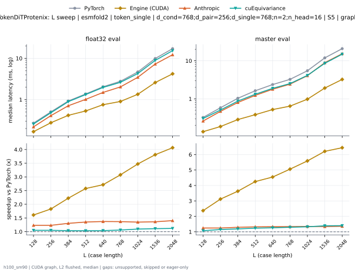

**float32 eval** (median ms; x = speedup vs PyTorch)

| L | PyTorch | Engine (Triton) | Engine (CUDA) | Anthropic | cuEquivariance |
|---|---|---|---|---|---|
| 128 | 0.2697 | 0.2406 (1.12x) | 0.1675 (1.61x) | 0.2191 (1.23x) | 0.2573 (1.05x) |
| 256 | 0.5053 | 0.4345 (1.16x) | 0.2746 (1.84x) | 0.4099 (1.23x) | 0.4814 (1.05x) |
| 384 | 0.9282 | 0.7386 (1.26x) | 0.4175 (2.22x) | 0.7106 (1.31x) | 0.8934 (1.04x) |
| 512 | 1.367 | 1.069 (1.28x) | 0.5317 (2.57x) | 1.014 (1.35x) | 1.326 (1.03x) |
| 640 | 2.049 | 1.558 (1.32x) | 0.7526 (2.72x) | 1.494 (1.37x) | 1.974 (1.04x) |
| 768 | 2.782 | 2.126 (1.31x) | 0.9065 (3.07x) | 2.033 (1.37x) | 2.625 (1.06x) |
| 1024 | 4.691 | 3.573 (1.31x) | 1.361 (3.45x) | 3.473 (1.35x) | 4.278 (1.10x) |
| 1536 | 9.88 | 7.509 (1.32x) | 2.576 (3.84x) | 7.262 (1.36x) | 8.908 (1.11x) |
| 2048 | 17.14 | 12.52 (1.37x) | 4.206 (4.07x) | 12.22 (1.40x) | 15.32 (1.12x) |

**master eval** (median ms; x = speedup vs PyTorch)

| L | PyTorch | Engine (Triton) | Engine (CUDA) | Anthropic | cuEquivariance |
|---|---|---|---|---|---|
| 128 | 0.3237 | 0.2826 (1.15x) | 0.1298 (2.49x) | 0.2611 (1.24x) | 0.3041 (1.06x) |
| 256 | 0.5829 | 0.4862 (1.20x) | 0.167 (3.49x) | 0.4685 (1.24x) | 0.5082 (1.15x) |
| 384 | 1.036 | 0.8205 (1.26x) | 0.227 (4.56x) | 0.8027 (1.29x) | 0.8728 (1.19x) |
| 512 | 1.628 | 1.257 (1.30x) | 0.2824 (5.77x) | 1.235 (1.32x) | 1.32 (1.23x) |
| 640 | 2.374 | 1.798 (1.32x) | 0.3682 (6.45x) | 1.786 (1.33x) | 1.888 (1.26x) |
| 768 | 3.251 | 2.434 (1.34x) | 0.4169 (7.80x) | 2.434 (1.34x) | 2.518 (1.29x) |
| 1024 | 5.476 | 4.078 (1.34x) | 0.5824 (9.40x) | 4.07 (1.35x) | 4.137 (1.32x) |
| 1536 | 11.94 | 8.943 (1.33x) | 1.02 (11.70x) | 8.922 (1.34x) | 8.598 (1.39x) |
| 2048 | 20.87 | 15.5 (1.35x) | 1.59 (13.13x) | 15.37 (1.36x) | 14.94 (1.40x) |

### L sweep: esmfold2 | token_single_shared_cond | d_cond=768;d_pair=256;d_single=768;n=2;n_head=16 | S5 | graph

**float32 eval** (median ms; x = speedup vs PyTorch)

| L | PyTorch | Engine (Triton) | Engine (CUDA) | Anthropic | cuEquivariance |
|---|---|---|---|---|---|
| 128 | 0.2856 | 0.2565 (1.11x) | 0.1568 (1.82x) | 0.2369 (1.21x) | 0.2736 (1.04x) |
| 256 | 0.5268 | 0.4579 (1.15x) | 0.2435 (2.16x) | 0.4345 (1.21x) | 0.5043 (1.04x) |
| 384 | 0.9495 | 0.7694 (1.23x) | 0.3689 (2.57x) | 0.7386 (1.29x) | 0.9197 (1.03x) |
| 512 | 1.397 | 1.105 (1.27x) | 0.4721 (2.96x) | 1.045 (1.34x) | 1.355 (1.03x) |
| 640 | 2.087 | 1.593 (1.31x) | 0.6679 (3.13x) | 1.539 (1.36x) | 2.014 (1.04x) |
| 768 | 2.828 | 2.173 (1.30x) | 0.8226 (3.44x) | 2.099 (1.35x) | 2.674 (1.06x) |
| 1024 | 4.731 | 3.621 (1.31x) | 1.244 (3.80x) | 3.491 (1.36x) | 4.307 (1.10x) |
| 1536 | 9.933 | 7.586 (1.31x) | 2.433 (4.08x) | 7.346 (1.35x) | 8.981 (1.11x) |
| 2048 | 17.26 | 12.88 (1.34x) | 4.003 (4.31x) | 12.35 (1.40x) | 15.5 (1.11x) |

**master eval** (median ms; x = speedup vs PyTorch)

| L | PyTorch | Engine (Triton) | Engine (CUDA) | Anthropic | cuEquivariance |
|---|---|---|---|---|---|
| 128 | 0.332 | 0.2913 (1.14x) | 0.121 (2.74x) | 0.2698 (1.23x) | 0.3116 (1.07x) |
| 256 | 0.5922 | 0.4955 (1.20x) | 0.1473 (4.02x) | 0.479 (1.24x) | 0.5164 (1.15x) |
| 384 | 1.048 | 0.834 (1.26x) | 0.1965 (5.33x) | 0.8154 (1.29x) | 0.884 (1.19x) |
| 512 | 1.647 | 1.262 (1.30x) | 0.2382 (6.92x) | 1.251 (1.32x) | 1.329 (1.24x) |
| 640 | 2.388 | 1.805 (1.32x) | 0.3123 (7.65x) | 1.797 (1.33x) | 1.894 (1.26x) |
| 768 | 3.272 | 2.451 (1.34x) | 0.352 (9.30x) | 2.456 (1.33x) | 2.537 (1.29x) |
| 1024 | 5.499 | 4.096 (1.34x) | 0.5022 (10.95x) | 4.095 (1.34x) | 4.152 (1.32x) |
| 1536 | 11.97 | 8.973 (1.33x) | 0.9056 (13.21x) | 8.949 (1.34x) | 8.608 (1.39x) |
| 2048 | 20.89 | 15.54 (1.34x) | 1.433 (14.58x) | 15.4 (1.36x) | 15.03 (1.39x) |

### L sweep: intellifold2 | token_single | d_cond=384;d_pair=512;d_single=768;n=2;n_head=16 | S1 | graph

**float32 train** (median ms; x = speedup vs PyTorch)

| L | PyTorch | Engine (Triton) | Engine (CUDA) | Anthropic | cuEquivariance |
|---|---|---|---|---|---|
| 128 | 0.7001 | 0.6654 (1.05x) | 0.4209 (1.66x) | unsupported | 1.511 (0.46x) |
| 256 | 1.321 | 1.273 (1.04x) | 0.7862 (1.68x) | unsupported | 4.282 (0.31x) |
| 384 | 1.901 | 1.862 (1.02x) | 1.332 (1.43x) | unsupported | 8.895 (0.21x) |
| 512 | 2.878 | 2.81 (1.02x) | 2.055 (1.40x) | unsupported | 15.23 (0.19x) |
| 640 | 4.16 | 4.032 (1.03x) | 2.952 (1.41x) | unsupported | 23.35 (0.18x) |
| 768 | 5.797 | 5.552 (1.04x) | 4.076 (1.42x) | unsupported | 33.32 (0.17x) |

**master train** (median ms; x = speedup vs PyTorch)

| L | PyTorch | Engine (Triton) | Engine (CUDA) | Anthropic | cuEquivariance |
|---|---|---|---|---|---|
| 128 | 0.8058 | 0.7622 (1.06x) | 0.3267 (2.47x) | unsupported | 1.314 (0.61x) |
| 256 | 1.579 | 1.533 (1.03x) | 0.4343 (3.64x) | unsupported | 3.446 (0.46x) |
| 384 | 2.446 | 2.375 (1.03x) | 0.5733 (4.27x) | unsupported | 6.924 (0.35x) |
| 512 | 3.851 | 3.75 (1.03x) | 0.7463 (5.16x) | unsupported | 11.74 (0.33x) |
| 640 | 5.679 | 5.509 (1.03x) | 0.9685 (5.86x) | unsupported | 17.94 (0.32x) |
| 768 | 7.917 | 7.672 (1.03x) | 1.234 (6.42x) | unsupported | 25.43 (0.31x) |

### L sweep: intellifold2 | token_single | d_cond=384;d_pair=512;d_single=768;n=2;n_head=16 | S5 | graph

**float32 eval** (median ms; x = speedup vs PyTorch)

| L | PyTorch | Engine (Triton) | Engine (CUDA) | Anthropic | cuEquivariance |
|---|---|---|---|---|---|
| 128 | 0.2736 | 0.2424 (1.13x) | 0.1858 (1.47x) | 0.2242 (1.22x) | 1.054 (0.26x) |
| 256 | 0.5444 | 0.4728 (1.15x) | 0.3714 (1.47x) | 0.4503 (1.21x) | 3.761 (0.14x) |
| 384 | 1.012 | 0.8269 (1.22x) | 0.62 (1.63x) | 0.8006 (1.26x) | 8.241 (0.12x) |
| 512 | 1.557 | 1.283 (1.21x) | 0.9151 (1.70x) | 1.193 (1.31x) | 14.42 (0.11x) |
| 640 | 2.336 | 1.83 (1.28x) | 1.312 (1.78x) | 1.797 (1.30x) | 22.35 (0.10x) |
| 768 | 3.214 | 2.501 (1.29x) | 1.735 (1.85x) | 2.458 (1.31x) | 31.67 (0.10x) |

**master eval** (median ms; x = speedup vs PyTorch)

| L | PyTorch | Engine (Triton) | Engine (CUDA) | Anthropic | cuEquivariance |
|---|---|---|---|---|---|
| 128 | 0.3502 | 0.3087 (1.13x) | 0.1243 (2.82x) | 0.2858 (1.23x) | 0.8316 (0.42x) |
| 256 | 0.6996 | 0.5947 (1.18x) | 0.1678 (4.17x) | 0.5855 (1.20x) | 2.478 (0.28x) |
| 384 | 1.301 | 1.065 (1.22x) | 0.2373 (5.48x) | 1.065 (1.22x) | 5.213 (0.25x) |
| 512 | 2.107 | 1.702 (1.24x) | 0.31 (6.80x) | 1.709 (1.23x) | 8.998 (0.23x) |
| 640 | 3.116 | 2.514 (1.24x) | 0.4123 (7.56x) | 2.534 (1.23x) | 13.84 (0.23x) |
| 768 | 4.334 | 3.516 (1.23x) | 0.4964 (8.73x) | 3.521 (1.23x) | 19.72 (0.22x) |

### L sweep: intellifold2 | token_single_shared_cond | d_cond=384;d_pair=512;d_single=768;n=2;n_head=16 | S5 | graph

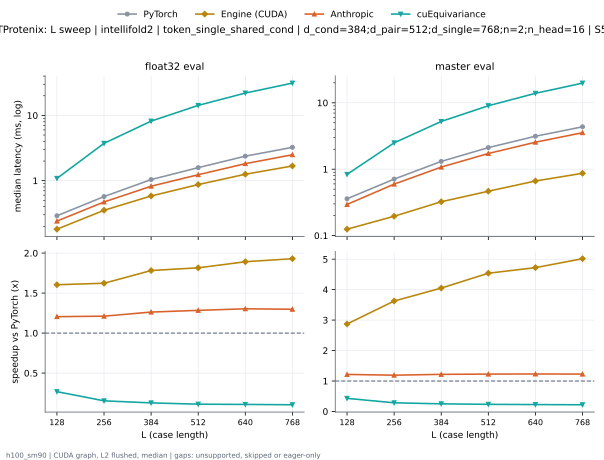

**float32 eval** (median ms; x = speedup vs PyTorch)

| L | PyTorch | Engine (Triton) | Engine (CUDA) | Anthropic | cuEquivariance |
|---|---|---|---|---|---|
| 128 | 0.2891 | 0.2593 (1.11x) | 0.1802 (1.60x) | 0.2403 (1.20x) | 1.084 (0.27x) |
| 256 | 0.5647 | 0.4911 (1.15x) | 0.3508 (1.61x) | 0.4714 (1.20x) | 3.735 (0.15x) |
| 384 | 1.036 | 0.8463 (1.22x) | 0.5855 (1.77x) | 0.8232 (1.26x) | 8.18 (0.13x) |
| 512 | 1.583 | 1.262 (1.25x) | 0.8713 (1.82x) | 1.234 (1.28x) | 14.26 (0.11x) |
| 640 | 2.369 | 1.867 (1.27x) | 1.254 (1.89x) | 1.822 (1.30x) | 22.02 (0.11x) |
| 768 | 3.243 | 2.543 (1.28x) | 1.681 (1.93x) | 2.499 (1.30x) | 31.27 (0.10x) |

**master eval** (median ms; x = speedup vs PyTorch)

| L | PyTorch | Engine (Triton) | Engine (CUDA) | Anthropic | cuEquivariance |
|---|---|---|---|---|---|
| 128 | 0.3578 | 0.3142 (1.14x) | 0.1164 (3.07x) | 0.2948 (1.21x) | 0.8353 (0.43x) |
| 256 | 0.708 | 0.6034 (1.17x) | 0.1526 (4.64x) | 0.5959 (1.19x) | 2.495 (0.28x) |
| 384 | 1.308 | 1.081 (1.21x) | 0.2142 (6.10x) | 1.076 (1.22x) | 5.24 (0.25x) |
| 512 | 2.123 | 1.722 (1.23x) | 0.2737 (7.76x) | 1.724 (1.23x) | 9.034 (0.23x) |
| 640 | 3.138 | 2.523 (1.24x) | 0.3712 (8.45x) | 2.55 (1.23x) | 13.89 (0.23x) |
| 768 | 4.349 | 3.51 (1.24x) | 0.4447 (9.78x) | 3.547 (1.23x) | 19.79 (0.22x) |

### L sweep: protenix | token_folds | d_cond=384;d_pair=128;d_single=768;n=2;n_head=16 | D5 | S5 | graph

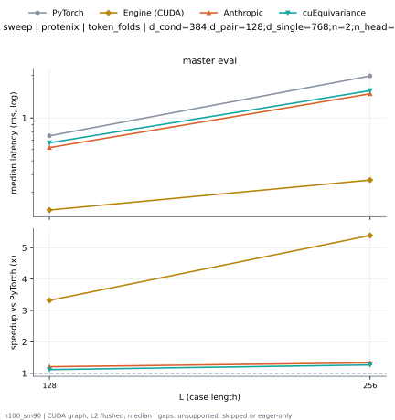

**master eval** (median ms; x = speedup vs PyTorch)

| L | PyTorch | Engine (Triton) | Engine (CUDA) | Anthropic | cuEquivariance |
|---|---|---|---|---|---|
| 128 | 0.75 | 0.6201 (1.21x) | 0.2261 (3.32x) | 0.6191 (1.21x) | 0.6694 (1.12x) |
| 256 | 1.968 | 1.471 (1.34x) | 0.3661 (5.38x) | 1.479 (1.33x) | 1.556 (1.26x) |

### L sweep: protenix | token_folds_shared_cond | d_cond=384;d_pair=128;d_single=768;n=2;n_head=16 | D5 | S5 | graph

**master eval** (median ms; x = speedup vs PyTorch)

| L | PyTorch | Engine (Triton) | Engine (CUDA) | Anthropic | cuEquivariance |
|---|---|---|---|---|---|
| 128 | 0.7486 | 0.6164 (1.21x) | 0.2256 (3.32x) | 0.6217 (1.20x) | 0.6664 (1.12x) |
| 256 | 1.969 | 1.471 (1.34x) | 0.3688 (5.34x) | 1.481 (1.33x) | 1.561 (1.26x) |

### L sweep: protenix_v2 | token_single | d_cond=384;d_pair=256;d_single=768;n=2;n_head=16 | S1 | graph

**float32 train** (median ms; x = speedup vs PyTorch)

| L | PyTorch | Engine (Triton) | Engine (CUDA) | Anthropic | cuEquivariance |
|---|---|---|---|---|---|
| 128 | 0.6569 | 0.6204 (1.06x) | 0.3773 (1.74x) | unsupported | 0.6198 (1.06x) |
| 256 | 1.154 | 1.118 (1.03x) | 0.6042 (1.91x) | unsupported | 0.9685 (1.19x) |
| 384 | 1.459 | 1.409 (1.04x) | 0.9359 (1.56x) | unsupported | 1.494 (0.98x) |
| 512 | 2.108 | 2.02 (1.04x) | 1.35 (1.56x) | unsupported | 2.155 (0.98x) |
| 640 | 2.959 | 2.818 (1.05x) | 1.853 (1.60x) | unsupported | 3.03 (0.98x) |
| 768 | 4.073 | 3.834 (1.06x) | 2.507 (1.62x) | unsupported | 4.117 (0.99x) |

**master train** (median ms; x = speedup vs PyTorch)

| L | PyTorch | Engine (Triton) | Engine (CUDA) | Anthropic | cuEquivariance |
|---|---|---|---|---|---|
| 128 | 0.7238 | 0.6787 (1.07x) | 0.2749 (2.63x) | unsupported | 0.6107 (1.19x) |
| 256 | 1.274 | 1.224 (1.04x) | 0.3459 (3.68x) | unsupported | 0.7876 (1.62x) |
| 384 | 1.702 | 1.628 (1.05x) | 0.4322 (3.94x) | unsupported | 1.028 (1.66x) |
| 512 | 2.546 | 2.425 (1.05x) | 0.5328 (4.78x) | unsupported | 1.364 (1.87x) |
| 640 | 3.639 | 3.473 (1.05x) | 0.6619 (5.50x) | unsupported | 1.815 (2.00x) |
| 768 | 4.978 | 4.719 (1.05x) | 0.8182 (6.08x) | unsupported | 2.367 (2.10x) |

### L sweep: protenix_v2 | token_single | d_cond=384;d_pair=256;d_single=768;n=2;n_head=16 | S5 | graph

**float32 eval** (median ms; x = speedup vs PyTorch)

| L | PyTorch | Engine (Triton) | Engine (CUDA) | Anthropic | cuEquivariance |
|---|---|---|---|---|---|
| 128 | 0.2578 | 0.2286 (1.13x) | 0.1562 (1.65x) | 0.2093 (1.23x) | 0.2466 (1.05x) |
| 256 | 0.4883 | 0.4176 (1.17x) | 0.2562 (1.91x) | 0.3939 (1.24x) | 0.4647 (1.05x) |
| 384 | 0.8883 | 0.7007 (1.27x) | 0.3908 (2.27x) | 0.6786 (1.31x) | 0.8574 (1.04x) |
| 512 | 1.337 | 1.03 (1.30x) | 0.5057 (2.64x) | 0.9838 (1.36x) | 1.302 (1.03x) |
| 640 | 2.013 | 1.52 (1.32x) | 0.7103 (2.83x) | 1.452 (1.39x) | 1.929 (1.04x) |
| 768 | 2.744 | 2.073 (1.32x) | 0.8719 (3.15x) | 1.983 (1.38x) | 2.577 (1.07x) |
| 1024 | 4.628 | 3.49 (1.33x) | 1.314 (3.52x) | 3.372 (1.37x) | 4.194 (1.10x) |
| 1536 | 9.779 | 7.289 (1.34x) | 2.52 (3.88x) | 7.099 (1.38x) | 8.749 (1.12x) |
| 2048 | 17.04 | 12.45 (1.37x) | 4.121 (4.13x) | 12.16 (1.40x) | 15.21 (1.12x) |

**master eval** (median ms; x = speedup vs PyTorch)

| L | PyTorch | Engine (Triton) | Engine (CUDA) | Anthropic | cuEquivariance |
|---|---|---|---|---|---|
| 128 | 0.3151 | 0.2729 (1.15x) | 0.1185 (2.66x) | 0.2511 (1.25x) | 0.2943 (1.07x) |
| 256 | 0.5696 | 0.4745 (1.20x) | 0.153 (3.72x) | 0.4557 (1.25x) | 0.493 (1.16x) |
| 384 | 1.012 | 0.8006 (1.26x) | 0.2089 (4.84x) | 0.7809 (1.30x) | 0.848 (1.19x) |
| 512 | 1.605 | 1.227 (1.31x) | 0.2627 (6.11x) | 1.214 (1.32x) | 1.29 (1.24x) |
| 640 | 2.34 | 1.761 (1.33x) | 0.3423 (6.84x) | 1.755 (1.33x) | 1.85 (1.26x) |
| 768 | 3.207 | 2.403 (1.33x) | 0.3927 (8.17x) | 2.396 (1.34x) | 2.48 (1.29x) |
| 1024 | 5.429 | 4.029 (1.35x) | 0.556 (9.76x) | 4.023 (1.35x) | 4.079 (1.33x) |
| 1536 | 11.86 | 8.867 (1.34x) | 0.9781 (12.13x) | 8.84 (1.34x) | 8.508 (1.39x) |
| 2048 | 20.81 | 15.39 (1.35x) | 1.533 (13.57x) | 15.26 (1.36x) | 14.82 (1.40x) |

### L sweep: protenix_v2 | token_single_shared_cond | d_cond=384;d_pair=256;d_single=768;n=2;n_head=16 | S5 | graph

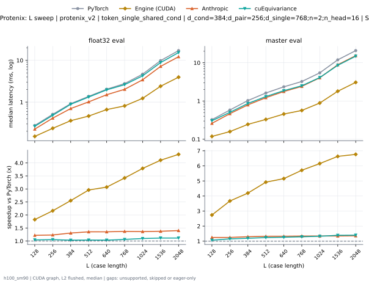

**float32 eval** (median ms; x = speedup vs PyTorch)

| L | PyTorch | Engine (Triton) | Engine (CUDA) | Anthropic | cuEquivariance |
|---|---|---|---|---|---|
| 128 | 0.2748 | 0.2457 (1.12x) | 0.1511 (1.82x) | 0.2256 (1.22x) | 0.2638 (1.04x) |
| 256 | 0.5092 | 0.4395 (1.16x) | 0.2348 (2.17x) | 0.4139 (1.23x) | 0.4835 (1.05x) |
| 384 | 0.9151 | 0.7325 (1.25x) | 0.3571 (2.56x) | 0.7012 (1.31x) | 0.8871 (1.03x) |
| 512 | 1.368 | 1.072 (1.28x) | 0.4617 (2.96x) | 1.013 (1.35x) | 1.323 (1.03x) |
| 640 | 2.042 | 1.569 (1.30x) | 0.6573 (3.11x) | 1.502 (1.36x) | 1.966 (1.04x) |
| 768 | 2.769 | 2.107 (1.31x) | 0.8139 (3.40x) | 2.025 (1.37x) | 2.612 (1.06x) |
| 1024 | 4.662 | 3.523 (1.32x) | 1.223 (3.81x) | 3.422 (1.36x) | 4.256 (1.10x) |
| 1536 | 9.838 | 7.5 (1.31x) | 2.397 (4.10x) | 7.162 (1.37x) | 8.829 (1.11x) |
| 2048 | 17.12 | 12.49 (1.37x) | 3.999 (4.28x) | 12.2 (1.40x) | 15.35 (1.11x) |

**master eval** (median ms; x = speedup vs PyTorch)

| L | PyTorch | Engine (Triton) | Engine (CUDA) | Anthropic | cuEquivariance |
|---|---|---|---|---|---|
| 128 | 0.3245 | 0.2821 (1.15x) | 0.1107 (2.93x) | 0.2608 (1.24x) | 0.3046 (1.07x) |
| 256 | 0.5798 | 0.4834 (1.20x) | 0.1385 (4.19x) | 0.4666 (1.24x) | 0.5055 (1.15x) |
| 384 | 1.027 | 0.8122 (1.26x) | 0.1878 (5.47x) | 0.7921 (1.30x) | 0.8615 (1.19x) |
| 512 | 1.616 | 1.253 (1.29x) | 0.2281 (7.09x) | 1.222 (1.32x) | 1.308 (1.24x) |
| 640 | 2.358 | 1.783 (1.32x) | 0.3008 (7.84x) | 1.77 (1.33x) | 1.867 (1.26x) |
| 768 | 3.225 | 2.448 (1.32x) | 0.341 (9.46x) | 2.414 (1.34x) | 2.503 (1.29x) |
| 1024 | 5.453 | 4.055 (1.34x) | 0.4894 (11.14x) | 4.05 (1.35x) | 4.109 (1.33x) |
| 1536 | 11.89 | 8.893 (1.34x) | 0.8923 (13.32x) | 8.873 (1.34x) | 8.577 (1.39x) |
| 2048 | 20.78 | 15.42 (1.35x) | 1.417 (14.66x) | 15.35 (1.35x) | 14.86 (1.40x) |

### d_pair sweep at L768: token_single | n=2 | S1 | graph

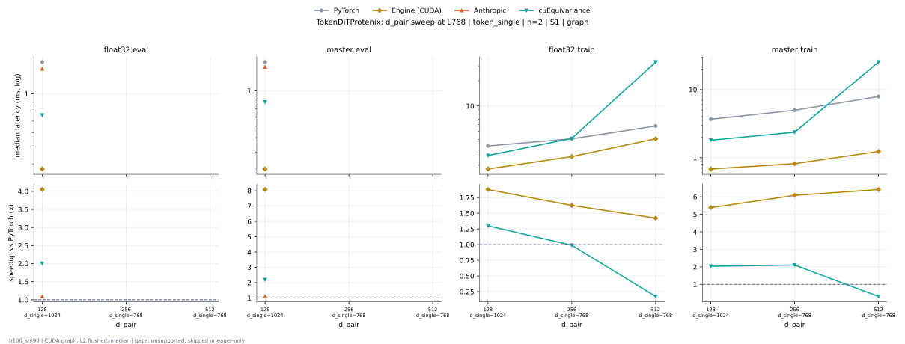

**float32 eval** (median ms; x = speedup vs PyTorch)

| d_pair | PyTorch | Engine (Triton) | Engine (CUDA) | Anthropic | cuEquivariance |
|---|---|---|---|---|---|
| 128 d_single=1024 | 1.516 | 1.366 (1.11x) | 0.3742 (4.05x) | 1.388 (1.09x) | 0.7565 (2.00x) |
| 256 d_single=768 |  |  |  |  |  |
| 512 d_single=768 |  |  |  |  |  |

**master eval** (median ms; x = speedup vs PyTorch)

| d_pair | PyTorch | Engine (Triton) | Engine (CUDA) | Anthropic | cuEquivariance |
|---|---|---|---|---|---|
| 128 d_single=1024 | 1.752 | 1.614 (1.08x) | 0.2167 (8.08x) | 1.596 (1.10x) | 0.7995 (2.19x) |
| 256 d_single=768 |  |  |  |  |  |
| 512 d_single=768 |  |  |  |  |  |

**float32 train** (median ms; x = speedup vs PyTorch)

| d_pair | PyTorch | Engine (Triton) | Engine (CUDA) | Anthropic | cuEquivariance |
|---|---|---|---|---|---|
| 128 d_single=1024 | 3.353 | 3.143 (1.07x) | 1.785 (1.88x) | unsupported | 2.58 (1.30x) |
| 256 d_single=768 | 4.073 | 3.834 (1.06x) | 2.507 (1.62x) | unsupported | 4.117 (0.99x) |
| 512 d_single=768 | 5.797 | 5.552 (1.04x) | 4.076 (1.42x) | unsupported | 33.32 (0.17x) |

**master train** (median ms; x = speedup vs PyTorch)

| d_pair | PyTorch | Engine (Triton) | Engine (CUDA) | Anthropic | cuEquivariance |
|---|---|---|---|---|---|
| 128 d_single=1024 | 3.678 | 3.437 (1.07x) | 0.683 (5.38x) | unsupported | 1.807 (2.04x) |
| 256 d_single=768 | 4.978 | 4.719 (1.05x) | 0.8182 (6.08x) | unsupported | 2.367 (2.10x) |
| 512 d_single=768 | 7.917 | 7.672 (1.03x) | 1.234 (6.42x) | unsupported | 25.43 (0.31x) |

### d_pair sweep at L768: token_single | n=2 | S5 | graph

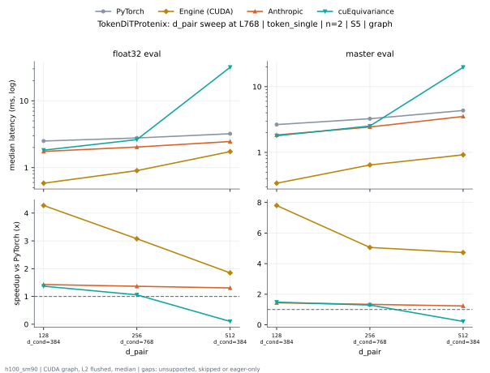

**float32 eval** (median ms; x = speedup vs PyTorch)

| d_pair | PyTorch | Engine (Triton) | Engine (CUDA) | Anthropic | cuEquivariance |
|---|---|---|---|---|---|
| 128 d_cond=384 | 2.508 | 1.837 (1.37x) | 0.5846 (4.29x) | 1.75 (1.43x) | 1.826 (1.37x) |
| 256 d_cond=768 | 2.782 | 2.126 (1.31x) | 0.9065 (3.07x) | 2.033 (1.37x) | 2.625 (1.06x) |
| 512 d_cond=384 | 3.214 | 2.501 (1.29x) | 1.735 (1.85x) | 2.458 (1.31x) | 31.67 (0.10x) |

**master eval** (median ms; x = speedup vs PyTorch)

| d_pair | PyTorch | Engine (Triton) | Engine (CUDA) | Anthropic | cuEquivariance |
|---|---|---|---|---|---|
| 128 d_cond=384 | 2.654 | 1.855 (1.43x) | 0.3392 (7.83x) | 1.838 (1.44x) | 1.791 (1.48x) |
| 256 d_cond=768 | 3.251 | 2.434 (1.34x) | 0.4169 (7.80x) | 2.434 (1.34x) | 2.518 (1.29x) |
| 512 d_cond=384 | 4.334 | 3.516 (1.23x) | 0.4964 (8.73x) | 3.521 (1.23x) | 19.72 (0.22x) |

### d_pair sweep at L768: token_single_shared_cond | n=2 | S5 | graph

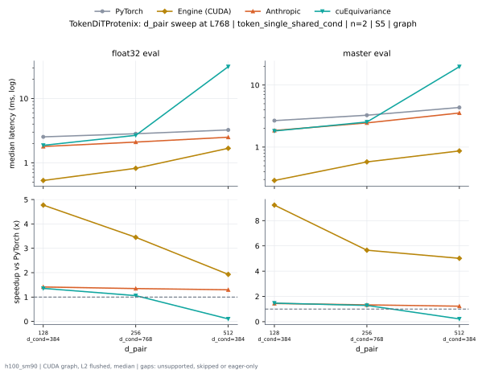

**float32 eval** (median ms; x = speedup vs PyTorch)

| d_pair | PyTorch | Engine (Triton) | Engine (CUDA) | Anthropic | cuEquivariance |
|---|---|---|---|---|---|
| 128 d_cond=384 | 2.535 | 1.876 (1.35x) | 0.53 (4.78x) | 1.791 (1.41x) | 1.867 (1.36x) |
| 256 d_cond=768 | 2.828 | 2.173 (1.30x) | 0.8226 (3.44x) | 2.099 (1.35x) | 2.674 (1.06x) |
| 512 d_cond=384 | 3.243 | 2.543 (1.28x) | 1.681 (1.93x) | 2.499 (1.30x) | 31.27 (0.10x) |

**master eval** (median ms; x = speedup vs PyTorch)

| d_pair | PyTorch | Engine (Triton) | Engine (CUDA) | Anthropic | cuEquivariance |
|---|---|---|---|---|---|
| 128 d_cond=384 | 2.664 | 1.878 (1.42x) | 0.2886 (9.23x) | 1.854 (1.44x) | 1.818 (1.46x) |
| 256 d_cond=768 | 3.272 | 2.451 (1.34x) | 0.352 (9.30x) | 2.456 (1.33x) | 2.537 (1.29x) |
| 512 d_cond=384 | 4.349 | 3.51 (1.24x) | 0.4447 (9.78x) | 3.547 (1.23x) | 19.79 (0.22x) |

### n_head sweep at L768: token_single | n=2 | S1 | graph

**float32 eval** (median ms; x = speedup vs PyTorch)

| n_head | PyTorch | Engine (Triton) | Engine (CUDA) | Anthropic | cuEquivariance |
|---|---|---|---|---|---|
| 12 d_single=768 | 1.369 | 1.265 (1.08x) | 0.3189 (4.29x) | 1.269 (1.08x) | 0.6679 (2.05x) |
| 16 d_single=1024 | 1.516 | 1.366 (1.11x) | 0.3742 (4.05x) | 1.388 (1.09x) | 0.7565 (2.00x) |
| 24 d_single=768 | 1.757 | 1.53 (1.15x) | 0.3297 (5.33x) | 1.564 (1.12x) | 1.157 (1.52x) |

**master eval** (median ms; x = speedup vs PyTorch)

| n_head | PyTorch | Engine (Triton) | Engine (CUDA) | Anthropic | cuEquivariance |
|---|---|---|---|---|---|
| 12 d_single=768 | 1.697 | 1.594 (1.06x) | 0.1893 (8.97x) | 1.582 (1.07x) | 0.7099 (2.39x) |
| 16 d_single=1024 | 1.752 | 1.614 (1.08x) | 0.2167 (8.08x) | 1.596 (1.10x) | 0.7995 (2.19x) |
| 24 d_single=768 | 1.845 | 1.608 (1.15x) | 0.1973 (9.35x) | 1.611 (1.14x) | 1.203 (1.53x) |

**float32 train** (median ms; x = speedup vs PyTorch)

| n_head | PyTorch | Engine (Triton) | Engine (CUDA) | Anthropic | cuEquivariance |
|---|---|---|---|---|---|
| 12 d_single=768 | 3.107 | 2.997 (1.04x) | 1.655 (1.88x) | unsupported | 2.356 (1.32x) |
| 16 d_single=1024 | 3.353 | 3.143 (1.07x) | 1.785 (1.88x) | unsupported | 2.58 (1.30x) |
| 24 d_single=768 | 3.662 | 3.242 (1.13x) | 1.846 (1.98x) | unsupported | 3.113 (1.18x) |

**master train** (median ms; x = speedup vs PyTorch)

| n_head | PyTorch | Engine (Triton) | Engine (CUDA) | Anthropic | cuEquivariance |
|---|---|---|---|---|---|
| 12 d_single=768 | 3.519 | 3.364 (1.05x) | 0.59 (5.96x) | unsupported | 1.607 (2.19x) |
| 16 d_single=1024 | 3.678 | 3.437 (1.07x) | 0.683 (5.38x) | unsupported | 1.807 (2.04x) |
| 24 d_single=768 | 3.766 | 3.427 (1.10x) | 0.6528 (5.77x) | unsupported | 2.59 (1.45x) |

