# TokenDiTProtenix on h100_sm90

Generated by `python -m miniworld_engine.measure.plot` from speed tokens `judge/tokens/h100_sm90/`; do not edit.

### L sweep: token_single | d_cond=384;d_pair=128;d_single=1024;n=2;n_head=16 | S1 | graph

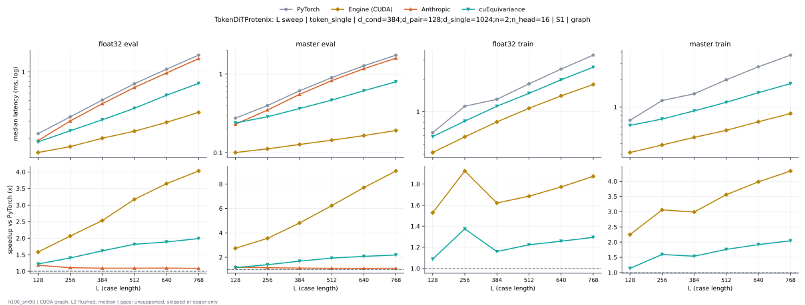

**float32 eval** (median ms; x = speedup vs PyTorch)

| L | PyTorch | Engine (Triton) | Engine (CUDA) | Anthropic | cuEquivariance |
|---|---|---|---|---|---|
| 128 | 0.2229 | 0.206 (1.08x) | 0.1409 (1.58x) | 0.1884 (1.18x) | 0.1826 (1.22x) |
| 256 | 0.3361 | 0.3146 (1.07x) | 0.1626 (2.07x) | 0.3033 (1.11x) | 0.2394 (1.40x) |
| 384 | 0.5061 | 0.4738 (1.07x) | 0.1996 (2.54x) | 0.4625 (1.09x) | 0.3125 (1.62x) |
| 512 | 0.7477 | 0.7 (1.07x) | 0.2366 (3.16x) | 0.6867 (1.09x) | 0.4138 (1.81x) |
| 640 | 1.071 | 0.9765 (1.10x) | 0.2937 (3.65x) | 0.9767 (1.10x) | 0.5682 (1.89x) |
| 768 | 1.509 | 1.375 (1.10x) | 0.3741 (4.03x) | 1.386 (1.09x) | 0.7585 (1.99x) |

**master eval** (median ms; x = speedup vs PyTorch)

| L | PyTorch | Engine (Triton) | Engine (CUDA) | Anthropic | cuEquivariance |
|---|---|---|---|---|---|
| 128 | 0.2751 | 0.2538 (1.08x) | 0.1009 (2.73x) | 0.2307 (1.19x) | 0.2396 (1.15x) |
| 256 | 0.3983 | 0.3726 (1.07x) | 0.1122 (3.55x) | 0.3499 (1.14x) | 0.2872 (1.39x) |
| 384 | 0.6124 | 0.5748 (1.07x) | 0.1277 (4.80x) | 0.5532 (1.11x) | 0.3656 (1.67x) |
| 512 | 0.9008 | 0.8488 (1.06x) | 0.1448 (6.22x) | 0.8273 (1.09x) | 0.4677 (1.93x) |
| 640 | 1.277 | 1.195 (1.07x) | 0.1654 (7.72x) | 1.172 (1.09x) | 0.6156 (2.07x) |
| 768 | 1.75 | 1.627 (1.08x) | 0.1921 (9.11x) | 1.595 (1.10x) | 0.7988 (2.19x) |

**float32 train** (median ms; x = speedup vs PyTorch)

| L | PyTorch | Engine (Triton) | Engine (CUDA) | Anthropic | cuEquivariance |
|---|---|---|---|---|---|
| 128 | 0.6415 | 0.6119 (1.05x) | 0.4189 (1.53x) | unsupported | 0.5885 (1.09x) |
| 256 | 1.117 | 1.085 (1.03x) | 0.5854 (1.91x) | unsupported | 0.8191 (1.36x) |
| 384 | 1.306 | 1.262 (1.04x) | 0.8056 (1.62x) | unsupported | 1.126 (1.16x) |
| 512 | 1.819 | 1.734 (1.05x) | 1.078 (1.69x) | unsupported | 1.484 (1.23x) |
| 640 | 2.493 | 2.356 (1.06x) | 1.405 (1.77x) | unsupported | 1.981 (1.26x) |
| 768 | 3.36 | 3.128 (1.07x) | 1.791 (1.88x) | unsupported | 2.592 (1.30x) |

**master train** (median ms; x = speedup vs PyTorch)

| L | PyTorch | Engine (Triton) | Engine (CUDA) | Anthropic | cuEquivariance |
|---|---|---|---|---|---|
| 128 | 0.7069 | 0.6683 (1.06x) | 0.3183 (2.22x) | unsupported | 0.6292 (1.12x) |
| 256 | 1.172 | 1.119 (1.05x) | 0.3843 (3.05x) | unsupported | 0.7383 (1.59x) |
| 384 | 1.393 | 1.321 (1.06x) | 0.4657 (2.99x) | unsupported | 0.906 (1.54x) |
| 512 | 1.98 | 1.882 (1.05x) | 0.5558 (3.56x) | unsupported | 1.124 (1.76x) |
| 640 | 2.747 | 2.597 (1.06x) | 0.6897 (3.98x) | unsupported | 1.431 (1.92x) |
| 768 | 3.668 | 3.435 (1.07x) | 0.8476 (4.33x) | unsupported | 1.799 (2.04x) |

### L sweep: token_single | d_cond=384;d_pair=128;d_single=768;n=2;n_head=12 | S1 | graph

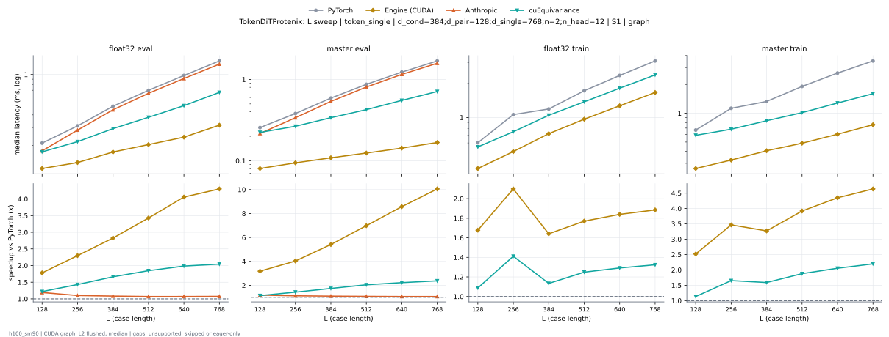

**float32 eval** (median ms; x = speedup vs PyTorch)

| L | PyTorch | Engine (Triton) | Engine (CUDA) | Anthropic | cuEquivariance |
|---|---|---|---|---|---|
| 128 | 0.2111 | 0.1957 (1.08x) | 0.1188 (1.78x) | 0.177 (1.19x) | 0.1728 (1.22x) |
| 256 | 0.3147 | 0.2954 (1.07x) | 0.1358 (2.32x) | 0.2832 (1.11x) | 0.2179 (1.44x) |
| 384 | 0.4878 | 0.4621 (1.06x) | 0.1731 (2.82x) | 0.4493 (1.09x) | 0.2929 (1.67x) |
| 512 | 0.7105 | 0.6717 (1.06x) | 0.2048 (3.47x) | 0.6528 (1.09x) | 0.3786 (1.88x) |
| 640 | 0.979 | 0.9196 (1.06x) | 0.241 (4.06x) | 0.9141 (1.07x) | 0.4933 (1.98x) |
| 768 | 1.363 | 1.277 (1.07x) | 0.3169 (4.30x) | 1.267 (1.08x) | 0.667 (2.04x) |

**master eval** (median ms; x = speedup vs PyTorch)

| L | PyTorch | Engine (Triton) | Engine (CUDA) | Anthropic | cuEquivariance |
|---|---|---|---|---|---|
| 128 | 0.2572 | 0.2369 (1.09x) | 0.08198 (3.14x) | 0.2166 (1.19x) | 0.2234 (1.15x) |
| 256 | 0.3833 | 0.36 (1.06x) | 0.09485 (4.04x) | 0.3384 (1.13x) | 0.2658 (1.44x) |
| 384 | 0.5932 | 0.56 (1.06x) | 0.1091 (5.44x) | 0.5371 (1.10x) | 0.3385 (1.75x) |
| 512 | 0.8723 | 0.8277 (1.05x) | 0.1249 (6.98x) | 0.8063 (1.08x) | 0.4253 (2.05x) |
| 640 | 1.234 | 1.174 (1.05x) | 0.1439 (8.57x) | 1.153 (1.07x) | 0.5525 (2.23x) |
| 768 | 1.69 | 1.606 (1.05x) | 0.1689 (10.01x) | 1.581 (1.07x) | 0.7109 (2.38x) |

**float32 train** (median ms; x = speedup vs PyTorch)

| L | PyTorch | Engine (Triton) | Engine (CUDA) | Anthropic | cuEquivariance |
|---|---|---|---|---|---|
| 128 | 0.6059 | 0.5785 (1.05x) | 0.3595 (1.69x) | unsupported | 0.5543 (1.09x) |
| 256 | 1.067 | 1.043 (1.02x) | 0.5068 (2.10x) | unsupported | 0.7516 (1.42x) |
| 384 | 1.24 | 1.207 (1.03x) | 0.7239 (1.71x) | unsupported | 1.046 (1.18x) |
| 512 | 1.724 | 1.666 (1.04x) | 0.9705 (1.78x) | unsupported | 1.371 (1.26x) |
| 640 | 2.327 | 2.23 (1.04x) | 1.269 (1.83x) | unsupported | 1.802 (1.29x) |
| 768 | 3.099 | 2.976 (1.04x) | 1.656 (1.87x) | unsupported | 2.353 (1.32x) |

**master train** (median ms; x = speedup vs PyTorch)

| L | PyTorch | Engine (Triton) | Engine (CUDA) | Anthropic | cuEquivariance |
|---|---|---|---|---|---|
| 128 | 0.6676 | 0.6287 (1.06x) | 0.2656 (2.51x) | unsupported | 0.5881 (1.14x) |
| 256 | 1.126 | 1.08 (1.04x) | 0.3253 (3.46x) | unsupported | 0.6812 (1.65x) |
| 384 | 1.335 | 1.271 (1.05x) | 0.4064 (3.29x) | unsupported | 0.8352 (1.60x) |
| 512 | 1.91 | 1.828 (1.04x) | 0.4885 (3.91x) | unsupported | 1.015 (1.88x) |
| 640 | 2.629 | 2.523 (1.04x) | 0.6045 (4.35x) | unsupported | 1.278 (2.06x) |
| 768 | 3.521 | 3.374 (1.04x) | 0.7612 (4.63x) | unsupported | 1.6 (2.20x) |

### L sweep: token_single | d_cond=384;d_pair=128;d_single=768;n=2;n_head=24 | S1 | graph

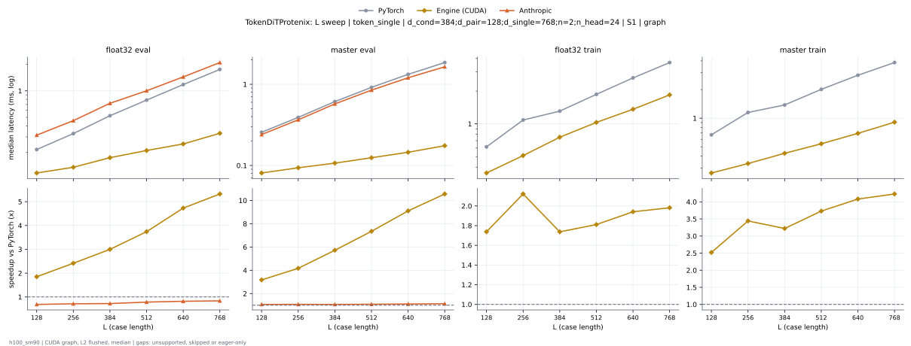

**float32 eval** (median ms; x = speedup vs PyTorch)

| L | PyTorch | Engine (Triton) | Engine (CUDA) | Anthropic | cuEquivariance |
|---|---|---|---|---|---|
| 128 | 0.2153 | 0.1977 (1.09x) | 0.1171 (1.84x) | 0.1784 (1.21x) | 0.1824 (1.18x) |
| 256 | 0.326 | 0.2982 (1.09x) | 0.1348 (2.42x) | 0.2889 (1.13x) | 0.2683 (1.22x) |
| 384 | 0.5212 | 0.4738 (1.10x) | 0.1745 (2.99x) | 0.4637 (1.12x) | 0.4046 (1.29x) |
| 512 | 0.7834 | 0.6968 (1.12x) | 0.2096 (3.74x) | 0.6935 (1.13x) | 0.5815 (1.35x) |
| 640 | 1.178 | 1.029 (1.14x) | 0.2488 (4.73x) | 1.039 (1.13x) | 0.8358 (1.41x) |
| 768 | 1.738 | 1.544 (1.13x) | 0.3288 (5.28x) | 1.562 (1.11x) | 1.157 (1.50x) |

**master eval** (median ms; x = speedup vs PyTorch)

| L | PyTorch | Engine (Triton) | Engine (CUDA) | Anthropic | cuEquivariance |
|---|---|---|---|---|---|
| 128 | 0.2566 | 0.2353 (1.09x) | 0.08062 (3.18x) | 0.2159 (1.19x) | 0.2331 (1.10x) |
| 256 | 0.3911 | 0.3576 (1.09x) | 0.09357 (4.18x) | 0.341 (1.15x) | 0.3157 (1.24x) |
| 384 | 0.6106 | 0.5633 (1.08x) | 0.107 (5.71x) | 0.5503 (1.11x) | 0.4466 (1.37x) |
| 512 | 0.9172 | 0.8371 (1.10x) | 0.1243 (7.38x) | 0.823 (1.11x) | 0.6313 (1.45x) |
| 640 | 1.325 | 1.189 (1.11x) | 0.1453 (9.12x) | 1.182 (1.12x) | 0.8934 (1.48x) |
| 768 | 1.843 | 1.626 (1.13x) | 0.1758 (10.48x) | 1.616 (1.14x) | 1.201 (1.53x) |

**float32 train** (median ms; x = speedup vs PyTorch)

| L | PyTorch | Engine (Triton) | Engine (CUDA) | Anthropic | cuEquivariance |
|---|---|---|---|---|---|
| 128 | 0.6154 | 0.5766 (1.07x) | 0.3536 (1.74x) | unsupported | 0.5699 (1.08x) |
| 256 | 1.087 | 1.031 (1.05x) | 0.5101 (2.13x) | unsupported | 0.8179 (1.33x) |
| 384 | 1.306 | 1.21 (1.08x) | 0.7551 (1.73x) | unsupported | 1.212 (1.08x) |
| 512 | 1.868 | 1.696 (1.10x) | 1.032 (1.81x) | unsupported | 1.683 (1.11x) |
| 640 | 2.642 | 2.336 (1.13x) | 1.361 (1.94x) | unsupported | 2.335 (1.13x) |
| 768 | 3.673 | 3.249 (1.13x) | 1.846 (1.99x) | unsupported | 3.12 (1.18x) |

**master train** (median ms; x = speedup vs PyTorch)

| L | PyTorch | Engine (Triton) | Engine (CUDA) | Anthropic | cuEquivariance |
|---|---|---|---|---|---|
| 128 | 0.6707 | 0.6255 (1.07x) | 0.2657 (2.52x) | unsupported | 0.6158 (1.09x) |
| 256 | 1.146 | 1.082 (1.06x) | 0.3337 (3.43x) | unsupported | 0.8008 (1.43x) |
| 384 | 1.381 | 1.284 (1.08x) | 0.4282 (3.22x) | unsupported | 1.081 (1.28x) |
| 512 | 2.015 | 1.85 (1.09x) | 0.541 (3.72x) | unsupported | 1.456 (1.38x) |
| 640 | 2.827 | 2.565 (1.10x) | 0.6931 (4.08x) | unsupported | 1.977 (1.43x) |
| 768 | 3.846 | 3.445 (1.12x) | 0.9103 (4.23x) | unsupported | 2.587 (1.49x) |

### L sweep: af3|opendde|openfold3|openfold3_preview2|protenix | token_single | d_cond=384;d_pair=128;d_single=768;n=2;n_head=16 | S1 | graph

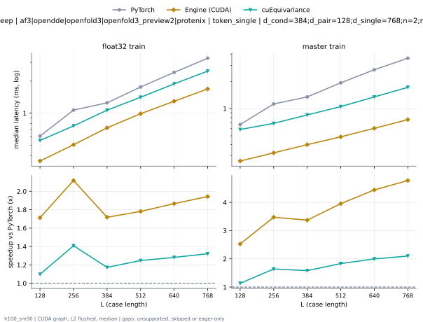

**float32 train** (median ms; x = speedup vs PyTorch)

| L | PyTorch | Engine (Triton) | Engine (CUDA) | Anthropic | cuEquivariance |
|---|---|---|---|---|---|
| 128 | 0.61 | 0.5797 (1.05x) | 0.3555 (1.72x) | unsupported | 0.5544 (1.10x) |
| 256 | 1.066 | 1.037 (1.03x) | 0.5054 (2.11x) | unsupported | 0.7598 (1.40x) |
| 384 | 1.252 | 1.211 (1.03x) | 0.7287 (1.72x) | unsupported | 1.067 (1.17x) |
| 512 | 1.753 | 1.678 (1.04x) | 0.9888 (1.77x) | unsupported | 1.412 (1.24x) |
| 640 | 2.416 | 2.282 (1.06x) | 1.295 (1.87x) | unsupported | 1.886 (1.28x) |
| 768 | 3.291 | 3.068 (1.07x) | 1.69 (1.95x) | unsupported | 2.485 (1.32x) |

**master train** (median ms; x = speedup vs PyTorch)

| L | PyTorch | Engine (Triton) | Engine (CUDA) | Anthropic | cuEquivariance |
|---|---|---|---|---|---|
| 128 | 0.6677 | 0.6282 (1.06x) | 0.2633 (2.54x) | unsupported | 0.5876 (1.14x) |
| 256 | 1.123 | 1.077 (1.04x) | 0.3241 (3.46x) | unsupported | 0.6867 (1.63x) |
| 384 | 1.342 | 1.279 (1.05x) | 0.3993 (3.36x) | unsupported | 0.8509 (1.58x) |
| 512 | 1.929 | 1.83 (1.05x) | 0.4876 (3.96x) | unsupported | 1.052 (1.83x) |
| 640 | 2.69 | 2.535 (1.06x) | 0.6054 (4.44x) | unsupported | 1.347 (2.00x) |
| 768 | 3.606 | 3.375 (1.07x) | 0.7554 (4.77x) | unsupported | 1.718 (2.10x) |

### L sweep: af3|opendde|openfold3|openfold3_preview2|protenix | token_single | d_cond=384;d_pair=128;d_single=768;n=2;n_head=16 | S5 | graph

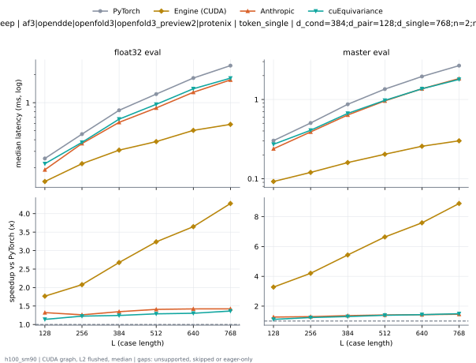

**float32 eval** (median ms; x = speedup vs PyTorch)

| L | PyTorch | Engine (Triton) | Engine (CUDA) | Anthropic | cuEquivariance |
|---|---|---|---|---|---|
| 128 | 0.2528 | 0.2227 (1.14x) | 0.1424 (1.77x) | 0.1904 (1.33x) | 0.221 (1.14x) |
| 256 | 0.4597 | 0.3907 (1.18x) | 0.2212 (2.08x) | 0.3643 (1.26x) | 0.3749 (1.23x) |
| 384 | 0.8299 | 0.6437 (1.29x) | 0.3093 (2.68x) | 0.615 (1.35x) | 0.6656 (1.25x) |
| 512 | 1.232 | 0.9283 (1.33x) | 0.382 (3.23x) | 0.8777 (1.40x) | 0.9598 (1.28x) |
| 640 | 1.843 | 1.354 (1.36x) | 0.5041 (3.65x) | 1.293 (1.42x) | 1.411 (1.31x) |
| 768 | 2.492 | 1.822 (1.37x) | 0.5847 (4.26x) | 1.756 (1.42x) | 1.832 (1.36x) |

**master eval** (median ms; x = speedup vs PyTorch)

| L | PyTorch | Engine (Triton) | Engine (CUDA) | Anthropic | cuEquivariance |
|---|---|---|---|---|---|
| 128 | 0.3034 | 0.2615 (1.16x) | 0.09221 (3.29x) | 0.2385 (1.27x) | 0.2717 (1.12x) |
| 256 | 0.5051 | 0.4104 (1.23x) | 0.12 (4.21x) | 0.3895 (1.30x) | 0.4084 (1.24x) |
| 384 | 0.8732 | 0.6608 (1.32x) | 0.1599 (5.46x) | 0.637 (1.37x) | 0.6668 (1.31x) |
| 512 | 1.347 | 0.9848 (1.37x) | 0.2035 (6.62x) | 0.9595 (1.40x) | 0.9738 (1.38x) |
| 640 | 1.945 | 1.389 (1.40x) | 0.2569 (7.57x) | 1.365 (1.42x) | 1.363 (1.43x) |
| 768 | 2.671 | 1.868 (1.43x) | 0.3008 (8.88x) | 1.833 (1.46x) | 1.791 (1.49x) |

### L sweep: esmfold2 | token_single | d_cond=768;d_pair=256;d_single=768;n=2;n_head=16 | S48 | graph

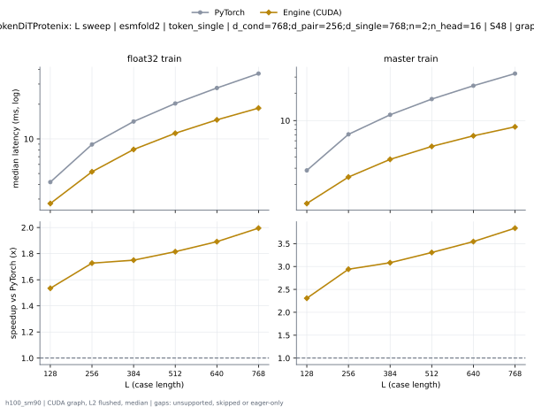

**float32 train** (median ms; x = speedup vs PyTorch)

| L | PyTorch | Engine (Triton) | Engine (CUDA) | Anthropic | cuEquivariance |
|---|---|---|---|---|---|
| 128 | 4.212 | 3.849 (1.09x) | 2.74 (1.54x) | unsupported | 4.478 (0.94x) |
| 256 | 8.964 | 7.817 (1.15x) | 5.199 (1.72x) | unsupported | 9.452 (0.95x) |
| 384 | 14.17 | 11.72 (1.21x) | 8.117 (1.75x) | unsupported | 15.45 (0.92x) |
| 512 | 20.33 | 16.24 (1.25x) | 11.25 (1.81x) | unsupported | 22.52 (0.90x) |
| 640 | 27.71 | 20.23 (1.37x) | 14.63 (1.89x) | unsupported | 30.78 (0.90x) |
| 768 | 36.97 | 25.75 (1.44x) | 18.86 (1.96x) | unsupported | 41.03 (0.90x) |

**master train** (median ms; x = speedup vs PyTorch)

| L | PyTorch | Engine (Triton) | Engine (CUDA) | Anthropic | cuEquivariance |
|---|---|---|---|---|---|
| 128 | 2.834 | 2.384 (1.19x) | 1.231 (2.30x) | unsupported | 3.091 (0.92x) |
| 256 | 7.053 | 5.049 (1.40x) | 2.401 (2.94x) | unsupported | 7.036 (1.00x) |
| 384 | 11.57 | 7.757 (1.49x) | 3.733 (3.10x) | unsupported | 11.96 (0.97x) |
| 512 | 17.21 | 11.37 (1.51x) | 5.162 (3.33x) | unsupported | 18.06 (0.95x) |
| 640 | 24.22 | 14.65 (1.65x) | 6.823 (3.55x) | unsupported | 25.1 (0.96x) |
| 768 | 32.64 | 18.65 (1.75x) | 8.593 (3.80x) | unsupported | 33.83 (0.96x) |

### L sweep: esmfold2 | token_single | d_cond=768;d_pair=256;d_single=768;n=2;n_head=16 | S5 | graph

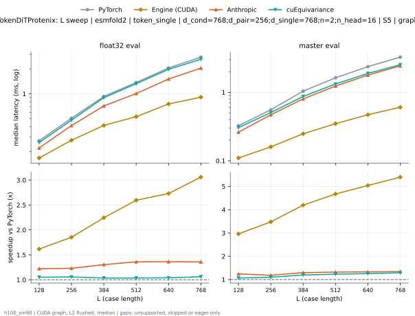

**float32 eval** (median ms; x = speedup vs PyTorch)

| L | PyTorch | Engine (Triton) | Engine (CUDA) | Anthropic | cuEquivariance |
|---|---|---|---|---|---|
| 128 | 0.2691 | 0.2395 (1.12x) | 0.167 (1.61x) | 0.2206 (1.22x) | 0.2563 (1.05x) |
| 256 | 0.5067 | 0.4365 (1.16x) | 0.2752 (1.84x) | 0.4121 (1.23x) | 0.4797 (1.06x) |
| 384 | 0.9274 | 0.7415 (1.25x) | 0.4171 (2.22x) | 0.7126 (1.30x) | 0.8975 (1.03x) |
| 512 | 1.356 | 1.07 (1.27x) | 0.5354 (2.53x) | 1.008 (1.34x) | 1.325 (1.02x) |
| 640 | 2.049 | 1.57 (1.31x) | 0.745 (2.75x) | 1.51 (1.36x) | 1.977 (1.04x) |
| 768 | 2.787 | 2.126 (1.31x) | 0.9131 (3.05x) | 2.051 (1.36x) | 2.624 (1.06x) |

**master eval** (median ms; x = speedup vs PyTorch)

| L | PyTorch | Engine (Triton) | Engine (CUDA) | Anthropic | cuEquivariance |
|---|---|---|---|---|---|
| 128 | 0.3267 | 0.2847 (1.15x) | 0.1104 (2.96x) | 0.2618 (1.25x) | 0.3051 (1.07x) |
| 256 | 0.5837 | 0.4885 (1.19x) | 0.1603 (3.64x) | 0.4696 (1.24x) | 0.5062 (1.15x) |
| 384 | 1.04 | 0.8256 (1.26x) | 0.2499 (4.16x) | 0.8025 (1.30x) | 0.8704 (1.20x) |
| 512 | 1.63 | 1.262 (1.29x) | 0.3485 (4.68x) | 1.235 (1.32x) | 1.323 (1.23x) |
| 640 | 2.375 | 1.812 (1.31x) | 0.474 (5.01x) | 1.783 (1.33x) | 1.889 (1.26x) |
| 768 | 3.272 | 2.468 (1.33x) | 0.6062 (5.40x) | 2.434 (1.34x) | 2.531 (1.29x) |

### L sweep: intellifold2 | token_single | d_cond=384;d_pair=512;d_single=768;n=2;n_head=16 | S1 | graph

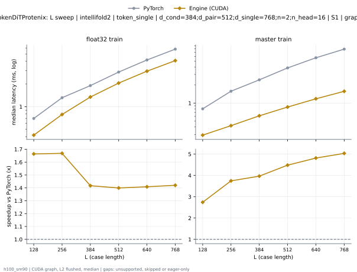

**float32 train** (median ms; x = speedup vs PyTorch)

| L | PyTorch | Engine (Triton) | Engine (CUDA) | Anthropic | cuEquivariance |
|---|---|---|---|---|---|
| 128 | 0.695 | 0.6676 (1.04x) | 0.42 (1.65x) | unsupported | 1.508 (0.46x) |
| 256 | 1.315 | 1.281 (1.03x) | 0.7891 (1.67x) | unsupported | 4.278 (0.31x) |
| 384 | 1.9 | 1.852 (1.03x) | 1.333 (1.43x) | unsupported | 8.874 (0.21x) |
| 512 | 2.885 | 2.804 (1.03x) | 2.054 (1.40x) | unsupported | 15.18 (0.19x) |
| 640 | 4.157 | 4.034 (1.03x) | 2.953 (1.41x) | unsupported | 23.27 (0.18x) |
| 768 | 5.798 | 5.566 (1.04x) | 4.078 (1.42x) | unsupported | 33.21 (0.17x) |

**master train** (median ms; x = speedup vs PyTorch)

| L | PyTorch | Engine (Triton) | Engine (CUDA) | Anthropic | cuEquivariance |
|---|---|---|---|---|---|
| 128 | 0.8039 | 0.7629 (1.05x) | 0.2929 (2.74x) | unsupported | 1.31 (0.61x) |
| 256 | 1.582 | 1.53 (1.03x) | 0.4193 (3.77x) | unsupported | 3.445 (0.46x) |
| 384 | 2.441 | 2.372 (1.03x) | 0.6141 (3.98x) | unsupported | 6.913 (0.35x) |
| 512 | 3.851 | 3.751 (1.03x) | 0.8613 (4.47x) | unsupported | 11.74 (0.33x) |
| 640 | 5.685 | 5.527 (1.03x) | 1.18 (4.82x) | unsupported | 17.85 (0.32x) |
| 768 | 7.918 | 7.685 (1.03x) | 1.566 (5.06x) | unsupported | 25.39 (0.31x) |

### L sweep: intellifold2 | token_single | d_cond=384;d_pair=512;d_single=768;n=2;n_head=16 | S5 | graph

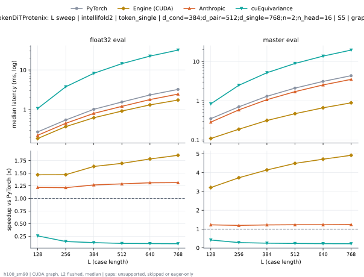

**float32 eval** (median ms; x = speedup vs PyTorch)

| L | PyTorch | Engine (Triton) | Engine (CUDA) | Anthropic | cuEquivariance |
|---|---|---|---|---|---|
| 128 | 0.2727 | 0.2432 (1.12x) | 0.1859 (1.47x) | 0.2239 (1.22x) | 1.063 (0.26x) |
| 256 | 0.5449 | 0.4744 (1.15x) | 0.373 (1.46x) | 0.4494 (1.21x) | 3.76 (0.14x) |
| 384 | 1.014 | 0.8276 (1.23x) | 0.6184 (1.64x) | 0.8005 (1.27x) | 8.224 (0.12x) |
| 512 | 1.556 | 1.254 (1.24x) | 0.9153 (1.70x) | 1.204 (1.29x) | 14.42 (0.11x) |
| 640 | 2.341 | 1.864 (1.26x) | 1.31 (1.79x) | 1.785 (1.31x) | 22.34 (0.10x) |
| 768 | 3.202 | 2.521 (1.27x) | 1.738 (1.84x) | 2.453 (1.31x) | 31.72 (0.10x) |

**master eval** (median ms; x = speedup vs PyTorch)

| L | PyTorch | Engine (Triton) | Engine (CUDA) | Anthropic | cuEquivariance |
|---|---|---|---|---|---|
| 128 | 0.3509 | 0.3092 (1.13x) | 0.1087 (3.23x) | 0.2851 (1.23x) | 0.8343 (0.42x) |
| 256 | 0.7003 | 0.6038 (1.16x) | 0.1876 (3.73x) | 0.5859 (1.20x) | 2.482 (0.28x) |
| 384 | 1.296 | 1.059 (1.22x) | 0.3146 (4.12x) | 1.066 (1.22x) | 5.188 (0.25x) |
| 512 | 2.104 | 1.737 (1.21x) | 0.4684 (4.49x) | 1.708 (1.23x) | 8.946 (0.24x) |
| 640 | 3.116 | 2.561 (1.22x) | 0.6625 (4.70x) | 2.533 (1.23x) | 13.77 (0.23x) |
| 768 | 4.354 | 3.554 (1.23x) | 0.8872 (4.91x) | 3.515 (1.24x) | 19.63 (0.22x) |

### L sweep: protenix_v2 | token_single | d_cond=384;d_pair=256;d_single=768;n=2;n_head=16 | S1 | graph

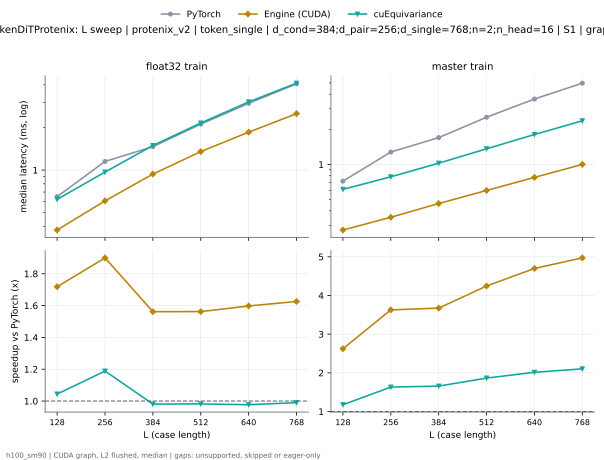

**float32 train** (median ms; x = speedup vs PyTorch)

| L | PyTorch | Engine (Triton) | Engine (CUDA) | Anthropic | cuEquivariance |
|---|---|---|---|---|---|
| 128 | 0.6496 | 0.6203 (1.05x) | 0.3775 (1.72x) | unsupported | 0.6214 (1.05x) |
| 256 | 1.15 | 1.126 (1.02x) | 0.606 (1.90x) | unsupported | 0.9686 (1.19x) |
| 384 | 1.457 | 1.411 (1.03x) | 0.937 (1.55x) | unsupported | 1.492 (0.98x) |
| 512 | 2.108 | 2.029 (1.04x) | 1.351 (1.56x) | unsupported | 2.149 (0.98x) |
| 640 | 2.956 | 2.832 (1.04x) | 1.853 (1.59x) | unsupported | 3.031 (0.98x) |
| 768 | 4.073 | 3.855 (1.06x) | 2.504 (1.63x) | unsupported | 4.112 (0.99x) |

**master train** (median ms; x = speedup vs PyTorch)

| L | PyTorch | Engine (Triton) | Engine (CUDA) | Anthropic | cuEquivariance |
|---|---|---|---|---|---|
| 128 | 0.7193 | 0.68 (1.06x) | 0.2741 (2.62x) | unsupported | 0.6117 (1.18x) |
| 256 | 1.28 | 1.232 (1.04x) | 0.3523 (3.63x) | unsupported | 0.7834 (1.63x) |
| 384 | 1.7 | 1.634 (1.04x) | 0.4625 (3.67x) | unsupported | 1.025 (1.66x) |
| 512 | 2.539 | 2.439 (1.04x) | 0.5984 (4.24x) | unsupported | 1.362 (1.86x) |
| 640 | 3.642 | 3.487 (1.04x) | 0.7747 (4.70x) | unsupported | 1.806 (2.02x) |
| 768 | 4.978 | 4.746 (1.05x) | 1.001 (4.97x) | unsupported | 2.367 (2.10x) |

### L sweep: protenix_v2 | token_single | d_cond=384;d_pair=256;d_single=768;n=2;n_head=16 | S5 | graph

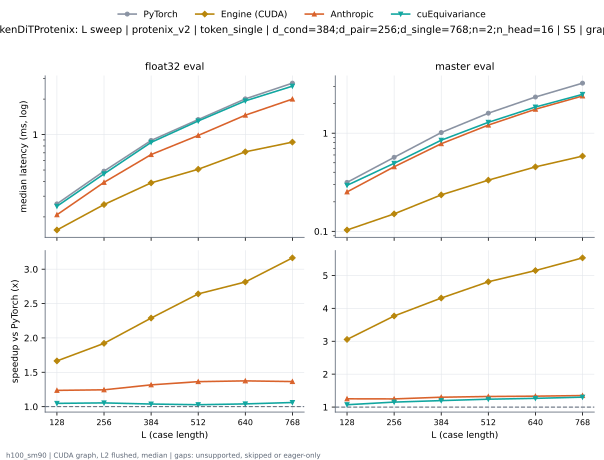

**float32 eval** (median ms; x = speedup vs PyTorch)

| L | PyTorch | Engine (Triton) | Engine (CUDA) | Anthropic | cuEquivariance |
|---|---|---|---|---|---|
| 128 | 0.258 | 0.2286 (1.13x) | 0.1549 (1.67x) | 0.2086 (1.24x) | 0.2463 (1.05x) |
| 256 | 0.4893 | 0.4184 (1.17x) | 0.2548 (1.92x) | 0.393 (1.25x) | 0.464 (1.05x) |
| 384 | 0.8909 | 0.7038 (1.27x) | 0.3892 (2.29x) | 0.6764 (1.32x) | 0.8582 (1.04x) |
| 512 | 1.341 | 1.037 (1.29x) | 0.5077 (2.64x) | 0.9831 (1.36x) | 1.304 (1.03x) |
| 640 | 2.008 | 1.525 (1.32x) | 0.7137 (2.81x) | 1.461 (1.38x) | 1.931 (1.04x) |
| 768 | 2.73 | 2.059 (1.33x) | 0.8628 (3.16x) | 2 (1.37x) | 2.575 (1.06x) |

**master eval** (median ms; x = speedup vs PyTorch)

| L | PyTorch | Engine (Triton) | Engine (CUDA) | Anthropic | cuEquivariance |
|---|---|---|---|---|---|
| 128 | 0.3154 | 0.2736 (1.15x) | 0.1032 (3.06x) | 0.2522 (1.25x) | 0.2944 (1.07x) |
| 256 | 0.5677 | 0.4743 (1.20x) | 0.1507 (3.77x) | 0.4549 (1.25x) | 0.4932 (1.15x) |
| 384 | 1.015 | 0.8015 (1.27x) | 0.2352 (4.31x) | 0.7808 (1.30x) | 0.848 (1.20x) |
| 512 | 1.598 | 1.237 (1.29x) | 0.3324 (4.81x) | 1.209 (1.32x) | 1.29 (1.24x) |
| 640 | 2.336 | 1.779 (1.31x) | 0.4536 (5.15x) | 1.754 (1.33x) | 1.846 (1.26x) |
| 768 | 3.233 | 2.432 (1.33x) | 0.5841 (5.53x) | 2.394 (1.35x) | 2.484 (1.30x) |

### d_pair sweep at L768: token_single | n=2 | S1 | graph

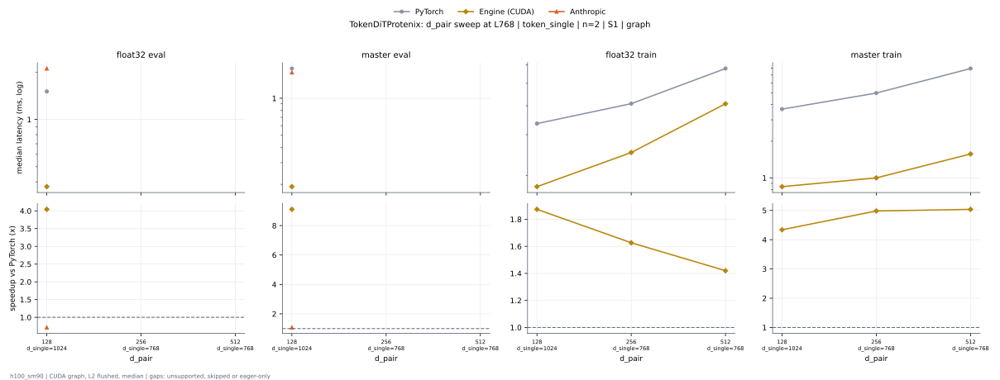

**float32 eval** (median ms; x = speedup vs PyTorch)

| d_pair | PyTorch | Engine (Triton) | Engine (CUDA) | Anthropic | cuEquivariance |
|---|---|---|---|---|---|
| 128 d_single=1024 | 1.509 | 1.375 (1.10x) | 0.3741 (4.03x) | 1.386 (1.09x) | 0.7585 (1.99x) |
| 256 d_single=768 |  |  |  |  |  |
| 512 d_single=768 |  |  |  |  |  |

**master eval** (median ms; x = speedup vs PyTorch)

| d_pair | PyTorch | Engine (Triton) | Engine (CUDA) | Anthropic | cuEquivariance |
|---|---|---|---|---|---|
| 128 d_single=1024 | 1.75 | 1.627 (1.08x) | 0.1921 (9.11x) | 1.595 (1.10x) | 0.7988 (2.19x) |
| 256 d_single=768 |  |  |  |  |  |
| 512 d_single=768 |  |  |  |  |  |

**float32 train** (median ms; x = speedup vs PyTorch)

| d_pair | PyTorch | Engine (Triton) | Engine (CUDA) | Anthropic | cuEquivariance |
|---|---|---|---|---|---|
| 128 d_single=1024 | 3.36 | 3.128 (1.07x) | 1.791 (1.88x) | unsupported | 2.592 (1.30x) |
| 256 d_single=768 | 4.073 | 3.855 (1.06x) | 2.504 (1.63x) | unsupported | 4.112 (0.99x) |
| 512 d_single=768 | 5.798 | 5.566 (1.04x) | 4.078 (1.42x) | unsupported | 33.21 (0.17x) |

**master train** (median ms; x = speedup vs PyTorch)

| d_pair | PyTorch | Engine (Triton) | Engine (CUDA) | Anthropic | cuEquivariance |
|---|---|---|---|---|---|
| 128 d_single=1024 | 3.668 | 3.435 (1.07x) | 0.8476 (4.33x) | unsupported | 1.799 (2.04x) |
| 256 d_single=768 | 4.978 | 4.746 (1.05x) | 1.001 (4.97x) | unsupported | 2.367 (2.10x) |
| 512 d_single=768 | 7.918 | 7.685 (1.03x) | 1.566 (5.06x) | unsupported | 25.39 (0.31x) |

### d_pair sweep at L768: token_single | n=2 | S5 | graph

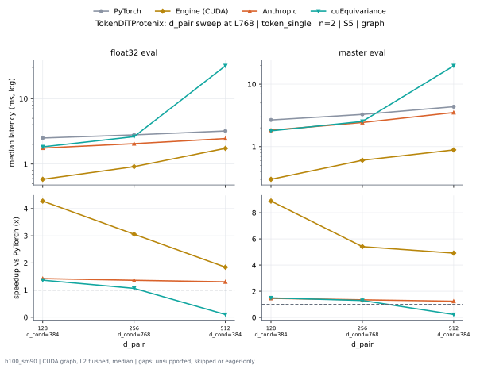

**float32 eval** (median ms; x = speedup vs PyTorch)

| d_pair | PyTorch | Engine (Triton) | Engine (CUDA) | Anthropic | cuEquivariance |
|---|---|---|---|---|---|
| 128 d_cond=384 | 2.492 | 1.822 (1.37x) | 0.5847 (4.26x) | 1.756 (1.42x) | 1.832 (1.36x) |
| 256 d_cond=768 | 2.787 | 2.126 (1.31x) | 0.9131 (3.05x) | 2.051 (1.36x) | 2.624 (1.06x) |
| 512 d_cond=384 | 3.202 | 2.521 (1.27x) | 1.738 (1.84x) | 2.453 (1.31x) | 31.72 (0.10x) |

**master eval** (median ms; x = speedup vs PyTorch)

| d_pair | PyTorch | Engine (Triton) | Engine (CUDA) | Anthropic | cuEquivariance |
|---|---|---|---|---|---|
| 128 d_cond=384 | 2.671 | 1.868 (1.43x) | 0.3008 (8.88x) | 1.833 (1.46x) | 1.791 (1.49x) |
| 256 d_cond=768 | 3.272 | 2.468 (1.33x) | 0.6062 (5.40x) | 2.434 (1.34x) | 2.531 (1.29x) |
| 512 d_cond=384 | 4.354 | 3.554 (1.23x) | 0.8872 (4.91x) | 3.515 (1.24x) | 19.63 (0.22x) |

### n_head sweep at L768: token_single | n=2 | S1 | graph

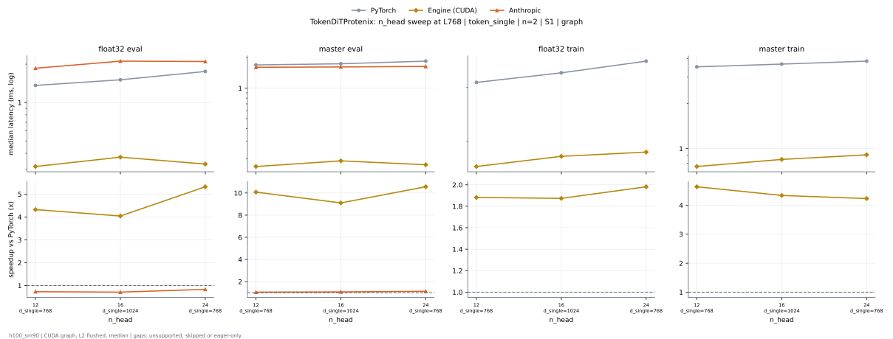

**float32 eval** (median ms; x = speedup vs PyTorch)

| n_head | PyTorch | Engine (Triton) | Engine (CUDA) | Anthropic | cuEquivariance |
|---|---|---|---|---|---|
| 12 d_single=768 | 1.363 | 1.277 (1.07x) | 0.3169 (4.30x) | 1.267 (1.08x) | 0.667 (2.04x) |
| 16 d_single=1024 | 1.509 | 1.375 (1.10x) | 0.3741 (4.03x) | 1.386 (1.09x) | 0.7585 (1.99x) |
| 24 d_single=768 | 1.738 | 1.544 (1.13x) | 0.3288 (5.28x) | 1.562 (1.11x) | 1.157 (1.50x) |

**master eval** (median ms; x = speedup vs PyTorch)

| n_head | PyTorch | Engine (Triton) | Engine (CUDA) | Anthropic | cuEquivariance |
|---|---|---|---|---|---|
| 12 d_single=768 | 1.69 | 1.606 (1.05x) | 0.1689 (10.01x) | 1.581 (1.07x) | 0.7109 (2.38x) |
| 16 d_single=1024 | 1.75 | 1.627 (1.08x) | 0.1921 (9.11x) | 1.595 (1.10x) | 0.7988 (2.19x) |
| 24 d_single=768 | 1.843 | 1.626 (1.13x) | 0.1758 (10.48x) | 1.616 (1.14x) | 1.201 (1.53x) |

**float32 train** (median ms; x = speedup vs PyTorch)

| n_head | PyTorch | Engine (Triton) | Engine (CUDA) | Anthropic | cuEquivariance |
|---|---|---|---|---|---|
| 12 d_single=768 | 3.099 | 2.976 (1.04x) | 1.656 (1.87x) | unsupported | 2.353 (1.32x) |
| 16 d_single=1024 | 3.36 | 3.128 (1.07x) | 1.791 (1.88x) | unsupported | 2.592 (1.30x) |
| 24 d_single=768 | 3.673 | 3.249 (1.13x) | 1.846 (1.99x) | unsupported | 3.12 (1.18x) |

**master train** (median ms; x = speedup vs PyTorch)

| n_head | PyTorch | Engine (Triton) | Engine (CUDA) | Anthropic | cuEquivariance |
|---|---|---|---|---|---|
| 12 d_single=768 | 3.521 | 3.374 (1.04x) | 0.7612 (4.63x) | unsupported | 1.6 (2.20x) |
| 16 d_single=1024 | 3.668 | 3.435 (1.07x) | 0.8476 (4.33x) | unsupported | 1.799 (2.04x) |
| 24 d_single=768 | 3.846 | 3.445 (1.12x) | 0.9103 (4.23x) | unsupported | 2.587 (1.49x) |

