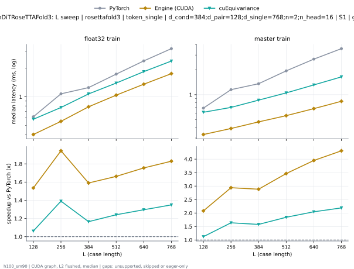
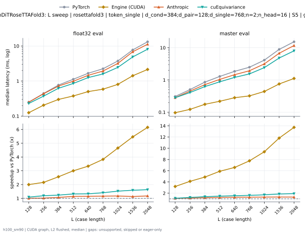

# TokenDiTRoseTTAFold3 on h100_sm90

Generated by `python -m miniworld_engine.measure.plot` from speed tokens `judge/tokens/h100_sm90/`; do not edit.

### L sweep: rosettafold3 | token_single | d_cond=384;d_pair=128;d_single=768;n=2;n_head=16 | S1 | graph

**float32 train** (median ms; x = speedup vs PyTorch)

| L | PyTorch | Engine (Triton) | Engine (CUDA) | Anthropic | cuEquivariance |
|---|---|---|---|---|---|
| 128 | 0.6167 | 0.5967 (1.03x) | 0.4016 (1.54x) | unsupported | 0.5805 (1.06x) |
| 256 | 1.073 | 1.058 (1.01x) | 0.5518 (1.94x) | unsupported | 0.7713 (1.39x) |
| 384 | 1.247 | 1.232 (1.01x) | 0.7842 (1.59x) | unsupported | 1.07 (1.16x) |
| 512 | 1.726 | 1.688 (1.02x) | 1.038 (1.66x) | unsupported | 1.391 (1.24x) |
| 640 | 2.375 | 2.294 (1.04x) | 1.353 (1.76x) | unsupported | 1.832 (1.30x) |
| 768 | 3.194 | 3.072 (1.04x) | 1.746 (1.83x) | unsupported | 2.367 (1.35x) |

**master train** (median ms; x = speedup vs PyTorch)

| L | PyTorch | Engine (Triton) | Engine (CUDA) | Anthropic | cuEquivariance |
|---|---|---|---|---|---|
| 128 | 0.6882 | 0.6579 (1.05x) | 0.3309 (2.08x) | unsupported | 0.6135 (1.12x) |
| 256 | 1.149 | 1.106 (1.04x) | 0.3909 (2.94x) | unsupported | 0.7018 (1.64x) |
| 384 | 1.355 | 1.304 (1.04x) | 0.4698 (2.88x) | unsupported | 0.8592 (1.58x) |
| 512 | 1.935 | 1.853 (1.04x) | 0.5583 (3.47x) | unsupported | 1.05 (1.84x) |
| 640 | 2.68 | 2.553 (1.05x) | 0.6784 (3.95x) | unsupported | 1.31 (2.05x) |
| 768 | 3.587 | 3.415 (1.05x) | 0.8323 (4.31x) | unsupported | 1.638 (2.19x) |

### L sweep: rosettafold3 | token_single | d_cond=384;d_pair=128;d_single=768;n=2;n_head=16 | S5 | graph

**float32 eval** (median ms; x = speedup vs PyTorch)

| L | PyTorch | Engine (Triton) | Engine (CUDA) | Anthropic | cuEquivariance |
|---|---|---|---|---|---|
| 128 | 0.2501 | 0.23 (1.09x) | 0.1251 (2.00x) | 0.2492 (1.00x) | 0.23 (1.09x) |
| 256 | 0.4427 | 0.3999 (1.11x) | 0.2051 (2.16x) | 0.4348 (1.02x) | 0.3719 (1.19x) |
| 384 | 0.7681 | 0.657 (1.17x) | 0.2992 (2.57x) | 0.7193 (1.07x) | 0.6234 (1.23x) |
| 512 | 1.127 | 0.9544 (1.18x) | 0.3758 (3.00x) | 0.9891 (1.14x) | 0.8547 (1.32x) |
| 640 | 1.671 | 1.396 (1.20x) | 0.5009 (3.34x) | 1.457 (1.15x) | 1.258 (1.33x) |
| 768 | 2.246 | 1.871 (1.20x) | 0.5865 (3.83x) | 1.934 (1.16x) | 1.597 (1.41x) |
| 1024 | 3.747 | 3.131 (1.20x) | 0.8058 (4.65x) | 3.198 (1.17x) | 2.462 (1.52x) |
| 1536 | 7.748 | 6.532 (1.19x) | 1.418 (5.46x) | 6.851 (1.13x) | 4.881 (1.59x) |
| 2048 | 13.2 | 10.89 (1.21x) | 2.145 (6.15x) | 11.23 (1.18x) | 8.108 (1.63x) |

**master eval** (median ms; x = speedup vs PyTorch)

| L | PyTorch | Engine (Triton) | Engine (CUDA) | Anthropic | cuEquivariance |
|---|---|---|---|---|---|
| 128 | 0.3079 | 0.2765 (1.11x) | 0.09642 (3.19x) | 0.2827 (1.09x) | 0.2812 (1.09x) |
| 256 | 0.5032 | 0.4287 (1.17x) | 0.1224 (4.11x) | 0.4503 (1.12x) | 0.4075 (1.24x) |
| 384 | 0.8569 | 0.6908 (1.24x) | 0.1759 (4.87x) | 0.7163 (1.20x) | 0.6238 (1.37x) |
| 512 | 1.288 | 1.02 (1.26x) | 0.2182 (5.90x) | 1.042 (1.24x) | 0.877 (1.47x) |
| 640 | 1.851 | 1.439 (1.29x) | 0.2812 (6.58x) | 1.457 (1.27x) | 1.2 (1.54x) |
| 768 | 2.487 | 1.908 (1.30x) | 0.3204 (7.76x) | 1.932 (1.29x) | 1.543 (1.61x) |
| 1024 | 4.123 | 3.118 (1.32x) | 0.4397 (9.38x) | 3.152 (1.31x) | 2.416 (1.71x) |
| 1536 | 8.88 | 6.729 (1.32x) | 0.7514 (11.82x) | 6.742 (1.32x) | 4.794 (1.85x) |
| 2048 | 15.3 | 11.55 (1.32x) | 1.114 (13.73x) | 11.7 (1.31x) | 8.006 (1.91x) |

### L sweep: rosettafold3 | token_single_shared_cond | d_cond=384;d_pair=128;d_single=768;n=2;n_head=16 | S5 | graph

**float32 eval** (median ms; x = speedup vs PyTorch)

| L | PyTorch | Engine (Triton) | Engine (CUDA) | Anthropic | cuEquivariance |
|---|---|---|---|---|---|
| 128 | 0.2673 | 0.2473 (1.08x) | 0.1211 (2.21x) | 0.2659 (1.01x) | 0.2473 (1.08x) |
| 256 | 0.4611 | 0.4158 (1.11x) | 0.1872 (2.46x) | 0.4531 (1.02x) | 0.3905 (1.18x) |
| 384 | 0.796 | 0.6827 (1.17x) | 0.2674 (2.98x) | 0.7423 (1.07x) | 0.6467 (1.23x) |
| 512 | 1.153 | 0.9922 (1.16x) | 0.3323 (3.47x) | 1.019 (1.13x) | 0.885 (1.30x) |
| 640 | 1.702 | 1.43 (1.19x) | 0.4419 (3.85x) | 1.479 (1.15x) | 1.288 (1.32x) |
| 768 | 2.284 | 1.906 (1.20x) | 0.5277 (4.33x) | 1.957 (1.17x) | 1.632 (1.40x) |
| 1024 | 3.774 | 3.157 (1.20x) | 0.7324 (5.15x) | 3.227 (1.17x) | 2.501 (1.51x) |
| 1536 | 7.819 | 6.599 (1.18x) | 1.326 (5.90x) | 6.904 (1.13x) | 4.945 (1.58x) |
| 2048 | 13.29 | 10.97 (1.21x) | 2.029 (6.55x) | 11.31 (1.17x) | 8.186 (1.62x) |

**master eval** (median ms; x = speedup vs PyTorch)

| L | PyTorch | Engine (Triton) | Engine (CUDA) | Anthropic | cuEquivariance |
|---|---|---|---|---|---|
| 128 | 0.3182 | 0.2862 (1.11x) | 0.09069 (3.51x) | 0.2908 (1.09x) | 0.2921 (1.09x) |
| 256 | 0.5144 | 0.4428 (1.16x) | 0.1115 (4.61x) | 0.4612 (1.12x) | 0.4201 (1.22x) |
| 384 | 0.8697 | 0.6997 (1.24x) | 0.1529 (5.69x) | 0.7273 (1.20x) | 0.6327 (1.37x) |
| 512 | 1.306 | 1.031 (1.27x) | 0.184 (7.10x) | 1.056 (1.24x) | 0.8928 (1.46x) |
| 640 | 1.866 | 1.448 (1.29x) | 0.2397 (7.79x) | 1.47 (1.27x) | 1.217 (1.53x) |
| 768 | 2.504 | 1.926 (1.30x) | 0.2688 (9.32x) | 1.954 (1.28x) | 1.566 (1.60x) |
| 1024 | 4.145 | 3.152 (1.32x) | 0.3753 (11.04x) | 3.172 (1.31x) | 2.452 (1.69x) |
| 1536 | 8.911 | 6.761 (1.32x) | 0.6674 (13.35x) | 6.762 (1.32x) | 4.823 (1.85x) |
| 2048 | 15.32 | 11.58 (1.32x) | 1.015 (15.10x) | 11.73 (1.31x) | 8.023 (1.91x) |

