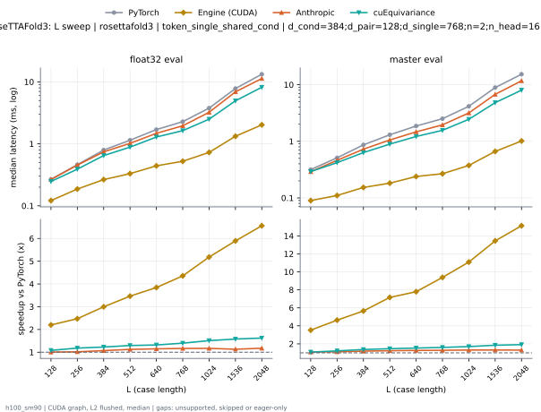

# TokenDiTRoseTTAFold3 on h100_sm90

Generated by `python -m miniworld_engine.measure.plot` from speed tokens `judge/tokens/h100_sm90/`; do not edit.

### L sweep: rosettafold3 | token_single | d_cond=384;d_pair=128;d_single=768;n=2;n_head=16 | S1 | graph

**float32 train** (median ms; x = speedup vs PyTorch)

| L | PyTorch | Engine (Triton) | Engine (CUDA) | Anthropic | cuEquivariance |
|---|---|---|---|---|---|
| 128 | 0.6184 | 0.5967 (1.04x) | 0.4018 (1.54x) | unsupported | 0.5805 (1.07x) |
| 256 | 1.065 | 1.058 (1.01x) | 0.5512 (1.93x) | unsupported | 0.7713 (1.38x) |
| 384 | 1.249 | 1.232 (1.01x) | 0.7832 (1.59x) | unsupported | 1.07 (1.17x) |
| 512 | 1.735 | 1.688 (1.03x) | 1.038 (1.67x) | unsupported | 1.391 (1.25x) |
| 640 | 2.369 | 2.294 (1.03x) | 1.351 (1.75x) | unsupported | 1.832 (1.29x) |
| 768 | 3.189 | 3.072 (1.04x) | 1.749 (1.82x) | unsupported | 2.367 (1.35x) |

**master train** (median ms; x = speedup vs PyTorch)

| L | PyTorch | Engine (Triton) | Engine (CUDA) | Anthropic | cuEquivariance |
|---|---|---|---|---|---|
| 128 | 0.6853 | 0.6579 (1.04x) | 0.3212 (2.13x) | unsupported | 0.6135 (1.12x) |
| 256 | 1.144 | 1.106 (1.03x) | 0.3663 (3.12x) | unsupported | 0.7018 (1.63x) |
| 384 | 1.352 | 1.304 (1.04x) | 0.4268 (3.17x) | unsupported | 0.8592 (1.57x) |
| 512 | 1.931 | 1.853 (1.04x) | 0.486 (3.97x) | unsupported | 1.05 (1.84x) |
| 640 | 2.685 | 2.553 (1.05x) | 0.5644 (4.76x) | unsupported | 1.31 (2.05x) |
| 768 | 3.592 | 3.415 (1.05x) | 0.6629 (5.42x) | unsupported | 1.638 (2.19x) |

### L sweep: rosettafold3 | token_single | d_cond=384;d_pair=128;d_single=768;n=2;n_head=16 | S5 | graph

**float32 eval** (median ms; x = speedup vs PyTorch)

| L | PyTorch | Engine (Triton) | Engine (CUDA) | Anthropic | cuEquivariance |
|---|---|---|---|---|---|
| 128 | 0.2499 | 0.23 (1.09x) | 0.1247 (2.00x) | 0.2492 (1.00x) | 0.23 (1.09x) |
| 256 | 0.442 | 0.3999 (1.11x) | 0.2042 (2.16x) | 0.4348 (1.02x) | 0.3719 (1.19x) |
| 384 | 0.7662 | 0.657 (1.17x) | 0.2982 (2.57x) | 0.7193 (1.07x) | 0.6234 (1.23x) |
| 512 | 1.123 | 0.9544 (1.18x) | 0.3729 (3.01x) | 0.9891 (1.14x) | 0.8547 (1.31x) |
| 640 | 1.659 | 1.396 (1.19x) | 0.4979 (3.33x) | 1.457 (1.14x) | 1.258 (1.32x) |
| 768 | 2.237 | 1.871 (1.20x) | 0.5843 (3.83x) | 1.934 (1.16x) | 1.597 (1.40x) |
| 1024 | 3.737 | 3.131 (1.19x) | 0.8012 (4.66x) | 3.198 (1.17x) | 2.462 (1.52x) |
| 1536 | 7.722 | 6.532 (1.18x) | 1.412 (5.47x) | 6.851 (1.13x) | 4.881 (1.58x) |
| 2048 | 13.2 | 10.89 (1.21x) | 2.141 (6.17x) | 11.23 (1.18x) | 8.108 (1.63x) |

**master eval** (median ms; x = speedup vs PyTorch)

| L | PyTorch | Engine (Triton) | Engine (CUDA) | Anthropic | cuEquivariance |
|---|---|---|---|---|---|
| 128 | 0.308 | 0.2765 (1.11x) | 0.09632 (3.20x) | 0.2827 (1.09x) | 0.2812 (1.10x) |
| 256 | 0.5015 | 0.4287 (1.17x) | 0.1224 (4.10x) | 0.4503 (1.11x) | 0.4075 (1.23x) |
| 384 | 0.8527 | 0.6908 (1.23x) | 0.1753 (4.86x) | 0.7163 (1.19x) | 0.6238 (1.37x) |
| 512 | 1.289 | 1.02 (1.26x) | 0.2172 (5.93x) | 1.042 (1.24x) | 0.877 (1.47x) |
| 640 | 1.85 | 1.439 (1.29x) | 0.2814 (6.57x) | 1.457 (1.27x) | 1.2 (1.54x) |
| 768 | 2.487 | 1.908 (1.30x) | 0.3202 (7.77x) | 1.932 (1.29x) | 1.543 (1.61x) |
| 1024 | 4.124 | 3.118 (1.32x) | 0.4398 (9.38x) | 3.152 (1.31x) | 2.416 (1.71x) |
| 1536 | 8.875 | 6.729 (1.32x) | 0.7464 (11.89x) | 6.742 (1.32x) | 4.794 (1.85x) |
| 2048 | 15.31 | 11.55 (1.33x) | 1.115 (13.73x) | 11.7 (1.31x) | 8.006 (1.91x) |

### L sweep: rosettafold3 | token_single_shared_cond | d_cond=384;d_pair=128;d_single=768;n=2;n_head=16 | S5 | graph

**float32 eval** (median ms; x = speedup vs PyTorch)

| L | PyTorch | Engine (Triton) | Engine (CUDA) | Anthropic | cuEquivariance |
|---|---|---|---|---|---|
| 128 | 0.2672 | 0.2473 (1.08x) | 0.1215 (2.20x) | 0.2659 (1.00x) | 0.2473 (1.08x) |
| 256 | 0.4609 | 0.4158 (1.11x) | 0.1864 (2.47x) | 0.4531 (1.02x) | 0.3905 (1.18x) |
| 384 | 0.7938 | 0.6827 (1.16x) | 0.2649 (3.00x) | 0.7423 (1.07x) | 0.6467 (1.23x) |
| 512 | 1.145 | 0.9922 (1.15x) | 0.3306 (3.46x) | 1.019 (1.12x) | 0.885 (1.29x) |
| 640 | 1.698 | 1.43 (1.19x) | 0.4418 (3.84x) | 1.479 (1.15x) | 1.288 (1.32x) |
| 768 | 2.279 | 1.906 (1.20x) | 0.5233 (4.36x) | 1.957 (1.17x) | 1.632 (1.40x) |
| 1024 | 3.772 | 3.157 (1.20x) | 0.7279 (5.18x) | 3.227 (1.17x) | 2.501 (1.51x) |
| 1536 | 7.806 | 6.599 (1.18x) | 1.325 (5.89x) | 6.904 (1.13x) | 4.945 (1.58x) |
| 2048 | 13.28 | 10.97 (1.21x) | 2.025 (6.56x) | 11.31 (1.17x) | 8.186 (1.62x) |

**master eval** (median ms; x = speedup vs PyTorch)

| L | PyTorch | Engine (Triton) | Engine (CUDA) | Anthropic | cuEquivariance |
|---|---|---|---|---|---|
| 128 | 0.3164 | 0.2862 (1.11x) | 0.08982 (3.52x) | 0.2908 (1.09x) | 0.2921 (1.08x) |
| 256 | 0.5115 | 0.4428 (1.16x) | 0.1104 (4.63x) | 0.4612 (1.11x) | 0.4201 (1.22x) |
| 384 | 0.866 | 0.6997 (1.24x) | 0.1531 (5.66x) | 0.7273 (1.19x) | 0.6327 (1.37x) |
| 512 | 1.305 | 1.031 (1.27x) | 0.1823 (7.16x) | 1.056 (1.24x) | 0.8928 (1.46x) |
| 640 | 1.863 | 1.448 (1.29x) | 0.2392 (7.79x) | 1.47 (1.27x) | 1.217 (1.53x) |
| 768 | 2.512 | 1.926 (1.30x) | 0.2676 (9.38x) | 1.954 (1.29x) | 1.566 (1.60x) |
| 1024 | 4.158 | 3.152 (1.32x) | 0.375 (11.09x) | 3.172 (1.31x) | 2.452 (1.70x) |
| 1536 | 8.906 | 6.761 (1.32x) | 0.6626 (13.44x) | 6.762 (1.32x) | 4.823 (1.85x) |
| 2048 | 15.34 | 11.58 (1.32x) | 1.014 (15.12x) | 11.73 (1.31x) | 8.023 (1.91x) |

