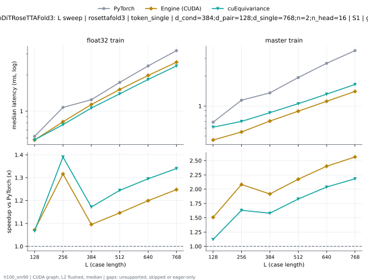
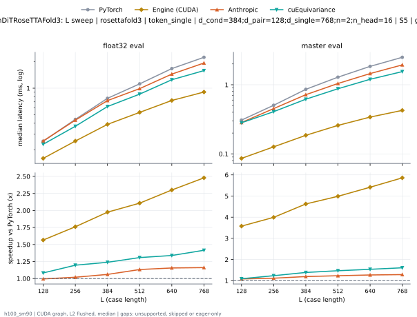

# TokenDiTRoseTTAFold3 on h100_sm90

Generated by `python -m miniworld_engine.measure.plot` from speed tokens `judge/tokens/h100_sm90/`; do not edit.

### L sweep: rosettafold3 | token_single | d_cond=384;d_pair=128;d_single=768;n=2;n_head=16 | S1 | graph

**float32 train** (median ms; x = speedup vs PyTorch)

| L | PyTorch | Engine (Triton) | Engine (CUDA) | Anthropic |
|---|---|---|---|---|
| 128 | 0.6168 | 0.8238 (0.75x) | 0.7747 (0.80x) | unsupported |
| 256 | 1.067 | 1.411 (0.76x) | 1.148 (0.93x) | unsupported |
| 384 | 1.244 | 1.74 (0.72x) | 1.587 (0.78x) | unsupported |
| 512 | 1.729 | 2.351 (0.74x) | 2.08 (0.83x) | unsupported |
| 640 | 2.366 | 3.132 (0.76x) | 2.72 (0.87x) | unsupported |
| 768 | 3.195 | 4.186 (0.76x) | 3.479 (0.92x) | unsupported |

**master train** (median ms; x = speedup vs PyTorch)

| L | PyTorch | Engine (Triton) | Engine (CUDA) | Anthropic |
|---|---|---|---|---|
| 128 | 0.6858 | 0.6658 (1.03x) | 0.4576 (1.50x) | unsupported |
| 256 | 1.138 | 1.125 (1.01x) | 0.5503 (2.07x) | unsupported |
| 384 | 1.355 | 1.335 (1.02x) | 0.708 (1.91x) | unsupported |
| 512 | 1.933 | 1.903 (1.02x) | 0.8883 (2.18x) | unsupported |
| 640 | 2.682 | 2.63 (1.02x) | 1.116 (2.40x) | unsupported |
| 768 | 3.589 | 3.499 (1.03x) | 1.4 (2.56x) | unsupported |

### L sweep: rosettafold3 | token_single | d_cond=384;d_pair=128;d_single=768;n=2;n_head=16 | S5 | graph

**float32 eval** (median ms; x = speedup vs PyTorch)

| L | PyTorch | Engine (Triton) | Engine (CUDA) | Anthropic |
|---|---|---|---|---|
| 128 | 0.2501 | 0.5073 (0.49x) | 0.8701 (0.29x) | 0.5821 (0.43x) |
| 256 | 0.4428 | 0.8568 (0.52x) | 1.221 (0.36x) | 1.002 (0.44x) |
| 384 | 0.7681 | 1.425 (0.54x) | 1.562 (0.49x) | 1.739 (0.44x) |
| 512 | 1.12 | 1.742 (0.64x) | 1.911 (0.59x) | 2.161 (0.52x) |
| 640 | 1.667 | 2.588 (0.64x) | 2.233 (0.75x) | 3.355 (0.50x) |
| 768 | 2.239 | 3.355 (0.67x) | 2.824 (0.79x) | 4.297 (0.52x) |

**master eval** (median ms; x = speedup vs PyTorch)

| L | PyTorch | Engine (Triton) | Engine (CUDA) | Anthropic |
|---|---|---|---|---|
| 128 | 0.308 | 0.2768 (1.11x) | 0.34 (0.91x) | 0.2963 (1.04x) |
| 256 | 0.5026 | 0.4305 (1.17x) | 0.3877 (1.30x) | 0.4617 (1.09x) |
| 384 | 0.8541 | 0.6831 (1.25x) | 0.4459 (1.92x) | 0.7272 (1.17x) |
| 512 | 1.294 | 1.016 (1.27x) | 0.5071 (2.55x) | 1.06 (1.22x) |
| 640 | 1.85 | 1.435 (1.29x) | 0.5824 (3.18x) | 1.474 (1.26x) |
| 768 | 2.489 | 1.897 (1.31x) | 0.6735 (3.70x) | 1.958 (1.27x) |

