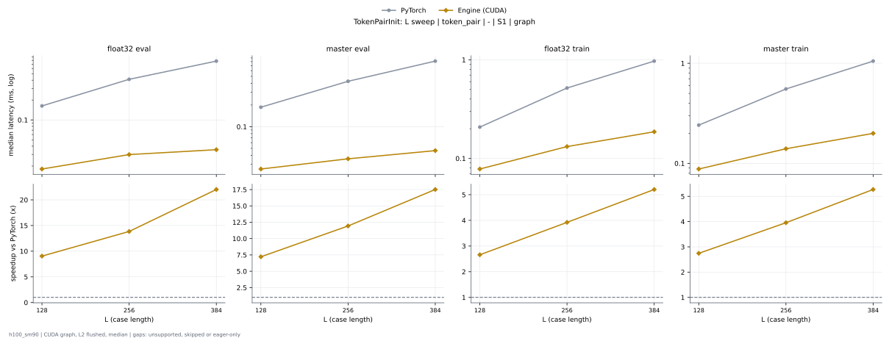

# TokenPairInit on h100_sm90

Generated by `python -m miniworld_engine.measure.plot` from speed tokens `judge/tokens/h100_sm90/`; do not edit.

### L sweep: token_pair | - | S1 | graph

**float32 eval** (median ms; x = speedup vs PyTorch)

| L | PyTorch | Engine (Triton) | Engine (CUDA) |
|---|---|---|---|
| 128 | 0.163 | 0.02258 (7.22x) | 0.01803 (9.04x) |
| 256 | 0.4136 | 0.03262 (12.68x) | 0.02994 (13.82x) |
| 384 | 0.7808 | 0.04786 (16.32x) | 0.0357 (21.87x) |

**master eval** (median ms; x = speedup vs PyTorch)

| L | PyTorch | Engine (Triton) | Engine (CUDA) |
|---|---|---|---|
| 128 | 0.1868 | 0.02923 (6.39x) | 0.02589 (7.21x) |
| 256 | 0.427 | 0.03898 (10.96x) | 0.036 (11.86x) |
| 384 | 0.8152 | 0.05542 (14.71x) | 0.04648 (17.54x) |

**float32 train** (median ms; x = speedup vs PyTorch)

| L | PyTorch | Engine (Triton) | Engine (CUDA) |
|---|---|---|---|
| 128 | 0.2084 | 0.08448 (2.47x) | 0.07845 (2.66x) |
| 256 | 0.5181 | 0.2087 (2.48x) | 0.1321 (3.92x) |
| 384 | 0.9704 | 0.3376 (2.87x) | 0.1863 (5.21x) |

**master train** (median ms; x = speedup vs PyTorch)

| L | PyTorch | Engine (Triton) | Engine (CUDA) |
|---|---|---|---|
| 128 | 0.2416 | 0.09403 (2.57x) | 0.0879 (2.75x) |
| 256 | 0.5546 | 0.2192 (2.53x) | 0.1401 (3.96x) |
| 384 | 1.052 | 0.3482 (3.02x) | 0.1998 (5.27x) |

